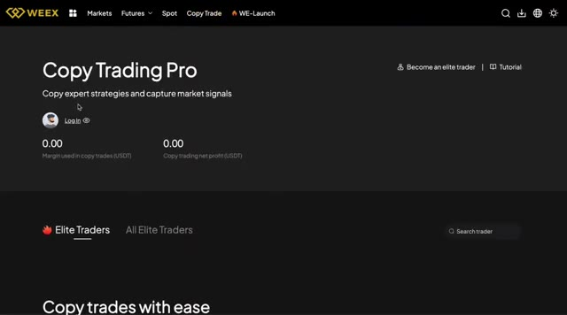
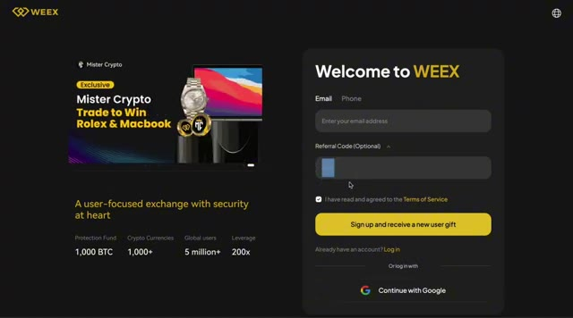
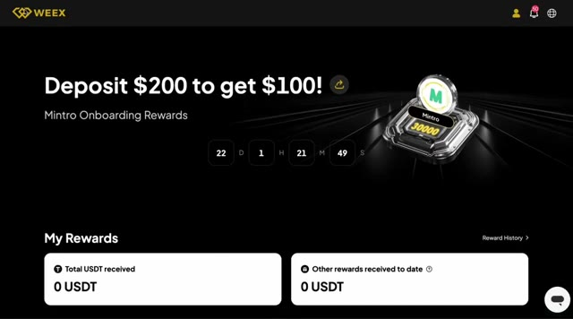
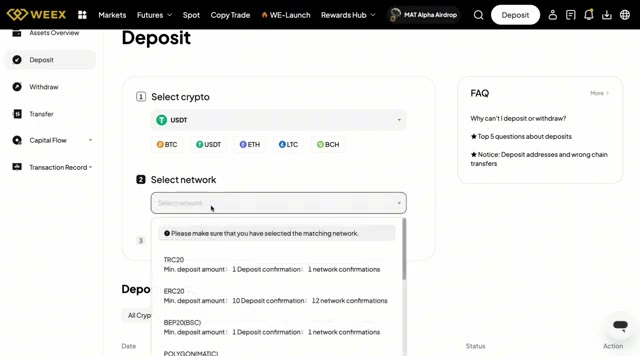
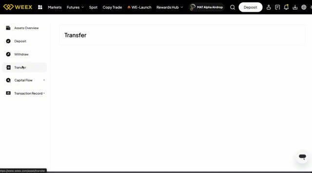
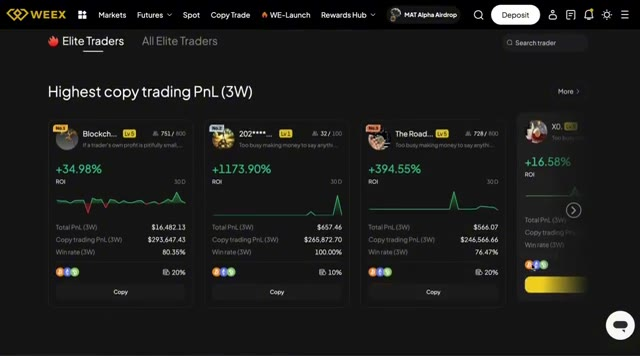
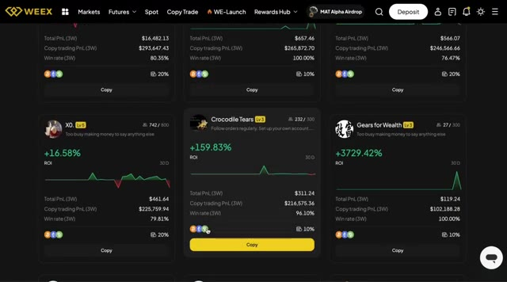
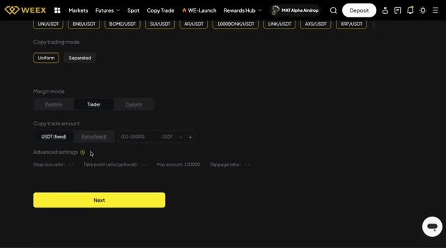
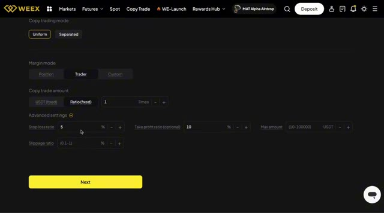
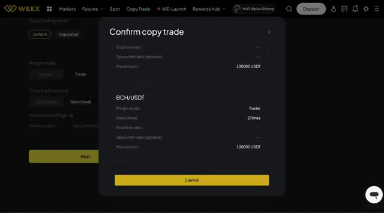

# 🎬 Earn $100 a Day With WEEX Copytrading (2025 Tutorial)

> **Chaîne** : [Alex Carter](https://www.youtube.com/@AlexCarterTrading)  
> **Lien YouTube** : [https://www.youtube.com/watch?v=OHQZk8mX0gI](https://www.youtube.com/watch?v=OHQZk8mX0gI)  
> **Date de publication** : 20250622  
> **Durée** : 00:07:54  
> **Identifiant vidéo** : `OHQZk8mX0gI`  
> **Transcription & Analyse** : `whisper-v3-large-turbo+gemini-3.5-flash-lite`  

---

## 📌 Synthèse Exécutive & Outils

### 💡 Résumé
Dans cette vidéo intitulée **Gagner 100 $ par jour avec le copytrading WEEX (Tutoriel 2025)**, Alex Carter détaille une approche stratégique et pratique du trading et de l'automatisation par agents IA.

### 🛠️ Outils, Modèles & Logiciels Présentés
- **TradingView & Claude Code** : Analyse technique avancée et automatisation algorithmique.

### 🔑 Points Clés & Enseignements Stratégiques
- Respect rigoureux du ratio risque/rendement et du money management.
- Automatisation méthodique des déclencheurs d'ordres via des agents intelligents.

---

## ⏱️ Chronologie & Transcription Complète Audio & Visuelle (Mot pour Mot)

### ⏱️ `[00:00:00 - 00:00:34]` | Segment #01

**🔊 Audio (Transcription Intégrale Mot pour Mot en Français) :**
> Dans cette vidéo, je vais vous montrer exactement comment vous pouvez gagner de l'argent grâce au copy trading sur Weeks, et oui, c'est beaucoup plus simple que vous ne le pensez. Weeks dispose d'une fonction de copy trading intégrée directement dans la plateforme d'échange. Donc, que vous soyez un débutant complet ou quelqu'un qui n'a tout simplement pas le temps de trader activement, c'est l'un des moyens les plus simples de suivre des traders rentables et potentiellement de faire croître votre compte de manière passive. Mais d'abord, et c'est important, assurez-vous de cliquer sur le lien dans la description de la vidéo ou dans le commentaire épinglé. Ce lien vous donne accès à un bonus exclusif pouvant aller jusqu'à 30 000 $ en récompenses de trading. Après avoir cliqué, vous arriverez sur une page

**👁️ Analyse Visuelle d'Écran (gemini-3.5-flash-lite) :**
**Interface & Outils** : Plateforme d'échange crypto WEEX (interface web, sections Copy Trade et Inscription).

**Contenu textuel & Code** : Interface Copy Trading Pro, indicateurs de marge et profits nets (0.00 USDT), formulaire d'inscription WEEX, champ Referral Code.

**Action / Démonstration** : Présentation de la fonctionnalité de copy trading intégrée sur l'échange WEEX et démonstration du processus d'inscription.

*⏱️ 00:00:09 — Interface de la section Copy Trading Pro sur l'échange WEEX avec aperçu du solde et menu Elite Traders.*

*⏱️ 00:00:26 — Page d'inscription de la plateforme WEEX avec formulaires de création de compte et saisie du code de parrainage.*

---

### ⏱️ `[00:00:34 - 00:01:00]` | Segment #02

**🔊 Audio (Transcription Intégrale Mot pour Mot en Français) :**
> avec quelques tâches simples qui débloquent le bonus, comme s'inscrire, faire un dépôt et passer quelques trades. C'est de l'argent gratuit si vous prévoyez de toute façon d'essayer la plateforme. Très bien, maintenant commençons étape par étape. Étape un, dépôt et alimentation de votre portefeuille futures. Une fois que vous avez créé votre compte Weeks, la première chose que vous devez faire est de déposer des fonds sur la plateforme. De là, cliquez sur le bouton de dépôt. On vous demandera quelle crypto-monnaie vous souhaitez déposer.

**👁️ Analyse Visuelle d'Écran (gemini-3.5-flash-lite) :**
**Interface & Outils** : Échange de cryptomonnaies WEEX (interface web)

**Contenu textuel & Code** : Offres de bienvenue et récompenses : « Deposit $200 to get $100! », cagnotte de 60 000 USDT (« MAT x WEEX Alpha Airdrop »), bonus de bienvenue jusqu'à 30 000 USDT.

**Action / Démonstration** : Navigation dans la section des récompenses (Rewards Hub) de WEEX puis préparation du premier dépôt sur le compte.

*⏱️ 00:00:41 — Menu déroulant « Rewards Hub » sur la plateforme WEEX affichant les événements Spot et Futures (bonus de 30 000 USDT, airdrops).*

*⏱️ 00:00:47 — Page « Rewards » de WEEX présentant l'offre promotionnelle « Deposit $200 to get $100! » et le tableau de bord des récompenses.*

*⏱️ 00:00:54 — Page d'accueil de WEEX affichant la bannière « MAT x WEEX Alpha Airdrop » avec le curseur orienté vers le bouton « Deposit ».*

---

### ⏱️ `[00:01:01 - 00:01:29]` | Segment #03

**🔊 Audio (Transcription Intégrale Mot pour Mot en Français) :**
> Je recommande l'USDT car la plupart des paires futures sont basées dessus. Ensuite, sélectionnez le réseau blockchain depuis lequel vous envoyez. C'est très important. Assurez-vous de faire correspondre le réseau avec celui que vous utilisez dans votre portefeuille externe ou votre plateforme d'échange. Ainsi, par exemple, si vous envoyez de l'USDT via Tron, choisissez TRC20. Une fois sélectionné, Weeks générera votre adresse de dépôt. Copiez-la simplement, collez-la dans votre portefeuille d'envoi et envoyez d'abord un petit montant de test pour vous assurer que tout fonctionne correctement.

**👁️ Analyse Visuelle d'Écran (gemini-3.5-flash-lite) :**
**Interface & Outils** : WEEX (Plateforme d'échange crypto)

**Contenu textuel & Code** : Section "Deposit" avec l'étape 1 "Select crypto" (USDT) et l'étape 2 "Select network" affichant les réseaux TRC20, ERC20, BEP20(BSC) et POLYGON(MATIC).

**Action / Démonstration** : Sélection du réseau blockchain correspondant pour réaliser un dépôt en USDT.

*⏱️ 00:01:08 — Page de dépôt sur la plateforme WEEX avec sélection de l'USDT et ouverture du menu déroulant de choix du réseau blockchain.*

---

### ⏱️ `[00:01:30 - 00:02:06]` | Segment #04

**🔊 Audio (Transcription Intégrale Mot pour Mot en Français) :**
> Une fois que votre dépôt est arrivé et que votre portefeuille au comptant est approvisionné, il est temps de transférer ces fonds vers votre portefeuille futures, celui utilisé pour le copy trading. Cliquez sur transférer, sélectionnez du comptant vers les futures, choisissez l'USDT comme actif et entrez le montant que vous souhaitez utiliser. Dans mon cas, je transfère mes USDT dans mon portefeuille futures. Ce sera mon capital de copy trading. Étape 2, accéder au tableau de bord du copy trading. Très bien, maintenant que vos fonds se trouvent dans votre portefeuille futures, passons à la partie amusante, le copy trading. Depuis la page d'accueil, rendez-vous simplement dans le coin supérieur gauche et cliquez sur copy trading.

**👁️ Analyse Visuelle d'Écran (gemini-3.5-flash-lite) :**
**Interface & Outils** : Échange de cryptomonnaies WEEX (interface web).

**Contenu textuel & Code** : Menu de gestion des actifs comprenant les options Assets Overview, Deposit, Withdraw, Transfer, Capital Flow et Transaction Record.

**Action / Démonstration** : Sélection de l'onglet 'Transfer' pour initier le transfert des fonds du portefeuille comptant vers le portefeuille futures.

*⏱️ 00:01:39 — Capture d'écran de l'interface de la plateforme WEEX montrant le menu latéral avec l'onglet 'Transfer' sélectionné pour le transfert de fonds.*

---

### ⏱️ `[00:02:06 - 00:02:38]` | Segment #05

**🔊 Audio (Transcription Intégrale Mot pour Mot en Français) :**
> Cela vous amène directement au tableau de bord du copy trading où tout se passe. Ici, vous verrez une liste des traders les plus performants mise à jour en temps réel. Ce sont les traders que vous pouvez suivre et le truc génial, c'est que lorsqu'ils ouvrent un trade, votre compte fait exactement la même chose automatiquement, pas besoin de passer des ordres vous-même, tout est synchronisé. Chaque trader est accompagné d'un tas de statistiques utiles pour vous aider à choisir judicieusement, vous verrez des choses comme leur P&L sur les trois dernières semaines, leur ROI ou retour sur investissement, le profit total que leurs abonnés ont réalisé, combien de personnes sont

**👁️ Analyse Visuelle d'Écran (gemini-3.5-flash-lite) :**
**Interface & Outils** : WEEX (Section Copy Trade / Elite Traders)

**Contenu textuel & Code** : Cartes de profils de traders avec métriques sur 3 semaines : ROI (+34,98%, +1173,90%, +394,55%), Total PnL, Copy trading PnL, Win rate (80,35%, 100,00%, 76,47%), courbes de profit et boutons "Copy".

**Action / Démonstration** : Navigation et présentation de la liste des traders les plus performants à suivre en temps réel sur l'échangeur WEEX.

*⏱️ 00:02:14 — Tableau de bord du service de Copy Trading sur WEEX affichant la liste des "Elite Traders" et leurs statistiques de performance.*

---

### ⏱️ `[00:02:38 - 00:03:13]` | Segment #06

**🔊 Audio (Transcription Intégrale Mot pour Mot en Français) :**
> les copiant et leur taux de réussite si vous voulez plus de détails ou comparer des traders, cliquez sur tous les traders ce qui affiche une liste complète et à partir de là, vous pouvez trier par différents filtres comme le PNL total du copy trading qui, à mon avis, est l'un des meilleurs moyens repérer des performances constantes. Étape trois, choisir un trader à copier. Maintenant, avant de copier qui que ce soit, il y a une chose importante que vous devez savoir, le copy trading n'est pas 100 % gratuit. Chaque fois qu'un trader réalise un profit pour vous, il prend un petit pourcentage, généralement autour de 10 à 15 pour cent du profit. C'est ce qu'on appelle

**👁️ Analyse Visuelle d'Écran (gemini-3.5-flash-lite) :**
**Interface & Outils** : Plateforme de trading / Broker WEEX (Section Copy Trade)

**Contenu textuel & Code** : Cartes de profils de traders ("Crocodile Tears", "Gears for Wealth", "XO."), métriques de rentabilité (ROI allant de +16.58% à +3729.42%, Total PnL 3W, Copy trading PnL 3W), taux de réussite (Win rate jusqu'à 100%), nombre de copieurs et boutons d'action "Copy".

**Action / Démonstration** : Navigation et comparaison des performances des traders sur la plateforme pour effectuer une sélection basée sur la rentabilité et le PnL.

*⏱️ 00:02:46 — Interface de Copy Trading sur WEEX affichant une liste de profils de traders avec leurs performances et métriques associées.*

---

### ⏱️ `[00:03:13 - 00:03:34]` | Segment #07

**🔊 Audio (Transcription Intégrale Mot pour Mot en Français) :**
> un partage des profits. Disons donc que vous gagnez 100 dollars grâce à un trade. Le trader conserve 10 ou 15 dollars pour sa part. Tout à fait juste si vous voulez mon avis, d'autant plus que vous n'avez pas eu à faire le moindre travail. Maintenant, trouvons quelqu'un qui vaut la peine d'être copié. Je vais chercher un trader avec des performances constantes, un historique solide et des abonnés qui ont réellement gagné de bons profits en le copiant.

**👁️ Analyse Visuelle d'Écran (gemini-3.5-flash-lite) :**
**Interface & Outils** : Présentation ou face-caméra explicatif du trader sans interface logicielle partagée.

**Contenu textuel & Code** : Explications orales des stratégies et mise en contexte méthodologique du marché.

**Action / Démonstration** : Explications face caméra et analyse conceptuelle des marchés.

---

### ⏱️ `[00:03:34 - 00:04:07]` | Segment #08

**🔊 Audio (Transcription Intégrale Mot pour Mot en Français) :**
> Une fois que vous cliquez sur le profil d'un trader, vous obtenez une vue d'ensemble complète. Vous pouvez consulter son historique de transactions, voir ses positions ouvertes actuelles et même regarder comment s'en sortent ses copieurs, ce qui est honnêtement très utile pour savoir s'il s'agit d'un vrai pro. Si tout vous semble bon et que vous avez confiance en ses statistiques, cliquez simplement sur le bouton copier sur la droite et boum, vous êtes prêt à commencer à copier ses transactions en temps réel. Étape 4 : configurer votre copy trade. Il est maintenant temps de configurer vos paramètres de copy trade. Vous choisirez d'abord entre le mode uniforme et le mode séparé.

**👁️ Analyse Visuelle d'Écran (gemini-3.5-flash-lite) :**
**Interface & Outils** : Présentation ou face-caméra explicatif du trader sans interface logicielle partagée.

**Contenu textuel & Code** : Explications orales des stratégies et mise en contexte méthodologique du marché.

**Action / Démonstration** : Explications face caméra et analyse conceptuelle des marchés.

---

### ⏱️ `[00:04:07 - 00:04:37]` | Segment #09

**🔊 Audio (Transcription Intégrale Mot pour Mot en Français) :**
> mode. Le mode uniforme applique les mêmes paramètres pour tous les actifs. C'est plus facile, plus rapide et parfait pour les débutants. Le mode séparé vous permet de personnaliser chaque crypto individuellement. Plus avancé, plus chronophage. Je vais choisir le mode uniforme pour cette démo. Ensuite, vous choisirez le mode de position. Utilisez « trader » si vous voulez copier le même effet de levier que le trader, ou utilisez « personnalisé » pour définir le vôtre. Par exemple, toujours utiliser un effet de levier 2x, peu importe ce que le trader utilise. C'est plus sûr si le risque vous préoccupe.

**👁️ Analyse Visuelle d'Écran (gemini-3.5-flash-lite) :**
**Interface & Outils** : Présentation ou face-caméra explicatif du trader sans interface logicielle partagée.

**Contenu textuel & Code** : Explications orales des stratégies et mise en contexte méthodologique du marché.

**Action / Démonstration** : Explications face caméra et analyse conceptuelle des marchés.

---

### ⏱️ `[00:04:37 - 00:05:09]` | Segment #10

**🔊 Audio (Transcription Intégrale Mot pour Mot en Français) :**
> Personnellement, je vais opter pour le mode trader. Donc, si le trader principal utilise un effet de levier de 5x, mes trades le feront aussi. Ensuite, la taille de la position. Vous avez deux options principales ici. Un, montant fixe. Par exemple, copier chaque trade avec exactement 100 dollars. Deux, mode ratio. Cela reflète la taille en pourcentage que le trader utilise par rapport à son portefeuille. Pour les débutants, le montant fixe est plus simple et plus sûr, mais je vais choisir le ratio un pour un pour cet exemple, ce qui signifie que si le trader utilise 10 % de son capital, j'utiliserai aussi 10 % du mien.

**👁️ Analyse Visuelle d'Écran (gemini-3.5-flash-lite) :**
**Interface & Outils** : WEEX (Exchange crypto - section Copy Trade)

**Contenu textuel & Code** : Options de copy trading : Copy trading mode (Uniform/Separated), Margin mode (Trader sélectionné), Copy trade amount (USDT fixed / Ratio fixed, champ 10-10000 USDT), paramètres avancés (Stop loss ratio, Take profit ratio, Max amount: 100000, Slippage ratio)

**Action / Démonstration** : Configuration des paramètres de risque et de réplication d'un copy trading, notamment le choix de copier l'effet de levier du trader ("Trader margin mode") et la définition de la taille de position fixe.

*⏱️ 00:04:45 — Menu de configuration des paramètres de copy trading sur la plateforme WEEX avec sélection du mode de marge et du montant de copie.*

---

### ⏱️ `[00:05:09 - 00:05:34]` | Segment #11

**🔊 Audio (Transcription Intégrale Mot pour Mot en Français) :**
> Faites attention à ne pas augmenter le ratio à 3X ou 5X, à moins que vous ne sachiez ce que vous faites. Cela multiplie votre exposition très rapidement. Optionnel, paramètres de risque avancés. Si vous voulez plus de contrôle, vous pouvez aussi définir un pourcentage de stop-loss, comme sortir du trade si vous perdez 5 %, un niveau de take-profit, par exemple sortir après plus 10 % de gain, un montant maximum par trade, plafonner chaque trade à 500 $ max.

**👁️ Analyse Visuelle d'Écran (gemini-3.5-flash-lite) :**
**Interface & Outils** : Présentation ou face-caméra explicatif du trader sans interface logicielle partagée.

**Contenu textuel & Code** : Explications orales des stratégies et mise en contexte méthodologique du marché.

**Action / Démonstration** : Explications face caméra et analyse conceptuelle des marchés.

---

### ⏱️ `[00:05:34 - 00:05:52]` | Segment #12

**🔊 Audio (Transcription Intégrale Mot pour Mot en Français) :**
> Une tolérance de glissement, pour éviter les mauvais placements sur des actifs volatils. Dans cette démo, je vais faire simple et les ignorer, mais c'est formidable que Weeks vous offre cette flexibilité. Une fois que vous avez tout configuré, cliquez sur Suivant, vérifiez vos paramètres et appuyez sur Confirmer. Boum, vous faites désormais officiellement du copy trading sur Weeks.

**👁️ Analyse Visuelle d'Écran (gemini-3.5-flash-lite) :**
**Interface & Outils** : Interface de la plateforme d'échange de cryptomonnaies WEEX (module de Copy Trading).

**Contenu textuel & Code** : Configuration du copy trading (mode uniforme/séparé, mode de marge, ratio fixe, stop loss à 5 %, take profit à 10 %, slippage ratio, et récapitulatif BCH/USDT).

**Action / Démonstration** : Saisie des paramètres avancés puis clic sur le bouton 'Next' pour afficher la fenêtre de confirmation 'Confirm copy trade'.

*⏱️ 00:05:39 — Paramètres avancés du copy trading sur l'échange WEEX, affichant le ratio de stop loss, de take profit et le ratio de glissement (slippage ratio).*

*⏱️ 00:05:48 — Fenêtre de confirmation du copy trade sur WEEX, récapitulant les paramètres pour la paire BCH/USDT avant validation finale.*

---

### ⏱️ `[00:05:52 - 00:06:13]` | Segment #13

**🔊 Audio (Transcription Intégrale Mot pour Mot en Français) :**
> Step 5, tracking and managing your copy trades. Once your copy trade is live, you can keep an eye on everything right from the copy trading dashboard. There are a few tabs here that are really helpful. History. This shows you all the trades your copied trader has made. My Traders. Here you'll see a list of all the traders you're currently copying.

**👁️ Analyse Visuelle d'Écran (gemini-3.5-flash-lite) :**
**Interface & Outils** : Présentation ou face-caméra explicatif du trader sans interface logicielle partagée.

**Contenu textuel & Code** : Explications orales des stratégies et mise en contexte méthodologique du marché.

**Action / Démonstration** : Explications face caméra et analyse conceptuelle des marchés.

---

### ⏱️ `[00:06:13 - 00:06:34]` | Segment #14

**🔊 Audio (Transcription Intégrale Mot pour Mot en Français) :**
> Details. This tab gives you a clear summary of your performance, profits, losses, and open trades. If your trader hasn't placed any trades yet, don't worry. It might look empty at first, but everything updates in real time as soon as trades go live. So check back from time to time to see how things are going. Step six, editing or stopping a copy trade.

**👁️ Analyse Visuelle d'Écran (gemini-3.5-flash-lite) :**
**Interface & Outils** : Présentation ou face-caméra explicatif du trader sans interface logicielle partagée.

**Contenu textuel & Code** : Explications orales des stratégies et mise en contexte méthodologique du marché.

**Action / Démonstration** : Explications face caméra et analyse conceptuelle des marchés.

---

### ⏱️ `[00:06:35 - 00:07:09]` | Segment #15

**🔊 Audio (Transcription Intégrale Mot pour Mot en Français) :**
> Now, what if you want to tweak your settings, reduce your risk, or even stop copying a trader altogether? It's super easy. Just head back to the copy trading page, then click on your email address at the top right. That takes you to your personal copy trader profile. From there, next to each trader, you'll see an edit button. Click it and you'll be able to adjust your settings like leverage, position size, or risk parameters. Or simply hit stop copying if you want to exit and stop following that trader. If you make changes, just hit next to confirm. And that's it. Your

**👁️ Analyse Visuelle d'Écran (gemini-3.5-flash-lite) :**
**Interface & Outils** : Présentation ou face-caméra explicatif du trader sans interface logicielle partagée.

**Contenu textuel & Code** : Explications orales des stratégies et mise en contexte méthodologique du marché.

**Action / Démonstration** : Explications face caméra et analyse conceptuelle des marchés.

---

### ⏱️ `[00:07:09 - 00:07:42]` | Segment #16

**🔊 Audio (Transcription Intégrale Mot pour Mot en Français) :**
> La stratégie est maintenant mise à jour. Dernières réflexions. Et voilà. Maintenant, vous savez exactement comment utiliser le copy trading sur WEEX de A à Z. C'est honnêtement l'un des moyens les plus simples de se lancer dans le trading de futures crypto, surtout si vous n'êtes pas un expert des graphiques ou si vous n'avez pas le temps de trader activement. N'oubliez juste pas d'utiliser le lien dans la description pour réclamer votre bonus allant jusqu'à 30 000 $ lors de votre inscription. Ce bonus à lui seul peut donner un grand coup de pouce à votre compte. Si vous souhaitez également explorer d'autres plateformes de copy trading, j'ai inclus des liens et des tutoriels utiles ci-dessous.

**👁️ Analyse Visuelle d'Écran (gemini-3.5-flash-lite) :**
**Interface & Outils** : Présentation ou face-caméra explicatif du trader sans interface logicielle partagée.

**Contenu textuel & Code** : Explications orales des stratégies et mise en contexte méthodologique du marché.

**Action / Démonstration** : Explications face caméra et analyse conceptuelle des marchés.

---

### ⏱️ `[00:07:42 - 00:07:53]` | Segment #17

**🔊 Audio (Transcription Intégrale Mot pour Mot en Français) :**
> If you found this video helpful, give it a like, subscribe for more crypto tutorials and drop a comment. Let me know which trader you're planning to copy or how copy trading has worked for you in the past.

**👁️ Analyse Visuelle d'Écran (gemini-3.5-flash-lite) :**
**Interface & Outils** : Présentation ou face-caméra explicatif du trader sans interface logicielle partagée.

**Contenu textuel & Code** : Explications orales des stratégies et mise en contexte méthodologique du marché.

**Action / Démonstration** : Explications face caméra et analyse conceptuelle des marchés.

---

