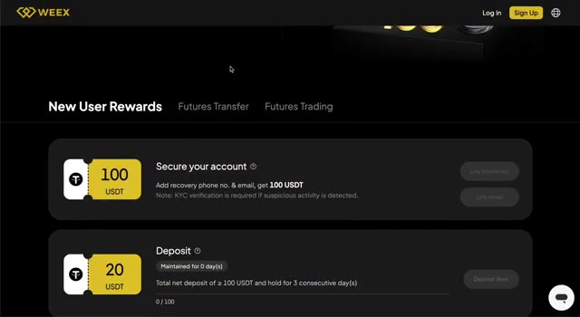
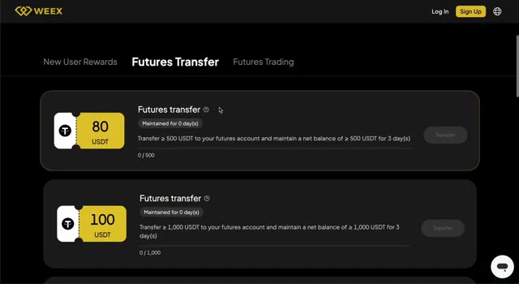
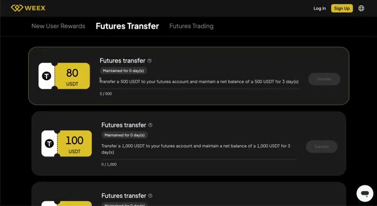
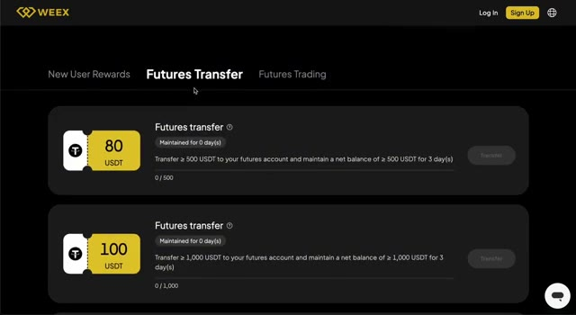
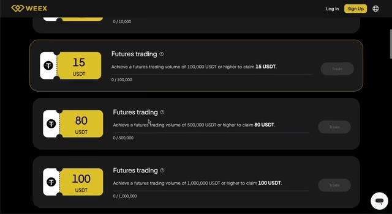
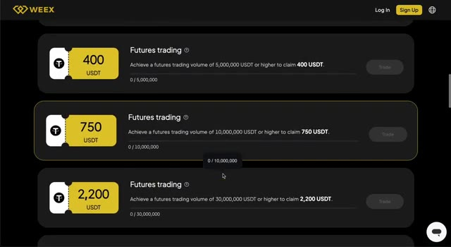
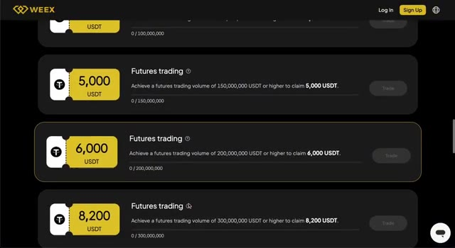
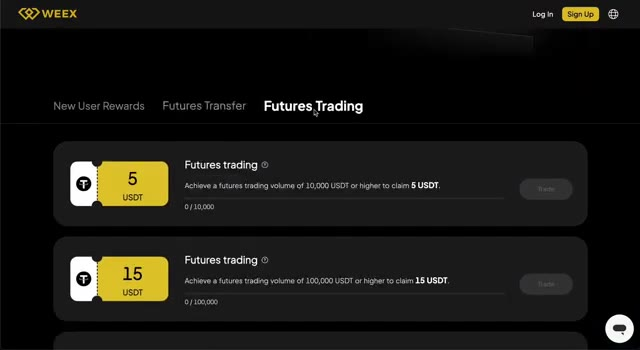

# 🎬 CLAIM $100 FREE – No Deposit Required on WEEX (Tutorial)

> **Chaîne** : [Alex Carter](https://www.youtube.com/@AlexCarterTrading)  
> **Lien YouTube** : [https://www.youtube.com/watch?v=Za8YbqYd3Wg](https://www.youtube.com/watch?v=Za8YbqYd3Wg)  
> **Date de publication** : 20250702  
> **Durée** : 00:03:15  
> **Identifiant vidéo** : `Za8YbqYd3Wg`  
> **Transcription & Analyse** : `whisper-v3-large-turbo+gemini-3.5-flash-lite`  

---

## 📌 Synthèse Exécutive & Outils

### 💡 Résumé
Dans cette vidéo intitulée **RÉCUPÉREZ 100 $ GRATUITS – Sans dépôt requis sur WEEX (Tutoriel)**, Alex Carter détaille une approche stratégique et pratique du trading et de l'automatisation par agents IA.

### 🛠️ Outils, Modèles & Logiciels Présentés
- **TradingView & Claude Code** : Analyse technique avancée et automatisation algorithmique.

### 🔑 Points Clés & Enseignements Stratégiques
- Respect rigoureux du ratio risque/rendement et du money management.
- Automatisation méthodique des déclencheurs d'ordres via des agents intelligents.

---

## ⏱️ Chronologie & Transcription Complète Audio & Visuelle (Mot pour Mot)

### ⏱️ `[00:00:00 - 00:00:25]` | Segment #01

**🔊 Audio (Transcription Intégrale Mot pour Mot en Français) :**
> Dans cette vidéo, je vais vous montrer comment obtenir 100 dollars rien qu'en vous inscrivant sur Weeks. Aucun dépôt, aucun trading requis. Il suffit littéralement de s'inscrire, de vérifier son e-mail et son téléphone, et le bonus est à vous. C'est l'un des bonus crypto les plus faciles et les plus généreux que j'ai vus depuis longtemps. Et en plus de ça, Weeks vous donne la possibilité de débloquer jusqu'à 30 000 dollars de récompenses totales si vous décidez d'aller plus loin. Laissez-moi vous expliquer en détail comment tout cela fonctionne.

**👁️ Analyse Visuelle d'Écran (gemini-3.5-flash-lite) :**
**Interface & Outils** : Plateforme d'échange crypto WEEX (interface Web).

**Contenu textuel & Code** : Offre de bienvenue "Mister Crypto Welcome Bonus", récompense de 100 USDT pour la vérification du compte (email et téléphone).

**Action / Démonstration** : Navigation sur le site WEEX pour expliquer l'obtention du bonus d'inscription sans dépôt.

*⏱️ 00:00:06 — Page de bienvenue WEEX affichant le bonus d'inscription de 100 $.*

*⏱️ 00:00:12 — Gros plan sur l'offre "Secure your account" permettant d'obtenir 100 USDT après ajout d'un téléphone et e-mail.*

*⏱️ 00:00:18 — Interface WEEX montrant la bannière du bonus Mister Crypto et les onglets de récompenses.*

---

### ⏱️ `[00:00:25 - 00:00:59]` | Segment #02

**🔊 Audio (Transcription Intégrale Mot pour Mot en Français) :**
> Commençons par la partie la plus folle, le bonus de 100 $. Tout ce que vous avez à faire, c'est créer un compte sur Reeks et lier votre e-mail et votre numéro de téléphone. C'est tout. Dès que c'est fait, vous recevrez 100 $ directement sur votre portefeuille bonus. Pas besoin de déposer de fonds, pas besoin de passer des trades. C'est un pur bonus d'inscription et cela prend moins de deux minutes à réclamer. Il s'agit d'une offre pour une durée limitée qui ne fonctionne que via le lien spécial dans la description ci-dessous. En plus du bonus, les nouveaux utilisateurs qui s'inscrivent via le lien obtiennent également une mise à niveau VIP2 gratuite. Cela signifie une réduction de 25 % sur

**👁️ Analyse Visuelle d'Écran (gemini-3.5-flash-lite) :**
**Interface & Outils** : Plateforme de trading crypto WEEX (site web).

**Contenu textuel & Code** : Offre promotionnelle « Mister Crypto Welcome Bonus », coupon de 100 USDT, instruction « Register & Bind to Claim $100! » via l'ajout d'un e-mail et numéro de téléphone de récupération.

**Action / Démonstration** : Présentation des conditions d'obtention du bonus sans dépôt de 100 USDT sur WEEX par simple sécurisation du compte.

*⏱️ 00:00:33 — Page web de la plateforme d'échange WEEX affichant l'offre « Mister Crypto Welcome Bonus » avec le texte surligné « Add recovery phone no. & email, get 100 USDT ».*

*⏱️ 00:00:42 — Interface promotionnelle de WEEX montrant le visuel d'accueil du bonus de 100 $ et les catégories de récompenses pour nouveaux utilisateurs.*

---

### ⏱️ `[00:00:59 - 00:01:20]` | Segment #03

**🔊 Audio (Transcription Intégrale Mot pour Mot en Français) :**
> frais de trading et un accès à de meilleurs tarifs sur la plateforme dès le premier jour, même si vous débutez. C'est une énorme longueur d'avance par rapport à un départ de zéro. Et maintenant, si vous voulez aller plus loin, Weeks propose toute une structure de bonus qui peut vous rapporter jusqu'à 30 000 dollars de récompenses totales. Cela repose sur deux éléments : le montant que vous déposez et le volume de vos transactions sur la plateforme.

**👁️ Analyse Visuelle d'Écran (gemini-3.5-flash-lite) :**
**Interface & Outils** : Plateforme d'échange de cryptomonnaies WEEX (page de promotion et dashboard des récompenses).

**Contenu textuel & Code** : - Bonus de bienvenue WEEX x MisterCrypto : 100 $ offerts, surclassement VIP (-25 % sur les frais), bonus de dépôt de 20 %.
- Conditions des paliers : Dépôt 100 $ (20 $ bonus), Transfert 500 $ (100 $ bonus), Transfert 1 000 $ (200 $ bonus), Transfert 2 000 $ (400 $ bonus).
- Récompenses : 100 USDT pour la sécurisation du compte (téléphone/email), 20 USDT pour un dépôt net ≥ 100 USDT conservé 3 jours.

**Action / Démonstration** : Présentation détaillée de la structure de bonus, des réductions de frais de trading et des étapes de réclamation des récompenses pour les nouveaux inscrits sur WEEX.

*⏱️ 00:01:04 — Bannière promotionnelle du partenariat MisterCrypto x WEEX détaillant le bonus d'inscription de 100 $, la réduction de 25 % sur les frais VIP et les paliers de bonus par dépôt/transfert.*

*⏱️ 00:01:09 — Page d'accueil de la plateforme WEEX présentant l'offre de bienvenue « Mister Crypto Welcome Bonus » pour l'inscription de nouveaux utilisateurs.*

*⏱️ 00:01:14 — Interface web de la plateforme WEEX affichant le détail des tâches et récompenses « New User Rewards » (sécurisation du compte, dépôt minimum).*

---

### ⏱️ `[00:01:20 - 00:01:40]` | Segment #04

**🔊 Audio (Transcription Intégrale Mot pour Mot en Français) :**
> Et vous n'avez pas besoin d'être une baleine pour commencer à débloquer des récompenses. Même de petits dépôts et transactions vous rapportent des bonus. Parlons d'abord des dépôts. Lorsque vous transférez des USDT sur votre compte de contrats à terme et que vous les y maintenez pendant trois jours, vous commencez à débloquer des bonus en argent. Par exemple, déposez 500 USDT pendant trois jours, et vous obtenez 80 dollars.

**👁️ Analyse Visuelle d'Écran (gemini-3.5-flash-lite) :**
**Interface & Outils** : Plateforme d'échange crypto WEEX (section "Futures Transfer" / Récompenses nouveaux utilisateurs).

**Contenu textuel & Code** : Conditions d'obtention de bonus USDT : transfert de ≥ 500 USDT (80 USDT offerts) et ≥ 1 000 USDT (100 USDT offerts) avec maintien du solde net pendant au moins 3 jours.

**Action / Démonstration** : Présentation des conditions et paliers de dépôt requis pour débloquer les bonus sur le compte Futures WEEX.

*⏱️ 00:01:25 — Interface de l'échange WEEX affichant la section "Futures Transfer" et le coupon de 80 USDT attribué pour un dépôt de 500 USDT maintenu 3 jours.*

*⏱️ 00:01:30 — Vue de la page "Futures Transfer" sur WEEX mettant en évidence les paliers de récompense (80 USDT pour ≥ 500 USDT et 100 USDT pour ≥ 1 000 USDT).*

*⏱️ 00:01:35 — Capture de l'interface WEEX montrant le sous-menu "Futures Transfer" et les conditions d'éligibilité aux bonus de dépôt.*

---

### ⏱️ `[00:01:41 - 00:01:59]` | Segment #05

**🔊 Audio (Transcription Intégrale Mot pour Mot en Français) :**
> Conservez 1 000 USDT, vous obtenez 100 $. Conservez 2 000 USDT, vous obtenez 200 $. Il n'y a aucun risque ici. Vous ne les tradez pas, vous les gardez simplement sur votre compte. Maintenant, disons que vous voulez trader. Les opportunités de bonus deviennent encore plus grandes. À mesure que vous tradez et que le volume augmente, WEEX vous récompense à chaque palier.

**👁️ Analyse Visuelle d'Écran (gemini-3.5-flash-lite) :**
**Interface & Outils** : Présentation ou face-caméra explicatif du trader sans interface logicielle partagée.

**Contenu textuel & Code** : Explications orales des stratégies et mise en contexte méthodologique du marché.

**Action / Démonstration** : Explications face caméra et analyse conceptuelle des marchés.

---

### ⏱️ `[00:02:00 - 00:02:36]` | Segment #06

**🔊 Audio (Transcription Intégrale Mot pour Mot en Français) :**
> To give you an idea, with just 10,000 USDT in futures trading, you earn a $5 bonus. At 100,000, it goes up to $15. Around 500,000, you're looking at $80. At 1 million, it's already $100. And if you go further, 3 million, 5 million, 10 million, the rewards keep stacking. Top traders can go all the way up to bonuses like $2,000, $4,000, even $6,000 depending on how far they push. But again, you don't need to aim for those levels to start earning. Even low volume users can take advantage. Let's be real. Most platforms don't

**👁️ Analyse Visuelle d'Écran (gemini-3.5-flash-lite) :**
**Interface & Outils** : Plateforme d'échange de cryptomonnaies WEEX (Centre des récompenses / Bonus de bienvenue).

**Contenu textuel & Code** : Bareme des bonus de trading Futures selon le volume exécuté (de 100 000 USDT à 300 000 000 USDT de volume débloquant jusqu'à 8 200 USDT de bonus).

**Action / Démonstration** : Défilement de la page des récompenses de volume de la plateforme WEEX pour détailler les avantages accordés aux traders selon leur volume de transaction.

*⏱️ 00:02:09 — Interface du centre de récompenses WEEX montrant les bonus Futures pour 100k USDT (15 USDT), 500k USDT (80 USDT) et 1M USDT (100 USDT) de volume.*

*⏱️ 00:02:18 — Interface WEEX affichant les paliers de bonus pour 5M USDT (400 USDT), 10M USDT (750 USDT) et 30M USDT (2 200 USDT) de volume.*

*⏱️ 00:02:27 — Interface WEEX présentant les récompenses maximales pour 150M USDT (5 000 USDT), 200M USDT (6 000 USDT) et 300M USDT (8 200 USDT) de volume.*

---

### ⏱️ `[00:02:36 - 00:03:10]` | Segment #07

**🔊 Audio (Transcription Intégrale Mot pour Mot en Français) :**
> vous donner quoi que ce soit à moins que vous ne déposiez et commenciez à trader. Weeks fait tout le contraire. Ils vous donnent 100 dollars juste pour la création d'un compte, plus de véritables incitations si vous choisissez de déposer ou de trader plus tard. Vous n'êtes pas obligé de vous lancer à fond, mais la structure est là si vous voulez progresser graduellement et gagner plus. Voici donc l'offre. Inscrivez-vous en utilisant le lien dans la description. Obtenez votre bonus de 100 dollars immédiatement après avoir vérifié votre e-mail et votre téléphone. Profitez de frais réduits avec le statut VIP2. Et si vous décidez de déposer ou de trader, vous pouvez débloquer jusqu'à 30 000 dollars de récompenses au fil du temps. C'est simple, c'est généreux,

**👁️ Analyse Visuelle d'Écran (gemini-3.5-flash-lite) :**
**Interface & Outils** : Plateforme d'échange de cryptomonnaies WEEX (page web des récompenses et bonus de bienvenue).

**Contenu textuel & Code** : Détails de l'offre promotionnelle : bonus d'inscription de 100 $, réduction de 25 % sur les frais VIP, bonus de dépôt de 20 %, coupons de récompense de 5 USDT (pour 10 000 USDT de volume) et 15 USDT (pour 100 000 USDT de volume).

**Action / Démonstration** : Présentation des conditions du bonus d'inscription sans dépôt obligatoire et des récompenses de trading sur la plateforme WEEX.

*⏱️ 00:02:44 — Infographie promotionnelle du partenariat MisterCrypto x WEEX détaillant le bonus d'inscription de 100 $ ainsi que les paliers de bonus sur dépôt et réduction de frais VIP.*

*⏱️ 00:02:53 — Interface web de l'échange WEEX affichant l'onglet « Futures Trading » et les paliers de récompenses en USDT selon le volume de trading réalisé.*

*⏱️ 00:03:01 — Page d'accueil de la campagne de bienvenue WEEX (« Mister Crypto Welcome Bonus ») avec l'en-tête invitant à réclamer les 100 $ et la section des récompenses futures.*

---

### ⏱️ `[00:03:10 - 00:03:15]` | Segment #08

**🔊 Audio (Transcription Intégrale Mot pour Mot en Français) :**
> et c'est l'une des meilleures offres de bienvenue dans la crypto en ce moment. Merci d'avoir regardé et bonne chance pour les semaines à venir.

**👁️ Analyse Visuelle d'Écran (gemini-3.5-flash-lite) :**
**Interface & Outils** : Présentation ou face-caméra explicatif du trader sans interface logicielle partagée.

**Contenu textuel & Code** : Explications orales des stratégies et mise en contexte méthodologique du marché.

**Action / Démonstration** : Explications face caméra et analyse conceptuelle des marchés.

---

