# 🎬 Bybit Card Review & Tutorial 2025 (ALL You Need To Know)

> **Chaîne** : [Alex Carter](https://www.youtube.com/@AlexCarterTrading)  
> **Lien YouTube** : [https://www.youtube.com/watch?v=bB0Hm8a9nNo](https://www.youtube.com/watch?v=bB0Hm8a9nNo)  
> **Date de publication** : 20250706  
> **Durée** : 00:08:06  
> **Identifiant vidéo** : `bB0Hm8a9nNo`  
> **Transcription & Analyse** : `whisper-v3-large-turbo+gemini-3.5-flash-lite`  

---

## 📌 Synthèse Exécutive & Outils

### 💡 Résumé
Dans cette vidéo intitulée **Test & Avis Bybit Card 2025 : Tout ce que vous devez savoir**, Alex Carter détaille une approche stratégique et pratique du trading et de l'automatisation par agents IA.

### 🛠️ Outils, Modèles & Logiciels Présentés
- **TradingView & Claude Code** : Analyse technique avancée et automatisation algorithmique.

### 🔑 Points Clés & Enseignements Stratégiques
- Respect rigoureux du ratio risque/rendement et du money management.
- Automatisation méthodique des déclencheurs d'ordres via des agents intelligents.

---

## ⏱️ Chronologie & Transcription Complète Audio & Visuelle (Mot pour Mot)

### ⏱️ `[00:00:00 - 00:00:37]` | Segment #01

**🔊 Audio (Transcription Intégrale Mot pour Mot en Français) :**
> La carte Bybit rend incroyablement facile l'utilisation de vos cryptos dans la vie réelle. J'utilise personnellement cette carte pour tout ce que j'achète, des achats en ligne aux paiements de la vie quotidienne et même avec Apple Pay. Je n'utilise plus aucune autre carte parce que la carte Bybit est tout simplement tellement facile à utiliser. Dans cette vidéo, je vais vous montrer exactement à quel point il est simple de tout configurer et de commencer à dépenser vos USDT, Bitcoin, ou même altcoins pour tout ce que vous voulez. Premièrement, la carte Bybit est disponible dans la plupart des pays. Mais le moyen le plus simple de vérifier si elle est disponible dans le vôtre est de vous inscrire avec le lien ci-dessous. C'est important car cela vous garantit d'obtenir le meilleur bonus possible disponible.

**👁️ Analyse Visuelle d'Écran (gemini-3.5-flash-lite) :**
**Interface & Outils** : Site web officiel de l'échange Bybit (section Carte).

**Contenu textuel & Code** : Informations sur l'obtention de la carte Bybit, intégration Apple Pay, étapes de vérification d'identité (KYC) et sélection de la région.

**Action / Démonstration** : Navigation sur la page web promotionnelle de la carte Bybit et démonstration de la compatibilité avec les services de paiement mobile.

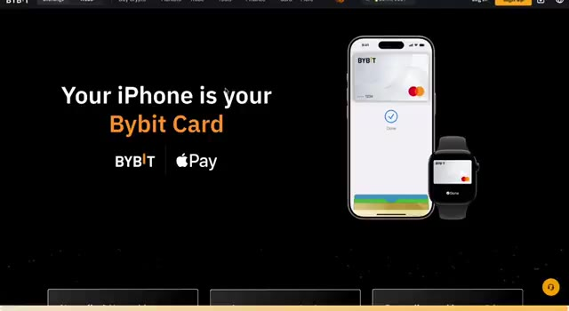
*⏱️ 00:00:09 — Page d'accueil du site Bybit mettant en avant la compatibilité de la carte Bybit avec Apple Pay et les appareils iOS.*

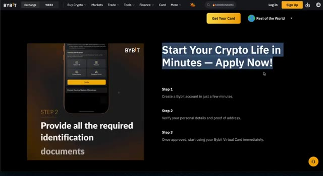
*⏱️ 00:00:18 — Section du site Bybit expliquant les étapes pour obtenir la carte Bybit, avec un aperçu de la vérification d'identité sur mobile.*

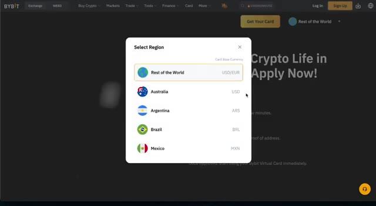
*⏱️ 00:00:28 — Fenêtre modale sur le site Bybit permettant de sélectionner la région et la devise de base pour la carte (ex. Rest of the World, Australie, Argentine).*

---

### ⏱️ `[00:00:37 - 00:01:14]` | Segment #02

**🔊 Audio (Transcription Intégrale Mot pour Mot en Français) :**
> et d'autres réductions pour la carte Bybit. Sans mon lien ci-dessous, vous ne pourrez pas l'obtenir. Créez un compte, téléchargez l'application Bybit, allez sur la page d'accueil, cliquez sur plus, trouvez carte, et cela vous montrera les détails pour votre pays. La carte Bybit est bien plus qu'une simple carte de débit crypto. C'est un moyen incroyablement pratique de faire le lien entre vos actifs numériques et le monde réel. Vous pouvez obtenir jusqu'à 10 % de remise en argent selon votre niveau VIP avec de véritables récompenses en USDT, et non pas un jeton volatil comme sur d'autres plateformes. Même si vous n'êtes pas VIP, vous recevrez quand même 2 % de remise en argent jusqu'à 10 $ par mois. C'est déjà suffisant pour couvrir les petits frais ou payer votre matinée

**👁️ Analyse Visuelle d'Écran (gemini-3.5-flash-lite) :**
**Interface & Outils** : Application mobile Bybit et site web officiel Bybit.

**Contenu textuel & Code** : Tableau des avantages de la carte Bybit (taux de cashback de 2% à 10%, limites mensuelles et dépenses requises par niveau VIP).

**Action / Démonstration** : Présentation des caractéristiques, niveaux VIP et avantages de la carte bancaire Bybit.

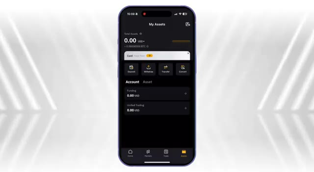
*⏱️ 00:00:46 — Capture d'écran mobile montrant l'application Bybit et la section des actifs (My Assets).*

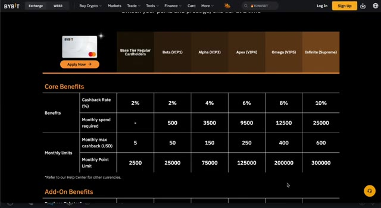
*⏱️ 00:01:05 — Page Web du site Bybit affichant le tableau comparatif des différents niveaux (Tiers) et avantages de la carte.*

---

### ⏱️ `[00:01:14 - 00:01:49]` | Segment #03

**🔊 Audio (Transcription Intégrale Mot pour Mot en Français) :**
> le café est fondamentalement gratuit. Et quoi de mieux ? Ils se sont associés à des services populaires comme Tradingview, Netflix, Spotify et Amazon Prime pour offrir des réductions sur les abonnements, là encore selon votre niveau VIP. Récemment, ils ont également dépassé le million de cartes émises, vous pourriez donc voir encore plus de promotions comme du cashback supplémentaire pour les nouveaux utilisateurs. Vous obtenez également l'accès aux salons d'aéroport et des réductions sur les voyages via nTravel, avec des économies allant jusqu'à 6 % sur les hôtels du monde entier. Donc oui, en termes d'avantages, c'est clairement l'une des cartes crypto les plus avantageuses du marché. Comment l'utiliser et s'inscrire. Voyons

**👁️ Analyse Visuelle d'Écran (gemini-3.5-flash-lite) :**
**Interface & Outils** : Site web officiel de la plateforme de cryptomonnaies Bybit (section Carte).

**Contenu textuel & Code** : Logos des services partenaires (Netflix, Spotify, ChatGPT, DeepSeek, Amazon Prime) et avantages liés à la carte Bybit (10% de réduction/cashback).

**Action / Démonstration** : Présentation à l'écran des avantages, des partenariats et des réductions sur les abonnements associés à la carte Bybit.

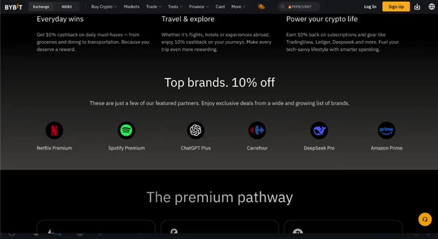
*⏱️ 00:01:23 — Page web de Bybit présentant les réductions et partenaires offrant 10% de cashback (Netflix, Spotify, ChatGPT, Carrefour, DeepSeek, Amazon Prime).*

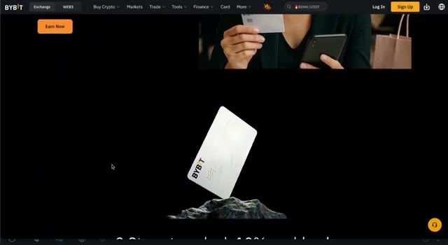
*⏱️ 00:01:32 — Visuel de la carte bancaire Bybit au centre avec une personne tenant une carte et un smartphone en haut.*

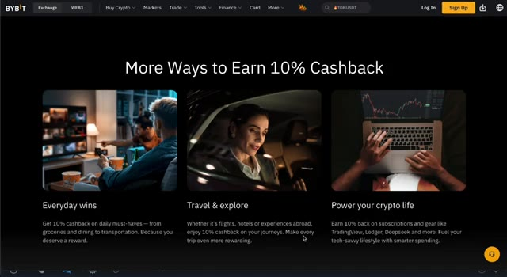
*⏱️ 00:01:40 — Page web de Bybit présentant les différentes catégories de cashback (Everyday wins, Travel & explore, Power your crypto life).*

---

### ⏱️ `[00:01:49 - 00:02:22]` | Segment #04

**🔊 Audio (Transcription Intégrale Mot pour Mot en Français) :**
> passer en revue tout le processus pour savoir comment commencer avec la carte Bybit. Le point positif, c'est que vous recevrez une carte virtuelle presque immédiatement après l'approbation de votre demande. Cette carte virtuelle peut être ajoutée immédiatement à Apple Pay ou Google Wallet, vous permettant ainsi de commencer à l'utiliser en quelques minutes, avant même que la carte physique n'arrive. Maintenant, pour faire une demande, vous devez compléter la procédure KYC, ce qui signifie « Know Your Customer », ou « Connaissez votre client ». En gros, vous avez juste besoin de vérifier votre identité, généralement avec un passeport ou une pièce d'identité émise par le gouvernement et un rapide scan facial. La plupart des utilisateurs qui ont déjà

**👁️ Analyse Visuelle d'Écran (gemini-3.5-flash-lite) :**
**Interface & Outils** : Site web et application mobile de l'échange Bybit.

**Contenu textuel & Code** : Statut de demande de carte virtuelle, informations de compatibilité Apple Pay et interface de vérification d'identité KYC.

**Action / Démonstration** : Présentation des étapes de demande, de validation et d'intégration de la carte Bybit dans les portefeuilles numériques.

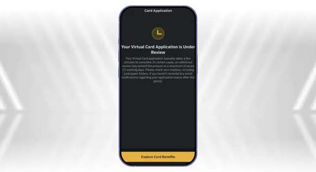
*⏱️ 00:01:57 — Capture d'écran mobile montrant l'écran de statut "Your Virtual Card Application is Under Review" sur l'application Bybit.*

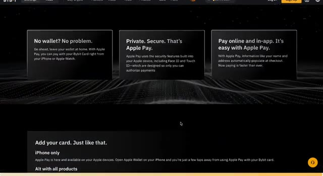
*⏱️ 00:02:06 — Page web de l'échange Bybit détaillant la compatibilité et l'utilisation de la carte avec Apple Pay.*

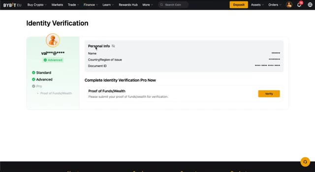
*⏱️ 00:02:14 — Page web de Bybit affichant le processus d'identification et de vérification d'identité (Identity Verification).*

---

### ⏱️ `[00:02:22 - 00:02:58]` | Segment #05

**🔊 Audio (Transcription Intégrale Mot pour Mot en Français) :**
> les traders sur Bybit ont probablement déjà complété cette étape, donc c'est généralement juste une formalité. Une fois que la vérification d'identité est faite, la configuration est vraiment très simple. On vous demandera de choisir le nom que vous voulez imprimer sur la carte, de confirmer votre adresse de livraison, de définir un code PIN que vous utiliserez pour vos achats et vos retraits aux distributeurs automatiques, et enfin d'ajouter votre numéro de téléphone pour que le service de livraison puisse vous contacter lorsque votre carte physique sera expédiée. Après cela, vous êtes paré. Frais et limites. Bybit est impressionnamment transparent en ce qui concerne les frais, et honnêtement, c'est l'une des principales raisons pour lesquelles je continue à utiliser cette

**👁️ Analyse Visuelle d'Écran (gemini-3.5-flash-lite) :**
**Interface & Outils** : Présentation ou face-caméra explicatif du trader sans interface logicielle partagée.

**Contenu textuel & Code** : Explications orales des stratégies et mise en contexte méthodologique du marché.

**Action / Démonstration** : Explications face caméra et analyse conceptuelle des marchés.

---

### ⏱️ `[00:02:58 - 00:03:34]` | Segment #06

**🔊 Audio (Transcription Intégrale Mot pour Mot en Français) :**
> carte par rapport aux autres. Tout d'abord, il n'y a pas de frais de dossier, ce qui signifie que vous pouvez demander la carte tout à fait gratuitement. Il n'y a pas non plus de frais annuels, vous n'êtes donc lié à aucuns frais récurrents juste pour détenir la carte. De plus, il n'y a pas de frais d'inactivité ni de frais de résiliation, ce qui est génial si vous n'utilisez pas la carte tout le temps ou si vous voulez simplement l'essayer sans aucun engagement. Et surtout, il n'y a pas de majoration sur les taux de change, ce que beaucoup de banques glissent discrètement lors des transactions en devises étrangères. Avec Bybit, ce que vous voyez est ce que vous obtenez. Passons maintenant aux coûts réels que vous pourriez rencontrer lors de l'utilisation de la carte. Vous laissez la carte convertir vos

**👁️ Analyse Visuelle d'Écran (gemini-3.5-flash-lite) :**
**Interface & Outils** : Site web de l'échange Bybit, page de tarification et de gestion de la Bybit Card.

**Contenu textuel & Code** : Tableau des frais détaillant les frais de change, de conversion crypto, de padding FX, les frais annuels (Annual Fee : None), les frais d'inactivité, de résiliation et d'émission de carte.

**Action / Démonstration** : Présentation des conditions tarifaires de la carte Bybit, mise en avant de l'absence de frais annuels et de frais de dossier pour les cartes virtuelles.

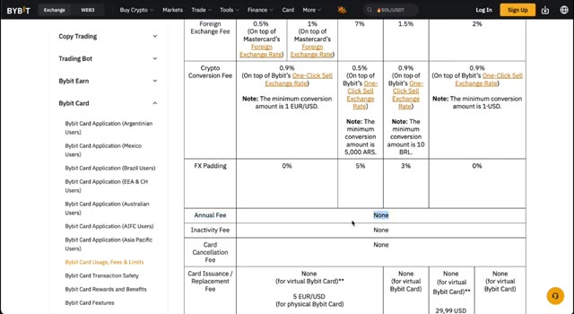
*⏱️ 00:03:07 — Tableau comparatif des frais de la carte Bybit affichant les frais annuels à zéro (None).*

---

### ⏱️ `[00:03:34 - 00:04:11]` | Segment #07

**🔊 Audio (Transcription Intégrale Mot pour Mot en Français) :**
> crypto automatically at the moment of purchase. There's a 0.9% crypto conversion fee. If you prefer to convert your crypto manually beforehand via spot trading, you'll only pay 0.1%, which is much cheaper. If you spend in a currency different from your card's base currency, for example, using a euro card in the US, then MasterCard applies a 0.5% for an exchange fee. ATM withdrawals are free up to a certain monthly limit, after which a small fee will apply. Nothing surprising there. Lorelasic. If you need to replace your card, there may be a small replacement fee,

**👁️ Analyse Visuelle d'Écran (gemini-3.5-flash-lite) :**
**Interface & Outils** : Présentation ou face-caméra explicatif du trader sans interface logicielle partagée.

**Contenu textuel & Code** : Explications orales des stratégies et mise en contexte méthodologique du marché.

**Action / Démonstration** : Explications face caméra et analyse conceptuelle des marchés.

---

### ⏱️ `[00:04:11 - 00:04:43]` | Segment #08

**🔊 Audio (Transcription Intégrale Mot pour Mot en Français) :**
> mais cela est annulé si vous êtes un membre VIP. Donc encore une fois, si vous êtes malin à ce sujet, c'est-à-dire que vous convertissez d'abord vos cryptos en monnaie fiduciaire et que vous dépensez dans votre devise de base, vous pouvez réduire vos frais totaux à seulement 0,1 %. C'est incroyablement bas et en fait moins cher que la plupart des cartes de crédit ou de débit traditionnelles, surtout lorsque vous voyagez à l'international. Avant de pouvoir réellement commencer à dépenser avec votre carte Bybit, vous devez l'approvisionner en fonds. Il y a deux façons principales de le faire, et la méthode que vous choisissez aura un impact sur les frais que vous payez. Option un, simple mais pas optimale. La première

**👁️ Analyse Visuelle d'Écran (gemini-3.5-flash-lite) :**
**Interface & Outils** : Site web Bybit et application mobile Bybit Card.

**Contenu textuel & Code** : Tableaux comparatifs des frais de conversion crypto, frais d'inactivité, frais annuels, et interface de solde de carte bancaire (3,969.43 USD).

**Action / Démonstration** : Présentation visuelle des différents niveaux de frais et des conditions d'utilisation de la carte Bybit pour illustrer l'optimisation des coûts.

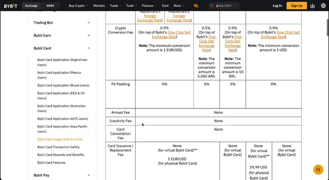
*⏱️ 00:04:19 — Un tableau détaillé des frais de la Bybit Card sur le site web officiel de l'échangeur, montrant les pourcentages de conversion et les frais associés.*

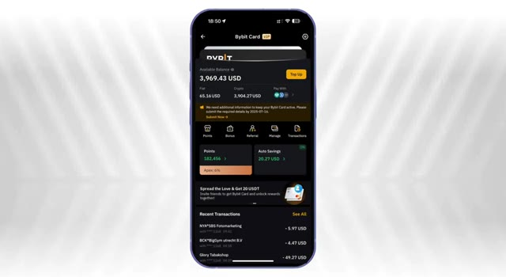
*⏱️ 00:04:35 — Une application mobile affichant l'interface de gestion de la Bybit Card avec le solde disponible en USD et les détails des transactions récentes.*

---

### ⏱️ `[00:04:43 - 00:05:03]` | Segment #09

**🔊 Audio (Transcription Intégrale Mot pour Mot en Français) :**
> option is pretty straightforward. You can transfer your crypto directly into your Bybit funding account. This can be Bitcoin, Ethereum, or any other supported token. Once the funds are in your account, the card will simply convert your crypto automatically at the time of the transaction. Option two, smarter and cheaper. The second option is much better if you're looking to reduce fees.

**👁️ Analyse Visuelle d'Écran (gemini-3.5-flash-lite) :**
**Interface & Outils** : Interface web de l'échange de cryptomonnaies Bybit EU.

**Contenu textuel & Code** : Solde total du compte de financement, liste des actifs (USDC, ADA, APT, AVAX, BTC) avec leurs soldes disponibles et options de dépôt/retrait.

**Action / Démonstration** : Navigation sur la plateforme Bybit pour consulter les soldes du compte de financement et les options de dépôt de cryptos.

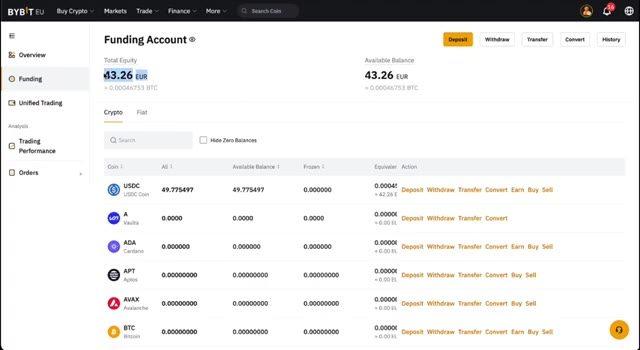
*⏱️ 00:04:48 — Capture d'écran de l'interface de Bybit montrant le compte de financement (Funding Account) avec les soldes en cryptomonnaies (USDC, ADA, etc.).*

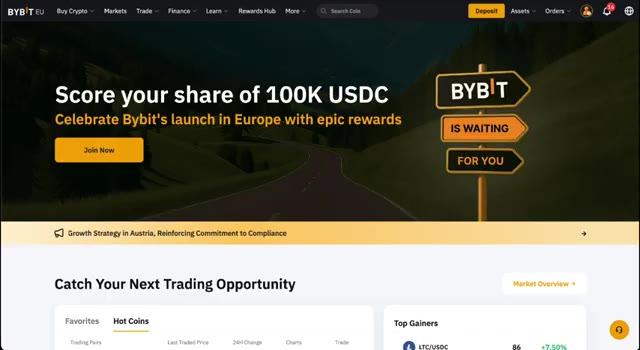
*⏱️ 00:04:58 — Page d'accueil de la plateforme Bybit EU affichant des promotions de lancement et un aperçu des marchés.*

---

### ⏱️ `[00:05:03 - 00:05:22]` | Segment #10

**🔊 Audio (Transcription Intégrale Mot pour Mot en Français) :**
> Au lieu de laisser la carte gérer la conversion, vous pouvez convertir manuellement vos cryptomonnaies en monnaie fiat ou en stablecoins à l'avance en utilisant la fonction de trading au comptant de Bybit. Voici comment procéder étape par étape. Tout d'abord, allez dans la section de trading au comptant. Sélectionnez la paire de trading que vous voulez, par exemple, BTC, EUR, ou BTC USDT, selon votre région.

**👁️ Analyse Visuelle d'Écran (gemini-3.5-flash-lite) :**
**Interface & Outils** : Bybit (Plateforme d'échange de cryptomonnaies - Interface Web)

**Contenu textuel & Code** : Paires de trading, graphiques de prix en chandelier, carnet d'ordres (order book), options d'achat/vente (Long/Short) et soldes disponibles.
[DESC_IMAGE_1] Navigation dans les menus de Bybit pour sélectionner le marché Spot.
[DESC_IMAGE_2] Navigation et sélection de paires de trading dans l'interface Spot de Bybit.

**Action / Démonstration** : Explications face caméra et analyse conceptuelle des marchés.

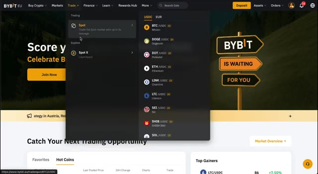
*⏱️ 00:05:08 — Capture d'écran de Bybit montrant le menu déroulant de l'onglet Trade pour accéder à la section Spot.*

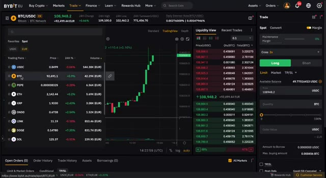
*⏱️ 00:05:17 — Interface de trading spot de Bybit affichant le graphique des prix, le carnet d'ordres et la sélection de paires de cryptomonnaies.*

---

### ⏱️ `[00:05:23 - 00:05:59]` | Segment #11

**🔊 Audio (Transcription Intégrale Mot pour Mot en Français) :**
> Sell your crypto and receive either fiat, like Euros, or a stablecoin, like USDT. Then transfer those converted funds into your funding account. Once that's done, your balance is already in the right currency. So when you make a purchase, it behaves exactly like a normal debit card with no conversion fee at all. You've only paid a 0.1% spot trading fee. Match your region's currency. If you're in Europe and you're using the euro-based card, spending in euro means zero fees. The same goes for users in Australia, where the base currency is usually USD or AUD. Choose which asset to spend. Another great feature of the

**👁️ Analyse Visuelle d'Écran (gemini-3.5-flash-lite) :**
**Interface & Outils** : Bybit EU (Plateforme d'échange de cryptomonnaies)

**Contenu textuel & Code** : Soldes de comptes cryptos (USDC, 42.26 EUR), interface de transfert de fonds entre comptes de trading et de financement.

**Action / Démonstration** : Configuration d'un transfert interne de fonds en USDC vers le compte de financement pour préparer les dépenses par carte bancaire.

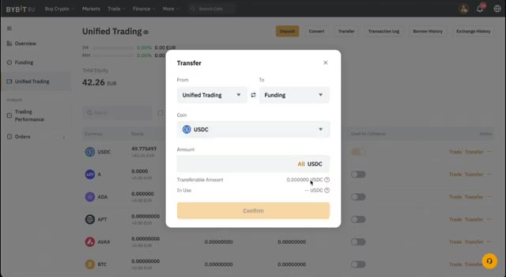
*⏱️ 00:05:32 — Interface de la plateforme Bybit affichant une fenêtre contextuelle de transfert de fonds ("Transfer") pour transférer des USDC du compte "Unified Trading" vers le compte "Funding".*

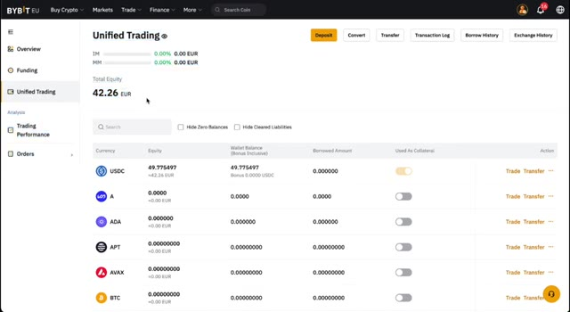
*⏱️ 00:05:41 — Vue d'ensemble du compte "Unified Trading" sur Bybit, affichant la balance totale de 42.26 EUR et le détail des cryptomonnaies détenues (notamment USDC).*

---

### ⏱️ `[00:05:59 - 00:06:28]` | Segment #12

**🔊 Audio (Transcription Intégrale Mot pour Mot en Français) :**
> La carte Bybit est que vous pouvez réellement choisir l'actif dans lequel la carte puisera lors d'un paiement. Dans les paramètres de la carte, il y a une section appelée payer avec, où vous pouvez sélectionner si vous souhaitez dépenser depuis vos USDT, vos USDC, ou même directement depuis votre solde en monnaie fiduciaire. Cela vous donne un contrôle total et vous aide également à éviter des conversions imprévues. Astuce bonus, gagnez pendant que vous attendez. Si vous détenez des fonds sur votre compte mais ne les dépensez pas tout de suite, vous pouvez également activer la fonction d'épargne automatique.

**👁️ Analyse Visuelle d'Écran (gemini-3.5-flash-lite) :**
**Interface & Outils** : Présentation ou face-caméra explicatif du trader sans interface logicielle partagée.

**Contenu textuel & Code** : Explications orales des stratégies et mise en contexte méthodologique du marché.

**Action / Démonstration** : Explications face caméra et analyse conceptuelle des marchés.

---

### ⏱️ `[00:06:28 - 00:06:53]` | Segment #13

**🔊 Audio (Transcription Intégrale Mot pour Mot en Français) :**
> For example, if you're holding USDC, you can earn up to 4.5% APY passively just by letting it sit there until you're ready to spend. It's a great way to put your EIDL funds to work, and honestly, it's way better than the 0.01% interest you get in a traditional bank account. So, in short, load your card smartly, choose the right asset to spend, avoid conversion fees, and earn interest while you wait.

**👁️ Analyse Visuelle d'Écran (gemini-3.5-flash-lite) :**
**Interface & Outils** : Bybit Card / Bybit Earn

**Contenu textuel & Code** : Paramètres d'Auto-Savings affichant l'APR de l'USDT (6,00 %), l'USDC (8,00 %), le BTC (1,50 %) et l'ETH (2,50 %), ainsi que les rendements journaliers et le statut des bascules d'épargne automatique.

**Action / Démonstration** : Présentation et configuration des options d'épargne automatique et de rendement passif associées à l'utilisation de la carte Bybit.

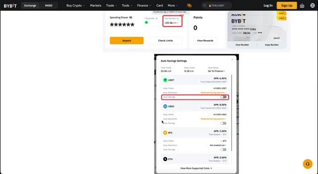
*⏱️ 00:06:34 — Capture d'écran de l'interface de la carte Bybit montrant les paramètres d'épargne automatique (Auto-Savings) avec les taux APR pour l'USDT, l'USDC, le BTC et l'ETH.*

---

### ⏱️ `[00:06:53 - 00:07:12]` | Segment #14

**🔊 Audio (Transcription Intégrale Mot pour Mot en Français) :**
> C'est comme ça que vous tirez le meilleur parti de votre carte Bybit. Mon avis honnête avec une utilisation réelle, j'utilise la carte Bybit depuis quelques mois maintenant. Et honnêtement, elle a remplacé toutes mes autres cartes. Qu'il s'agisse de payer l'épicerie, des abonnements en ligne ou même de voyager, ça fonctionne tout simplement. Apple Pay fonctionne parfaitement. Le cashback arrive directement en USDT.

**👁️ Analyse Visuelle d'Écran (gemini-3.5-flash-lite) :**
**Interface & Outils** : Présentation ou face-caméra explicatif du trader sans interface logicielle partagée.

**Contenu textuel & Code** : Explications orales des stratégies et mise en contexte méthodologique du marché.

**Action / Démonstration** : Explications face caméra et analyse conceptuelle des marchés.

---

### ⏱️ `[00:07:12 - 00:07:32]` | Segment #15

**🔊 Audio (Transcription Intégrale Mot pour Mot en Français) :**
> Les frais sont transparents et évitables. Et la flexibilité de choisir comment je dépense, qu'il s'agisse de stablecoins, de Bitcoin ou d'euros, rend cette carte parfaite pour quiconque est déjà dans la crypto. Le seul petit inconvénient est que les impôts peuvent être compliqués si vous dépensez souvent du Bitcoin ou de l'ETH. Donc, personnellement, je convertis en stablecoins à l'avance pour éviter d'avoir à suivre chaque transaction.

**👁️ Analyse Visuelle d'Écran (gemini-3.5-flash-lite) :**
**Interface & Outils** : Application mobile Bybit Card et site Web Blockpit

**Contenu textuel & Code** : Solde de 3,969.43 USD, points fidélité (182,456), épargne automatique (20.27 USD), et conseils pour réduire la responsabilité fiscale (HODL, stablecoins, pertes).

**Action / Démonstration** : Présentation des fonctionnalités de la carte crypto Bybit et des solutions logicielles de gestion fiscale.

*⏱️ 00:07:17 — Capture d'écran d'un smartphone affichant l'interface de l'application Bybit Card avec le solde disponible en USD et l'historique des transactions.*

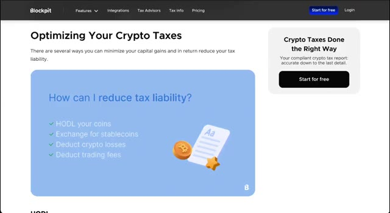
*⏱️ 00:07:22 — Capture d'écran du site Web Blockpit montrant une page dédiée à l'optimisation des impôts sur les cryptomonnaies.*

---

### ⏱️ `[00:07:32 - 00:07:51]` | Segment #16

**🔊 Audio (Transcription Intégrale Mot pour Mot en Français) :**
> N'oubliez pas non plus d'activer le cashback automatique dans votre application. De cette façon, chaque transaction éligible est récompensée automatiquement. Pour résumer, une configuration facile, pas de frais cachés, du vrai cashback et des USDT, un contrôle total sur l'actif que vous dépensez, et un solide support mondial avec des mises à jour continues.

**👁️ Analyse Visuelle d'Écran (gemini-3.5-flash-lite) :**
**Interface & Outils** : Interface web de l'échange Bybit (section Bybit Card).

**Contenu textuel & Code** : Documentation sur les récompenses de la carte, les options de cashback automatique et la présentation visuelle de la carte Bybit.

**Action / Démonstration** : Présentation des fonctionnalités de cashback et navigation sur le site de l'échange pour expliquer l'activation des avantages.

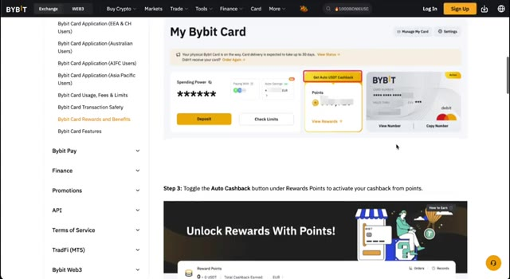
*⏱️ 00:07:37 — Page de documentation Bybit Card détaillant les avantages et la procédure pour activer le cashback automatique en USDT.*

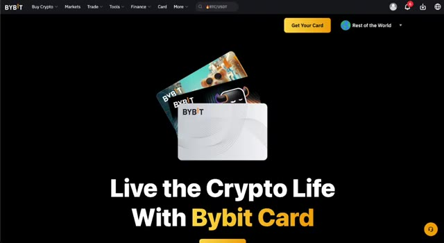
*⏱️ 00:07:42 — Page d'accueil de la Bybit Card sur l'échange Bybit avec le slogan « Live the Crypto Life With Bybit Card ».*

---

### ⏱️ `[00:07:51 - 00:08:05]` | Segment #17

**🔊 Audio (Transcription Intégrale Mot pour Mot en Français) :**
> Si vous ne l'avez pas encore essayé, utilisez le lien dans la description pour vous inscrire et vérifier si votre pays est pris en charge. Cela garantit également que vous obtenez le meilleur bonus d'inscription, du cashback et les autres avantages disponibles en ce moment. C'est tout pour cette vidéo. Merci d'avoir regardé. À la prochaine.

**👁️ Analyse Visuelle d'Écran (gemini-3.5-flash-lite) :**
**Interface & Outils** : Interface web de l'échange Bybit.

**Contenu textuel & Code** : Mention de récompenses de bienvenue jusqu'à 30 050 $, un code de parrainage (17185) pré-rempli, et des champs pour l'e-mail et le mot de passe.

**Action / Démonstration** : Présentation de la page d'inscription et des avantages du lien de parrainage pour l'audience.

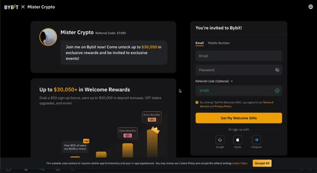
*⏱️ 00:07:55 — Page d'inscription de l'échange de cryptomonnaies Bybit en partenariat avec Mister Crypto, affichant les bonus de bienvenue et le formulaire de création de compte.*

---

