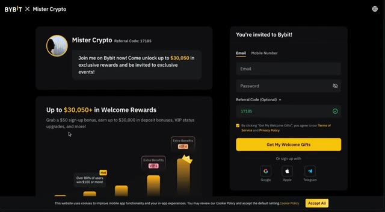
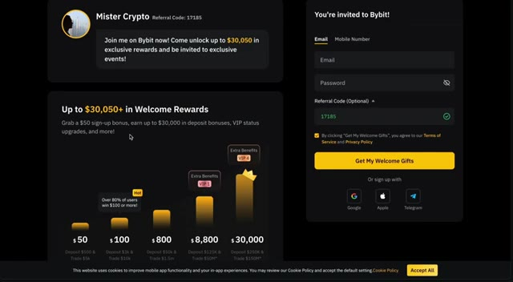
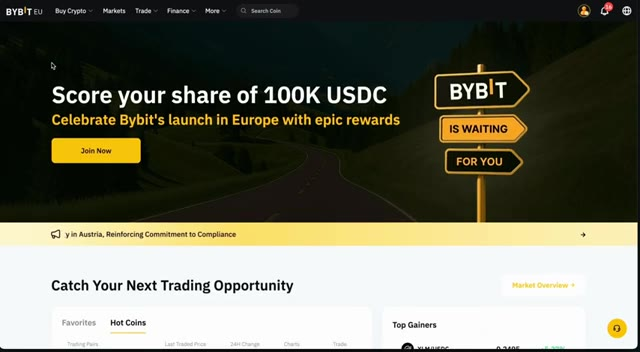
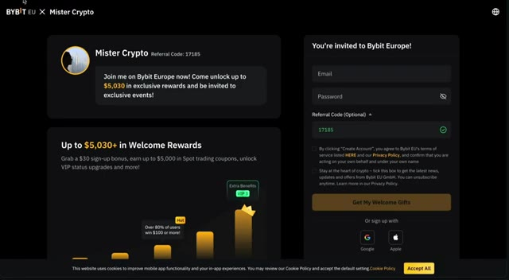
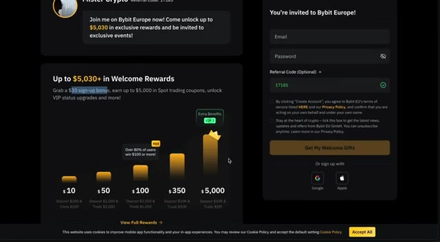
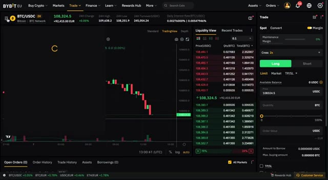
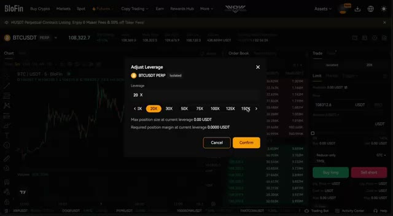
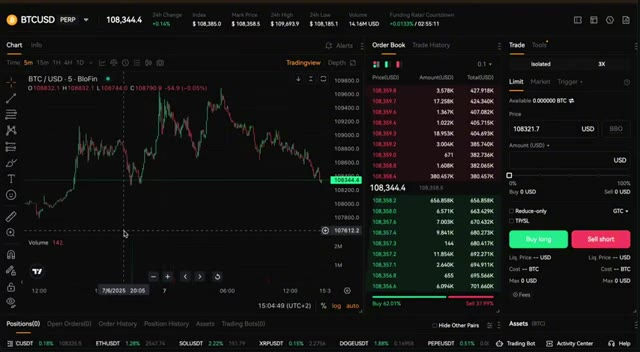
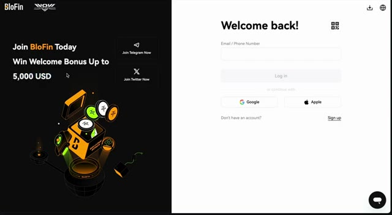
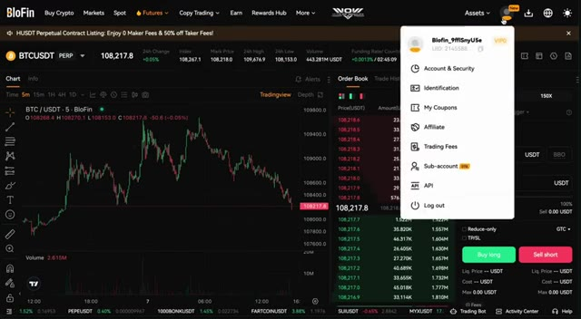

# 🎬 Bybit vs Blofin: Which Crypto Platform Wins in 2025?

> **Chaîne** : [Alex Carter](https://www.youtube.com/@AlexCarterTrading)  
> **Lien YouTube** : [https://www.youtube.com/watch?v=6syIj5hqlXI](https://www.youtube.com/watch?v=6syIj5hqlXI)  
> **Date de publication** : 20250707  
> **Durée** : 00:06:58  
> **Identifiant vidéo** : `6syIj5hqlXI`  
> **Transcription & Analyse** : `whisper-v3-large-turbo+gemini-3.5-flash-lite`  

---

## 📌 Synthèse Exécutive & Outils

### 💡 Résumé
Dans cette vidéo intitulée **Bybit vs Blofin : Quelle plateforme crypto l'emporte en 2025 ?**, Alex Carter détaille une approche stratégique et pratique du trading et de l'automatisation par agents IA.

### 🛠️ Outils, Modèles & Logiciels Présentés
- **TradingView & Claude Code** : Analyse technique avancée et automatisation algorithmique.

### 🔑 Points Clés & Enseignements Stratégiques
- Respect rigoureux du ratio risque/rendement et du money management.
- Automatisation méthodique des déclencheurs d'ordres via des agents intelligents.

---

## ⏱️ Chronologie & Transcription Complète Audio & Visuelle (Mot pour Mot)

### ⏱️ `[00:00:00 - 00:00:20]` | Segment #01

**🔊 Audio (Transcription Intégrale Mot pour Mot en Français) :**
> In this video, we're going to compare two of the most talked about crypto exchanges in 2025, Bybit and Blofin. Whether you're trading spot futures or just looking for a platform with fewer restrictions, this guide will help you figure out which one is best for your needs, especially after the major update that affected Bybit users in Europe.

**👁️ Analyse Visuelle d'Écran (gemini-3.5-flash-lite) :**
**Interface & Outils** : Présentation ou face-caméra explicatif du trader sans interface logicielle partagée.

**Contenu textuel & Code** : Explications orales des stratégies et mise en contexte méthodologique du marché.

**Action / Démonstration** : Explications face caméra et analyse conceptuelle des marchés.

---

### ⏱️ `[00:00:20 - 00:00:55]` | Segment #02

**🔊 Audio (Transcription Intégrale Mot pour Mot en Français) :**
> Both platforms have their strengths, but depending on where you live and how you trade, one may suit you better than the other. Let's dive in. Let's start with Bybit. Bybit has built a strong reputation over the years as one of the most reliable and feature-packed crypto exchanges in the market. The user interface is sleek and responsive, trading is smooth and wishy, and the liquidity is excellent across all major pairs, whether you're trading spot or derivatives. If you're using the classic version of Bybit, meaning you're not affected by the new European restrictions, you still have full access to everything the platform offers.

**👁️ Analyse Visuelle d'Écran (gemini-3.5-flash-lite) :**
**Interface & Outils** : Présentation ou face-caméra explicatif du trader sans interface logicielle partagée.

**Contenu textuel & Code** : Explications orales des stratégies et mise en contexte méthodologique du marché.

**Action / Démonstration** : Explications face caméra et analyse conceptuelle des marchés.

---

### ⏱️ `[00:00:55 - 00:01:23]` | Segment #03

**🔊 Audio (Transcription Intégrale Mot pour Mot en Français) :**
> qui incluent le trading au comptant et à terme, le copy trading, le staking, et une fonctionnalité majeure qui distingue vraiment Bybit, la carte Bybit. La carte Bybit vous permet de dépenser vos cryptos directement dans la vie réelle, que ce soit en ligne, en magasin ou même via Apple Pay et Google Pay. C'est transparent et vous pouvez gagner du cashback sur chaque achat. Pour de nombreux utilisateurs, cela transforme la crypto d'un investissement passif en quelque chose que vous pouvez réellement utiliser dans votre vie quotidienne, instantanément et à l'échelle mondiale.

**👁️ Analyse Visuelle d'Écran (gemini-3.5-flash-lite) :**
**Interface & Outils** : Présentation ou face-caméra explicatif du trader sans interface logicielle partagée.

**Contenu textuel & Code** : Explications orales des stratégies et mise en contexte méthodologique du marché.

**Action / Démonstration** : Explications face caméra et analyse conceptuelle des marchés.

---

### ⏱️ `[00:01:23 - 00:01:49]` | Segment #04

**🔊 Audio (Transcription Intégrale Mot pour Mot en Français) :**
> Et voici le clou du spectacle. Si vous vous inscrivez en utilisant le lien dans la description, vous pouvez débloquer un bonus de bienvenue allant jusqu'à 30 050 $. Oui, vous avez bien entendu. Plus de 30 000 $ de bonus en fonction de votre activité. Cela inclut des récompenses pour avoir complété la vérification KYC, effectué votre premier dépôt, tradé, et plus encore. Donc, si vous voulez vous lancer avec une plateforme d'échange puissante qui récompense ses utilisateurs et vous offre une utilité concrète grâce à la carte Bybit, c'est le moment de l'essayer.

**👁️ Analyse Visuelle d'Écran (gemini-3.5-flash-lite) :**
**Interface & Outils** : Interface web de l'échange de cryptomonnaies Bybit.

**Contenu textuel & Code** : Mention « Up to $30,050+ in Welcome Rewards », formulaire d'inscription avec le code de parrainage 17185 et paliers de bonus (50$, 100$, 800$, 8800$, 30000$).

**Action / Démonstration** : Présentation visuelle de l'offre de bonus d'inscription pour inciter les spectateurs à utiliser le lien affilié.

*⏱️ 00:01:30 — Page de parrainage de la plateforme Bybit affichant un bonus de bienvenue de 30 050 $ avec le code de parrainage 17185.*

*⏱️ 00:01:36 — Même page Bybit montrant en détail les paliers de récompenses et de bonus selon les dépôts et le volume de trading.*

---

### ⏱️ `[00:01:50 - 00:02:10]` | Segment #05

**🔊 Audio (Transcription Intégrale Mot pour Mot en Français) :**
> What changed with Bybit EU? But things have changed for users in Europe, and it's important to understand why. On December 30th, 2024, the new Mika regulation officially came into effect across the European Union. This is a major regulatory framework for crypto platforms, and in response, Bybit launched a separate platform for European users called Bybit EU.

**👁️ Analyse Visuelle d'Écran (gemini-3.5-flash-lite) :**
**Interface & Outils** : Présentation ou face-caméra explicatif du trader sans interface logicielle partagée.

**Contenu textuel & Code** : Explications orales des stratégies et mise en contexte méthodologique du marché.

**Action / Démonstration** : Explications face caméra et analyse conceptuelle des marchés.

---

### ⏱️ `[00:02:10 - 00:02:29]` | Segment #06

**🔊 Audio (Transcription Intégrale Mot pour Mot en Français) :**
> Alors que la réglementation MiCA vise à protéger les utilisateurs et à apporter plus de surveillance, elle entraîne également de sérieux compromis en termes de fonctionnalités. Sur Bybit EU, vous n'avez plus accès au trading de contrats à terme, à l'effet de levier, au copy trading ou à la carte Bybit. Le KYC est obligatoire et vous ne pouvez faire du trading au comptant qu'exclusivement en USDC.

**👁️ Analyse Visuelle d'Écran (gemini-3.5-flash-lite) :**
**Interface & Outils** : Présentation ou face-caméra explicatif du trader sans interface logicielle partagée.

**Contenu textuel & Code** : Explications orales des stratégies et mise en contexte méthodologique du marché.

**Action / Démonstration** : Explications face caméra et analyse conceptuelle des marchés.

---

### ⏱️ `[00:02:29 - 00:02:51]` | Segment #07

**🔊 Audio (Transcription Intégrale Mot pour Mot en Français) :**
> C'est un changement significatif, en particulier pour ceux qui utilisent Bybit pour des stratégies avancées, des dépenses dans le monde réel, ou pour gagner de l'argent grâce au staking et aux récompenses de trading. Et voici quelque chose que la plupart des utilisateurs ne réalisent pas. Si vous avez été migré vers BybitEU, vous êtes techniquement sur une nouvelle plateforme, et vous devrez créer un nouveau compte. C'est donc en réalité une excellente opportunité de profiter du bonus de bienvenue exclusif d'une valeur allant jusqu'à 50-30 dollars.

**👁️ Analyse Visuelle d'Écran (gemini-3.5-flash-lite) :**
**Interface & Outils** : Interface web de l'échange de cryptomonnaies Bybit EU

**Contenu textuel & Code** : Bannières promotionnelles, sections de trading, formulaires d'inscription avec code de parrainage et offres de récompenses de bienvenue en USDC.

**Action / Démonstration** : Navigation et présentation de la plateforme Bybit EU et de ses offres promotionnelles d'inscription.

*⏱️ 00:02:34 — Page d'accueil de la plateforme Bybit EU affichant une promotion pour le lancement en Europe avec une récompense de 100k USDC.*

*⏱️ 00:02:40 — Page d'inscription et de parrainage de Bybit Europe avec un code de parrainage et des bonus de bienvenue pouvant atteindre 5 030 $.*

---

### ⏱️ `[00:02:51 - 00:03:14]` | Segment #08

**🔊 Audio (Transcription Intégrale Mot pour Mot en Français) :**
> Cela inclut des récompenses pour la vérification de votre identité, l'effectuation de votre premier dépôt, le placement d'un ordre et même le staking. Vous trouverez le lien d'inscription dédié à Bybit EU dans la description. Ne manquez pas cette chance de tirer le meilleur parti de votre nouveau compte. Et s'il est vrai que Bybit EU offre des fonctionnalités plus limitées, cela reste un moyen solide et sécurisé d'acheter et de détenir des cryptos avec de faibles frais au comptant et la même expérience de trading de qualité.

**👁️ Analyse Visuelle d'Écran (gemini-3.5-flash-lite) :**
**Interface & Outils** : Bybit EU

**Contenu textuel & Code** : Paliers de bonus de bienvenue ($10 à $5,000), graphique des prix BTC/USDC avec bougies japonaises et carnet d'ordres.

**Action / Démonstration** : Présentation des récompenses de parrainage et visualisation de l'interface de trading Spot de Bybit EU.

*⏱️ 00:02:57 — Page de parrainage et de récompenses de bienvenue de la plateforme Bybit EU avec un graphique des paliers de bonus.*

*⏱️ 00:03:08 — Interface de trading de la plateforme Bybit EU affichant le graphique de la paire BTC/USDC, le carnet d'ordres et le panneau de passage d'ordres.*

---

### ⏱️ `[00:03:14 - 00:03:39]` | Segment #09

**🔊 Audio (Transcription Intégrale Mot pour Mot en Français) :**
> Parlons de Blofen, car pour de nombreux traders européens, cette plateforme devient rapidement l'alternative incontournable à BybitEU. Blofen offre un accès à toutes les fonctionnalités puissantes qui ont été supprimées de la version européenne de Bybit, et dans certains cas, elle va encore plus loin. Sur Blofen, vous pouvez toujours trader des contrats à terme avec un effet de levier élevé, allant jusqu'à 150x, ce qui vous offre une réelle flexibilité si vous êtes un trader actif ou très convaincu par vos positions.

**👁️ Analyse Visuelle d'Écran (gemini-3.5-flash-lite) :**
**Interface & Outils** : Plateforme d'échange de cryptomonnaies BloFin (interface web et module de trading Futures).

**Contenu textuel & Code** : Options de trading futures, carnets d'ordres, graphiques de prix BTC/USDT et sélecteur de levier (20x à 150x).

**Action / Démonstration** : Navigation sur le site de BloFin et démonstration de la configuration du niveau de levier pour le trading de contrats à terme.

*⏱️ 00:03:20 — Page d'accueil officielle de la plateforme de trading BloFin avec mise en avant d'un événement promotionnel et de fonctionnalités de comptes unifiés.*

*⏱️ 00:03:26 — Menu déroulant de la section Futures de BloFin montrant les options USDT-M, Coin-M, Trading Bots et Demo Trading.*

*⏱️ 00:03:33 — Interface de trading de contrats perpetual BTCUSDT sur BloFin affichant la fenêtre contextuelle de réglage du levier (jusqu'à 150x).*

---

### ⏱️ `[00:03:39 - 00:04:10]` | Segment #10

**🔊 Audio (Transcription Intégrale Mot pour Mot en Français) :**
> And you're not limited to USDT pairs. You can trade futures on many major crypto-based pairs, offering much more diversity than what's possible on BybitEU. You also get full access to copy trading, allowing you to automatically mirror the strategies of top-performing traders. This is perfect if you're just starting out or if you prefer a more passive trading experience. Blowfin supports a wide range of stablecoins, including USDT, and its light KYC process means you can start trading quickly with minimal friction.

**👁️ Analyse Visuelle d'Écran (gemini-3.5-flash-lite) :**
**Interface & Outils** : Interface web de la plateforme de courtage BloFin avec graphique intégré TradingView.

**Contenu textuel & Code** : Graphique en chandeliers pour la paire BTC/USD en unité de temps 5 minutes, carnet d'ordres (Order Book) en temps réel, panneau de trading pour ordres Limit/Market/Trigger avec levier x3 en mode isolé, et indicateurs de prix du Bitcoin (108,344.4).

**Action / Démonstration** : Affichage de l'interface de trading de la plateforme pour illustrer la diversité des paires et des fonctionnalités de trading de futures.

*⏱️ 00:03:47 — Capture d'écran de l'interface de trading de la plateforme BloFin montrant un graphique des prix BTC/USD, un carnet d'ordres et le panneau de passage d'ordres.*

---

### ⏱️ `[00:04:10 - 00:04:46]` | Segment #11

**🔊 Audio (Transcription Intégrale Mot pour Mot en Français) :**
> Pour de nombreuses fonctionnalités, la vérification d'identité est facultative ou simplifiée. Bien qu'elle propose des outils avancés, la plateforme de Blowfin est rapide, épurée et adaptée aux débutants. Il y a même des fonctionnalités de trading alimentées par l'intelligence artificielle conçues pour vous aider à automatiser les entrées, les sorties et à gérer vos positions plus intelligemment. Et maintenant, parlons des bonus. Si vous utilisez le lien dans la description et déposez plus de 2 000 dollars, vous pouvez débloquer un bonus de dépôt exclusif allant jusqu'à 300 dollars crédité directement sur votre compte. C'est de l'argent réel avec lequel vous pouvez trader. Mais cela ne s'arrête pas là.

**👁️ Analyse Visuelle d'Écran (gemini-3.5-flash-lite) :**
**Interface & Outils** : Présentation ou face-caméra explicatif du trader sans interface logicielle partagée.

**Contenu textuel & Code** : Explications orales des stratégies et mise en contexte méthodologique du marché.

**Action / Démonstration** : Explications face caméra et analyse conceptuelle des marchés.

---

### ⏱️ `[00:04:46 - 00:05:21]` | Segment #12

**🔊 Audio (Transcription Intégrale Mot pour Mot en Français) :**
> Les nouveaux utilisateurs peuvent également débloquer un bonus total pouvant aller jusqu'à 5 030 dollars en complétant simplement des étapes faciles comme l'inscription, la vérification de votre identité, le dépôt de fonds et le placement de votre premier trade. Tous les détails du bonus, y compris le lien d'inscription officiel, sont disponibles dans la description ci-dessous. Donc, si vous vous sentez limité par les restrictions sur Bybit EU et que vous voulez un accès complet aux contrats à terme à effet de levier élevé, au copy trading et à un KYC flexible, alors Blofin vaut vraiment le détour. Prenons une minute pour parler des frais parce qu'ils comptent, surtout si vous tradez fréquemment. Au niveau non-VIP,

**👁️ Analyse Visuelle d'Écran (gemini-3.5-flash-lite) :**
**Interface & Outils** : Interface web de l'échange de cryptomonnaies BloFin (page de connexion et interface de trading Futures).

**Contenu textuel & Code** : Page de connexion avec offre de bonus, graphique de trading BTC/USDT en unités de 5 minutes, carnet d'ordres en temps réel et options de gestion de compte.

**Action / Démonstration** : Navigation sur la plateforme BloFin pour illustrer l'inscription, la connexion et l'accès au compte utilisateur de l'échange.

*⏱️ 00:04:55 — Page de connexion de la plateforme d'échange BloFin, mettant en avant un bonus de bienvenue pouvant aller jusqu'à 5 000 USD.*

*⏱️ 00:05:12 — Interface de trading de contrats perpétuels BTC/USDT sur BloFin, affichant le graphique des prix, le carnet d'ordres et le menu du compte utilisateur ouvert (Identification, sécurité, etc.).*

---

### ⏱️ `[00:05:21 - 00:05:49]` | Segment #13

**🔊 Audio (Transcription Intégrale Mot pour Mot en Français) :**
> Les frais de trading au comptant sont identiques sur les trois versions des plateformes, Bybit Classic, Bybit EU et Blofen. Dans chaque cas, vous paierez 0,1 % de frais de maker et 0,1 % de taker. Pour le trading de futures, les choses deviennent un peu plus intéressantes. Bybit Classic facture 0,02 % pour les ordres maker et 0,055 % pour les taker. Blofen est très proche avec 0,02 % de maker et 0,06 % de taker. Mais c'est là que Blofen se démarque.

**👁️ Analyse Visuelle d'Écran (gemini-3.5-flash-lite) :**
**Interface & Outils** : Présentation ou face-caméra explicatif du trader sans interface logicielle partagée.

**Contenu textuel & Code** : Explications orales des stratégies et mise en contexte méthodologique du marché.

**Action / Démonstration** : Explications face caméra et analyse conceptuelle des marchés.

---

### ⏱️ `[00:05:49 - 00:06:26]` | Segment #14

**🔊 Audio (Transcription Intégrale Mot pour Mot en Français) :**
> Au fur et à mesure que vous progressez dans les niveaux VIP, vos frais diminuent plus rapidement par rapport à Bybit. Donc, si vous prévoyez d'augmenter votre volume de trading ou d'être plus actif au fil du temps, Blofen devient plus rentable. Bien sûr, Bybit l'emporte toujours en ce qui concerne l'écosystème global, surtout si vous utilisez la version classique, mais d'un point de vue purement lié à la progression des frais, Blofen offre un chemin plus rapide vers des taux plus bas. Alors, laquel devez-vous utiliser, Bybit ou Blofen ? Si vous êtes basé en Europe et que vous souhaitez uniquement trader au comptant dans un environnement réglementé, Bybit EU reste une bonne option. C'est propre, sûr et fiable. Si vous avez accès à la version classique de Bybit, je dirais de rester avec elle,

**👁️ Analyse Visuelle d'Écran (gemini-3.5-flash-lite) :**
**Interface & Outils** : Présentation ou face-caméra explicatif du trader sans interface logicielle partagée.

**Contenu textuel & Code** : Explications orales des stratégies et mise en contexte méthodologique du marché.

**Action / Démonstration** : Explications face caméra et analyse conceptuelle des marchés.

---

### ⏱️ `[00:06:26 - 00:06:49]` | Segment #15

**🔊 Audio (Transcription Intégrale Mot pour Mot en Français) :**
> particulièrement si vous voulez un accès complet aux meilleures fonctionnalités de la plateforme, y compris les contrats à terme et la carte Bybit. Mais si vous n'avez pas accès à ces fonctionnalités, ou si vous voulez plus de flexibilité, deeffet de levier et moins de contraintes KYC, alors Blofin vaut vraiment la peine d'être considéré. Personnellement, j'utilise les deux plateformes. Chacune a ses points forts selon le contexte, et c'est super d'avoir le choix. Tous les liens de bonus et les pages d'inscription se trouvent dans la description ci-dessous.

**👁️ Analyse Visuelle d'Écran (gemini-3.5-flash-lite) :**
**Interface & Outils** : Présentation ou face-caméra explicatif du trader sans interface logicielle partagée.

**Contenu textuel & Code** : Explications orales des stratégies et mise en contexte méthodologique du marché.

**Action / Démonstration** : Explications face caméra et analyse conceptuelle des marchés.

---

### ⏱️ `[00:06:49 - 00:06:57]` | Segment #16

**🔊 Audio (Transcription Intégrale Mot pour Mot en Français) :**
> Merci d'avoir regardé. N'oubliez pas d'aimer la vidéo, de vous abonner si vous aimez ce genre de contenu sur les cryptos, et de laisser un commentaire si vous avez des questions ou si vous voulez que je traite d'une autre plateforme.

**👁️ Analyse Visuelle d'Écran (gemini-3.5-flash-lite) :**
**Interface & Outils** : Présentation ou face-caméra explicatif du trader sans interface logicielle partagée.

**Contenu textuel & Code** : Explications orales des stratégies et mise en contexte méthodologique du marché.

**Action / Démonstration** : Explications face caméra et analyse conceptuelle des marchés.

---

