# 🎬 Why BONK is EXPLODING (Watch Before You Buy)

> **Chaîne** : [Alex Carter](https://www.youtube.com/@AlexCarterTrading)  
> **Lien YouTube** : [https://www.youtube.com/watch?v=fe6umRjySRQ](https://www.youtube.com/watch?v=fe6umRjySRQ)  
> **Date de publication** : 20250708  
> **Durée** : 00:05:09  
> **Identifiant vidéo** : `fe6umRjySRQ`  
> **Transcription & Analyse** : `whisper-v3-large-turbo+gemini-3.5-flash-lite`  

---

## 📌 Synthèse Exécutive & Outils

### 💡 Résumé
Dans cette analyse de marché à haute valeur ajoutée, l'écosystème du token BONK est décortiqué à travers le prisme de la microstructure des marchés et de la théorie des flux de liquidité. La flambée spectaculaire de l'actif ne relève pas d'un simple engouement spéculatif, mais d'une restructuration profonde de la dynamique de l'offre et de la demande, alimentée par la transition des volumes on-chain vers les bourses centralisées (CEX). La rivalité stratégique entre les plateformes de lancement sur Solana met en lumière la supériorité structurelle d'un modèle économique fondé sur des mécanismes déflationnistes, où les rachats et destructions massifs de tokens redéfinissent la valorisation fondamentale par rapport à ses concurrents.

L'analyse technique et quantitative révèle que la corrélation étroite entre le prix de BONK et l'intérêt ouvert (*open interest*) sur les contrats à terme perpétuels constitue le baromètre principal de la tendance. Les taux de financement positifs témoignent d'une domination des positions acheteuses, nécessitant une surveillance rigoureuse des leviers pour anticiper d'éventuels retournements ou *short squeezes*. En s'appuyant sur l'automatisation des configurations graphiques et le suivi chirurgical des zones de résistance, la stratégie présentée vise à capitaliser sur cette dynamique haussière tout en maintenant une rigueur absolue dans la gestion du risque.

Enfin, la vidéo démontre comment l'intelligence artificielle et les scripts algorithmiques sur mesure (via TradingView, Pine Script et des assistants de code avancés comme Claude Code) permettent aux traders quantitatifs d'optimiser leurs exécutions sur les marchés dérivés. En combinant l'analyse macro-fondamentale de l'écosystème Solana et l'automatisation par des bots de trading (Grok Bots), cette approche systématique transforme la volatilité des memecoins en opportunités de scalping et de swing trading hautement reproductibles.

### 🛠️ Outils, Modèles & Logiciels Présentés
* **TradingView** : Plateforme de graphisme avancée utilisée pour analyser l'action des prix, cartographier les zones de résistance et corréler l'intérêt ouvert des contrats perpétuels avec les mouvements de prix.
* **Pine Script** : Langage de programmation propriétaire de TradingView employé pour coder, backtester et automatiser des stratégies de scalping sur mesure adaptées aux cryptomonnaies à haute volatilité.
* **Grok Bots** : Agents conversationnels et d'automatisation basés sur l'IA, exploités pour surveiller le sentiment du marché, analyser les flux de données on-chain et assister à la prise de décision en temps réel.
* **Claude Code** : Assistant de développement par IA de pointe utilisé pour concevoir, optimiser et déboguer rapidement les scripts de trading algorithmique et les outils d'analyse quantitative.
* **Bourses Centralisées (CEX)** : Infrastructures de marché (notamment la plateforme partenaire mise en avant) privilégiées pour l'exécution rapide, la profondeur de liquidité et le trading sur marge des contrats à terme perpétuels.
* **BonkFund / Écosystème Solana** : Infrastructure décentralisée et rampe de lancement servant de catalyseur fondamental grâce à son mécanisme de redistribution et de destruction de tokens (*burn*).

### 🔑 Points Clés & Enseignements Stratégiques
* **Dynamique Déflationniste Fondamentale** : 58 % des frais générés par BonkFund sont directement alloués au rachat et à la destruction (*burn*) de tokens BONK, créant une pression d'achat structurelle et constante qui surpasse les modèles concurrents plus extractifs.
* **Migration des Flux vers les CEX** : La majorité du volume de trading effectif ne s'effectue plus sur les DEX on-chain (Raydium, Orca), mais sur les carnets d'ordres des bourses centralisées via des contrats au comptant et perpétuels, garantissant des spreads plus serrés.
* **Corrélation Prix / Intérêt Ouvert (*Open Interest*)** : Il existe un lien direct entre l'accumulation de l'effet de levier sur les marchés dérivés et l'accélération haussière du prix, rendant le suivi de l'intérêt ouvert indispensable pour anticiper les retournements.
* **Analyse des Taux de Financement (*Funding Rates*)** : Des taux de financement durablement positifs indiquent une domination des positions acheteuses (longs), signalant une confiance accrue du marché mais exigeant une vigilance accrue face aux risques de liquidation en cascade.
* **Arbitrage de Valorisation Relative** : Avec une capitalisation de 1,8 milliard de dollars face à des concurrents évalués entre 4 et 10 milliards, BONK présente une sous-évaluation structurelle offrant un potentiel de rattrapage asymétrique.
* **Stratégie de Cassure de Résistance** : La méthodologie opérationnelle consiste à identifier les zones de résistance macroscopiques et à attendre une cassure nette confirmée par le volume pour déclencher des entrées à fort momentum, visant des extensions de plus de 80 %.
* **Risk Management et Effet de Levier** : L'utilisation de produits dérivés sur marge impose des règles strictes de gestion du capital, notamment l'ajustement dynamique de la taille des positions en fonction de la volatilité implicite et des seuils d'invalidation technique.
* **Automatisation par Pine Script et Claude Code** : L'utilisation conjointe de Pine Script et de Claude Code permet de transformer des hypothèses de trading discrétionnaires en règles algorithmiques strictes, éliminant les biais émotionnels lors de l'exécution.
* **Optimisation des Bots de Trading (Grok Bots)** : L'intégration d'agents décisionnels par IA permet de filtrer le bruit médiatique des réseaux sociaux et de détecter instantanément les variations anormales de liquidité sur les paires Solana.
* **Planification des Scénarios Invalides** : La stratégie intègre un plan de sortie systématique si les taux de financement basculent en territoire négatif, signalant un essoufflement de la dynamique haussière et une prise de contrôle par les vendeurs (*shorts*).

---

## ⏱️ Chronologie & Transcription Complète Audio & Visuelle (Mot pour Mot)

### ⏱️ `[00:00:00 - 00:00:21]` | Segment #01

**🔊 Audio (Transcription Intégrale Mot pour Mot en Français) :**
> Dollar Bonk explose absolument en ce moment. C'est le plus gros gagnant de la semaine, surperformant la majeure partie du marché de la crypto. Et si vous avez surveillé les graphiques, vous vous demandez probablement si c'est encore le bon moment pour acheter ou si vous devriez vous tenir à l'écart de cette pièce en ce moment même. Dans cette vidéo, je vais décrypter exactement pourquoi Bonk s'envole, ce qui rend cette hausse différente de la précédente, et s'il est encore temps d'acheter.

**👁️ Analyse Visuelle d'Écran (gemini-3.5-flash-lite) :**
**Interface & Outils** : Agrégateur de données crypto (Image 1) et plateforme de graphiques financiers TradingView (Image 3).

**Contenu textuel & Code** : Prix de Bonk à 0,00002231 $ (+61,6% sur 7j) et capitalisation boursière à 1,728 milliard de dollars (Image 1) ; Graphique en chandeliers 1h de BONK/USDT montrant une explosion de prix récente (Image 3).

**Action / Démonstration** : Visualisation des performances hebdomadaires de Bonk et analyse graphique de la flambée des prix sur TradingView.

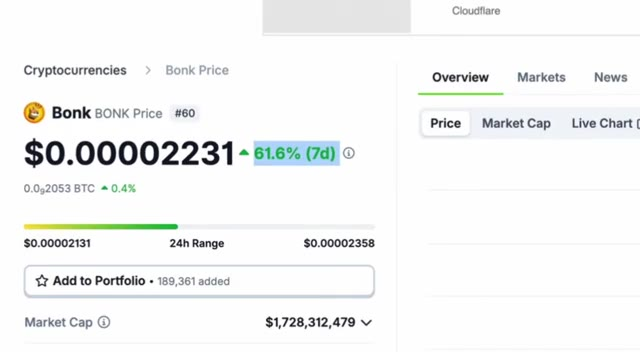
*⏱️ 00:00:05 — Capture d'écran montrant les données de prix de Bonk sur un site Web de type agrégateur de crypto (avec un prix à 0,00002231 $ et une hausse de 61,6 % sur 7 jours).*

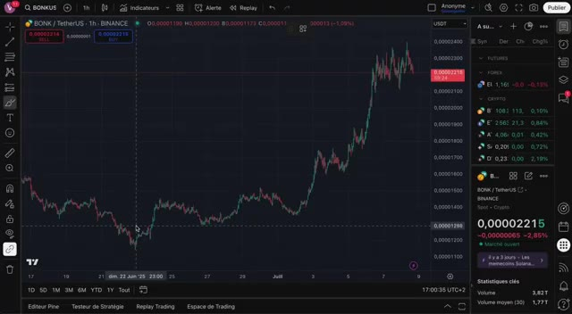
*⏱️ 00:00:16 — Graphique TradingView en unité 1 heure de la paire BONK/TetherUS sur Binance, illustrant une forte hausse verticale du cours.*

---

### ⏱️ `[00:00:22 - 00:00:57]` | Segment #02

**🔊 Audio (Transcription Intégrale Mot pour Mot en Français) :**
> Je vais aussi vous montrer les niveaux que je surveille personnellement, à quoi s'attendre ensuite, et à la toute fin, je révélerai une stratégie que j'utilise en ce moment et qui pourrait transformer cette dynamique en une réelle opportunité. Plongeons dans le vif du sujet. Pour comprendre cette hausse, nous devons regarder au-delà du graphique. Dollar Bonks est désormais bien plus qu'un simple mème. C'est le cœur de l'un des écosystèmes à la croissance la plus rapide sur Boncelana, BonkFund. Et ces derniers temps, il domine l'espace. BonkFund a récemment dépassé PumpFund en termes d'utilisateurs engagés et de performance des tokens, et cela s'est produit juste avant le lancement tant attendu du Pumptoken. Alors que beaucoup s'attendaient à ce que le TGE de Pump Fund draine la liquidité

**👁️ Analyse Visuelle d'Écran (gemini-3.5-flash-lite) :**
**Interface & Outils** : TradingView, X (anciennement Twitter)

**Contenu textuel & Code** : Graphique de prix cryptographique BONK/USDT, données de marché et de volume sur 24h pour les launchpads (LetsbonkFun à 54.80%, Pump à 35.10%, Believe, Jup Studio, Moonshot).

**Action / Démonstration** : Analyse technique du cours de BONK et consultation de données textuelles et statistiques sur les parts de marché des plateformes de lancement de memecoins.

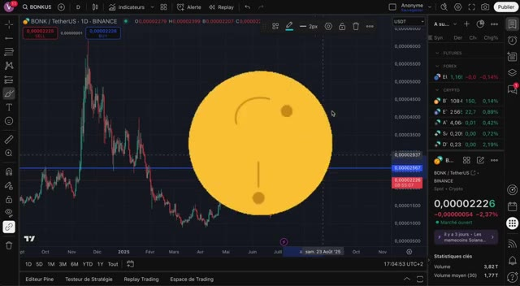
*⏱️ 00:00:30 — Graphique TradingView en chandelier journalier (1D) de la paire BONK/TetherUS sur Binance, montrant les fluctuations de prix avec un motif graphique rond jaune au centre.*

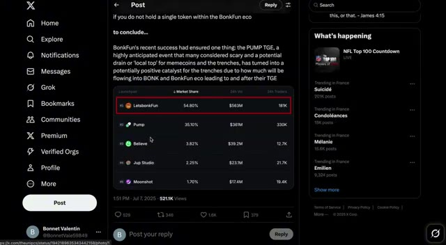
*⏱️ 00:00:39 — Capture d'écran de l'interface du réseau social X (Twitter) affichant un fil de discussion avec un tableau comparatif des parts de marché des launchpads crypto (LetsbonkFun, Pump, etc.).*

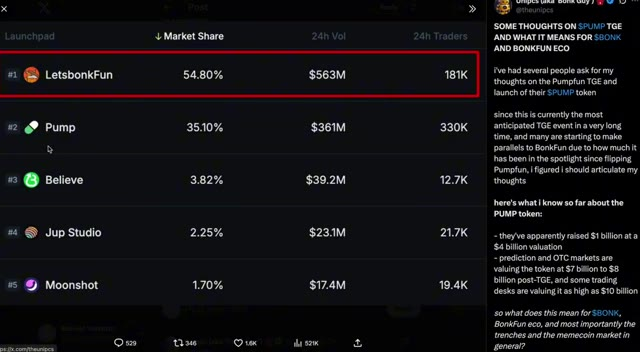
*⏱️ 00:00:48 — Gros plan sur le tableau statistique des launchpads affiché dans le post X, montrant les parts de marché, le volume sur 24h et le nombre de traders pour chaque plateforme.*

---

### ⏱️ `[00:00:57 - 00:01:26]` | Segment #03

**🔊 Audio (Transcription Intégrale Mot pour Mot en Français) :**
> Du côté du marché, ce que nous voyons réellement, c'est l'inverse. Bonk absorbe l'engouement et Bonk Finance gagne des parts de marché considérables, et voici pourquoi. Contrairement à Pumpt Fund, perçu par beaucoup comme extractif en vendant de grandes quantités de Sol, Bonk Fund est profondément intégré dans l'écosystème Solana. Il brûle du Bonk à chaque transaction, il stake du Sol pour soutenir la sécurité du réseau, et il bâtit une culture de créateurs axée sur la communauté qui attire désormais des traders du monde entier, en particulier de Chine.

**👁️ Analyse Visuelle d'Écran (gemini-3.5-flash-lite) :**
**Interface & Outils** : DefiLlama, Twitter/X (Lookonchain) et Dune Analytics.

**Contenu textuel & Code** : Courbes de croissance des frais cumulés, statistiques de vente de SOL par Pump.fun (969 945 SOL de revenus totaux), et tableaux de données chiffrées sur les volumes de Bonk brûlés mensuellement.

**Action / Démonstration** : Présentation de graphiques on-chain et de rapports de données pour comparer l'activité économique de Pump.fun et l'impact de Bonk sur le marché.

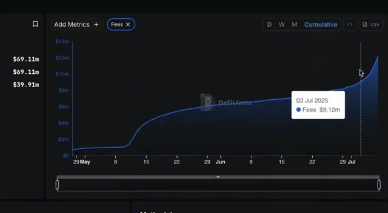
*⏱️ 00:01:04 — Un graphique en courbes issu de DefiLlama montrant l'évolution cumulée des frais (Fees) du 29 mai au début du mois de juillet 2025.*

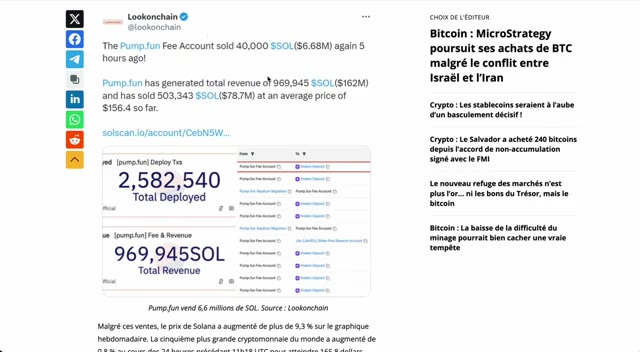
*⏱️ 00:01:12 — Une publication du compte Lookonchain sur le réseau X (Twitter) détaillant les ventes de SOL par Pump.fun et des données associées.*

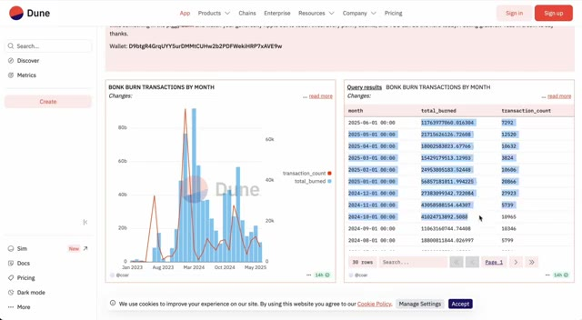
*⏱️ 00:01:19 — Un tableau de bord de la plateforme Dune Analytics affichant les transactions de brûlage de jetons Bonk par mois (Bonk Burn Transactions by Month).*

---

### ⏱️ `[00:01:27 - 00:01:47]` | Segment #04

**🔊 Audio (Transcription Intégrale Mot pour Mot en Français) :**
> Soyons réalistes. Pump Fund a levé 1 milliard de dollars pour une valorisation de 4 milliards. Mais ce qui est surprenant, c'est à quelle vitesse Bonk Fund les a dépassés, même avec un token qui existait déjà. Et la raison est simple. Bonk Fund redistribue vraiment. 58 % de ses frais servent directement à racheter et à brûler du Bonk. Cela crée une demande réelle et constante.

**👁️ Analyse Visuelle d'Écran (gemini-3.5-flash-lite) :**
**Interface & Outils** : Navigateur web affichant le site d'actualités financières Blockworks et l'interface du réseau social X (Twitter).

**Contenu textuel & Code** : Titre d'article sur la levée de fonds de 1 milliard de dollars de Pump.fun pour une valorisation de 4 milliards, et tableau chiffré des parts de marché des launchpads crypto (LetsbonkFun à 54.80% / $563M vs Pump à 35.10% / $361M).

**Action / Démonstration** : Illustration visuelle des données financières et de la comparaison de marché entre Pump.fun et Bonk Fund évoquée dans le commentaire audio.

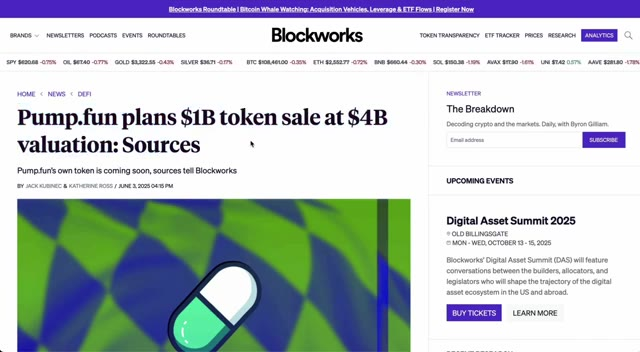
*⏱️ 00:01:32 — Capture d'écran d'un article du site Blockworks intitulé "Pump.fun plans $1B token sale at $4B valuation: Sources".*

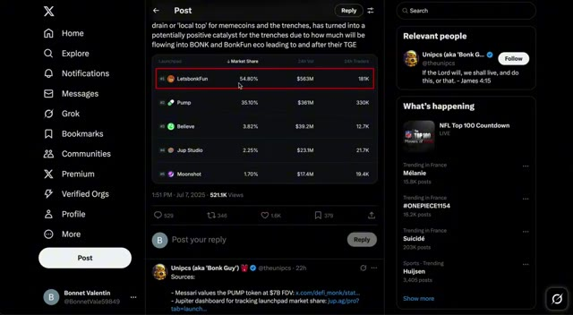
*⏱️ 00:01:37 — Capture d'écran d'une publication sur le réseau social X montrant un tableau comparatif des parts de marché des launchpads, avec "LetsbonkFun" en première position à 54,80 % devant "Pump".*

---

### ⏱️ `[00:01:47 - 00:02:20]` | Segment #05

**🔊 Audio (Transcription Intégrale Mot pour Mot en Français) :**
> Pendant ce temps, le jeton de PumpFun reste flou en termes de tokenomique. Nous ne savons pas quelle quantité ira aux capital-risqueurs, aux initiés, ni quelle est la durée des périodes de blocage. Donc, quand on compare un projet comme PumpFun, évalué entre 4 et 10 milliards de dollars, à Bonk, qui ne vaut que 1,8 milliard de dollars, il est clair que Bonk est encore sous-évalué. Ce qui est encore plus intéressant, c'est que la majeure partie du véritable trading de Bonk ne se fait même plus on-chain. Bonk apparaît à peine sur les DEX de Solana comme Raydium ou Orca. Il est très bas dans le classement en termes de volume. C'est parce que la véritable action s'est déplacée vers les bourses centralisées,

**👁️ Analyse Visuelle d'Écran (gemini-3.5-flash-lite) :**
**Interface & Outils** : Navigateur web, plateforme pump.fun, Crypto Bubbles, interface de DEX décentralisé (Raydium ou similaire)

**Contenu textuel & Code** : Offre totale de pump.fun (1 000 000 000 000 PUMP), détails de l'IEO sur Gate Launchpad ($600M levés, prix $0.004), statistiques de Bonk (Capitalisation : $1.78B, Volume 24h : $1.11B, performance semaine +65%), graphique RAY/SOL en chandelier (15m).

**Action / Démonstration** : Présentation des métriques tokenomiques et de levée de fonds de pump.fun, suivie de la visualisation des performances de marché de Bonk et d'un graphique de swap DEX.

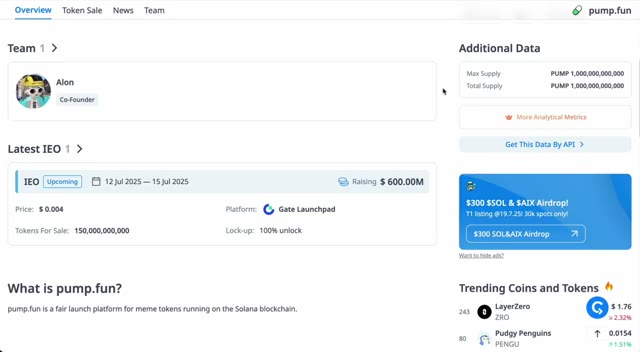
*⏱️ 00:01:55 — Page d'aperçu de pump.fun montrant les détails de l'équipe, de l'IEO et de l'offre totale de jetons.*

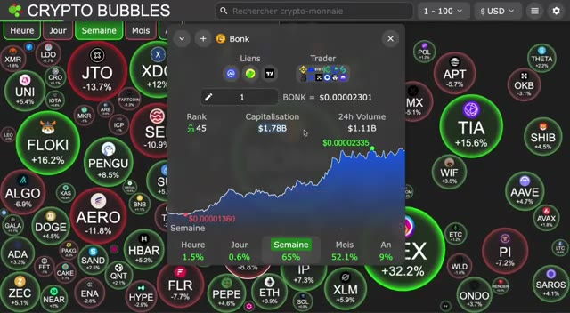
*⏱️ 00:02:04 — Interface de Crypto Bubbles affichant les performances de Bonk avec un graphique de prix sur une semaine et une capitalisation boursière de 1,78 milliard de dollars.*

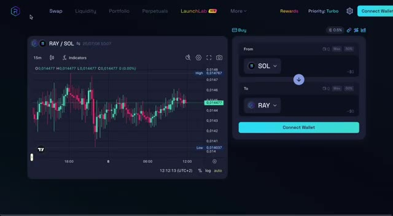
*⏱️ 00:02:12 — Interface de DEX montrant un graphique de trading RAY/SOL sur 15 minutes et un module de swap.*

---

### ⏱️ `[00:02:21 - 00:02:55]` | Segment #06

**🔊 Audio (Transcription Intégrale Mot pour Mot en Français) :**
> où le trading de contrats à terme au comptant et perpétuels domine désormais. Ce changement est essentiel pour comprendre ce qui stimule le prix. Et voici quelque chose de crucial. Il y a une corrélation très forte entre l'intérêt ouvert sur les contrats perpétuels de bonk et son prix. Lorsque l'effet de levier s'accumule, le prix a tendance à monter. Et lorsque les traders se retirent, le prix chute. En ce moment, les taux de financement sont positifs, ce qui signifie que la plupart des traders sont acheteurs sur bonk. Ils parient sur une hausse encore plus importante. Cet effet de levier croissant, combiné à une exécution rapide et à des spreads serrés sur les CEX, pourrait être l'un des

**👁️ Analyse Visuelle d'Écran (gemini-3.5-flash-lite) :**
**Interface & Outils** : TradingView et plateforme de données analytiques crypto (CoinGlass).

**Contenu textuel & Code** : Graphique en chandeliers, outils de mesure de performance, volume d'échange de 620,11M $, intérêt ouvert (Open Interest) à 52,28M $, ratios Long/Short et graphiques de taux de financement.

**Action / Démonstration** : Analyse de l'évolution du prix de BONK et des métriques de contrats à terme associées.

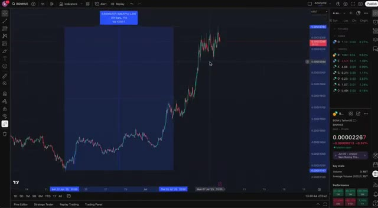
*⏱️ 00:02:29 — Graphique de prix TradingView de la crypto-monnaie BONK/USDT montrant une hausse importante de la valeur.*

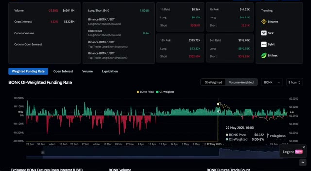
*⏱️ 00:02:46 — Tableau de bord analytique CoinGlass affichant le taux de financement pondéré (OI-Weighted Funding Rate) de BONK et diverses statistiques de liquidations et de volumes.*

---

### ⏱️ `[00:02:55 - 00:03:23]` | Segment #07

**🔊 Audio (Transcription Intégrale Mot pour Mot en Français) :**
> principales raisons derrière cette hausse explosive. Ce n'est pas seulement du battage médiatique, c'est la structure du marché à l'œuvre. Posons maintenant la vraie question. Bonk peut-il réellement atteindre un nouveau record historique pour ce cycle ? Eh bien, voici ce que nous avons pour lui. L'écosystème Solana est toujours fort et actif. Les pièces mèmes s'enflamment à nouveau sur tout le marché. Bonk Fun est devenu la principale rampe de lancement sur Solana, devançant complètement Pump Fun. 58 % des frais de plateforme sont désormais utilisés pour acheter et brûler du Bonk.

**👁️ Analyse Visuelle d'Écran (gemini-3.5-flash-lite) :**
**Interface & Outils** : TradingView, Crypto Bubbles (site web de visualisation de données de marché).

**Contenu textuel & Code** : Graphique en chandeliers japonais pour BONK/USDT avec données de prix (0.00002258 USDT), volume et statistiques clés ; carte thermique (heat map) Crypto Bubbles avec variations hebdomadaires de différentes cryptomonnaies (BONK +63,5%, HEX +29,3%, FLOKI +15,2%, TIA +13,6%).

**Action / Démonstration** : Analyse technique de la structure de marché et de la hausse explosive de BONK à l'aide d'un outil de mesure de performance temporelle et de prix sur graphique, suivie d'une vue d'ensemble sectorielle.

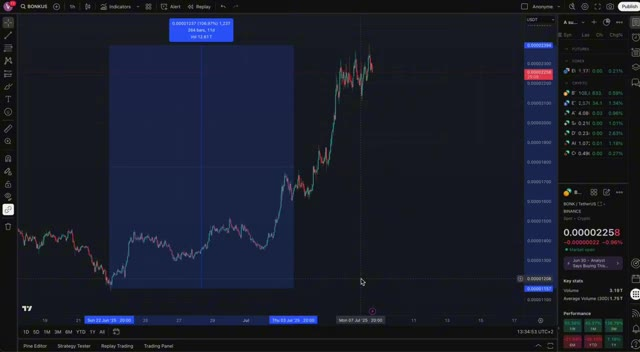
*⏱️ 00:03:02 — Graphique TradingView affichant l'évolution du cours de BONK (BONKUS) en unité de temps 1 heure, avec un outil de mesure rectangulaire bleu mettant en évidence une forte hausse de 106,87% sur 264 barres.*

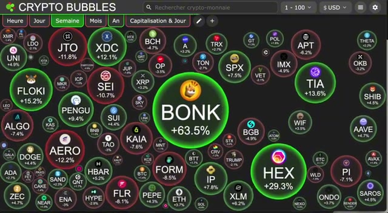
*⏱️ 00:03:16 — Interface Crypto Bubbles montrant une vue d'ensemble du marché crypto sous forme de bulles interactives, avec la bulle centrale de BONK affichant une performance positive de +63,5%.*

---

### ⏱️ `[00:03:23 - 00:03:42]` | Segment #08

**🔊 Audio (Transcription Intégrale Mot pour Mot en Français) :**
> C'est une pression d'achat massive. La communauté est énorme. Plus de 900 000 portefeuilles uniques détiennent du Bonk. Et la plupart des transactions se font désormais sur des bourses centralisées majeures, où il y a un véritable volume et de la liquidité. Avec ce genre de dynamique, je pense qu'il est tout à fait réaliste de s'attendre à ce que Bonk pousse pour un nouveau record historique au cours de ce cycle.

**👁️ Analyse Visuelle d'Écran (gemini-3.5-flash-lite) :**
**Interface & Outils** : Birdeye (agrégateur de données crypto) et WEEX (bourse d'échange centralisée de crypto-monnaies).

**Contenu textuel & Code** : Graphiques en chandeliers de Bonk, volumes de transactions, indicateurs de liquidité, capitalisation boursière (Market Cap), nombre de détenteurs (950.58K), carnet d'ordres et options de levier.

**Action / Démonstration** : Présentation de données on-chain sur les détenteurs de Bonk et transition vers l'analyse des bourses centralisées et de la liquidité des paires de trading.

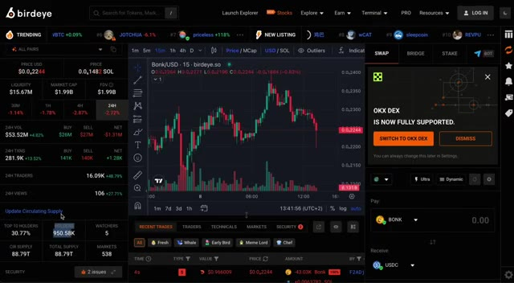
*⏱️ 00:03:28 — Interface Birdeye affichant le graphique du token Bonk (Bonk/USD) sur 15 minutes, avec les statistiques du marché, la capitalisation, la liquidité et le nombre de détenteurs de portefeuilles uniques (plus de 950K).*

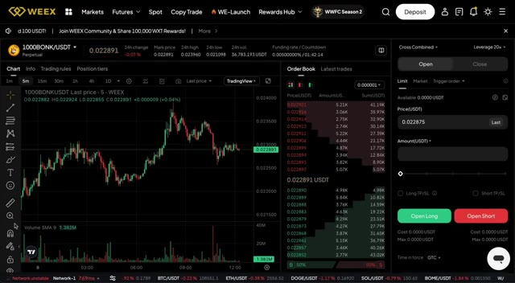
*⏱️ 00:03:33 — Interface de la bourse de dérivés WEEX montrant le carnet d'ordres et le graphique de trading en chandeliers pour la paire 1000BONK/USDT en timeframe 5 minutes.*

---

### ⏱️ `[00:03:42 - 00:04:03]` | Segment #09

**🔊 Audio (Transcription Intégrale Mot pour Mot en Français) :**
> Il pourrait même devenir la pièce mème dominante sur Solana à long terme, surtout si le fonds Bonk continue de croître à ce rythme. Bien sûr, une chose à surveiller est le marché des contrats à terme. Si le financement devient négatif et que l'intérêt à découvert s'envole, nous pourrions assister à un repli. Mais pour l'instant, les acheteurs ont clairement le dessus. Maintenant, si vous vous demandez où je trade Bonk, la réponse est weeks.

**👁️ Analyse Visuelle d'Écran (gemini-3.5-flash-lite) :**
**Interface & Outils** : Coinglass (Dashboard de données de marché crypto et dérivés).

**Contenu textuel & Code** : Graphique du taux de financement de BONK sur le marché des contrats à terme, affichant les données d'intérêt ouvert (Open Interest), de volume, et les liquidations sur différentes périodes (1h, 4h, 12h, 24h).

**Action / Démonstration** : Analyse des données de contrats à terme et des taux de financement de BONK en lien avec l'intérêt à découvert.

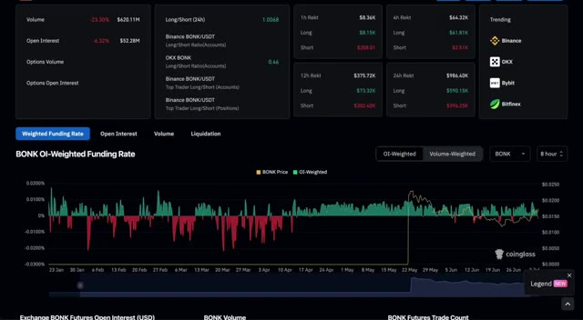
*⏱️ 00:03:48 — Capture d'écran de l'interface Coinglass montrant le taux de financement pondéré par l'intérêt ouvert (OI-Weighted Funding Rate) pour le jeton BONK.*

---

### ⏱️ `[00:04:03 - 00:04:28]` | Segment #10

**🔊 Audio (Transcription Intégrale Mot pour Mot en Français) :**
> C'est fluide, fiable, et parfait pour le trading au comptant comme sur marge. Et voici le meilleur. Si vous vous inscrivez en utilisant le lien dans la description, vous obtiendrez un bonus de 100 USDT instantanément. Tout ce que vous avez à faire, c'est créer votre compte, vérifier votre e-mail et votre téléphone. C'est tout. Aucun dépôt requis. Et si vous décidez de déposer et de commencer à trader, il y a aussi des récompenses supplémentaires, incluant un bonus sur dépôt allant jusqu'approximativement 300 $ si vous financez votre compte avec au moins 2 000 $.

**👁️ Analyse Visuelle d'Écran (gemini-3.5-flash-lite) :**
**Interface & Outils** : Plateforme d'échange de cryptomonnaies WEEX

**Contenu textuel & Code** : Offres de bonus de bienvenue, paliers de dépôt (100$, 500$, 1000$, 2000$), et conditions de récompenses pour nouveaux utilisateurs (150 USDT et 100 USDT).

**Action / Démonstration** : Présentation des avantages et des bonus d'inscription pour les nouveaux utilisateurs de la plateforme WEEX.

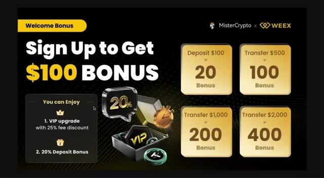
*⏱️ 00:04:09 — Image promotionnelle présentant le bonus de bienvenue de WEEX avec les détails des différents paliers de dépôt et de transfert.*

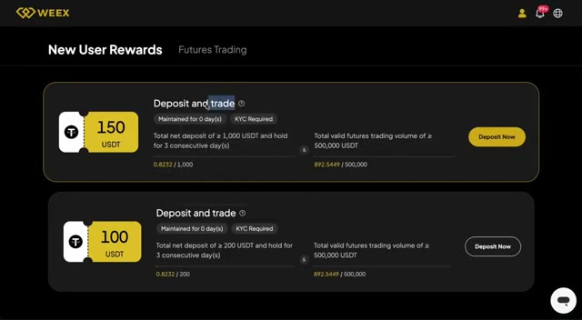
*⏱️ 00:04:22 — Interface de la plateforme WEEX affichant la section "New User Rewards" avec les récompenses et conditions de dépôt et de trading.*

---

### ⏱️ `[00:04:29 - 00:04:50]` | Segment #11

**🔊 Audio (Transcription Intégrale Mot pour Mot en Français) :**
> Ce bonus est uniquement disponible via le lien ci-dessous. Donc, si vous voulez surfer sur cette dynamique avec Bonk, ne manquez pas l'opportunité. Que ce rallye de Bonk continue ou ralentisse, une chose est claire. Le Bonk Fund a complètement inversé la tendance. Ce qui était censé être un énorme drainage de liquidité issu du TGE de Pump se transforme maintenant en un catalyseur haussier pour Bonk et tout l'écosystème du Bonk Fund.

**👁️ Analyse Visuelle d'Écran (gemini-3.5-flash-lite) :**
**Interface & Outils** : WEEX exchange, TradingView, X (Twitter)

**Contenu textuel & Code** : Soldes à 0 USDT, graphique de prix crypto (BONK/USDT), parts de marché des lancements (LetbonkFun 54.80%, Pump 35.10%)

**Action / Démonstration** : Présentation de la plateforme WEEX, analyse de la tendance haussière de Bonk sur TradingView et consultation d'une statistique sur X.

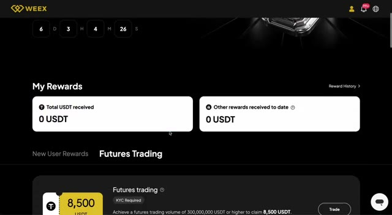
*⏱️ 00:04:34 — Interface de la plateforme d'échange WEEX affichant le solde des récompenses utilisateur et les programmes de trading de futures.*

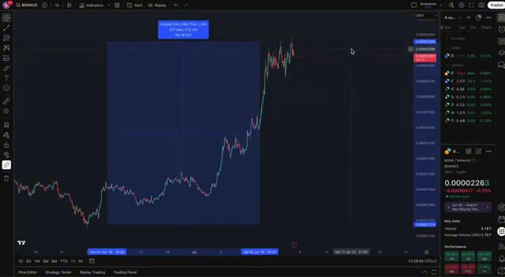
*⏱️ 00:04:40 — Graphique TradingView en chandelier horaire montrant l'évolution du cours de BONK (BONK/USDT) avec une hausse marquée et un rectangle de mesure.*

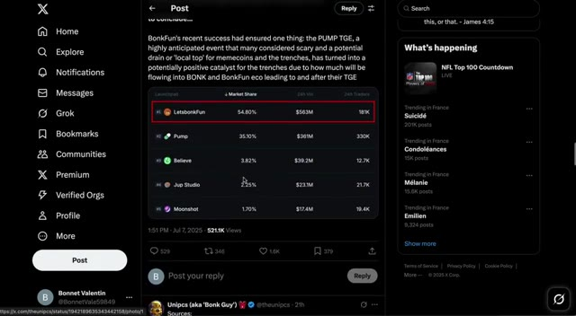
*⏱️ 00:04:45 — Capture d'écran d'un post sur X (Twitter) montrant un classement de parts de marché de plateformes (LetbonkFun en tête avec 54,80%).*

---

### ⏱️ `[00:04:50 - 00:05:09]` | Segment #12

**🔊 Audio (Transcription Intégrale Mot pour Mot en Français) :**
> Je surveille personnellement les graphiques et les taux de financement perpétuels de très près, et si nous parvenons à franchir cette zone de résistance, nous pourrions voir un autre mouvement de plus 80 % en un rien de temps. Merci d'avoir regardé. N'oubliez pas d'aimer, de vous abonner pour plus d'analyses crypto en temps réel, et de laisser un commentaire si vous surfez sur la vague Bonk en cette période. Voyons jusqu'où celui-ci peut aller.

**👁️ Analyse Visuelle d'Écran (gemini-3.5-flash-lite) :**
**Interface & Outils** : TradingView, Crypto Bubbles

**Contenu textuel & Code** : Graphique de prix historique de BONK avec une ligne de résistance horizontale ; vue d'ensemble de la performance hebdomadaire du marché crypto via Crypto Bubbles mettant en avant BONK (+63.5%) et HEX (+29.3%).

**Action / Démonstration** : Analyse technique du graphique de prix de BONK et surveillance des performances du marché sur Crypto Bubbles.

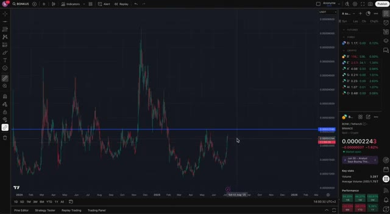
*⏱️ 00:04:55 — Graphique en chandeliers TradingView montrant l'historique des prix de BONK avec un niveau de résistance horizontal tracé en bleu.*

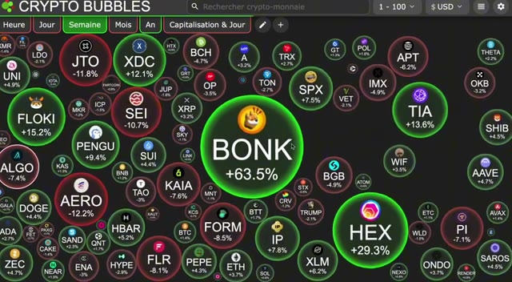
*⏱️ 00:05:04 — Interface de Crypto Bubbles montrant une vue d'ensemble du marché crypto avec la bulle BONK mise en avant à +63.5%.*

---

