# 🎬 BEST 1 Minute Crypto Scalping STRATEGY (Simple)

> **Chaîne** : [Alex Carter](https://www.youtube.com/@AlexCarterTrading)  
> **Lien YouTube** : [https://www.youtube.com/watch?v=8szv0DEU0j4](https://www.youtube.com/watch?v=8szv0DEU0j4)  
> **Date de publication** : 20250710  
> **Durée** : 00:07:50  
> **Identifiant vidéo** : `8szv0DEU0j4`  
> **Transcription & Analyse** : `whisper-v3-large-turbo+gemini-3.5-flash-lite`  

---

## 📌 Synthèse Exécutive & Outils

### 💡 Résumé
Dans cette vidéo intitulée **BEST 1 Minute Crypto Scalping STRATEGY (Simple)**, Alex Carter détaille une approche stratégique et pratique du trading et de l'automatisation par agents IA.

### 🛠️ Outils, Modèles & Logiciels Présentés
- **TradingView & Claude Code** : Analyse technique avancée et automatisation algorithmique.

### 🔑 Points Clés & Enseignements Stratégiques
- Respect rigoureux du ratio risque/rendement et du money management.
- Automatisation méthodique des déclencheurs d'ordres via des agents intelligents.

---

## ⏱️ Chronologie & Transcription Complète Audio & Visuelle (Mot pour Mot)

### ⏱️ `[00:00:00 - 00:00:29]` | Segment #01

**🔊 Audio (Transcription Intégrale Mot pour Mot en Français) :**
> Tu veux apprendre à gagner 100 à 300 dollars par jour avec le scalping crypto ? Dans cette vidéo, je vais te montrer l'une des stratégies de scalping les plus simples et les plus efficaces, même si tu ne fais que débuter. Nous verrons les indicateurs exacts à utiliser, comment repérer des configurations rentables en temps réel, et comment entrer et sortir des trades comme un pro, à la hausse comme à la baisse. Ensuite, je te montrerai comment tout configurer sur Wix, la plateforme crypto que j'utilise tous les jours pour ces trades. Si tu es nouveau, tu peux obtenir un bonus de bienvenue de 100 dollars avec mon lien dans la description.

**👁️ Analyse Visuelle d'Écran (gemini-3.5-flash-lite) :**
**Interface & Outils** : TradingView, WEEX (échange de cryptomonnaies)

**Contenu textuel & Code** : Graphique en chandeliers, indicateur technique oscillateur, carnet d'ordres (Order Book), options de levier (Cross 20x), volumes (Volume SMA 9).

**Action / Démonstration** : Analyse graphique et démonstration d'une position longue avec outil de risk/reward sur TradingView, visualisation du marché des contrats futures ETH/USDT sur WEEX.

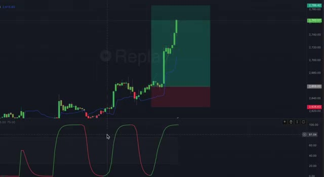
*⏱️ 00:00:07 — Un graphique en chandeliers japonais sur TradingView avec un indicateur de type oscillateur dans un panneau inférieur et une position longue configurée en mode Replay.*

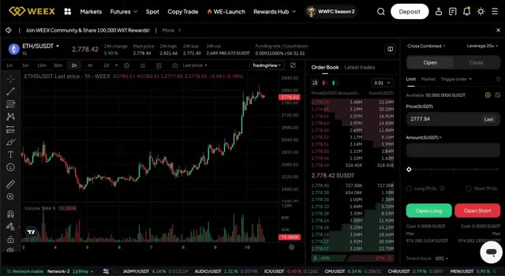
*⏱️ 00:00:22 — L'interface de trading de la bourse WEEX affichant le graphique de la paire ETH/USDT en unité de temps 1 heure, avec un carnet d'ordres et un panneau de passage d'ordres à droite.*

---

### ⏱️ `[00:00:29 - 00:00:49]` | Segment #02

**🔊 Audio (Transcription Intégrale Mot pour Mot en Français) :**
> Pas de code, pas de prises de tête avec les vérifications KYC. Plongeons dedans et transformons ces petits mouvements en de vrais profits. Donc, voici l'idée derrière cette stratégie de scalping. Tout tourne autour de trades rapides. Vous ne conservez rien pendant des heures, juste une entrée et une sortie en quelques minutes, idéalement en cumulant 20 à 30 petits trades par jour, selon les conditions du marché.

**👁️ Analyse Visuelle d'Écran (gemini-3.5-flash-lite) :**
**Interface & Outils** : Plateforme d'échange WEEX (Image 1) et graphique TradingView (Image 2).

**Contenu textuel & Code** : Graphique de prix Ethereum (ETH/USDT), EMA 200, Trend Trader Strategy 21, et oscillateur STC (Schaff Trend Cycle) avec zones de surachat et de survente.

**Action / Démonstration** : Présentation d'une configuration de scalping sur graphique en chandeliers japonais avec indicateurs de tendance et de momentum.

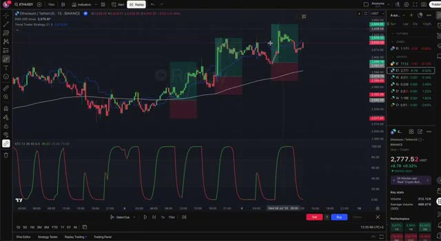
*⏱️ 00:00:39 — Graphique TradingView affichant le cours d'Ethereum (ETH/USDT) en unité de temps 15 minutes avec l'indicateur STC en sous-fenêtre.*

---

### ⏱️ `[00:00:49 - 00:01:19]` | Segment #03

**🔊 Audio (Transcription Intégrale Mot pour Mot en Français) :**
> L'objectif est simple, ne devinez pas le marché. Suivez la tendance, attrapez ces micro-mouvements, et surfez-les pour des profits réguliers. Pour y arriver, nous allons utiliser trois indicateurs super simples qui fonctionnent à merveille ensemble. Le STC ou Schaff trend cycle pour nous aider à repérer le momentum d'achat et de vente. L'EMA200, qui nous montre la tendance globale. Sommes-nous dans une tendance haussière ou baissière ? Un outil appelé le trend trader, qui met visuellement en valeur le mouvement des prix comme les bougies Heikinashi, mais en encore plus propre. Maintenant, configurons cela sur TradingView.

**👁️ Analyse Visuelle d'Écran (gemini-3.5-flash-lite) :**
**Interface & Outils** : TradingView

**Contenu textuel & Code** : ETHUSDT, indicateurs techniques (SMA 200, Trend Trader Strategy 21 3, Schaff Trend Cycle STC 12 26 60 0.5)

**Action / Démonstration** : Analyse graphique de la tendance et présentation de l'indicateur STC pour le trading de micro-mouvements.

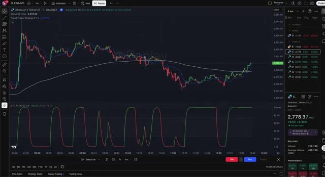
*⏱️ 00:00:57 — Graphique TradingView en chandeliers japonais montrant Ethereum contre TetherUS (ETHUSDT) avec l'indicateur Schaff Trend Cycle (STC) dans le panneau inférieur.*

---

### ⏱️ `[00:01:19 - 00:01:43]` | Segment #04

**🔊 Audio (Transcription Intégrale Mot pour Mot en Français) :**
> C'est complètement gratuit et j'ai glissé le lien en dessous. Commencez par ouvrir le graphique ETH USDT ou BTC USDT et passez sur l'unité de temps d'une minute. C'est là que nous allons faire du scalping. Ensuite, ajoutez les indicateurs STC et choisissez le premier qui apparaît. EMA, sélectionnez Moyenne Mobile Exponencielle, réglez la longueur sur 200, et changez la couleur en blanc pour qu'elle soit facile à voir.

**👁️ Analyse Visuelle d'Écran (gemini-3.5-flash-lite) :**
**Interface & Outils** : TradingView (interface graphique de trading).

**Contenu textuel & Code** : Barre de recherche de symboles avec la requête "ETHUSDT" et liste des paires disponibles sur divers échanges (Binance, Bybit, OKX, KuCoin, etc.).

**Action / Démonstration** : Sélection de la paire ETHUSDT pour afficher le graphique de prix.

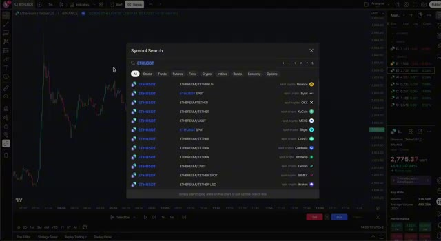
*⏱️ 00:01:25 — Fenêtre de recherche de symboles ouverte sur le graphique TradingView montrant la recherche de la paire ETHUSDT sur différentes bourses.*

---

### ⏱️ `[00:01:43 - 00:02:01]` | Segment #05

**🔊 Audio (Transcription Intégrale Mot pour Mot en Français) :**
> Et cherchez la stratégie Trend Trader Strategy et ajoutez celle-là aussi. Ça colorera les bougies en vert ou en rouge selon la direction de la tendance. Super utile pour des décisions visuelles rapides. Une fois que tout cela est en place, vous avez une configuration parfaite pour commencer à repérer des trades. Maintenant, décomposons la stratégie proprement dite. Et ne vous inquiétez pas, c'est super facile à suivre.

**👁️ Analyse Visuelle d'Écran (gemini-3.5-flash-lite) :**
**Interface & Outils** : TradingView (Graphique des prix ETH/USDT en arrière-plan et panneau de recherche d'indicateurs au premier plan)

**Contenu textuel & Code** : Indicateurs visibles dans la liste : Moving Average Exponential, STC Indicator - A Better MACD, Trend Trader Strategy.

**Action / Démonstration** : Sélection et ajout de la 'Trend Trader Strategy' depuis le menu des indicateurs.

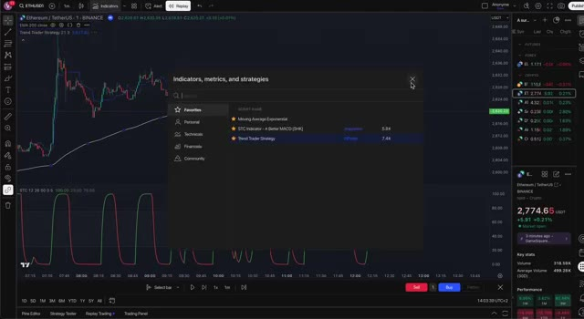
*⏱️ 00:01:47 — Fenêtre de recherche des indicateurs sur le graphique TradingView avec l'indicateur 'Trend Trader Strategy' sélectionné dans les favoris.*

---

### ⏱️ `[00:02:01 - 00:02:36]` | Segment #06

**🔊 Audio (Transcription Intégrale Mot pour Mot en Français) :**
> Nous allons utiliser quatre règles simples pour décider quand entrer dans un trade. Règle numéro un, trader avec la tendance. Premièrement, nous voulons toujours trader avec la tendance générale, et non contre elle. C'est à cela que sert l'EMA 200. Elle agit comme une ligne tracée dans le sable. En dessous, les prix au-dessus de l'EMA 200, nous sommes dans une tendance haussière, nous ne cherchons que des entrées à l'achat. Si le prix est en dessous, nous sommes dans une tendance baissière et nous ne prenons que des entrées à la vente. Cette règle à elle seule élimine une tonne de mauvais trades. Pas de devinettes, il suffit de suivre le mouvement. Règle numéro deux, attendre un repli. Même dans une forte tendance, le prix ne se déplace jamais en ligne droite. Il va

**👁️ Analyse Visuelle d'Écran (gemini-3.5-flash-lite) :**
**Interface & Outils** : TradingView

**Contenu textuel & Code** : EMA 200 (valeur affichée à 2,775.18), Trend Trader Strategy, indicateur STC (Schaff Trend Cycle) en bas, graphiques de prix en chandeliers 1 minute sur Binance.

**Action / Démonstration** : Présentation de la première règle de trading consistant à utiliser l'EMA 200 pour déterminer la tendance générale du marché.

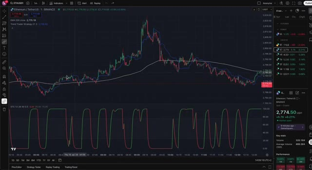
*⏱️ 00:02:10 — Un graphique en chandeliers japonais affichant le cours de l'Ethereum (ETH/USDT) avec l'indicateur EMA 200 en ligne blanche et un oscillateur en bas de l'écran.*

---

### ⏱️ `[00:02:36 - 00:03:12]` | Segment #07

**🔊 Audio (Transcription Intégrale Mot pour Mot en Français) :**
> monter, puis descendre, puis remonter en vagues. Donc au lieu de sauter le pas immédiatement, nous attendons un petit repli. Dans une tendance haussière, cela signifie quelques bougies rouges, une petite baisse de prix. Dans une tendance baissière, c'est un bref rebond, quelques bougies vertes avant la prochaine jambe de baisse. Cette étape est une question de patience. Nous attendons que le marché respire avant de faire un mouvement. Règle numéro trois, confirmation de la tendance. Vvient maintenant la confirmation visuelle. Une fois le repli terminé, nous voulons voir l'indicateur de tendance basculer à nouveau dans la direction de la tendance. Dans une tendance haussière, la bougie devrait redevenir verte, montrant que le prix récupère. Dans une tendance baissière, elles devraient redevenir rouges, confirmant le rebond.

**👁️ Analyse Visuelle d'Écran (gemini-3.5-flash-lite) :**
**Interface & Outils** : TradingView

**Contenu textuel & Code** : ETHUSDT 1m, EMA 200, Trend Trader Strategy, indicateur STC (Schaff Trend Cycle)

**Action / Démonstration** : Analyse d'un repli (bougies rouges) au sein d'une tendance haussière pour illustrer le point d'entrée en vagues.

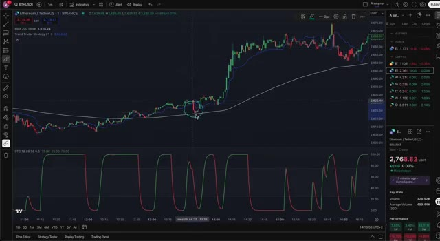
*⏱️ 00:02:45 — Graphique TradingView d'Ethereum (ETHUSDT) en unités de 1 minute, montrant le cours entouré par le curseur lors d'un repli sur une moyenne mobile, avec l'indicateur STC en bas.*

---

### ⏱️ `[00:03:12 - 00:03:38]` | Segment #08

**🔊 Audio (Transcription Intégrale Mot pour Mot en Français) :**
> est terminé. Cela nous donne l'confiance que la tendance est toujours intacte et que le repli se termine. Règle numéro quatre, la confirmation STC. Et enfin, nous attendons que l'indicateur STC s'aligne avec tout le reste. Si nous prenons position à l'achat, le STC doit passer au vert, ce qui signale le retour d'un momentum haussier. Si nous prenons position à la vente, nous voulons qu'il passe au rouge, montrant que la pression à la baisse reprend. C'est notre signal de départ final. Nous n'entrons dans le trade que lorsque les quatre conditions sont remplies.

**👁️ Analyse Visuelle d'Écran (gemini-3.5-flash-lite) :**
**Interface & Outils** : Graphique de type TradingView.

**Contenu textuel & Code** : Texte superposé "STC Confirmation" et indicateur technique en bas du graphique.

**Action / Démonstration** : Présentation de la règle numéro quatre concernant la confirmation par l'indicateur STC.

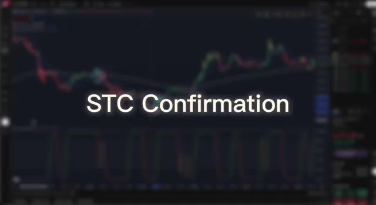
*⏱️ 00:03:19 — Capture d'écran floue d'un graphique de trading en arrière-plan avec le texte "STC Confirmation" affiché au centre.*

---

### ⏱️ `[00:03:38 - 00:04:16]` | Segment #09

**🔊 Audio (Transcription Intégrale Mot pour Mot en Français) :**
> Ce qui est formidable, c'est que cette stratégie fonctionne dans les deux sens, en tendance haussière ou baissière. Il suffit d'inverser la logique selon la position du prix par rapport à l'EMA. Pas de devinettes, pas de place pour les sentiments, juste des configurations propres basées sur les données que vous pouvez répéter encore et encore. Examinons notre exemple concret sur TradingView pour que vous puissiez voir comment cette stratégie se déroule. Nous regardons le graphique ETH USDT et le prix est clairement au-dessus de l'EMA 200. Nous sommes donc dans une tendance haussière et nous ne chercherons que des positions acheteuses. Ensuite, nous obtenons un petit repli, quelques bougies rouges. Rien de majeur, juste une petite baisse dans la tendance. Ensuite, l'indicateur de tendance redevient vert,

**👁️ Analyse Visuelle d'Écran (gemini-3.5-flash-lite) :**
**Interface & Outils** : TradingView

**Contenu textuel & Code** : EMA 200 (ligne blanche), indicateur STC (Schaff Trend Cycle) configuré en 12, 26, 50, 0.5 avec des zones de surachat/survente (25-75), et des cercles de surbrillance sur les configurations graphiques.

**Action / Démonstration** : Analyse de la position du prix par rapport à l'EMA et de la corrélation avec l'indicateur STC pour illustrer la stratégie de trading.

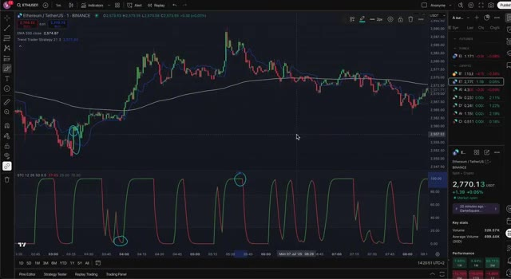
*⏱️ 00:03:48 — Graphique TradingView affichant le cours d'Ethereum (ETHUSDT) en unité de temps 1 minute, avec des indicateurs techniques de tendance et de momentum.*

---

### ⏱️ `[00:04:16 - 00:04:41]` | Segment #10

**🔊 Audio (Transcription Intégrale Mot pour Mot en Français) :**
> montrant que le prix est en train de se redresser. Et enfin, le STC passe au vert. Parfait. C'est notre signal. Les quatre conditions sont réunies, donc nous passons à l'achat pour une position long. Pleat is no too fun. Maintenant, en matière de gestion des risques, voici ce que je fais habituellement. Je place un stop loss à environ 0,25 % en dessous de mon entrée, à peu près au même niveau, ce qui me donne un ratio risque/rendement de 1 pour 1.

**👁️ Analyse Visuelle d'Écran (gemini-3.5-flash-lite) :**
**Interface & Outils** : TradingView

**Contenu textuel & Code** : Graphique en chandeliers, EMA 200, indicateur STC (Schaff Trend Cycle) en bas, outil de relecture (Replay) actif.

**Action / Démonstration** : Analyse graphique et observation du passage au vert de l'indicateur STC confirmant le signal d'achat pour une position long.

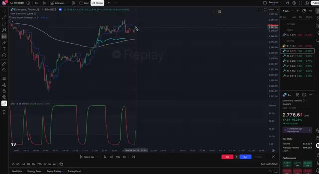
*⏱️ 00:04:22 — Graphique TradingView montrant le cours d'Ethereum (ETH/USDT) avec les indicateurs techniques EMA et STC.*

---

### ⏱️ `[00:04:41 - 00:05:04]` | Segment #11

**🔊 Audio (Transcription Intégrale Mot pour Mot en Français) :**
> Si la tendance a l'air vraiment forte, vous pouvez viser un peu plus, comme 1 pour 1,5 ou 1 pour 2, mais ne vous prenez pas trop la tête. Le plus important est de rester cohérent, de protéger votre capital et de laisser les mathématiques faire leur œuvre au fil du temps. Passons maintenant à Weeks, qui est la plateforme que j'utilise personnellement pour le scalping. Elle est rapide, fiable et conçue pour ce type de trading à court terme.

**👁️ Analyse Visuelle d'Écran (gemini-3.5-flash-lite) :**
**Interface & Outils** : Graphique TradingView et plateforme d'échange de cryptomonnaies WEEX.

**Contenu textuel & Code** : Paire ETH/SUSDT, prix actuel à 2772,94 SUSDT, indicateurs de volume (Volume SMA 9), carnet d'ordres et outils de gestion des positions (Long/Short).

**Action / Démonstration** : Configuration d'une position de trading avec un ratio risque/rendement adapté et navigation sur la plateforme WEEX pour analyser le marché de l'Ethereum.

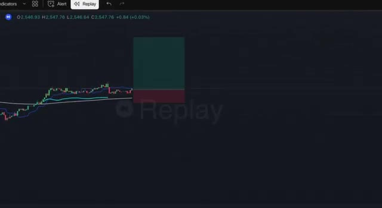
*⏱️ 00:04:47 — Graphique TradingView en mode Replay affichant une position longue avec un objectif de profit élevé (ratio risque/rendement supérieur à 1:2) et un stop-loss serré.*

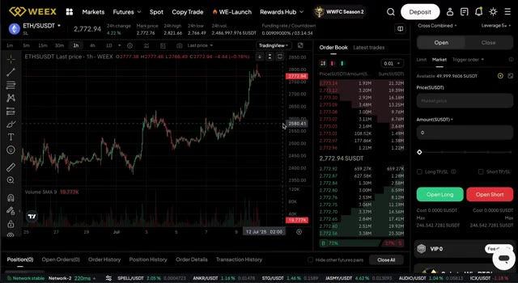
*⏱️ 00:04:58 — Interface de la plateforme de trading WEEX montrant le graphique de la paire ETH/SUSDT sur une unité de temps d'une heure, avec le carnet d'ordres à droite et le panneau de passage d'ordres.*

---

### ⏱️ `[00:05:04 - 00:05:24]` | Segment #12

**🔊 Audio (Transcription Intégrale Mot pour Mot en Français) :**
> Voici exactement comment configurer les choses. D'abord, allez dans la section Futures, et non Spot, et sélectionnez votre paire de trading. Je recommande de commencer par ETH USDT ou BTC USDT, puisqu'ils sont les plus liquides. Ensuite, choisissez votre effet de levier. Personnellement, je m'en tiens à un maximum de 5X, surtout pour les débutants.

**👁️ Analyse Visuelle d'Écran (gemini-3.5-flash-lite) :**
**Interface & Outils** : WEEX (Exchange de cryptomonnaies)

**Contenu textuel & Code** : Paire ETH/USDT, menu déroulant Futures (USDT-M futures, Demo trading, About futures, Funding rate, About position tiers, Leaderboard), carnet d'ordres, panneau de passage d'ordres (Open Long / Open Short) et effet de levier réglé sur 5x.

**Action / Démonstration** : Navigation dans les menus de la plateforme pour accéder à la section Futures et sélection de la paire de trading.

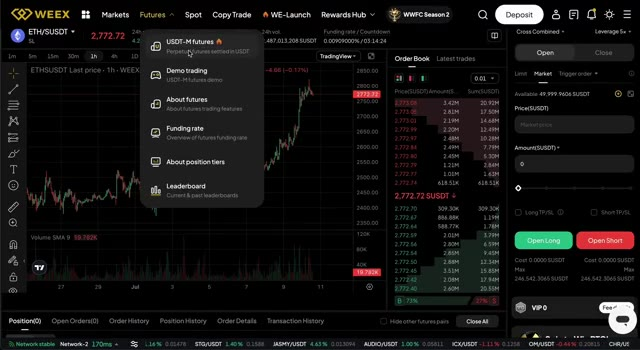
*⏱️ 00:05:09 — Capture d'écran de l'interface de la plateforme WEEX montrant le menu déroulant de la section Futures avec l'option USDT-M futures sélectionnée, ainsi qu'un graphique de la paire ETH/USDT en arrière-plan.*

---

### ⏱️ `[00:05:24 - 00:05:44]` | Segment #13

**🔊 Audio (Transcription Intégrale Mot pour Mot en Français) :**
> Ça vous donne un peu de puissance supplémentaire sans pour autant devenir complètement un *degen*. Ensuite, définissez votre mode de marge. Je choisis généralement le mode croisé, mais si vous préférez un contrôle plus strict de la taille de votre position, vous pouvez choisir la marge isolée. Saisissez maintenant votre ordre par valeur. Ainsi, si vous souhaitez ouvrir un trade de 100 dollars avec un levier de 5, vous n'aurez besoin que de 20 dollars comme marge.

**👁️ Analyse Visuelle d'Écran (gemini-3.5-flash-lite) :**
**Interface & Outils** : Interface de la plateforme d'échange de cryptomonnaies WEEX, graphiques de trading en chandeliers japonais.

**Contenu textuel & Code** : Paire ETH/SUSDT, prix à 2772,62 USDT, options de marge Cross et Isolated, carnet d'ordres et panneau de passage d'ordres.

**Action / Démonstration** : Sélection et configuration du mode de marge (Cross / Isolated) sur l'interface d'échange.

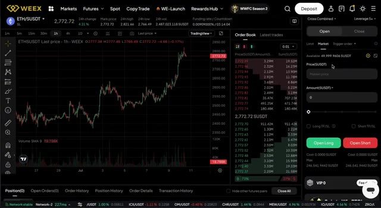
*⏱️ 00:05:29 — Interface de trading WEEX affichant le graphique de la paire ETH/SUSDT en unité de temps 1h avec le carnet d'ordres à droite.*

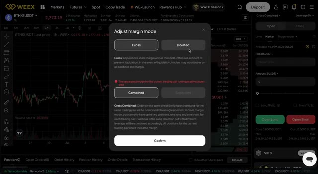
*⏱️ 00:05:34 — Fenêtre modale "Adjust margin mode" sur la plateforme WEEX permettant de choisir entre les modes de marge Cross et Isolated.*

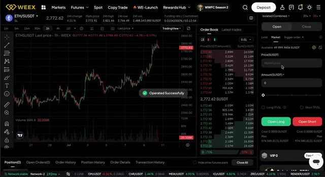
*⏱️ 00:05:39 — Interface de trading WEEX avec une notification verte "Operated Successfully" confirmant la modification du mode de marge.*

---

### ⏱️ `[00:05:44 - 00:06:07]` | Segment #14

**🔊 Audio (Transcription Intégrale Mot pour Mot en Français) :**
> Super efficace. Pour le scalping, j'utilise toujours un ordre au marché. Ça me fait entrer instantanément. Vous ne voulez pas rater le mouvement en attendant qu'un ordre limite soit exécuté. Avant de confirmer le trade, assurez-vous de définir à la fois votre stop loss et votre take profit. Comme je l'ai dit avant, je choisis généralement un ratio risque/rendement de 1 pour 1. Donc si je risque 0,25 %, je viserai un gain de 0,25 %.

**👁️ Analyse Visuelle d'Écran (gemini-3.5-flash-lite) :**
**Interface & Outils** : Interface de l'échange WEEX Futures avec graphique TradingView intégré, carnet d'ordres (Order Book) et panneau de saisie d'ordres.

**Contenu textuel & Code** : Graphique de la paire ETH/SUSDT (prix autour de 2773,13 SUSDT), indicateur Volume SMA 9, carnet d'ordres en temps réel, options de passage d'ordre configurées sur "Market" (ordre au marché) avec un montant de 20 SUSDT et levier réglé sur 20x.

**Action / Démonstration** : Configuration d'un ordre au marché pour l'achat ou la vente rapide (scalping) sur la plateforme WEEX.

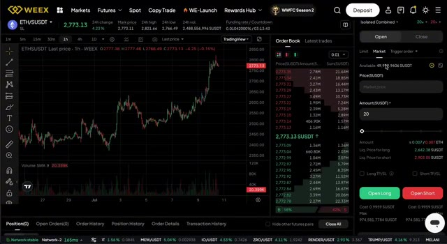
*⏱️ 00:05:50 — Capture d'écran de l'interface de trading WEEX montrant un graphique en chandeliers de la paire ETH/SUSDT sur une période d'une heure, avec le carnet d'ordres et le panneau de passage d'ordres au marché.*

---

### ⏱️ `[00:06:07 - 00:06:28]` | Segment #15

**🔊 Audio (Transcription Intégrale Mot pour Mot en Français) :**
> Ce n'est pas grand-chose par transaction, mais avec 20 ou 30 transactions par jour, ça s'accumule vite. Une fois que tout a l'air bon, appuyez sur confirmer et vous quittez le marché. Si vous débutez sur Weeks, vous avez de la chance. Ils offrent un bonus de bienvenue de 100 $ lorsque vous vous inscrivez avec mon lien ci-dessous. Il vous suffit de vous inscrire, de vérifier et de faire un petit dépôt.

**👁️ Analyse Visuelle d'Écran (gemini-3.5-flash-lite) :**
**Interface & Outils** : Interface de l'échange de cryptomonnaies WEEX (fenêtre de trading et page promotionnelle du bonus de bienvenue).

**Contenu textuel & Code** : Graphique de prix, carnet d'ordres, paramètres de Take Profit / Stop Loss, et grille des bonus de parrainage/bienvenue ($100, $20, $100, $200, $400).

**Action / Démonstration** : Présentation de l'interface de passage d'ordres sur l'échange WEEX puis affichage de l'offre de bonus de bienvenue pour les nouveaux utilisateurs.

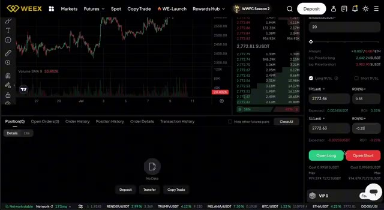
*⏱️ 00:06:12 — Interface de trading de la plateforme WEEX montrant un graphique des prix avec des indicateurs de volume, un carnet d'ordres et le panneau de passage d'ordres à droite avec les boutons 'Open Long' et 'Open Short'.*

*⏱️ 00:06:17 — Écran promotionnel de la plateforme WEEX en partenariat avec MisterCrypto affichant les détails du bonus de bienvenue ('Sign Up to Get $100 BONUS') et les paliers de récompenses selon les dépôts et transferts.*

---

### ⏱️ `[00:06:28 - 00:06:47]` | Segment #16

**🔊 Audio (Transcription Intégrale Mot pour Mot en Français) :**
> Super rapide. Le bonus est crédité sur votre compte futures pour que vous puissiez commencer à tester cette stratégie de scalping exacte. C'est parfait si vous ne voulez pas risquer vos propres fonds tout de suite. Soyons réalistes. Le scalping est risqué. Tous les trades ne fonctionneront pas. Vous obtiendrez de faux signaux, des mouvements de prix erratiques, ou vous ferez stopper juste avant un retournement.

**👁️ Analyse Visuelle d'Écran (gemini-3.5-flash-lite) :**
**Interface & Outils** : TradingView

**Contenu textuel & Code** : Graphique de prix Ethereum (ETH/USDT) en timeframe 15m, indicateur EMA 200, indicateur STC (Schaff Trend Cycle) et zones colorées de stratégie de trading.

**Action / Démonstration** : Analyse graphique de la configuration de scalping sur Ethereum illustrant les signaux de trade.

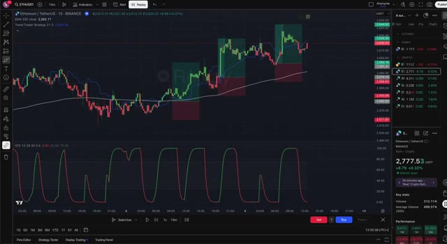
*⏱️ 00:06:37 — Graphique TradingView affichant la paire ETH/USDT en unité de temps 15 minutes avec des indicateurs techniques et des zones de signaux de trading.*

---

### ⏱️ `[00:06:47 - 00:07:07]` | Segment #17

**🔊 Audio (Transcription Intégrale Mot pour Mot en Français) :**
> C'est normal. La clé est de rester discipliné. Ne sur-tradez pas. Maintenez votre risque par trade à un niveau bas. Et ne supprimez jamais votre stop-loss, surtout dans les trades à effet de levier élevé. Faisons un récapitulatif rapide. Utilisez trois indicateurs, le STC, l'EMA 200 et le Trend Trader.

**👁️ Analyse Visuelle d'Écran (gemini-3.5-flash-lite) :**
**Interface & Outils** : TradingView

**Contenu textuel & Code** : Indicateurs techniques visibles : EMA 200 (ligne blanche), Trend Trader Strategy, et indicateur STC (Schaff Trend Cycle) dans le panneau inférieur.

**Action / Démonstration** : Analyse graphique et récapitulatif visuel de la stratégie de trading basée sur la combinaison de l'EMA 200, du Trend Trader et du STC.

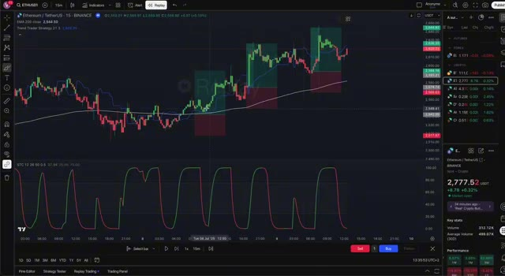
*⏱️ 00:06:52 — Un graphique TradingView en unité de temps 15 minutes d'Ethereum (ETHUSDT) sur Binance, affichant les zones de trading colorées en vert et rouge selon la stratégie.*

---

### ⏱️ `[00:07:07 - 00:07:25]` | Segment #18

**🔊 Audio (Transcription Intégrale Mot pour Mot en Français) :**
> Ne tradez qu'avec la tendance. Attendez un repli et une confirmation. Exécutez rapidement les semaines avec une action de prix de stop-loss appropriée. Restez strict, restez simple. Avec cette stratégie, vous pouvez placer plus de 20 trades par jour si le marché bouge. C'est tout pour ce guide de scalping.

**👁️ Analyse Visuelle d'Écran (gemini-3.5-flash-lite) :**
**Interface & Outils** : Interface de la plateforme d'échange WEEX et interface graphique TradingView.

**Contenu textuel & Code** : Graphiques des prix ETH/USDT, indicateur EMA 200, indicateur de tendance STC, carnet d'ordres, et panneau d'ordres d'achat/vente avec effet de levier.

**Action / Démonstration** : Présentation de la configuration des graphiques et des interfaces de passage d'ordres pour appliquer la stratégie de trading sur la tendance.

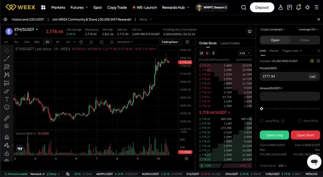
*⏱️ 00:07:11 — Interface de la plateforme de trading WEEX affichant le graphique en chandeliers de la paire ETH/USDT en unité de temps 1 heure, avec le carnet d'ordres et le panneau d'exécution à droite.*

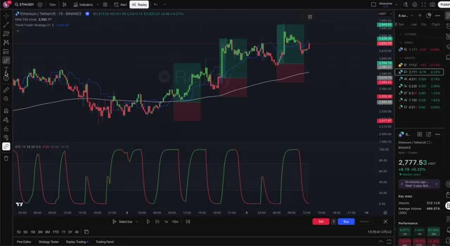
*⏱️ 00:07:21 — Graphique TradingView en unité de temps 15 minutes pour Ethereum (ETH/USDT) affichant les indicateurs techniques et la stratégie de trading avec les zones de profit et de perte colorées.*

---

### ⏱️ `[00:07:25 - 00:07:46]` | Segment #19

**🔊 Audio (Transcription Intégrale Mot pour Mot en Français) :**
> If you want to give it a try, use the link in the description to sign up on weeks and get your $100 bonus. Let me know in the comments if you want a follow up video with live trades or a version of this strategy adapted for 1 hour charts. If you found this helpful, consider liking the video and subscribing. I post weekly guides just like this.

**👁️ Analyse Visuelle d'Écran (gemini-3.5-flash-lite) :**
**Interface & Outils** : Présentation ou face-caméra explicatif du trader sans interface logicielle partagée.

**Contenu textuel & Code** : Explications orales des stratégies et mise en contexte méthodologique du marché.

**Action / Démonstration** : Explications face caméra et analyse conceptuelle des marchés.

---

### ⏱️ `[00:07:46 - 00:07:49]` | Segment #20

**🔊 Audio (Transcription Intégrale Mot pour Mot en Français) :**
> Merci d'avoir regardé, bon scalping, et à la prochaine.

**👁️ Analyse Visuelle d'Écran (gemini-3.5-flash-lite) :**
**Interface & Outils** : TradingView

**Contenu textuel & Code** : EMA 200, Trend Trader Strategy, indicateur STC (Schaff Trend Cycle) avec paramètres 12, 26, 60, 0.5, 0.9.

**Action / Démonstration** : Visualisation du graphique en mode Replay trading.

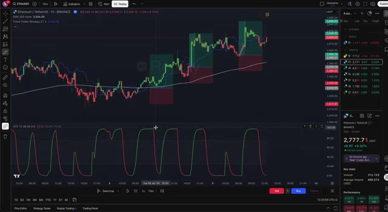
*⏱️ 00:07:47 — Graphique TradingView d'Ethereum (ETHUSDT) en unité de temps 15 minutes, affichant la stratégie Trend Trader Strategy et l'indicateur STC en bas.*

---

