# 🎬 These 10 Altcoins Will 30X In 3 Months (URGENT)

> **Chaîne** : [Alex Carter](https://www.youtube.com/@AlexCarterTrading)  
> **Lien YouTube** : [https://www.youtube.com/watch?v=DcbP6TmO8JM](https://www.youtube.com/watch?v=DcbP6TmO8JM)  
> **Date de publication** : 20250717  
> **Durée** : 00:07:52  
> **Identifiant vidéo** : `DcbP6TmO8JM`  
> **Transcription & Analyse** : `whisper-v3-large-turbo+gemini-3.5-flash-lite`  

---

## 📌 Synthèse Exécutive & Outils

### 💡 Résumé
Dans cette vidéo intitulée **These 10 Altcoins Will 30X In 3 Months (URGENT)**, Alex Carter détaille une approche stratégique et pratique du trading et de l'automatisation par agents IA.

### 🛠️ Outils, Modèles & Logiciels Présentés
- **TradingView & Claude Code** : Analyse technique avancée et automatisation algorithmique.

### 🔑 Points Clés & Enseignements Stratégiques
- Respect rigoureux du ratio risque/rendement et du money management.
- Automatisation méthodique des déclencheurs d'ordres via des agents intelligents.

---

## ⏱️ Chronologie & Transcription Complète Audio & Visuelle (Mot pour Mot)

### ⏱️ `[00:00:00 - 00:00:36]` | Segment #01

**🔊 Audio (Transcription Intégrale Mot pour Mot en Français) :**
> Ethereum commence à s'envoler et cela ne peut signifier qu'une seule chose. La saison des altcoins arrive. En fait, depuis ma dernière vidéo, plusieurs pépites dont j'ai parlé ont déjà fait x5. Mais soyons honnêtes, ce n'est pas suffisant. Nous visons des gains de x30, x50, voire x100. J'ai donc fait des recherches approfondies, analysé les graphiques, suivi les schémas de rotation, et aujourd'hui je partage avec vous les 10 altcoins qui ont le plus fort potentiel d'exploser littéralement au cours des trois prochains mois. Mais avant de vous montrer la liste, vous devez comprendre pourquoi cela se produit, car une fois que vous l'aurez compris, vous réaliserez que vous êtes encore en avance. Ethereum surperforme désormais Bitcoin. C'est le début de la phase

**👁️ Analyse Visuelle d'Écran (gemini-3.5-flash-lite) :**
**Interface & Outils** : Crypto Bubbles, Réseau social X (Twitter)

**Contenu textuel & Code** : Graphique de bulles de cryptomonnaies, tableau de classement et de métriques financières, infographie sur les phases du marché des cryptos (Phase 1: Bitcoin, Phase 2: Ethereum, Phase 3: Large Caps, Phase 4: Altseason)

**Action / Démonstration** : Présentation des performances des altcoins et analyse des différentes phases menant à la saison des altcoins.

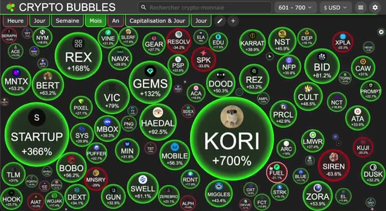
*⏱️ 00:00:09 — Vue d'ensemble de la plateforme Crypto Bubbles montrant les variations mensuelles des cryptomonnaies classées de la position 601 à 700.*

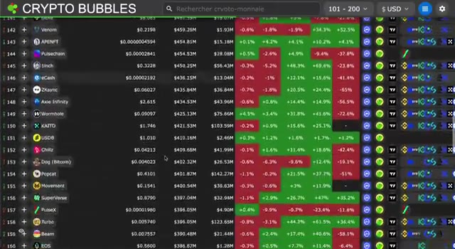
*⏱️ 00:00:18 — Tableau de données Crypto Bubbles affichant les cryptomonnaies de la position 101 à 200 avec leurs prix, capitalisations et variations en pourcentage.*

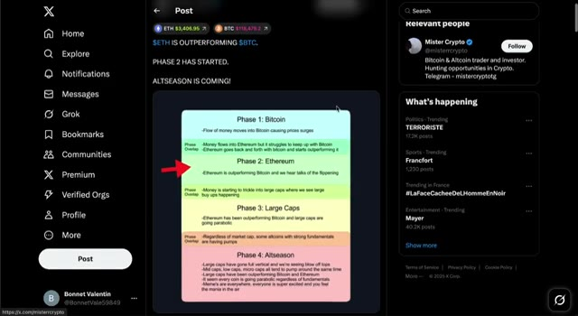
*⏱️ 00:00:27 — Capture d'écran du réseau social X (Twitter) montrant un post sur les différentes phases de l'Altseason avec une infographie détaillée.*

---

### ⏱️ `[00:00:36 - 00:01:10]` | Segment #02

**🔊 Audio (Transcription Intégrale Mot pour Mot en Français) :**
> deux du cycle de marché. C'est le moment où les capitaux sortent du Bitcoin pour aller vers l'Ethereum, puis affluent vers les grandes capitalisations et enfin vers les altcoins. C'est un schéma que nous avons vu maintes et maintes fois. La dominance du Bitcoin est rejetée. La paire ETH BTC est en train de casser sa résistance et le graphique Total 3, qui correspond à la capitalisation boursière de tous les altcoins, hors BTC et ETH, montre une formation de cassure massive. La rotation a commencé. La saison des altcoins n'est plus seulement une possibilité. Elle frappe à la porte. Et au-delà des graphiques, les fondamentaux s'alignent. Des lois sur la crypto sont approuvées. Des nations achètent. Des institutions

**👁️ Analyse Visuelle d'Écran (gemini-3.5-flash-lite) :**
**Interface & Outils** : Réseau social X (Twitter), TradingView (graphique financier).

**Contenu textuel & Code** : Schéma explicatif des flux de capitaux du cycle crypto en quatre phases (Phase 1 : Bitcoin, Phase 2 : Ethereum, Phase 3 : Large Caps, Phase 4 : Altseason) et graphique de la dominance des altcoins.

**Action / Démonstration** : Présentation visuelle des différentes étapes de rotation des capitaux du marché crypto au cours d'un cycle haussier.

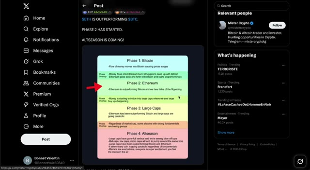
*⏱️ 00:00:44 — Capture d'écran du réseau social X affichant un post sur les cycles de marché crypto, montrant un diagramme détaillé en quatre phases avec une flèche rouge pointant sur la phase 2 : Ethereum.*

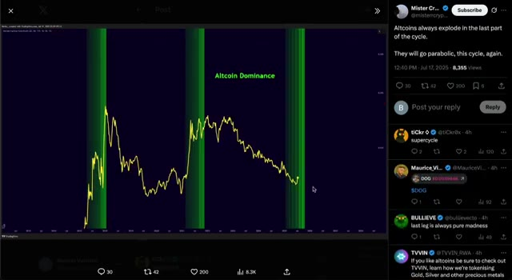
*⏱️ 00:00:53 — Capture d'écran montrant un graphique technique de TradingView intégré dans un post X, illustrant la dominance des altcoins avec des zones surlignées en vert.*

---

### ⏱️ `[00:01:10 - 00:01:29]` | Segment #03

**🔊 Audio (Transcription Intégrale Mot pour Mot en Français) :**
> font le plein d'Ethereum. Et une liquidité massive est sur le point de basculer dans le marché des altcoins. Je crois que la capitalisation boursière totale des cryptomonnaies, hors Bitcoin et Ethereum, le total 3, se dirige vers les 3 billions de dollars pour ce cycle. Mais pour capturer ces gains, vous avez besoin des bonnes cryptos. C'est pourquoi j'ai fait mes devoirs. Il ne s'agit pas juste d'une autre liste aléatoire d'altcoins.

**👁️ Analyse Visuelle d'Écran (gemini-3.5-flash-lite) :**
**Interface & Outils** : Site web Cointelegraph et interface de la plateforme X (Twitter) affichant un graphique TradingView.

**Contenu textuel & Code** : Articles d'actualité crypto sur Cointelegraph, et graphique technique TOTAL3 avec l'annotation « $TOTAL3 Breakout Incoming » et une flèche verte de projection haussière.

**Action / Démonstration** : Illustration visuelle des flux institutionnels vers Ethereum via un article d'actualité, puis analyse technique haussière du TOTAL3 sur un graphique TradingView publié sur X.

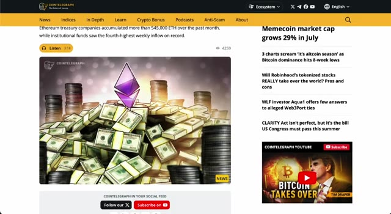
*⏱️ 00:01:15 — Capture d'écran d'un article du site Cointelegraph montrant un graphique illustratif avec des piles de billets de banque et un symbole Ethereum, accompagné de titres sur l'accumulation d'ETH et le marché des altcoins.*

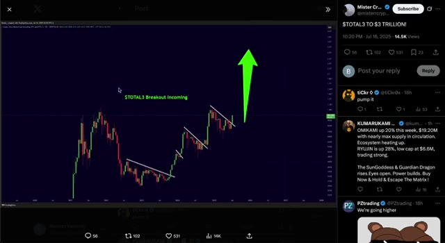
*⏱️ 00:01:20 — Capture d'écran d'une publication X (Twitter) affichant un graphique TradingView de la capitalisation boursière TOTAL3 avec des lignes de tendance baissières et une flèche verte pointant vers le haut.*

---

### ⏱️ `[00:01:30 - 00:02:04]` | Segment #04

**🔊 Audio (Transcription Intégrale Mot pour Mot en Français) :**
> Ce sont des pépites à forte conviction, profondément étudiées, le genre qui ne font pas seulement x3, mais x10, x30, ou même x100. Entrons dans le vif du sujet. Pepe. Commençons par Pepe. C'est le roi des memecoins, sauvage, viral, et soutenu par l'une des communautés les plus fortes de la crypto. Le hype est toujours bien vivant, et même après des gains massifs, il tient bon. Pas besoin d'un énorme pactole, avoir juste un peu d'exposition à Pepe pourrait s'avérer très rentable pendant la saison des altcoins. C'est bon marché, ça bouge vite, et c'est parfait pour le FOMO des particuliers. Cette pièce pourrait facilement faire un autre x10 à partir d'ici si la dynamique se met en place.

**👁️ Analyse Visuelle d'Écran (gemini-3.5-flash-lite) :**
**Interface & Outils** : Crypto Bubbles et CoinGecko

**Contenu textuel & Code** : Bubbles de performance des cryptos (AIOZ, ETH, ONDO, PEPE, ENA) et données de marché de Pepe (Market Cap, Supply, graphique de prix historique).

**Action / Démonstration** : Présentation visuelle des performances du marché et analyse des métriques fondamentales et du graphique de Pepe.

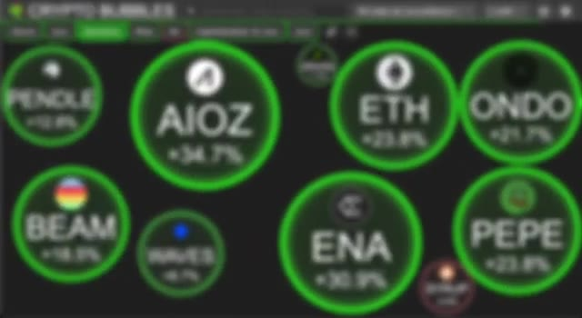
*⏱️ 00:01:39 — Capture d'écran montrant l'interface de Crypto Bubbles avec plusieurs cryptomonnaies en vert (hausses).*

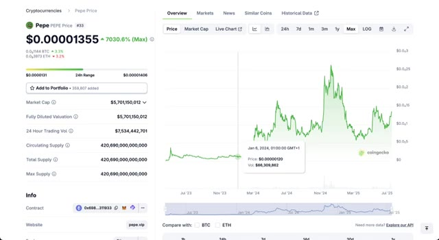
*⏱️ 00:01:47 — Page CoinGecko affichant le cours, la capitalisation et le graphique historique du token Pepe.*

---

### ⏱️ `[00:02:05 - 00:02:39]` | Segment #05

**🔊 Audio (Transcription Intégrale Mot pour Mot en Français) :**
> Maintenant, en regardant le graphique, nous voyons une forte tendance haussière, des niveaux de support nets et des cassures de consolidation. Il respecte parfaitement sa fourchette et le volume s'accumule à nouveau. S'il franchit la prochaine zone de résistance, il pourrait vraiment décoller. C'est une structure de memecoin classique, faible résistance, gros potentiel de hausse. Au fait, si vous cherchez à gagner de l'argent réel pendant cette saison des altcoins, je vous recommande vivement de trader ces cryptos sur Weeks, tout comme je le fais. Utilisez mon lien exclusif ci-dessous pour réclamer jusqu'à 30 000 $ de bonus sur dépôt, une boîte mystère de 100 000 $ et d'énormes réductions sur les frais de trading.

**👁️ Analyse Visuelle d'Écran (gemini-3.5-flash-lite) :**
**Interface & Outils** : Échange de cryptomonnaies WEEX / Interface de trading en ligne.

**Contenu textuel & Code** : Graphique en chandeliers 1D de la cryptomonnaie 1000PEPE/USDT, volume, carnet d'ordres (Order Book) en temps réel, panneau de passage d'ordres (Limit, Market, Trigger order) avec effet de levier 20x.

**Action / Démonstration** : Analyse technique du cours de la cryptomonnaie et présentation des fonctionnalités de trading sur la plateforme.

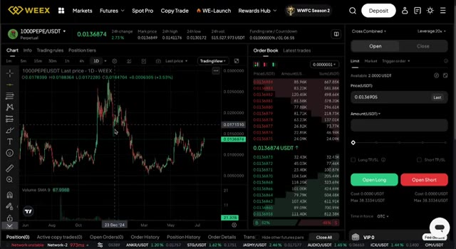
*⏱️ 00:02:13 — Capture d'écran de l'interface de l'échange WEEX affichant un graphique journalier de la paire 1000PEPE/USDT avec le carnet d'ordres et les options de trading.*

---

### ⏱️ `[00:02:39 - 00:03:16]` | Segment #06

**🔊 Audio (Transcription Intégrale Mot pour Mot en Français) :**
> Seulement disponible via mon lien. Ne le manquez pas si vous êtes sérieux au sujet de faire du profit sur ce marché. Ondo. Ondo est l'un des paris sur les actifs du monde réel les plus solides dans la crypto en ce moment. Pendant que tout le monde est concentré sur ETH, les gros joueurs comme BlackRock soutiennent également Ondo dans les coulisses. Cela amène les obligations et les rendements du Trésor directement sur la chaîne, et c'est énorme. À mesure que la réglementation rattrape son retard, Ondo est parfaitement positionné pour en bénéficier. Ce n'est pas un point de battage médiatique. C'est de la DeFi au niveau de l'infrastructure. Quand la rotation commencera des cryptos majeures vers les fondamentaux sérieux, Ondo pourrait être l'un des plus grands gagnants. Du point de vue du graphique, Ondo construit une structure haussière solide. Après avoir cassé des niveaux clés

**👁️ Analyse Visuelle d'Écran (gemini-3.5-flash-lite) :**
**Interface & Outils** : Présentation ou face-caméra explicatif du trader sans interface logicielle partagée.

**Contenu textuel & Code** : Explications orales des stratégies et mise en contexte méthodologique du marché.

**Action / Démonstration** : Explications face caméra et analyse conceptuelle des marchés.

---

### ⏱️ `[00:03:16 - 00:03:39]` | Segment #07

**🔊 Audio (Transcription Intégrale Mot pour Mot en Français) :**
> zones de résistance, nous sommes de nouveau en phase d'accumulation. Le prix se resserre et une cassure pourrait l'envoyer vers 2 dollars ou plus. Il a ce schéma de progression régulière. Ce n'est pas voyant, mais c'est très fiable. ENA. ENA est le jeton de gouvernance d'Athena, un protocole qui construit des dollars synthétiques, l'USDE, en utilisant des stratégies neutres par rapport au delta. C'est l'une des alternatives aux stablecoins les plus intéressantes qui soient.

**👁️ Analyse Visuelle d'Écran (gemini-3.5-flash-lite) :**
**Interface & Outils** : Interface de l'exchange WEEX et page web CoinGecko.

**Contenu textuel & Code** : Graphique de prix journalier ONDO/USDT avec volumes (Volume SMA 9), carnet d'ordres, et fiche d'information CoinGecko pour Ethena (ENA) affichant un prix de 0,3825 $, une capitalisation de 2,41 milliards de dollars et une TVL de 5,33 milliards.

**Action / Démonstration** : Présentation des graphiques de prix et des données de marché des cryptomonnaies ONDO et ENA pour illustrer l'analyse technique et fondamentale.

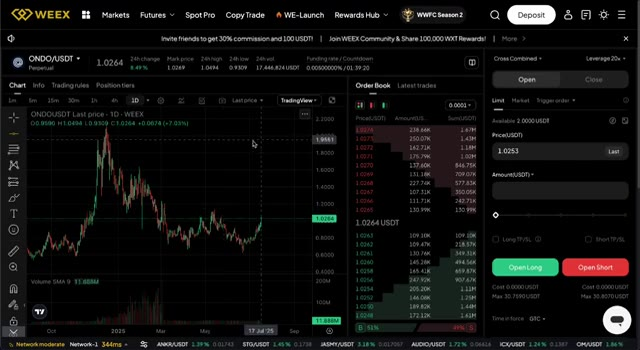
*⏱️ 00:03:22 — Capture d'écran de la plateforme d'échange WEEX affichant le graphique en chandeliers journaliers de la paire ONDO/USDT ainsi que le carnet d'ordres.*

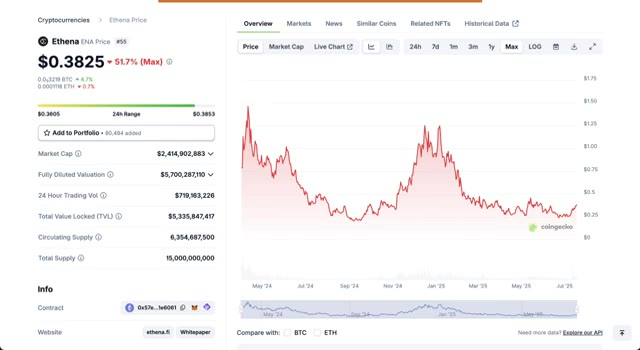
*⏱️ 00:03:33 — Capture d'écran du site CoinGecko présentant la page du token ENA d'Ethena avec son graphique de prix historique (vue maximale), sa capitalisation boursière et ses statistiques.*

---

### ⏱️ `[00:03:40 - 00:04:00]` | Segment #08

**🔊 Audio (Transcription Intégrale Mot pour Mot en Français) :**
> Les rendements sont générés par de véritables mécanismes de la DeFi, et non par de l'inflation artificielle. En ce moment, E&A passe encore sous le radar, mais avec ce genre de modèle et de traction, le token pourrait facilement faire x5 ou x10 à mesure que la demande de revenus stables augmente. Sur le graphique, E&A a rebondi depuis ses plus bas et a formé une base solide. Nous observons un schéma de retournement potentiel avec des creux plus hauts et un volume qui commence à augmenter.

**👁️ Analyse Visuelle d'Écran (gemini-3.5-flash-lite) :**
**Interface & Outils** : CoinGecko et la plateforme d'échange WEEX (interface de trading spot/futures avec graphique TradingView intégré).

**Contenu textuel & Code** : Prix du token ENA (0,3825 $ puis 0,3758 $), capitalisation boursière (2,41 milliards de dollars), volume sur 24h, TVL (5,33 milliards de dollars), graphiques de prix historiques et carnet d'ordres en temps réel.

**Action / Démonstration** : Analyse de la valorisation fondamentale du token Ethena sur CoinGecko suivie d'une observation de son graphique de prix et de sa liquidité sur l'exchange WEEX.

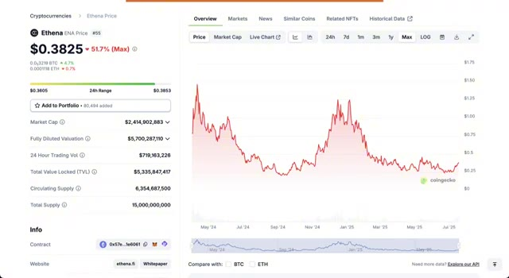
*⏱️ 00:03:45 — Capture d'écran de CoinGecko montrant les statistiques globales du token Ethena (ENA) avec son prix à 0,3825 $, sa capitalisation boursière et son graphique historique complet.*

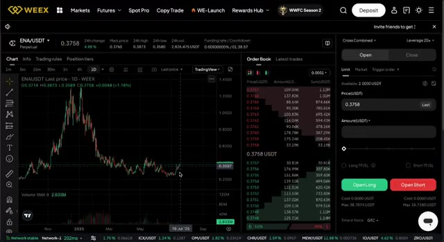
*⏱️ 00:03:55 — Interface de trading de la plateforme WEEX affichant le graphique journalier (1D) de la paire ENA/USDT, ainsi que le carnet d'ordres et le panneau de passage d'ordres à droite.*

---

### ⏱️ `[00:04:00 - 00:04:29]` | Segment #09

**🔊 Audio (Transcription Intégrale Mot pour Mot en Français) :**
> S'il dépasse la résistance, la dynamique pourrait vraiment s'enclencher. Pendle. Maintenant, plongeons dans les opportunités vraiment juteuses, les altcoins à faible capitalisation avec le plus grand potentiel de hausse. Ce sont ceux qui pourraient offrir des gains fous de 30x, voire 50x, si cette saison des altcoins démarre comme nous l'attendons. Pendle vous permet de tokeniser et d'échanger du rendement. Pensez-y. Vous pouvez littéralement acheter et vendre des rendements futurs. C'est comme le trading d'obligations de Wall Street, mais dans la DeFi. C'est une avancée énorme et personne ne le fait mieux que Pendle.

**👁️ Analyse Visuelle d'Écran (gemini-3.5-flash-lite) :**
**Interface & Outils** : Présentation ou face-caméra explicatif du trader sans interface logicielle partagée.

**Contenu textuel & Code** : Explications orales des stratégies et mise en contexte méthodologique du marché.

**Action / Démonstration** : Explications face caméra et analyse conceptuelle des marchés.

---

### ⏱️ `[00:04:30 - 00:04:50]` | Segment #10

**🔊 Audio (Transcription Intégrale Mot pour Mot en Français) :**
> Institutions are paying attention and as yield farming comes back into play, this could be a I really think this one could do a solid 10 to 20x. Pendle has been in a strong uptrend for months. Even during dips, it holds key support. Right now, it's consolidating under a major resistance. A breakout here could send it flying again. The setup looks clean and bullish.

**👁️ Analyse Visuelle d'Écran (gemini-3.5-flash-lite) :**
**Interface & Outils** : CoinGecko et WEEX (échange de crypto-monnaies).

**Contenu textuel & Code** : Prix de Pendle à 4,23 $, capitalisation boursière, volume de transactions sur 24 heures, graphique historique max, graphique en chandeliers 1D sur WEEX avec indicateur de volume, carnet d'ordres et options de levier.

**Action / Démonstration** : Analyse fondamentale de l'actif Pendle suivie d'une analyse technique du graphique journalier et consultation du carnet d'ordres.

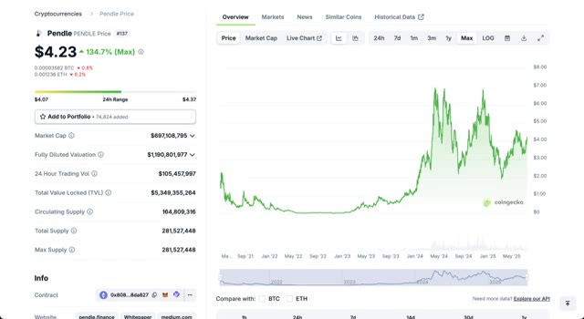
*⏱️ 00:04:35 — Page CoinGecko affichant le prix du jeton Pendle (4,23 $) avec des données fondamentales et un graphique historique global en forte hausse.*

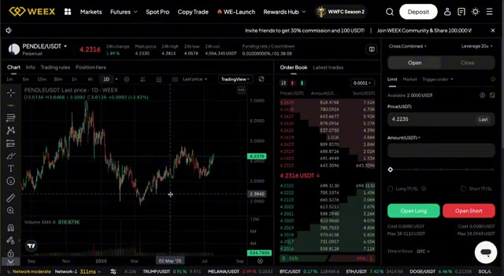
*⏱️ 00:04:40 — Interface de la bourse WEEX affichant le graphique journalier de la paire PENDLE/USDT, le carnet d'ordres et le panneau de passage d'ordres.*

---

### ⏱️ `[00:04:51 - 00:05:27]` | Segment #11

**🔊 Audio (Transcription Intégrale Mot pour Mot en Français) :**
> Petite note, aucun de ces projets ne m'a sponsorisé. Ce sont 100 % mes propres choix basés sur des années d'expérience en trading et en recherche sur la crypto à temps plein. Je vais toujours rester authentique et honnête avec vous. Si vous appréciez cela, assurez-vous de cliquer sur le bouton S'abonner. Ça aide vraiment. Syrup. Syrup est un nouvel altcoin avec une faible capitalisation boursière et un fort potentiel de hausse. Il construit des incitations DeFi durables et développe une communauté soudée. Pas beaucoup de gens en parlent encore, mais c'est exactement le genre de token qui peut exploser aléatoirement par 50 lorsque la vague de battage médiatique frappe. Risque élevé, récompense élevée, mais s'il tient ne serait-ce que la moitié de ses promesses, le potentiel de hausse est fou. Syrup se trouve dans une phase d'accumulation

**👁️ Analyse Visuelle d'Écran (gemini-3.5-flash-lite) :**
**Interface & Outils** : Crypto Bubbles et CoinGecko.

**Contenu textuel & Code** : Variations en pourcentage des cryptos (AIOZ, ONDO, ENA, PENDLE, etc.) et données financières de Maple Finance / SYRUP (Market Cap de 478M$, TVL de 1.88B$, prix à 0.4467$).

**Action / Démonstration** : Présentation de performances de cryptomonnaies et analyse fondamentale d'un jeton (Maple Finance).

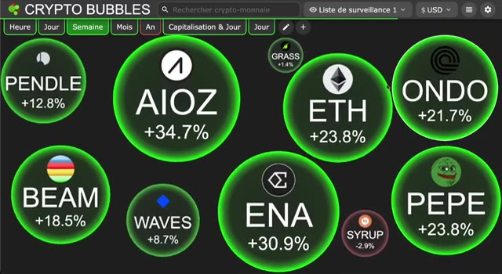
*⏱️ 00:05:00 — Vue d'ensemble de la plateforme Crypto Bubbles montrant les variations de prix de différentes cryptomonnaies en bulles vertes.*

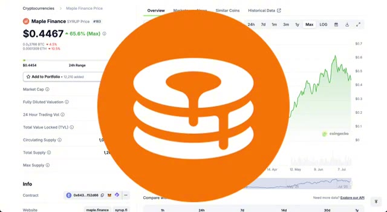
*⏱️ 00:05:09 — Page CoinGecko de Maple Finance (SYRUP) avec un logo géant superposé au milieu de l'écran.*

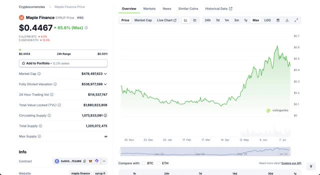
*⏱️ 00:05:18 — Page CoinGecko détaillée de Maple Finance (SYRUP) affichant le graphique de prix historique et les données de marché (market cap, TVL).*

---

### ⏱️ `[00:05:27 - 00:05:59]` | Segment #12

**🔊 Audio (Transcription Intégrale Mot pour Mot en Français) :**
> en ce moment. Il est à un plancher avec très peu de résistance au-dessus. Une petite hausse pourrait le propulser en découverte de prix. C'est l'une de ces configurations furtives où les entrées hâtives comptent. AIOZ. AIOZ concerne la décentralisation de la diffusion de contenu. YouTube, Netflix, Twitch, mais sur la chaîne. C'est une infrastructure réelle et elle est déjà en ligne. La technologie fonctionne, la demande est réelle, et à mesure que de plus en plus de créateurs s'impliqueront, la valeur du jeton pourrait monter en flèche. C'est le Web 3 qui rencontre le Web 2 et cela ne fait que commencer. AIOZ forme un fanion haussier classique. Le volume est en baisse,

**👁️ Analyse Visuelle d'Écran (gemini-3.5-flash-lite) :**
**Interface & Outils** : WEEX (bourse de dérivés crypto) et CoinGecko (agrégateur de données de marché).

**Contenu textuel & Code** : Graphiques en chandeliers, carnets d'ordres (Order Book), prix actuels ($0.4468 pour SYRUP et $0.4153 pour AIOZ), volumes de transactions sur 24h et capitalisations boursières.

**Action / Démonstration** : Présentation des configurations graphiques et analyse technique des altcoins SYRUP et AIOZ.

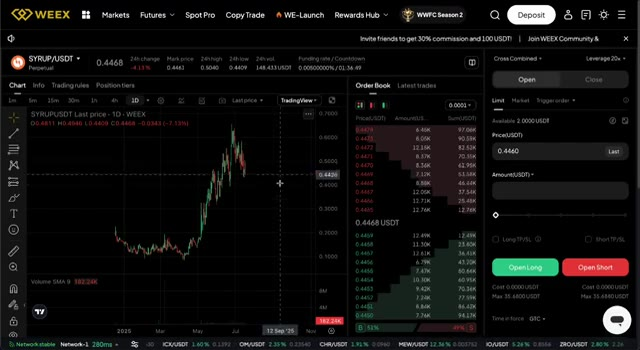
*⏱️ 00:05:35 — Interface de la plateforme WEEX affichant le graphique journalier (1D) et le carnet d'ordres de la paire SYRUP/USDT.*

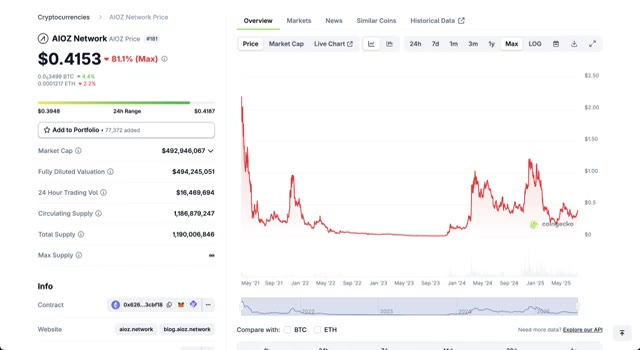
*⏱️ 00:05:43 — Page CoinGecko montrant le prix, la capitalisation boursière et l'historique graphique à long terme de l'actif AIOZ Network.*

---

### ⏱️ `[00:06:00 - 00:06:34]` | Segment #13

**🔊 Audio (Transcription Intégrale Mot pour Mot en Français) :**
> ce qui est ce que vous voulez avant une cassure. S'il franchit la ligne de tendance supérieure, cela peut facilement doubler ou tripler en quelques jours. Beam. Beam se concentre sur la confidentialité. Avec toute l'attention portée sur la surveillance et le suivi sur la chaîne, les transactions privées deviennent plus précieuses que jamais. Beam a été un pionnier dans ce domaine et continue d'innover. Si la confidentialité redevient un sujet brûlant, et ce sera le cas, Beam pourrait connaître une envolée parabolique. Beam est actuellement très comprimé. Il tient le support comme un roc et un mouvement au-dessus de la résistance pourrait déclencher une cassure sérieuse. Il ne fait pas grand-chose pour l'instant, ce qui est le moment idéal pour le surveiller. Et avant de passer aux vraies grosses pépites à la fin de la liste, n'oubliez pas de vous inscrire

**👁️ Analyse Visuelle d'Écran (gemini-3.5-flash-lite) :**
**Interface & Outils** : CoinGecko et la plateforme d'échange WEEX (interface de trading spot/futures avec graphique TradingView et carnet d'ordres).

**Contenu textuel & Code** : Graphiques de prix historiques de Beam, capitalisation boursière (391 millions de dollars), volume sur 24h, prix actuel (0.007565 USDT) et indicateur Volume SMA 9.

**Action / Démonstration** : Analyse du graphique de prix journalier de BEAMX et visualisation des données de marché sur CoinGecko et WEEX.

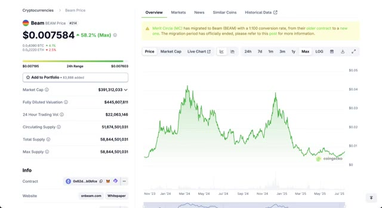
*⏱️ 00:06:17 — Vue d'ensemble du prix de Beam sur CoinGecko avec l'historique des graphiques, la capitalisation boursière et le volume.*

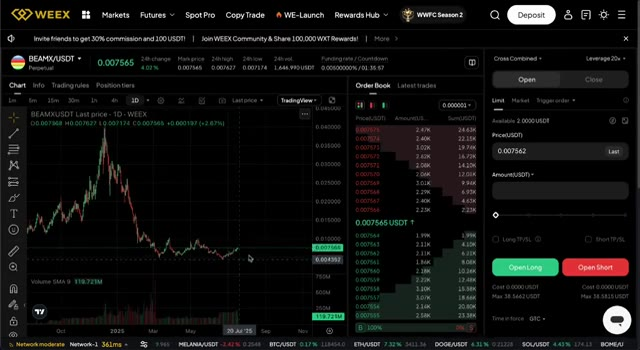
*⏱️ 00:06:26 — Interface de trading de la bourse WEEX montrant le graphique journalier (1D) de BEAMX/USDT, le carnet d'ordres et le panneau d'ordre.*

---

### ⏱️ `[00:06:34 - 00:07:09]` | Segment #14

**🔊 Audio (Transcription Intégrale Mot pour Mot en Français) :**
> jusqu'à Weeks en utilisant le lien ci-dessous pour réclamer vos bonus. C'est là que se fait le gros argent, en négociant ces altcoins avec effet de levier pendant que le marché s'échauffe. Grass. Grass joue la carte de la durabilité dans la crypto. Technologie verte, faibles émissions et dApps évolutives. Il se construit sur le long terme. Ce genre de projet pourrait attirer des capitaux soucieux de l'environnement, en particulier si les récits ESG font leur retour. En ce moment, il est encore sous le radar, mais il s'intègre parfaitement dans l'avenir de la blockchain propre. Le graphique ressemble à une configuration classique de pré-hausse. Il a été plat, le volume est bas, et cela signifie généralement une seule chose. Quelque chose de gros se prépare. Cela pourrait basculer rapidement.

**👁️ Analyse Visuelle d'Écran (gemini-3.5-flash-lite) :**
**Interface & Outils** : Navigateur web affichant la plateforme CoinGecko.

**Contenu textuel & Code** : Prix du jeton Grass à 1,16 $, capitalisation boursière de 341 millions de dollars, volume sur 24h et graphique d'évolution maximale.

**Action / Démonstration** : Présentation des données fondamentales et du graphique de prix du token Grass.

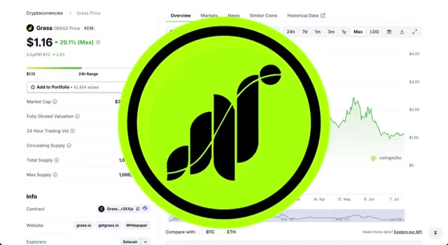
*⏱️ 00:06:43 — Aperçu du site CoinGecko affichant le cours du jeton Grass avec un logo vert superposé.*

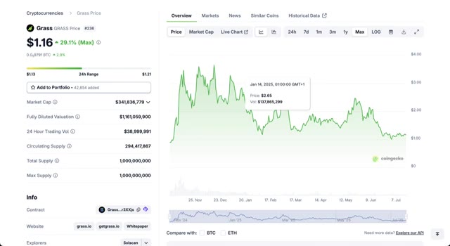
*⏱️ 00:06:52 — Graphique historique complet des prix du jeton Grass sur CoinGecko avec les métriques de capitalisation boursière.*

---

### ⏱️ `[00:07:10 - 00:07:36]` | Segment #15

**🔊 Audio (Transcription Intégrale Mot pour Mot en Français) :**
> Vagues. Vagues est un vétéran dans ce domaine. Une blockchain de niveau 1 avec son propre écosystème. C'est calme depuis un moment, mais des jetons comme celui-ci ont tendance à exploser de nulle part. Risque élevé, oui, mais aussi fort potentiel. Si l'attention se tourne vers les anciens L1, Waves pourrait connaître une seconde vie. Waves semble volatil, mais il teste la même zone encore et encore. S'il franchit ce seuil, nous pourrions voir un x2 ou plus très rapidement. Ce n'est vraiment pas une pièce à négliger pendant la saison des altcoins.

**👁️ Analyse Visuelle d'Écran (gemini-3.5-flash-lite) :**
**Interface & Outils** : CoinGecko et WEEX (plateforme d'échange de crypto-monnaies).

**Contenu textuel & Code** : Graphique de prix historique, capitalisation boursière (110 342 152 $), volume d'échange sur 24h, graphique en chandeliers japonais WAVES/USDT avec indicateur de volume (SMA 9) et carnet d'ordres en temps réel.

**Action / Démonstration** : Présentation des données fondamentales et techniques du token Waves sur différentes plateformes pour illustrer son potentiel d'investissement.

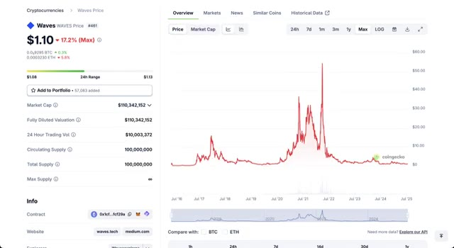
*⏱️ 00:07:16 — Capture d'écran montrant la page CoinGecko du token Waves avec le graphique historique complet (Max) du prix, la capitalisation boursière et les informations générales.*

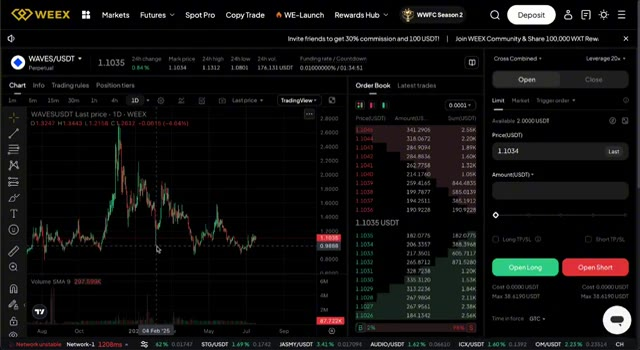
*⏱️ 00:07:29 — Interface de la plateforme de trading WEEX affichant le graphique journalier (1D) de la paire WAVES/USDT en mode perpétuel avec le carnet d'ordres et le panneau d'exécution.*

---

### ⏱️ `[00:07:36 - 00:07:52]` | Segment #16

**🔊 Audio (Transcription Intégrale Mot pour Mot en Français) :**
> Je détiens ces altcoins pour les prochains mois parce que je crois sincèrement qu'ils peuvent offrir des rendements massifs. Que vous les fassiez trader ou que vous les conserviez à long terme, le potentiel est Assurez-vous de consulter tous les liens ci-dessous, laissez un pouce bleu, abonnez-vous et regardez cette prochaine vidéo juste ici. Croyez-moi, vous ne voulez pas la manquer.

**👁️ Analyse Visuelle d'Écran (gemini-3.5-flash-lite) :**
**Interface & Outils** : Application Web Crypto Bubbles (outil de visualisation des performances des cryptomonnaies).

**Contenu textuel & Code** : Bulles interactives affichant les tickers et les variations en pourcentage des altcoins (AIOZ, PENDLE, ETH, ONDO, BEAM, WAVES, ENA, PEPE, GRASS, SYRUP) sur une période hebdomadaire.

**Action / Démonstration** : Présentation visuelle et analyse d'un portefeuille d'altcoins performants sur la plateforme Crypto Bubbles pour illustrer le potentiel de rendement élevé évoqué.

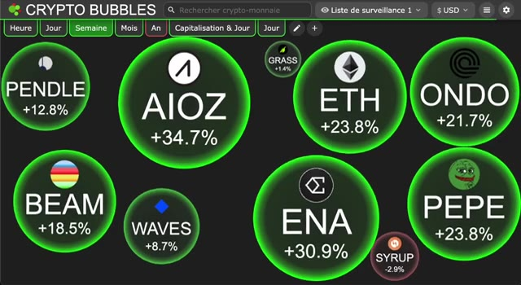
*⏱️ 00:07:40 — Capture d'écran de l'interface Crypto Bubbles montrant les performances hebdomadaires de différentes cryptomonnaies sous forme de bulles vertes et rouges (PENDLE, AIOZ, ETH, ONDO, BEAM, WAVES, ENA, PEPE, etc.).*

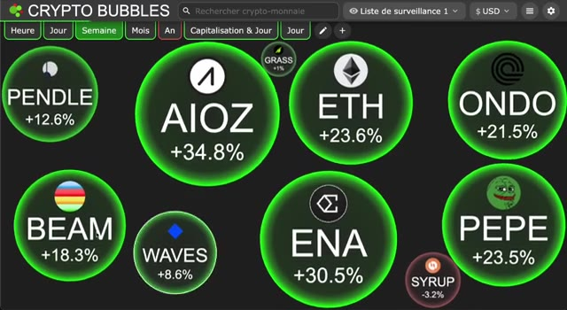
*⏱️ 00:07:48 — Capture d'écran similaire de l'interface Crypto Bubbles à un instant légèrement ultérieur, illustrant les variations de prix en pourcentage des altcoins présentés (AIOZ +34.8%, ENA +30.5%, ETH +23.6%).*

---

