# 🎬 How to Find 100x Memecoins Before Everyone Else

> **Chaîne** : [Alex Carter](https://www.youtube.com/@AlexCarterTrading)  
> **Lien YouTube** : [https://www.youtube.com/watch?v=JADhglih8nI](https://www.youtube.com/watch?v=JADhglih8nI)  
> **Date de publication** : 20250717  
> **Durée** : 00:14:59  
> **Identifiant vidéo** : `JADhglih8nI`  
> **Transcription & Analyse** : `whisper-v3-large-turbo+gemini-3.5-flash-lite`  

---

## 📌 Synthèse Exécutive & Outils

### 💡 Résumé
Dans cette vidéo intitulée **How to Find 100x Memecoins Before Everyone Else**, Alex Carter détaille une approche stratégique et pratique du trading et de l'automatisation par agents IA.

### 🛠️ Outils, Modèles & Logiciels Présentés
- **TradingView & Claude Code** : Analyse technique avancée et automatisation algorithmique.

### 🔑 Points Clés & Enseignements Stratégiques
- Respect rigoureux du ratio risque/rendement et du money management.
- Automatisation méthodique des déclencheurs d'ordres via des agents intelligents.

---

## ⏱️ Chronologie & Transcription Complète Audio & Visuelle (Mot pour Mot)

### ⏱️ `[00:00:00 - 00:00:30]` | Segment #01

**🔊 Audio (Transcription Intégrale Mot pour Mot en Français) :**
> Hé, tu veux trader des pièces mèmes comme un pro et amasser un max de fric ? Tu as cliqué pour une bonne raison, et je m'occupe de toi. Reste avec moi pour un cours gratuit qui vaut mieux que toutes ces conneries payantes, en plus d'un petit truc sournois que la plupart ratent. Plongeons-nous direct dedans. J'ai fait plus d'un million de balles l'année dernière en tradant des pièces mèmes crypto, et si je perds tout aujourd'hui, je reconstruirais 100k rapidement en utilisant exactement ce que je m'apprête à te montrer, même si tu n'as absolument aucune connaissance. Je sais que tu as vu des gens décrocher des rendements de 100x, 500x en quelques jours, parfois en quelques heures, pendant que tu restes bloqué à perdre des trades sans savoir quoi faire.

**👁️ Analyse Visuelle d'Écran (gemini-3.5-flash-lite) :**
**Interface & Outils** : TradingView

**Contenu textuel & Code** : Graphique en chandeliers japonais, outils de relecture (Replay), statistiques clés (volume, performance).

**Action / Démonstration** : Analyse graphique et visualisation de l'historique des prix de l'actif BONK.

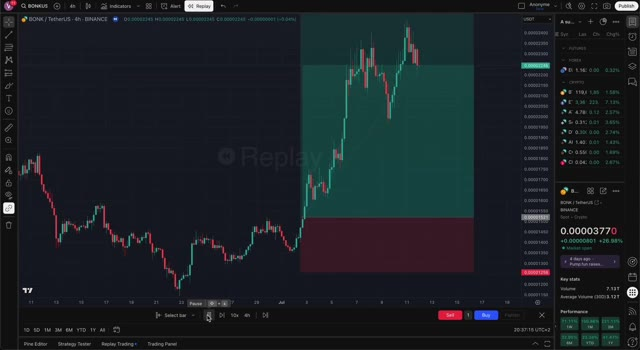
*⏱️ 00:00:07 — Un graphique TradingView en plein écran affichant l'actif BONK/TetherUS sur une période de 4 heures avec un outil de backtest ou de relecture de graphique (Replay).*

---

### ⏱️ `[00:00:30 - 00:00:52]` | Segment #02

**🔊 Audio (Transcription Intégrale Mot pour Mot en Français) :**
> Mon objectif ? Faire en sorte que ce cours gratuit dépasse ces formations hors de prix. Attaquons. Avant même de penser aux trades, quel est le bon équipement ? Quels outils, quelles applications, où restez-vous actifs ? Je détaille tout ce que mon équipe et moi utilisons pour gagner des millions depuis nos PC. D'abord, tradez sur un PC ou un ordinateur portable, pas sur votre téléphone. Un écran plus grand, de meilleures fonctionnalités, un basculement facile, la rapidité et la visibilité sont primordiales avec les meme coins.

**👁️ Analyse Visuelle d'Écran (gemini-3.5-flash-lite) :**
**Interface & Outils** : Plateforme de trading AXIOM Pro et site web de bureau (Autonomous).

**Contenu textuel & Code** : Graphique de prix BTC-USD, indicateurs techniques de volume, carnet d'ordres (Order Book) et panneau de passage d'ordres.

**Action / Démonstration** : Présentation de l'interface de trading professionnelle et des outils logiciels utilisés pour le trading.

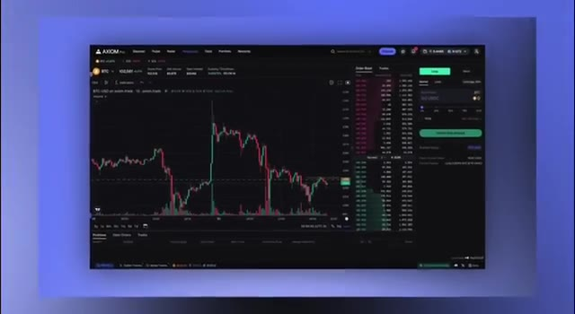
*⏱️ 00:00:41 — Interface de la plateforme de trading AXIOM Pro affichant un graphique en chandeliers japonais du Bitcoin (BTC-USD) avec carnet d'ordres.*

---

### ⏱️ `[00:00:53 - 00:01:11]` | Segment #03

**🔊 Audio (Transcription Intégrale Mot pour Mot en Français) :**
> Une fraction de seconde peut signifier des centaines de milliers ou rester sur la touche. Si vous êtes sur PC, prenez d'autres moniteurs. Ça va changer votre vie. Croyez-moi. Voici mon installation pour référence, de la pure efficacité. Ensuite, vous avez besoin d'un compte Twitter ou X. Le Crypto Twitter est la mine d'or de la recherche. Toutes mes victoires remontent au fait d'avoir creusé là-bas avant d'acheter. Vous voulez préparer votre Twitter pour la crypto ?

**👁️ Analyse Visuelle d'Écran (gemini-3.5-flash-lite) :**
**Interface & Outils** : Navigateur web affichant le site web Autonomous et la plateforme X (Twitter).

**Contenu textuel & Code** : Articles sur les configurations de bureaux ergonomiques et publications sur les memecoins crypto avec graphiques.

**Action / Démonstration** : Navigation sur le web pour illustrer l'installation multi-moniteurs et la recherche de comptes crypto sur Twitter.

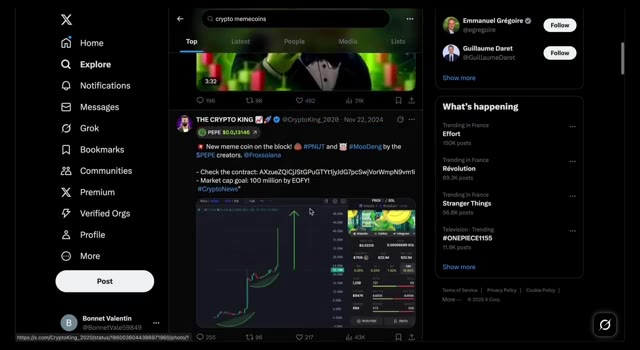
*⏱️ 00:01:06 — Capture d'écran de l'interface du réseau social X (Twitter) montrant une recherche sur les crypto memecoins et le profil de The Crypto King.*

---

### ⏱️ `[00:01:11 - 00:01:31]` | Segment #04

**🔊 Audio (Transcription Intégrale Mot pour Mot en Français) :**
> Suivez autant de comptes que possible dans la liste que je vais publier ensuite. Faites basculer votre page Pour vous, passez de pacotille aléatoire à des actualités et du contenu crypto. Petit avant-goût, il y a un compte que je mentionnerai plus tard qui est de l'alpha pur, alors ne sautez pas de passages. Créez aussi un compte Telegram ou Discord. La communauté est primordiale pour les memecoins. Ce sont vos principaux centres de discussion. Ensuite, il vous faudra Solana, la plus grande crypto pour les memecoins.

**👁️ Analyse Visuelle d'Écran (gemini-3.5-flash-lite) :**
**Interface & Outils** : Réseau social X (anciennement Twitter) et site web Discord.

**Contenu textuel & Code** : Publications sur les memecoins Solana, graphiques de trading, listes de paires de cryptomonnaies et avatars de memecoins.

**Action / Démonstration** : Navigation sur un fil d'actualité X axé sur la cryptographie et les memecoins.

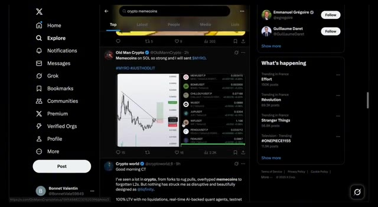
*⏱️ 00:01:16 — Capture d'écran du réseau social X montrant une publication sur les memecoins avec un graphique de prix et une liste de tokens.*

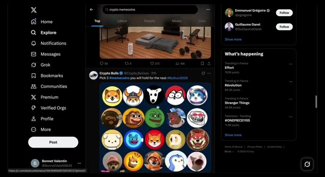
*⏱️ 00:01:21 — Capture d'écran de X affichant un tweet avec une grille d'avatars représentant différents memecoins populaires.*

---

### ⏱️ `[00:01:31 - 00:01:51]` | Segment #05

**🔊 Audio (Transcription Intégrale Mot pour Mot en Français) :**
> Des communautés se forment ici, les développeurs et les initiés lâchent des infos clés et des annonces. Alors, comment acheter du Solana ? Décomposons ça rapidement. Première étape, configurez un portefeuille Solana. Vous avez besoin d'un portefeuille numérique froid pour la blockchain Solana et le meilleur en ce moment est le portefeuille Phantom. Rendez-vous sur phantom.com, téléchargez-le pour Chrome si c'est votre navigateur, ajoutez l'extension, créez un nouveau portefeuille avec une phrase de récupération, définissez un mot de passe.

**👁️ Analyse Visuelle d'Écran (gemini-3.5-flash-lite) :**
**Interface & Outils** : Présentation ou face-caméra explicatif du trader sans interface logicielle partagée.

**Contenu textuel & Code** : Explications orales des stratégies et mise en contexte méthodologique du marché.

**Action / Démonstration** : Explications face caméra et analyse conceptuelle des marchés.

---

### ⏱️ `[00:01:51 - 00:02:12]` | Segment #06

**🔊 Audio (Transcription Intégrale Mot pour Mot en Français) :**
> When you get your recovery phrase, those random words, save them offline, write them on paper. If you lose your wallet, this is your only recovery and nobody but you should know it. Hit I've saved my recovery phrase, continue, set a username like Alex Crypto Tutorial, and you're set. Phantom extensions right there ready. Once your Solana wallet's up, buy Sol through a crypto exchange.

**👁️ Analyse Visuelle d'Écran (gemini-3.5-flash-lite) :**
**Interface & Outils** : Extension de portefeuille Phantom / Interface Web

**Contenu textuel & Code** : Avertissement sur la phrase de récupération, mots floutés masqués par une icône d'œil barré, case à cocher "J'ai enregistré ma phrase de récupération" et bouton "Continuer".

**Action / Démonstration** : Sauvegarde et sécurisation de la phrase de récupération du portefeuille crypto.

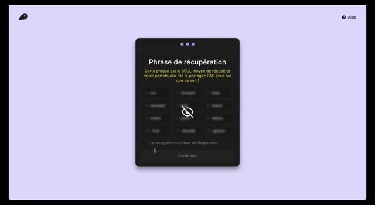
*⏱️ 00:01:56 — Interface du portefeuille Phantom affichant l'étape de sauvegarde de la phrase de récupération masquée avec un avertissement de sécurité.*

---

### ⏱️ `[00:02:12 - 00:02:39]` | Segment #07

**🔊 Audio (Transcription Intégrale Mot pour Mot en Français) :**
> Coinbase, Binance, Kraken, peu importe ce qui fonctionne dans votre région. Je vais utiliser Coinbase pour ça. Copiez l'adresse de votre portefeuille Solana Phantom, allez sur votre exchange, cliquez sur envoyer des cryptos, collez-la et envoyez la quantité de Sol que vous avez achetée. Facile. Maintenant, vous avez besoin d'un bon bot de trading pour acheter et vendre des memecoins avec vos Sol le plus rapidement possible. Le meilleur du marché ? Axiom. Les exécutions les plus rapides, le plus de fonctionnalités, les frais de réseau les moins chers. Inscrivez-vous sur Axiom avec Gmail ou votre portefeuille Phantom. Assurez-vous de vous inscrire en utilisant le lien dans la description.

**👁️ Analyse Visuelle d'Écran (gemini-3.5-flash-lite) :**
**Interface & Outils** : Coinbase, Axiom

**Contenu textuel & Code** : Graphique du cours de Solana, options d'envoi de cryptomonnaies ("Envoyer des cryptomonnaies", "Recevoir des cryptomonnaies").

**Action / Démonstration** : Navigation sur l'interface de l'exchange Coinbase pour montrer comment envoyer des cryptomonnaies.

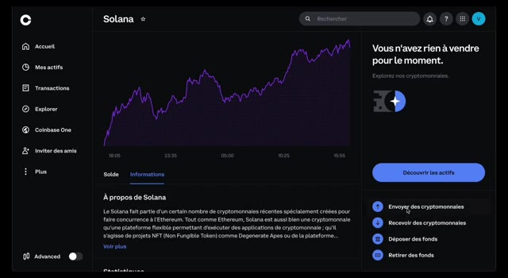
*⏱️ 00:02:18 — Interface de la plateforme Coinbase affichant le cours du Solana avec un graphique violet et les options d'envoi de cryptomonnaies.*

---

### ⏱️ `[00:02:39 - 00:03:13]` | Segment #08

**🔊 Audio (Transcription Intégrale Mot pour Mot en Français) :**
> J'ai négocié des frais de transaction réduits et des avantages exclusifs rien que pour vous. Une fois à l'intérieur, cliquez sur le bouton en haut à droite, allez dans sécurité du compte, affichez la clé de récupération, confirmez. Enregistrez la phrase de récupération en externe. C'est la seule récupération si quelque chose arrive à votre portefeuille Axiom. Rendez-vous dans la section du pool sur Axiom. C'est là que 99 % de votre temps est consacré, à surveiller les nouveaux lancements de memecoins. Changez d'abord les filtres. Allez sur les nouvelles paires à gauche. Cliquez sur le bouton, assurez-vous que seul pump fund est sélectionné. Les pièces Radium et moonshot ont un faible volume, elles ne battront pas de records. Pump fund, c'est là que ça se passe. Ensuite, sous les métriques, définissez la capitalisation boursière

**👁️ Analyse Visuelle d'Écran (gemini-3.5-flash-lite) :**
**Interface & Outils** : Interface web d'Axiom Pro (panneau de paramètres de compte).

**Contenu textuel & Code** : Menu des paramètres de compte montrant l'ID utilisateur, le niveau de récompense (Bronze), la gestion des portefeuilles, la configuration de la langue et le bouton pour afficher la clé de récupération ("View Recovery Key").

**Action / Démonstration** : Navigation dans le menu des paramètres de sécurité pour accéder à la clé de récupération du compte.

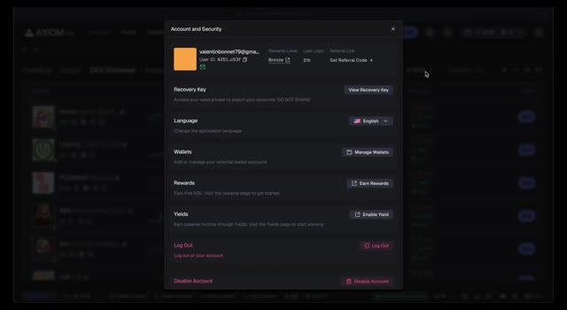
*⏱️ 00:02:48 — Fenêtre modale "Account and Security" sur l'interface d'Axiom Pro, affichant les options de sécurité du compte dont la clé de récupération ("Recovery Key").*

---

### ⏱️ `[00:03:13 - 00:03:35]` | Segment #09

**🔊 Audio (Transcription Intégrale Mot pour Mot en Français) :**
> minimum à 13 000. Cela élimine les déchets et vous permet d'entrer tôt sur des gagnants potentiels. Vous pouvez filtrer les snipers ou les initiés, mais parfois ces pièces montent haut avec un fort narratif, donc je laisse tel quel. Modifiez vos préréglages d'achat et de vente pour des exécutions efficaces. Cliquez sur les préréglages à côté des portefeuilles actifs. Réglez le slippage d'achat à 30 %. Les prix des memecoins fluctuent fortement, cela garantit les exécutions.

**👁️ Analyse Visuelle d'Écran (gemini-3.5-flash-lite) :**
**Interface & Outils** : Plateforme de trading et de suivi Axiom Pro (interface web sombre).

**Contenu textuel & Code** : Métriques de jetons (capitalisation boursière MC, volume V, ATH, variations en pourcentage) pour différents memecoins récents.

**Action / Démonstration** : Navigation et filtrage des paires de jetons sur l'onglet 'Surging' pour identifier des opportunités d'achat précoce.

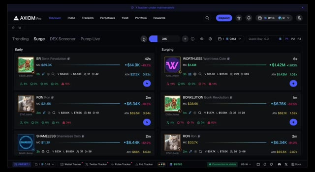
*⏱️ 00:03:18 — Interface de la plateforme Axiom Pro affichant des listes de jetons sous les onglets 'Early' et 'Surging' avec leurs capitalisations boursières et volumes.*

---

### ⏱️ `[00:03:35 - 00:04:12]` | Segment #10

**🔊 Audio (Transcription Intégrale Mot pour Mot en Français) :**
> Trop haut ou trop bas, vous risquez de rater l'occasion ou de surpayer. Définissez les frais de priorité et de corruption à 0,03 chacun. Cela surpasse la concurrence pour les snipes précoces. Activez la protection MEV, sinon les bots vous passeront devant et feront un sandwich de vos achats, ruinant votre entrée. Pour les préréglages de vente, définissez le slippage à 40 %, la priorité et la corruption à 0,03 chacun, et la protection MEV activée. Pour l'achat rapide, définissez un montant avec lequel vous êtes à l'aise pour les meme coins à faible capitalisation par rapport à votre portefeuille. Je le garde entre 5 et 10 sol, mais pour les plus petits portefeuilles, peut-être 1 sol. Petit truc, ajoutez 0,0000 après votre chiffre pour rendre le bouton d'achat rapide plus gros, plus facile à atteindre sur les investissements à haut risque.

**👁️ Analyse Visuelle d'Écran (gemini-3.5-flash-lite) :**
**Interface & Outils** : Application web Axiom Pro (interface de trading et de sniping de tokens).

**Contenu textuel & Code** : Paramètres de trading avec onglets Preset 1/2/3, réglages d'achat/vente, glissement (Slippage) à 30, frais de priorité (Priority) réglés à 0,03, frais de corruption (Bribe) réglés à 0,03, et options de mode MEV (Off, Reduced, Secure).

**Action / Démonstration** : Configuration des paramètres de trading pour définir les frais de priorité et de corruption à 0,03 et gestion des options MEV.

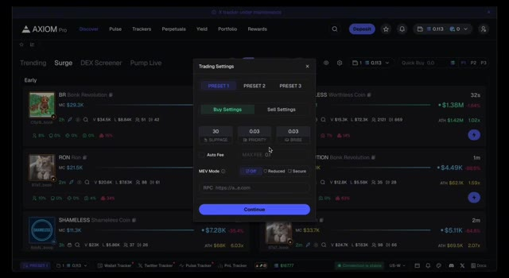
*⏱️ 00:03:44 — Fenêtre modale des paramètres de trading sur l'interface Axiom Pro montrant la configuration des frais de priorité et de corruption ainsi que la protection MEV.*

---

### ⏱️ `[00:04:12 - 00:04:34]` | Segment #11

**🔊 Audio (Transcription Intégrale Mot pour Mot en Français) :**
> jeux. Enfin, ajoutez Solana à votre portefeuille Axiom. Appuyez sur le bouton du portefeuille, cliquez sur dépôt, copiez l'adresse de votre portefeuille Axiom, allez sur Phantom, sélectionnez SOL, collez l'adresse, envoyez le montant qui vous convient. Axiom est configuré, boum, vous êtes prêts. Hé, petite interruption de rythme. Saviez-vous que la plupart des traders se trompent ici ? Même pas au moment du trade. Ils zappent les détails de configuration et perdent en rapidité. Ne soyez pas de ceux-là.

**👁️ Analyse Visuelle d'Écran (gemini-3.5-flash-lite) :**
**Interface & Outils** : Présentation ou face-caméra explicatif du trader sans interface logicielle partagée.

**Contenu textuel & Code** : Explications orales des stratégies et mise en contexte méthodologique du marché.

**Action / Démonstration** : Explications face caméra et analyse conceptuelle des marchés.

---

### ⏱️ `[00:04:34 - 00:05:12]` | Segment #12

**🔊 Audio (Transcription Intégrale Mot pour Mot en Français) :**
> Restez avec moi car la suite concerne la manière de ne pas trader en solo. Un énorme changement radical. Une fois votre configuration terminée, vous êtes prêts à vous lancer dans l'arène et à trader. Mais la crypto et les memecoins sont impitoyables, surtout en solo. Vous allez vous faire plumer. Voici donc mon conseil pour accélérer votre courbe d'apprentissage. D'abord, une petite histoire pour bien marquer les esprits. Quand j'ai commencé, j'ai rejoint des groupes de signaux gratuits sur Twitter. Des annonces survendues, un seul type aux commandes, qui balance des coups à des heures fixes. Il s'avère qu'ils lançaient leurs propres cryptos, s'emparaient de la plus grande partie de l'offre, puis revendaient tout sur le dos de leur communauté. Des chats verrouillés, zéro réseautage, juste des chiffres rouges. La leçon : il n'y a pas d'alpha gratuit. Il y a toujours un prix. Ne tombez pas dans le panneau. Nous avons gagné des millions en

**👁️ Analyse Visuelle d'Écran (gemini-3.5-flash-lite) :**
**Interface & Outils** : Application web Axiom Pro (panneau de trading et de suivi de memecoins)

**Contenu textuel & Code** : Alertes Twitter en temps réel (Bloomberg, New York Post) sur le panneau de gauche ; listes de jetons tendance et en forte hausse ("Surge") avec capitalisation boursière (MC), volumes et boutons d'achat rapide (Quick Buy) sur le panneau central.

**Action / Démonstration** : Navigation et présentation de l'interface de suivi des memecoins et des tendances du marché en direct.

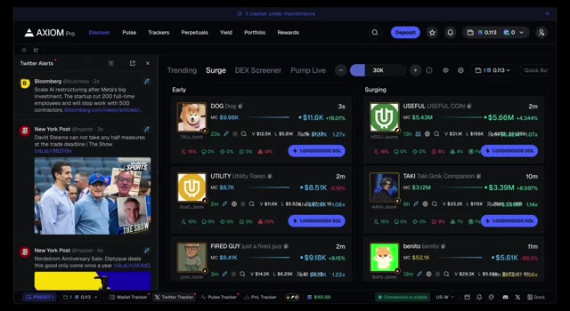
*⏱️ 00:04:44 — Capture d'écran de l'interface de la plateforme Axiom Pro affichant des flux de données en direct et des alertes Twitter pour le suivi des memecoins.*

---

### ⏱️ `[00:05:12 - 00:05:44]` | Segment #13

**🔊 Audio (Transcription Intégrale Mot pour Mot en Français) :**
> une communauté. Même les débutants d'il y a un mois prennent maintenant leurs propres positions, profitant des nôtres et des leurs. Ça n'a pas besoin d'être moi. Trouvez des groupes sur Crypto Twitter avec de solides antécédents. Trader avec eux accélère la progression et le réseau. Même trader avec des amis donne un avantage. Ne jouez simplement pas solo. Vous avez la configuration, la communauté, mais comment dominer les graphiques ? Toutes les memecoins ne se valent pas et le plus gros problème, c'est la recherche. Évaluer les monnaies pour voir si elles vont exploser. Laissez-moi vous montrer comment trouver vos propres 100x, le système que j'utilise pour faire 200k sur un seul trade. Première métrique : le narratif.

**👁️ Analyse Visuelle d'Écran (gemini-3.5-flash-lite) :**
**Interface & Outils** : Présentation ou face-caméra explicatif du trader sans interface logicielle partagée.

**Contenu textuel & Code** : Explications orales des stratégies et mise en contexte méthodologique du marché.

**Action / Démonstration** : Explications face caméra et analyse conceptuelle des marchés.

---

### ⏱️ `[00:05:44 - 00:06:18]` | Segment #14

**🔊 Audio (Transcription Intégrale Mot pour Mot en Français) :**
> C'est large mais crucial pour évaluer une pièce. Demandez-vous quelle est l'histoire derrière ? Qu'est-ce qui la rend précieuse ? Est-ce un mème ou une tendance comme Elon qui tweete ou Trump qui dit quelque chose de mémorable ? Pourquoi cette histoire a-t-elle de la valeur ? Le lancement d'un mème coin par Trump, par exemple, capte l'attention en tant que type le plus populaire au monde. L'attention équivaut à de la valeur dans la crypto. Mon groupe a fait 8 millions grâce à ce coup. Est-ce que la pièce fait partie d'un mouvement, résout un problème, ou relève de la spéculation ? Celle de Trump relèverait de la spéculation et d'un mouvement, rejoignant la culture des mème coins. Pensez toujours aux futurs catalyseurs haussiers. Si une pièce est à 10 millions

**👁️ Analyse Visuelle d'Écran (gemini-3.5-flash-lite) :**
**Interface & Outils** : Axiom Pro (plateforme de trading et de suivi) et navigateur web affichant un article d'actualité de la BBC.

**Contenu textuel & Code** : Tweets influents (Elon Musk, Ansem), articles de presse financière sur Donald Trump, et métriques en temps réel de memecoins sur Axiom (Market Cap, volumes, variations).

**Action / Démonstration** : Analyse de l'impact des publications sur les réseaux sociaux de personnalités publiques sur l'évaluation et le lancement des memecoins.

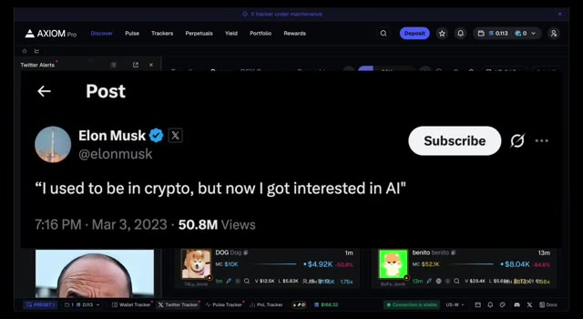
*⏱️ 00:05:53 — Capture d'écran montrant l'interface d'Axiom Pro avec un tweet d'Elon Musk superposé concernant l'IA et la crypto.*

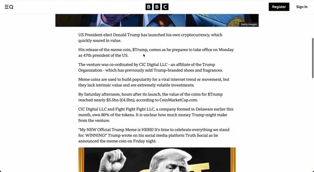
*⏱️ 00:06:01 — Article de la BBC traitant du lancement de la cryptomonnaie mème $Trump par Donald Trump avant son investiture.*

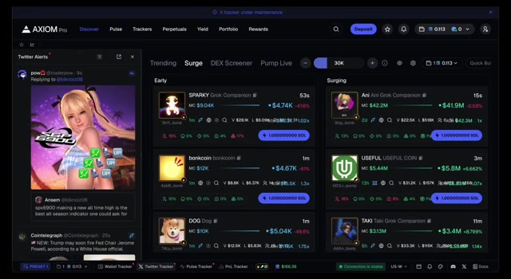
*⏱️ 00:06:09 — Interface de la plateforme Axiom Pro affichant le flux des réseaux sociaux ("Twitter Alerts") et les tendances du marché des meme coins ("Surge").*

---

### ⏱️ `[00:06:18 - 00:06:53]` | Segment #15

**🔊 Audio (Transcription Intégrale Mot pour Mot en Français) :**
> capitalisation boursière, pourquoi quelqu'un achèterait-il à 100 millions ? Qu'est-ce qui soutient ou fait croître l'histoire ? Une pièce utilitaire comme ARK, atteignant une capitalisation boursière de 645 millions de dollars, résout un problème, un cadre d'application d'IA. Astuce rapide pour évaluer l'utilité, vérifiez les partenaires de l'écosystème sur leur site. ARK a Solana, Arbitrum, Abstract, d'immenses noms de plusieurs milliards. Cela attire l'attention, renforce la valeur narrative. Peu importe la complexité, voyez simplement pourquoi une personne normale s'en soucierait. Recherchez un développement continu, des cotations potentielles, du battage médiatique, des mises à jour, des événements. Des histoires plus fortes et convaincantes attirent plus d'attention, une valeur plus élevée.

**👁️ Analyse Visuelle d'Écran (gemini-3.5-flash-lite) :**
**Interface & Outils** : Axiom Pro (plateforme de trading/suivi) et site web officiel d'ARK (arc.market).

**Contenu textuel & Code** : Tableaux de bord de cryptomonnaies, capitalisations boursières (MC), volumes (V), alertes Twitter en temps réel et liste de partenaires.

**Action / Démonstration** : Navigation entre l'outil de suivi de marché Axiom Pro et la présentation du projet ARK sur son site web.

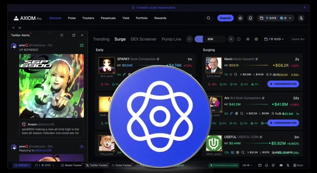
*⏱️ 00:06:27 — Interface de la plateforme Axiom Pro affichant des flux d'alertes Twitter et des cryptomonnaies tendance avec leurs capitalisations boursières.*

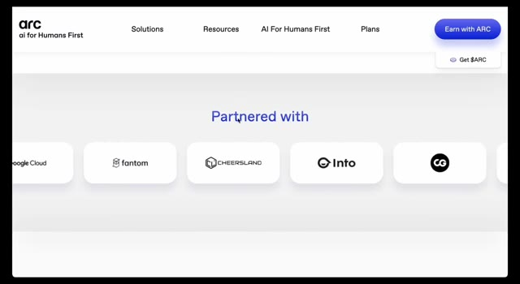
*⏱️ 00:06:35 — Page web officielle du projet ARK montrant la section des partenaires avec différents logos de protocoles et entreprises.*

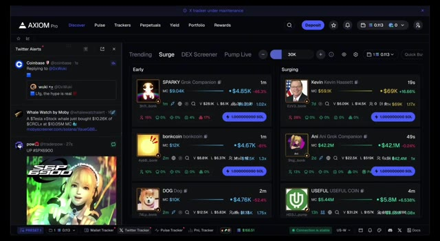
*⏱️ 00:06:44 — Vue actualisée de la plateforme Axiom Pro montrant l'évolution en temps réel des capitalisations boursières et des volumes de trading.*

---

### ⏱️ `[00:06:53 - 00:07:28]` | Segment #16

**🔊 Audio (Transcription Intégrale Mot pour Mot en Français) :**
> Ensuite, comment ce récit se compare-t-il aux autres ? Connaissez la méta. Récit actuel de départ. Dans une méta de l'IA, les pièces d'IA obtiennent plus d'attention, mais le hors-méta peut fonctionner s'il est unique. Trump a chuté pendant la méta de l'IA n'était pas de l'IA, mais son récit était si fort que cela n'avait pas d'importance. Le hors-méta a besoin de force pour se démarquer. Au sein des métas, il y a des jeux alpha et bêta. Les alpha sont les pièces à forte capitalisation boursière avec part d'esprit. Les bêta sont des imitateurs plus petits. Quand dog with hat est devenu parabolique, atteignant près de 5 milliards, nous étions dans une méta de chien. Whiffs est l'alpha. Les jeux bêta comme dog with nunchucks bondissent de 2,5 à 25 millions,

**👁️ Analyse Visuelle d'Écran (gemini-3.5-flash-lite) :**
**Interface & Outils** : Plateforme de trading/suivi Axiom Pro, agrégateur de jetons et flux d'alertes Twitter.

**Contenu textuel & Code** : Listes de cryptomonnaies (« Trending », « Surge », « DEX Screener ») avec capitalisation boursière (MC), variations de prix, volume et alertes de réseaux sociaux en temps réel.

**Action / Démonstration** : Navigation et surveillance des tendances de marché et des récits narratifs (tokens IA et hors-méta) sur la plateforme.

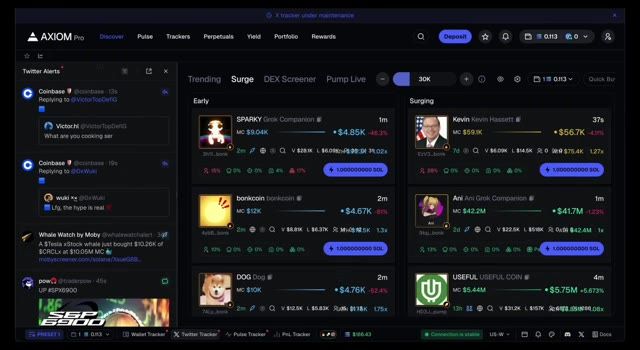
*⏱️ 00:07:02 — Capture d'écran de l'interface d'Axiom Pro montrant le panneau de suivi des tendances, des alertes Twitter et des cryptomonnaies émergentes (méta IA, SPARKY, Kevin, etc.).*

---

### ⏱️ `[00:07:28 - 00:07:54]` | Segment #17

**🔊 Audio (Transcription Intégrale Mot pour Mot en Français) :**
> Et les memecoins avec de mauvaises pièces s'envolent aussi. Le bêta n'est pas garanti. Beaucoup meurent même si l'alpha se maintient. Gérez strictement le risque. Les bêta solides peuvent atteindre 10 % de la capitalisation de l'alpha, ce n'est donc pas un mauvais coup avec une bonne entrée. Ne courez pas après trop de dérivés. Un ou deux seulement sont généralement solides. Comment trouvez-vous des narratifs ? Comment faites-vous vos recherches ? Utilisez Axiom. Vérifiez le Twitter, le site web, le Telegram des pièces. Recherchez sur Twitter manuellement. Cherchez quel type de pièce, utilité, actualités, politique.

**👁️ Analyse Visuelle d'Écran (gemini-3.5-flash-lite) :**
**Interface & Outils** : Navigateur Web affichant le réseau social X (anciennement Twitter).

**Contenu textuel & Code** : Profil X de dogwifcoin (@dogwifcoin), affichant le nombre d'abonnés, l'adresse de contrat (CA) sur Solana, un lien vers un graphique Birdeye et une vidéo épinglée $WIF.

**Action / Démonstration** : Navigation sur les réseaux sociaux pour illustrer un projet memecoin populaire ($WIF).

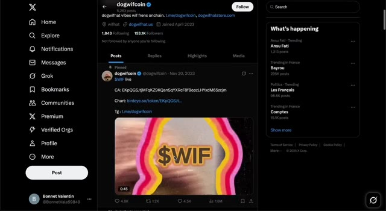
*⏱️ 00:07:47 — Capture d'écran du réseau social X (Twitter) montrant le profil officiel du projet 'dogwifcoin' avec un message épinglé pour le token $WIF.*

---

### ⏱️ `[00:07:54 - 00:08:28]` | Segment #18

**🔊 Audio (Transcription Intégrale Mot pour Mot en Français) :**
> Who's following or supporting a rich VC on Twitter is a narrative for attention. What's the trend mean news tech it covers? Find answers fast on Axiom. Twitter followers slash posts, GitHub for utility, Telegram announcements, manual Twitter searches. With experience, this takes seconds. Got the narrative? Next, community. No attention without support. Hype, buying, mindshare. Ask, how strong is the community? Check Twitter, Telegram, Discord for activity, team announcements, holder interaction, influential crypto Twitter followers. Collateralize is a good

**👁️ Analyse Visuelle d'Écran (gemini-3.5-flash-lite) :**
**Interface & Outils** : Application web Axiom Pro (Interface de trading et d'analyse crypto/sociale)

**Contenu textuel & Code** : Panneau latéral gauche affichant un fil d'alertes Twitter (Coinbase, actualités politiques et DogeDesigner). Panneau central divisé en sections "Early" et "Surging" listant divers tokens (Unlimited, Kevin, Ani, SPARKY, USEFUL) avec leurs capitalisations boursières, volumes, pourcentages de variation et soldes en SOL.

**Action / Démonstration** : Présentation de l'outil de suivi social et d'analyse de tendances sur les cryptomonnaies d'Axiom Pro.

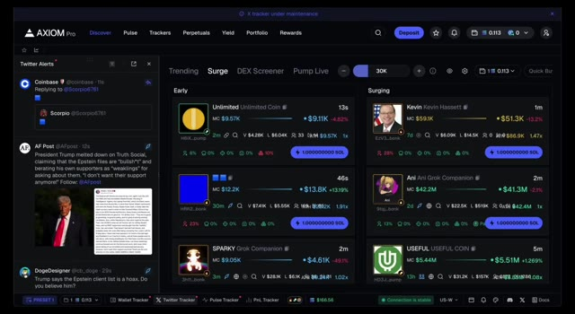
*⏱️ 00:08:03 — Capture d'écran de l'interface de la plateforme Axiom Pro affichant un flux d'alertes Twitter en temps réel et des analyses de tendances de tokens crypto (Surge) avec des métriques de capitalisation boursière (MC) et de volume.*

---

### ⏱️ `[00:08:28 - 00:09:02]` | Segment #19

**🔊 Audio (Transcription Intégrale Mot pour Mot en Français) :**
> Exemple. Des mises à jour régulières, des abonnés influents, un financement croissant. Aussi pour les pièces plus anciennes, quel âge a la communauté ? Survivre aux baisses d'activité montre de la force. Vous voulez un culte ? Pensez aux débuts de Pepe, DogWifHat, Shiba Inu, ils suivent peu importe les conditions, dernière pièce du puzzle, les chiffres, l'action des prix, ce sont des données de graphiques brutes, c'est souvent ce qui vous attire en premier sur mes vidéos de trading en direct, le volume attire mon œil en premier, la capitalisation boursière qui change rapidement sur Axiom signifie qu'il est temps de faire des recherches, vérifiez Twitter, cherchez manuellement, creusez rapidement, prenez Dog and Me, nous l'avons devancé sur Fortune avant la cotation sur Coinbase, demandez si c'est le cas

**👁️ Analyse Visuelle d'Écran (gemini-3.5-flash-lite) :**
**Interface & Outils** : Interface web AXIOM Pro avec volet d'alertes Twitter à gauche et tableau de suivi des tokens (Trending, Surge, DEX Screener, Pump Live) au centre.

**Contenu textuel & Code** : Listes de cryptomonnaies émergentes (PAWELL, Unlimited, Kevin, Ani, USEFUL) avec des métriques de capitalisation boursière (MC), de volume (V) et de variations en pourcentage. Flux d'alertes Twitter avec des publications récentes.

**Action / Démonstration** : Présentation des outils de suivi de tokens et d'analyse des tendances du marché par l'animateur.

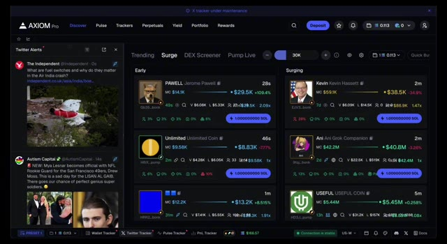
*⏱️ 00:08:36 — Capture d'écran de l'interface AXIOM Pro montrant un tableau de bord de suivi de cryptomonnaies et des alertes Twitter en temps réel.*

---

### ⏱️ `[00:09:02 - 00:09:37]` | Segment #20

**🔊 Audio (Transcription Intégrale Mot pour Mot en Français) :**
> ont bien performé récemment, en hausse de plusieurs fois, à moins que les récits ne soient extrêmement forts, attendez un repli. La plupart des memecoins, même Doge ou Pepe, subissent des baisses de 50 à 80 %. Les initiés détiennent probablement l'offre après la cotation, alors n'achetez pas les sommets. Pour les nouvelles paires, concentrez-vous sur le volume. Pour les anciennes, sur la force et les replis grâce à la croyance de la communauté et au récit. La patience avant et après l'achat est essentielle. Dernier contrôle, la légitimité. C'est évident, mais est-ce louche ? Axiom est un أبو de sauvetage. Les symboles montrent l'offre des 10 principaux détenteurs, un chiffre élevé est un signal d'alarme. Le développeur a vendu, DS. Ou le pourcentage de détention. Un chiffre élevé est mauvais, à moins que l'utilité ne l'exige.

**👁️ Analyse Visuelle d'Écran (gemini-3.5-flash-lite) :**
**Interface & Outils** : Crypto Bubbles et Axiom Pro (plateforme de trading et de suivi de memecoins)

**Contenu textuel & Code** : Graphique de prix et données de capitalisation pour PEPE ($5.73B), volumes sur 24h, et listes de tokens sur Axiom Pro avec capitalisations et variations en pourcentage.

**Action / Démonstration** : Visualisation des performances et de la volatilité des memecoins pour illustrer les cycles de hausse et de baisse du marché.

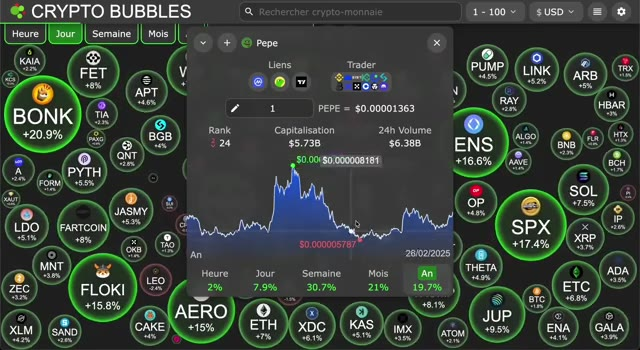
*⏱️ 00:09:11 — Interface Crypto Bubbles affichant une vue d'ensemble du marché crypto avec une bulle centrale ouverte sur le memecoin PEPE, montrant son graphique de capitalisation et ses variations.*

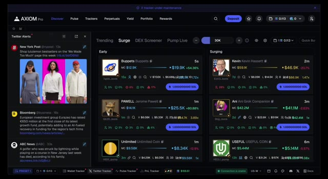
*⏱️ 00:09:20 — Interface Axiom Pro affichant des listes de tokens tendances, en forte hausse ("Surge") avec leurs capitalisations boursières et volumes en temps réel.*

---

### ⏱️ `[00:09:37 - 00:10:11]` | Segment #21

**🔊 Audio (Transcription Intégrale Mot pour Mot en Français) :**
> Support de développeur. Snipers. Premiers acheteurs de blocs. N'importe lequel est généralement un portefeuille de bot de développeur. Mauvais signe. Initiés. Le développeur a envoyé de l'offre. C'est acceptable si le narratif correspond, comme Elon qui détient 80 % d'une pièce Elon. Pack. Portefeuilles cachés du développeur. Presque toutes les pièces en ont. Moins un problème avec un fort narratif. Survolez le logo Twitter sur axiom pour l'historique des changements de nom. Plusieurs noms signifient souvent des projets louches passés. Évitez. Vérifiez les fautes de frappe sur les réseaux sociaux, les sites web, cherchez s'il s'agit d'une répétition ou d'une copie. Ces étapes réduisent considérablement le risque d'arnaque. Accroche rapide de relance,

**👁️ Analyse Visuelle d'Écran (gemini-3.5-flash-lite) :**
**Interface & Outils** : Axiom Pro (plateforme de trading de cryptomonnaies / memecoins)

**Contenu textuel & Code** : Graphique de prix, carnets d'ordres, statistiques de portefeuilles (Holders, Top 10 H., Dev H., Snipers H., Insiders, Bundlers), alertes Twitter en temps réel.

**Action / Démonstration** : Analyse des détenteurs (holders) et de la répartition des tokens (insiders, snipers, développeur) sur un memecoin.

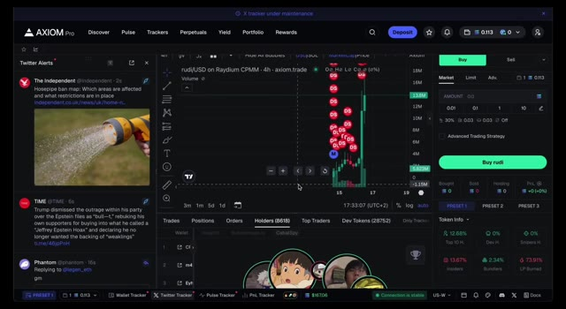
*⏱️ 00:09:46 — Interface de la plateforme Axiom Pro affichant un graphique de prix en chandeliers avec des indicateurs de bulles de trading, un panneau d'achat/vente à droite et des alertes Twitter à gauche.*

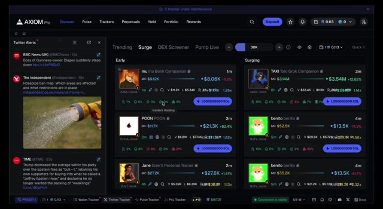
*⏱️ 00:10:03 — Tableau de bord d'Axiom Pro montrant des listes de tokens tendances et émergents (Surge) avec leurs métriques de capitalisation boursière (MC), volume et pourcentages d'initurés.*

---

### ⏱️ `[00:10:12 - 00:10:48]` | Segment #22

**🔊 Audio (Transcription Intégrale Mot pour Mot en Français) :**
> Yo, tu as déjà une longueur d'avance sur 90 % rien qu'en sachant ça, mais la plupart perdent quand même de l'argent. Pourquoi ? La gestion du risque. Reste avec moi, parce que la suite m'a évité de me retrouver ruiné. Les données montrent que 70 à 75 % perdent de l'argent la première année, 20 à 25 % les cinq suivantes, seulement 3 à 5 % restent rentables, c'est toute la gestion du risque. C'est là que la plupart crament du cash, faire de l'argent est facile ici, le garder est difficile. J'ai perdu six chiffres au début, pas à cause de mauvais coups, je faisais de superbes coups, mais à cause d'une gestion du risque affreuse, à FOMO sur les sommets, à surdimensionner, un portefeuille à haut risque évaporé, d'inarrêtable à 18 ans à ruiné, ça m'a remis les pieds sur terre et forcé à

**👁️ Analyse Visuelle d'Écran (gemini-3.5-flash-lite) :**
**Interface & Outils** : Interface de plateforme web ou de trading non spécifiée.

**Contenu textuel & Code** : Texte superposé « Risk management », éléments de dashboard floutés en arrière-plan.

**Action / Démonstration** : Illustration visuelle du sujet abordé (la gestion du risque).

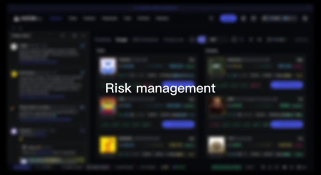
*⏱️ 00:10:21 — Capture d'écran floue affichant l'interface d'une plateforme avec le texte « Risk management » superposé au centre.*

---

### ⏱️ `[00:10:48 - 00:11:21]` | Segment #23

**🔊 Audio (Transcription Intégrale Mot pour Mot en Français) :**
> système pour protéger le capital gérer les émotions c'est seulement après cette perte que j'ai atteint mon premier million voici comment pour que vous n'appreniez pas à la dure un n'investissez jamais ce que vous ne pouvez pas vous permettre de perdre deux n'investissez jamais ce que vous n'êtes pas prêt à perdre similaire mais différent premier ne tradez pas des montants qui nuisent à votre vie supposez que c'est zéro si les trades s'effondrent deuxième soyez émotionnellement à l'aise avec chaque trade si vous ne l'êtes pas vous capitulerez facilement en parlant de deux capitulations existent la vente basée sur le prix à partir de

**👁️ Analyse Visuelle d'Écran (gemini-3.5-flash-lite) :**
**Interface & Outils** : Axiom Pro (plateforme de trading/suivi de cryptomonnaies)

**Contenu textuel & Code** : Tableaux de bord "Surge", listes de tokens (Market Cap, volumes, variations), et un fil d'alertes Twitter (X) avec des tweets de Michael Saylor.

**Action / Démonstration** : Navigation et surveillance des tendances de marché et des nouveaux tokens (memecoins/surges) sur la plateforme.

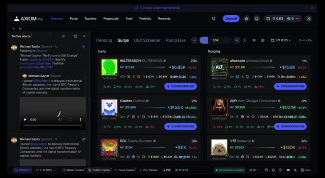
*⏱️ 00:10:56 — Interface de la plateforme Axiom Pro affichant un panneau de suivi des tendances crypto et des alertes Twitter sur la gauche.*

---

### ⏱️ `[00:11:21 - 00:11:45]` | Segment #24

**🔊 Audio (Transcription Intégrale Mot pour Mot en Français) :**
> bas prix ou important repli, perdre la foi dans le narratif ou couper ses pertes. Basé sur le temps, vendre par impatience. Si vous investissez seulement ce que vous pouvez et allez perdre. La capitulation par le prix est dure. Vous ne coupez pas si c'est insignifiant, même à zéro. Les memecoins reviennent souvent de zéro pour faire des multiples. Prenez trade par trade. Coupez en cas de *rug* ou de mauvaise nouvelle. La capitulation temporelle élimine les gens pendant une action de prix ennuyeuse.

**👁️ Analyse Visuelle d'Écran (gemini-3.5-flash-lite) :**
**Interface & Outils** : Interface web de plateforme de trading ou d'analyse de cryptomonnaies.

**Contenu textuel & Code** : Listes de tokens/actifs et un panneau latéral avec des fils d'actualité ou des publications textuelles/images.

**Action / Démonstration** : Illustration visuelle du concept de capitulation ou de vente basée sur le temps (Time Based) évoqué dans le commentaire audio.

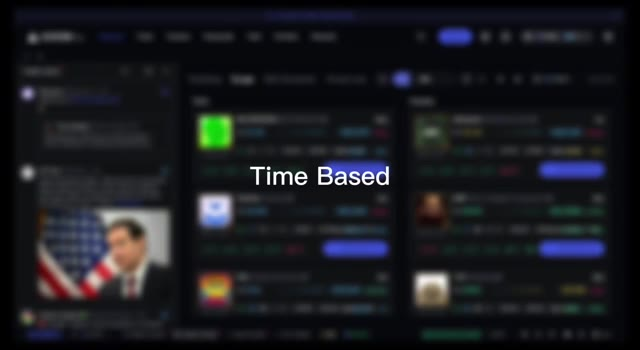
*⏱️ 00:11:27 — Capture d'écran montrant l'interface d'une plateforme de trading ou d'un explorateur de cryptomonnaies, avec le texte superposé 'Time Based'.*

---

### ⏱️ `[00:11:45 - 00:12:17]` | Segment #25

**🔊 Audio (Transcription Intégrale Mot pour Mot en Français) :**
> Je pense que les principaux points à retenir de Dogecoin sont d'avoir toujours une thèse et un plan par trade pour du peps, aucun prélèvement pour conserver un montant à risquer, ne jamais sur-allouer la liquidité, un seul trade gâche les émotions fait vendre par impatience ou FOMO, garder la liquidité pour les prochains trades, je fonce avec 50 sol, je réussis un trade, les portefeuilles sont à 100, je déplace 50 vers un nouveau portefeuille comme trésorerie, au-delà de 50 je continue à déplacer l'excédent, cela limite le risque, pas de nouveaux dépôts, ajustez selon votre portefeuille. Le marché haussier signifie des opportunités quotidiennes, une bénédiction et une malédiction.

**👁️ Analyse Visuelle d'Écran (gemini-3.5-flash-lite) :**
**Interface & Outils** : Présentation ou face-caméra explicatif du trader sans interface logicielle partagée.

**Contenu textuel & Code** : Explications orales des stratégies et mise en contexte méthodologique du marché.

**Action / Démonstration** : Explications face caméra et analyse conceptuelle des marchés.

---

### ⏱️ `[00:12:18 - 00:12:36]` | Segment #26

**🔊 Audio (Transcription Intégrale Mot pour Mot en Français) :**
> Restez les pieds sur terre, tenez-vous-en à votre thèse, investissez intelligemment, ne courez pas après les bougies vertes. Surpassez 90 % des gens en faisant cela. Très bien, voici la partie la plus difficile, le véritable élément déterminant. Entrer et sortir. C'est ce qui fait la différence entre un millionnaire de 19 ans comme moi et les gens qui font exploser leur portefeuille une semaine sur deux.

**👁️ Analyse Visuelle d'Écran (gemini-3.5-flash-lite) :**
**Interface & Outils** : Axiom Pro (plateforme de trading/suivi de memecoins et altcoins sur la blockchain Solana)

**Contenu textuel & Code** : Tableaux de bord de tokens avec métriques de capitalisation boursière (MC), volumes de transactions, variations de prix en pourcentage, et flux d'alertes Twitter en direct (Whale Watch, Phantom, actualités).

**Action / Démonstration** : Navigation et surveillance des tendances de marché et des mouvements de baleines en temps réel pour identifier les opportunités d'entrée ou de sortie.

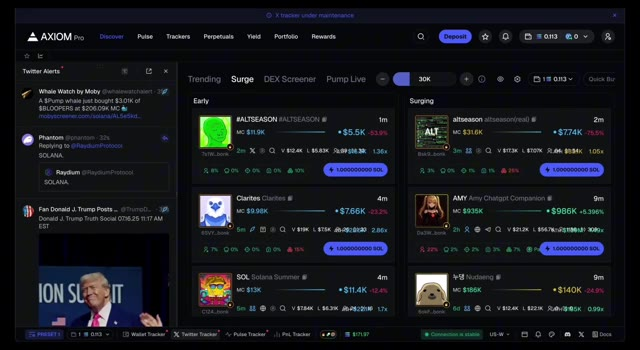
*⏱️ 00:12:22 — Interface de la plateforme Axiom Pro affichant un tableau de bord de suivi de cryptomonnaies en temps réel, incluant des alertes Twitter à gauche et des listes de jetons tendance (« Surge » et « Early ») au centre.*

---

### ⏱️ `[00:12:36 - 00:12:57]` | Segment #27

**🔊 Audio (Transcription Intégrale Mot pour Mot en Français) :**
> Et non, je ne suis pas spécial. Vous pouvez le faire aussi si vous apprenez à jouer intelligemment. Disons donc que vous avez trouvé une pièce solide en utilisant Axiom, et vous êtes largement en bénéfice. Et maintenant ? Comment sortir sans tout gâcher ? La réponse ? Vous faites des moyennes. Les mèmes coins sont extrêmement volatils. Un tweet d'influenceur ou un récit viral peut faire s'envoler ou s'effondrer les prix.

**👁️ Analyse Visuelle d'Écran (gemini-3.5-flash-lite) :**
**Interface & Outils** : Plateforme de trading décentralisée Axiom Pro.

**Contenu textuel & Code** : Métriques de tokens (Market Cap, liquidité, supply), flux d'actualités Twitter en temps réel et liste de tokens tendance ("Early" et "Surging").

**Action / Démonstration** : Navigation sur la plateforme Axiom Pro pour analyser un token et identifier des opportunités d'investissement.

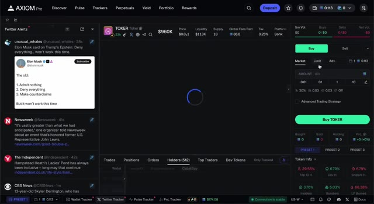
*⏱️ 00:12:41 — Interface principale d'Axiom Pro montrant les détails d'un token (TOKER) avec le panneau d'achat/vente à droite et un flux d'alertes Twitter à gauche.*

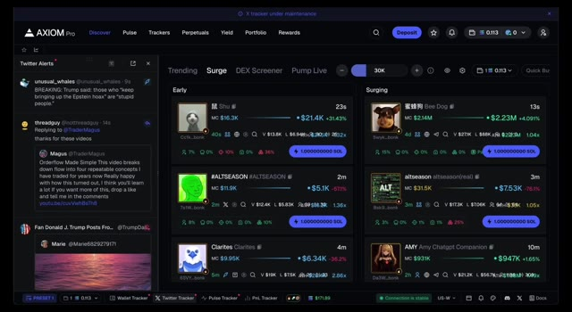
*⏱️ 00:12:46 — Vue d'ensemble de la plateforme Axiom Pro dans l'onglet 'Surge' affichant divers memecoins tendance avec leurs capitalisations boursières et variations.*

---

### ⏱️ `[00:12:57 - 00:13:30]` | Segment #28

**🔊 Audio (Transcription Intégrale Mot pour Mot en Français) :**
> Alors oubliez l'idée de chronométrer le sommet. Vous n'y arriverez pas. Moi non plus. Ne vendez jamais tout en une seule fois. Pareil pour l'achat. Si vous n'êtes pas sûr, achetez 50 % maintenant, 50 % plus tard. Comme ça, vous ne stressez pas pour un timing parfait. Même logique pour la sortie. Vendez par tranches. 10 %, 20 %, peut-être 25 % quand vous êtes en bénéfice ou quand un catalyseur haussier se présente, comme l'entrée d'un gros portefeuille ou un tweet d'Elon. Sécurisez votre mise initiale. Sécurisez quelques profits. Laissez-en un peu juste au cas où ça explose ou que ça s'effondre. Dans les deux cas, vous repartez gagnant. Voici un exemple concret.

**👁️ Analyse Visuelle d'Écran (gemini-3.5-flash-lite) :**
**Interface & Outils** : Axiom Pro (plateforme de trading et de suivi de cryptomonnaies)

**Contenu textuel & Code** : Listes de tokens classés par catégories ("Early", "Surging"), capitalisations boursières (MC), volumes d'échange et alertes Twitter dans le panneau latéral gauche.

**Action / Démonstration** : Navigation et surveillance des tendances de jetons et des flux sociaux sur la plateforme Axiom Pro.

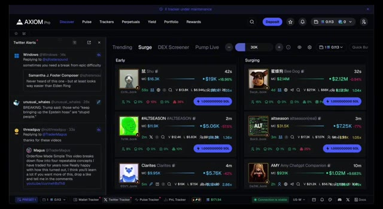
*⏱️ 00:13:06 — Capture d'écran de l'interface de la plateforme Axiom Pro affichant le suivi de cryptomonnaies et des alertes Twitter en temps réel.*

---

### ⏱️ `[00:13:30 - 00:14:09]` | Segment #29

**🔊 Audio (Transcription Intégrale Mot pour Mot en Français) :**
> J'ai fait 15 000 sur une seule pièce, mais cela a pris des dizaines de transactions. J'ai tout enregistré. Le volume explosait. Le compte Twitter à lui seul valait 30 000. C'était sur le thème de l'IA. La méta était chaude. La techno avait l'air légitime. Alors j'ai acheté 10 sol. Puis ça a chuté de 70 %. Mais je n'étais pas surexposé. Je croyais au catalyseur. J'ai donc abaissé mon prix de revient moyen à un meilleur prix et avec une taille plus importante. Puis est venu le rebond. J'ai retiré ma mise de départ. La nouvelle est tombée. Des influenceurs ont rejoint le mouvement et ma thèse s'est vérifiée. Vendu en plusieurs fois. Je n'ai jamais chronométré le sommet. Je suis quand même reparti avec 45,6 sol. Maintenant, voici la partie que la plupart zappent et c'est pourquoi la plupart échouent.

**👁️ Analyse Visuelle d'Écran (gemini-3.5-flash-lite) :**
**Interface & Outils** : Plateforme de trading et d'analyse Axiom Pro (intégrée avec Hyperliquid)

**Contenu textuel & Code** : Tableaux de tendances de tokens, capitalisations boursières, volumes d'échange, flux d'alertes Twitter et graphique de prix avec outil de mesure de variation (-81,28%).

**Action / Démonstration** : Navigation sur les outils de suivi des tokens (image 1) puis analyse graphique d'une forte baisse de prix (image 2) en lien avec la chute mentionnée dans l'audio.

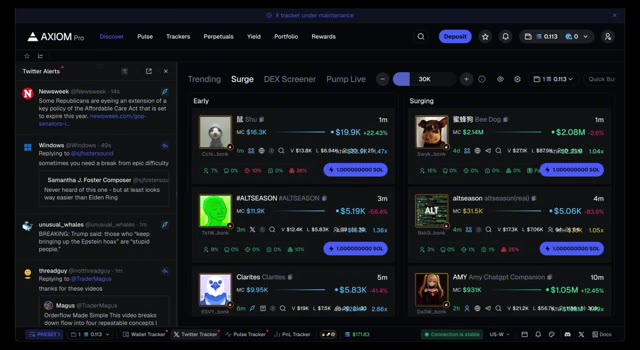
*⏱️ 00:13:40 — Interface de la plateforme Axiom Pro affichant un tableau de bord de suivi de tokens (Surge, Dex Screener) et un fil d'alertes Twitter sur la gauche.*

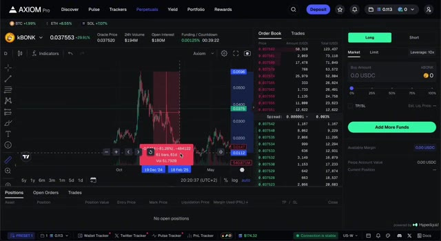
*⏱️ 00:13:50 — Interface de trading d'Axiom Pro montrant un graphique des prix avec une chute marquée sélectionnée en rouge, un carnet d'ordres et les options de passage d'ordres (Long/Short).*

---

### ⏱️ `[00:14:10 - 00:14:46]` | Segment #30

**🔊 Audio (Transcription Intégrale Mot pour Mot en Français) :**
> Journaling. I've lost tens of thousands, but I made hundreds of thousands because I take the time to learn after every trade. Ask yourself four questions after every play. What was the narrative? Why did I buy there? Write it down. Be brutally honest. Even now I look back and see trades I could have executed better. It keeps you grounded. It shows your strengths, your blind spots, your trading style, and helps you adapt because the market's always changing. Meme coin trading isn't about one big win. It's a process. Accept the losses. Detach from the outcome. Focus on refining

**👁️ Analyse Visuelle d'Écran (gemini-3.5-flash-lite) :**
**Interface & Outils** : Plateforme de trading et de suivi Axiom Pro

**Contenu textuel & Code** : Alertes Twitter en direct (comptes Phantom, Washington Post, Solana, etc.), tableau de bord des crypto-monnaies tendance avec capitalisation boursière (MC), volumes et variations de prix (ex: PEPPA, SOLABA, Bee Dog), onglets Discover, Pulse, Trackers, Perpetuals, Yield, Portfolio, Rewards.

**Action / Démonstration** : Suivi et analyse des nouveaux jetons sur Solana et surveillance des flux d'actualités Twitter en temps réel.

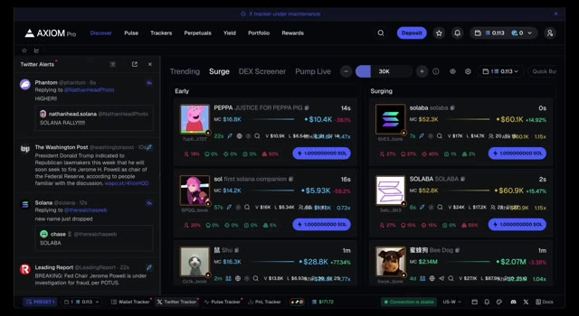
*⏱️ 00:14:19 — Interface de la plateforme Axiom Pro affichant des flux de données en temps réel avec les alertes Twitter sur la gauche et un panneau de suivi des jetons tendance (Surge) sur la droite.*

---

### ⏱️ `[00:14:46 - 00:14:59]` | Segment #31

**🔊 Audio (Transcription Intégrale Mot pour Mot en Français) :**
> votre stratégie. Parce que le vrai argent, il vient de l'accumulation de l'expérience et des relations. Vous avez tout le manuel maintenant. Si vous voulez aller plus loin, le premier lien est dans la description. Merci d'avoir regardé. Paix.

**👁️ Analyse Visuelle d'Écran (gemini-3.5-flash-lite) :**
**Interface & Outils** : Plateforme de trading et de suivi Axiom Pro (interface web avec flux Twitter intégré et tableau de bord de memecoins sur Solana).

**Contenu textuel & Code** : Alertes Twitter en temps réel (comptes de Martin Shkreli, Phantom, The Washington Post), listes de jetons cryptographiques avec capitalisation boursière (MC), volumes (V) et variations de prix.

**Action / Démonstration** : Surveillance en direct des flux sociaux et des tokens émergents sur la blockchain Solana pour repérer des opportunités de trading.

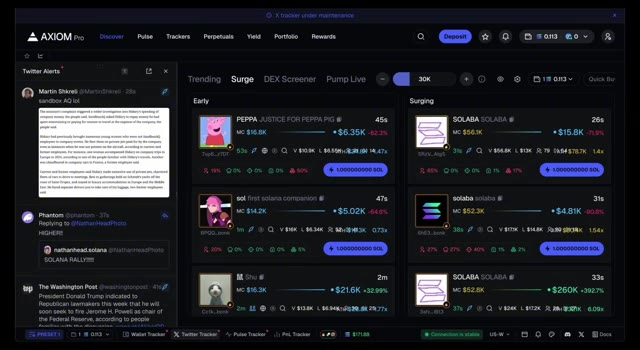
*⏱️ 00:14:49 — Interface de la plateforme Axiom Pro affichant un panneau de veille Twitter à gauche et des paires de jetons cryptographiques en tendance et en forte hausse ("Surge") à droite.*

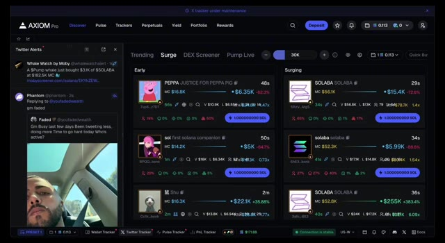
*⏱️ 00:14:52 — Vue actualisée de la plateforme Axiom Pro avec de nouvelles alertes Twitter dans le panneau de gauche et l'évolution en temps réel des capitalisations boursières des memecoins.*

---

