# 🎬 Why XRP is EXPLODING (Watch Before You Buy)

> **Chaîne** : [Alex Carter](https://www.youtube.com/@AlexCarterTrading)  
> **Lien YouTube** : [https://www.youtube.com/watch?v=ZLX-jX4lIaQ](https://www.youtube.com/watch?v=ZLX-jX4lIaQ)  
> **Date de publication** : 20250718  
> **Durée** : 00:04:59  
> **Identifiant vidéo** : `ZLX-jX4lIaQ`  
> **Transcription & Analyse** : `whisper-v3-large-turbo+gemini-3.5-flash-lite`  

---

## 📌 Synthèse Exécutive & Outils

### 💡 Résumé
Dans cette analyse de marché incisive signée Alex Carter, le focus est mis sur l'explosion historique du XRP, qui surperforme massivement l'ensemble du marché crypto à la faveur d'un alignement fondamental et technique rare. L'analyste décortique les catalyseurs de ce mouvement parabolique, allant de l'approbation imminente des ETF aux États-Unis et de l'intérêt ouvert record sur les contrats à terme, jusqu'à l'essor de la chaîne latérale EVM sur le XRPL et le lancement du stablecoin RLUSD. Cette dynamique haussière est soutenue par la fin de la bataille juridique avec la SEC et par des perspectives d'adoption institutionnelle massive, érigeant le XRP en actif pont incontournable pour la finance traditionnelle.

Sur le plan opérationnel, la vidéo dépasse la simple analyse macroéconomique pour s'immiscer dans la tactique de trading avancée. Alex Carter démontre comment exploiter cette volatilité exceptionnelle non pas par une simple stratégie passive de type *hodl*, mais via un trading actif et rigoureux. Il détaille l'utilisation d'un effet de levier modéré couplé à un risk management chirurgical pour capitaliser sur la sortie d'un triangle de consolidation générationnel de sept ans, tout en s'appuyant sur des plateformes de pointe et des architectures d'automatisation pour optimiser l'exécution des ordres.

Enfin, l'intervention met en lumière la nécessité absolue de structurer ses prises de position par paliers pour sécuriser les gains dans une phase de marché euphorique dominée par la saison des altcoins. En combinant lecture on-chain, analyse technique multi-temporelle et gestion stricte du ratio risque/rendement, l'analyste offre une feuille de route complète pour naviguer dans cette fenêtre d'opportunité générationnelle sans s'exposer à une liquidation brutale.

### 🛠️ Outils, Modèles & Logiciels Présentés
* **TradingView** : La plateforme de référence incontournable pour l'analyse technique avancée, l'identification des configurations graphiques (comme les triangles de consolidation) et le suivi des indicateurs de momentum.
* **Grok Bots** : Des agents conversationnels et d'intelligence artificielle utilisés pour sonder le sentiment de marché, analyser les flux on-chain et capter en temps réel l'euphorie des réseaux sociaux.
* **Pine Script** : Le langage de programmation dédié à TradingView permettant de concevoir, backtester et automatiser des stratégies de scalping et de swing trading sur mesure.
* **Claude Code** : Un assistant de développement de pointe mobilisé pour structurer, auditer et optimiser les scripts de trading algorithmique et les scripts d'automatisation des flux d'ordres.
* **Weeks** : La plateforme de trading et de produits dérivés mise en avant pour exécuter les positions longues avec un effet de levier de 10x, offrant des frais compétitifs et des bonus de dépôt.

### 🔑 Points Clés & Enseignements Stratégiques
* **Cassure générationnelle de 7 ans** : Le XRP s'est affranchi d'un immense triangle de consolidation pluriannuel sur le graphique Bitstamp, libérant une énergie technique haussière d'une rare intensité.
* **Alignement des catalyseurs fondamentaux** : L'approbation des ETF XRP aux États-Unis, la fin du litige de longue date avec la SEC et l'essor de l'utilité institutionnelle créent un momentum macroéconomique parfait.
* **Explosion de l'intérêt ouvert (Open Interest)** : Atteignant les 10 milliards de dollars sur les contrats à terme, cet afflux massif de capitaux témoigne d'une activité de « baleines » et d'institutionnels pariant lourdement à la hausse.
* **Innovation technologique et écosystème** : L'arrivée de la chaîne latérale EVM sur le XRPL et le lancement du stablecoin RLUSD soutenu par de grandes banques renforcent l'utilité réelle et l'attractivité pour les développeurs.
* **Validation par les signaux techniques** : L'apparition d'une croix dorée (*golden cross*) sur les graphiques, conjuguée à une explosion des volumes de transactions, confirme l'installation durable d'une tendance haussière agressive.
* **Arbitrage entre détention et trading actif** : Le véritable profit ne réside pas dans le simple *buy-and-hold*, mais dans le trading actif des vagues de volatilité, permettant d'entrer et de sortir chirurgicalement des positions.
* **Gestion du risque avec effet de levier** : L'utilisation d'un effet de levier mesuré (10x) doit impérativement s'accompagner de paramètres stricts incluant des points d'entrée validés, un stop-loss technique et un take-profit prédéfini.
* **Prise de profits par paliers** : Pour contrer la gourmandise et la volatilité inhérente aux altcoins, il est impératif de sécuriser les gains de manière échelonnée tout en préservant le capital initial.
* **Exploitation de la saison des altcoins** : La surperformance du Bitcoin agit comme un tremplin naturel, canalisant les liquidités vers des actifs à forte dynamique comme le XRP.
* **Cadre réglementaire mondial favorable** : Les évolutions juridiques aux États-Unis, dans l'Union européenne et aux Émirats arabes unis positionnent le XRP comme un actif pont privilégié pour les CBDC et les règlements transfrontaliers.

---

## ⏱️ Chronologie & Transcription Complète Audio & Visuelle (Mot pour Mot)

### ⏱️ `[00:00:00 - 00:00:23]` | Segment #01

**🔊 Audio (Transcription Intégrale Mot pour Mot en Français) :**
> Le XRP est en train d'exploser complètement en ce moment, surperformant massivement le reste du marché des cryptomonnaies. Alors que j'ai su capitaliser sur ce mouvement pour générer des millions de profits, la plupart des gens restent encore sur la touche. Mais dans la vidéo d'aujourd'hui, je vous explique exactement pourquoi le XRP s'envole, si c'est encore le bon moment pour en acheter et, plus important encore, comment vous pouvez profiter de cette opportunité. Plongeons dans le vif du sujet.

**👁️ Analyse Visuelle d'Écran (gemini-3.5-flash-lite) :**
**Interface & Outils** : Présentation ou face-caméra explicatif du trader sans interface logicielle partagée.

**Contenu textuel & Code** : Explications orales des stratégies et mise en contexte méthodologique du marché.

**Action / Démonstration** : Explications face caméra et analyse conceptuelle des marchés.

---

### ⏱️ `[00:00:24 - 00:00:47]` | Segment #02

**🔊 Audio (Transcription Intégrale Mot pour Mot en Français) :**
> Partie 1. Pourquoi le XRP s'envole. Alors pourquoi le XRP s'envole-t-il comme un fou ? Analysons cela avec les vraies raisons en langage simple. Premièrement, l'euphorique approbation des ETF. La SEC vient d'approuver le tout premier ETF lié au XRP aux États-Unis, et il est sur le point d'être lancé. Cela signifie des tonnes de nouveaux capitaux provenant d'investisseurs institutionnels qui pourraient affluer, poussant les prix encore plus haut.

**👁️ Analyse Visuelle d'Écran (gemini-3.5-flash-lite) :**
**Interface & Outils** : Crypto Bubbles et CryptoPotato (site web d'actualités crypto).

**Contenu textuel & Code** : Graphique de performance du XRP (+61.7% sur le mois, capitalisation de 206.17B$, volume 24h de 19.95B$) et article de presse annonçant l'approbation du ProShares XRP ETF par la SEC pour une cotation sur le NYSE Arca.

**Action / Démonstration** : Présentation des données de marché et de l'actualité de l'approbation de l'ETF XRP pour appuyer l'analyse de la hausse du token.

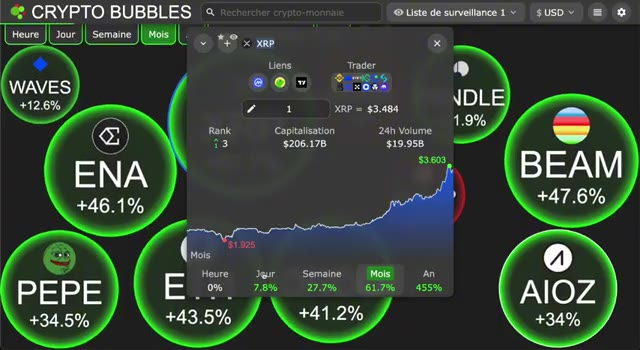
*⏱️ 00:00:30 — Capture d'écran du site Crypto Bubbles montrant les bulles de performance des cryptomonnaies avec une fenêtre contextuelle détaillée pour le XRP affichant son graphique mensuel, sa capitalisation et son volume.*

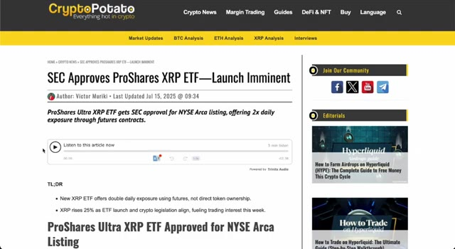
*⏱️ 00:00:36 — Capture d'écran de l'article d'actualité CryptoPotato intitulé "SEC Approves ProShares XRP ETF—Launch Imminent" illustrant l'approbation réglementaire du premier ETF XRP.*

---

### ⏱️ `[00:00:48 - 00:01:26]` | Segment #03

**🔊 Audio (Transcription Intégrale Mot pour Mot en Français) :**
> Parfois, nous voyons une immense vague d'achats institutionnels. L'intérêt ouvert sur les contrats à terme XRP vient d'atteindre 10 milliards de dollars. C'est une activité de baleine sérieuse et un signe clair que les professionnels parient gros. La bataille juridique avec la SEC est enfin en train de se terminer. L'affaire a traîné pendant des années, mais les investisseurs pensent maintenant que l'issue sera favorable à Ripple, libérant une adoption majeure. Voici la nouvelle chaîne latérale EVM sur le XRPL, qui permet de construire des applications compatibles Ethereum sur le grand livre XRP. Cela attire des développeurs, des dApps et une réelle utilité dans l'écosystème. Ripple a également lancé son nouveau stablecoin,

**👁️ Analyse Visuelle d'Écran (gemini-3.5-flash-lite) :**
**Interface & Outils** : Navigateur web affichant Yahoo Finance et Brave New Coin.

**Contenu textuel & Code** : Articles de presse financière, manchettes sur les poursuites de la SEC, prévisions de prix et données sur l'intérêt ouvert XRP.

**Action / Démonstration** : Revue de presse et présentation des actualités macroéconomiques et judiciaires concernant XRP.

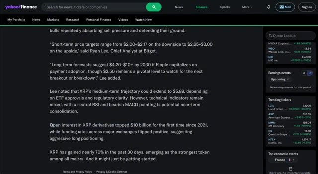
*⏱️ 00:00:57 — Capture d'écran d'un article Yahoo Finance affichant du texte sur XRP et ses perspectives de prix.*

*⏱️ 00:01:07 — Capture d'écran du site Brave New Coin montrant un article sur la fin du procès entre Ripple et la SEC.*

---

### ⏱️ `[00:01:26 - 00:01:45]` | Segment #04

**🔊 Audio (Transcription Intégrale Mot pour Mot en Français) :**
> RLUSD, et il est soutenu par de grandes banques comme Amina. De plus, ils demandent une licence bancaire américaine, faisant le pont entre la cryptomonnaie et la finance traditionnelle. Techniquement, XRP est également en train de sortir de sa tendance. Nous avons vu une croix dorée sur le graphique, un signal classique pour une forte tendance haussière, et le volume est en forte hausse.

**👁️ Analyse Visuelle d'Écran (gemini-3.5-flash-lite) :**
**Interface & Outils** : Présentation ou face-caméra explicatif du trader sans interface logicielle partagée.

**Contenu textuel & Code** : Explications orales des stratégies et mise en contexte méthodologique du marché.

**Action / Démonstration** : Explications face caméra et analyse conceptuelle des marchés.

---

### ⏱️ `[00:01:45 - 00:02:07]` | Segment #05

**🔊 Audio (Transcription Intégrale Mot pour Mot en Français) :**
> N'oublions pas, nous sommes dans un marché haussier global des cryptomonnaies. Bitcoin atteint de nouveaux sommets et les altcoins commencent à s'envoler. Ce genre de dynamique donne toujours un coup de pouce supplémentaire à XRP. Les banques ont désormais le feu vert pour utiliser XRP pour les paiements transfrontaliers rapides. Cela libère des billions de volumes potentiels. Avec une offre limitée, c'est la recette idéale pour une véritable compression des prix.

**👁️ Analyse Visuelle d'Écran (gemini-3.5-flash-lite) :**
**Interface & Outils** : Sites web financiers (MarketWatch et AInvest)

**Contenu textuel & Code** : Articles de presse financière, titres d'actualité sur le Bitcoin et XRP, indicateurs boursiers en haut de page (DJIA, S&P 500, Nasdaq, VIX).

**Action / Démonstration** : Présentation d'actualités financières et d'articles de presse appuyant l'analyse du marché des cryptomonnaies.

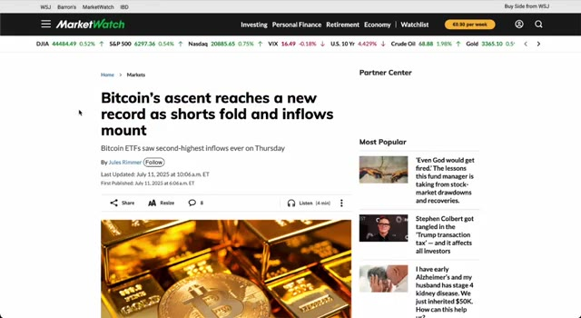
*⏱️ 00:01:51 — Capture d'écran du site MarketWatch affichant un article sur l'ascension du Bitcoin et les flux d'investissements record dans les ETF.*

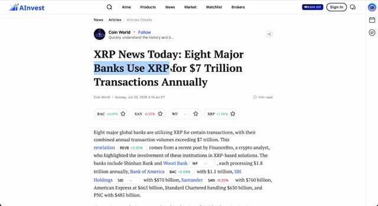
*⏱️ 00:02:01 — Capture d'écran de la plateforme AInvest montrant un article sur l'utilisation de XRP par de grandes banques pour 7 billions de dollars de transactions annuelles.*

---

### ⏱️ `[00:02:07 - 00:02:40]` | Segment #06

**🔊 Audio (Transcription Intégrale Mot pour Mot en Français) :**
> Les testaments s'accumulent, les déficits de liquidité sont comblés et la peur de rater une opportunité se propage rapidement. Les réseaux sociaux sont en ébullition et les données on-chain confirment que les particuliers affluents. Enfin, la réglementation tourne en faveur du XRP. L'Union européenne, les États-Unis et même des pays comme les Émirats arabes unis élaborent des cadres qui pourraient pousser le XRP à devenir l'actif pont par défaut pour les monnaies numériques de banque centrale et même pour les règlements pétroliers. Deuxième partie, les graphiques ne mentent pas. Parlons des graphiques. Nous venons de sortir d'un immense triangle de consolidation de sept ans sur le

**👁️ Analyse Visuelle d'Écran (gemini-3.5-flash-lite) :**
**Interface & Outils** : Site web d'actualités crypto (CryptoDNES) et interface de réseau social.

**Contenu textuel & Code** : Articles, titres et publications communautaires traitant de l'adoption institutionnelle du XRP, de la régulation européenne et de l'analyse du marché.

**Action / Démonstration** : Présentation visuelle d'articles d'actualité et de publications de réseaux sociaux pour illustrer le sentiment haussier et les avancées réglementaires du XRP.

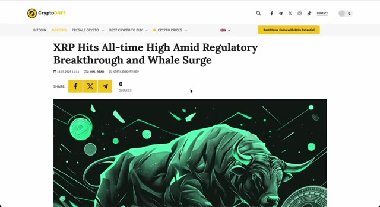
*⏱️ 00:02:16 — Capture d'écran d'un article de presse financière crypto titrant sur la hausse du XRP liée aux avancées réglementaires et à l'activité des baleines.*

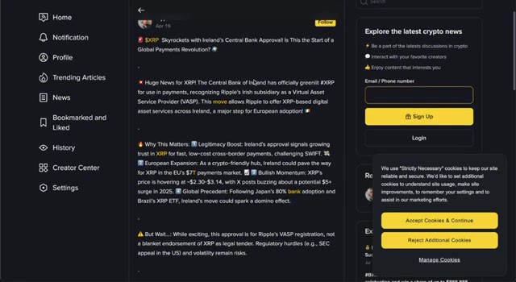
*⏱️ 00:02:24 — Capture d'écran d'une publication sur les réseaux sociaux détaillant l'approbation du XRP par la Banque centrale d'Irlande et son impact potentiel en Europe.*

---

### ⏱️ `[00:02:40 - 00:02:59]` | Segment #07

**🔊 Audio (Transcription Intégrale Mot pour Mot en Français) :**
> graphique Bitstamp. Ce n'est pas un petit mouvement. C'est de l'énergie de cassure générationnelle. Après cette première cassure, XRP a formé une courte phase de consolidation, et pas plus tard que la semaine dernière, nous avons à nouveau dépassé cette tendance baissière. En ce moment, nous dépassons les 3,50 $ et la dynamique devient inarrêtable.

**👁️ Analyse Visuelle d'Écran (gemini-3.5-flash-lite) :**
**Interface & Outils** : TradingView (mode graphique sombre, barre d'outils latérale, panneau de cotations à droite).

**Contenu textuel & Code** : Graphique de prix XRP/USDT sur l'exchange Binance (1W), lignes de tendance tracées pour matérialiser la cassure générationnelle et la phase de consolidation, cours actuel affiché à 3.5135 USDT.

**Action / Démonstration** : Analyse technique du graphique illustrant la cassure haussière majeure de XRP et sa phase de consolidation récente.

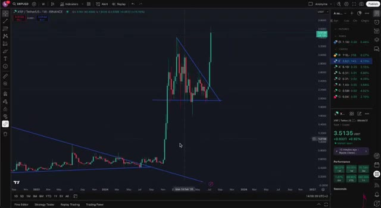
*⏱️ 00:02:45 — Un graphique en chandeliers japonais en unité de temps hebdomadaire (1W) affichant la paire XRP/USDT sur la plateforme TradingView, mettant en évidence une large structure de cassure de type triangle/biseau.*

---

### ⏱️ `[00:03:01 - 00:03:29]` | Segment #08

**🔊 Audio (Transcription Intégrale Mot pour Mot en Français) :**
> Écoutez, nous sommes officiellement dans la saison des altcoins. La force du Bitcoin profite toujours aux altcoins, et le XRP surfe parfaitement sur cette vague. Mais voici l'élément clé. Dans la crypto, le timing est primordial. Si vous attendez trop longtemps, vous ratez la hausse explosive. Si vous agissez trop tôt sans comprendre les fondamentaux, vous vous faites éliminer. Cet alignement des fondamentaux, de l'analyse technique et du timing, c'est rare. C'est pourquoi je mets le paquet sur le XRP en ce moment. Alors, est-ce toujours un bon moment pour acheter du XRP ?

**👁️ Analyse Visuelle d'Écran (gemini-3.5-flash-lite) :**
**Interface & Outils** : Présentation ou face-caméra explicatif du trader sans interface logicielle partagée.

**Contenu textuel & Code** : Explications orales des stratégies et mise en contexte méthodologique du marché.

**Action / Démonstration** : Explications face caméra et analyse conceptuelle des marchés.

---

### ⏱️ `[00:03:29 - 00:04:09]` | Segment #09

**🔊 Audio (Transcription Intégrale Mot pour Mot en Français) :**
> À mon avis, tout à fait. Mais laissez-moi être clair, ce n'est pas un conseil financier. Vous devez prendre vos propres décisions. Mais voici la vérité. Se contenter d'acheter et de conserver, ce n'est pas là que se fait le vrai argent. Les vrais profits proviennent du trading actif de ces mouvements, en entrant, en profitant de la hausse, et en sachant exactement quand sortir. C'est là que la magie opère. Laissez-moi vous montrer exactement comment je trade le XRP en ce moment, en utilisant Weeks. J'utilise Weeks parce qu'ils offrent les meilleurs bonus, des frais bas et un accès à un effet de levier de 10x. Si vous utilisez mon lien exclusif dans la description, vous obtiendrez des réductions massives sur les frais et des bonus de dépôt. Laissez-moi vous montrer. Voici ma configuration. Je suis

**👁️ Analyse Visuelle d'Écran (gemini-3.5-flash-lite) :**
**Interface & Outils** : TradingView, navigateur web, interface d'échange WEEX, YouTube Studio.

**Contenu textuel & Code** : Graphique en chandeliers japonais XRP/USD, lignes de tendance géométriques, panneau latéral de cotations et de watchlist, formulaire d'inscription WEEX avec bonus.

**Action / Démonstration** : Analyse graphique des mouvements de prix de l'actif XRP et présentation promotionnelle de la plateforme de trading WEEX.

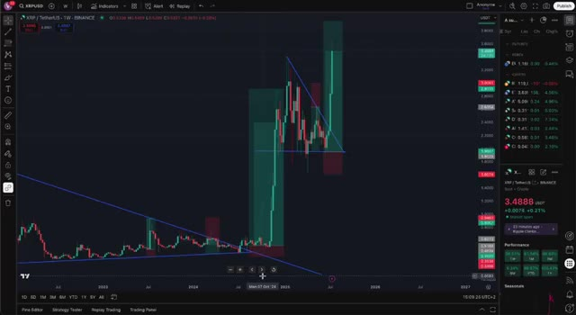
*⏱️ 00:03:39 — Un graphique TradingView en vue hebdomadaire (1W) de la paire XRP/USD sur Binance montrant une analyse technique avec des lignes de tendance et des zones de prix.*

*⏱️ 00:03:59 — Une page de navigateur affichant l'interface de la plateforme WEEX avec une promotion de bonus d'inscription, superposée à l'interface de gestion d'une vidéo YouTube.*

---

### ⏱️ `[00:04:09 - 00:04:42]` | Segment #10

**🔊 Audio (Transcription Intégrale Mot pour Mot en Français) :**
> en ouvrant une position longue sur XRP. J'utilise un effet de levier de 10x mais avec une gestion des risques stricte. Cela signifie que je définis mon point d'entrée. Je fixe un stop-loss clair et je sécurise mes profits avec un ordre take-profit. Cette stratégie me permet de multiplier les gains tout en limitant les pertes. Et la clé ? Ne pas être trop gourmand. Prenez vos profits par paliers, protégez votre capital, réentrez si nécessaire. Weeks rend tout ce processus fluide et adapté aux débutants. C'est pourquoi je les utilise. Très bien. Le XRP est en train de sortir de sa zone de consolidation. Les fondamentaux sont solides. Les graphiques virent au vert. C'est un moment rare. Et si

**👁️ Analyse Visuelle d'Écran (gemini-3.5-flash-lite) :**
**Interface & Outils** : Échange de cryptomonnaies WEEX intégrant un graphique TradingView, un carnet d'ordres et un panneau de passage d'ordres pour contrats Futures.

**Contenu textuel & Code** : Graphique de prix XRP/USDT en unité 1D, indicateur Volume SMA 9, carnet d'ordres central, et panneau latéral affichant les options d'ordre Limit/Market, un TP réglé à 3.8250 et un SL configuré pour la gestion des risques.

**Action / Démonstration** : Configuration d'un ordre d'achat avec effet de levier (Open Long) intégrant les niveaux de Take-Profit (TP) et de Stop-Loss (SL) sur la plateforme WEEX.

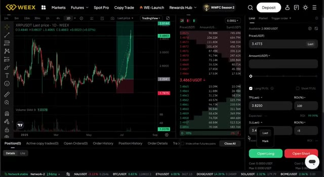
*⏱️ 00:04:17 — Capture d'écran de l'interface de trading WEEX montrant un graphique journalier (1D) de la paire XRP/USDT avec un outil de gestion des risques (Take-Profit et Stop-Loss) configuré pour une position longue.*

---

### ⏱️ `[00:04:42 - 00:04:59]` | Segment #11

**🔊 Audio (Transcription Intégrale Mot pour Mot en Français) :**
> watching this video right now, you're early. But here's the thing. If you want to know the exact list of altcoins I'm buying right now, with the potential to 30x in the next three months, watch the video popping up on your screen right now. Trust me, you'll learn a lot from it. Catch you in the next one.

**👁️ Analyse Visuelle d'Écran (gemini-3.5-flash-lite) :**
**Interface & Outils** : Crypto Bubbles (site web / application de visualisation de crypto-monnaies)

**Contenu textuel & Code** : Bulles de cryptomonnaies vertes indiquant des performances positives (WAVES +12.6%, ENA +46.1%, BEAM +47.6%, PEPE +34.5%, AIOZ +34%). Fenêtre pop-up sur XRP montrant un graphique de prix annuel, le cours actuel à 3.484 $, une capitalisation boursière de 206.17B$, un volume sur 24h de 19.95B$ et une performance annuelle de +455%.

**Action / Démonstration** : Consultation des performances de XRP et visualisation globale du marché crypto à travers l'interface Crypto Bubbles.

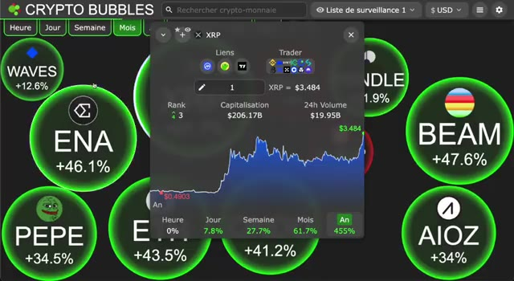
*⏱️ 00:04:46 — Capture d'écran de l'application Crypto Bubbles affichant une vue d'ensemble des cryptomonnaies avec une fenêtre contextuelle détaillée pour XRP.*

---

