# 🎬 How to Buy USDT to Trade With (Cheap and Easy)

> **Chaîne** : [Alex Carter](https://www.youtube.com/@AlexCarterTrading)  
> **Lien YouTube** : [https://www.youtube.com/watch?v=vULzp2_N-9A](https://www.youtube.com/watch?v=vULzp2_N-9A)  
> **Date de publication** : 20250719  
> **Durée** : 00:05:10  
> **Identifiant vidéo** : `vULzp2_N-9A`  
> **Transcription & Analyse** : `whisper-v3-large-turbo+gemini-3.5-flash-lite`  

---

## 📌 Synthèse Exécutive & Outils

### 💡 Résumé

Bienvenue dans cet épisode de la chaîne Alex Carter, conçu comme une passerelle indispensable pour tout trader débutant souhaitant s'initier aux marchés cryptographiques avec méthode, rigueur et efficacité financière. L'objectif central de cette vidéo est de démystifier le parcours d'achat initial — de la monnaie fiduciaire (fiat) jusqu'aux stablecoins — tout en posant les bases opérationnelles indispensables pour exécuter ses premiers ordres dans un environnement sécurisé et optimisé. Bien que cette session introductive se concentre sur l'onboarding et l'ergonomie des plateformes d'échange, elle s'inscrit dans une démarche globale de trading quantitatif et d'automatisation, où chaque étape logistique (frais de transfert, choix des réseaux, gestion du capital) impacte directement la rentabilité à long terme.

Au-delà de la simple manipulation d'interface, Alex Carter décortique l'architecture de deux acteurs majeurs de l'écosystème : **Kraken**, choisi pour sa conformité réglementaire et sa fiabilité bancaire, et **Weeks**, mis en avant pour sa flexibilité et ses frais réduits sur les carnets d'ordres. La démonstration guide le spectateur pas à pas à travers le processus critique de vérification d'identité (KYC), le choix stratégique des méthodes de dépôt — privilégiant le virement SEPA pour s'affranchir des commissions abusives des cartes de crédit —, et l'arbitrage des frais lors de la conversion en USDT. 

Enfin, la vidéo jette les ponts vers des notions plus avancées abordées sur la chaîne, telles que le scalping algorithmique, l'utilisation de bots propulsés par l'intelligence artificielle (**Grok Bots**), le codage de stratégies sur **Pine Script** via **TradingView**, ou encore l'assistance au développement par **Claude Code**. En consolidant ces bases logistiques, le trader débutant se dote d'une infrastructure propre, prête à intégrer ultérieurement des modèles de trading systématique et des protocoles stricts de *Risk Management*.

### 🛠️ Outils, Modèles & Logiciels Présentés

*   **Kraken** : Plateforme d'échange centralisée hautement réglementée, idéale pour acquérir des cryptomonnaies via des devises fiat grâce à sa robustesse institutionnelle et ses options de virement SEPA économiques.
*   **Weeks** : Exchange crypto orienté utilisateur, préconisé pour l'exécution des ordres et le trading spot ou futures grâce à son interface intuitive et ses frais de transaction réduits.
*   **TradingView** : Logiciel de graphisme de référence utilisé pour l'analyse technique, le suivi des indicateurs et le développement de stratégies quantitatives.
*   **Pine Script** : Langage de programmation propriétaire de TradingView permettant de coder, backtester et optimiser des indicateurs et des algorithmes de trading automatisés.
*   **Claude Code** : Assistant de développement par intelligence artificielle avancé, mobilisé par les quants pour structurer, auditer et générer du code de trading complexe.
*   **Grok Bots** : Assistants conversationnels et agents IA intégrés pour l'analyse de sentiment de marché, l'optimisation des flux de données et l'assistance à la prise de décision en temps réel.

### 🔑 Points Clés & Enseignements Stratégiques

*   **Sélection rigoureuse des passerelles fiat** : Privilégier les virements bancaires traditionnels (comme le réseau SEPA en Europe) au détriment des cartes de crédit ou de PayPal, dont les frais de transaction érodent immédiatement le capital initial.
*   **Importance de la conformité réglementaire (KYC)** : Valider son identité en amont sur des plateformes régulées garantit la sécurité juridique des fonds et évite les blocages lors des transferts de montants importants.
*   **Optimisation des réseaux de transfert (Blockchain)** : Utiliser systématiquement des réseaux rapides et économiques comme le **TRC20** (Tron) lors des transferts de stablecoins (USDT) d'un exchange à un autre pour minimiser les frais de réseau (gas fees).
*   **Ségrégation des rôles des exchanges** : Utiliser Kraken comme une passerelle d'entrée sécurisée pour convertir le fiat en stablecoin, puis basculer les fonds vers un exchange secondaire (Weeks) pour bénéficier de frais de trading optimisés.
*   **Gestion du risque sur le premier trade** : Commencer impérativement par le marché au comptant (*Spot*) plutôt que par les contrats dérivés avec effet de levier (*Futures*), afin d'éliminer le risque de liquidation totale inhérent aux débuts.
*   **Maîtrise de la psychologie du trading** : Éviter le piège de la sur-capitalisation et de la sur-fréquentation des marchés (*overtrading*) dès les premiers pas ; la discipline prime sur le volume.
*   **Transition vers le trading algorithmique** : Utiliser les interfaces graphiques pour comprendre la structure des carnets d'ordres avant d'automatiser l'exécution via des scripts personnalisés.
*   **Intégration de l'IA dans le workflow** : S'appuyer sur des outils de pointe comme **Claude Code** pour prototyper rapidement des scripts de backtesting ou analyser des anomalies de marché.
*   **Exploitation des avantages affiliés** : Tirer parti des liens de parrainage et des bonus d'inscription (comme les boîtes mystères ou les réductions de frais) pour optimiser mathématiquement l'expectation de gain dès le premier dépôt.
*   **Planification rigoureuse du capital** : Ne jamais allouer de fonds vitaux au trading de cryptomonnaies et structurer chaque position en fonction d'un pourcentage fixe de risque par rapport au portefeuille global.

---

## ⏱️ Chronologie & Transcription Complète Audio & Visuelle (Mot pour Mot)

### ⏱️ `[00:00:00 - 00:00:32]` | Segment #01

**🔊 Audio (Transcription Intégrale Mot pour Mot en Français) :**
> Êtes-vous totalement débutant dans la crypto et vous demandez-vous comment acheter votre premier USDT pour commencer à trader ? Dans cette vidéo, je vais vous guider à travers tout le processus étape par étape, depuis la création de votre compte sur Kraken, l'achat d'USDT avec des euros ou des dollars, puis le transfert de ces fonds vers Weeks, où vous placerez votre tout premier trade, dans un environnement très adapté aux débutants. Et ne vous inquiétez pas, je ferai en sorte que ce soit facile à suivre, que vous soyez sur votre téléphone ou votre ordinateur. Tous les liens dont vous avez besoin se trouvent dans la description, y compris mes liens de parrainage pour Kraken et Weeks. Ceux-ci vous donnent des bonus exclusifs et des réductions sur les frais,

**👁️ Analyse Visuelle d'Écran (gemini-3.5-flash-lite) :**
**Interface & Outils** : Échange de cryptomonnaies WEEX (interface web de trading spot).

**Contenu textuel & Code** : Liste des cryptos (ETC, TRX, XRP, SOL, BNB, etc.), carnet d'ordres pour la paire BTC/USDT, graphiques de prix avec indicateur Volume SMA 9, options d'ordres Limit et Market.

**Action / Démonstration** : Navigation et présentation de l'interface de l'échange WEEX pour passer un ordre d'achat/vente sur le marché spot.

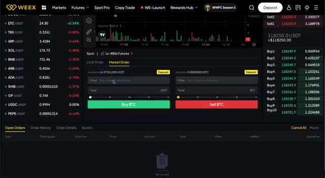
*⏱️ 00:00:16 — Interface complète de l'échange WEEX affichant le carnet d'ordres, le graphique des prix et le panneau de passage d'ordres Spot.*

---

### ⏱️ `[00:00:32 - 00:01:08]` | Segment #02

**🔊 Audio (Transcription Intégrale Mot pour Mot en Français) :**
> donc assurez-vous de les utiliser lors de votre inscription. Commençons. Première étape, nous devons créer votre compte Kraken. Rendez-vous sur kraken.com ou cliquez sur le premier lien dans la description. Vous arriverez soit sur leur site Web, soit vous serez redirigé vers l'App Store ou Google Play si vous êtes sur mobile. Kraken est l'un des échanges de crypto les plus fiables et les plus largement disponibles au monde. Il est entièrement réglementé, ce qui est particulièrement important si c'est la première fois que vous avez affaire à des cryptos. Une fois que vous y êtes, cliquez sur s'inscrire, entrez votre adresse e-mail, choisissez un mot de passe fort et, plus important encore, sélectionnez votre pays de résidence. Celui-ci sera utilisé plus tard pour l'identification

**👁️ Analyse Visuelle d'Écran (gemini-3.5-flash-lite) :**
**Interface & Outils** : Site web de Kraken (kraken.com)

**Contenu textuel & Code** : Formulaire d'inscription avec champs pour l'e-mail, le mot de passe, le pays de résidence (France), l'option de code d'invitation et les cases à cocher pour les conditions d'utilisation.

**Action / Démonstration** : Présentation de la première étape pour créer un compte Kraken.

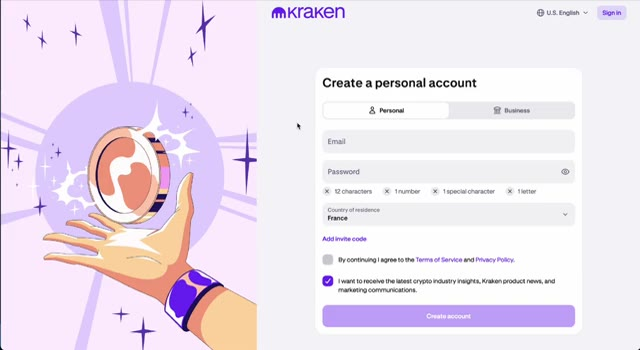
*⏱️ 00:00:41 — Page d'inscription de l'échange de cryptomonnaies Kraken affichant le formulaire de création de compte personnel.*

---

### ⏱️ `[00:01:08 - 00:01:40]` | Segment #03

**🔊 Audio (Transcription Intégrale Mot pour Mot en Français) :**
> vérification. Ensuite, rendez-vous simplement dans votre boîte de réception et confirmez votre e-mail pour continuer. Avant de pouvoir déposer ou acheter quoi que ce soit, Kraken vous demandera de vérifier votre identité. C'est une exigence standard pour toute plateforme d'échange réglementée. Le processus est super rapide. Il vous suffit d'entrer quelques informations personnelles, de télécharger une photo de votre pièce d'identité ou de votre passeport, et de prendre un petit selfie si nécessaire. C'est tout. Dans la plupart des cas, votre compte sera vérifié en quelques minutes seulement. Et une fois que ce sera fait, vous serez prêt à approvisionner votre compte. Votre compte étant vérifié, ajoutons maintenant un peu d'argent pour que vous puissiez acheter vos premières cryptos.

**👁️ Analyse Visuelle d'Écran (gemini-3.5-flash-lite) :**
**Interface & Outils** : Site web / Plateforme d'échange Kraken

**Contenu textuel & Code** : Section « Verification » avec le statut indiqué comme vérifié (« Verified »), ainsi que les préférences du compte (langue, devise en Euro, fuseau horaire).

**Action / Démonstration** : Consultation et présentation de la section de vérification d'identité et des paramètres du compte Kraken.

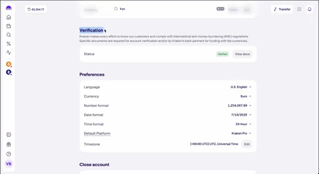
*⏱️ 00:01:16 — Capture d'écran montrant la page des paramètres de vérification (KYC) sur l'interface de l'échange Kraken.*

---

### ⏱️ `[00:01:41 - 00:02:14]` | Segment #04

**🔊 Audio (Transcription Intégrale Mot pour Mot en Français) :**
> Cliquez sur l'onglet du portefeuille, puis appuyez sur dépôt. Kraken prend en charge plusieurs devises comme les euros, l'USD, et plus encore. Vous pourrez choisir votre devise locale et Kraken vous montrera toutes les méthodes de dépôt disponibles. En Europe, l'option la moins chère et la plus fiable est un virement bancaire SEPA. Ailleurs, vous pourriez voir SWIFT ou d'autres options locales selon votre pays. Kraken fournira les coordonnées bancaires exactes. Suivez simplement les instructions et effectuez le virement depuis votre application bancaire. Petit conseil, évitez d'utiliser les cartes de crédit ou PayPal car les frais sont généralement beaucoup plus élevés.

**👁️ Analyse Visuelle d'Écran (gemini-3.5-flash-lite) :**
**Interface & Outils** : Échange de cryptomonnaies Kraken (interface web).

**Contenu textuel & Code** : Liste des monnaies fiat avec leurs soldes respectifs à zéro et une barre de recherche.

**Action / Démonstration** : Sélection de la devise de dépôt (US Dollar) par le curseur de la souris.

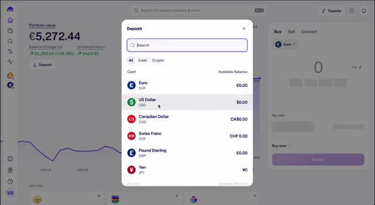
*⏱️ 00:01:49 — Fenêtre modale de dépôt sur Kraken affichant la liste des devises fiat disponibles (Euro, US Dollar, Canadian Dollar, Swiss Franc, Pound Sterling, Yen).*

---

### ⏱️ `[00:02:14 - 00:02:33]` | Segment #05

**🔊 Audio (Transcription Intégrale Mot pour Mot en Français) :**
> Une fois votre virement reçu, votre solde apparaîtra sur votre compte Kraken et vous êtes maintenant prêt à acheter des USDT. Maintenant que vos fonds sont arrivés, il est temps d'acheter vos premiers USDT, le stablecoin que vous utiliserez pour trader sur les semaines à venir. Voici comment faire. Allez dans l'onglet Acheter, Vendre ou Convertir sur Kraken.

**👁️ Analyse Visuelle d'Écran (gemini-3.5-flash-lite) :**
**Interface & Outils** : Échange de cryptomonnaies (Kraken)

**Contenu textuel & Code** : Valeur du portefeuille affichée à 5 272,44 €, graphique d'évolution sur un mois et module d'achat ("Buy, Sell, Convert") avec sélection de devise (Euro).

**Action / Démonstration** : Consultation du solde du compte et préparation de l'achat d'USDT après réception du virement.

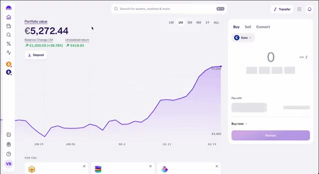
*⏱️ 00:02:19 — Capture d'écran de l'interface de la plateforme Kraken montrant la valeur du portefeuille en euros et le panneau d'achat/vente de cryptomonnaies.*

---

### ⏱️ `[00:02:33 - 00:02:52]` | Segment #06

**🔊 Audio (Transcription Intégrale Mot pour Mot en Français) :**
> Sélectionnez votre devise, comme l'euro ou l'USD, et choisissez l'USDT comme la cryptomonnaie que vous souhaitez acheter. Ensuite, entrez simplement le montant, par exemple 50 ou 100 euros, et cliquez sur vérifier, puis confirmez. C'est un processus ultra rapide et adapté aux débutants. Et c'est aussi simple que ça, vous possédez désormais des USDT.

**👁️ Analyse Visuelle d'Écran (gemini-3.5-flash-lite) :**
**Interface & Outils** : Plateforme d'échange de cryptomonnaies (interface web type exchange).

**Contenu textuel & Code** : Valeur du portefeuille à 5,270.86 €, graphique de performance sur 1 mois montrant une tendance haussière, menu d'achat rapide (Buy/Sell/Convert).

**Action / Démonstration** : Sélection de l'USDT dans la liste des cryptomonnaies pour préparer un achat.

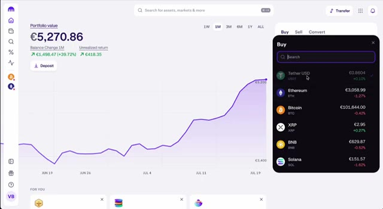
*⏱️ 00:02:38 — Sélection de la cryptomonnaie USDT (Tether USD) dans le panneau d'achat de la plateforme de crypto-monnaies.*

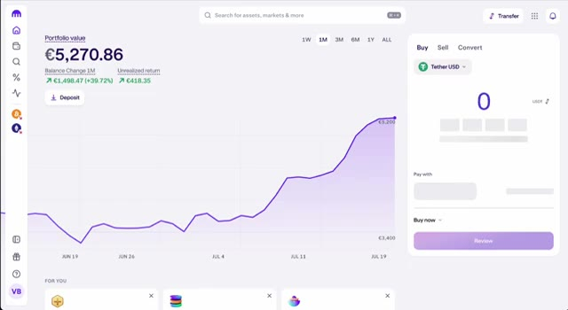
*⏱️ 00:02:43 — Interface de saisie du montant pour l'achat de Tether USD avec le bouton 'Review' en bas.*

---

### ⏱️ `[00:02:53 - 00:03:16]` | Segment #07

**🔊 Audio (Transcription Intégrale Mot pour Mot en Français) :**
> Maintenant, oui, la fonction d'achat instantané de Kraken facture des frais légèrement plus élevés, mais ne vous inquiétez pas. À l'étape suivante, je vais vous montrer comment envoyer vos USDT vers Weeks, où vous pourrez trader avec des frais beaucoup plus bas et utiliser une interface claire et intuitive qui est parfaite pour les débutants. Maintenant que vous avez vos USDT, nous allons les transférer vers Weeks, un exchange puissant et adapté aux débutants pour le trading de cryptos.

**👁️ Analyse Visuelle d'Écran (gemini-3.5-flash-lite) :**
**Interface & Outils** : Kraken, WEEX

**Contenu textuel & Code** : Valeur du portefeuille en euros, graphique de performance sur 1 mois, formulaire d'achat de Tether USD (USDT), bannières promotionnelles pour la compétition WEEX Team Battle avec un prize pool de 900 000 $.

**Action / Démonstration** : Présentation de l'interface d'achat instantané de crypto-monnaies sur Kraken, suivie d'une transition vers la plateforme de trading WEEX et ses offres promotionnelles.

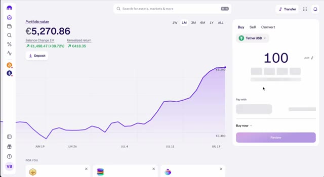
*⏱️ 00:02:58 — Interface de la plateforme Kraken montrant la valeur du portefeuille à 5 270,86 € et un graphique d'évolution sur 1 mois avec un panneau d'achat instantané de Tether USD (USDT).*

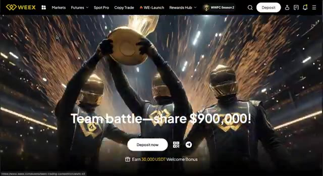
*⏱️ 00:03:04 — Page d'accueil de la plateforme WEEX affichant une promotion pour une compétition d'équipe avec un bonus de 900 000 $ et des personnages tenant un trophée doré.*

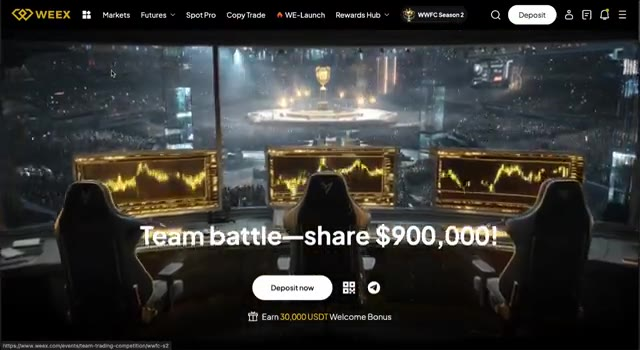
*⏱️ 00:03:10 — Page d'accueil de WEEX montrant une vue panoramique de traders avec des écrans affichant des graphiques de trading dorés et une bannière de compétition d'équipe.*

---

### ⏱️ `[00:03:16 - 00:03:40]` | Segment #08

**🔊 Audio (Transcription Intégrale Mot pour Mot en Français) :**
> Étape 1. Créez votre compte Weeks en utilisant le deuxième lien dans la description. Cela vous donne accès à des bonus exclusifs, y compris une boîte mystère de 100 USDT lorsque vous déposez et tradez. Une fois votre compte Weeks prêt, cliquez sur Actifs, puis sur Dépôt, et sélectionnez USDT. USDT. Assurez-vous de choisir le bon réseau. Généralement, le TRC20 est le mieux car il est rapide et bon marché.

**👁️ Analyse Visuelle d'Écran (gemini-3.5-flash-lite) :**
**Interface & Outils** : Site web de l'échangeur de cryptomonnaies WEEX (pages d'inscription, d'événements et de dépôt).

**Contenu textuel & Code** : Offres de bonus de bienvenue (boîte mystère de 100 USDT, bonus de 20%), options de dépôt de crypto (USDT, BTC, ETH) et interfaces de navigation.

**Action / Démonstration** : Navigation sur la plateforme WEEX, explication de la création de compte, des bonus et de la sélection de l'USDT pour effectuer un dépôt.

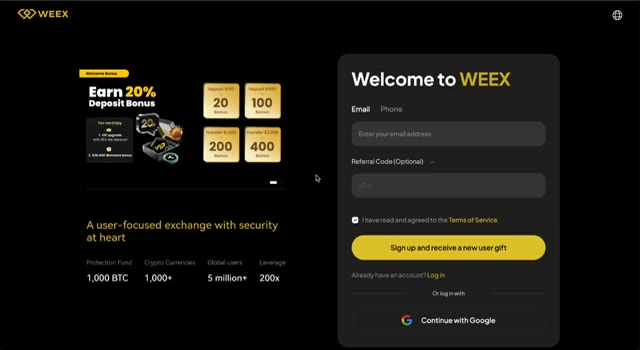
*⏱️ 00:03:22 — Page d'accueil et formulaire d'inscription de l'échangeur crypto WEEX avec des détails sur les bonus de dépôt.*

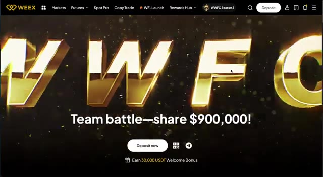
*⏱️ 00:03:28 — Bannière promotionnelle sur le site WEEX annonçant une compétition de trading d'équipe (WWFC) avec un pool de prix de 900 000 $.*

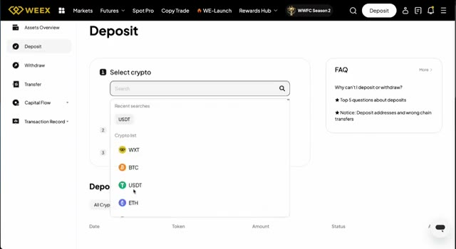
*⏱️ 00:03:34 — Interface de dépôt sur WEEX montrant la liste de sélection des cryptomonnaies avec USDT en surbrillance.*

---

### ⏱️ `[00:03:40 - 00:03:58]` | Segment #09

**🔊 Audio (Transcription Intégrale Mot pour Mot en Français) :**
> Copiez l'adresse de dépôt. Maintenant, retournez sur Kraken, trouvez votre USDT dans votre portefeuille, cliquez sur retirer, et collez l'adresse de Weeks. Sélectionnez TRC20 comme réseau, entrez le montant et confirmez la transaction. Vos fonds devraient arriver sur Weeks d'ici quelques minutes.

**👁️ Analyse Visuelle d'Écran (gemini-3.5-flash-lite) :**
**Interface & Outils** : Interface utilisateur de l'échange de cryptomonnaies Kraken

**Contenu textuel & Code** : Solde du portefeuille (€5,270.86), options d'achat/vente/convert, et liste des réseaux de blockchain disponibles pour les retraits d'USDT.

**Action / Démonstration** : Navigation sur Kraken pour préparer le retrait d'USDT et sélection du réseau de transfert.

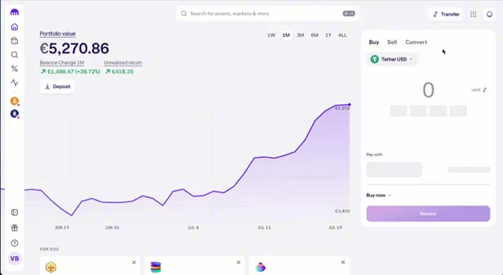
*⏱️ 00:03:45 — Capture d'écran du tableau de bord principal de la plateforme Kraken montrant la valeur du portefeuille avec un graphique de performance.*

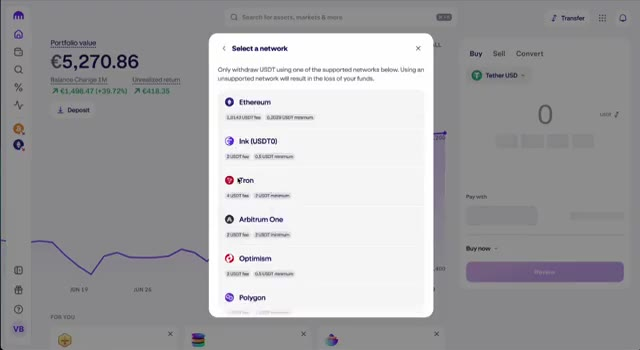
*⏱️ 00:03:49 — Fenêtre contextuelle sur Kraken permettant de sélectionner le réseau de retrait pour l'USDT, avec les options Ethereum, Tron, Arbitrum, Optimism et Polygon.*

---

### ⏱️ `[00:03:58 - 00:04:30]` | Segment #10

**🔊 Audio (Transcription Intégrale Mot pour Mot en Français) :**
> Maintenant que votre USDT est arrivé, ouvrons votre tout premier trade. Allez sur l'onglet futures ou l'onglet spot sur Weeks, selon votre préférence. Pour les débutants, le spot est plus sûr. Recherchons une paire de trading, disons BTC USDT ou ETH USDT. Cliquez sur acheter, entrez le montant d' USDT que vous souhaitez utiliser, et confirmez. Félicitations, vous venez de passer votre premier trade. Si vous souhaitez explorer du trading plus avancé comme les futures avec effet de levier, Weeks rend cela super simple avec une interface intuitive.

**👁️ Analyse Visuelle d'Écran (gemini-3.5-flash-lite) :**
**Interface & Outils** : Interface web de la bourse de cryptomonnaies WEEX (onglets Markets, Futures, SpotPro, Copy Trade).

**Contenu textuel & Code** : Paire USDC/USDT sélectionnée, statistiques du marché en haut (24h high/low), carnet d'ordres (Order Book) à droite et options de passage d'ordre en bas (Limit Order, Market Order).

**Action / Démonstration** : Navigation sur l'interface de trading pour préparer l'ouverture d'un ordre d'achat.

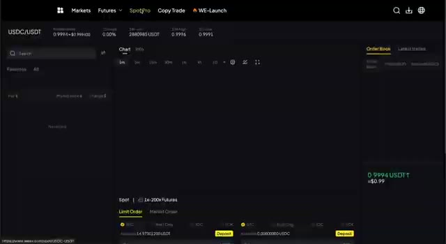
*⏱️ 00:04:06 — Interface de trading de la plateforme WEEX affichant la paire USDC/USDT avec les options de marché Spot et Futures.*

---

### ⏱️ `[00:04:31 - 00:05:04]` | Segment #11

**🔊 Audio (Transcription Intégrale Mot pour Mot en Français) :**
> N'en fais simplement pas trop. Commence doucement et assure-toi de comprendre les risques. Pour récapituler, tu as créé ton compte Kraken. Tu as un TOS dans ton identité. Tu peux déposer de l'argent fiduciaire Swin. Tu peux lier mon USDT fiduciaire. Tu peux écrire à Weeks. Tu peux réaliser ton tout premier trade. Tu possèdes désormais officiellement des cryptos et tu sais comment trader. Si ce guide t'a aidé, n'oublie pas d'utiliser les liens d'affiliation dans la description pour Kraken et Weeks. Cela soutient la chaîne et te donne accès à des bonus exclusifs. Si tu es prêt à passer au niveau supérieur, j'ai également fait des vidéos sur les stratégies de trading,

**👁️ Analyse Visuelle d'Écran (gemini-3.5-flash-lite) :**
**Interface & Outils** : Kraken, WEEX Exchange, YouTube

**Contenu textuel & Code** : Statut de vérification du compte Kraken (Verified), carnets d'ordres WEEX, paires de trading spot (BTC/USDT, ETH/USDT, etc.)

**Action / Démonstration** : Navigation dans les paramètres de Kraken puis passage à l'interface de trading de WEEX.

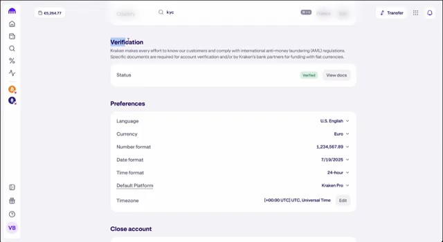
*⏱️ 00:04:40 — Paramètres du compte Kraken montrant la vérification d'identité (KYC) et les préférences régionales.*

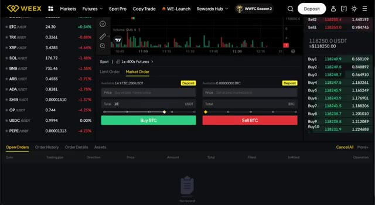
*⏱️ 00:04:48 — Interface de trading de la bourse WEEX avec le carnet d'ordres et les options d'achat/vente de cryptomonnaies.*

---

### ⏱️ `[00:05:05 - 00:05:10]` | Segment #12

**🔊 Audio (Transcription Intégrale Mot pour Mot en Français) :**
> les types d'ordres et la gestion des risques. Allez les voir ensuite. Merci d'avoir regardé, et je vous vois dans le prochain.

**👁️ Analyse Visuelle d'Écran (gemini-3.5-flash-lite) :**
**Interface & Outils** : Interface web YouTube

**Contenu textuel & Code** : Miniatures de vidéos YouTube sur les cryptomonnaies et le trading (Bybit, Blofin, WEEX).

**Action / Démonstration** : Navigation sur l'interface principale de YouTube.

---

