# 🎬 How to Buy XRP for Beginners — Make Big Profits

> **Chaîne** : [Alex Carter](https://www.youtube.com/@AlexCarterTrading)  
> **Lien YouTube** : [https://www.youtube.com/watch?v=CTLPzDVXAZ8](https://www.youtube.com/watch?v=CTLPzDVXAZ8)  
> **Date de publication** : 20250721  
> **Durée** : 00:05:15  
> **Identifiant vidéo** : `CTLPzDVXAZ8`  
> **Transcription & Analyse** : `whisper-v3-large-turbo+gemini-3.5-flash-lite`  

---

## 📌 Synthèse Exécutive & Outils

### 💡 Résumé

Bienvenue dans cette analyse approfondie signée Alex Carter, dédiée à la structuration d'une stratégie d'entrée et de trading dynamique sur le XRP. Dans cette vidéo, nous démontrons comment capitaliser sur l'actuel marché haussier des cryptomonnaies en combinant la sécurité réglementaire d'une plateforme de premier plan et l'agilité d'un exchange orienté dérivés. L'analyse fondamentale met en lumière des catalyseurs puissants : l'approbation historique d'un ETF XRP aux États-Unis, l'émergence du stablecoin RLUSD adossé à des banques traditionnelles, et le déploiement d'une nouvelle sidechain compatible avec Ethereum sur le grand livre XRP, ouvrant la voie aux contrats intelligents et à l'adoption institutionnelle massive. 

Au-delà de l'achat comptant initial, la démonstration pivote rapidement vers l'optimisation des performances en trading actif. Nous explorons les mécanismes de transfert inter-plateformes sécurisés et l'utilisation tactique du levier financier. L'objectif est de s'affranchir du simple "buy and hold" (acheter et conserver) pour exploiter activement la volatilité du marché via des configurations de scalping et de swing trading sur la paire XRP/USDT. Les aspects fondamentaux du passage d'une rampe d'accès fiat (Kraken) vers un écosystème de trading avancé (Bybit/Weeks) sont décortiqués pour offrir aux débutants comme aux traders plus expérimentés un parcours opérationnel fluide et sans friction.

Enfin, la méthodologie présentée insiste lourdement sur la discipline opérationnelle. Le succès en trading quantitatif et discrétionnaire ne repose pas uniquement sur l'impulsion haussière d'un actif, mais sur une architecture de gestion du risque rigoureuse. L'utilisation raisonnée des ordres de type *stop-loss*, la prise de bénéfices échelonnée (*take-profit*) et la maîtrise des effets de levier (jusqu'à 10x) constituent le socle indispensable pour transformer une opportunité spéculative en rentabilité à long terme, tout en évitant les pièges classiques de la sur-exposition.

### 🛠️ Outils, Modèles & Logiciels Présentés

* **Kraken** : Plateforme d'échange de cryptomonnaies régulée, utilisée comme passerelle sécurisée pour convertir les monnaies fiat (euros, dollars) en actifs numériques ou en XRP via des virements SEPA.
* **Bybit (mentionné sous le nom de Weeks dans la transcription)** : Exchange crypto ultra-performant offrant des frais réduits, des outils de trading avancés et un effet de levier allant jusqu'à 10x sur les contrats dérivés XRP/USDT.
* **Réseau TRC20** : Protocole blockchain ultrarapide et économique utilisé pour sécuriser les transferts d'USDT d'une plateforme à une autre en minimisant les frais de transaction.
* **TradingView** : L'outil de graphisme et d'analyse technique incontournable pour tracer les supports/résistances et repérer les configurations de retournement de tendance.
* **Pine Script** : Langage de programmation propriétaire de TradingView permettant de concevoir, backtester et automatiser des stratégies de trading algorithmiques.
* **Claude Code** : Assistant de développement par IA de pointe mobilisé pour coder, optimiser et déboguer rapidement des scripts de trading complexes.
* **Grok Bots** : Agents conversationnels et de trading dopés à l'intelligence artificielle pour identifier les flux de capitaux des "whales" et générer des signaux de marché en temps réel.

### 🔑 Points Clés & Enseignements Stratégiques

* **Catalyseurs macroéconomiques majeurs** : L'approbation du tout premier ETF XRP aux États-Unis valide l'entrée massive des flux institutionnels, agissant comme un propulseur structurel pour la valorisation à long terme de l'actif.
* **Innovation technologique et fondamentale** : Le lancement du stablecoin RLUSD adossé à des banques de premier plan et l'intégration d'une sidechain compatible Ethereum renforcent l'utilité réelle du XRP et son pont direct avec la finance traditionnelle (TradFi).
* **Sélection rigoureuse des rampes d'accès fiat** : Privilégier les virements bancaires SEPA sur des plateformes régulées comme Kraken pour minimiser les frais d'entrée, en évitant catégoriquement PayPal ou les cartes de crédit aux commissions dissuasives.
* **Optimisation des transferts inter-plateformes** : Pour réduire les frictions de coûts, convertir les fonds en USDT et utiliser systématiquement le réseau TRC20 lors des retraits vers des plateformes de trading avancées.
* **Dichotomie investissement vs trading actif** : Le simple achat-conservation (*spot holding*) convient aux profils passifs, mais la génération de alpha exige une migration vers des interfaces de trading flexibles pour capitaliser sur les mouvements intraday.
* **Gestion stricte du risque (*Risk Management*)** : L'utilisation d'un effet de levier (jusqu'à 10x) sur les contrats futures XRP/USDT doit impérativement s'accompagner d'un placement chirurgical de *stop-loss* pour parer aux retournements brutaux de liquidité.
* **Segmentation des marchés Spot et Futures** : Recommander l'utilisation du marché au comptant (*spot*) pour les débutants afin d'éliminer le risque de liquidation, réservant les produits dérivés et le levier aux opérateurs aguerris.
* **Psychologie d'accumulation des "Whales"** : Identifier les phases d'accumulation menées par les portefeuilles institutionnels pour aligner ses propres points d'entrée sur les zones de support institutionnelles validées par l'analyse on-chain.
* **Sécurisation des profits et ré-entrée tactique** : Structurer ses trades en achetant lors des phases de correction (*buy the dip*), en capitalisant sur les impulsions haussières et en planifiant méthodiquement les points de sortie.
* **Automatisation et backtesting par l'IA** : Combiner la puissance analytique de Claude Code et l'exécution de Pine Script pour transformer des intuitions graphiques en stratégies quantitatives testées et validées mathématiquement.

---

## ⏱️ Chronologie & Transcription Complète Audio & Visuelle (Mot pour Mot)

### ⏱️ `[00:00:00 - 00:00:37]` | Segment #01

**🔊 Audio (Transcription Intégrale Mot pour Mot en Français) :**
> Êtes-vous nouveau dans la crypto et voulez-vous acheter du XRP avant qu'il ne s'envole encore plus fort ? Dans cette vidéo, je vais vous guider pas à pas tout au long du processus. Comment acheter du XRP avec des euros ou des dollars sur Kraken. Et ensuite, si vous cherchez réellement à gagner de l'argent en trading, comment retirer votre XRP ou USDT vers Bybit, où vous pouvez trader du XRP avec des frais bas et jusqu'à 10 fois de effet de levier. C'est le meilleur des deux mondes, un point d'entrée sécurisé et régulé avec Kraken et une puissante plateforme de trading avec Bybit pour maximiser vos profits. Tous les liens sont dans la description, y compris mes liens de parrainage pour Kraken et Bybit, qui vous donnent des bonus exclusifs et des réductions sur les frais.

**👁️ Analyse Visuelle d'Écran (gemini-3.5-flash-lite) :**
**Interface & Outils** : Kraken, WEEX (plateformes d'échange de cryptomonnaies)

**Contenu textuel & Code** : Valeur du portefeuille à 5 633,47 €, performance mensuelle de +63,43%, graphique de prix XRP/USDT avec indicateur de volume (SMA 9) sur WEEX, prix actuel de XRP à 3,6266 $.

**Action / Démonstration** : Présentation de l'interface d'achat de XRP sur Kraken puis démonstration du graphique de trading et des carnets d'ordres pour la paire XRP/USDT sur WEEX.

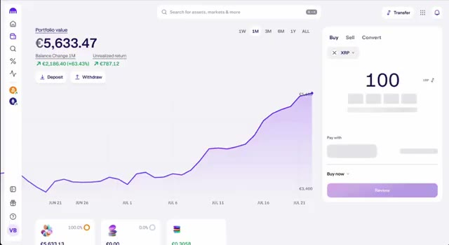
*⏱️ 00:00:09 — Interface de la plateforme Kraken montrant un portefeuille d'une valeur de 5 633,47 € avec un graphique d'évolution sur 1 mois et un module d'achat rapide de XRP.*

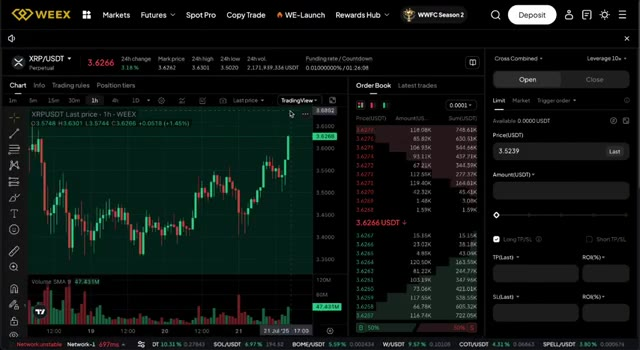
*⏱️ 00:00:19 — Interface de trading de l'exchange WEEX affichant le graphique en chandeliers 1 heure de la paire XRP/USDT, le carnet d'ordres et le panneau d'ordres à effet de levier.*

---

### ⏱️ `[00:00:37 - 00:01:14]` | Segment #02

**🔊 Audio (Transcription Intégrale Mot pour Mot en Français) :**
> Entrons dans le vif du sujet. Alors, pourquoi tout le monde reparle-t-il soudainement du XRP ? Eh bien, plusieurs événements majeurs viennent de se produire. Tout d'abord, la SEC a approuvé le tout premier ETF XRP aux États-Unis, ce qui signifie que les gros capitaux institutionnels commencent enfin à affluer. Deuxièmement, Ripple lance son propre stablecoin, appelé RLUSD, soutenu par des banques de premier plan, et ils demandent une licence bancaire américaine, ce qui pourrait complètement faire le pont entre la crypto et la finance traditionnelle. De plus, une toute nouvelle sidechain compatible avec Ethereum est en cours de construction sur le grand livre XRP, apportant des contrats intelligents, des applications décentralisées et des cas d'utilisation dans le monde réel à l'écosystème. En plus

**👁️ Analyse Visuelle d'Écran (gemini-3.5-flash-lite) :**
**Interface & Outils** : Navigateur web affichant divers sites d'actualités financières (CryptoSlate) et institutionnels sur les cryptomonnaies.

**Contenu textuel & Code** : Titres d'articles sur l'approbation d'un ETF XRP par la SEC, le stablecoin RLUSD de Ripple, et le lancement de la sidechain EVM pour le XRP Ledger.

**Action / Démonstration** : Présentation de captures d'articles de presse et de pages web pour illustrer les actualités majeures concernant le XRP.

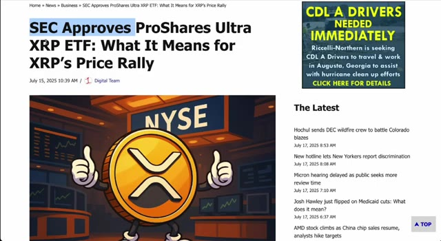
*⏱️ 00:00:47 — Capture d'écran d'un article d'actualité financière montrant le titre 'SEC Approves ProShares Ultra XRP ETF: What It Means for XRP's Price Rally'.*

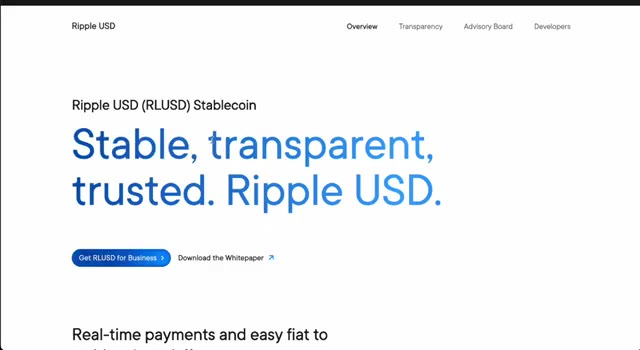
*⏱️ 00:00:56 — Capture d'écran du site officiel de Ripple présentant le stablecoin 'Ripple USD (RLUSD)'.*

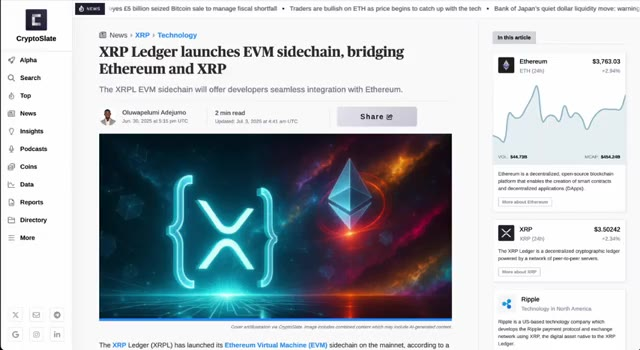
*⏱️ 00:01:05 — Capture d'écran du site CryptoSlate affichant un article intitulé 'XRP Ledger launches EVM sidechain, bridging Ethereum and XRP' avec des cours du marché à droite.*

---

### ⏱️ `[00:01:14 - 00:01:41]` | Segment #03

**🔊 Audio (Transcription Intégrale Mot pour Mot en Français) :**
> de tout cela, les graphiques sont haussiers, les "whales" accumulent et nous sommes en plein cœur d'un marché haussier des cryptomonnaies. Pour faire court, XRP a de l'élan, de solides fondamentaux et un potentiel de hausse massif en ce moment même. Et c'est exactement pourquoi cette vidéo est importante. Tout d'abord, nous devons créer votre compte sur Kraken, l'une des plateformes d'échange de cryptomonnaies les plus fiables du marché. Rendez-vous sur kraken.com ou cliquez sur le premier lien dans la description. Appuyez sur s'inscrire, entrez votre e-mail, définissez un mot de passe fort et sélectionnez votre pays.

**👁️ Analyse Visuelle d'Écran (gemini-3.5-flash-lite) :**
**Interface & Outils** : TradingView, Kraken

**Contenu textuel & Code** : Graphique de prix XRP/USD (Binance) en données hebdomadaires, affichant un cours actuel à 3,4887 $ avec des indicateurs de performance et des tracés techniques (lignes de tendance convergentes).

**Action / Démonstration** : Analyse technique haussière du cours de XRP sur une vue à long terme.

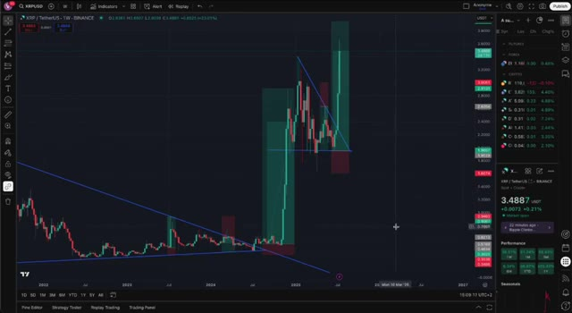
*⏱️ 00:01:21 — Un graphique en chandeliers japonais sur l'interface TradingView montrant l'actif XRP/USD en unité de temps hebdomadaire (1W) avec des lignes de tendance et des zones de support/résistance.*

---

### ⏱️ `[00:01:41 - 00:02:14]` | Segment #04

**🔊 Audio (Transcription Intégrale Mot pour Mot en Français) :**
> Une fois que c'est fait, vérifiez votre boîte de réception et confirmez votre e-mail. Kraken est entièrement réglementé, ils auront donc besoin de vérifier votre identité. Mais ne vous inquiétez pas, c'est rapide. Il vous suffit de télécharger une photo de votre pièce d'identité ou de votre passeport et de prendre un selfie. La plupart des gens sont vérifiés en quelques minutes seulement. Et maintenant que vous êtes vérifié, approvisionnons votre compte. Cliquez sur portefeuille, puis sur dépôt. Vous pouvez déposer en euros, en dollars ou dans d'autres monnaies locales. Et si vous êtes en Europe, les virements bancaires SEPA sont généralement l'option la moins chère. Suivez attentivement les instructions. Assurez-vous d'envoyer le virement depuis

**👁️ Analyse Visuelle d'Écran (gemini-3.5-flash-lite) :**
**Interface & Outils** : Interface web de l'échange de cryptomonnaies Kraken.

**Contenu textuel & Code** : Statut de vérification du compte (KYC) et options de dépôt de fonds en devises fiat.
[DESC_IMAGE_1] Navigation dans les paramètres de vérification du compte sur l'échange Kraken.
[DESC_IMAGE_2] Affichage de la fenêtre contextuelle pour effectuer un dépôt de devises fiat sur Kraken.

**Action / Démonstration** : Explications face caméra et analyse conceptuelle des marchés.

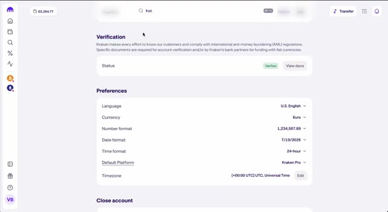
*⏱️ 00:01:49 — Page des paramètres du compte Kraken montrant la section Vérification (KYC) et les préférences de l'utilisateur.*

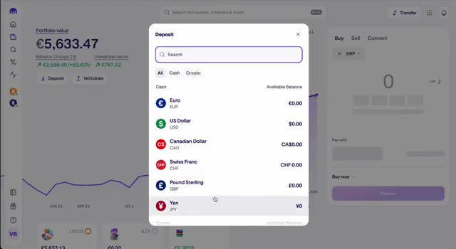
*⏱️ 00:02:06 — Fenêtre modale de dépôt sur Kraken affichant les différentes devises fiat disponibles (Euro, USD, Dollar canadien, etc.).*

---

### ⏱️ `[00:02:14 - 00:02:48]` | Segment #05

**🔊 Audio (Transcription Intégrale Mot pour Mot en Français) :**
> un compte bancaire à votre nom. Évitez d'utiliser PayPal ou les cartes de crédit. Les frais sont plus élevés et cela n'en vaut pas la peine. Une fois votre virement arrivé, votre solde Kraken se mettra à jour et vous serez prêt à acheter du XRP. Il est temps d'obtenir votre XRP. Allez dans l'onglet acheter/vendre ou l'onglet convertir sur Kraken. Sélectionnez votre monnaie fiat comme les euros ou l'USD et choisissez le XRP comme crypto. Entrez le montant que vous voulez acheter, peut-être 50 euros ou 100 euros. Cliquez sur réviser, puis confirmez. Félicitations, vous possédez maintenant du XRP. Mais voici le

**👁️ Analyse Visuelle d'Écran (gemini-3.5-flash-lite) :**
**Interface & Outils** : Kraken (interface Web d'échange de cryptomonnaies)

**Contenu textuel & Code** : Valeur du portefeuille à 5 633,47 €, variation du solde sur 1 mois (+63,43 %), graphique d'évolution du solde et module d'achat rapide de cryptomonnaies (Buy/Sell/Convert).

**Action / Démonstration** : Consultation du solde du compte et du graphique de performance après le dépôt de fonds.

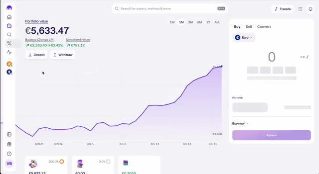
*⏱️ 00:02:22 — Vue d'ensemble du tableau de bord de la plateforme d'échange Kraken affichant la valeur du portefeuille en euros et un graphique de performance sur un mois.*

---

### ⏱️ `[00:02:48 - 00:03:25]` | Segment #06

**🔊 Audio (Transcription Intégrale Mot pour Mot en Français) :**
> chose. La plupart des gens achètent et conservent tout simplement du XRP en espérant que le prix monte. Si vous voulez vraiment gagner de l'argent avec le XRP, vous devriez apprendre à le trader. Et pour cela, nous allons transférer votre XRP ou USDT vers Weeks. Mais si votre objectif est l'investissement à long terme, conserver du XRP très bien. Mais si vous voulez profiter des hauts et des bas du marché, vous avez besoin d'une plateforme de trading avec plus de flexibilité. C'est là que Weeks entre en jeu. Weeks propose des frais bas, des outils puissants et jusqu'à 10 fois de effet de levier sur la paire XRP USDT. C'est également adapté aux débutants, et avec mon lien de parrainage, vous obtiendrez jusqu'à 100 USDT de bonus lorsque vous déposerez et

**👁️ Analyse Visuelle d'Écran (gemini-3.5-flash-lite) :**
**Interface & Outils** : TradingView, plateforme de change WEEX (interface de trading spot/futures).

**Contenu textuel & Code** : Graphiques en chandeliers japonais, graphiques de volume (Volume SMA 9), carnets d'ordres en temps réel, niveaux de prix et outils de dessin techniques.

**Action / Démonstration** : Analyse technique du XRP avec traçage de lignes de tendance sur TradingView, suivie d'une transition vers la plateforme WEEX pour illustrer le trading actif.

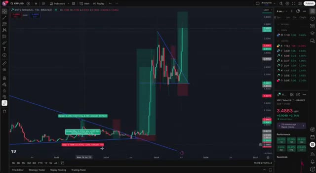
*⏱️ 00:02:58 — Graphique TradingView affichant l'actif XRP/USD sur une période hebdomadaire avec des lignes de tendance et des zones de prix tracées.*

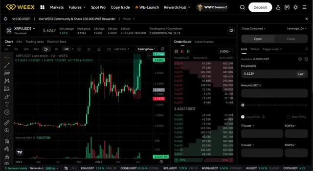
*⏱️ 00:03:07 — Interface de la plateforme de trading WEEX montrant le graphique du XRP/USDT, le carnet d'ordres et le panneau de passage d'ordres.*

---

### ⏱️ `[00:03:25 - 00:03:46]` | Segment #07

**🔊 Audio (Transcription Intégrale Mot pour Mot en Français) :**
> trade. Donc déplaçons vos fonds. Si vous avez acheté du XRP, vous pouvez le retirer directement vers Weeks, mais si vous préférez, vous pouvez aussi convertir votre XRP en USDT sur Kraken et retirer cela à la place. Voici comment faire. Ouvrez votre compte Weeks en utilisant le deuxième lien dans la description. Allez dans Actifs, Dépôt, et sélectionnez USDT ou XRP.

**👁️ Analyse Visuelle d'Écran (gemini-3.5-flash-lite) :**
**Interface & Outils** : Kraken, WEEX

**Contenu textuel & Code** : Graphique de performance du portefeuille Kraken (5 611,97 €), graphique de prix XRP/USDT sur WEEX avec indicateurs de volume et carnet d'ordres en temps réel.

**Action / Démonstration** : Présentation des interfaces de Kraken (pour la conversion de XRP en USDT) et de WEEX (pour le dépôt et le trading de la cryptomonnaie).

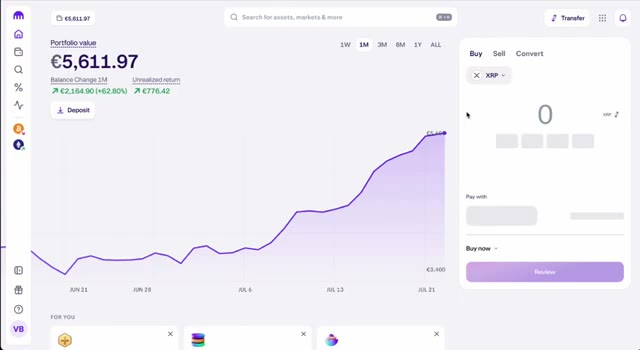
*⏱️ 00:03:30 — Interface de la plateforme Kraken montrant la valeur du portefeuille à 5 611,97 € avec un graphique de performance sur un mois et un panneau d'achat/conversion pour le XRP.*

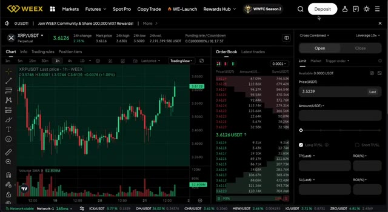
*⏱️ 00:03:40 — Interface de trading de la bourse WEEX montrant le graphique en chandeliers de la paire XRP/USDT sur l'unité de temps 1 heure avec le carnet d'ordres à droite.*

---

### ⏱️ `[00:03:46 - 00:04:05]` | Segment #08

**🔊 Audio (Transcription Intégrale Mot pour Mot en Français) :**
> Choisissez le réseau TRC20 pour l'USDT. C'est rapide et bon marché. Copiez l'adresse de dépôt. Maintenant, retournez sur Kraken. Trouvez votre USDT ou XRP dans le portefeuille. Cliquez sur Retirer. Collez l'adresse de la semaine. Sélectionnez le bon réseau, TRC20 pour l'USDT. Entrez le montant. Confirmez la transaction.

**👁️ Analyse Visuelle d'Écran (gemini-3.5-flash-lite) :**
**Interface & Outils** : Plateformes d'échange WEEX et Kraken.

**Contenu textuel & Code** : Menus de dépôt et de retrait, sélection des crypto-monnaies (USDT, BTC, ETH, XRP), choix du réseau TRC20, et soldes du portefeuille.

**Action / Démonstration** : Sélection du réseau TRC20 sur WEEX puis navigation vers Kraken pour initier le retrait d'USDT ou XRP.

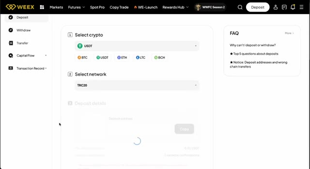
*⏱️ 00:03:51 — Interface WEEX montrant la sélection de la crypto USDT et du réseau TRC20 pour le dépôt.*

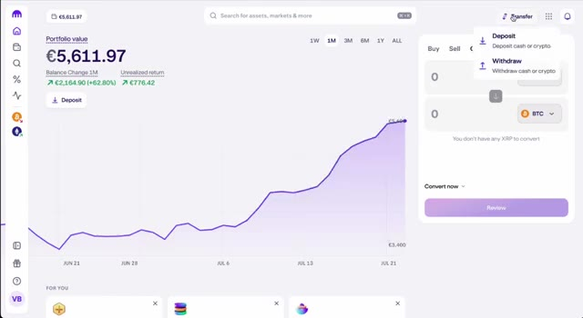
*⏱️ 00:03:56 — Interface Kraken affichant le portefeuille avec un solde de 5 611,97 € et le menu déroulant "Transfer" pour effectuer un retrait.*

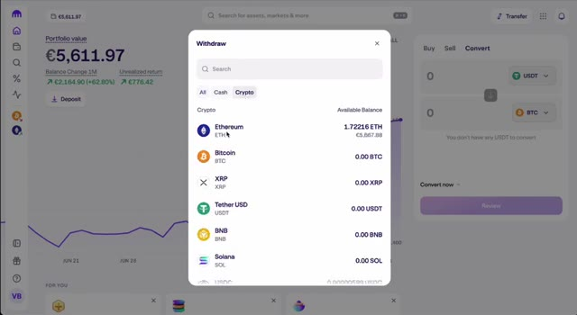
*⏱️ 00:04:01 — Fenêtre de retrait Kraken affichant la liste des cryptomonnaies disponibles (Ethereum, Bitcoin, XRP, Tether USD, etc.).*

---

### ⏱️ `[00:04:06 - 00:04:41]` | Segment #09

**🔊 Audio (Transcription Intégrale Mot pour Mot en Français) :**
> Vos fonds devraient arriver sur Bybit en quelques minutes. Bien, passons maintenant à la partie principale : ouvrons votre premier trade de XRP. Sur Bybit, allez sur l'onglet au comptant ou futures et, pour les débutants, commençons par le comptant. C'est plus sûr et facile à utiliser. Le clic suivant consiste à rechercher XRP USDT. Cliquez sur acheter et choisissez le montant d'USDT que vous voulez dépenser. Si vous êtes plus avancé, allez sur l'onglet futures où vous pouvez trader du XRP avec un effet de levier allant jusqu'à 10 fois. Faites juste attention, définissez votre stop loss, prenez vos profits et gérez votre risque sagement. C'est là que les traders expérimentés font de vrais profits.

**👁️ Analyse Visuelle d'Écran (gemini-3.5-flash-lite) :**
**Interface & Outils** : Interface de la plateforme d'échange de cryptomonnaies WEEX (sections Spot et Futures).

**Contenu textuel & Code** : Paire XRP/USDT, soldes en USDT et Bitcoin, carnets d'ordres (Order Book), graphiques de prix journaliers (1D), indicateur Volume SMA 9.

**Action / Démonstration** : Navigation dans les menus de la plateforme WEEX, sélection de la paire XRP/USDT pour le trading spot et futures.

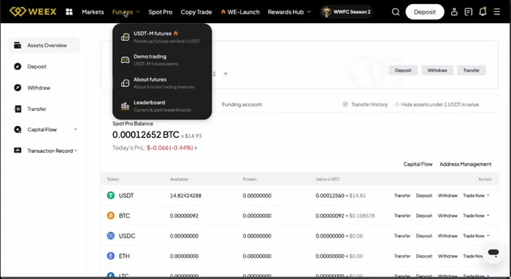
*⏱️ 00:04:15 — Vue d'ensemble des actifs sur l'interface WEEX avec le menu déroulant des options Futures.*

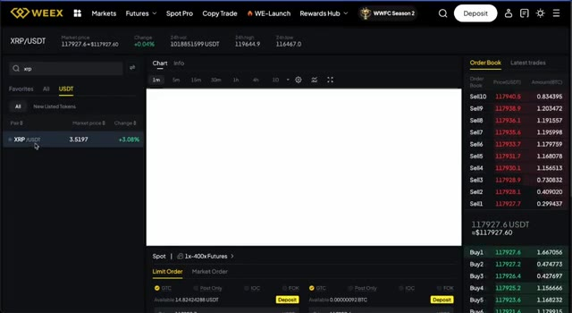
*⏱️ 00:04:23 — Interface de trading spot de WEEX avec la paire XRP/USDT sélectionnée et le carnet d'ordres visible.*

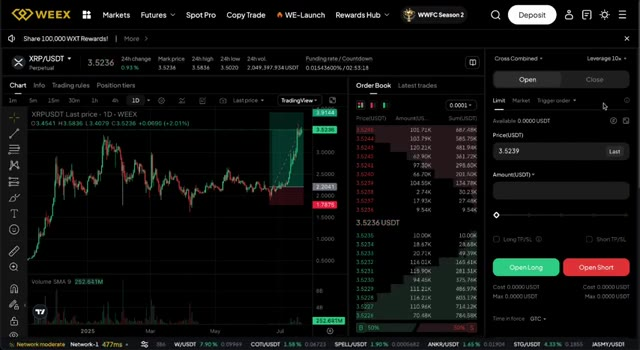
*⏱️ 00:04:32 — Graphique en chandeliers journaliers de la paire XRP/USDT sur l'interface de trading futures de WEEX avec panneau d'ordres.*

---

### ⏱️ `[00:04:41 - 00:05:01]` | Segment #10

**🔊 Audio (Transcription Intégrale Mot pour Mot en Français) :**
> acheter lors de la baisse, profiter de la hausse, et réentrer avec une stratégie. Donc pour récapituler, vous avez créé votre compte Kraken, vérifié votre identité, déposé de la monnaie fiat, acheté du XRP, envoyé vos fonds vers weeks, et appris à trader comme un pro. Si cette vidéo vous a aidé, veuillez soutenir la chaîne en utilisant les liens d'affiliation dans la description.

**👁️ Analyse Visuelle d'Écran (gemini-3.5-flash-lite) :**
**Interface & Outils** : Kraken (plateforme d'échange crypto), WEEX (bourse de dérivés crypto).

**Contenu textuel & Code** : Valeur du portefeuille (€5,633.47), performance (+63.43%), graphique en chandelier journalier XRP/USDT, carnet d'ordres, module de passage d'ordres Long/Short.

**Action / Démonstration** : Configuration d'un compte, consultation de l'évolution d'un portefeuille, analyse technique du XRP et préparation d'une position de trading.

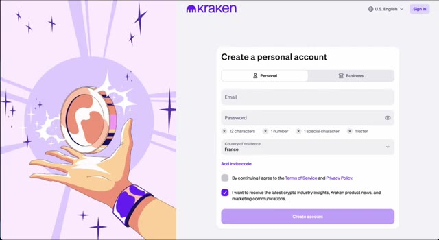
*⏱️ 00:04:46 — Formulaire d'inscription pour créer un compte personnel sur la plateforme Kraken.*

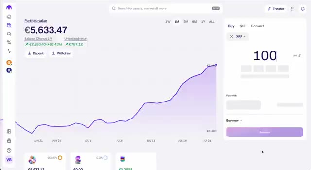
*⏱️ 00:04:51 — Interface du portefeuille Kraken affichant la valeur totale en euros, un graphique de performance et le module d'achat de XRP.*

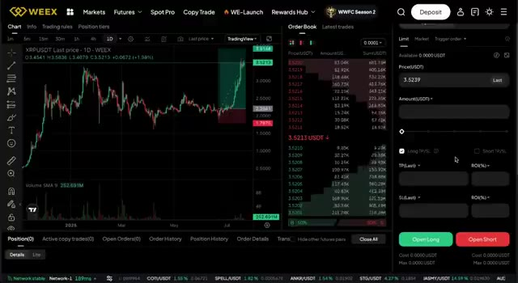
*⏱️ 00:04:56 — Interface de trading de la plateforme WEEX montrant un graphique journalier de la paire XRP/USDT, le carnet d'ordres et le panneau d'exécution.*

---

### ⏱️ `[00:05:01 - 00:05:15]` | Segment #11

**🔊 Audio (Transcription Intégrale Mot pour Mot en Français) :**
> Vous obtiendrez des bonus exclusifs et cela nous aide à continuer à créer ce contenu. Et si vous voulez apprendre à maîtriser le trading de cryptomonnaies, regardez la prochaine vidéo sur la façon de repérer les hausses des altcoins avant qu'elles ne se produisent. Elle est liée juste ici sur l'écran. Merci d'avoir regardé et à la prochaine.

**👁️ Analyse Visuelle d'Écran (gemini-3.5-flash-lite) :**
**Interface & Outils** : YouTube (Interface web de visionnage et de gestion de chaîne)

**Contenu textuel & Code** : Interface YouTube affichant la vidéo "How to Buy USDT to Trade With (Cheap and Easy)", des liens vers Kraken et WEEX, ainsi que d'autres vidéos recommandées de la chaîne.

**Action / Démonstration** : Navigation sur la plateforme YouTube pour montrer la chaîne, la description de la vidéo et les recommandations de contenu connexe.

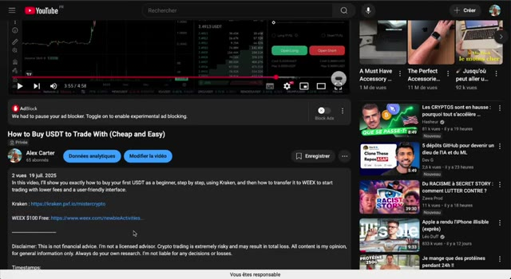
*⏱️ 00:05:04 — Capture d'écran montrant la page YouTube du créateur avec une vidéo en cours de lecture et ses liens d'affiliation dans la description.*

*⏱️ 00:05:08 — Capture d'écran montrant la page d'accueil de la chaîne YouTube du créateur avec la grille de ses vidéos de trading.*

---

