# 🎬 Why PENGU is EXPLODING (Watch Before You Buy)

> **Chaîne** : [Alex Carter](https://www.youtube.com/@AlexCarterTrading)  
> **Lien YouTube** : [https://www.youtube.com/watch?v=GVkLXAuDvqk](https://www.youtube.com/watch?v=GVkLXAuDvqk)  
> **Date de publication** : 20250724  
> **Durée** : 00:05:18  
> **Identifiant vidéo** : `GVkLXAuDvqk`  
> **Transcription & Analyse** : `whisper-v3-large-turbo+gemini-3.5-flash-lite`  

---

## 📌 Synthèse Exécutive & Outils

### 💡 Résumé

La vidéo de la chaîne Alex Carter décortique l'explosion fulgurante du mème coin $PENGU (Pudgy Penguins), propulsé au rang de token le plus tendance sur CoinGecko à l'occasion de son quatrième anniversaire. L'analyse met en lumière la confluence de catalyseurs fondamentaux puissants — l'annonce du jeu mobile *Pudgy Party Battle Royale* par Mythical Games, un volume de ventes de NFT en hausse de 247 %, le dépôt d'un dossier d'ETF par Canary Capital auprès de la SEC et du CBOE, ainsi qu'une accumulation agressive par les baleines (+11,37 %). Cette dynamique parabolique confirme la thèse selon laquelle il faut trader la force et surfer sur les actifs surperformants de l'écosystème crypto actuel.

Sur le plan tactique, l'approche présentée combine une vision macro haussière à long terme (visant des objectifs de prix entre 0,10 $ et 0,20 $, voire une fraction du sommet historique de Dogecoin) et une exécution de trading active axée sur le scalping et le swing trading des retracements. Loin de succomber à la peur de rater le coche (FOMO) au sommet, la méthodologie mise en avant repose sur l'achat systématique des creux (*buy the dips*), l'utilisation d'un effet de levier calculé et l'optimisation des frais de transaction via des plateformes de pointe adaptées au trading haute fréquence sur altcoins à forte volatilité.

Enfin, la démonstration insiste lourdement sur la discipline opérationnelle indispensable pour transformer ces configurations à forte conviction en gains réels. L'automatisation partielle de la gestion du risque, le placement rigoureux d'ordres stop-loss pour parer aux retournements de tendance, et la prise de bénéfices échelonnée constituent le triptyque gagnant de cette stratégie. Pour les traders quantitatifs et suiveurs de momentum, $PENGU s'impose non pas comme un simple pari spéculatif, mais comme un cas d'école d'actif bénéficiant d'une synergie parfaite entre adoption institutionnelle, expansion de propriété intellectuelle (IP) et spéculation de détail.

### 🛠️ Outils, Modèles & Logiciels Présentés

* **Pine Script** : Langage de programmation propriétaire de TradingView utilisé pour concevoir, backtester et automatiser des indicateurs techniques personnalisés et des stratégies de scalping sur les paires mème coins.
* **Claude Code** : Assistant de développement par IA de pointe mobilisé pour générer, auditer et optimiser rapidement des scripts de trading algorithmique et des bots de surveillance de marché.
* **Grok Bots** : Agents conversationnels et d'intelligence artificielle autonomes intégrés pour analyser en temps réel le sentiment social, les flux on-chain et les tendances virales sur les réseaux sociaux.
* **TradingView** : Plateforme de graphisme et d'analyse technique incontournable pour repérer les configurations de prix haussières, tracer les niveaux de résistance clés et surveiller les volumes de transactions.
* **Weeks** : Plateforme de prédilection mise en avant pour exécuter les trades sur $PENGU, offrant des frais extrêmement bas, une application mobile fluide et un accès flexible au levier financier.

### 🔑 Points Clés & Enseignements Stratégiques

* **Trading de la force et du momentum** : Dans le marché des cryptomonnaies, la règle d'or est d'acheter les leaders incontestés et de surfer sur la dynamique haussière plutôt que de parier sur des actifs stagnants.
* **Catalyseurs macro-fondamentaux** : L'envolée de $PENGU est soutenue par des catalyseurs tangibles, notamment le lancement du jeu *Pudgy Party* par Mythical Games et le dépôt institutionnel d'un ETF par Canary Capital auprès de la SEC.
* **Dynamique de l'écosystème NFT** : Une augmentation de 247 % du volume des ventes de NFT Pudgy Penguins et des prix planchers record (16,2 ETH) témoignent d'une demande organique massive et d'une demande institutionnelle latente.
* **Stratégie d'accumulation sur les replis** : Éviter de courir après le prix au sommet ; la stratégie optimale consiste à acheter patiemment chaque micro-correction ou repli technique du marché.
* **Prise de profits échelonnée** : Sécuriser les gains par étapes progressives pour capitaliser sur les mouvements paraboliques tout en verrouillant le capital déjà gagné.
* **Protection stricte par Stop-Loss** : Neutraliser le risque baissier inhérent à la volatilité extrême des mèmes coins en plaçant systématiquement des ordres stop-loss stricts sur chaque position.
* **Optimisation des coûts de transaction** : Utiliser des plateformes de trading dotées de frais extrêmement bas (comme Weeks) pour maximiser la rentabilité nette lors d'opérations de scalping fréquentes.
* **Effet de levier responsable** : Amplifier les profits sur les configurations à forte conviction en employant l'effet de levier de manière strictement contrôlée et mesurée.
* **Objectifs de valorisation ambitieux** : Cibler une fourchette de prix psychologique comprise entre 0,10 $ et 0,20 $, avec un potentiel de revalorisation supplémentaire en cas d'approbation réglementaire de l'ETF.
* **Synergie entre IP et utilité blockchain** : Tirer parti de l'expansion de la propriété intellectuelle dans le monde réel (partenariats NASCAR, PEZ, Revolut) couplée au lancement de la chaîne Abstract pour stimuler durablement l'utilité du token.

---

## ⏱️ Chronologie & Transcription Complète Audio & Visuelle (Mot pour Mot)

### ⏱️ `[00:00:00 - 00:00:30]` | Segment #01

**🔊 Audio (Transcription Intégrale Mot pour Mot en Français) :**
> Pudgy Penguins explose absolument en ce moment. Le meme coin $Pengu vient d'atteindre un nouveau record historique et c'est désormais l'un des tokens les plus tendance sur CoinGecko. Mais pourquoi est-ce que cela se produit ? Suis-je haussier à son sujet ? Et plus important encore, va-t-il aller encore plus haut ? Dans cette vidéo, je décortique tout cela, pourquoi $Pengu s'envole, si je pense qu'il a encore de la marge pour progresser, et comment je compte personnellement gagner des millions en tradant cette crypto. Entrons dans le vif du sujet. Alors tout d'abord, pourquoi Pudgy Penguins devient-il parabolique ?

**👁️ Analyse Visuelle d'Écran (gemini-3.5-flash-lite) :**
**Interface & Outils** : CoinGecko, Plateforme d'échange de cryptomonnaies WEEX, Graphique TradingView

**Contenu textuel & Code** : Paire PENGU/USDT, prix actuel à 0,040451$, volume sur 24h, capitalisation boursière, carnets d'ordres (order book), indicateur de volume (Volume SMA 9).

**Action / Démonstration** : Consultation du classement des cryptomonnaies et analyse technique de la paire PENGU/USDT en unité de temps 4h sur l'échange WEEX.

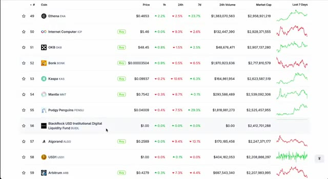
*⏱️ 00:00:07 — Liste des cryptomonnaies tendance avec leurs prix, variations et capitalisations boursières, incluant Pudgy Penguins (PENGU).*

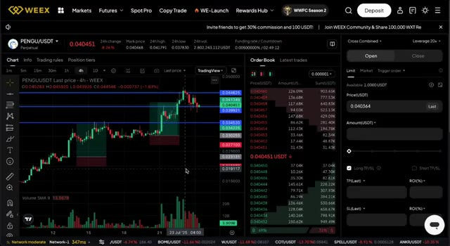
*⏱️ 00:00:22 — Interface de l'échange WEEX affichant le graphique de trading en chandeliers 4h de la paire PENGU/USDT, le carnet d'ordres et le panneau de passage d'ordres.*

---

### ⏱️ `[00:00:30 - 00:00:53]` | Segment #02

**🔊 Audio (Transcription Intégrale Mot pour Mot en Français) :**
> Voici ce qui fait grimper le prix. Dollar Sign Pengu vient d'atteindre 4,705 dollars pour son quatrième anniversaire, grâce à l'annonce d'un jeu Pudgy Party Battle Royale et à des prix planchers de NFT atteignant 16,2 ETH. Un NFT rare d'Ice Pudgy Penguin s'est vendu pour 120 ETH, soit près de 450 000 dollars, ce qui témoigne d'une sérieuse demande de la part des acheteurs et peut-être d'une certaine activité d'initiés.

**👁️ Analyse Visuelle d'Écran (gemini-3.5-flash-lite) :**
**Interface & Outils** : Réseau social X (anciennement Twitter)

**Contenu textuel & Code** : Publications textuelles sur le token PENGU, son ATH, son prix plancher NFT de 16,2 ETH et la vente d'un NFT rare à 120 ETH.

**Action / Démonstration** : Navigation et affichage de publications sur les réseaux sociaux pour illustrer l'actualité des cryptomonnaies et des NFT.

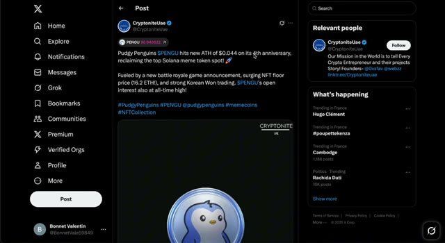
*⏱️ 00:00:36 — Capture d'écran du réseau social X montrant un post de @CryptoniteUae indiquant que Pudgy Penguins $PENGU atteint un nouvel ATH de 0,044 $ pour son 4e anniversaire, avec une image de profil Pudgy Penguin.*

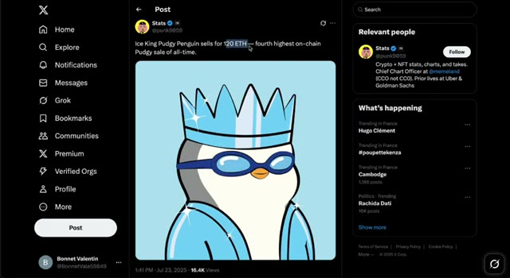
*⏱️ 00:00:47 — Capture d'écran du réseau social X montrant un post de @punk9859 rapportant qu'un Ice King Pudgy Penguin s'est vendu pour 120 ETH.*

---

### ⏱️ `[00:00:53 - 00:01:17]` | Segment #03

**🔊 Audio (Transcription Intégrale Mot pour Mot en Français) :**
> Les analystes prévoient une nouvelle hausse de 140 %, et nous avons déjà observé un rallye de 170 % rien que ce mois-ci, stimulé par le volume des ventes de NFT et des configurations de graphiques haussières. Certains analystes techniques visent le niveau de 0,075 $ comme prochain objectif. En plus de cela, Canary Capital a déposé une demande pour un ETF dollar sign Peng Yu, qui comprend à la fois le jeton et les NFT, et c'est un signal fort pour les investisseurs institutionnels.

**👁️ Analyse Visuelle d'Écran (gemini-3.5-flash-lite) :**
**Interface & Outils** : Navigateur web affichant des articles d'actualité et d'analyse financière crypto (Ethos, sites d'analyse).

**Contenu textuel & Code** : Titres d'articles sur les ventes de NFT en hausse (122,6 millions de dollars) et prévisions de prix pour Pudgy Penguins (PENGU) avec des niveaux cibles de 0,032 $ et 0,075 $.

**Action / Démonstration** : Navigation et lecture d'articles d'actualité et d'analyses techniques sur les cryptomonnaies et les NFT.

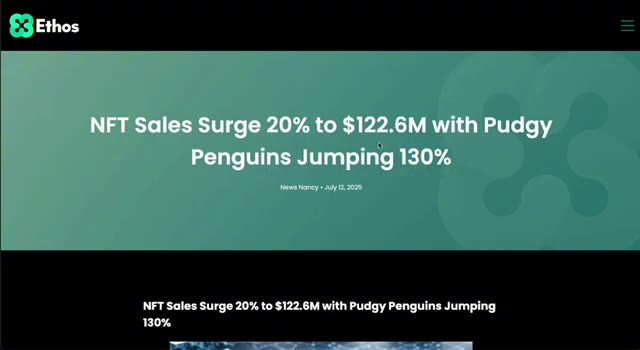
*⏱️ 00:00:59 — Capture d'écran du site web Ethos affichant un article sur l'augmentation du volume des ventes de NFT.*

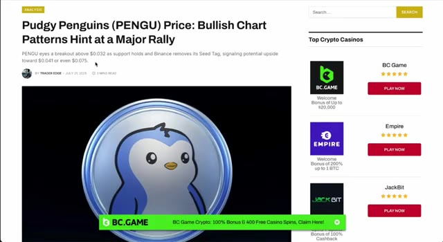
*⏱️ 00:01:05 — Capture d'écran d'un article d'analyse technique sur le jeton Pudgy Penguins (PENGU) mentionnant un objectif de prix de 0,075 $.*

---

### ⏱️ `[00:01:17 - 00:01:36]` | Segment #04

**🔊 Audio (Transcription Intégrale Mot pour Mot en Français) :**
> De plus, le jeu mobile battle royale à venir, Pudgy Party, vise à être numéro un sur les app stores, et ce genre d'exposition médiatique pourrait propulser tout cet écosystème vers la lune. Le volume des ventes de NFT est en hausse de 247 % et tout le marché des NFT est en train de chuter. Mais nous ne nous soucions pas seulement de ce qui s'est déjà produit. Nous voulons gagner de l'argent à l'avenir.

**👁️ Analyse Visuelle d'Écran (gemini-3.5-flash-lite) :**
**Interface & Outils** : Interface web de la plateforme de réseau social X (anciennement Twitter).

**Contenu textuel & Code** : Publications textuelles et visuelles sur X concernant le jeu mobile Pudgy Party et les statistiques de hausse des ventes de NFT (+247 % pour Pudgy Penguins).

**Action / Démonstration** : Navigation et présentation de publications sur le réseau social X illustrant l'actualité du projet Pudgy Penguins et le marché des NFT.

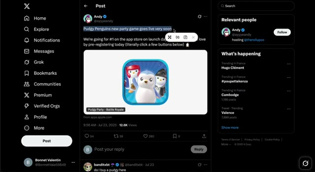
*⏱️ 00:01:22 — Capture d'écran du réseau social X (Twitter) montrant un post d'Andy (@ayyyeandy) au sujet du jeu mobile Pudgy Party.*

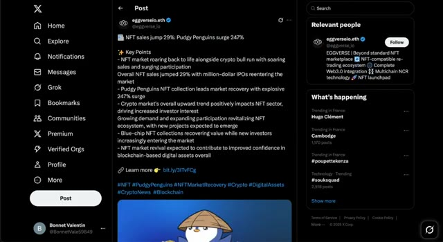
*⏱️ 00:01:27 — Capture d'écran du réseau social X (Twitter) montrant un post d'Eggverse (@eggverse_io) indiquant une hausse de 247 % des ventes de la collection Pudgy Penguins et de 29 % pour le marché NFT global.*

---

### ⏱️ `[00:01:36 - 00:02:04]` | Segment #05

**🔊 Audio (Transcription Intégrale Mot pour Mot en Français) :**
> Et pour ça, nous devons penser comme des traders. Oui, je suis 100 % haussier sur Pudgy Penguins et le symbole boursier Pengu. Parce que dans la crypto, vous voulez être haussier sur les gagnants. Achetez la force, surfez sur la dynamique, ne sous-estimez pas les meilleurs performers. Et Pudgy gagne gros en ce moment, à la fois dans l'espace des NFT et dans l'espace des pièces mémes. Mais je ne suis pas seulement haussier en me basant sur le passé. Je suis haussier parce que les catalyseurs futurs sont encore plus fous. Voici ce qui arrive ensuite pour Pudgy Penguins et pourquoi cela pourrait n'être que le début.

**👁️ Analyse Visuelle d'Écran (gemini-3.5-flash-lite) :**
**Interface & Outils** : TradingView

**Contenu textuel & Code** : Graphique de prix de PENGU/USDT affichant le cours actuel à 0.040348 USD, avec des bougies japonaises journalières illustrant une forte dynamique de hausse.

**Action / Démonstration** : Analyse graphique de la dynamique haussière de PENGU sur un horizon journalier.

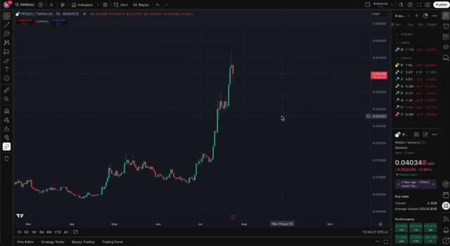
*⏱️ 00:01:43 — Graphique en chandeliers journaliers (1D) de la paire PENGU/TetherUS sur l'échange Binance, montrant une forte tendance haussière.*

---

### ⏱️ `[00:02:05 - 00:02:30]` | Segment #06

**🔊 Audio (Transcription Intégrale Mot pour Mot en Français) :**
> Lancement du jeu Pudgy Party. Un jeu de bataille royale mobile complet par Mythical Games avec une préinscription déjà ouverte et des projets de domination des classements des boutiques d'applications. TGE de la chaîne Abstract et airdrop. Des airdrops potentiels pour les détenteurs ainsi qu'un écosystème blockchain qui pourrait stimuler l'utilité de Pengu. Progrès des ETF. L'ETF de Canary Capital est déjà déposé auprès de la SEC et du CBOE.

**👁️ Analyse Visuelle d'Écran (gemini-3.5-flash-lite) :**
**Interface & Outils** : Navigateur web affichant des articles d'actualité et des blogs spécialisés (Followin).

**Contenu textuel & Code** : Textes informatifs et captures d'écran illustrant le lancement de Pudgy Party et les instructions pour participer à l'airdrop d'Abstract.

**Action / Démonstration** : Présentation visuelle des annonces de préinscription et des opportunités d'airdrop pour appuyer les explications du présentateur.

*⏱️ 00:02:11 — Capture d'écran d'un article d'actualité concernant le lancement des préinscriptions pour le jeu mobile Pudgy Party avec des récompenses en jetons.*

*⏱️ 00:02:17 — Capture d'écran d'une plateforme d'actualités cryptographiques (Followin) affichant un article sur l'airdrop de la chaîne Abstract lié au projet Pudgy Penguins.*

---

### ⏱️ `[00:02:30 - 00:03:00]` | Segment #07

**🔊 Audio (Transcription Intégrale Mot pour Mot en Français) :**
> Si c'est approuvé, nous pourrions voir Pengu listé et négocié par des institutions. Des partenariats dans le monde réel, NASCAR, PEZ, Revolut, et des rumeurs d'expansion sur le marché asiatique et d'apparitions au Comic-Con. Plus de 13 millions de dollars de ventes de produits dérivés déjà réalisés. De nouveaux lancements de NFT. Les jeux Telegram de Lil Pudgy comme Pengu Clash et d'autres expansions de propriété intellectuelle arrivent. L'accumulation par les baleines est en hausse de 11,37 %, les cotations sur les principales bourses comme Bitstamp augmentent, et les campagnes PFP virales dominent les réseaux sociaux.

**👁️ Analyse Visuelle d'Écran (gemini-3.5-flash-lite) :**
**Interface & Outils** : Navigateur web affichant OpenSea (marketplace NFT).

**Contenu textuel & Code** : Métriques de marché NFT, prix plancher de 1,66 ETH, volume total de 129,1K ETH, graphique de ventes et liste des derniers articles vendus.

**Action / Démonstration** : Consultation du marché secondaire des NFT Lil Pudgys pour analyser l'activité de trading et les prix planchers associés à l'écosystème Pengu.

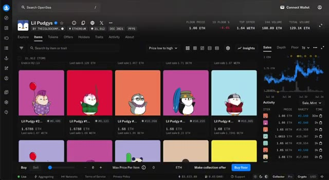
*⏱️ 00:02:53 — Interface de la plateforme OpenSea montrant la collection NFT « Lil Pudgys » avec les prix planchers, les volumes et les éléments de trading.*

---

### ⏱️ `[00:03:00 - 00:03:34]` | Segment #08

**🔊 Audio (Transcription Intégrale Mot pour Mot en Français) :**
> Tout cela, en plus du rallye général du marché des NFT et des altcoins, se conjugue pour préparer quelque chose d'énorme. Alors oui, si ce truc baisse même légèrement, j'en achète encore. Sans hésitation. Parlons de prévision de prix. Lors du dernier marché haussier, le Doge a atteint des niveaux fous, et je ne dis pas que Pengyu arrive là, mais je le vois facilement aller à un cinquième du sommet historique du Doge, ce qui représenterait quand même un mouvement énorme par rapport à ici. Avec ce genre de battage médiatique, d'expansion de l'écosystème et de dynamique, je crois sincèrement que 10 centimes à 20 centimes sont à portée de main, et si l'ETF est approuvé,

**👁️ Analyse Visuelle d'Écran (gemini-3.5-flash-lite) :**
**Interface & Outils** : TradingView (graphique financier avec panneau latéral des actifs et outils d'analyse technique).

**Contenu textuel & Code** : Graphique TOTAL3 (Crypto Total Market Cap Excluding BTC and ETH), chandeliers en unités de 4h, montrant une tendance haussière marquée vers la fin de la période affichée (autour de 1 T$).

**Action / Démonstration** : Visualisation de la capitalisation totale des altcoins (TOTAL3) pour illustrer le rallye général du marché évoqué dans l'analyse.

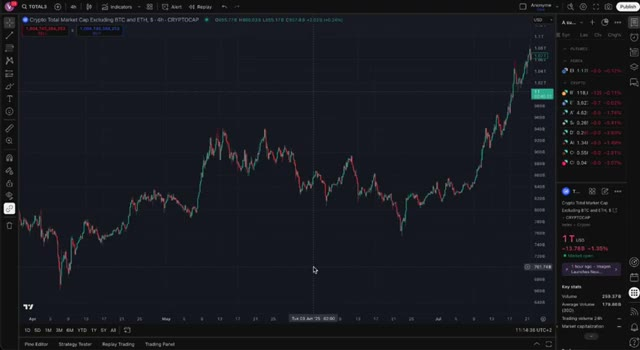
*⏱️ 00:03:09 — Un graphique en chandeliers affichant la capitalisation totale du marché crypto hors Bitcoin et Ethereum (TOTAL3) en unité de temps 4 heures sur TradingView.*

---

### ⏱️ `[00:03:34 - 00:04:08]` | Segment #09

**🔊 Audio (Transcription Intégrale Mot pour Mot en Français) :**
> encore plus haut. Évidemment, ce n'est pas un conseil financier, mais c'est comme ça que je vais en profiter. Donc voici exactement comment je joue le coup. En ce moment, j'achète chaque baisse et je surfe sur chaque vague de momentum, parce que c'est là que les vrais profits se font. J'utilise Weeks pour trader Pengu, et honnêtement, c'est devenu ma plateforme de prédilection pour ce genre de coup. Pourquoi ? D'abord, les frais sont extrêmement bas, ce qui est crucial quand on fait du trading actif. Deuxièmement, l'application mobile est fluide, intuitive, et fonctionne parfaitement que je sois à mon bureau ou en déplacement. Et troisièmement, vous avez accès à

**👁️ Analyse Visuelle d'Écran (gemini-3.5-flash-lite) :**
**Interface & Outils** : Échange de cryptomonnaies WEEX (interface Futures)

**Contenu textuel & Code** : Paire PENGU/USDT, prix actuel à 0,040330 (variation de -8,51 % sur 24h), graphique en chandeliers avec indicateur de volume (SMA 9), carnet d'ordres (Order Book) et panneau de levier (20x) avec les boutons Open Long et Open Short.

**Action / Démonstration** : Consultation du graphique des prix et du carnet d'ordres sur la plateforme WEEX pour analyser la tendance de la cryptomonnaie PENGU.

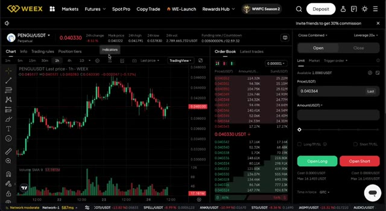
*⏱️ 00:03:42 — Interface de trading de la plateforme WEEX affichant le graphique en chandelier de la paire PENGU/USDT en unité de temps 1h, avec le carnet d'ordres et le panneau de passage d'ordres à droite.*

---

### ⏱️ `[00:04:08 - 00:04:30]` | Segment #10

**🔊 Audio (Transcription Intégrale Mot pour Mot en Français) :**
> un effet de levier si vous voulez amplifier vos trades, ce qui peut être puissant lorsqu'il est utilisé de manière responsable. De plus, si vous utilisez le lien dans la description, vous obtiendrez jusqu'à 100 USDT de bonus sur dépôt. Donc, si vous prenez le trading de cette hausse au sérieux, c'est pratiquement de l'argent gratuit pour commencer. La stratégie que j'utilise est simple mais efficace. Je prends mes bénéfices par étapes, je protège mes risques de baisse avec des ordres stop-loss, et je ne cours jamais après le marché.

**👁️ Analyse Visuelle d'Écran (gemini-3.5-flash-lite) :**
**Interface & Outils** : WEEX (Interface d'échange crypto), YouTube

**Contenu textuel & Code** : Paire PENGU/USDT en graphique 1 heure, carnet d'ordres (Order Book), options de levier (20x), boutons Open Long / Open Short.

**Action / Démonstration** : Présentation de l'interface de trading de la plateforme WEEX avec les graphiques de prix et les options de levier.

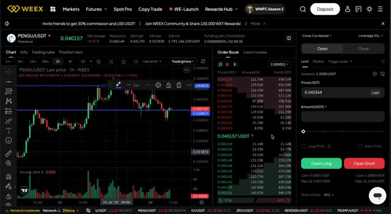
*⏱️ 00:04:25 — Interface de trading de la plateforme WEEX affichant le graphique de la paire PENGU/USDT, le carnet d'ordres et le panneau de passage d'ordres.*

---

### ⏱️ `[00:04:30 - 00:05:06]` | Segment #11

**🔊 Audio (Transcription Intégrale Mot pour Mot en Français) :**
> J'achète les creux, pas les sommets. C'est comme ça que je transforme des configurations à forte conviction en gains sérieux, et c'est pourquoi Pengu est un trade que je surveille de très près. Donc pour conclure, oui, Dollar Pengu s'envole fortement, mais ce n'est pas seulement du battage médiatique. Les fondamentaux derrière ce projet se renforcent chaque semaine. Avec tous les principaux catalyseurs alignés pour le reste de 2025, je suis convaincu qu'il y a encore un énorme potentiel de hausse à venir. Et comme vous l'avez vu, je ne me contente pas de HODLer, je trade activement cette opportunité pour maximiser mes profits. Maintenant, si vous voulez voir quels autres altcoins j'achète en ce moment, ceux dont je suis convaincu qu'ils peuvent

**👁️ Analyse Visuelle d'Écran (gemini-3.5-flash-lite) :**
**Interface & Outils** : TradingView, Binance, Exchange WEEX

**Contenu textuel & Code** : PENGU/USDT, graphique en chandeliers (1D et 4H), volume, carnet d'ordres, Closed PNL (+0.011094), ratio Risque/Rendement de 3.52, prix actuel à 0.040364 USDT.

**Action / Démonstration** : Analyse technique du cours de Pengu, affichage des niveaux de prix et visualisation des performances de trading.

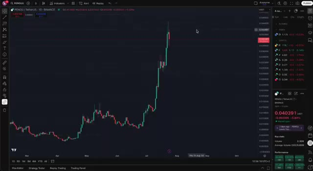
*⏱️ 00:04:39 — Graphique journalier TradingView montrant l'évolution du cours de PENGU/TetherUS sur Binance.*

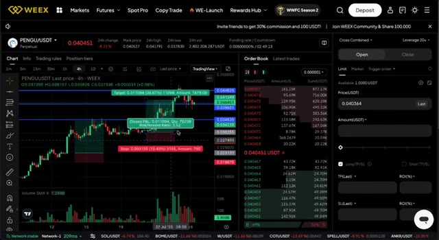
*⏱️ 00:04:57 — Interface de l'exchange WEEX affichant le graphique de trading PENGU/USDT, un carnet d'ordres et les indicateurs de profit (Closed PNL, ratio Risque/Rendement).*

---

### ⏱️ `[00:05:06 - 00:05:18]` | Segment #12

**🔊 Audio (Transcription Intégrale Mot pour Mot en Français) :**
> 30 fois ou plus, allez-y et cliquez sur la vidéo qui apparaît en ce moment même sur votre écran. Elle regorge de véritables pépites que vous ne voulez pas manquez. Merci d'avoir regardé et écrasons ce marché haussier ensemble. On se voit dans la prochaine.

**👁️ Analyse Visuelle d'Écran (gemini-3.5-flash-lite) :**
**Interface & Outils** : YouTube (Interface Web)

**Contenu textuel & Code** : Liste des vidéos de la chaîne avec vignettes et titres liés aux cryptomonnaies (XRP, altcoins, stratégies de scalping, comparatifs d'échanges comme Blofin et Bybit).

**Action / Démonstration** : Navigation sur la page d'accueil de la chaîne YouTube pour montrer les vidéos précédentes.

---

