# 🎬 XRP Price Prediction (Everyone's Wrong)

> **Chaîne** : [Alex Carter](https://www.youtube.com/@AlexCarterTrading)  
> **Lien YouTube** : [https://www.youtube.com/watch?v=SNp28nL_Da8](https://www.youtube.com/watch?v=SNp28nL_Da8)  
> **Date de publication** : 20250729  
> **Durée** : 00:05:29  
> **Identifiant vidéo** : `SNp28nL_Da8`  
> **Transcription & Analyse** : `whisper-v3-large-turbo+gemini-3.5-flash-lite`  

---

## 📌 Synthèse Exécutive & Outils

### 💡 Résumé
Dans cette vidéo, Alex Carter décortique la dynamique explosive du XRP, qui se négocie actuellement à 3,12 dollars, en adoptant une approche d'analyste quantitatif axée sur l'analyse macroéconomique des cycles et la gestion rigoureuse du capital. Loin de céder à la panique ou de prendre des bénéfices hâtifs après des années de stagnation réglementaire et de FUD, Carter démontre par les chiffres que ce mouvement haussier n'est qu'un rattrapage historique, propulsé par la fin du procès de la SEC, les perspectives d'ETF, et une adoption institutionnelle massive. Il expose sa stratégie hybride de gestion de portefeuille : sanctuariser un stock long terme intouchable sur hardware wallet tout en exploitant la volatilité à court terme via le scalping et le trading sur marge.

Pour maximiser l'efficacité de cette approche, Carter combine l'analyse comparative des cycles historiques (en prenant l'exemple du Bitcoin et de l'Ethereum) avec des outils de pointe et des plateformes de trading performantes. Il illustre l'impact d'une exécution tactique précise en partageant ses propres performances, comme ce trade récent transformant 2 000 dollars en près de 60 000 dollars de profit. En s'appuyant sur l'automatisation potentielle via des agents de trading (Grok Bots) et des scripts de rétro-test (Pine Script sur TradingView), l'analyse met en lumière la nécessité d'allier la conviction psychologique à des outils algorithmiques stricts pour naviguer dans le marché haussier de 2025.

Enfin, la vidéo insiste sur l'importance cruciale du *Risk Management* dans l'optimisation des rendements. En utilisant des plateformes offrant des conditions de liquidité et des bonus de dépôt attractifs (comme WOOX / Weeks), l'analyste rappelle que le succès en trading quantitatif ne repose pas sur le hasard, mais sur la maîtrise des flux, la structure des graphiques et une discipline de fer. L'objectif est clair : capitaliser sur la force de frappe de la communauté XRP et sur les inefficacités du marché pour transformer la volatilité en une machine à générer du cash-flow, tout en préparant le terrain pour des projections de prix oscillant entre 10 et 30 dollars pour ce cycle.

### 🛠️ Outils, Modèles & Logiciels Présentés
* **Pine Script** : Langage de programmation propriétaire de TradingView utilisé pour concevoir, backtester et automatiser des stratégies de trading algorithmique et des indicateurs sur mesure.
* **Claude Code** : Assistant de développement par intelligence artificielle avancé, mobilisé pour optimiser, déboguer et structurer les scripts de trading et les codes d'automatisation des stratégies.
* **Grok Bots** : Agents conversationnels et bots de trading pilotés par l'IA de xAI, exploités pour analyser le sentiment du marché, détecter les tendances en temps réel et exécuter des ordres de scalping automatisés.
* **TradingView** : Plateforme de graphisme boursier incontournable servant à l'analyse technique multi-temporelle, au tracé des niveaux de support/résistance et au déploiement des scripts Pine.
* **WOO X (Weeks)** : Exchange de cryptomonnaies centralisé hautement performant offrant une liquidité profonde, des options de levier avancées et des bonus de dépôt majeurs (jusqu'à 30 000 $) pour le trading à court terme.
* **Ledger** : Portefeuille matériel (*hardware wallet*) sécurisé hors-ligne utilisé pour la conservation à long terme et l'isolation des actifs principaux ("le sac intouchable") contre le risque de contrepartie des exchanges.

### 🔑 Points Clés & Enseignements Stratégiques
* **Dissociation des portefeuilles (Core vs Trading)** : Séparation stricte entre les avoirs à long terme stockés sur un Ledger (intouchables) et le capital spéculatif alloué au trading actif sur les exchanges pour surfer sur la volatilité.
* **Analyse comparative des cycles macroéconomiques** : Utilisation des multiplicateurs historiques du Bitcoin (x3,5) et de l'Ethereum (x3) lors des cycles précédents pour modéliser par analogie un objectif plancher de 9 $ à 12 $ pour le XRP.
* **Rattrapage temporel et structurel** : Prise en compte du coût d'opportunité lié au procès de la SEC, suggérant que le XRP accuse un retard de valorisation qui amplifie la violence de la cassure haussière actuelle vers les 3,12 $ et au-delà.
* **Effet de levier de la psychologie de marché** : Analyse de la force de la communauté XRP et de sa faible propension à vendre à bas prix, créant une contraction de l'offre circulante et une pression acheteuse organique massive.
* **Gestion du risque (*Risk Management*) asymétrique** : Engagement d'un capital de départ limité (ex: 2 000 $) sur des configurations à fort effet de levier pour viser des rendements exponentiels (ex: 60 000 $ de profit) sans compromettre le capital global.
* **Exploitation des inefficacités de court terme** : Mise en place de stratégies de scalping sur les unités de temps inférieures (UT) pour capitaliser sur les mouvements de panique haussière et baissière sans toucher au capital macro.
* **Optimisation du capital via les incitations** : Utilisation stratégique des bonus de dépôt institutionnels et des offres promotionnelles des plateformes (jusqu'à 30 000 $ sur WOO X) pour accroître artificiellement la marge de manœuvre et le collatéral de trading.
* **Validation fondamentale par l'utilité réelle** : Intégration des catalyseurs fondamentaux (demandes d'ETF, intégrations bancaires, DeFi et tokenisation d'actifs) dans les modèles de valorisation quantitative pour justifier des objectifs de 20 $ à 30 $ d'ici 2025.
* **Automatisation et rigueur algorithmique** : Recours combiné à Pine Script, Claude Code et Grok Bots pour éliminer les biais émotionnels humains et exécuter des entrées/sorties chirurgicales basées sur la data.
* **Planification des prises de profits étagées** : Refus des visions utopiques irréalistes (100 $ et plus pour ce cycle) tout en maintenant un plan de sortie dynamique aligné sur l'extension des vagues de Elliott et la liquidité globale du marché crypto.

---

## ⏱️ Chronologie & Transcription Complète Audio & Visuelle (Mot pour Mot)

### ⏱️ `[00:00:00 - 00:00:37]` | Segment #01

**🔊 Audio (Transcription Intégrale Mot pour Mot en Français) :**
> XRP est en train d'exploser. En ce moment, il se négocie à 3,12 dollars et la dynamique derrière lui est absolument folle. Mais voici une vraie question. Jusqu'où peut-il monter ? Personnellement, j'achète du XRP depuis les creux du marché baissier et, même maintenant, j'en achète encore plus chaque jour. Et dans cette vidéo, je vais vous montrer exactement où je prévois de vendre, jusqu'où je pense que XRP peut réellement monter, et surtout la logique étape par étape et les calculs que j'utilise pour déterminer ces objectifs. Car voici la vérité, alors que la plupart des gens se concentrent sur ce qui s'est déjà produit, nous sommes ici pour gagner de l'argent sur ce qui va arriver.

**👁️ Analyse Visuelle d'Écran (gemini-3.5-flash-lite) :**
**Interface & Outils** : Graphique de trading (type TradingView)

**Contenu textuel & Code** : Courbe de prix montrant une explosion haussière verticale sur la droite, avec le texte "How high" affiché au premier plan.

**Action / Démonstration** : Illustration visuelle de la flambée du cours du XRP et de la question sur son potentiel de hausse.

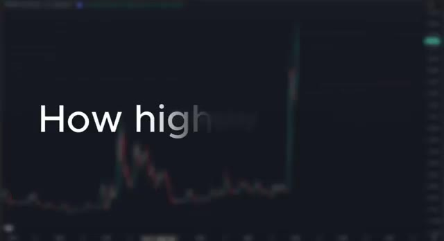
*⏱️ 00:00:09 — Un graphique de prix en forte hausse avec le texte "How high" superposé.*

---

### ⏱️ `[00:00:37 - 00:01:02]` | Segment #02

**🔊 Audio (Transcription Intégrale Mot pour Mot en Français) :**
> Entrons dans le vif du sujet. Alors d'abord, pourquoi est-ce que j'achète encore du XRP, même à 3,12 $ ? Pourquoi est-ce que je n'ai pas encore vendu ? Soyons honnêtes, 3,12 $ c'est déjà une victoire énorme par rapport à là où nous en étions. Pour beaucoup de gens, ce serait le moment de prendre leurs profits et de verrouiller tout ça. Mais pour moi, je suis dans ce milieu depuis trop longtemps pour abandonner juste au moment où ça devient intéressant. Nous avons traversé des années de suppression, de poursuites judiciaires, de FUD et de frustration.

**👁️ Analyse Visuelle d'Écran (gemini-3.5-flash-lite) :**
**Interface & Outils** : Graphique TradingView affichant l'historique des prix de la cryptomonnaie XRP de 2022 à 2025.

**Contenu textuel & Code** : Chandeliers japonais hebdomadaires montrant une longue période de consolidation à bas prix (0,40$ - 0,60$) suivie d'une forte explosion haussière en 2025 atteignant un niveau proche de 3,12$ à 3,50$. Le cours actuel affiché sur l'axe des ordonnées est de 3,1501$.

**Action / Démonstration** : Présentation de l'évolution macroéconomique et de la flambée récente du cours du XRP pour illustrer la performance actuelle du jeton.

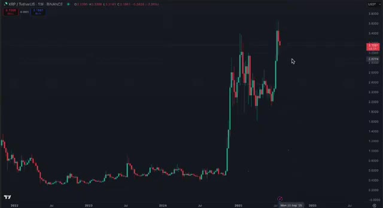
*⏱️ 00:00:43 — Graphique en chandeliers japonais en unité de temps hebdomadaire (1W) pour la paire XRP/TetherUS sur Binance.*

---

### ⏱️ `[00:01:03 - 00:01:31]` | Segment #03

**🔊 Audio (Transcription Intégrale Mot pour Mot en Français) :**
> Et maintenant que la cassure se produit enfin, ce n'est pas le moment d'encaisser. C'est le moment de surfer sur la vague. Je me dis depuis des années que 10 dollars par XRP, ce n'est rien. Et honnêtement, je l'ai tellement dit que j'ai fini par y croire sincèrement. À l'époque où je parlais d'un XRP atteignant 10 dollars, les gens riaient. Mais nous avons continué à accumuler. Nous avons continué à y croire. Et toutes ces discussions sur le procès de la SEC et la pression réglementaire, tout cela n'a fait que mener à ce moment précis.

**👁️ Analyse Visuelle d'Écran (gemini-3.5-flash-lite) :**
**Interface & Outils** : TradingView / Binance

**Contenu textuel & Code** : Paire XRP/USDT, chandeliers hebdomadaires (1W), ligne de tendance baissière bleue tracée sur plusieurs années, prix actuel autour de 3,15 $ avec une forte impulsion haussière récente.

**Action / Démonstration** : Analyse technique du graphique du XRP mettant en évidence la cassure de la ligne de résistance oblique de long terme.

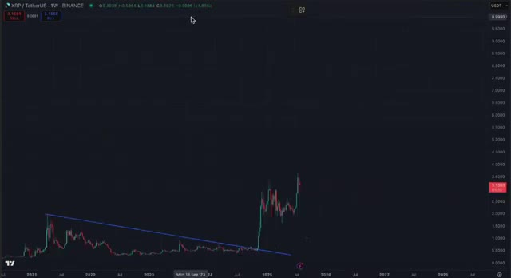
*⏱️ 00:01:10 — Graphique en chandeliers japonais en unité de temps hebdomadaire (1W) pour la paire XRP/TetherUS sur Binance, illustrant une longue tendance de consolidation suivie d'une cassure haussière majeure.*

---

### ⏱️ `[00:01:32 - 00:02:05]` | Segment #04

**🔊 Audio (Transcription Intégrale Mot pour Mot en Français) :**
> Parce que maintenant, toute cette frustration se transforme en carburant. Et c'est pour ça que je suis toujours là, plus optimiste que jamais. Laissez-moi vous dire quelque chose d'important. La plupart des gens n'ont aucune idée de la force réelle de la communauté XRP. Quand on demande aux détenteurs à quel prix ils préviennent de vendre, ils ne disent pas 4 dollars. Ils ne disent pas 10 dollars. Ils disent, je ne vends pas en dessous de 100 dollars. Certains disent même 500 ou 1 000 dollars. Maintenant, je ne dis pas que ce sont des objectifs réalistes pour ce cycle. Mais le fait est que, lorsque les gens croient en un projet aussi fortement et lorsqu'ils refusent de vendre,

**👁️ Analyse Visuelle d'Écran (gemini-3.5-flash-lite) :**
**Interface & Outils** : Réseau social X (anciennement Twitter).

**Contenu textuel & Code** : Publications de comptes crypto sur X évoquant des prédictions de prix haussières pour le XRP (objectifs allant de 33 $ à 1 000 $) et graphiques d'analyse technique associés.

**Action / Démonstration** : Consultation et présentation de publications communautaires sur X illustrant l'optimisme et les prédictions de prix haussières des détenteurs de XRP.

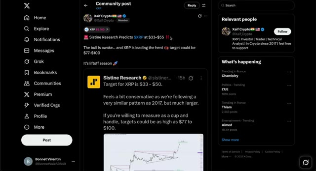
*⏱️ 00:01:40 — Capture d'écran du réseau social X montrant une publication de la communauté XRP par l'utilisateur Xaif Crypto, relayant une analyse de Sistine Research prédisant le XRP entre 33 $ et 55 $, avec un objectif potentiel de 77 $ à 100 $.*

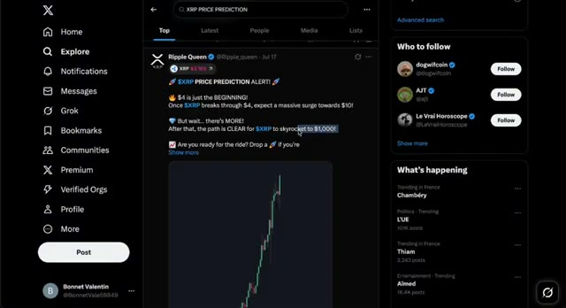
*⏱️ 00:01:57 — Capture d'écran du réseau social X affichant un tweet de Ripple Queen concernant une prédiction de prix pour le XRP, mentionnant un objectif à 1 000 $ et incluant un graphique de tendance haussière.*

---

### ⏱️ `[00:02:05 - 00:02:35]` | Segment #05

**🔊 Audio (Transcription Intégrale Mot pour Mot en Français) :**
> cela crée une pression haussière énorme. Et c'est exactement ce qui se passe en ce moment. Laissez-moi être clair. Je n'ai absolument aucun projet de vendre le XRP que je detiens sur mon Ledger. C'est du long terme. C'est intouchable. À la place, ce que je fais, c'est trader les mouvements sur Weeks. En fait, l'un de mes trades récents sur le XRP a transformé 2 000 dollars en près de 60 000 dollars de profit. En ce moment, si vous vous inscrivez sur Weeks en utilisant le lien ci-dessous, vous pouvez obtenir accès à un bonus allant jusqu'à 30 000 dollars rien qu'en déposant et en tradant. Ce n'est pas une blague.

**👁️ Analyse Visuelle d'Écran (gemini-3.5-flash-lite) :**
**Interface & Outils** : Plateforme d'échange WEEX (interface de trading Futures) et interface de lecteur vidéo YouTube.

**Contenu textuel & Code** : Graphique en chandeliers japonais XRP/USDT (prix actuel autour de 3.1496 USD), indicateur de volume (Volume SMA 9), carnet d'ordres en temps réel et panneau de configuration des ordres de trading.

**Action / Démonstration** : Présentation de la plateforme WEEX et analyse technique de la paire XRP/USDT sur graphique de 4 heures.

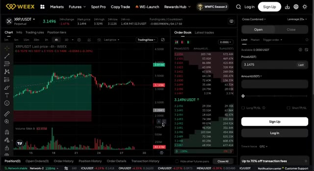
*⏱️ 00:02:13 — Capture d'écran de l'interface de trading de la plateforme WEEX affichant le graphique de la paire XRP/USDT en unités de 4 heures, avec le carnet d'ordres et le panneau de passage d'ordres sur la droite.*

---

### ⏱️ `[00:02:36 - 00:03:05]` | Segment #06

**🔊 Audio (Transcription Intégrale Mot pour Mot en Français) :**
> C'est la plus haute offre de bonus que j'ai vue en 2025 jusqu'à présent. Donc si vous voulez suivre ma configuration de trading exacte, consultez le lien dans la description. Parlons des objectifs de prix. En 2017, le XRP a atteint 3,50 $. Le Bitcoin est passé de 20 000 $ à 70 000 $ lors du dernier cycle, soit une multiplication par 3,5. L'Ethereum est passé de 1 500 $ à 4 500 $, soit une multiplication par 3. Donc logiquement, je pensais que le XRP passerait de 3,50 $ à au moins 9 $ à 12 $ dans ce cycle.

**👁️ Analyse Visuelle d'Écran (gemini-3.5-flash-lite) :**
**Interface & Outils** : WEEX et TradingView

**Contenu textuel & Code** : Offres de bonus et coupons pour nouveaux utilisateurs (10-100 coupon, 20 USDT de dépôt) sur WEEX ; graphique en chandeliers Bitcoin avec données de prix historiques et indicateurs de volume sur TradingView.

**Action / Démonstration** : Présentation des bonus de la plateforme d'échange et analyse historique des prix du Bitcoin.

*⏱️ 00:02:43 — Interface de la plateforme d'échange WEEX affichant la section des récompenses pour les nouveaux utilisateurs (New User Rewards) avec des coupons et bonus de dépôt.*

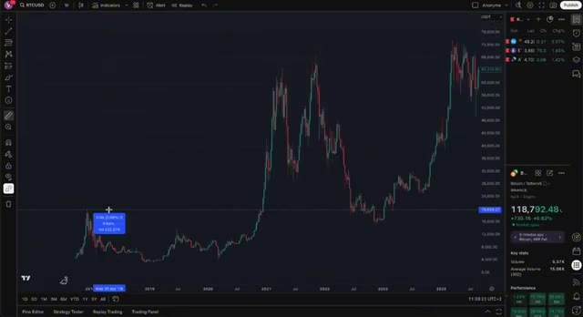
*⏱️ 00:02:50 — Graphique TradingView en chandeliers montrant l'historique des prix du Bitcoin (BTCUSD) sur une période pluriannuelle avec des outils de mesure de prix.*

---

### ⏱️ `[00:03:06 - 00:03:42]` | Segment #07

**🔊 Audio (Transcription Intégrale Mot pour Mot en Français) :**
> C'était mon estimation prudente et elle est basée sur des cycles historiques, pas sur du "hopium". Mais ensuite, j'ai réalisé quelque chose. Si le XRP avait réellement participé au bull run de 2021, il aurait probablement atteint 9 dollars à l'époque, et maintenant nous viserions 18 dollars ou plus. Donc, d'une certaine manière, ce mouvement actuel rattrape le temps perdu. Souvenez-vous, le XRP a été la deuxième cryptomonnaie en termes de capitalisation boursière pendant longtemps. Même pendant le procès, il est resté dans le top 10, ce qui est du jamais vu. Maintenant que le procès est terminé et que les rumeurs d'ETF arrivent, le XRP obtient enfin la reconnaissance et l'utilité qu'il mérite.

**👁️ Analyse Visuelle d'Écran (gemini-3.5-flash-lite) :**
**Interface & Outils** : Graphique financier sur TradingView et site web de cotations crypto de type CoinGecko.

**Contenu textuel & Code** : Données de prix historiques du XRP, prix actuel à 3.1553 USD, volumes et statistiques clés, ainsi que tableau de classement des cryptomonnaies par capitalisation boursière.

**Action / Démonstration** : Analyse technique des cycles historiques du cours du XRP et visualisation des performances de marché.

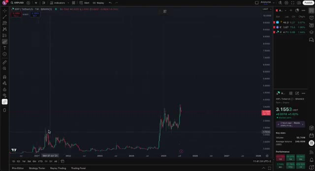
*⏱️ 00:03:15 — Capture d'écran montrant un graphique TradingView de la paire XRP/USD en unités hebdomadaires sur Binance, affichant l'évolution historique des prix et le cours actuel à 3.1553 USD.*

---

### ⏱️ `[00:03:43 - 00:04:23]` | Segment #08

**🔊 Audio (Transcription Intégrale Mot pour Mot en Français) :**
> Nous voyons des intégrations avec les systèmes bancaires. Nous voyons une adoption dans le monde réel. Nous voyons des demandes de ETF, des intégrations DeFi, la tokenisation d'actifs. Et c'est pourquoi je crois que le XRP à 10 dollars n'est que le début. Je ne dis pas que le XRP atteindra 100 dollars demain. Ce n'est pas réaliste dans ce cycle. Mais si nous voyons déjà une multiplication par 3 ou 4 à partir d'ici en l'espace de quelques mois, et que le marché haussier se poursuit jusqu'en 2025, alors 20 à 30 dollars ne semble plus si fou que ça. Et encore une fois, si le Bitcoin monte plus haut, ces objectifs augmentent en conséquence. Alors, comment est-ce que je joue le coup ? Simple. Je conserve du XRP à long terme sur mon

**👁️ Analyse Visuelle d'Écran (gemini-3.5-flash-lite) :**
**Interface & Outils** : Site web financier 'AIinvest' et plateforme de graphiques boursiers TradingView.

**Contenu textuel & Code** : Articles d'actualité financière, barres de cotation (BAC, ETH, SOL, XRP) et graphique de prix avec axes temporels (2018 à 2027) et indicateurs de performance de XRP.

**Action / Démonstration** : Présentation d'une analyse comparative sur la tokenisation d'actifs et visualisation de l'évolution technique à long terme du cours de XRP sur TradingView.

*⏱️ 00:03:53 — Capture d'écran d'un article financier sur le site 'AIinvest' intitulé 'XRP vs. Solana: The Long Game in Real-World Asset Tokenization', illustrant la tokenisation d'actifs réels.*

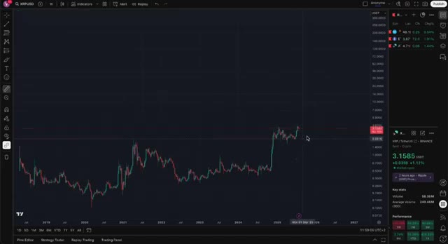
*⏱️ 00:04:03 — Graphique TradingView en chandeliers japonais de la paire XRP/USD (échelle logarithmique), montrant l'évolution historique des prix et la dynamique haussière récente.*

---

### ⏱️ `[00:04:23 - 00:05:00]` | Segment #09

**🔊 Audio (Transcription Intégrale Mot pour Mot en Français) :**
> grand livre, et je trade les hausses et les baisses à court terme sur WOO X. Je ne veux jamais vendre mes avoirs principaux, mais le trading me permet de profiter de la volatilité sans toucher à mon sac principal. Et grâce au bonus allant jusqu'à 30 000 $ sur WOO X, il n'a jamais été aussi facile de commencer. Déposez, tradez et gagnez. C'est aussi simple que ça. Laissez-moi résumer. XRP explose, mais je pense toujours que c'est le début. Ce n'est pas le moment de paniquer ou de douter. C'est le début de la cassure que nous attendons tous. Si vous êtes déjà dedans, félicitations. Si ce n'est pas le cas, faites vos recherches, étudiez les graphiques,

**👁️ Analyse Visuelle d'Écran (gemini-3.5-flash-lite) :**
**Interface & Outils** : WEEX (interface de trading et page promotionnelle) et graphique TradingView (Binance).

**Contenu textuel & Code** : Paire XRP/USDT, chandeliers hebdomadaires, volumes, carnet d'ordres et interface de passage d'ordres (Limit/Market).

**Action / Démonstration** : Présentation de l'interface de trading et visualisation historique des prix d'une cryptomonnaie avec l'outil Replay.

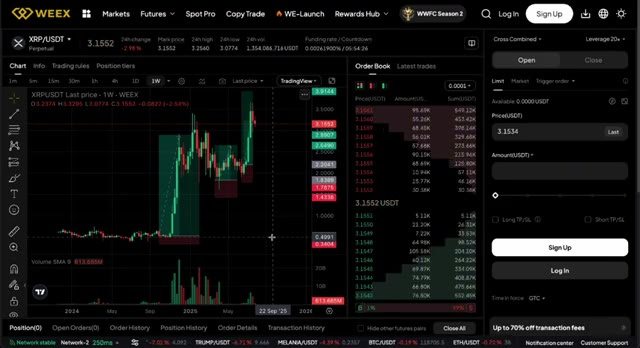
*⏱️ 00:04:32 — Interface de trading de la plateforme WEEX montrant le graphique XRP/USDT en unités hebdomadaires avec le carnet d'ordres à droite.*

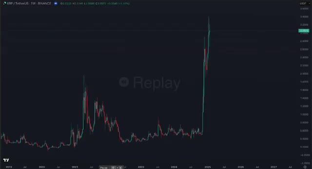
*⏱️ 00:04:50 — Graphique en chandeliers japonais TradingView (XRP/TetherUS en données hebdomadaires sur Binance) avec l'outil de relecture (Replay) actif.*

---

### ⏱️ `[00:05:00 - 00:05:30]` | Segment #10

**🔊 Audio (Transcription Intégrale Mot pour Mot en Français) :**
> comprenez les cycles, parce que cette course ne fait que commencer. Assurez-vous d'aimer la vidéo, de vous abonner à la chaîne et d'activer la cloche parce que nous allons aller loin dans ce marché haussier et je serai là à chaque étape et si vous voulez rejoindre weeks réclamez votre bonus et commencez à trader avec moi le lien est juste en dessous et si vous voulez connaître les dix autres altcoins que j'achète en ce moment et qui pourraient faire x30 cliquez sur la vidéo sur votre écran dès maintenant rendons cette saison légendaire

**👁️ Analyse Visuelle d'Écran (gemini-3.5-flash-lite) :**
**Interface & Outils** : YouTube (Interface web de visionnage et de navigation de chaînes).

**Contenu textuel & Code** : Titres de vidéos, vignettes de tutoriels sur WEEX et Bybit, ainsi que des listes de lecture de cryptomonnaies.
[DESC_IMAGE_3] Navigation dans les vidéos de la chaîne pour illustrer les offres et bonus mentionnés dans l'audio.

**Action / Démonstration** : Explications face caméra et analyse conceptuelle des marchés.

---

