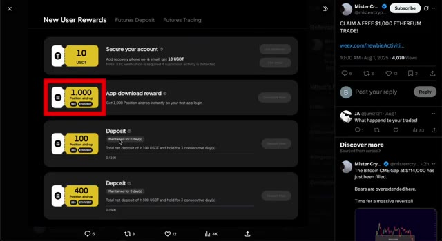
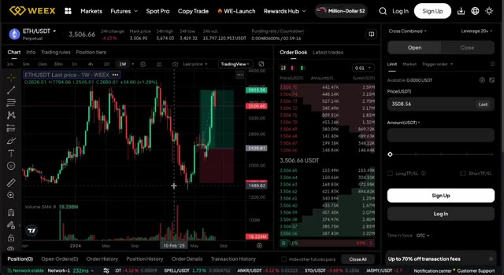
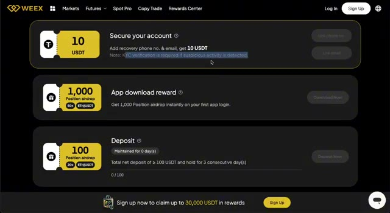
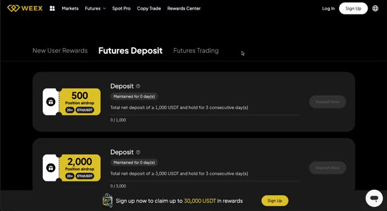
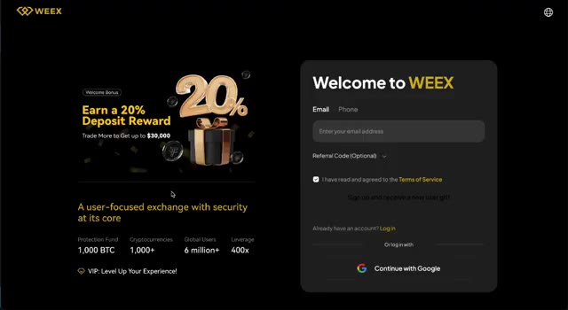
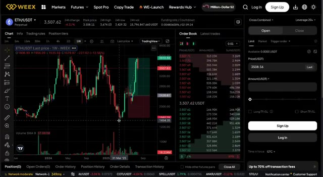

# 🎬 Get $1,000 FREE Bonus – No Deposit Needed (5 Days Left...)

> **Chaîne** : [Alex Carter](https://www.youtube.com/@AlexCarterTrading)  
> **Lien YouTube** : [https://www.youtube.com/watch?v=QEAEKSM2MyA](https://www.youtube.com/watch?v=QEAEKSM2MyA)  
> **Date de publication** : 20250802  
> **Durée** : 00:03:04  
> **Identifiant vidéo** : `QEAEKSM2MyA`  
> **Transcription & Analyse** : `whisper-v3-large-turbo+gemini-3.5-flash-lite`  

---

## 📌 Synthèse Exécutive & Outils

### 💡 Résumé

Cette vidéo présentée par la chaîne Alex Carter met en avant une opportunité promotionnelle majeure en partenariat avec la plateforme d'échange de cryptomonnaies Weeks, ciblant particulièrement les traders cherchant à maximiser leur effet de levier sans engager immédiatement de capital personnel. L'analyse se concentre sur l'obtention d'une position de trading gratuite en Ethereum (ETH) d'une valeur maximale de 1 000 dollars sans dépôt requis, ainsi que sur l'activation de bonus complémentaires liés à l'enregistrement des coordonnées et au volume d'échange cumulé. 

Bien que la transcription se focalise principalement sur la structure des incitations financières, des réductions de frais de transaction de 25 % et des paliers de bonus de dépôt pouvant atteindre 30 000 dollars, elle s'inscrit dans une démarche globale d'optimisation du capital propre au trading quantitatif et au scalping à haute fréquence. L'utilisation de telles positions offertes permet de tester des stratégies algorithmiques ou des configurations de scalping en conditions réelles de marché, tout en s'affranchissant du risque de perte en capital initial sur les fonds propres, les profits générés restant intégralement acquis par le trader.

L'approche démontrée insiste sur l'importance d'une exécution rapide — l'offre étant limitée dans le temps — et sur l'optimisation des frais de courtage, un facteur critique pour la rentabilité à long terme des stratégies automatisées ou discrétionnaires à forte cadence. En combinant l'absence de KYC strict pour l'accès aux bonus initiaux, des récompenses de volume progressives et un effet de levier en ETH, cette configuration offre aux opérateurs de marché un banc d'essai idéal pour valider leurs modèles d'exécution avant de déployer des capitaux substantiels.

### 🛠️ Outils, Modèles & Logiciels Présentés

*   **Weeks** : Plateforme d'échange de cryptomonnaies centralisée proposant des bonus de bienvenue, des positions de trading financées en ETH et des réductions sur les frais de transaction.
*   **Application Mobile Weeks (iOS / Android)** : Interface logicielle officielle indispensable pour lier automatiquement le compte, activer les bonus et exécuter les ordres de trading en temps réel.
*   **Pine Script** : Langage de programmation propriétaire de TradingView utilisé pour concevoir, backtester et automatiser des indicateurs techniques et des stratégies de scalping sur mesure.
*   **Claude Code** : Outil d'intelligence artificielle avancé permettant d'assister les codeurs et quant traders dans la génération, le débogage et l'optimisation de scripts de trading complexes.
*   **Grok Bots** : Agents conversationnels et algorithmiques dopés à l'IA intégrés pour assister dans la prise de décision, l'analyse de sentiment de marché et l'optimisation des points d'entrée/sortie.
*   **TradingView** : Plateforme de graphisme et d'analyse technique de référence pour l'étude des price actions, l'application d'indicateurs quantitatifs et le suivi des actifs numériques.

### 🔑 Points Clés & Enseignements Stratégiques

*   **Effet de levier sans risque en capital** : Obtention d'une position de trading en ETH d'une valeur maximale de 1 000 $ sans nécessiter de dépôt initial, permettant d'exposer la stratégie aux fluctuations du marché sans risquer ses propres fonds.
*   **Propriété intégrale des profits** : Bien que la position principale offerte ne soit pas retirable en tant que telle, l'ensemble des plus-values réalisées grâce aux transactions exécutées avec ce capital virtuel revient entièrement au trader.
*   **Incitations incrémentielles par palier de dépôt** : Structure de bonus proportionnelle où un dépôt de 100 USDT octroie 100 $ additionnels en position ETH, 1 000 USDT débloquent 500 $, et 10 000 USDT permettent d'atteindre une puissance de trading de 4 000 $.
*   **Récompenses basées sur le volume (Volume Rebates)** : Mécanisme incitatif récompensant l'activité de trading active avec des versements en USDT (10 USDT pour 10 000 $ de volume, 25 USDT pour 100 000 $, et 200 USDT pour 1 million de volume cumulé).
*   **Optimisation agressive des frais de transaction** : Application immédiate d'une réduction de 25 % sur les frais de courtage, un paramètre quantitatif fondamental pour préserver l'esperance de gain (expectancy) des stratégies de scalping à haute fréquence.
*   **Rapidité d'exécution des paiements** : Traitement et crédit des différents bonus sur le compte de trading généralement garantis dans une fenêtre de 72 heures suivant la validation des critères requis.
*   **Procédure d'onboarding simplifiée** : Processus d'inscription facilité via un lien de parrainage spécifique, couplé à une association rapide par e-mail et numéro de téléphone rapportant un bonus immédiat de 10 USDT.
*   **Flexibilité des conditions de vérification** : Absence d'exigence de vérification KYC lourde pour accéder au bonus initial de 1000 $, tout en maintenant des mesures de sécurité pour valider la légitimité de l'activité.
*   **Synergie avec l'automatisation par IA** : Possibilité de coupler ce capital initial offert avec des bots de trading propulsés par l'intelligence artificielle (type Grok Bots) et des scripts codés via Claude Code pour tester la robustesse d'une automatisation.
*   **Backtesting et scalping en conditions réelles** : Utilisation des positions financées comme un environnement de test grandeur nature pour affiner les paramètres Pine Script sur TradingView avant d'engager du capital réel.

---

## ⏱️ Chronologie & Transcription Complète Audio & Visuelle (Mot pour Mot)

### ⏱️ `[00:00:00 - 00:00:33]` | Segment #01

**🔊 Audio (Transcription Intégrale Mot pour Mot en Français) :**
> Nous venons de lancer l'un des bonus de bienvenue les plus généreux que j'aie jamais vus. Et si vous êtes un nouvel utilisateur, vous pouvez obtenir une position de trading en ETH d'une valeur pouvant aller jusqu'à 1 000 dollars, entièrement gratuitement. Aucun dépôt requis. Ce n'est pas tout. Vous recevrez également 10 USDT rien qu'en associant votre adresse e-mail et votre numéro de téléphone. En plus de cela, vous débloquez une réduction de 25 % sur les frais de trading. Et si vous décidez d'approvisionner votre compte, vous pouvez accéder à des récompenses encore plus importantes, notamment un énorme bonus de dépôt de 30 000 dollars. Tout cela est uniquement disponible via le lien spécial situé dans la description ci-dessous,

**👁️ Analyse Visuelle d'Écran (gemini-3.5-flash-lite) :**
**Interface & Outils** : Interface web de l'échange de cryptomonnaies WEEX en partenariat avec MisterCrypto.

**Contenu textuel & Code** : Texte publicitaire « Get 1,000 ETH Position Airdrop » et tableaux détaillant les paliers de dépôt en USDT et les bonus de futures correspondants.

**Action / Démonstration** : Présentation visuelle des conditions de l'événement promotionnel et des bonus de bienvenue de la plateforme.

*⏱️ 00:00:08 — Page promotionnelle de la plateforme WEEX présentant une offre de bonus de bienvenue pour obtenir une position ETH en airdrop.*

*⏱️ 00:00:25 — Tableau des détails de l'offre promotionnelle montrant les paliers de dépôt et les bonus de trading associés sur WEEX.*

---

### ⏱️ `[00:00:33 - 00:01:10]` | Segment #02

**🔊 Audio (Transcription Intégrale Mot pour Mot en Français) :**
> alors ne manquez pas ça. Laissez-moi vous expliquer en détail comment tout cela fonctionne. Pour commencer, vous devez créer un tout nouveau compte Weeks, et il est important de le faire en utilisant le lien dans la description. Sans cela, aucun des bonus ne sera activé. Vous pouvez le faire depuis votre téléphone ou votre ordinateur. Une fois votre compte créé, téléchargez l'application Weeks depuis l'App Store ou Google Play, puis connectez-vous en utilisant le compte que vous venez de configurer. À ce moment-là, votre bonus sera automatiquement lié et prêt à l'emploi. Juste après votre inscription, vous pourrez activer gratuitement une position en ETH de 1 000 dollars. Et encore une fois, aucun dépôt n'est requis. Cela signifie que vous pouvez commencer à trader instantanément avec de vrais

**👁️ Analyse Visuelle d'Écran (gemini-3.5-flash-lite) :**
**Interface & Outils** : Navigateur web affichant la plateforme WEEX et l'App Store d'Apple.

**Contenu textuel & Code** : Offres de bonus d'inscription (1 000 $ ETH Position Airdrop), formulaires de création de compte, et système de récompenses pour nouveaux utilisateurs.

**Action / Démonstration** : Présentation du processus d'inscription et des bonus disponibles pour les nouveaux utilisateurs de la plateforme WEEX.

*⏱️ 00:00:43 — Page d'inscription de la plateforme WEEX montrant les bonus de bienvenue et le formulaire de création de compte.*

*⏱️ 00:00:52 — Page de prévisualisation de l'application mobile WEEX sur l'App Store d'Apple.*

*⏱️ 00:01:01 — Tableau de bord des récompenses nouvel utilisateur (New User Rewards) sur WEEX avec les différentes étapes de bonus.*

---

### ⏱️ `[00:01:10 - 00:01:44]` | Segment #03

**🔊 Audio (Transcription Intégrale Mot pour Mot en Français) :**
> exposition au marché sans risquer le moindre centime de votre propre poche. Bien que les 1 000 dollars en soi ne soient pas retirables, tous les bénéfices que vous générez en les négociant vous appartiennent entièrement. Pour que tout reste sécurisé et équitable, Weeks pourrait vous demander de compléter quelques étapes de vérification rapides afin de confirmer que l'activité est légitime, mais aucune vérification KYC n'est requise pour accéder à ce bonus et le processus est très simple. Maintenant, si vous voulez aller plus loin, vous pouvez déposer vos propres fonds et débloquer des positions en ETH encore plus importantes. Par exemple, si vous déposez 100 USDT, vous recevrez 100 dollars supplémentaires en ETH

**👁️ Analyse Visuelle d'Écran (gemini-3.5-flash-lite) :**
**Interface & Outils** : Plateforme d'échange de cryptomonnaies WEEX (interface de trading spot/futures et pages de récompenses promotionnelles).

**Contenu textuel & Code** : Graphique de prix ETH/USDT, indicateurs de volume (Volume SMA 9), carnet d'ordres en temps réel, tableaux des paliers de dépôt (de 100 à 10 000 USDT) et grilles de bonus de trading (de 10K à 1M de volume).

**Action / Démonstration** : Présentation visuelle des conditions d'utilisation de la plateforme, des graphiques de marché et des incitations promotionnelles liées aux airdrops de positions de trading.

*⏱️ 00:01:19 — Interface de trading de la plateforme WEEX montrant le graphique d'Ethereum (ETH/USDT) avec des bougies hebdomadaires, le carnet d'ordres et le panneau de passage d'ordres.*

*⏱️ 00:01:27 — Page de récompenses et de sécurité du compte WEEX affichant différentes tâches et bonus, incluant la vérification du compte, une récompense de téléchargement d'application et des conditions de dépôt.*

*⏱️ 00:01:36 — Page promotionnelle de l'application WEEX en partenariat avec MisterCrypto, détaillant les paliers de dépôt, les airdrops de positions ETH et les bonus de trading associés.*

---

### ⏱️ `[00:01:44 - 00:02:17]` | Segment #04

**🔊 Audio (Transcription Intégrale Mot pour Mot en Français) :**
> position. Avec 1000 USDT, vous obtiendrez 500 dollars de puissance de trading supplémentaire. Et si vous y allez en grand et déposez 10 000, vous pouvez débloquer une position en ETH massive de quatre mille dollars, ces bonus sont disponibles immédiatement et tout comme avant, les profits que vous faites avec eux sont entièrement vôtres. Weeks récapitule également le trading actif. Si votre volume de trading total atteint 10 000, vous recevrez 10 USDT, si vous tradez 100 000, vous obtiendrez 25 USDT, et si vous atteignez 1 million en volume de trading, vous débloquerez un supplément.

**👁️ Analyse Visuelle d'Écran (gemini-3.5-flash-lite) :**
**Interface & Outils** : Site web ou application de la plateforme d'échange de cryptomonnaies WEEX.

**Contenu textuel & Code** : Tableaux détaillant les paliers de dépôt (100 USDT, 500 USDT, 1000 USDT, 3000 USDT, 6000 USDT, 10 000 USDT) associés aux valeurs d'airdrop de position ETH correspondantes, ainsi que des tâches de trading et bonus futures.

**Action / Démonstration** : Présentation visuelle des offres promotionnelles et des bonus de dépôt pour les utilisateurs.

*⏱️ 00:01:52 — Capture d'écran promotionnelle de la plateforme WEEX montrant les détails d'un airdrop de position ETH et des bonus de trading selon les paliers de dépôt.*

---

### ⏱️ `[00:02:17 - 00:02:50]` | Segment #05

**🔊 Audio (Transcription Intégrale Mot pour Mot en Français) :**
> récompense de 200 USDT. Tous ces bonus sont traités rapidement, généralement dans les 72 heures suivant l'accomplissement de vos tâches. Donc, si vous prévoyez de trader de toute façon, c'est un moyen simple de tirer le meilleur parti de chaque position. Et cela ne s'arrête pas là. Si vous déposez davantage, vous pouvez prétendre à un bonus sur dépôt allant jusqu'à 30 000 dollars. S'ajoutant à tout ce que nous avons déjà mentionné. Et dès le premier jour, tous les utilisateurs bénéficient également d'une réduction de 25 % sur les frais de trading, ce qui s'accumule rapidement, surtout si vous êtes un trader actif.

**👁️ Analyse Visuelle d'Écran (gemini-3.5-flash-lite) :**
**Interface & Outils** : WEEX (Exchange crypto)

**Contenu textuel & Code** : Tableaux de récompenses (dépôts de 100 à 10 000 USDT, tâches de trading de 10K à 1M), interface de dépôt futures et formulaire d'inscription.

**Action / Démonstration** : Présentation des offres promotionnelles, des conditions de bonus et de l'interface d'inscription de la bourse WEEX.

*⏱️ 00:02:25 — Tableau des bonus de dépôt et des tâches de trading de la plateforme WEEX avec un airdrop de position ETH.*

*⏱️ 00:02:34 — Interface de la section "Futures Deposit" sur WEEX montrant les conditions de dépôt et de maintien pour les bonus.*

*⏱️ 00:02:42 — Page d'inscription de la plateforme WEEX mettant en avant un bonus de dépôt de 20% et le formulaire de création de compte.*

---

### ⏱️ `[00:02:50 - 00:03:04]` | Segment #06

**🔊 Audio (Transcription Intégrale Mot pour Mot en Français) :**
> Mais souvenez-vous, cette offre est uniquement disponible si vous vous inscrivez via le lien dans la description. Prenez donc une minute maintenant, créez votre compte, téléchargez l'application et commencez à trader. C'est rapide, c'est simple, et c'est réel. Je vous vois dans les semaines à venir.

**👁️ Analyse Visuelle d'Écran (gemini-3.5-flash-lite) :**
**Interface & Outils** : Interface web de YouTube et plateforme de trading de l'exchange WEEX.

**Contenu textuel & Code** : Graphique en chandeliers japonais de ETH/USDT sur WEEX avec indicateur de volume et carnet d'ordres en temps réel.

**Action / Démonstration** : Navigation sur la plateforme WEEX et affichage du graphique de trading des cryptomonnaies.

*⏱️ 00:03:00 — Interface de trading de la plateforme WEEX affichant le graphique de la paire ETH/USDT en unités hebdomadaires avec le carnet d'ordres et le panneau de passage d'ordres.*

---

