# 🎬 Toobit Tutorial for Beginners 2025 (Full Guide)

> **Chaîne** : [Alex Carter](https://www.youtube.com/@AlexCarterTrading)  
> **Lien YouTube** : [https://www.youtube.com/watch?v=q-X2ve1AHyo](https://www.youtube.com/watch?v=q-X2ve1AHyo)  
> **Date de publication** : 20250811  
> **Durée** : 00:10:37  
> **Identifiant vidéo** : `q-X2ve1AHyo`  
> **Transcription & Analyse** : `whisper-v3-large-turbo+gemini-3.5-flash-lite`  

---

## 📌 Synthèse Exécutive & Outils

### 💡 Résumé
Ce tutoriel complet guidé par Alex Carter plonge au cœur de l'écosystème de la plateforme de trading de cryptomonnaies Toobit (souvent phonétiquement retranscrite "2Bit"), positionnée comme un acteur incontournable du marché en 2025 pour les traders recherchant une solution sans KYC (sans vérification d'identité). L'analyse démontre comment passer rapidement de l'inscription à l'exécution de stratégies de contrats à terme (futures) en exploitant l'infrastructure de pointe de la bourse, soutenue à ses débuts par des géants industriels comme Bybit et Huobi. La vidéo détaille minutieusement la structure des portefeuilles isolés (financement, comptant, futures), l'optimisation des flux de capitaux via l'USDT, et l'intégration d'outils graphiques professionnels pour maximiser l'efficacité opérationnelle des débutants comme des traders confirmés.

Au-delà de la prise en main ergonomique, la démonstration met un accent particulier sur la gestion agressive des avantages de démarrage : un package promotionnel exclusif pouvant atteindre 6 850 USDT en fonds d'essai et l'attribution instantanée d'un statut VIP 2. Sur le plan purement méthodologique, Carter insiste sur l'importance cruciale du découpage des risques, de la maîtrise des effets de levier modérés (3x à 5x) et de l'implémentation rigoureuse d'ordres *stop-loss* et *take-profit*. Cette approche vise à prémunir les opérateurs contre la liquidation tout en profitant de frais de transaction parmi les plus compétitifs et bas de l'industrie, redéfinissant ainsi les standards du trading retail moderne.

### 🛠️ Outils, Modèles & Logiciels Présentés
* **Toobit (2Bit)** : Échangeur centralisé de cryptomonnaies fondé en 2022, sans KYC, reconnu pour ses frais ultra-faibles et ses incitations financières agressives.
* **TradingView** : Moteur graphique de pointe intégré nativement à l'interface de Toobit pour l'analyse technique professionnelle et le suivi des carnets d'ordres.
* **Portefeuille de Financement Toobit** : Module de stockage centralisé dédié à la réception des dépôts initiaux en monnaie fiduciaire ou en cryptomonnaies.
* **Portefeuille Comptant (Spot Wallet)** : Espace d'exécution pour l'échange direct de tokens sans effet de levier, optimisé pour les conversions en USDT à 0 % de frais.
* **Portefeuille Futures Toobit** : Compartiment de marge dédié aux produits dérivés et au trading spéculatif à effet de levier.
* **USDT (Tether)** : Actif numérique stable indexé sur le dollar américain, utilisé comme monnaie de base pivot pour le trading de contrats perpétuels et l'optimisation des frais.

### 🔑 Points Clés & Enseignements Stratégiques
* **Accessibilité sans KYC** : Possibilité d'ouvrir un compte, de déposer des fonds et de trader immédiatement de manière anonyme ou semi-anonyme sans soumettre de documents d'identité.
* **Garantie de robustesse institutionnelle** : Soutien partiel et cofondation par Bybit et Huobi, conférant à la plateforme un niveau de crédibilité et de liquidité supérieur aux nouveaux exchanges opportunistes.
* **Architecture de portefeuilles cloisonnés** : Séparation stricte entre le portefeuille de financement, le portefeuille comptant et le portefeuille futures pour éliminer les risques de sur-levier accidentel et isoler les capitaux engagés.
* **Optimisation des frais via l'USDT** : Conversion préalable des actifs en USDT pour bénéficier de frais de comptoir nuls (0 %) sur de nombreuses paires et fluidifier la transition vers les marchés dérivés.
* **Gestion agressive des bonus de démarrage** : Exploitation d'un package promotionnel via lien affilié offrant 50 USDT de fonds d'essai sans dépôt, un passage immédiat au niveau VIP 2, et des bonus progressifs allant jusqu'à 6 850 USDT.
* **Règle d'or de l'effet de levier initial** : Limitation stricte de l'effet de levier entre 3x et 5x pour les débutants sur les contrats perpétuels afin d'éviter une liquidation rapide tout en s'exposant aux mouvements de marché.
* **Hiérarchisation des paires liquides** : Concentration initiale des efforts sur les paires majeures à forte liquidité (BTC/USDT et ETH/USDT) avant d'explorer les altcoins à haute volatilité.
* **Automatisation du Risk Management** : Implantation systématique et obligatoire d'ordres *stop-loss* (coupe-perte) et *take-profit* (prise de bénéfice) avant la validation de chaque position longue ou courte.
* **Onboarding fiduciaire instantané** : Utilisation de cartes de crédit/débit ou de virements bancaires pour acquérir des cryptomonnaies en quelques minutes, réduisant à néant les barrières à l'entrée des nouveaux investisseurs.
* **Avantage compétitif sur les frais de courtage** : Utilisation délibérée de structures de frais de futures extrêmement basses pour maximiser les profits nets sur le long terme, notamment pour les stratégies de trading à haute fréquence.

---

## ⏱️ Chronologie & Transcription Complète Audio & Visuelle (Mot pour Mot)

### ⏱️ `[00:00:00 - 00:00:23]` | Segment #01

**🔊 Audio (Transcription Intégrale Mot pour Mot en Français) :**
> Dans cette vidéo, je vais vous emmener de zéro à trader pleinement sur 2Bit. Nous passerons en revue chaque étape, de l'ouverture de votre compte au dépôt de fonds, à l'achat de votre première cryptomonnaie, et même au trading de contrats à terme avec effet de levier. Vous obtiendrez également mon avis honnête sur la plateforme et je la comparerai avec d'autres exchanges afin que vous compreniez exactement où se situe 2Bit sur le marché actuellement.

**👁️ Analyse Visuelle d'Écran (gemini-3.5-flash-lite) :**
**Interface & Outils** : Plateforme d'échange Toobit et site web Cryptonews.

**Contenu textuel & Code** : Graphique TradingView BTCUSDT perpétuel, carnet d'ordres (Order Book), effet de levier 50X, notes d'évaluation de Toobit (8.5/10).

**Action / Démonstration** : Présentation de l'interface de trading à effet de levier de Toobit et revue détaillée de la plateforme.

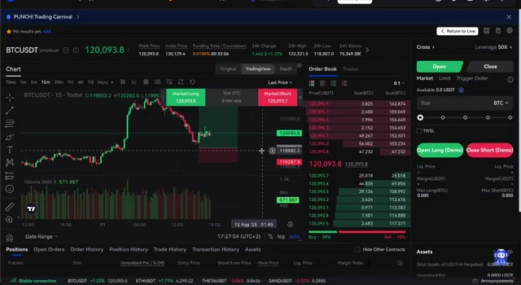
*⏱️ 00:00:06 — Interface de trading de la plateforme Toobit montrant un graphique BTCUSDT en chandelier 15m, un carnet d'ordres et le panneau de passage d'ordres avec effet de levier 50X.*

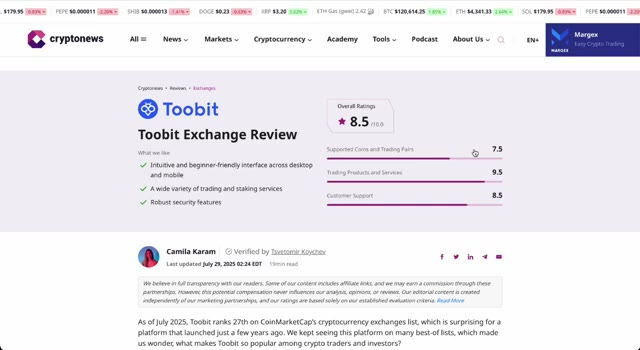
*⏱️ 00:00:17 — Page Web d'un article de revue sur Cryptonews consacrée à l'échange Toobit, affichant une note globale de 8.5/10 et des détails sur ses fonctionnalités.*

---

### ⏱️ `[00:00:24 - 00:00:57]` | Segment #02

**🔊 Audio (Transcription Intégrale Mot pour Mot en Français) :**
> 2Bit est ce qu'on appelle un échangeur de crypto sans KYC, ce qui signifie que vous pouvez créer un compte et commencer à trader sans avoir à télécharger votre passeport ou à passer par quelque forme de vérification d'identité que ce soit. Il a été fondé en 2022 et voici quelque chose que beaucoup de gens ignorent. Il a été partiellement soutenu et même cofondé par Bybit et Huobi, qui sont deux des noms les plus grands et les plus respectés de l'industrie de la crypto. Cela confère instantanément à 2Bit une énorme crédibilité et un grand capital de confiance par rapport à d'autres nouveaux échangeurs qui semblent surgir de nulle part. Dès l'instant où vous vous connectez,

**👁️ Analyse Visuelle d'Écran (gemini-3.5-flash-lite) :**
**Interface & Outils** : Navigateur web affichant la plateforme Toobit et un article d'actualité financière.

**Contenu textuel & Code** : Interface utilisateur de l'échange Toobit, bonus de bienvenue en USDT, et texte de présentation mentionnant le lancement en 2022 et le volume de trading.

**Action / Démonstration** : Navigation sur le site web de l'échangeur Toobit et lecture d'un article de présentation de la plateforme.

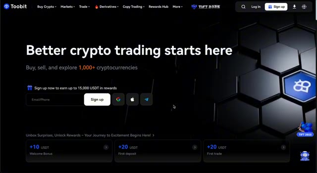
*⏱️ 00:00:32 — Page d'accueil officielle de l'échangeur de crypto Toobit, affichant le slogan 'Better crypto trading starts here' et des options d'inscription.*

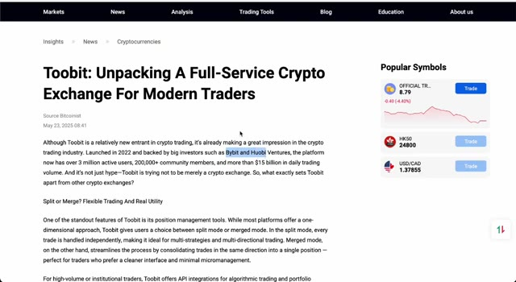
*⏱️ 00:00:41 — Article de presse en ligne intitulé 'Toobit: Unpacking A Full-Service Crypto Exchange For Modern Traders' détaillant les fonctionnalités de la plateforme.*

---

### ⏱️ `[00:00:57 - 00:01:33]` | Segment #03

**🔊 Audio (Transcription Intégrale Mot pour Mot en Français) :**
> Vous remarquerez que l'interface de 2Bit est rapide, épurée et conçue à la fois pour les débutants et les traders expérimentés. Ils l'ont construite d'une manière qui semble familière si vous avez utilisé d'autres grandes plateformes, mais elle est aussi dépourvue de superflu inutile afin que vous puissiez vous concentrer sur le trading. Une autre chose qui fait sortir 2Bit du lot, c'est la rapidité de sa croissance. Ils ajoutent constamment de nouvelles cryptomonnaies, de nouvelles paires de trading et de nouvelles fonctionnalités. Et parce qu'ils sont encore dans cette phase de croissance, ils essaient activement d'attirer de nouveaux utilisateurs, c'est pourquoi les frais sont extrêmement compétitifs et c'est pourquoi ils proposent le genre de package de bonus que j'ai pu négocier pour vous.

**👁️ Analyse Visuelle d'Écran (gemini-3.5-flash-lite) :**
**Interface & Outils** : Site web et plateforme de trading de l'échange Toobit.

**Contenu textuel & Code** : Paires de cryptomonnaies, prix du marché, graphique en chandeliers TradingView, carnet d'ordres (Order Book) et options de levier (50X).

**Action / Démonstration** : Navigation dans les menus de sélection des contrats et présentation de l'interface de trading principale de la plateforme.

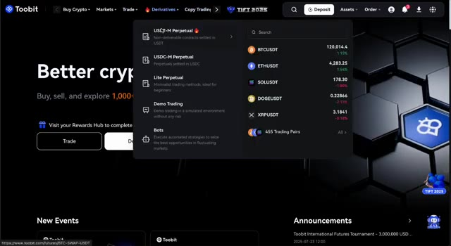
*⏱️ 00:01:06 — Page d'accueil de la plateforme Toobit affichant le menu des produits dérivés et la liste des paires de trading populaires (BTCUSDT, ETHUSDT, etc.).*

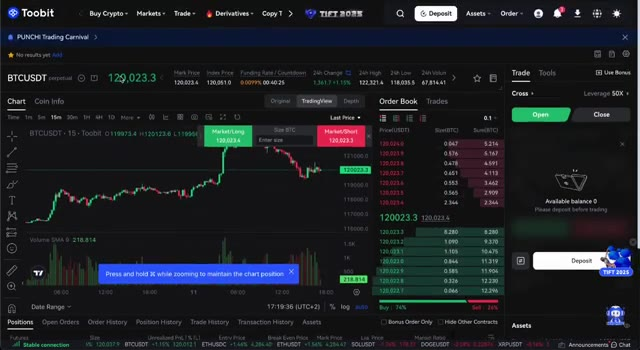
*⏱️ 00:01:15 — Interface de trading de Toobit montrant un graphique de prix BTCUSDT en unités de 15 minutes, le carnet d'ordres et le panneau de passage d'ordres.*

---

### ⏱️ `[00:01:33 - 00:01:54]` | Segment #04

**🔊 Audio (Transcription Intégrale Mot pour Mot en Français) :**
> Maintenant, parlons de ce bonus, car honnêtement, c'est l'un des meilleurs que j'aie jamais vus de la part d'un échange, surtout un qui ne требует pas de KYC. Si vous cliquez sur mon lien dans la description et que vous vous inscrivez, la première chose qui se produit, c'est que vous recevrez 50 USDT crédités directement sur votre compte sous forme de fonds d'essai. C'généralement juste pour l'inscription. Aucun dépôt requis.

**👁️ Analyse Visuelle d'Écran (gemini-3.5-flash-lite) :**
**Interface & Outils** : Interface web de l'échange de cryptomonnaies Toobit et interface de gestion YouTube.

**Contenu textuel & Code** : Montants de bonus affichés : 50 USD à l'inscription, bonus de dépôt de 20 à 800 USD, et récompenses de contrats perpétuels jusqu'à 6000 USD.

**Action / Démonstration** : Présentation des avantages du lien d'affiliation et des bonus de trading de l'échange Toobit.

*⏱️ 00:01:38 — Présentation des bonus Toobit avec le détail des récompenses d'inscription et de dépôt s'élevant jusqu'à 6850 USD.*

*⏱️ 00:01:49 — Vue similaire ou identique à l'image 1 détaillant les paliers de bonus de dépôt et d'inscription sur l'échange Toobit.*

---

### ⏱️ `[00:01:54 - 00:02:12]` | Segment #05

**🔊 Audio (Transcription Intégrale Mot pour Mot en Français) :**
> En plus de cela, 2Bit vous passera immédiatement au niveau VIP 2 pendant un mois entier. Cela signifie que vous commencerez avec des frais de trading réduits dès le premier jour, ce qui est un énorme avantage par rapport à un démarrage en tant qu'utilisateur classique. Mais ce n'est que le début. Une fois que vous effectuez un dépôt, les bonus augmentent en fonction du montant que vous y mettez.

**👁️ Analyse Visuelle d'Écran (gemini-3.5-flash-lite) :**
**Interface & Outils** : Page promotionnelle de la plateforme d'échange Toobit

**Contenu textuel & Code** : Texte indiquant "Register, Deposit & Trade Get $6,850 Trial Fund", étape 1 avec obtention de 50 USDT et upgrade VIP 2, et tableau des bonus de dépôt (ex: 100 USDT de dépôt pour 20 USDT, jusqu'à 4 000 USDT de dépôt pour 800 USDT).

**Action / Démonstration** : Affichage des conditions de l'offre de parrainage et des paliers de bonus pour les nouveaux utilisateurs.

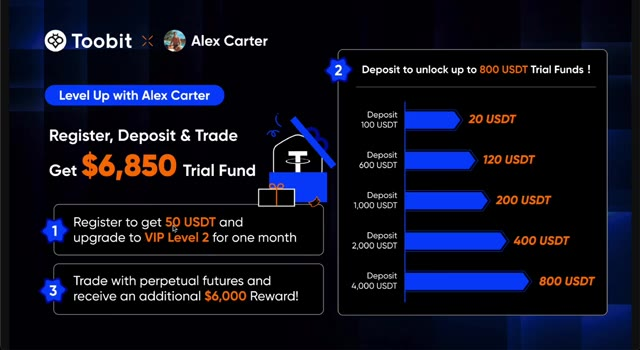
*⏱️ 00:01:58 — Présentation des bonus et avantages promotionnels de la plateforme Toobit en partenariat avec Alex Carter, détaillant les récompenses de dépôt et le statut VIP 2.*

---

### ⏱️ `[00:02:12 - 00:02:49]` | Segment #06

**🔊 Audio (Transcription Intégrale Mot pour Mot en Français) :**
> Par exemple, si vous déposez 100 USDT, vous recevrez 20 USDT supplémentaires en fonds d'essai. Déposez 600 USDT et vous obtiendrez 120 USDT en bonus. Si vous allez jusqu'à 1 000 USDT, vous obtenez 200 de plus. À 2 000 USDT, le bonus grimpe à 400 et si vous déposez 4 000 USDT, vous débloquez le maximum de 800 USDT en fonds d'essai. Et c'est là que ça devient encore plus fou. Si vous commencez à trader des contrats futures perpétuels sur 2Bit, vous pouvez débloquer 6 000 USDT supplémentaires en récompenses. Cela signifie que le bonus total potentiel

**👁️ Analyse Visuelle d'Écran (gemini-3.5-flash-lite) :**
**Interface & Outils** : Page web / interface promotionnelle de l'échangeur de cryptomonnaies Toobit.

**Contenu textuel & Code** : Tableau des bonus de dépôt : 100 USDT pour 20 USDT de bonus, 600 USDT pour 120 USDT, 1 000 USDT pour 200 USDT, 2 000 USDT pour 400 USDT, et 4 000 USDT pour 800 USDT de fonds d'essai (Trial Funds). Mention globale de 6 850 $ de fonds d'essai au total.

**Action / Démonstration** : Présentation visuelle des paliers de récompenses et des bonus de dépôt pour inciter l'utilisateur à s'inscrire et déposer des fonds.

*⏱️ 00:02:22 — Interface promotionnelle de la plateforme Toobit en partenariat avec Alex Carter détaillant les paliers de bonus de dépôt.*

---

### ⏱️ `[00:02:49 - 00:03:07]` | Segment #07

**🔊 Audio (Transcription Intégrale Mot pour Mot en Français) :**
> le pack vaut 6 850 USDT, entièrement à votre disposition gratuitement rien qu'en vous inscrivant avec mon lien exclusif. La raison pour laquelle c'est si précieux est que les fonds d'essai vous donnent la chance de trader, de tester des stratégies et même potentiellement de faire des profits sans risquer autant de votre propre capital.

**👁️ Analyse Visuelle d'Écran (gemini-3.5-flash-lite) :**
**Interface & Outils** : Échange de cryptomonnaies Toobit et outil de graphique TradingView.

**Contenu textuel & Code** : Détails de l'offre promotionnelle (fonds d'essai de 6 850 USDT, paliers de dépôt de 100 à 4 000 USDT) sur l'image 1 ; graphique BTCUSDT, carnet d'ordres, effet de levier (50X), et options de trading (Long/Short, Demo) sur l'image 2.

**Action / Démonstration** : Présentation des avantages et des bonus de parrainage de la plateforme Toobit suivie d'une démonstration de l'interface de trading futures.

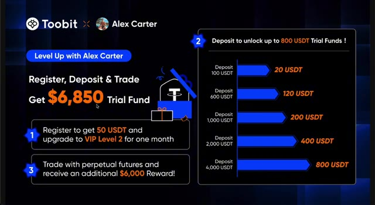
*⏱️ 00:02:53 — Interface promotionnelle de l'échange Toobit détaillant l'offre exclusive de 6 850 USDT en fonds d'essai et les paliers de dépôt.*

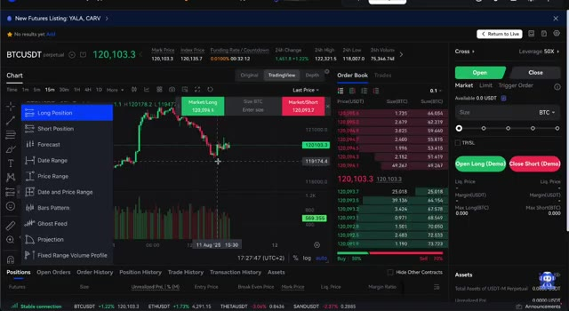
*⏱️ 00:02:58 — Interface de trading de l'échange Toobit affichant un graphique de prix BTCUSDT en chandeliers japonais sur TradingView avec carnet d'ordres et panneau de position.*

---

### ⏱️ `[00:03:07 - 00:03:40]` | Segment #08

**🔊 Audio (Transcription Intégrale Mot pour Mot en Français) :**
> C'est fondamentalement des munitions gratuites pour votre parcours de trading. L'ouverture d'un compte sur 2Bit prend moins d'une minute. Il vous suffit de cliquer sur le lien dans la description, et je n'insérerai jamais assez là-dessus, vous devez utiliser ce lien si vous voulez que ces bonus s'appliquent. Ensuite, entrez votre adresse e-mail, choisissez un mot de passe, et c'est tout. Comme il n'y a pas d'exigence de KYC, vous êtes prêt à déposer et à trader immédiatement. En vous connectant, vous verrez que 2Bit utilise plusieurs portefeuilles. C'est quelque chose qui perturbe les débutants au début, alors laissez-moi vous l'expliquer clairement. Votre portefeuille de financement est l'endroit où tous les dépôts

**👁️ Analyse Visuelle d'Écran (gemini-3.5-flash-lite) :**
**Interface & Outils** : Site web de l'échangeur de cryptomonnaies Toobit

**Contenu textuel & Code** : Offres de bonus jusqu'à 15 000 USDT, champs de saisie pour la création de compte et ID de parrainage 'alexct'.

**Action / Démonstration** : Présentation de la procédure d'inscription sur la plateforme d'échange Toobit via le lien affilié.

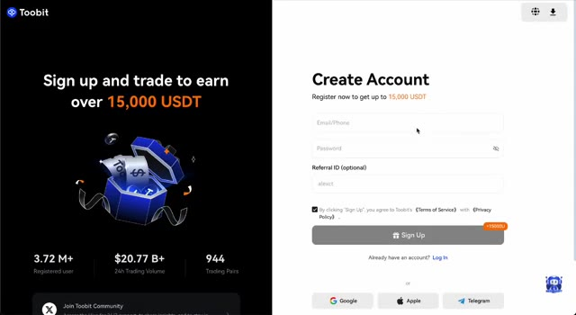
*⏱️ 00:03:15 — Page d'inscription de l'échangeur Toobit montrant les bonus d'inscription de 15 000 USDT et le code de parrainage 'alexct'.*

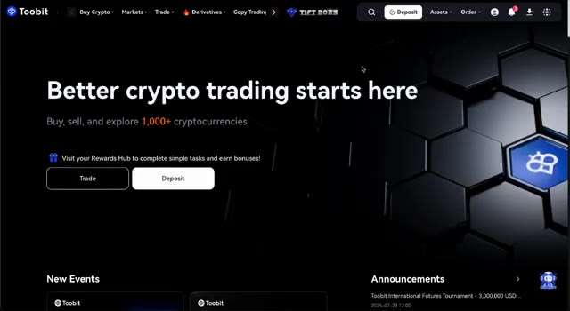
*⏱️ 00:03:32 — Page d'accueil de la plateforme Toobit affichant le slogan 'Better crypto trading starts here' et les options de dépôt.*

---

### ⏱️ `[00:03:40 - 00:04:16]` | Segment #09

**🔊 Audio (Transcription Intégrale Mot pour Mot en Français) :**
> que vous ferez va arriver. C'est comme votre compte bancaire principal sur 2Bit. Si vous voulez acheter ou vendre des cryptos sans effet de levier, vous déplacerez des fonds dans votre portefeuille au comptant. Et si vous voulez trader avec effet de levier, ce que nous aborderons plus tard, vous devrez transférer des fonds dans votre portefeuille de contrats à terme. Cette séparation est en fait une bonne chose car elle vous évite de risquer accidentellement des fonds que vous n'aviez pas l'intention d'utiliser pour un type de trade particulier. Financer votre compte sur 2-Bit est un processus très simple, et il y a en fait plusieurs façons différentes de le faire selon votre préférence. La méthode la plus courante consiste à envoyer des cryptos depuis un autre portefeuille ou une autre bourse. Par exemple,

**👁️ Analyse Visuelle d'Écran (gemini-3.5-flash-lite) :**
**Interface & Outils** : Plateforme d'échange de cryptomonnaies Toobit (interface web de gestion des actifs).

**Contenu textuel & Code** : Résumé des actifs (Asset Summary) affichant une valorisation totale de 0,00000000 USDT et les différents sous-comptes : Spot Account, Futures Account, DEX+ Account, Copy Trading, Earn Account et Trading Bots, tous à 0,00 USDT.

**Action / Démonstration** : Navigation et présentation des différents types de portefeuilles disponibles sur la bourse Toobit, illustrant la distinction entre le compte au comptant (Spot) et le compte futures.

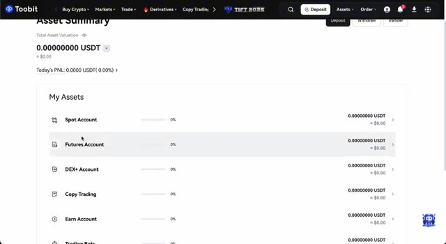
*⏱️ 00:03:49 — Capture d'écran de l'interface de la plateforme Toobit montrant la page "Asset Summary" avec les différents types de comptes (Spot, Futures, DEX+, Copy Trading, Earn).*

---

### ⏱️ `[00:04:16 - 00:04:50]` | Segment #10

**🔊 Audio (Transcription Intégrale Mot pour Mot en Français) :**
> Si vous possédez déjà du Bitcoin, de l'Ethereum ou de l'USDT sur une autre plateforme, vous pouvez simplement le retirer de là et le déposer sur votre compte 2-Bit. Le système générera automatiquement une adresse de dépôt unique pour vous, et en quelques minutes, vos fonds apparaîtront dans votre portefeuille de financement, prêts à être utilisés. Mais ce qui est vraiment formidable pour les débutants, c'est que vous n'avez pas réellement besoin de posséder déjà des cryptos pour commencer. 2-Bit vous permet d'acheter directement avec de la monnaie fiduciaire, c'est-à-dire votre monnaie locale. Cela peut se faire en utilisant une carte de crédit, une carte de débit, ou même un virement bancaire, selon l'option qui est la plus pratique dans votre pays. L'interface vous guidera à travers

**👁️ Analyse Visuelle d'Écran (gemini-3.5-flash-lite) :**
**Interface & Outils** : Site web de l'échange Toobit (page de dépôt)

**Contenu textuel & Code** : Sélection de l'actif (BTC, ETH, USDC, SOL, USDT), réseau de transfert (BTC Bitcoin), et section 'Deposit Details' avec un bouton 'Get Address'.

**Action / Démonstration** : Navigation sur la page de dépôt et préparation de la génération d'une adresse unique pour le Bitcoin.

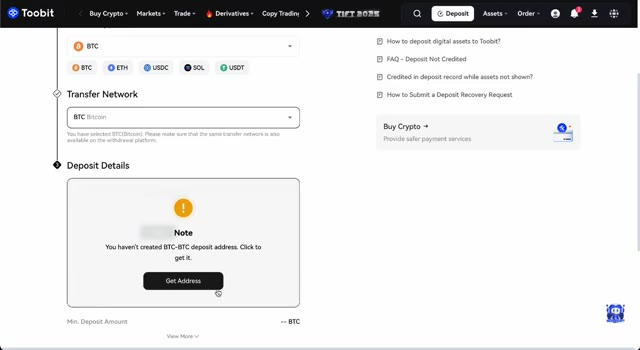
*⏱️ 00:04:25 — Interface de dépôt de la plateforme Toobit montrant la sélection des cryptomonnaies et le bouton pour générer une adresse de dépôt.*

---

### ⏱️ `[00:04:50 - 00:05:15]` | Segment #11

**🔊 Audio (Transcription Intégrale Mot pour Mot en Français) :**
> le processus étape par étape. Vous choisissez simplement votre devise, sélectionnez le montant que vous voulez acheter, et confirmez la transaction. Dans la plupart des cas, les fonds apparaîtront dans votre portefeuille de financement en quelques minutes seulement, vous pouvez donc littéralement passer de zéro à trader en moins d'une heure. Personnellement, je recommande de commencer avec un montant avec lequel vous êtes à l'aise, puis de vous familiariser avec la plateforme avant d'en ajouter davantage. La clé ici, c'est que 2-bit rend le processus d'intégration incroyablement rapide et sans douleur.

**👁️ Analyse Visuelle d'Écran (gemini-3.5-flash-lite) :**
**Interface & Outils** : Plateforme d'échange de cryptomonnaies Toobit (interface web d'achat direct par carte).

**Contenu textuel & Code** : Formulaire d'achat de crypto avec montants en EUR (50) et conversion estimée en USDT (56.1397), sélection des processeurs de paiement (Simplex, MoonPay, Advcash).

**Action / Démonstration** : Configuration du montant d'achat en euros et sélection du mode de paiement par carte bancaire pour obtenir des USDT.

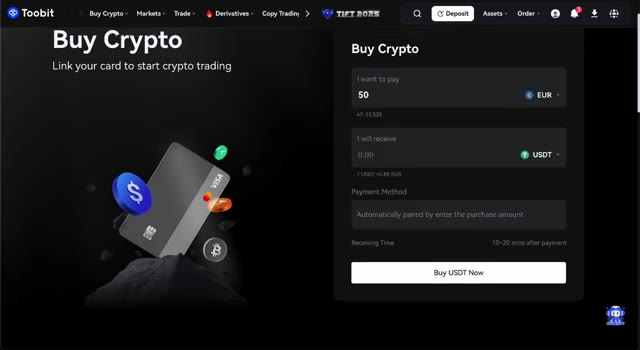
*⏱️ 00:04:56 — Interface de la plateforme Toobit montrant le formulaire d'achat de cryptomonnaies avec un montant de 50 EUR.*

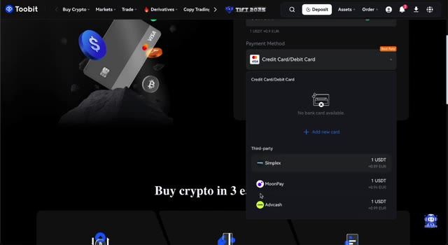
*⏱️ 00:05:02 — Sélection des méthodes de paiement tierces (Simplex, MoonPay, Advcash) sur l'interface Toobit.*

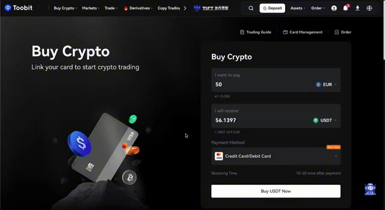
*⏱️ 00:05:09 — Formulaire d'achat de cryptomonnaies Toobit actualisé affichant le montant converti en USDT (56.1397 USDT).*

---

### ⏱️ `[00:05:15 - 00:05:48]` | Segment #12

**🔊 Audio (Transcription Intégrale Mot pour Mot en Français) :**
> Pas de longs temps d'attente, pas de complications inutiles. Le trading au comptant est essentiellement le moyen le plus direct d'acheter et de vendre des cryptomonnaies. Vous échangez une pièce contre une autre au prix du marché actuel sans utiliser de levier. C'|est la forme de trading la plus simple et c'|est généralement là que la plupart des débutants commencent. Sur 2Bit, le trading au comptant est un plaisir à utiliser car la plateforme offre l'une des plus grandes sélections de paires de trading du marché. Que vous souhaitiez vous en tenir aux grandes pièces établies comme Bitcoin et Ethereum ou explorer des altcoins plus petits et plus de niche avec une volatilité potentielle plus élevée,

**👁️ Analyse Visuelle d'Écran (gemini-3.5-flash-lite) :**
**Interface & Outils** : Interface web de la plateforme d'échange Toobit et graphique intégré TradingView.

**Contenu textuel & Code** : Paires de cryptomonnaies populaires (BTC/USDT, ETH/USDT, SOL/USDT), graphique des prix en chandelier pour BTC/USDT sur un intervalle de 15 minutes, carnet d'ordres en temps réel.

**Action / Démonstration** : Navigation dans le menu principal de la plateforme pour sélectionner la section de trading au comptant (Spot) et visualisation du graphique de marché et du carnet d'ordres.

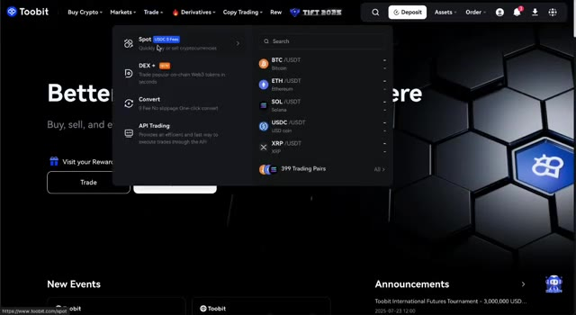
*⏱️ 00:05:23 — Capture d'écran montrant le menu de la plateforme d'échange Toobit, avec le curseur sur l'option 'Spot' et les différentes paires de trading disponibles.*

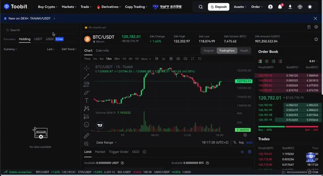
*⏱️ 00:05:31 — Interface de trading spot de Toobit affichant le graphique TradingView de la paire BTC/USDT, le carnet d'ordres et les options d'achat/vente au comptant.*

---

### ⏱️ `[00:05:48 - 00:06:20]` | Segment #13

**🔊 Audio (Transcription Intégrale Mot pour Mot en Français) :**
> vous les trouverez ici. Le carnet d'ordres est facile à lire, les graphiques sont alimentés par TradingView pour une analyse de qualité professionnelle, et le processus d'achat-vente est assez intuitif pour les débutants tout en offrant tous les outils dont les traders avancés ont besoin. Une chose que je recommande, surtout si vous prévoyez de passer au trading de contrats à terme plus tard, est de convertir d'abord vos fonds en USDT, qui est une cryptomonnaie stable indexée sur le dollar américain. Il y a deux raisons principales à cela. Premièrement, l'USDT est la monnaie de base la plus courante pour le trading avec effet de levier, donc avoir votre solde en USDT rendra la transition plus fluide.

**👁️ Analyse Visuelle d'Écran (gemini-3.5-flash-lite) :**
**Interface & Outils** : Interface de la plateforme de trading Toobit avec graphique TradingView intégré.

**Contenu textuel & Code** : Graphique en chandeliers japonais de la paire BTC/USDT (unité 15m), volume avec indicateur Volume SMA 9, carnet d'ordres (Order Book) en temps réel et panneau de passage d'ordres (Limit, Market, Trigger Order).

**Action / Démonstration** : Visualisation globale de l'interface de trading comprenant le carnet d'ordres et les graphiques de prix.

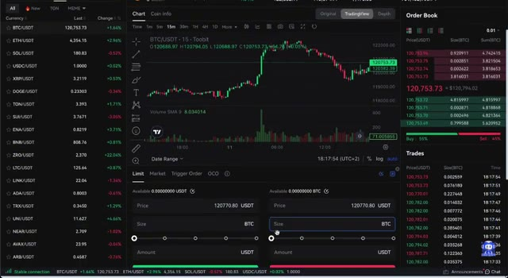
*⏱️ 00:05:56 — Interface de trading affichant le graphique BTC/USDT en unité de temps 15 minutes avec le carnet d'ordres à droite.*

---

### ⏱️ `[00:06:21 - 00:06:46]` | Segment #14

**🔊 Audio (Transcription Intégrale Mot pour Mot en Français) :**
> Deuxièmement, 2Bit propose actuellement des frais de comptoir de 0 % sur de nombreuses paires impliquant l'USDT, ce qui signifie que vous pouvez convertir sans payer le moindre supplément. C'est essentiellement un mouvement gratuit. C'est l'un de ces petits détails mais importants qui peuvent vous faire économiser de l'argent au fil du temps et rendre votre expérience de trading plus efficace. Une fois que vous avez votre solde en USDT dans votre portefeuille au comptant, l'étape suivante, si vous souhaitez trader avec effet de levier, est de le transférer dans votre portefeuille de futures.

**👁️ Analyse Visuelle d'Écran (gemini-3.5-flash-lite) :**
**Interface & Outils** : Interface de l'échange Toobit

**Contenu textuel & Code** : Graphique de prix BTC/USDT (unité de temps 15m), volume SMA 9, liste des paires avec l'onglet USDT sélectionné et mention '0 Fees', carnet d'ordres en temps réel.

**Action / Démonstration** : Navigation et présentation de l'interface de trading spot sur Toobit avec affichage des paires sans frais.

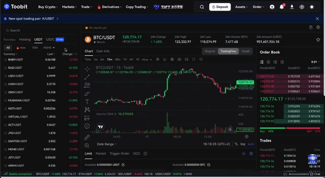
*⏱️ 00:06:27 — Interface de trading de la plateforme Toobit montrant la paire BTC/USDT avec les graphiques de prix, la liste des paires USDT à gauche et le carnet d'ordres à droite.*

---

### ⏱️ `[00:06:47 - 00:07:05]` | Segment #15

**🔊 Audio (Transcription Intégrale Mot pour Mot en Français) :**
> Sur 2Bit, ce transfert est instantané, gratuit et incroyablement simple. Vous cliquez simplement sur transférer, vous sélectionnez le montant que vous souhaitez déplacer, vous confirmez, et vos fonds sont prêts à être négociés immédiatement. Cette séparation entre les portefeuilles peut sembler inutile au premier abord, mais c'est en réalité une excellente fonctionnalité de gestion des risques.

**👁️ Analyse Visuelle d'Écran (gemini-3.5-flash-lite) :**
**Interface & Outils** : Interface web de l'échange de cryptomonnaies Toobit (section gestion des actifs et des transferts).

**Contenu textuel & Code** : Résumé des actifs avec une valorisation totale à 0,00000000 USDT et interface de paramétrage d'un transfert interne de fonds.

**Action / Démonstration** : Démonstration du processus de transfert de fonds entre les différents portefeuilles de la plateforme d'échange.

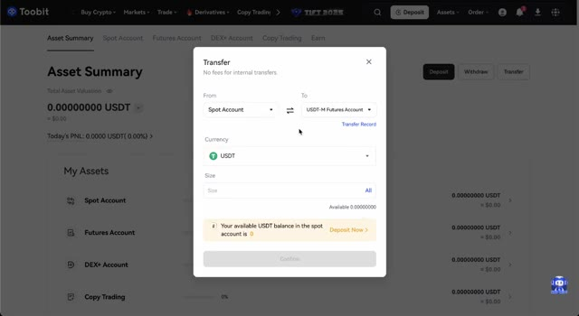
*⏱️ 00:06:51 — Fenêtre de transfert ouverte sur la plateforme Toobit, permettant de déplacer des fonds du compte Spot vers le compte Futures M.*

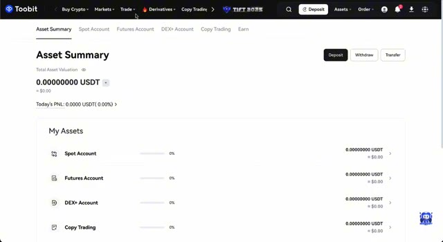
*⏱️ 00:07:00 — Vue d'ensemble du tableau de bord 'Asset Summary' sur Toobit montrant les soldes des différents comptes (Spot, Futures, DEX+, Copy Trading).*

---

### ⏱️ `[00:07:05 - 00:07:41]` | Segment #16

**🔊 Audio (Transcription Intégrale Mot pour Mot en Français) :**
> En gardant vos fonds au comptant et vos fonds de contrats à terme séparés, vous évitez le risque de sur-leverager accidentellement l'ensemble de votre solde. C'est comme avoir des comptes séparés pour différents types d'investissements. Cela maintient les choses organisées et plus sûres. Le trading est là où les choses deviennent plus avancées et, pour de nombreux traders, plus excitantes. C'est la partie de la plateforme où vous pouvez utiliser l'effet de levier pour amplifier vos gains potentiels, mais bien sûr, cela amplifie également vos pertes potentielles, vous devez donc l'aborder avec précaution. Sur la plateforme de contrats à terme de 2bit, vous commencez par sélectionner votre paire de trading souhaitée. La plupart des gens commencent par BTC slash USDT ou ETH slash USDT parce que

**👁️ Analyse Visuelle d'Écran (gemini-3.5-flash-lite) :**
**Interface & Outils** : Plateforme d'échange de cryptomonnaies Toobit (interface de trading de contrats à terme / dérivés).

**Contenu textuel & Code** : Graphique en chandelier BTCUSDT (15m), carnet d'ordres en temps réel, indicateur Volume SMA 9, mode de marge Cross avec levier 50x, solde disponible de 10000.0 USDT (compte démo), et boutons d'exécution Open Long / Close Short.

**Action / Démonstration** : Présentation de l'interface de trading de contrats à terme et illustration de la gestion du levier et des paramètres de marge.

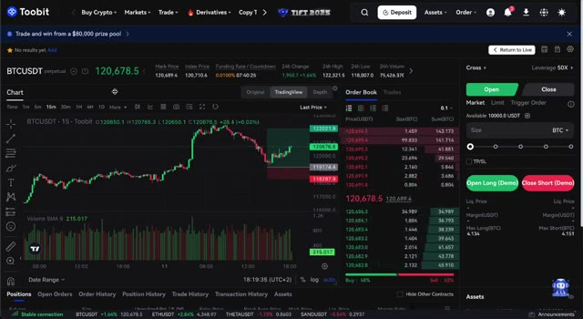
*⏱️ 00:07:14 — Capture d'écran de l'interface de la plateforme de trading Toobit montrant le graphique de la paire BTCUSDT en unités de 15 minutes, avec un panneau de passage d'ordres configuré en mode Cross avec un effet de levier de 50x.*

---

### ⏱️ `[00:07:41 - 00:08:14]` | Segment #17

**🔊 Audio (Transcription Intégrale Mot pour Mot en Français) :**
> Ce sont les plus liquides. Ensuite, vous choisissez votre effet de levier. Je ne le répéterai jamais assez. Si vous débutez dans les contrats à terme, commencez petit. Un effet de levier de trois à cinq fois est largement suffisant pour commencer. Un effet de levier plus élevé peut être tentant, mais il rend aussi beaucoup plus facile d'être liquidé. Après avoir choisi votre effet de levier, vous décidez si vous voulez prendre une position longue, ce qui signifie que vous pensez que le prix va monter, ou courte, ce qui signifie que vous pensez que le prix va baisser. Avant de cliquer sur ce bouton de confirmation, assurez-vous de définir un ordre stop-loss pour vous protéger contre des pertes importantes si le marché évolue en votre défaveur, et un ordre take-profit pour verrouiller automatiquement vos gains lorsque le

**👁️ Analyse Visuelle d'Écran (gemini-3.5-flash-lite) :**
**Interface & Outils** : Plateforme d'échange de crypto-monnaies (Toobit), graphique intégré TradingView.

**Contenu textuel & Code** : Paire BTCUSDT perpetual, prix actuel à 120,681.2 USDT, indicateur de volume (Volume SMA 9), carnet d'ordres en temps réel, réglage du levier configuré à 5X en mode Cross.

**Action / Démonstration** : Configuration d'un ordre de trading sur les contrats à terme avec un effet de levier de 5x et visualisation du carnet d'ordres.

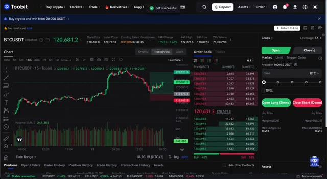
*⏱️ 00:07:49 — Interface de trading de la plateforme Toobit montrant la paire BTCUSDT perpetual, avec un graphique des prix en chandeliers 15m, un carnet d'ordres et les options de levier.*

---

### ⏱️ `[00:08:14 - 00:08:36]` | Segment #18

**🔊 Audio (Transcription Intégrale Mot pour Mot en Français) :**
> Le prix atteint votre objectif. Une fois que le trade est actif, vous pouvez suivre sa progression en temps réel, ajuster vos niveaux de stop loss ou de take profit, ou fermer la position manuellement à tout moment. Le trading de futures demande plus d'attention que le trading au comptant, mais avec une gestion des risques appropriée, cela peut être un outil incroyablement puissant. L'un des grands avantages de trader sur Tubic en ce moment, ce sont les frais ultra-faibles.

**👁️ Analyse Visuelle d'Écran (gemini-3.5-flash-lite) :**
**Interface & Outils** : Interface de la plateforme d'échange Toobit (Trading de Futures / Dérivés)

**Contenu textuel & Code** : Paire BTCUSDT perpetual, prix actuel à 120 551.1 USDT, effet de levier 5X en mode Cross, graphique de prix en chandeliers avec volumes (Volume SMA 9), niveaux de Take Profit et Stop Loss affichés sur le graphique, carnet d'ordres (Order Book) et onglet Positions actives.

**Action / Démonstration** : Suivi en temps réel de la progression d'un trade actif sur les futures, visualisation du PnL et gestion des niveaux de Take Profit et Stop Loss.

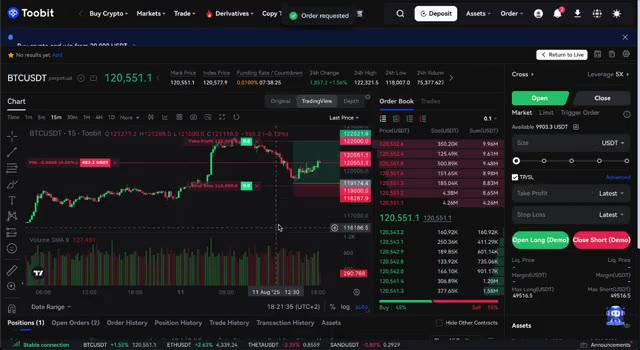
*⏱️ 00:08:20 — Interface de trading de futures sur Toobit montrant un graphique BTCUSDT en unités de 15 minutes avec un trade ouvert, le carnet d'ordres à droite et le panneau de gestion des positions en bas.*

---

### ⏱️ `[00:08:36 - 00:09:09]` | Segment #19

**🔊 Audio (Transcription Intégrale Mot pour Mot en Français) :**
> En fait, leurs frais pour le trading de contrats à terme sont parmi les plus bas de toute l'industrie. Ils ont clairement indiqué qu'ils maintiennent des frais délibérément bas pour attirer des traders d'autres plateformes, ce qui est une excellente nouvelle pour nous en tant qu'utilisateurs. Cela signifie qu'une plus grande partie de vos profits reste dans votre poche au lieu d'aller à la bourse, et avec le temps, cela peut faire une énorme différence, surtout si vous tradez fréquemment. Il est également important de noter que 2-Bit propose parfois des promotions spéciales avec des frais de trading nuls pour certaines paires, il est donc toujours conseillé de consulter leur section d'annonces pour voir s'il y a une offre en cours lorsque vous vous inscrivez.

**👁️ Analyse Visuelle d'Écran (gemini-3.5-flash-lite) :**
**Interface & Outils** : Site Web de l'échange de cryptomonnaies Toobit (page sur les frais de trading).

**Contenu textuel & Code** : Tableau des frais détaillés : niveaux VIP (VIP0 à VIP6), exigences de solde et de volume sur 30 jours, frais Futures (Maker à partir de 0.0200% et Taker à partir de 0.0600% pour VIP0), et frais Spot.

**Action / Démonstration** : Présentation visuelle et explication de la grille tarifaire et des frais de trading de la plateforme Toobit.

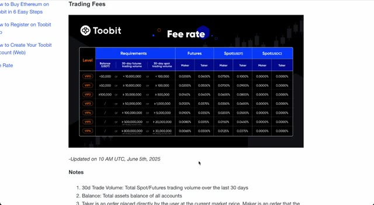
*⏱️ 00:08:44 — Capture d'écran du site Web de l'échange Toobit montrant un tableau détaillé des grilles tarifaires (Fee rate) pour les contrats Futures et Spot.*

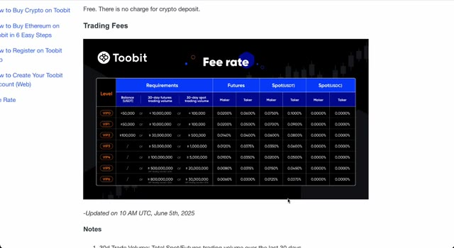
*⏱️ 00:08:52 — Capture d'écran identique montrant le tableau des taux de frais de Toobit, avec les niveaux VIP de VIP0 à VIP6 et les pourcentages Maker/Taker associés.*

---

### ⏱️ `[00:09:09 - 00:09:44]` | Segment #20

**🔊 Audio (Transcription Intégrale Mot pour Mot en Français) :**
> J'ai testé beaucoup de plateformes d'échange au fil des ans, certaines qui sont immenses et bien établies, et d'autres qui sont apparues et ont disparu en l'espace d'un an. 2Bit s'est démarqué pour moi dès le premier jour pour quelques raisons clés. Premièrement, c'est sécurisé et bénéficie d'un soutien solide de la part de grands noms de l'industrie. Deuxièmement, c'est rapide et réactif, ce qui est crucial lorsque vous tradez sur un marché volatil où les secondes peuvent faire la différence entre profit et perte. Le fait qu'il soit encore relativement nouveau joue en notre faveur parce qu'ils sont en pleine phase de croissance, se battent agressivement pour de nouveaux utilisateurs, déployant des mises à jour constantes, ajoutant de nouvelles cryptos, et offrant des bonus que vous ne trouverez tout simplement pas sur des plateformes plus anciennes, plus

**👁️ Analyse Visuelle d'Écran (gemini-3.5-flash-lite) :**
**Interface & Outils** : Navigateur web affichant le site d'actualités et d'analyses crypto Cryptonews.

**Contenu textuel & Code** : Évaluation détaillée de la plateforme Toobit incluant les notes par catégorie, les fonctionnalités supportées, ainsi qu'une liste comparative des avantages et inconvénients.

**Action / Démonstration** : Navigation et lecture d'une revue d'échange de cryptomonnaies à l'écran pour illustrer la présentation de la plateforme.

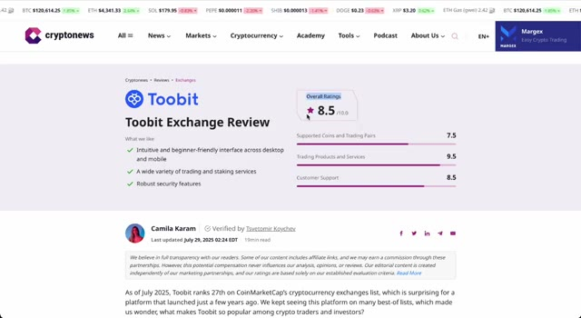
*⏱️ 00:09:17 — Capture d'écran du site Cryptonews affichant une revue détaillée de l'échange Toobit avec une note globale de 8.5/10.*

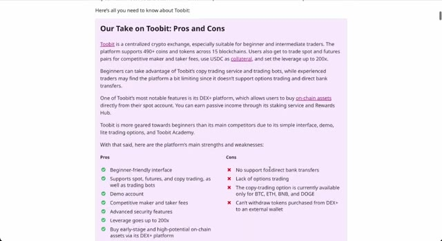
*⏱️ 00:09:26 — Capture d'écran du site Cryptonews présentant les points forts (Pros) et les points faibles (Cons) de la plateforme Toobit.*

---

### ⏱️ `[00:09:44 - 00:10:21]` | Segment #21

**🔊 Audio (Transcription Intégrale Mot pour Mot en Français) :**
> bourses établies. Si vous voulez une plateforme où vous pouvez vous inscrire instantanément, éviter les longs délais de KYC, commencer à trader le jour même et accéder à des milliers de dollars de fonds d'essai, 2Bit est facilement l'un des meilleurs choix que vous puissiez faire en 2025. Très bien, voici donc ce que je vous suggère de faire ensuite. Cliquez sur le lien dans la description dès maintenant. Il faut moins d'une minute pour s'inscrire, et en le faisant via mon lien, vous débloquerez automatiquement le pack de bonus exclusif d'une valeur allant jusqu'à 6 850 USDT. Il s'agit d'un capital de trading gratuit que vous pouvez utiliser immédiatement pour tester des stratégies, prendre des positions et potentiellement réaliser des profits sans risquer autant de votre propre argent.

**👁️ Analyse Visuelle d'Écran (gemini-3.5-flash-lite) :**
**Interface & Outils** : Navigateur web, site de revue Cryptonews, interface YouTube Studio et slide promotionnelle Toobit.

**Contenu textuel & Code** : Notes d'évaluation d'exchange, détails des paliers de dépôt et des fonds d'essai (jusqu'à 6 850 $ de bonus en USDT).

**Action / Démonstration** : Présentation des avantages et des bonus de la plateforme de trading Toobit pour les nouveaux utilisateurs.

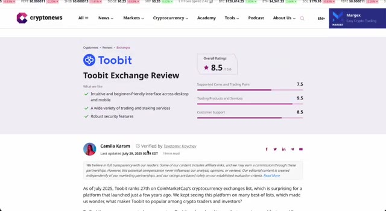
*⏱️ 00:09:53 — Capture d'écran d'un article web évaluant la plateforme Toobit avec une note globale de 8.5/10.*

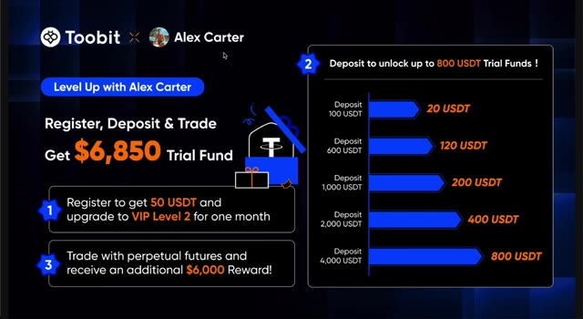
*⏱️ 00:10:12 — Visuel promotionnel détaillé affichant le partenariat entre Toobit et Alex Carter avec le détail des bonus de fonds d'essai jusqu'à 6 850 $.*

---

### ⏱️ `[00:10:21 - 00:10:37]` | Segment #22

**🔊 Audio (Transcription Intégrale Mot pour Mot en Français) :**
> argent. Rappelez-vous, cette offre n'est disponible nulle part ailleurs, et je ne sais honnêtement pas combien de temps 2Bit la gardera active. Donc si vous regardez ceci en ce moment même, c'est votre chance de la saisir tant qu'elle est toujours d'actualité. Je vous retrouverai sur la plateforme et j'ai hâte d'entendre parler de vos premiers trades.

**👁️ Analyse Visuelle d'Écran (gemini-3.5-flash-lite) :**
**Interface & Outils** : Site Web de l'échange de cryptomonnaies Toobit

**Contenu textuel & Code** : Texte promotionnel "Level Up with Alex Carter: Get 6850 USDT!" et mention du code d'invitation "alexct" pour les récompenses de bienvenue.

**Action / Démonstration** : Présentation de l'offre spéciale et du code de parrainage pour l'inscription sur la plateforme.

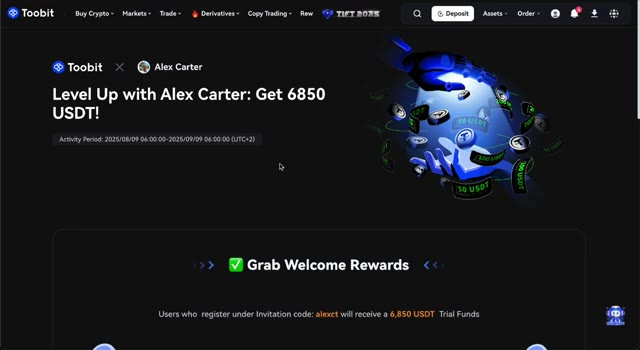
*⏱️ 00:10:25 — Capture d'écran de la page de la plateforme Toobit affichant une promotion exclusive en partenariat avec Alex Carter pour obtenir jusqu'à 6850 USDT de bonus.*

---

