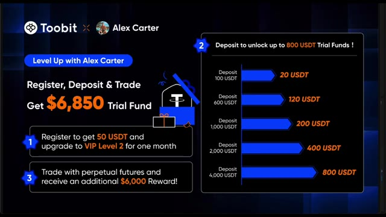
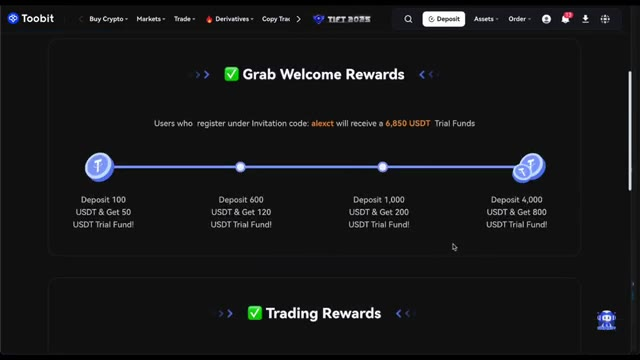
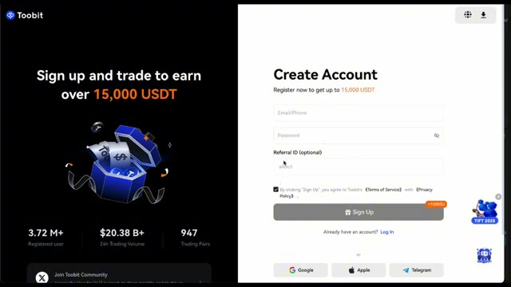
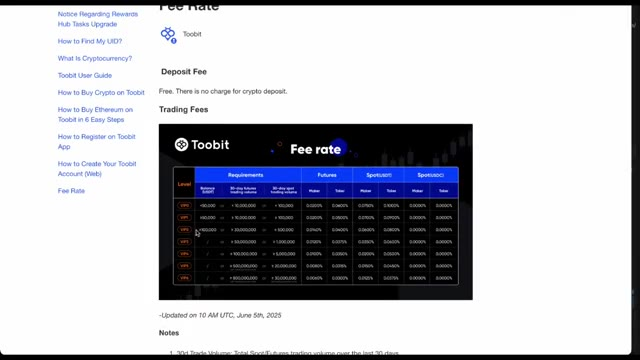
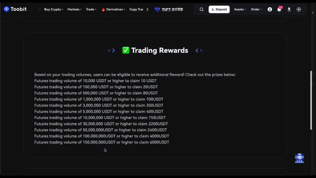
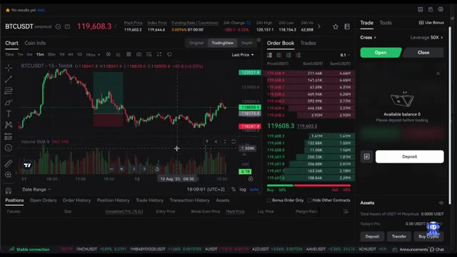
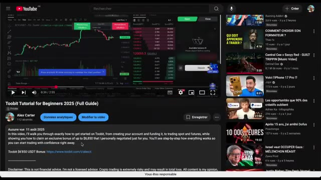
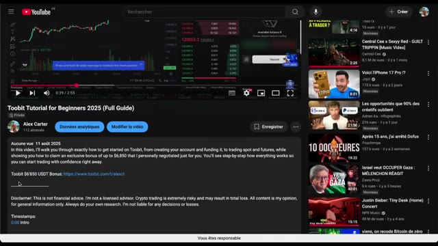

# 🎬 Get $6,850 FREE Bonus + VIP Perks on Toobit!

> **Chaîne** : [Alex Carter](https://www.youtube.com/@AlexCarterTrading)  
> **Lien YouTube** : [https://www.youtube.com/watch?v=7VbzIb5J2_k](https://www.youtube.com/watch?v=7VbzIb5J2_k)  
> **Date de publication** : 20250813  
> **Durée** : 00:04:15  
> **Identifiant vidéo** : `7VbzIb5J2_k`  
> **Transcription & Analyse** : `whisper-v3-large-turbo+gemini-3.5-flash-lite`  

---

## 📌 Synthèse Exécutive & Outils

### 💡 Résumé

Bienvenue dans cette analyse quantitative de la chaîne Alex Carter. Aujourd'hui, nous changeons exceptionnellement de focale par rapport à nos habitudes de code algorithmique en Pine Script, de déploiement de bots via Claude Code ou de scalping haute fréquence propulsé par Grok, pour nous attaquer à un pilier tout aussi critique du succès en trading : l'optimisation structurelle du capital et l'infrastructure de courtage. La vidéo se concentre sur le partenariat exclusif négocié avec la plateforme Toobit, conçu pour offrir aux traders quantitatifs et systématiques un avantage asymétrique dès le lancement de leurs opérations. En tant qu'analystes, nous savons que la survie d'une stratégie algorithmique dépend intrinsèquement des frottements de marché, des frais de transaction et de la robustesse du capital initial alloué aux phases de test et de "forward testing". 

Au-delà de la simple présentation commerciale, cette intervention met en lumière l'importance cruciale de l'ingénierie financière appliquée au compte de trading. Alex Carter détaille comment exploiter des fonds d'essai et des statuts VIP pour réduire drastiquement le *drawdown* psychologique et les coûts opérationnels lors de l'exécution de nouvelles stratégies de scalping ou de grilles algorithmiques. La démonstration s'articule autour d'un plan d'action progressif : capitalisation initiale optimisée par des bonus de dépôt échelonnés, réduction immédiate des frais grâce au statut VIP 2, et incitations basées sur le volume pour scalper les marchés dérivés avec un ratio risque/rendement considérablement amélioré.

Cette approche pragmatique rappelle que même les modèles mathématiques les plus sophistiqués, qu'ils soient backtestés sur TradingView ou codés sur mesure, nécessitent un environnement d'exécution financièrement viable. En sécurisant des avantages tels qu'un accès instantané à des fonds virtuels pour valider des configurations en conditions réelles sans risque de ruine, les traders s'assurent une rampe de lancement idéale pour industrialiser leurs méthodologies de trading automatisé ou discrétionnaire.

---

### 🛠️ Outils, Modèles & Logiciels Présentés

* **Toobit** : Échange centralisé de cryptomonnaies et de contrats à terme servant d'infrastructure d'exécution principale pour le déploiement des stratégies et l'optimisation des frais de trading.
* **Pine Script** : Langage de programmation dédié au développement d'indicateurs personnalisés et de stratégies algorithmiques de rétro-test (mentionné dans l'écosystème global de la chaîne).
* **Claude Code** : Assistant de développement par intelligence artificielle utilisé pour coder, déboguer et automatiser la logique des scripts de trading (évoqué dans la méthodologie d'ingénierie d'Alex Carter).
* **Grok Bots** : Agents conversationnels et décisionnels propulsés par l'IA pour assister le trader dans l'analyse contextuelle et l'optimisation des flux de marché (faisant partie de la boîte à outils quantitative de la chaîne).
* **TradingView** : Plateforme de graphisme, d'analyse technique et de backtesting indispensable pour le design et la validation visuelle des configurations de scalping.

---

### 🔑 Points Clés & Enseignements Stratégiques

* **Optimisation structurelle du capital de départ** : L'utilisation de codes d'invitation spécifiques (comme `AlexCT`) permet d'obtenir immédiatement 50 USDT de fonds d'essai, éliminant ainsi le risque financier personnel lors des premières phases de prise en main de la plateforme.
* **Réduction drastique des frictions transactionnelles** : L'accès automatique au niveau VIP 2 pendant un mois complet garantit des frais de trading réduits, un paramètre fondamental pour la rentabilité à long terme, en particulier pour les stratégies à haute fréquence et le scalping.
* **Effet de levier sur les fonds d'essai par paliers de dépôt** : Les bonus de dépôt s'échelonnent stratégiquement (par exemple, +20 USDT pour 100 USDT déposés, jusqu'à +800 USDT pour un dépôt de 4 000 USDT), augmentant la puissance de feu du trader sans injection excessive de capital propre.
* **Validation sécurisée des stratégies en conditions réelles** : Les fonds d'essai agissent comme un tampon de capital permettant d'exécuter des phases de *forward testing* en conditions de marché réelles, reproduisant fidèlement la psychologie et l'exécution sans exposer le capital net du trader.
* **Incitatifs de volume et constitution de capital** : Le système de récompenses basé sur le volume de contrats à terme tradés (allant de 10 USDT pour 10 000 USDT de volume jusqu'à 6 000 USDT pour les paliers supérieurs) récompense l'activité régulière et accélère la capitalisation du compte.
* **Gestion du risque psychologique (*Drawdown*)** : Disposer de capitaux non-directement issus de l'épargne personnelle atténue les biais cognitifs liés à la peur de la perte, favorisant une exécution disciplinée des plans de trading algorithmiques ou discrétionnaires.
* **Scalabilité des positions** : Le capital additionnel généré par les bonus offre une flexibilité accrue pour tester des tailles de lots plus importantes ou diversifier les portefeuilles sur plusieurs paires de contrats à terme simultanément.
* **Synergie entre infrastructure et automatisation** : Lier un environnement de courtage optimisé (frais bas, bonus de liquidité) à des outils de pointe (Pine Script, Claude Code, TradingView) maximise l'espérance mathématique globale de toute stratégie quantitative.

---

## ⏱️ Chronologie & Transcription Complète Audio & Visuelle (Mot pour Mot)

### ⏱️ `[00:00:00 - 00:00:34]` | Segment #01

**🔊 Audio (Transcription Intégrale Mot pour Mot en Français) :**
> Aujourd'hui, j'ai un bonus exclusif que j'ai personnellement négocié avec 2Bit rien que pour vous. C'est une offre spéciale que vous ne trouverez nulle part ailleurs, quelque chose que j'ai organisé pour donner à mon audience un sérieux avantage pour commencer à trader. Avec cet accord, vous pouvez obtenir jusqu'à 6 850 USDT et des fonds d'essai, ce qui signifie que vous obtenez un gros pot d'argent virtuel pour trader sans aucun risque. En plus de cela, vous recevrez également des récompenses supplémentaires basées sur vos dépôts et votre activité de trading, donc cela vaut vraiment la peine d'être actif et régulier sur la plateforme. C'est super simple. Tout ce que vous avez à

**👁️ Analyse Visuelle d'Écran (gemini-3.5-flash-lite) :**
**Interface & Outils** : Interface graphique promotionnelle / Échange de cryptomonnaies Toobit

**Contenu textuel & Code** : Texte affichant "Level Up with Alex Carter", "Register, Deposit & Trade Get $6,850 Trial Fund", avec trois paliers d'avantages : 1) Inscription (50 USDT + VIP Niveau 2), 2) Dépôt (jusqu'à 800 USDT de fonds d'essai selon le montant déposé : 100$, 600$, 1000$, 2000$, 4000$), 3) Trading sur contrats futures perpétuels (récompense additionnelle de 6 000$).

**Action / Démonstration** : Présentation visuelle de l'offre de parrainage et de bonus d'inscription pour l'audience.

*⏱️ 00:00:09 — Présentation des détails de l'offre promotionnelle exclusive entre Toobit et Alex Carter, détaillant les bonus de dépôt et de trading.*

---

### ⏱️ `[00:00:34 - 00:01:10]` | Segment #02

**🔊 Audio (Transcription Intégrale Mot pour Mot en Français) :**
> ce qu'il faut faire, c'est s'inscrire, déposer des fonds, trader, et regarder comment vous débloquez tous ces superbes bonus. Et ne vous inquiétez pas, je vais vous guider à chaque étape du processus pour que vous ne ratiez absolument rien. N'oubliez pas non plus que le lien pour tout réclamer ainsi que tous les détails se trouvent juste en bas, dans la description sous cette vidéo. La première étape consiste à s'inscrire. Lorsque vous créez votre compte en utilisant mon code d'invitation AlexCT, vous obtenez immédiatement 50 USDT de fonds d'essai crédités sur votre compte. Cela signifie que dès le moment où vous vous inscrivez, vous pouvez commencer à vous entraîner et à trader

**👁️ Analyse Visuelle d'Écran (gemini-3.5-flash-lite) :**
**Interface & Outils** : Échange de cryptomonnaies Toobit, interface YouTube.

**Contenu textuel & Code** : Paliers de bonus de dépôt de 100 à 4 000 USDT, code de parrainage "alexct".

**Action / Démonstration** : Présentation du processus d'inscription et des bonus de dépôt disponibles sur la plateforme.

*⏱️ 00:00:43 — Page de récompenses de bienvenue de l'échange Toobit montrant les paliers de bonus de dépôt en USDT.*

*⏱️ 00:01:01 — Page de création de compte de la plateforme Toobit avec un champ d'identifiant de parrainage pré-rempli.*

---

### ⏱️ `[00:01:10 - 00:01:44]` | Segment #03

**🔊 Audio (Transcription Intégrale Mot pour Mot en Français) :**
> avec un petit coup de pouce sans risquer votre propre argent. Mais ce n'est pas tout. En utilisant mon code, votre compte sera également mis à niveau automatiquement au niveau VIP deux pendant un mois complet. Qu'est-ce que cela signifie ? Vous profitez de frais de trading plus bas immédiatement, sans conditions supplémentaires ni exigences compliquées. Cette mise à niveau à elle seule peut vous faire économiser une bonne somme d'argent, surtout si vous prévoyez de trader régulièrement. C' même si vous êtes complètement nouveau dans le trading de crypto et que vous ne savez pas par où commencer. Ensuite, plongeons dans les bonus de dépôt. Le concept est très simple.

**👁️ Analyse Visuelle d'Écran (gemini-3.5-flash-lite) :**
**Interface & Outils** : Interface web de l'échange Toobit (page promotionnelle et grille tarifaire).

**Contenu textuel & Code** : Montants des bonus en USDT (50 USDT à l'inscription, 20 à 800 USDT selon les dépôts, jusqu'à 6 000 USDT de récompense futures) et tableau complet des taux de frais de trading par niveau VIP.

**Action / Démonstration** : Présentation visuelle des avantages promotionnels et des réductions de frais de trading offerts aux utilisateurs.

*⏱️ 00:01:18 — Présentation des bonus d'inscription et des paliers de dépôt sur la plateforme Toobit en partenariat avec Alex Carter, mentionnant jusqu'à 6 850 $ de fonds d'essai et une mise à niveau VIP Level 2.*

*⏱️ 00:01:27 — Affichage du tableau des frais de trading (Fee rate) de l'échange Toobit, détaillant les taux Maker et Taker pour chaque niveau VIP selon le volume et le solde.*

---

### ⏱️ `[00:01:45 - 00:02:08]` | Segment #04

**🔊 Audio (Transcription Intégrale Mot pour Mot en Français) :**
> Plus vous déposez, plus vous obtenez de fonds d'essai pour trader, ce qui vous offre une flexibilité et un pouvoir bien plus grands sans avoir besoin de risquer trop de vos propres capitaux. Par exemple, si vous déposez seulement 100 USDT, 2Bit ajoutera 20 USDT de fonds d'essai en bonus avec lesquels vous pourrez trader. Si vous voyez plus grand, disons un dépôt de 1 000 USDT, vous recevrez 200 USDT de fonds en bonus.

**👁️ Analyse Visuelle d'Écran (gemini-3.5-flash-lite) :**
**Interface & Outils** : Page promotionnelle de l'échange Toobit.

**Contenu textuel & Code** : Tableau des paliers de bonus : un dépôt de 100 USDT donne 20 USDT de bonus, 600 USDT donne 120 USDT, 1 000 USDT donne 200 USDT, 2 000 USDT donne 400 USDT, et 4 000 USDT donne 800 USDT. Mention de 6 850 USDT de fonds d'essai au total.

**Action / Démonstration** : Présentation des offres de bonus et des paliers de dépôt sur la plateforme Toobit.

*⏱️ 00:01:51 — Une diapositive promotionnelle de l'échange Toobit en partenariat avec Alex Carter, détaillant les différents paliers de bonus de dépôt et de fonds d'essai.*

---

### ⏱️ `[00:02:09 - 00:02:46]` | Segment #05

**🔊 Audio (Transcription Intégrale Mot pour Mot en Français) :**
> Et cela va jusqu'au niveau supérieur, où un dépôt de 4 000 USDT vous offrira l'incroyable somme de 800 USDT de fonds d'essai en bonus. Ce capital supplémentaire représente un énorme avantage lors du test de nouvelles stratégies ou du trading de positions plus importantes. Il vous permet d'expérimenter et d'apprendre sans mettre votre argent en danger. Parlons maintenant des récompenses de trading. Une fonction conçue pour continuer à vous récompenser à mesure que votre volume de trading augmente. Plus vous tradez de contrats à terme sur 2-bit, plus vous débloquez de récompenses en USDT. Par exemple, si votre volume de trading atteint 10 000 USDT, vous obtenez 10 USDT en

**👁️ Analyse Visuelle d'Écran (gemini-3.5-flash-lite) :**
**Interface & Outils** : Plateforme d'échange de cryptomonnaies Toobit

**Contenu textuel & Code** : Tableau des bonus de dépôt (100 USDT = 20 USDT, jusqu'à 4 000 USDT = 800 USDT) et barème des récompenses de volume de trading futures.

**Action / Démonstration** : Présentation des avantages et des paliers de bonus offerts aux utilisateurs inscrits via le partenariat.

*⏱️ 00:02:18 — Interface graphique de Toobit présentant les paliers de bonus de dépôt allant jusqu'à 800 USDT pour un dépôt de 4 000 USDT.*

*⏱️ 00:02:37 — Page Web de Toobit détaillant les récompenses de trading basées sur les volumes de futures (Trading Rewards).*

---

### ⏱️ `[00:02:46 - 00:03:23]` | Segment #06

**🔊 Audio (Transcription Intégrale Mot pour Mot en Français) :**
> récompenses. Au fur et à mesure que vous gravissez les échelons, atteignant des volumes tels que 100 000, 500 000 et même jusqu'à 150 millions d'USDT, vos récompenses augmentent de manière significative, pour aller jusqu'à 6 000 USDT. C'est un système qui encourage l'activité et la régularité, en s'assurant que vos efforts de trading sont reconnus et récompensés. De plus, ces récompenses peuvent s'accumuler au fil du temps et vous aider à constituer votre capital plus rapidement. Une fois que vous avez débloqué vos bonus et préparé votre compte, vous pouvez commencer à trader immédiatement. Pas besoin d'attendre. Choisissez simplement votre marché préféré, décidez du montant que vous voulez

**👁️ Analyse Visuelle d'Écran (gemini-3.5-flash-lite) :**
**Interface & Outils** : Site web / Échange de cryptomonnaies (Toobit)

**Contenu textuel & Code** : Tableau des paliers de volume de trading futures et récompenses en USDT : 10 000 USDT (10 USDT), 100 000 USDT (20 USDT), 500 000 USDT (80 USDT), jusqu'à 150 000 000 USDT (6 000 USDT).

**Action / Démonstration** : Présentation des conditions et des récompenses du programme de trading de la plateforme.

*⏱️ 00:02:55 — Capture d'écran de l'interface de la plateforme Toobit montrant la section des récompenses de trading (Trading Rewards) avec le barème des paliers de volume et des primes associées.*

---

### ⏱️ `[00:03:23 - 00:04:00]` | Segment #07

**🔊 Audio (Transcription Intégrale Mot pour Mot en Français) :**
> pour trader, et vous lancer directement. Vos fonds d'essai vous permettent de vous entraîner à différentes stratégies de trading, d'essayer de nouvelles configurations et de trader exactement comme avec de l'argent réel, mais avec beaucoup moins de risque. C'est inestimable, surtout si vous débutez ou apprenez encore les ficelles. Si vous ne savez pas comment commencer ou si vous voulez un guide détaillé, j'ai déjà fait un tutoriel complet étape par étape sur la façon d'utiliser 2Bit, que vous pouvez trouver comme étant la vidéo précédente sur ma chaîne. Assurez-vous de la regarder. Elle explique tout, de l'inscription au placement de votre premier trade. Donc si vous voulez réclamer jusqu'à 6 850 USDT

**👁️ Analyse Visuelle d'Écran (gemini-3.5-flash-lite) :**
**Interface & Outils** : Interface de la plateforme de trading Toobit et interface de la plateforme YouTube.

**Contenu textuel & Code** : Graphique de prix BTCUSDT avec indicateur Volume SMA 9, carnet d'ordres (Order Book), solde du compte et vignettes de vidéos YouTube.

**Action / Démonstration** : Visualisation d'un graphique de trading pour illustrer l'utilisation des fonds d'essai et l'entraînement sur une plateforme d'échange.

*⏱️ 00:03:33 — Interface d'échange crypto affichant un graphique de prix Bitcoin en chandeliers sur l'unité de temps 15 minutes, un carnet d'ordres à droite et le panneau de trading.*

---

### ⏱️ `[00:04:00 - 00:04:15]` | Segment #08

**🔊 Audio (Transcription Intégrale Mot pour Mot en Français) :**
> de fonds d'essai et commencez à trader avec de précieux avantages VIP, assurez-vous de vous inscrire avec mon code AlexCT. Le lien est juste là, dans la description ci-dessous. Cliquez dessus, inscrivez-vous et commencez à trader dès aujourd'hui. Je vous retrouve sur la plateforme et j'ai hâte d'entendre parler de votre parcours de trader.

**👁️ Analyse Visuelle d'Écran (gemini-3.5-flash-lite) :**
**Interface & Outils** : Navigateur web, plateforme d'échange Toobit, interface YouTube.

**Contenu textuel & Code** : URL de parrainage 'toobit.com/t/alexct', code de parrainage 'alexct', bonus de 15 000 USDT, graphique de trading BTCUSDT.

**Action / Démonstration** : Présentation de la procédure d'inscription sur l'exchange avec le code de parrainage et visualisation du tutoriel vidéo sur YouTube.

*⏱️ 00:04:03 — Page d'inscription de la plateforme Toobit avec le code de parrainage 'alexct' pré-rempli et une offre de bonus de 15 000 USDT.*

*⏱️ 00:04:07 — Interface YouTube montrant le tutoriel Toobit d'Alex Carter, avec un graphique de trading et le lien d'affiliation dans la description.*

*⏱️ 00:04:11 — Vue similaire de la vidéo YouTube de tutoriel Toobit sur la chaîne d'Alex Carter, affichant la description complète et les horodatages.*

---

