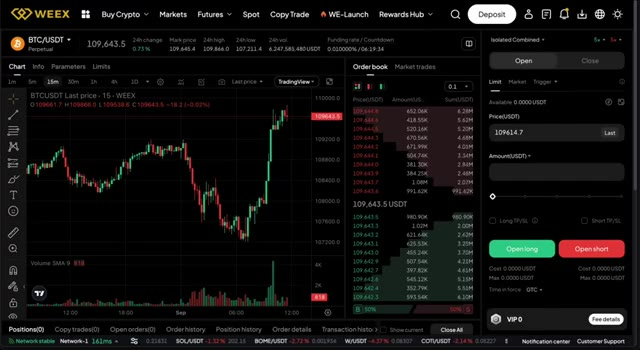
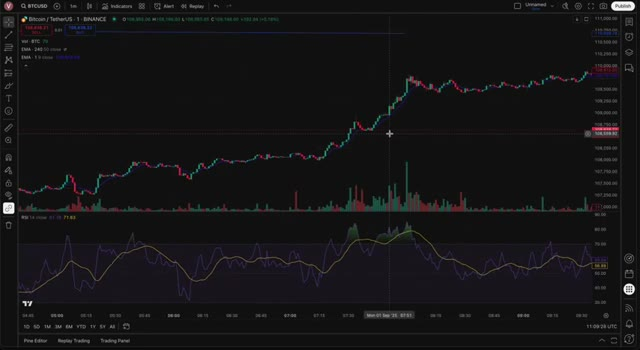

# 🎬 My Incredibly Easy Scalping Strategy That Works Everytime

> **Chaîne** : [Alex Carter](https://www.youtube.com/@AlexCarterTrading)  
> **Lien YouTube** : [https://www.youtube.com/watch?v=AlqCVr5kS3A](https://www.youtube.com/watch?v=AlqCVr5kS3A)  
> **Date de publication** : 20250901  
> **Durée** : 00:07:39  
> **Identifiant vidéo** : `AlqCVr5kS3A`  
> **Transcription & Analyse** : `whisper-v3-large-turbo+gemini-3.5-flash-lite`  

---

## 📌 Synthèse Exécutive & Outils

### 💡 Résumé
Dans cette vidéo intitulée **Ma stratégie de scalping incroyablement simple qui fonctionne à tous les coups**, Alex Carter détaille une approche stratégique et pratique du trading et de l'automatisation par agents IA.

### 🛠️ Outils, Modèles & Logiciels Présentés
- **TradingView & Claude Code** : Analyse technique avancée et automatisation algorithmique.

### 🔑 Points Clés & Enseignements Stratégiques
- Respect rigoureux du ratio risque/rendement et du money management.
- Automatisation méthodique des déclencheurs d'ordres via des agents intelligents.

---

## ⏱️ Chronologie & Transcription Complète Audio & Visuelle (Mot pour Mot)

### ⏱️ `[00:00:00 - 00:00:33]` | Segment #01

**🔊 Audio (Transcription Intégrale Mot pour Mot en Français) :**
> Il y a une configuration que j'utilise absolument tous les jours. C'est incroyablement simple, reproductible et ça fonctionne. Pas de calculs compliqués, pas un empilement d'indicateurs confus, juste des bougies Heikin Ashi, un RSI de base et deux EMA avec des règles très claires. Aujourd'hui, je vais vous donner la structure complète, puis je vous montrerai comment l'exécuter étape par étape sur le graphique en une minute avec des exemples réels pour que vous puissiez commencer à le trader en toute confiance. Tout d'abord, configurons le graphique. Passez vos bougies en Heikin Ashi pour que la tendance devienne beaucoup plus facile à lire. Ensuite, ajoutez le RSI avec les paramètres par défaut et ajoutez deux

**👁️ Analyse Visuelle d'Écran (gemini-3.5-flash-lite) :**
**Interface & Outils** : Présentation ou face-caméra explicatif du trader sans interface logicielle partagée.

**Contenu textuel & Code** : Explications orales des stratégies et mise en contexte méthodologique du marché.

**Action / Démonstration** : Explications face caméra et analyse conceptuelle des marchés.

---

### ⏱️ `[00:00:33 - 00:01:06]` | Segment #02

**🔊 Audio (Transcription Intégrale Mot pour Mot en Français) :**
> moyennes mobiles exponentielles. La première EMA doit être réglée sur 50 mais avec un cadre temporel de quatre heures, cela vous donne votre biais de cadre temporel supérieur. La deuxième EMA reste sur le graphique d'une minute comme guide à court terme. J'aime utiliser une EMA à neuf périodes ici car elle réagit rapidement au prix. À ce stade, vous devriez voir le RSI en dessous, une EMA à long terme qui coupe le prix plus lentement et une EMA courte qui épouse le prix de beaucoup plus près. Et avant d'aller plus loin, laissez-moi dire ceci. Si vous allez faire du scalping ou du day trading, vous avez absolument besoin d'une bourse avec des frais bas et une exécution fiable.

**👁️ Analyse Visuelle d'Écran (gemini-3.5-flash-lite) :**
**Interface & Outils** : Présentation ou face-caméra explicatif du trader sans interface logicielle partagée.

**Contenu textuel & Code** : Explications orales des stratégies et mise en contexte méthodologique du marché.

**Action / Démonstration** : Explications face caméra et analyse conceptuelle des marchés.

---

### ⏱️ `[00:01:06 - 00:01:39]` | Segment #03

**🔊 Audio (Transcription Intégrale Mot pour Mot en Français) :**
> Sinon, vos profits disparaissent tout simplement en commissions. C'est pourquoi je recommande personnellement Weeks. C'est conçu pour les traders actifs et cela permet de maintenir des coûts très bas. Si vous n'avez pas encore de compte, vous pouvez vous inscrire grâce au lien dans la description et commencer. Voici donc la règle d'or, et c'est ce qui garantit cette régularité. Si le prix est au-dessus de l'EMA 50 en 4 heures, vous ne cherchez que des longs. S'il est en dessous, vous ne cherchez que des shorts. La raison pour laquelle cela fonctionne si bien, c'est parce que vous tradez toujours avec le momentum dominant au lieu de le combattre. Essayer de short un marché qui est

**👁️ Analyse Visuelle d'Écran (gemini-3.5-flash-lite) :**
**Interface & Outils** : Plateforme d'échange WEEX et interface graphique TradingView.

**Contenu textuel & Code** : Graphique BTC/USDT en 15m, carnet d'ordres en temps réel, volumes, indicateurs techniques EMA et RSI(14).

**Action / Démonstration** : Présentation de la plateforme de courtage et analyse technique du cours du Bitcoin.

*⏱️ 00:01:14 — Interface de trading de la plateforme WEEX montrant le graphique du Bitcoin (BTC/USDT) en timeframe 15m, le carnet d'ordres et le panneau de passage d'ordres.*

*⏱️ 00:01:23 — Graphique TradingView en unité de temps 1 minute affichant les chandeliers japonais du BTC/USD, des indicateurs de volume, des moyennes mobiles (EMA) et l'oscillateur RSI.*

---

### ⏱️ `[00:01:39 - 00:02:17]` | Segment #04

**🔊 Audio (Transcription Intégrale Mot pour Mot en Français) :**
> clairement orienté à la hausse ou se positionner à l'achat quand les vendeurs ont le contrôle total est l'un des moyens les plus rapides de perdre de l'argent. Ce filtre simple agit comme une boussole. Il vous maintient aligné avec la vision d'ensemble et vous aide à éviter de nombreux mauvais configurations qui semblent tentantes sur le graphique d'une minute mais qui n'ont pas le vent en poupe. Une fois la direction définie, vous zoomez sur le graphique d'une minute et attendez trois confirmations avant de faire quoi que ce soit. Disons que le prix est sous l'EMA 50 et que vous cherchez des positions vendeuses. Premièrement, vous voulez que le RSI dépasse 70, montrant que le marché est étiré et susceptible de reculer

**👁️ Analyse Visuelle d'Écran (gemini-3.5-flash-lite) :**
**Interface & Outils** : Présentation ou face-caméra explicatif du trader sans interface logicielle partagée.

**Contenu textuel & Code** : Explications orales des stratégies et mise en contexte méthodologique du marché.

**Action / Démonstration** : Explications face caméra et analyse conceptuelle des marchés.

---

### ⏱️ `[00:02:17 - 00:02:53]` | Segment #05

**🔊 Audio (Transcription Intégrale Mot pour Mot en Français) :**
> ...en arrière. Deuxièmement, il faut qu'une bougie Heikin-Ashi rouge apparaisse, ce qui vous indique que les vendeurs reviennent à la charge. Et troisièmement, cette bougie doit clôturer entièrement en dessous de l'EMA 9. Ce dernier élément est important car il prouve que le momentum s'est suffisamment inversé pour casser la structure à court terme. Pour les positions acheteuses, c'est l'exact opposé. Le RSI passe sous les 30, une bougie Heikin-Ashi verte se forme, et elle clôture au-dessus de l'EMA 9. C'est seulement lorsque ces trois éléments se produisent ensemble que vous entrez. S'il en manque un, vous...

**👁️ Analyse Visuelle d'Écran (gemini-3.5-flash-lite) :**
**Interface & Outils** : Présentation ou face-caméra explicatif du trader sans interface logicielle partagée.

**Contenu textuel & Code** : Explications orales des stratégies et mise en contexte méthodologique du marché.

**Action / Démonstration** : Explications face caméra et analyse conceptuelle des marchés.

---

### ⏱️ `[00:02:53 - 00:03:25]` | Segment #06

**🔊 Audio (Transcription Intégrale Mot pour Mot en Français) :**
> Attendez. C'est cette discipline qui rend cette configuration fiable. Quand tout est aligné, vous entrez pile à la clôture de la bougie de confirmation. Le stop se place juste au-delà du swing le plus récent, donc au-dessus du dernier sommet mineur pour les shorts ou en dessous du dernier creux mineur pour les longs. De cette façon, votre risque est serré mais reste logique. L'objectif est fixé à deux fois ce que vous risquez, vous donnant un ratio risque/rendement net de un pour deux. C'est ce qui fait que les calculs fonctionnent sur la durée, même si vous ne gagnez pas chaque trade.

**👁️ Analyse Visuelle d'Écran (gemini-3.5-flash-lite) :**
**Interface & Outils** : Présentation ou face-caméra explicatif du trader sans interface logicielle partagée.

**Contenu textuel & Code** : Explications orales des stratégies et mise en contexte méthodologique du marché.

**Action / Démonstration** : Explications face caméra et analyse conceptuelle des marchés.

---

### ⏱️ `[00:03:25 - 00:04:04]` | Segment #07

**🔊 Audio (Transcription Intégrale Mot pour Mot en Français) :**
> If price reaches the level equal to your risk you can choose to move your stop to break even and let the trade run further. Some traders also trail behind the EMA 9 to ride strong trends. The key is that you define your stop and target before you enter so every trade follows the same structure. Let me walk you through an example. Price is trading under the 4-hour EMA 50, so I'm only looking for shorts. RSI spikes above 70, a red Heikinashi candle appears, and it closes below the EMA 9. That's my entry. I short on the close, place my stop above the swing

**👁️ Analyse Visuelle d'Écran (gemini-3.5-flash-lite) :**
**Interface & Outils** : Présentation ou face-caméra explicatif du trader sans interface logicielle partagée.

**Contenu textuel & Code** : Explications orales des stratégies et mise en contexte méthodologique du marché.

**Action / Démonstration** : Explications face caméra et analyse conceptuelle des marchés.

---

### ⏱️ `[00:04:04 - 00:04:24]` | Segment #08

**🔊 Audio (Transcription Intégrale Mot pour Mot en Français) :**
> high, and aim for double the distance. A few candles later, price retests the EMA 9, then pushes down and easily hits target. Another example in an uptrend. Price is above the EMA 50, RSI dips below 30, a green Heikinashi candle prints, but it doesn't close above the EMA 9. That means no entry.

**👁️ Analyse Visuelle d'Écran (gemini-3.5-flash-lite) :**
**Interface & Outils** : Présentation ou face-caméra explicatif du trader sans interface logicielle partagée.

**Contenu textuel & Code** : Explications orales des stratégies et mise en contexte méthodologique du marché.

**Action / Démonstration** : Explications face caméra et analyse conceptuelle des marchés.

---

### ⏱️ `[00:04:24 - 00:04:44]` | Segment #09

**🔊 Audio (Transcription Intégrale Mot pour Mot en Français) :**
> The next candle closes above the EMA, now I'm in. Stop under the swing low, target two times the risk. Price slowly grinds higher and eventually hits profit. Of course, not every trade wins. Sometimes you'll get the signal, enter, and price will snap back and stop you up. That's fine, because you only risk a fixed amount each time.

**👁️ Analyse Visuelle d'Écran (gemini-3.5-flash-lite) :**
**Interface & Outils** : Présentation ou face-caméra explicatif du trader sans interface logicielle partagée.

**Contenu textuel & Code** : Explications orales des stratégies et mise en contexte méthodologique du marché.

**Action / Démonstration** : Explications face caméra et analyse conceptuelle des marchés.

---

### ⏱️ `[00:04:45 - 00:05:20]` | Segment #10

**🔊 Audio (Transcription Intégrale Mot pour Mot en Français) :**
> The whole edge of the system is that your losers are small and controlled, while your winners are at least double. Over a series of trades, the math works in your favor. Before we move into the advanced parts of the strategy, let's take a moment to talk about something practical that makes a big difference when you're scalping. Having the right exchange matters just as much as having the right strategy. If your platform charges high feedies or executes slowly, all those little scalps quickly lose their edge. That's why I recommend Weeks. They're currently offering one of the best deposit deals out there. With the link in the description,

**👁️ Analyse Visuelle d'Écran (gemini-3.5-flash-lite) :**
**Interface & Outils** : Présentation ou face-caméra explicatif du trader sans interface logicielle partagée.

**Contenu textuel & Code** : Explications orales des stratégies et mise en contexte méthodologique du marché.

**Action / Démonstration** : Explications face caméra et analyse conceptuelle des marchés.

---

### ⏱️ `[00:05:20 - 00:05:45]` | Segment #11

**🔊 Audio (Transcription Intégrale Mot pour Mot en Français) :**
> you can claim up to $30,000 in deposit bonuses. On top of that, they give you VIP status, which cuts 20% off your trading fees. And trust me, for scalpers, fees stack up fast. So having that discount is like starting every trade with a small built-in advantage. If you're testing this strategy, the bonus is basically free firepower you can practice with, while the fee reduction helps you keep more of your profits.

**👁️ Analyse Visuelle d'Écran (gemini-3.5-flash-lite) :**
**Interface & Outils** : Présentation ou face-caméra explicatif du trader sans interface logicielle partagée.

**Contenu textuel & Code** : Explications orales des stratégies et mise en contexte méthodologique du marché.

**Action / Démonstration** : Explications face caméra et analyse conceptuelle des marchés.

---

### ⏱️ `[00:05:45 - 00:06:14]` | Segment #12

**🔊 Audio (Transcription Intégrale Mot pour Mot en Français) :**
> Now, even with a clean setup like this, you need filters to protect yourself from low quality trades. The first rule is simple. Always wait for the camel to close. A wick poking through the EMA isn't enough. It has to actually close beyond it. Otherwise, the setup is invalid. Another thing to watch out for is news events or sudden spikes in volatility. The one minute chart can go crazy right after announcements. So giving it a few minutes to settle can save you from unnecessary stopouts. Liquidity also matters.

**👁️ Analyse Visuelle d'Écran (gemini-3.5-flash-lite) :**
**Interface & Outils** : Présentation ou face-caméra explicatif du trader sans interface logicielle partagée.

**Contenu textuel & Code** : Explications orales des stratégies et mise en contexte méthodologique du marché.

**Action / Démonstration** : Explications face caméra et analyse conceptuelle des marchés.

---

### ⏱️ `[00:06:14 - 00:06:33]` | Segment #13

**🔊 Audio (Transcription Intégrale Mot pour Mot en Français) :**
> Stick to hours when spreads are tight and the order book is active, because scalping only works if transaction costs are minimal. And finally, be picky. If hike and ashy candles are flipping green to red and back again around your EMA 9, that's chop. The best move in that situation is no move at all. Standing aside and protecting your capital is still playing the game.

**👁️ Analyse Visuelle d'Écran (gemini-3.5-flash-lite) :**
**Interface & Outils** : Présentation ou face-caméra explicatif du trader sans interface logicielle partagée.

**Contenu textuel & Code** : Explications orales des stratégies et mise en contexte méthodologique du marché.

**Action / Démonstration** : Explications face caméra et analyse conceptuelle des marchés.

---

### ⏱️ `[00:06:33 - 00:07:06]` | Segment #14

**🔊 Audio (Transcription Intégrale Mot pour Mot en Français) :**
> One of the reasons this strategy is so powerful is because it's incredibly easy to backtest. You don't need fancy tools or special data. Just pull up a chart, scroll back, and apply the rules. mark when price is above or below the four hour EMA 50. Then check for RSI signals, confirm with Heiken Ashi, and see if the candle closes past EMA 9. Log the entry, the stop, and whether your two to one target was hit. After doing this across 50 to 100 trades, you'll know exactly how the system behaves and what kind of win rate and average return you can expect. Journaling is key here.

**👁️ Analyse Visuelle d'Écran (gemini-3.5-flash-lite) :**
**Interface & Outils** : Présentation ou face-caméra explicatif du trader sans interface logicielle partagée.

**Contenu textuel & Code** : Explications orales des stratégies et mise en contexte méthodologique du marché.

**Action / Démonstration** : Explications face caméra et analyse conceptuelle des marchés.

---

### ⏱️ `[00:07:06 - 00:07:37]` | Segment #15

**🔊 Audio (Transcription Intégrale Mot pour Mot en Français) :**
> Take screenshots of your trades, note the conditions, and track your emotions too. It's not just about numbers. It's about building confidence that the system works and understanding how you personally execute it. Follow the rules with discipline and you'll see why I call this my incredibly easy scalping strategy that works every time. If you want to put it into practice, don't forget the weeks link in the description. You'll get the bonus, the position boost, and the reduced fees that make scalping a lot more profitable. If you got value from this, hit like, subscribe to the channel, and let me know in the comments what market you want me to to test this on next.

**👁️ Analyse Visuelle d'Écran (gemini-3.5-flash-lite) :**
**Interface & Outils** : Présentation ou face-caméra explicatif du trader sans interface logicielle partagée.

**Contenu textuel & Code** : Explications orales des stratégies et mise en contexte méthodologique du marché.

**Action / Démonstration** : Explications face caméra et analyse conceptuelle des marchés.

---

