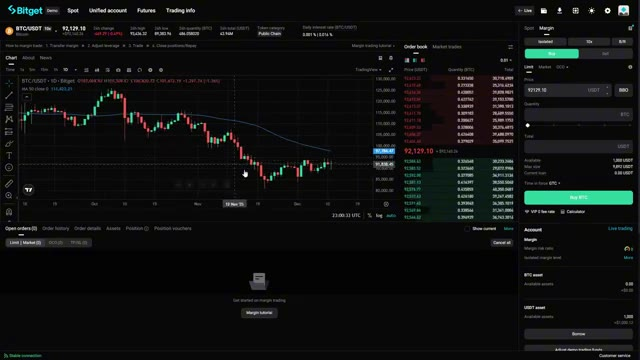

# 🎬 How To Trade Crypto On Bitget! (Step-By-Step Tutorial)

> **Chaîne** : [Alex Carter](https://www.youtube.com/@AlexCarterTrading)  
> **Lien YouTube** : [https://www.youtube.com/watch?v=3JNfGa_lJJU](https://www.youtube.com/watch?v=3JNfGa_lJJU)  
> **Date de publication** : 20251212  
> **Durée** : 00:28:14  
> **Identifiant vidéo** : `3JNfGa_lJJU`  
> **Transcription & Analyse** : `whisper-v3-large-turbo+gemini-3.5-flash-lite`  

---

## 📌 Synthèse Exécutive & Outils

### 💡 Résumé
Dans cette vidéo intitulée **Comment Trader la Crypto sur Bitget ! (Tutoriel Étape par Étape)**, Alex Carter détaille une approche stratégique et pratique du trading et de l'automatisation par agents IA.

### 🛠️ Outils, Modèles & Logiciels Présentés
- **TradingView & Claude Code** : Analyse technique avancée et automatisation algorithmique.

### 🔑 Points Clés & Enseignements Stratégiques
- Respect rigoureux du ratio risque/rendement et du money management.
- Automatisation méthodique des déclencheurs d'ordres via des agents intelligents.

---

## ⏱️ Chronologie & Transcription Complète Audio & Visuelle (Mot pour Mot)

### ⏱️ `[00:00:00 - 00:00:38]` | Segment #01

**🔊 Audio (Transcription Intégrale Mot pour Mot en Français) :**
> In this video, I'm going to show you the complete A to Z guide on how to trade crypto on BitGit. Whether you are a complete beginner who has never touched a crypto exchange before, or you are coming from another platform and want to learn BitGit inside and out, this tutorial has everything you need. Now here's the thing, BitGit is one of the most powerful exchanges out there, with incredible volume, tons of altcoins, and features that can help you trade like a pro. But I know it can look overwhelming at first. That is why I'm breaking down every single feature, every button, every setting you need to know. And here's the cool part.

**👁️ Analyse Visuelle d'Écran (gemini-3.5-flash-lite) :**
**Interface & Outils** : Présentation ou face-caméra explicatif du trader sans interface logicielle partagée.

**Contenu textuel & Code** : Explications orales des stratégies et mise en contexte méthodologique du marché.

**Action / Démonstration** : Explications face caméra et analyse conceptuelle des marchés.

---

### ⏱️ `[00:00:38 - 00:01:14]` | Segment #02

**🔊 Audio (Transcription Intégrale Mot pour Mot en Français) :**
> By the end of this video, you will know exactly how to secure your account, deposit funds, trade spot and futures, use advanced tools like limit orders and leverage, and even how to short crypto. Now, this is a full walkthrough packed with a lot of detail. So feel free to save this video and come back to it whenever you need a refresher. I have also time stamped every section in the description so you can jump straight to whatever you need. Let us get started. All right, first things first, you need to create your BitGet account. Now, before you do anything else, make sure you click the link in the description below. That link is my exclusive partner link,

**👁️ Analyse Visuelle d'Écran (gemini-3.5-flash-lite) :**
**Interface & Outils** : Présentation ou face-caméra explicatif du trader sans interface logicielle partagée.

**Contenu textuel & Code** : Explications orales des stratégies et mise en contexte méthodologique du marché.

**Action / Démonstration** : Explications face caméra et analyse conceptuelle des marchés.

---

### ⏱️ `[00:01:14 - 00:01:38]` | Segment #03

**🔊 Audio (Transcription Intégrale Mot pour Mot en Français) :**
> and it is the only way to unlock the full welcome bonus package. Up to $6,200 in rewards depending on your deposits and trade in volume. Once you click that link, you will land on the BitGet signup page. Just enter your email address and create a strong password. I'm talking uppercase, lowercase, numbers, and symbols. Make it secure. Then hit create account and boom, you have got your account.

**👁️ Analyse Visuelle d'Écran (gemini-3.5-flash-lite) :**
**Interface & Outils** : Présentation ou face-caméra explicatif du trader sans interface logicielle partagée.

**Contenu textuel & Code** : Explications orales des stratégies et mise en contexte méthodologique du marché.

**Action / Démonstration** : Explications face caméra et analyse conceptuelle des marchés.

---

### ⏱️ `[00:01:38 - 00:02:12]` | Segment #04

**🔊 Audio (Transcription Intégrale Mot pour Mot en Français) :**
> Now, BitGet will send you a verification email. Just open that, click the link, and your email is confirmed. Super simple. Okay, now the first thing you will see is this page right here and there is something you absolutely cannot skip, two-factor authentication or 2FA. This is your second line of defense and trust me, you need it. Without 2FA, anyone who gets your email and password can access your account and drain your funds. With two-factor authentication, even if someone has your login details, they still can't get in without that second code. Here's how to set it up. Once you

**👁️ Analyse Visuelle d'Écran (gemini-3.5-flash-lite) :**
**Interface & Outils** : Présentation ou face-caméra explicatif du trader sans interface logicielle partagée.

**Contenu textuel & Code** : Explications orales des stratégies et mise en contexte méthodologique du marché.

**Action / Démonstration** : Explications face caméra et analyse conceptuelle des marchés.

---

### ⏱️ `[00:02:12 - 00:02:45]` | Segment #05

**🔊 Audio (Transcription Intégrale Mot pour Mot en Français) :**
> are logged in, click on your profile icon in the top right corner, then go to security setting. Then you will see three options here. First is the SMS verification, a code sent to your phone. Then next is email verification, a code sent to your email. Lastly is the Google Authenticator, my personal favorite. I highly recommend using Google Authenticator. Here is why. It is not connected to your phone number or email. So even if someone hacks those, they still cannot get your two-factor authentication code. It is a separate app that generates a new six-digit code every 30

**👁️ Analyse Visuelle d'Écran (gemini-3.5-flash-lite) :**
**Interface & Outils** : Présentation ou face-caméra explicatif du trader sans interface logicielle partagée.

**Contenu textuel & Code** : Explications orales des stratégies et mise en contexte méthodologique du marché.

**Action / Démonstration** : Explications face caméra et analyse conceptuelle des marchés.

---

### ⏱️ `[00:02:45 - 00:03:08]` | Segment #06

**🔊 Audio (Transcription Intégrale Mot pour Mot en Français) :**
> seconds. To set it up, download the Google Authenticator app from the App Store or Google Play. Then, back on BitGet, click Enable next to Google Authenticator. BitGet will show you a QR code. Open the Google Authenticator app and scan that QR code with your phone's camera. Now, this is super important. BitGet will also show you a backup key. This is a long string of letters and numbers.

**👁️ Analyse Visuelle d'Écran (gemini-3.5-flash-lite) :**
**Interface & Outils** : Présentation ou face-caméra explicatif du trader sans interface logicielle partagée.

**Contenu textuel & Code** : Explications orales des stratégies et mise en contexte méthodologique du marché.

**Action / Démonstration** : Explications face caméra et analyse conceptuelle des marchés.

---

### ⏱️ `[00:03:08 - 00:03:41]` | Segment #07

**🔊 Audio (Transcription Intégrale Mot pour Mot en Français) :**
> Screenshot this, write it down, and keep it somewhere safe. If you ever lose your phone or get a new one, you'll need this key to restore your two-factor authentication. Without it, you could get locked out of your account permanently. Once you have scanned the QR code, the Google Authenticator app will start generating codes for BitGit. Enter the current six-digit code into BitGit to confirm, and boom, your two-factor authentication is active. From now on, every time you log in or make a withdrawal, BitGit will ask for that six-digit code. It is an extra step, sure, but it is the

**👁️ Analyse Visuelle d'Écran (gemini-3.5-flash-lite) :**
**Interface & Outils** : Présentation ou face-caméra explicatif du trader sans interface logicielle partagée.

**Contenu textuel & Code** : Explications orales des stratégies et mise en contexte méthodologique du marché.

**Action / Démonstration** : Explications face caméra et analyse conceptuelle des marchés.

---

### ⏱️ `[00:03:41 - 00:04:17]` | Segment #08

**🔊 Audio (Transcription Intégrale Mot pour Mot en Français) :**
> best way to protect your funds. And honestly, once you get used to it, it takes like five seconds. All right, your account is now secure. Let us move on to verification. Okay, next up, KYC or Know Your Customer Verification. Now, I know some people do not love the idea of uploading their ID to an exchange, but here's the reality. If you want to withdraw large amounts of crypto or access certain features on BitGet, you need to complete KYC. It is a regulatory requirement and pretty much every major exchange requires it. The good news, it is quick and straightforward on BitGet.

**👁️ Analyse Visuelle d'Écran (gemini-3.5-flash-lite) :**
**Interface & Outils** : Présentation ou face-caméra explicatif du trader sans interface logicielle partagée.

**Contenu textuel & Code** : Explications orales des stratégies et mise en contexte méthodologique du marché.

**Action / Démonstration** : Explications face caméra et analyse conceptuelle des marchés.

---

### ⏱️ `[00:04:17 - 00:04:52]` | Segment #09

**🔊 Audio (Transcription Intégrale Mot pour Mot en Français) :**
> Click on your profile icon, then go to identity verification. You will see exactly the same screen appearing on my screen and you just have click the verify now button. And then just simply follow the on-screen instructions. And once you submit everything, BitGet system will review it. In most cases, you will get approved within a few minutes. Sometimes it can take up to 24 hours if there is high demand, but it is usually pretty fast. And that is it. You are now a Verify user on BitGit. You can now deposit, trade, and withdraw with much higher limits. Let us talk about getting

**👁️ Analyse Visuelle d'Écran (gemini-3.5-flash-lite) :**
**Interface & Outils** : Présentation ou face-caméra explicatif du trader sans interface logicielle partagée.

**Contenu textuel & Code** : Explications orales des stratégies et mise en contexte méthodologique du marché.

**Action / Démonstration** : Explications face caméra et analyse conceptuelle des marchés.

---

### ⏱️ `[00:04:52 - 00:05:26]` | Segment #10

**🔊 Audio (Transcription Intégrale Mot pour Mot en Français) :**
> funds onto the platform. All right, now that your account is set up and verified, let us get some funds onto the platform so you can start trading. There are two main ways to get crypto onto BitGit. First is deposit crypto from another wallet or exchange. Second buy crypto directly with a credit or debit card. Let me show you both methods. First click on wallet in the top menu. This takes you to your main wallet dashboard where you can see all your balances across different wallets. Now click on deposit in the top right corner. You will see a drop-down menu asking which cryptocurrency

**👁️ Analyse Visuelle d'Écran (gemini-3.5-flash-lite) :**
**Interface & Outils** : Présentation ou face-caméra explicatif du trader sans interface logicielle partagée.

**Contenu textuel & Code** : Explications orales des stratégies et mise en contexte méthodologique du marché.

**Action / Démonstration** : Explications face caméra et analyse conceptuelle des marchés.

---

### ⏱️ `[00:05:26 - 00:06:02]` | Segment #11

**🔊 Audio (Transcription Intégrale Mot pour Mot en Français) :**
> you want to deposit. For this example I'm going to use USDT which is the most common stablecoin and what most people use for trading. Select USDT from the list. Now, here is something super important. You need to choose the correct blockchain network. USDT exists on multiple blockchains, and if you send it on the wrong network, your funds could be lost forever. The most common networks are ERC20, Ethereum, secure but can have high fees, TRC20, Tron, fast and cheap, my personal favorite, BEP20, Binance Smart Chain, also fast and cheap. Make sure the network you

**👁️ Analyse Visuelle d'Écran (gemini-3.5-flash-lite) :**
**Interface & Outils** : Présentation ou face-caméra explicatif du trader sans interface logicielle partagée.

**Contenu textuel & Code** : Explications orales des stratégies et mise en contexte méthodologique du marché.

**Action / Démonstration** : Explications face caméra et analyse conceptuelle des marchés.

---

### ⏱️ `[00:06:02 - 00:06:35]` | Segment #12

**🔊 Audio (Transcription Intégrale Mot pour Mot en Français) :**
> select on BitGit matches the network you are sending from. If you are withdrawing from another exchange, check which networks they support and choose one that is available on both platforms. For this example, I will choose TRC20 because it is fast and the fees are super low. Once you select the network, BitGit will generate a deposit address for you. This is a long string of letters and numbers. It is basically your account number on the blockchain. Click copy to copy the address, then go to your external wallet or exchange, paste this address into the withdrawal field,

**👁️ Analyse Visuelle d'Écran (gemini-3.5-flash-lite) :**
**Interface & Outils** : Présentation ou face-caméra explicatif du trader sans interface logicielle partagée.

**Contenu textuel & Code** : Explications orales des stratégies et mise en contexte méthodologique du marché.

**Action / Démonstration** : Explications face caméra et analyse conceptuelle des marchés.

---

### ⏱️ `[00:06:35 - 00:07:11]` | Segment #13

**🔊 Audio (Transcription Intégrale Mot pour Mot en Français) :**
> select the same network, TRC20 in this case, enter the amount you want to send and confirm the transaction. Additional tip, if this is your first time depositing, send a small test amount first, like $10 or $20. Once that arrives safely, you can send the rest. It is better to be safe and sorry. Your deposit will usually arrive within a few minutes depending on the network. You can track the transaction by scrolling down below and you will see deposit history. Now if you do not have any crypto and you want to buy it directly on BitKit using a credit or debit card, just hover your mouse

**👁️ Analyse Visuelle d'Écran (gemini-3.5-flash-lite) :**
**Interface & Outils** : Présentation ou face-caméra explicatif du trader sans interface logicielle partagée.

**Contenu textuel & Code** : Explications orales des stratégies et mise en contexte méthodologique du marché.

**Action / Démonstration** : Explications face caméra et analyse conceptuelle des marchés.

---

### ⏱️ `[00:07:11 - 00:07:43]` | Segment #14

**🔊 Audio (Transcription Intégrale Mot pour Mot en Français) :**
> directly on buy crypto in the top menu then click the bank deposit select your local currency USD, EUR, GBP and many more. Then just follow the on-screen instructions, then you are good to go. Now let us quickly cover how to withdraw crypto from BitGet. Go back to assets, then click withdraw. Select the cryptocurrency you want to withdraw. Let us choose USDT for this example, then choose the network and paste the destination address. This is the address from your external wallet or another exchange. Enter the amount you want to withdraw,

**👁️ Analyse Visuelle d'Écran (gemini-3.5-flash-lite) :**
**Interface & Outils** : Présentation ou face-caméra explicatif du trader sans interface logicielle partagée.

**Contenu textuel & Code** : Explications orales des stratégies et mise en contexte méthodologique du marché.

**Action / Démonstration** : Explications face caméra et analyse conceptuelle des marchés.

---

### ⏱️ `[00:07:44 - 00:08:06]` | Segment #15

**🔊 Audio (Transcription Intégrale Mot pour Mot en Français) :**
> and BitGet will show you the network fee. Double check everything, the coin, the network, and the address because blockchain transactions are irreversible. If you send to the wrong address, your funds are gone. Once you confirm, BitGit will send you a two-factor authentication code and an email confirmation. Enter the code, confirm, and your withdrawal will be processed.

**👁️ Analyse Visuelle d'Écran (gemini-3.5-flash-lite) :**
**Interface & Outils** : Présentation ou face-caméra explicatif du trader sans interface logicielle partagée.

**Contenu textuel & Code** : Explications orales des stratégies et mise en contexte méthodologique du marché.

**Action / Démonstration** : Explications face caméra et analyse conceptuelle des marchés.

---

### ⏱️ `[00:08:07 - 00:08:42]` | Segment #16

**🔊 Audio (Transcription Intégrale Mot pour Mot en Français) :**
> Depending on the network, it can take anywhere from a few minutes to an hour. All right, now you know how to get funds in and out of BitGit. Let us talk about the different wallets inside the platform. Okay, this is something that confuses a lot of beginners, so pay close attention. BitGit does not just have one wallet. It has multiple wallets for different types of trading. The two main ones you need to know about are, first is the spot wallet. For buying and holding crypto long-term second is the futures wallet. For leveraged trading and short-term trades, the reason BitGit separates these is for risk management. Whatever happens in your spot wallet does not affect your

**👁️ Analyse Visuelle d'Écran (gemini-3.5-flash-lite) :**
**Interface & Outils** : Présentation ou face-caméra explicatif du trader sans interface logicielle partagée.

**Contenu textuel & Code** : Explications orales des stratégies et mise en contexte méthodologique du marché.

**Action / Démonstration** : Explications face caméra et analyse conceptuelle des marchés.

---

### ⏱️ `[00:08:42 - 00:09:05]` | Segment #17

**🔊 Audio (Transcription Intégrale Mot pour Mot en Français) :**
> futures wallet and vice versa. So if you are trading with leverage in futures and you get liquidated, it will not touch the crypto you are holding long term in your spot wallet. That is a huge safety feature. When you first deposit funds, they usually go into your spot wallet by default. But if you want to trade futures or use leverage, you need to transfer funds to your futures wallet.

**👁️ Analyse Visuelle d'Écran (gemini-3.5-flash-lite) :**
**Interface & Outils** : Présentation ou face-caméra explicatif du trader sans interface logicielle partagée.

**Contenu textuel & Code** : Explications orales des stratégies et mise en contexte méthodologique du marché.

**Action / Démonstration** : Explications face caméra et analyse conceptuelle des marchés.

---

### ⏱️ `[00:09:05 - 00:09:25]` | Segment #18

**🔊 Audio (Transcription Intégrale Mot pour Mot en Français) :**
> Here is how to do it. Click on the spot wallet, then click transfer in the top right corner. You will see a simple interface with two drop-down menus, from select Spot Wallet to select Futures Wallet or USDTM Futures. Then choose the cryptocurrency you want to transfer, usually USDT, and enter the amount.

**👁️ Analyse Visuelle d'Écran (gemini-3.5-flash-lite) :**
**Interface & Outils** : Présentation ou face-caméra explicatif du trader sans interface logicielle partagée.

**Contenu textuel & Code** : Explications orales des stratégies et mise en contexte méthodologique du marché.

**Action / Démonstration** : Explications face caméra et analyse conceptuelle des marchés.

---

### ⏱️ `[00:09:25 - 00:09:46]` | Segment #19

**🔊 Audio (Transcription Intégrale Mot pour Mot en Français) :**
> Then click Confirm and boom, the transfer is instant. Your funds are now in your Futures Wallet ready for leverage trading. And if you ever want to move funds back, maybe you made some profits and futures and want to lock them away in Spot. Just do the same thing in reverse, from futures to spot. Here's what I do, and I recommend you do the same, especially if you are new.

**👁️ Analyse Visuelle d'Écran (gemini-3.5-flash-lite) :**
**Interface & Outils** : Présentation ou face-caméra explicatif du trader sans interface logicielle partagée.

**Contenu textuel & Code** : Explications orales des stratégies et mise en contexte méthodologique du marché.

**Action / Démonstration** : Explications face caméra et analyse conceptuelle des marchés.

---

### ⏱️ `[00:09:47 - 00:10:06]` | Segment #20

**🔊 Audio (Transcription Intégrale Mot pour Mot en Français) :**
> I keep the majority of my funds, like 80 to 90%, in my spot wallet. This is my long-term hold, my safe money. I buy solid projects like Bitcoin, Ethereum, or Solana, and I just let them sit there. Then I keep a small amount, maybe 10 to 20%, in my futures wallet for short-term trades and leverage.

**👁️ Analyse Visuelle d'Écran (gemini-3.5-flash-lite) :**
**Interface & Outils** : Présentation ou face-caméra explicatif du trader sans interface logicielle partagée.

**Contenu textuel & Code** : Explications orales des stratégies et mise en contexte méthodologique du marché.

**Action / Démonstration** : Explications face caméra et analyse conceptuelle des marchés.

---

### ⏱️ `[00:10:07 - 00:10:27]` | Segment #21

**🔊 Audio (Transcription Intégrale Mot pour Mot en Français) :**
> This way, even if I have a bad day trading, I'm not risking my entire portfolio. I'm only risking a small, controlled portion. Risk management is everything in crypto, guys. Do not put all your eggs in one basket. All right, now that you understand the wallet system, let's dive into actually finding and trading altcoins. All right, let us talk about finding altcoins to trade.

**👁️ Analyse Visuelle d'Écran (gemini-3.5-flash-lite) :**
**Interface & Outils** : Présentation ou face-caméra explicatif du trader sans interface logicielle partagée.

**Contenu textuel & Code** : Explications orales des stratégies et mise en contexte méthodologique du marché.

**Action / Démonstration** : Explications face caméra et analyse conceptuelle des marchés.

---

### ⏱️ `[00:10:28 - 00:10:58]` | Segment #22

**🔊 Audio (Transcription Intégrale Mot pour Mot en Français) :**
> BitKet has hundreds of trading pairs. So how do you find the good ones? Let me show you. Click on markets in the top menu. This will show you a full list of all the cryptocurrencies available on BitGit. Then click margin. You will see a bunch of useful information here. First is the price. It is the current price of the coin. Second is the 24-hour change. How much the price has moved in the last 24 hours. Green is up, red is down, and their percentage. Third is the market cap. The total value of all coins in circulation.

**👁️ Analyse Visuelle d'Écran (gemini-3.5-flash-lite) :**
**Interface & Outils** : Présentation ou face-caméra explicatif du trader sans interface logicielle partagée.

**Contenu textuel & Code** : Explications orales des stratégies et mise en contexte méthodologique du marché.

**Action / Démonstration** : Explications face caméra et analyse conceptuelle des marchés.

---

### ⏱️ `[00:10:58 - 00:11:31]` | Segment #23

**🔊 Audio (Transcription Intégrale Mot pour Mot en Français) :**
> Now here is an additional tip. Always check the volume before you trade a coin. Volume is super important because it tells you how liquid the market is. High volume means there are lots of buyers and sellers so you can get in and out of trades easily. Low volume means the market is thin and you might struggle to sell when you want to. I personally avoid any coin with less than 1 million dollars in 24-hour volume. It is just not worth the risk. You can also filter coins by category. For example, layer 1, blockchain platforms like Ethereum, Solana, Avalanche,

**👁️ Analyse Visuelle d'Écran (gemini-3.5-flash-lite) :**
**Interface & Outils** : Présentation ou face-caméra explicatif du trader sans interface logicielle partagée.

**Contenu textuel & Code** : Explications orales des stratégies et mise en contexte méthodologique du marché.

**Action / Démonstration** : Explications face caméra et analyse conceptuelle des marchés.

---

### ⏱️ `[00:11:31 - 00:12:01]` | Segment #24

**🔊 Audio (Transcription Intégrale Mot pour Mot en Français) :**
> then the AI tokens, where all of the artificial intelligence related projects, and followed by meme coins, high risk, high reward coins like Dogecoin, Pipe, or Shiba Inu, Solana ecosystem, RWA, public chain, GameFi, LSD, Tone ecosystem, NFT, Deepin, Web3, and then followed by DeFi, are the decentralized finance projects. This is a great way to explore specific sectors if you have a thesis about what is going to perform well. All right, let us say you want to buy Bitcoin.

**👁️ Analyse Visuelle d'Écran (gemini-3.5-flash-lite) :**
**Interface & Outils** : Présentation ou face-caméra explicatif du trader sans interface logicielle partagée.

**Contenu textuel & Code** : Explications orales des stratégies et mise en contexte méthodologique du marché.

**Action / Démonstration** : Explications face caméra et analyse conceptuelle des marchés.

---

### ⏱️ `[00:12:01 - 00:12:23]` | Segment #25

**🔊 Audio (Transcription Intégrale Mot pour Mot en Français) :**
> Click on BTC slash USDT from the markets list and you will be taken to the spot trading interface. This is where all the magic happens. Let me break down what you're looking at. In the center, you have got the price chart. This shows you the historical price movement of Bitcoin. You can see patterns, trends, and key levels where the price has bounced or broken through.

**👁️ Analyse Visuelle d'Écran (gemini-3.5-flash-lite) :**
**Interface & Outils** : Présentation ou face-caméra explicatif du trader sans interface logicielle partagée.

**Contenu textuel & Code** : Explications orales des stratégies et mise en contexte méthodologique du marché.

**Action / Démonstration** : Explications face caméra et analyse conceptuelle des marchés.

---

### ⏱️ `[00:12:23 - 00:12:57]` | Segment #26

**🔊 Audio (Transcription Intégrale Mot pour Mot en Français) :**
> At the top of the chart, you will see the time frame selector. This is super important. the time frame you choose determines what kind of trader you are. First is the one minute or five minute charts for scalpers who want to make quick trades and be in and out within minutes. Second is 15 minute or one hour charts for day traders who hold positions for a few hours. Then next is four hour or daily charts for swing traders who hold for days or weeks. Lastly, weekly or monthly charts for long-term investors. If you are new, I recommend starting with the four-hour or daily

**👁️ Analyse Visuelle d'Écran (gemini-3.5-flash-lite) :**
**Interface & Outils** : Présentation ou face-caméra explicatif du trader sans interface logicielle partagée.

**Contenu textuel & Code** : Explications orales des stratégies et mise en contexte méthodologique du marché.

**Action / Démonstration** : Explications face caméra et analyse conceptuelle des marchés.

---

### ⏱️ `[00:12:57 - 00:13:17]` | Segment #27

**🔊 Audio (Transcription Intégrale Mot pour Mot en Français) :**
> chart. These give you a clearer picture of the overall trend without all the noise of the lower time frame. The chart uses candlesticks. Each candlestick represents a specific period of time, depending on your time frame. For example, on the daily chart, each candle represents one day. Green candles mean the price went up during that period. Red candles mean the price went down.

**👁️ Analyse Visuelle d'Écran (gemini-3.5-flash-lite) :**
**Interface & Outils** : Plateforme de trading Bitget (interface Spot / Margin).

**Contenu textuel & Code** : Graphique en chandeliers journaliers de la paire BTC/USDT avec une moyenne mobile (MA 50), carnet d'ordres, et panneau de passage d'ordres (Limit / Market).

**Action / Démonstration** : Présentation visuelle d'un graphique en chandeliers journaliers pour illustrer l'analyse de tendance.

*⏱️ 00:13:02 — Capture d'écran de l'interface de la plateforme Bitget montrant un graphique en chandeliers journaliers de la paire BTC/USDT ainsi qu'un carnet d'ordres à droite.*

---

### ⏱️ `[00:13:17 - 00:13:39]` | Segment #28

**🔊 Audio (Transcription Intégrale Mot pour Mot en Français) :**
> The body of the candle shows the opening and closing price, and the wicks, the thin lines above and below, show the highest and lowest prices during that period. Learning to read candlesticks is one of the most important skills in trading. It tells you the story of what buyers and sellers are doing. All right, now that you understand the chart, let us talk about the tools you can use to analyze it.

**👁️ Analyse Visuelle d'Écran (gemini-3.5-flash-lite) :**
**Interface & Outils** : Présentation ou face-caméra explicatif du trader sans interface logicielle partagée.

**Contenu textuel & Code** : Explications orales des stratégies et mise en contexte méthodologique du marché.

**Action / Démonstration** : Explications face caméra et analyse conceptuelle des marchés.

---

### ⏱️ `[00:13:39 - 00:13:58]` | Segment #29

**🔊 Audio (Transcription Intégrale Mot pour Mot en Français) :**
> Okay, now let us add some tools to help you make better trading decisions. On the left side of the chart, you will see a toolbar with a bunch of icons. These are your drawing tools and indicators. The most basic and useful tool is the trend line. Click on the trend line icon, then click on two points on the chart to draw a line.

**👁️ Analyse Visuelle d'Écran (gemini-3.5-flash-lite) :**
**Interface & Outils** : Présentation ou face-caméra explicatif du trader sans interface logicielle partagée.

**Contenu textuel & Code** : Explications orales des stratégies et mise en contexte méthodologique du marché.

**Action / Démonstration** : Explications face caméra et analyse conceptuelle des marchés.

---

### ⏱️ `[00:13:58 - 00:14:33]` | Segment #30

**🔊 Audio (Transcription Intégrale Mot pour Mot en Français) :**
> This helps you identify the direction of the trend. If the price is making higher highs and higher lows, you are in an uptrend. If the price is making lower highs and lower lows, you are in a downtrend. If the price is moving sideways, you are in a range. You can also draw horizontal lines to mark support and resistance levels. Support is a price level where the price tends to bounce up from, and resistance is a level where the price tends to get rejected and fall back down. These levels are super important because they help you decide where to enter and exit trades. Now, let

**👁️ Analyse Visuelle d'Écran (gemini-3.5-flash-lite) :**
**Interface & Outils** : Présentation ou face-caméra explicatif du trader sans interface logicielle partagée.

**Contenu textuel & Code** : Explications orales des stratégies et mise en contexte méthodologique du marché.

**Action / Démonstration** : Explications face caméra et analyse conceptuelle des marchés.

---

### ⏱️ `[00:14:33 - 00:14:51]` | Segment #31

**🔊 Audio (Transcription Intégrale Mot pour Mot en Français) :**
> us add some indicators. Click on the indicators button at the top of the chart. You'll see a huge list of technical indicators. Here are the ones I use most often. First is the moving averages. These smooth out the price action and help you see the overall trend. I like to use the 50-day and 200-day moving averages.

**👁️ Analyse Visuelle d'Écran (gemini-3.5-flash-lite) :**
**Interface & Outils** : Présentation ou face-caméra explicatif du trader sans interface logicielle partagée.

**Contenu textuel & Code** : Explications orales des stratégies et mise en contexte méthodologique du marché.

**Action / Démonstration** : Explications face caméra et analyse conceptuelle des marchés.

---

### ⏱️ `[00:14:51 - 00:15:12]` | Segment #32

**🔊 Audio (Transcription Intégrale Mot pour Mot en Français) :**
> If the price is above these lines, it is bullish. If it is below, it is bearish. Second will be the RSI, or also known as Relative Strength Index. This tells you if a coin is overbought or oversold. If the RSI is above 70, the coin might be overbought and due for a pullback. If it's below 30, it might be oversold and due for a bounce.

**👁️ Analyse Visuelle d'Écran (gemini-3.5-flash-lite) :**
**Interface & Outils** : Présentation ou face-caméra explicatif du trader sans interface logicielle partagée.

**Contenu textuel & Code** : Explications orales des stratégies et mise en contexte méthodologique du marché.

**Action / Démonstration** : Explications face caméra et analyse conceptuelle des marchés.

---

### ⏱️ `[00:15:12 - 00:15:32]` | Segment #33

**🔊 Audio (Transcription Intégrale Mot pour Mot en Français) :**
> and the third is MACD or also known as moving average convergence divergence. So this shows you momentum and potential trend changes. When the MSED line, which is the color blue line, crosses above the signal line, it is a bullish signal. When it crosses below, it is bearish. You do not need to use all of these at once.

**👁️ Analyse Visuelle d'Écran (gemini-3.5-flash-lite) :**
**Interface & Outils** : Présentation ou face-caméra explicatif du trader sans interface logicielle partagée.

**Contenu textuel & Code** : Explications orales des stratégies et mise en contexte méthodologique du marché.

**Action / Démonstration** : Explications face caméra et analyse conceptuelle des marchés.

---

### ⏱️ `[00:15:32 - 00:15:53]` | Segment #34

**🔊 Audio (Transcription Intégrale Mot pour Mot en Français) :**
> In fact, I recommend starting with just one or two. Too many indicators can be confusing and lead to analysis paralysis. Now let us talk about the order book. This is on the right side of the screen, and it shows you all the buy and sell orders that are currently active in the market. Green numbers are buy orders. These are people who want to buy Bitcoin at a specific price.

**👁️ Analyse Visuelle d'Écran (gemini-3.5-flash-lite) :**
**Interface & Outils** : Présentation ou face-caméra explicatif du trader sans interface logicielle partagée.

**Contenu textuel & Code** : Explications orales des stratégies et mise en contexte méthodologique du marché.

**Action / Démonstration** : Explications face caméra et analyse conceptuelle des marchés.

---

### ⏱️ `[00:15:54 - 00:16:15]` | Segment #35

**🔊 Audio (Transcription Intégrale Mot pour Mot en Français) :**
> And then the red numbers are sell orders. These are people who want to sell Bitcoin at a specific price. The order book gives you a real-time view of supply and demand. If you see a huge wall of buy orders at a certain price, that is a strong support level. If you see a huge wall of sell orders, that is resistance.

**👁️ Analyse Visuelle d'Écran (gemini-3.5-flash-lite) :**
**Interface & Outils** : Présentation ou face-caméra explicatif du trader sans interface logicielle partagée.

**Contenu textuel & Code** : Explications orales des stratégies et mise en contexte méthodologique du marché.

**Action / Démonstration** : Explications face caméra et analyse conceptuelle des marchés.

---

### ⏱️ `[00:16:15 - 00:16:48]` | Segment #36

**🔊 Audio (Transcription Intégrale Mot pour Mot en Français) :**
> Below the order book, you will see the recent trades. This shows you every trade that has been executed in real time, along with the price and size. It is a great way to see if there is buying or selling pressure in the market. All right, now you have got the tools. Let us actually place a trade. Okay, this is where the rubber meets the road. Let us actually buy some Bitcoin. On the right side of the screen, you'll see the order panel. This is where you place your trades. There are two main types of orders you need to know. First is the market order. Buys or sells immediately at the

**👁️ Analyse Visuelle d'Écran (gemini-3.5-flash-lite) :**
**Interface & Outils** : Présentation ou face-caméra explicatif du trader sans interface logicielle partagée.

**Contenu textuel & Code** : Explications orales des stratégies et mise en contexte méthodologique du marché.

**Action / Démonstration** : Explications face caméra et analyse conceptuelle des marchés.

---

### ⏱️ `[00:16:48 - 00:17:24]` | Segment #37

**🔊 Audio (Transcription Intégrale Mot pour Mot en Français) :**
> current market price. Then next is the limit order. Buys or sells only when the price reaches a specific level you set. Let me explain the difference. A market order is the fastest way to get into a trade. You just enter the amount of Bitcoin you want to buy, click buy BTC, and boom, you own Bitcoin instantly. The downside, you do not get to choose the exact price. You are buying at whatever the current market price is, which can sometimes be a bit higher than you expected, especially if the market is moving fast. Market orders are great if you need to get in right now

**👁️ Analyse Visuelle d'Écran (gemini-3.5-flash-lite) :**
**Interface & Outils** : Présentation ou face-caméra explicatif du trader sans interface logicielle partagée.

**Contenu textuel & Code** : Explications orales des stratégies et mise en contexte méthodologique du marché.

**Action / Démonstration** : Explications face caméra et analyse conceptuelle des marchés.

---

### ⏱️ `[00:17:24 - 00:17:53]` | Segment #38

**🔊 Audio (Transcription Intégrale Mot pour Mot en Français) :**
> and you do not want to wait. A limit order gives you more control. You set the exact price you want to buy at and your order will only execute if the market reaches that price. For example, let us say Bitcoin is currently trading at $91,000 but you think it's going to dip to $90,000 before going higher. You can place a limit order at $90,000 and if the price drops to that level, your order will automatically execute. The advantage? You get the exact price you want. The disadvantage?

**👁️ Analyse Visuelle d'Écran (gemini-3.5-flash-lite) :**
**Interface & Outils** : Présentation ou face-caméra explicatif du trader sans interface logicielle partagée.

**Contenu textuel & Code** : Explications orales des stratégies et mise en contexte méthodologique du marché.

**Action / Démonstration** : Explications face caméra et analyse conceptuelle des marchés.

---

### ⏱️ `[00:17:54 - 00:18:31]` | Segment #39

**🔊 Audio (Transcription Intégrale Mot pour Mot en Français) :**
> Your order might never fail if the price does not reach your level. Let me show you how to place a Limit Order. Click on the Limit tab in the Order panel. First, enter the price you want to buy at. Let us say I want to buy Bitcoin at $90,000. Next, enter the amount. You can either enter the amount of Bitcoin you want to buy, like 0.001 BTC, or you can enter the amount of USDT you want to spend, like $50. BitGet will automatically calculate the other value for you. Once you have entered your price and amount, click Buy BTC. Your order will now sit in the order book, waiting for the

**👁️ Analyse Visuelle d'Écran (gemini-3.5-flash-lite) :**
**Interface & Outils** : Présentation ou face-caméra explicatif du trader sans interface logicielle partagée.

**Contenu textuel & Code** : Explications orales des stratégies et mise en contexte méthodologique du marché.

**Action / Démonstration** : Explications face caméra et analyse conceptuelle des marchés.

---

### ⏱️ `[00:18:31 - 00:19:04]` | Segment #40

**🔊 Audio (Transcription Intégrale Mot pour Mot en Français) :**
> price to reach your level. You can see your open orders at the bottom of the screen under Open Orders. If you change your mind, you can cancel the order at any time. Now, if you want to buy immediately, switch to the Market tab. Just enter the amount of USDT you want to spend or the amount of Bitcoin you want to buy. Then click Buy BTC. And just like that, you own Bitcoin. You will see your balance update in the top right corner and your trade will appear in your trade history at the bottom. Congratulations, you just made your first trade on BitGit. Now let us talk about something

**👁️ Analyse Visuelle d'Écran (gemini-3.5-flash-lite) :**
**Interface & Outils** : Présentation ou face-caméra explicatif du trader sans interface logicielle partagée.

**Contenu textuel & Code** : Explications orales des stratégies et mise en contexte méthodologique du marché.

**Action / Démonstration** : Explications face caméra et analyse conceptuelle des marchés.

---

### ⏱️ `[00:19:04 - 00:19:37]` | Segment #41

**🔊 Audio (Transcription Intégrale Mot pour Mot en Français) :**
> more advanced, leverage trading. All right, now we are getting into the big leagues. Futures, trading with leverage. This is where you can amplify your gains but also your losses, so listen carefully. First, make sure you have transferred funds to your futures wallet like I showed you earlier. Then click on futures in the top menu. The futures interface looks similar to spot, but there are some key differences. The most important one is leverage. Leverage allows you to trade with more money than you actually have. For example, if you have $100 and you use

**👁️ Analyse Visuelle d'Écran (gemini-3.5-flash-lite) :**
**Interface & Outils** : Présentation ou face-caméra explicatif du trader sans interface logicielle partagée.

**Contenu textuel & Code** : Explications orales des stratégies et mise en contexte méthodologique du marché.

**Action / Démonstration** : Explications face caméra et analyse conceptuelle des marchés.

---

### ⏱️ `[00:19:37 - 00:20:05]` | Segment #42

**🔊 Audio (Transcription Intégrale Mot pour Mot en Français) :**
> 10 times leverage, you are trading with $1,000. If the price goes up 10%, you make $100, a 100% return on your $100. But if the price goes down 10%, you lose your entire $100. Leverage is a double-edged sword. It can make you a lot of money fast, but it can also wipe out your account just as fast. On BitGet, you can choose your leverage level. It goes all the way up to 125 times.

**👁️ Analyse Visuelle d'Écran (gemini-3.5-flash-lite) :**
**Interface & Outils** : Présentation ou face-caméra explicatif du trader sans interface logicielle partagée.

**Contenu textuel & Code** : Explications orales des stratégies et mise en contexte méthodologique du marché.

**Action / Démonstration** : Explications face caméra et analyse conceptuelle des marchés.

---

### ⏱️ `[00:20:05 - 00:20:39]` | Segment #43

**🔊 Audio (Transcription Intégrale Mot pour Mot en Français) :**
> But let me be very clear. If you are using anything above 10 times, you are gambling, not trading. I personally stick to two to five times leverage, and I recommend you do the same, especially if you are a beginner. Now, before you place a trade, you need to choose your margin mode. There are two options. First is the isolated margin. Only the funds you allocate to this specific trade are at risk. Then the second is cross margin. All the funds in your futures wallet can be used to support your trades. Let me explain why this matters. With isolated margin, if you

**👁️ Analyse Visuelle d'Écran (gemini-3.5-flash-lite) :**
**Interface & Outils** : Présentation ou face-caméra explicatif du trader sans interface logicielle partagée.

**Contenu textuel & Code** : Explications orales des stratégies et mise en contexte méthodologique du marché.

**Action / Démonstration** : Explications face caméra et analyse conceptuelle des marchés.

---

### ⏱️ `[00:20:39 - 00:21:14]` | Segment #44

**🔊 Audio (Transcription Intégrale Mot pour Mot en Français) :**
> open a trade with $100 and it goes against you, the maximum you can lose is that $100. The rest of your futures wallet is safe. This is the safer option and it is what I recommend for beginners. It protects you from one bad trade wiping out your entire account. With cross margin, if you open a trade with $100 and it starts losing, BitGit will automatically use the rest of your futures wallet balance to keep the trade open and prevent liquidation. The advantage? Your trades are less likely to get liquidated. The disadvantage? One really bad trade can drain your entire futures

**👁️ Analyse Visuelle d'Écran (gemini-3.5-flash-lite) :**
**Interface & Outils** : Présentation ou face-caméra explicatif du trader sans interface logicielle partagée.

**Contenu textuel & Code** : Explications orales des stratégies et mise en contexte méthodologique du marché.

**Action / Démonstration** : Explications face caméra et analyse conceptuelle des marchés.

---

### ⏱️ `[00:21:14 - 00:21:40]` | Segment #45

**🔊 Audio (Transcription Intégrale Mot pour Mot en Français) :**
> wallet. I only use cross margin when I'm very confident in a trade and I want to give it more room to breathe. But for most trades, I stick with isolated. To set your margin mode, click on the isolated or cross button at the top of the order panel. Then use the leverage slider to choose your leverage level. Always double check these settings before you place a trade. It is easy to accidentally leave it on 50 times leverage from a previous trade and that can be disastrous.

**👁️ Analyse Visuelle d'Écran (gemini-3.5-flash-lite) :**
**Interface & Outils** : Présentation ou face-caméra explicatif du trader sans interface logicielle partagée.

**Contenu textuel & Code** : Explications orales des stratégies et mise en contexte méthodologique du marché.

**Action / Démonstration** : Explications face caméra et analyse conceptuelle des marchés.

---

### ⏱️ `[00:21:40 - 00:22:02]` | Segment #46

**🔊 Audio (Transcription Intégrale Mot pour Mot en Français) :**
> All right, now let us talk about protecting your trades with stop losses and take profits. Okay, this is one of the most important sections of this entire tutorial. If you do not use stop losses and take profits, you're going to lose money, period. A stop loss is an order that automatically closes your trade if the price moves against you by a certain amount. It is your safety net.

**👁️ Analyse Visuelle d'Écran (gemini-3.5-flash-lite) :**
**Interface & Outils** : Présentation ou face-caméra explicatif du trader sans interface logicielle partagée.

**Contenu textuel & Code** : Explications orales des stratégies et mise en contexte méthodologique du marché.

**Action / Démonstration** : Explications face caméra et analyse conceptuelle des marchés.

---

### ⏱️ `[00:22:02 - 00:22:21]` | Segment #47

**🔊 Audio (Transcription Intégrale Mot pour Mot en Français) :**
> A take profit is an order that automatically closes your trade when you have reached your profit target. It locks in your gains. Let me show you how to set these up. When you're placing a trade, you will see a checkbox that says TP slash SL, take profit and stop loss. Click that to expand the options. First, let us set a stop loss.

**👁️ Analyse Visuelle d'Écran (gemini-3.5-flash-lite) :**
**Interface & Outils** : Présentation ou face-caméra explicatif du trader sans interface logicielle partagée.

**Contenu textuel & Code** : Explications orales des stratégies et mise en contexte méthodologique du marché.

**Action / Démonstration** : Explications face caméra et analyse conceptuelle des marchés.

---

### ⏱️ `[00:22:22 - 00:22:41]` | Segment #48

**🔊 Audio (Transcription Intégrale Mot pour Mot en Français) :**
> Instead of entering a price, we are using ROI percent. For example, if you are buying Bitcoin at $89,500, you might set your stop loss at minus 5% ROI. That means if Bitcoin drops roughly 1% in price, because you're using an X5 leverage, your trade will automatically close and protect your capital.

**👁️ Analyse Visuelle d'Écran (gemini-3.5-flash-lite) :**
**Interface & Outils** : Présentation ou face-caméra explicatif du trader sans interface logicielle partagée.

**Contenu textuel & Code** : Explications orales des stratégies et mise en contexte méthodologique du marché.

**Action / Démonstration** : Explications face caméra et analyse conceptuelle des marchés.

---

### ⏱️ `[00:22:42 - 00:23:04]` | Segment #49

**🔊 Audio (Transcription Intégrale Mot pour Mot en Français) :**
> Now, I know taking a loss does not feel good, but here is the thing. Small losses are part of trading. The key is to keep your losses small and your wins big. Next, set your take profit. This is the price at which you want to exit the trade and lock in your gains. Using the same example, if you bought Bitcoin at $89,500, you might set your take profit at plus 15% ROI.

**👁️ Analyse Visuelle d'Écran (gemini-3.5-flash-lite) :**
**Interface & Outils** : Présentation ou face-caméra explicatif du trader sans interface logicielle partagée.

**Contenu textuel & Code** : Explications orales des stratégies et mise en contexte méthodologique du marché.

**Action / Démonstration** : Explications face caméra et analyse conceptuelle des marchés.

---

### ⏱️ `[00:23:05 - 00:23:43]` | Segment #50

**🔊 Audio (Transcription Intégrale Mot pour Mot en Français) :**
> With 5 times leverage, that equals roughly a 3% price increase. That means if Bitcoin goes up to around $92,200, your trade will automatically close and secure your profit. Here's a golden rule. Your potential reward should always be bigger than your potential risk. Ideally, you want at least a 2 to 1 or 3 to 1 risk to reward ratio. In the example I just gave, you are risking negative 5% ROI to potentially make plus 15% ROI. That is a 3 to 1 ratio, which is excellent. Even if you only win 40 to 50% of your trades, you can still be profitable

**👁️ Analyse Visuelle d'Écran (gemini-3.5-flash-lite) :**
**Interface & Outils** : Présentation ou face-caméra explicatif du trader sans interface logicielle partagée.

**Contenu textuel & Code** : Explications orales des stratégies et mise en contexte méthodologique du marché.

**Action / Démonstration** : Explications face caméra et analyse conceptuelle des marchés.

---

### ⏱️ `[00:23:43 - 00:24:16]` | Segment #51

**🔊 Audio (Transcription Intégrale Mot pour Mot en Français) :**
> over time. ROI stands for return on investment. It is a simple way to measure how much profit you made relative to how much you invested. The formula is ROI equals profit divided by investment times 100. For example, if you invested $1,000 and made $200 profit, your ROI is 200 divided by 1000 times 100 equals 20%. BitGet will automatically calculate your ROI for you and show it in your trade history, but it is good to understand how it works. Okay, final topic, shorting. This is how

**👁️ Analyse Visuelle d'Écran (gemini-3.5-flash-lite) :**
**Interface & Outils** : Présentation ou face-caméra explicatif du trader sans interface logicielle partagée.

**Contenu textuel & Code** : Explications orales des stratégies et mise en contexte méthodologique du marché.

**Action / Démonstration** : Explications face caméra et analyse conceptuelle des marchés.

---

### ⏱️ `[00:24:16 - 00:24:49]` | Segment #52

**🔊 Audio (Transcription Intégrale Mot pour Mot en Français) :**
> you make money when the market goes down. Most beginners only know how to go long, which means buying and hoping the price goes up. But in crypto, the market goes down just as often as it goes up. If you only know how to go long, you are missing out on half the opportunities. Shorting allows you to profit from falling prices. Here is how it works. When you short a coin, you are borrowing it, selling it at the current price, and then buying it back later at a lower price. The gap between your sell price and buyback price is your profit. For example, Bitcoin is trading around $92,000

**👁️ Analyse Visuelle d'Écran (gemini-3.5-flash-lite) :**
**Interface & Outils** : Présentation ou face-caméra explicatif du trader sans interface logicielle partagée.

**Contenu textuel & Code** : Explications orales des stratégies et mise en contexte méthodologique du marché.

**Action / Démonstration** : Explications face caméra et analyse conceptuelle des marchés.

---

### ⏱️ `[00:24:49 - 00:25:21]` | Segment #53

**🔊 Audio (Transcription Intégrale Mot pour Mot en Français) :**
> and you think the price will drop. You open a short position at $91,500. If Bitcoin falls to $88,500, you close your short by buying it back at the lower price. You sold high and bought low. The difference is your profit minus fees. But if Bitcoin goes up instead, your short position loses money. This is why, just like with long trades, you should always use a stop loss to protect yourself from larger losses. Shorting is only available in the futures section, so make sure you are on

**👁️ Analyse Visuelle d'Écran (gemini-3.5-flash-lite) :**
**Interface & Outils** : Présentation ou face-caméra explicatif du trader sans interface logicielle partagée.

**Contenu textuel & Code** : Explications orales des stratégies et mise en contexte méthodologique du marché.

**Action / Démonstration** : Explications face caméra et analyse conceptuelle des marchés.

---

### ⏱️ `[00:25:21 - 00:25:48]` | Segment #54

**🔊 Audio (Transcription Intégrale Mot pour Mot en Français) :**
> the futures trading page. The process is almost identical to going long, except you click sell short instead of buy long. First, make sure your margin mode and leverage are set correctly. I recommend isolated margin and low leverage, just like with long trades. Next, enter the price you want to short at if you're using a limit order or just enter the amount and click sell short if you're using a market order. Now, here is where things work a little differently when you are shorting.

**👁️ Analyse Visuelle d'Écran (gemini-3.5-flash-lite) :**
**Interface & Outils** : Présentation ou face-caméra explicatif du trader sans interface logicielle partagée.

**Contenu textuel & Code** : Explications orales des stratégies et mise en contexte méthodologique du marché.

**Action / Démonstration** : Explications face caméra et analyse conceptuelle des marchés.

---

### ⏱️ `[00:25:48 - 00:26:26]` | Segment #55

**🔊 Audio (Transcription Intégrale Mot pour Mot en Français) :**
> Your stop loss goes above your entry price because you lose money if price goes up. Your take profit goes below your entry price because you make money if price goes down. So for example, if you short Bitcoin at $91,500, you might set stop loss, $93,500, a little above your entry to protect you. Take profit, $88,500, your expected drop target. Once your short is open, you can manage it just like a long position. You can adjust your stop loss and take profit, add to your position, or close it manually at any time. Shorting carries extra risk because,

**👁️ Analyse Visuelle d'Écran (gemini-3.5-flash-lite) :**
**Interface & Outils** : Présentation ou face-caméra explicatif du trader sans interface logicielle partagée.

**Contenu textuel & Code** : Explications orales des stratégies et mise en contexte méthodologique du marché.

**Action / Démonstration** : Explications face caméra et analyse conceptuelle des marchés.

---

### ⏱️ `[00:26:26 - 00:26:57]` | Segment #56

**🔊 Audio (Transcription Intégrale Mot pour Mot en Français) :**
> in theory, the price can rise indefinitely. If you short Bitcoin at $89,900 and it pumps to $95,000, $100,000, or even higher, your losses grow with every move upward. That is why a stop loss is absolutely essential when shorting. Never short without a stop loss, ever. And just like with long positions, avoid extreme leverage. Stick to something safe like three times to five times, especially as a beginner. And there you have it, the complete guide to trading crypto on BitGit.

**👁️ Analyse Visuelle d'Écran (gemini-3.5-flash-lite) :**
**Interface & Outils** : Présentation ou face-caméra explicatif du trader sans interface logicielle partagée.

**Contenu textuel & Code** : Explications orales des stratégies et mise en contexte méthodologique du marché.

**Action / Démonstration** : Explications face caméra et analyse conceptuelle des marchés.

---

### ⏱️ `[00:26:58 - 00:27:26]` | Segment #57

**🔊 Audio (Transcription Intégrale Mot pour Mot en Français) :**
> We covered everything from setting up your account and securing it with two-factor authentication to depositing funds, trading spot, and futures using leverage, setting stop losses, and even shorting. If you made it this far, congratulations. Now here is what I want you to do next. First, click the link in the description below to sign up for BitGit. You can claim a welcome bonus that grows as you trade and deposit up to $6,200 in free funds to kickstart your trading journey.

**👁️ Analyse Visuelle d'Écran (gemini-3.5-flash-lite) :**
**Interface & Outils** : Présentation ou face-caméra explicatif du trader sans interface logicielle partagée.

**Contenu textuel & Code** : Explications orales des stratégies et mise en contexte méthodologique du marché.

**Action / Démonstration** : Explications face caméra et analyse conceptuelle des marchés.

---

### ⏱️ `[00:27:26 - 00:28:03]` | Segment #58

**🔊 Audio (Transcription Intégrale Mot pour Mot en Français) :**
> Second, save this video. Seriously, bookmark it, add it to a playlist, or do whatever helps you find it later. This tutorial is packed with valuable information and you probably will not remember everything on the first watch. Come back to it anytime you need a refresher. And finally, if you found this video helpful, smash that like button and subscribe to the channel. I share crypto tutorial videos covering trading strategies, platform guides, and many more. And to watch more videos like this just simply click on the videos popping out of your screen. Drop a comment below and let me know what is the first coin you're going to trade on BitGit. I read every comment and I will

**👁️ Analyse Visuelle d'Écran (gemini-3.5-flash-lite) :**
**Interface & Outils** : Présentation ou face-caméra explicatif du trader sans interface logicielle partagée.

**Contenu textuel & Code** : Explications orales des stratégies et mise en contexte méthodologique du marché.

**Action / Démonstration** : Explications face caméra et analyse conceptuelle des marchés.

---

### ⏱️ `[00:28:03 - 00:28:08]` | Segment #59

**🔊 Audio (Transcription Intégrale Mot pour Mot en Français) :**
> do my best to reply. Thanks for watching and I will see you in the next one. Happy trading!

**👁️ Analyse Visuelle d'Écran (gemini-3.5-flash-lite) :**
**Interface & Outils** : Présentation ou face-caméra explicatif du trader sans interface logicielle partagée.

**Contenu textuel & Code** : Explications orales des stratégies et mise en contexte méthodologique du marché.

**Action / Démonstration** : Explications face caméra et analyse conceptuelle des marchés.

---

