# 🎬 How Claude Changes Crypto Trading Forever

> **Chaîne** : [Alex Carter](https://www.youtube.com/@AlexCarterTrading)  
> **Lien YouTube** : [https://www.youtube.com/watch?v=3r7u6q-egP8](https://www.youtube.com/watch?v=3r7u6q-egP8)  
> **Date de publication** : 20260101  
> **Durée** : 00:12:32  
> **Identifiant vidéo** : `3r7u6q-egP8`  
> **Transcription & Analyse** : `whisper-v3-large-turbo+gemini-3.5-flash-lite`  

---

## 📌 Synthèse Exécutive & Outils

### 💡 Résumé
Cette vidéo de la chaîne Alex Carter démontre comment l'intelligence artificielle conversationnelle, et plus particulièrement Claude, démocratise l'accès aux stratégies de trading quantitatif et algorithmique autrefois réservées aux fonds spéculatifs institutionnels. En s'appuyant sur des abonnements IA abordables, un trader individuel peut désormais automatiser l'intégralité de son workflow : de l'analyse technique automatisée à la création de stratégies complexes en Pine Script, jusqu'à l'exécution mains libres via des webhooks et des assistants Telegram connectés aux exchanges.

La démonstration met en lumière des cas d'usage avancés, allant du scalping et de la gestion dynamique des risques à l'analyse on-chain sophistiquée. En exploitant la transparence des données publiques de protocoles décentralisés comme Hyperliquid, l'IA est capable d'analyser des dizaines de milliers de portefeuilles en temps réel. Elle isole le comportement de « l'argent intelligent » (les traders les plus rentables), le compare aux portefeuilles déficitaires pour détecter des divergences de marché, et repère instantanément des opportunités de rendement telles que le funding rate arbitrage.

Au-delà de la simple consultation de graphiques, la vidéo illustre la puissance de l'automatisation de bout en bout grâce à des outils de codage comme Claude Code. Les utilisateurs peuvent concevoir, déboguer et déployer des bots de trading autonomes capables d'exécuter des ordres, de surveiller des positions avec des stops et des takes profits précis, et de générer des rapports de portefeuille complets de niveau institutionnel à partir d'une simple consigne textuelle.

### 🛠️ Outils, Modèles & Logiciels Présentés
* **Claude / Claude Code** : Modèle d'IA de pointe et interface de développement agissant comme le cerveau central pour l'analyse de données, l'écriture de code, la génération de rapports de risque et l'exécution de stratégies.
* **TradingView** : Plateforme de graphitage de référence utilisée pour concevoir des indicateurs, tester des stratégies et transmettre des signaux en temps réel via des webhooks.
* **Pine Script** : Langage de programmation propriétaire de TradingView permettant de coder des stratégies de trading automatisées à partir de descriptions en langage naturel.
* **Hyperliquid** : Échange décentralisé (DEX) de contrats perpétuels fonctionnant sur sa propre blockchain, dont la transparence on-chain permet d'analyser publiquement toutes les positions et portefeuilles.
* **Telegram** : Application de messagerie instantanée exploitée comme interface mobile pour piloter les bots de trading, recevoir des alertes en temps réel et exécuter des commandes par texte.
* **Grok Bots** : Outils alternatifs d'IA et de bots mentionnés pour l'automatisation et le suivi des flux de marché.

### 🔑 Points Clés & Enseignements Stratégiques
* **Démocratisation du quantitatif** : Plus de 70 % à 80 % du volume sur les marchés actions et crypto étant algorithmique, l'IA permet aux investisseurs particuliers de combler l'écart technologique avec les fonds institutionnels pour un coût minime.
* **Automatisation textuelle des ordres** : Capacité d'ouvrir, gérer et clôturer des positions complexes (effets de levier, stop-loss, take-profit) sur les exchanges à l'aide d'une simple phrase transmise via un assistant mobile.
* **Tracé et analyse technique instantanés** : Automatisation de la lecture de l'historique des prix par l'IA pour identifier, étiqueter et tracer les lignes de support et de résistance majeures, ainsi que pour formuler un biais directionnel en quelques secondes.
* **Génération et débogage de code** : Utilisation de l'IA pour rédiger des scripts de stratégie complets sur TradingView et corriger des indicateurs techniques sans nécessiter de compétences avancées en programmation.
* **Exécution de trade mains libres** : Connexion des stratégies TradingView aux exchanges via des webhooks pour automatiser l'ouverture et la fermeture des positions sans intervention humaine après le signal initial.
* **Suivi de « l'argent intelligent » (Smart Money)** : Analyse comparative des 33 000 portefeuilles d'Hyperliquid pour isoler les 20 traders les plus rentables et identifier leurs positions en temps réel (prix d'entrée, effet de levier, P&L).
* **Analyse de divergence de marché** : Croisement des positions des portefeuilles les plus rentables face aux portefeuilles les plus perdants pour détecter les consensus encombrés et les divergences exploitables (ex. : accumulation par les pros vs vente par le retail).
* **Agriculture de taux de financement (Funding Rate Arbitrage)** : Exploitation de scanners automatisés pour détecter les paires affichant les taux de financement perpétuels les plus élevés, permettant de percevoir des rendements réguliers toutes les huit heures sans spéculer sur la direction du prix.
* **Tableaux de bord de portefeuille institutionnels** : Extraction instantanée de métriques globales (courbe de capital, taux de réussite, frais de financement ventilés, distance de liquidation) sous forme de rapports visuels synthétiques.
* **Gestion rigoureuse du risque** : Intégration systématique de règles strictes de risk management (définition automatique de pourcentages de perte maximale et de prise de bénéfices) validées par l'IA avant toute exécution d'ordre.

---

## ⏱️ Chronologie & Transcription Complète Audio & Visuelle (Mot pour Mot)

### ⏱️ `[00:00:00 - 00:00:29]` | Segment #01

**🔊 Audio (Transcription Intégrale Mot pour Mot en Français) :**
> Claude est en train de changer le trading pour toujours et je ne dis pas ça à la légère. En ce moment même, les systèmes exacts que les fonds spéculatifs et les sociétés quantitatives utilisent depuis des décennies sont désormais accessibles à une seule personne avec un abonnement IA à 20 dollars. Et dans cette vidéo, je vais vous montrer exactement à quoi ressemble le futur du trading. En direct à l'écran, sans détour. Et à la fin, je vous montrerai comment vous pouvez construire votre propre bot de trading 1 augmenté par IA de zéro, pour la crypto, les actions, ou quel que soit le marché sur lequel vous êtes.

**👁️ Analyse Visuelle d'Écran (gemini-3.5-flash-lite) :**
**Interface & Outils** : Telegram, TradingView, plateforme de courtage WEEX.

**Contenu textuel & Code** : Positions de trading automatisées (BTCUSDT LONG 5x, SOLUSDT LONG 5x, DOGEUSDT SHORT 5x), prix d'entrée, stop-loss (-3%), take-profit (+8%) et niveaux de support/résistance identifiés sur le graphique Bitcoin.

**Action / Démonstration** : Envoi de captures de graphiques via une interface de messagerie et exécution d'ordres automatisés par un agent IA.

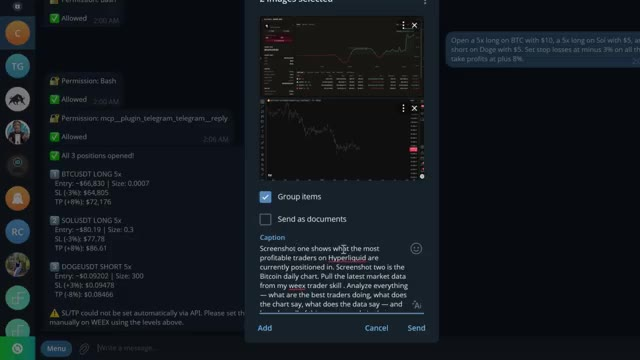
*⏱️ 00:00:14 — Interface de messagerie (Telegram) montrant des confirmations de positions ouvertes automatiquement et des captures de graphiques transmises à l'IA.*

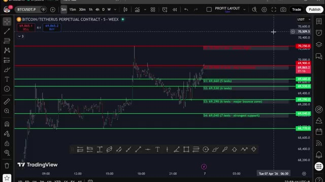
*⏱️ 00:00:22 — Graphique de trading en chandeliers japonais (TradingView / WEEX) sur le contrat perpétuel Bitcoin/Tether avec des niveaux de support et résistance tracés.*

---

### ⏱️ `[00:00:29 - 00:00:49]` | Segment #02

**🔊 Audio (Transcription Intégrale Mot pour Mot en Français) :**
> Les traders qui adoptent cela tôt vont avoir un réel avantage sur tout le monde. Ce n’est pas le futur. Cela se passe en ce moment même. Alors assurez-vous de rester jusqu'à la fin. Entrons dans le vif du sujet. Avant de passer aux démonstrations, je veux rapidement expliquer pourquoi c'est vraiment important. Parce que je pense que la plupart des gens sous-estiment gravement l'ampleur de ce changement.

**👁️ Analyse Visuelle d'Écran (gemini-3.5-flash-lite) :**
**Interface & Outils** : Terminal de script CLI (fenêtre bleue), TradingView, échange WEEX, et interface X (Twitter).

**Contenu textuel & Code** : Tableau d'analyse des baleines Hyperliquid (Smart Money vs. Rekt Money, tokens XMR, BTC, ETH, HYPE, LIT, SUI, plans de trade avec prix d'entrée, stop loss, take profit) et graphique TradingView BTCUSDT.P avec indicateur technique de type ATR/bandes.

**Action / Démonstration** : Analyse des données on-chain et des positions des baleines via un script personnalisé, et visualisation de graphiques de prix avec signaux de trading automatisés.

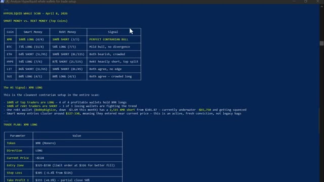
*⏱️ 00:00:39 — Interface de terminal (script CLI bleu) affichant une analyse des portefeuilles de baleines sur Hyperliquid (« Hyperliquid Whale Scan ») avec un tableau comparatif Smart Money vs. Rekt Money.*

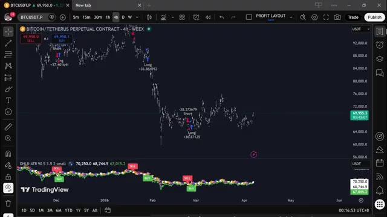
*⏱️ 00:00:44 — Graphique de trading TradingView en unité 4h pour la paire BTCUSDT.P sur l'échange WEEX, affichant des signaux d'achat/vente (Buy/Sell) et des indicateurs techniques en bas.*

---

### ⏱️ `[00:00:49 - 00:01:08]` | Segment #03

**🔊 Audio (Transcription Intégrale Mot pour Mot en Français) :**
> Le marché mondial du trading algorithmique pèse plus de 21 milliards de dollars. Et d'ici 2030, il devrait atteindre 43 milliards de dollars. C'est le monde dans lequel vous concourez chaque fois que vous ouvrez un trade manuellement. Pendant des décennies, l'avantage dans le trading a appartenu aux institutions, aux fonds spéculatifs, aux sociétés quantitatives.

**👁️ Analyse Visuelle d'Écran (gemini-3.5-flash-lite) :**
**Interface & Outils** : Navigateur web affichant un rapport de marché et un article spécialisé sur le trading algorithmique.

**Contenu textuel & Code** : Chiffres de valorisation du marché mondial (21,06 milliards USD en 2024, projection à 42,99 milliards USD d'ici 2030, TCAC de 12,9%) et statistiques de part de marché par classe d'actifs.

**Action / Démonstration** : Présentation visuelle des statistiques et des perspectives de croissance du marché du trading algorithmique pour illustrer l'ampleur du secteur.

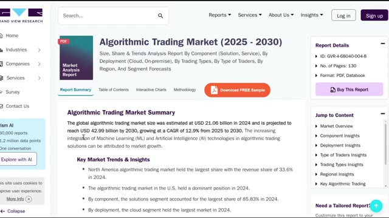
*⏱️ 00:00:54 — Capture d'écran du site web Grand View Research montrant le rapport sur le marché du trading algorithmique (2025-2030) avec les chiffres clés de valorisation.*

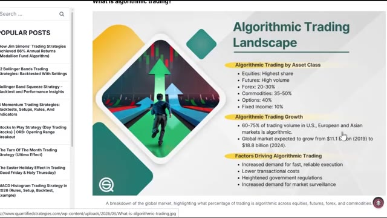
*⏱️ 00:01:03 — Infographie intitulée 'Algorithmic Trading Landscape' détaillant la répartition par classe d'actifs et la croissance du marché.*

---

### ⏱️ `[00:01:08 - 00:01:42]` | Segment #04

**🔊 Audio (Transcription Intégrale Mot pour Mot en Français) :**
> Et voici le chiffre qui remet les choses en perspective. Plus de 70 % de tout le volume des transactions sur les marchés actions américains est déjà algorithmique. Sur les plateformes de cryptomonnaies, ce chiffre est encore plus élevé. Certaines estimations le situent au-dessus de 80 %. pourcent. Vous, qui tradez manuellement, en vérifiant les graphiques, en passant des ordres à la main, vous avez été en concurrence contre cela pendant tout ce temps. Ce qui a changé, c'est que des modèles d'IA comme Claude sont devenus suffisamment puissants pour qu'une seule personne puisse désormais commencer à combler cet écart. Un rapport de JP Morgan de 2023 a révélé que

**👁️ Analyse Visuelle d'Écran (gemini-3.5-flash-lite) :**
**Interface & Outils** : TradingView

**Contenu textuel & Code** : Graphique de prix du Bitcoin (BTC/USDT Perp), indicateur MACD (12, 26, 9), histogramme de volume, outil de calcul de position (Open P&L, Risk/Reward Ratio: 7.4, Stop, Target).

**Action / Démonstration** : Visualisation d'un setup de trading sur le Bitcoin avec un outil de gestion du risque et des objectifs de profit/perte.

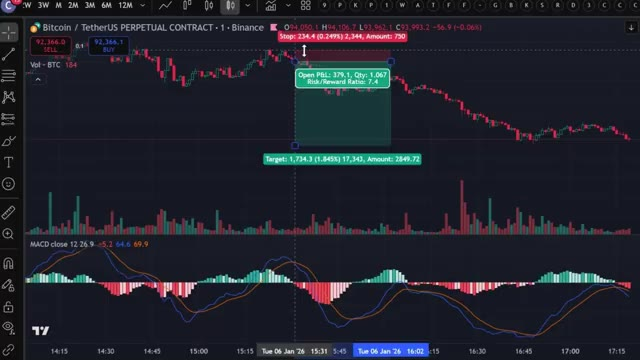
*⏱️ 00:01:25 — Graphique TradingView d'un contrat perpétuel Bitcoin/USDT en unité de temps 1 minute, affichant un outil de position longue avec un ratio risque/rendement de 7.4, le volume et l'indicateur MACD en sous-fenêtre.*

---

### ⏱️ `[00:01:42 - 00:02:04]` | Segment #05

**🔊 Audio (Transcription Intégrale Mot pour Mot en Français) :**
> Les outils de trading pilotés par l'IA réduisent les coûts d'exécution jusqu'à 30 % pour les morts institutionnels. Ces mêmes outils sont désormais accessibles aux investisseurs particuliers pour 20 dollars par mois. Vous pouvez désormais disposer d'un système qui surveille vos positions pendant que vous dormez. Qui exécute un trade en plusieurs étapes à partir d'une seule phrase. Qui analyse des milliers de portefeuilles et vous dit ce que fait l'argent intelligent en ce moment même.

**👁️ Analyse Visuelle d'Écran (gemini-3.5-flash-lite) :**
**Interface & Outils** : Application web de tarification et interface de messagerie (Telegram) avec bot de trading.

**Contenu textuel & Code** : Tarifs d'abonnement IA (20$/mois) et métriques de trading (taux de financement pour ACTUSDT, DOGEUSDT, APTUSDT).

**Action / Démonstration** : Sélection du plan Pro à 20 dollars par mois et analyse des opportunités de taux de financement via un bot Telegram.

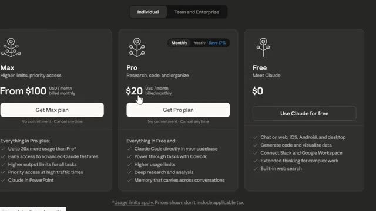
*⏱️ 00:01:53 — Page de tarification d'un service d'IA (Claude) affichant le plan Pro à 20 dollars par mois.*

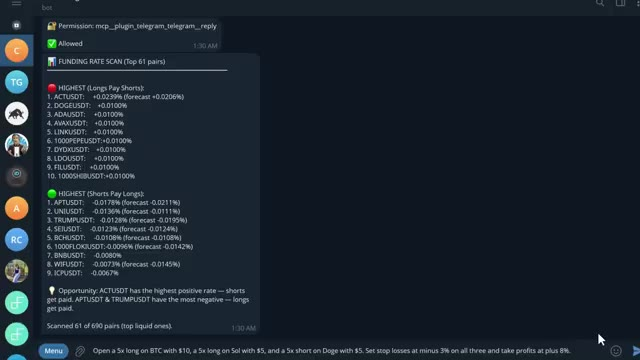
*⏱️ 00:01:59 — Interface de bot Telegram montrant un scan des taux de financement (Funding Rate Scan) pour différentes paires crypto.*

---

### ⏱️ `[00:02:05 - 00:02:25]` | Segment #06

**🔊 Audio (Transcription Intégrale Mot pour Mot en Français) :**
> Cela génère un rapport complet sur le risque du portefeuille en quelques secondes. Les grandes entreprises ont eu ce genre d'avantage pendant des années. Maintenant, vous pouvez l'avoir aussi. Et je veux être clair, je ne dis pas que vous allez immédiatement rivaliser avec des fonds de plusieurs milliards de dollars. Mais les outils pour penser et trader de manière plus systématique sont désormais accessibles à quiconque veut vraiment y consacrer du temps et apprendre les concepts.

**👁️ Analyse Visuelle d'Écran (gemini-3.5-flash-lite) :**
**Interface & Outils** : Claude Code (CLI) et Hyperdash (plateforme d'analyse de portefeuille et de données on-chain)

**Contenu textuel & Code** : Rapport de risque de portefeuille, analyse multi-timeframe (EMA, RSI, MACD), niveaux de support/résistance, et métriques de PnL par cohorte de portefeuilles.

**Action / Démonstration** : Génération d'un rapport complet sur le risque et analyse des portefeuilles et tendances de marché.

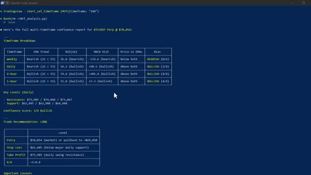
*⏱️ 00:02:15 — Terminal de commande Claude Code affichant un rapport multi-timeframe de confluence pour le Bitcoin (BTCUSDT) avec indicateurs techniques, niveaux clés et recommandation de trade.*

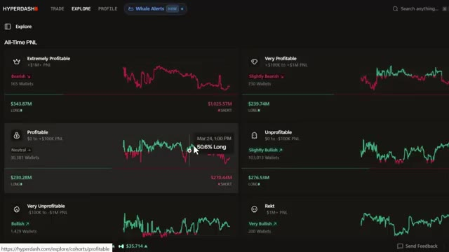
*⏱️ 00:02:20 — Interface de la plateforme Hyperdash montrant l'analyse du PnL global et des portefeuilles de différents profils d'investisseurs (traders rentables, non rentables, etc.).*

---

### ⏱️ `[00:02:26 - 00:02:48]` | Segment #07

**🔊 Audio (Transcription Intégrale Mot pour Mot en Français) :**
> Laissez-moi donc vous montrer exactement à quoi cela ressemble. La première chose que je veux vous montrer, et c'est celle qui m'a sincèrement scotché la première fois que je l'ai vue. Claude lit, l'historique des prix identifie les niveaux les plus importants, les trace directement sur votre graphique, et vous indique lesquels comptent le plus en ce moment même. Regardez le graphique. Lignes vertes pour le support, lignes rouges pour la résistance, étiquettes de prix.

**👁️ Analyse Visuelle d'Écran (gemini-3.5-flash-lite) :**
**Interface & Outils** : Terminal de commandes Claude Code (CLI).

**Contenu textuel & Code** : Texte d'information sur la mise à jour de Claude Code et l'invite de commande active.

**Action / Démonstration** : Initialisation ou affichage du terminal Claude Code avant de lancer une démonstration technique.

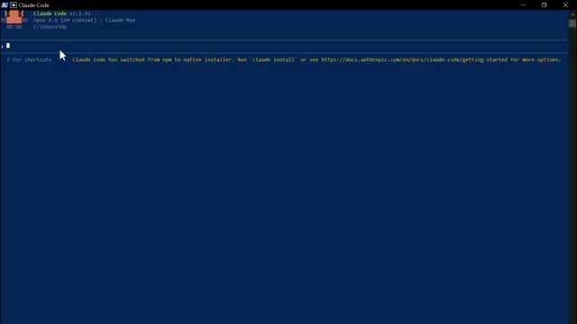
*⏱️ 00:02:31 — Capture d'écran montrant l'interface de terminal de Claude Code.*

---

### ⏱️ `[00:02:49 - 00:03:09]` | Segment #08

**🔊 Audio (Transcription Intégrale Mot pour Mot en Français) :**
> Nombre de fois où chaque niveau a été testé, tous tracés automatiquement. Et ensuite, cela vous indique exactement où se situe le prix en ce moment par rapport à ces niveaux et vous donne un biais directionnel basé sur l'historique de la façon dont le prix a réagi à chacun d'eux. Cela me prenait 20 minutes à tracer manuellement sur chaque graphique. Claude le fait en quelques secondes.

**👁️ Analyse Visuelle d'Écran (gemini-3.5-flash-lite) :**
**Interface & Outils** : TradingView, interface de courtier WEEX et terminal de commande/analyse personnalisé.

**Contenu textuel & Code** : Niveaux de prix clés (résistances à 70 250 et 69 900 ; supports S1 à S5 étagés de 69 660 à 68 770), nombre de tests, volume et analyse du biais directionnel.

**Action / Démonstration** : Analyse technique des niveaux de support et résistance et affichage des statistiques de réaction du prix.

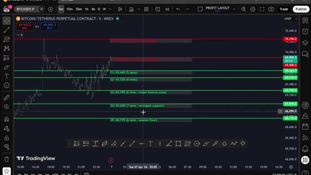
*⏱️ 00:02:54 — Graphique TradingView (WEEX) du Bitcoin sur une unité de temps de 5 minutes, affichant des niveaux de résistance en rouge et des supports en vert avec le nombre de tests.*

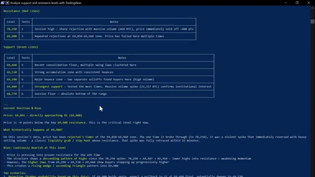
*⏱️ 00:02:59 — Interface de terminal sombre affichant un tableau analytique détaillé des résistances et supports, ainsi qu'une section de position actuelle et de biais de marché.*

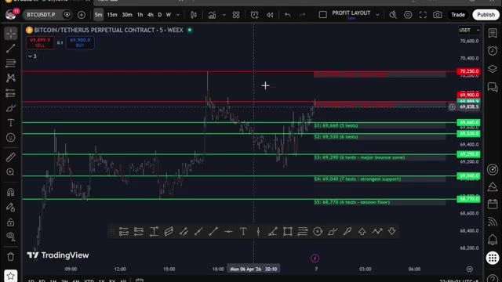
*⏱️ 00:03:04 — Retour sur le graphique TradingView montrant l'évolution du cours du Bitcoin testant la zone de résistance supérieure.*

---

### ⏱️ `[00:03:09 - 00:03:39]` | Segment #09

**🔊 Audio (Transcription Intégrale Mot pour Mot en Français) :**
> Et ce n’est que le point de départ. Vous pouvez également demander à Claude d'écrire des stratégies Pinescript complètes à partir d'un anglais simple, de déboguer vos indicateurs existants, d'exécuter une analyse complète de confluence multi-temporelle sur le graphique hebdomadaire, journalier, en quatre heures et en une heure simultanément, et d'obtenir une recommandation de trade spécifique avec un point d'entrée, un stop loss et un take profit, le tout à partir d'une seule consigne. Mais voici où cela devient entièrement mains libres. Vous pouvez connecter n'importe laquelle de ces stratégies directement à votre exchange via un webhook TradingView.

**👁️ Analyse Visuelle d'Écran (gemini-3.5-flash-lite) :**
**Interface & Outils** : TradingView et terminal de ligne de commande (Claude Code session / Bash).

**Contenu textuel & Code** : Code Pine Script de stratégie de trading et tableau de rapport d'analyse technique multi-temporelle (Weekly, Daily, 4-Hour, 1-Hour) avec EMA, RSI, MACD et recommandations de trade (Long/Short, Stop Loss, Take Profit).

**Action / Démonstration** : Présentation du code Pine Script d'une stratégie et démonstration d'une analyse technique automatisée multi-temporelle via un terminal de commande.

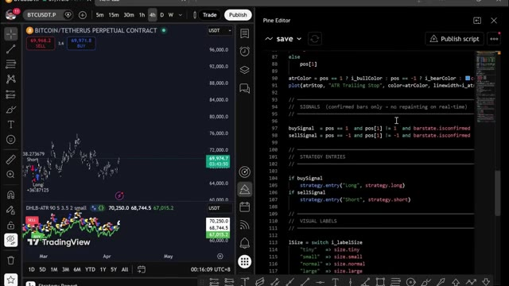
*⏱️ 00:03:17 — Interface TradingView montrant un graphique du Bitcoin sur l'écran de gauche et l'éditeur de code Pine Editor sur l'écran de droite.*

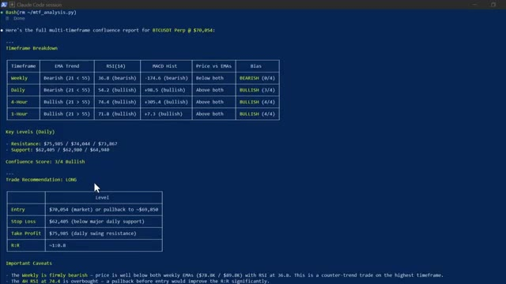
*⏱️ 00:03:24 — Terminal de commande (Claude Code session) affichant un rapport complet d'analyse de confluence multi-temporelle pour BTCUSDT Perp.*

---

### ⏱️ `[00:03:39 - 00:04:00]` | Segment #10

**🔊 Audio (Transcription Intégrale Mot pour Mot en Français) :**
> Quand votre stratégie émet un signal sur TradingView, Claude le reçoit instantanément par le webhook et exécute le trade automatiquement sur votre exchange. Entrée, stop-loss, take-profit, tout est fait. Sans que vous ne touchiez à rien, le signal est arrivé. Claude l'a traité, le trade est ouvert, confirmé en retour avec tous les détails. Vous construisez la stratégie une seule fois, et à partir de ce moment-là, elle tourne toute seule.

**👁️ Analyse Visuelle d'Écran (gemini-3.5-flash-lite) :**
**Interface & Outils** : TradingView, Terminal de commandes CLI (Claude Code)

**Contenu textuel & Code** : Graphique Bitcoin (BTCUSDT), indicateurs techniques, tableau récapitulatif d'une position LONG ETH (Side: LONG, Size: 0.024 ETH, Entry Price: $2,052.00, Leverage: 5x, Take Profit: $2,216.16, Stop Loss: $1,990.44)

**Action / Démonstration** : Affichage d'un graphique boursier et exécution automatisée d'un trade avec configuration des ordres de gestion des risques.

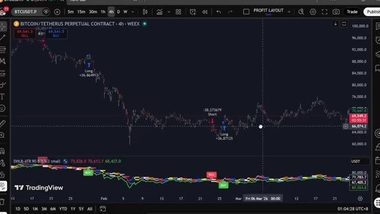
*⏱️ 00:03:50 — Graphique TradingView affichant le cours de Bitcoin avec des indicateurs techniques et des signaux d'achat/vente.*

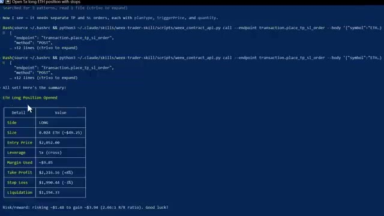
*⏱️ 00:03:55 — Terminal de commandes affichant les détails d'une position ouverte sur ETH (prix d'entrée, take-profit, stop-loss).*

---

### ⏱️ `[00:04:00 - 00:04:35]` | Segment #11

**🔊 Audio (Transcription Intégrale Mot pour Mot en Français) :**
> Maintenant, celui-ci, c'est celui qui a complètement changé ma routine quotidienne. J'ai construit mon propre assistant de trading IA en utilisant Claude et Telegram, et il trouve des transactions rentables pour moi en utilisant l'IA la plus puissante disponible en ce moment, plus intelligente que n'importe quel humain ne pourrait l'être. Il exécute des transactions, gère mes positions, m'envoie des alertes en temps réel et génère des rapports de portefeuille complets, le tout à partir d'un simple message sur mon téléphone. Ce matin, j'ai placé une transaction depuis mon lit, j'ai pris mes bénéfices depuis la salle de sport, sans toucher à un seul graphique. C'est Claude qui tourne sur mon ordinateur. Ça a l'air simple, juste une interface textuelle, mais regardez.

**👁️ Analyse Visuelle d'Écran (gemini-3.5-flash-lite) :**
**Interface & Outils** : Application de messagerie Telegram (interface desktop/web)

**Contenu textuel & Code** : Instructions d'appairage du bot Telegram avec Claude Code, commandes disponibles (`/start`, `/status`) et messages de confirmation indiquant que le bot est prêt ("Paired! Say hi to Claude.").

**Action / Démonstration** : Présentation de la configuration initiale de l'assistant de trading IA reliant Telegram à une session de code Claude.

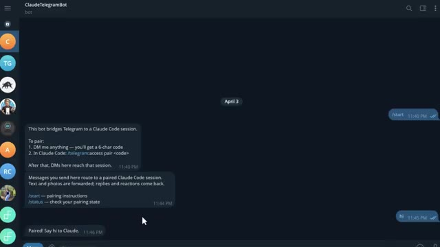
*⏱️ 00:04:09 — Capture d'écran montrant l'interface d'une application de messagerie (Telegram) avec un bot nommé ClaudeTelegramBot, affichant les instructions de configuration pour l'associer à une session Claude Code.*

---

### ⏱️ `[00:04:35 - 00:04:55]` | Segment #12

**🔊 Audio (Transcription Intégrale Mot pour Mot en Français) :**
> ce qu'elle peut faire. Vous pouvez essentiellement ouvrir une position de trading avec une seule phrase. Ouvrez un long cinq fois sur l'ETH avec 10 dollars. Définissez le stop loss à moins 3 % et le take profit à plus 8 %. Regardez-la réfléchir, et voilà. Position ouverte. Stop loss défini. Take profit défini. Confirmation de chaque détail en retour. Une phrase.

**👁️ Analyse Visuelle d'Écran (gemini-3.5-flash-lite) :**
**Interface & Outils** : Terminal de commandes Claude Code et interface d'échange crypto WEEX.

**Contenu textuel & Code** : Commandes textuelles de trading pour l'ETH, graphiques de prix en chandeliers, carnet d'ordres et statuts des ordres ouverts.

**Action / Démonstration** : Saisie d'une commande d'ouverture de position avec effet de levier et affichage des ordres de stop loss/take profit sur la plateforme WEEX.

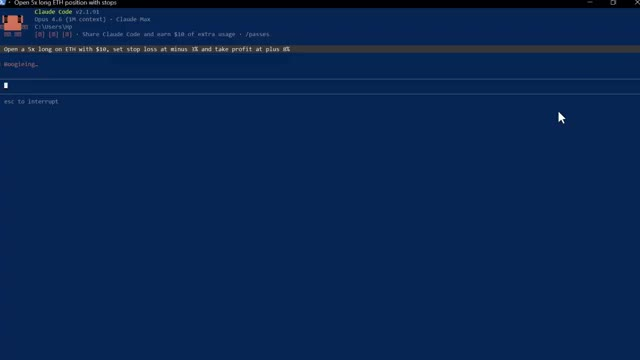
*⏱️ 00:04:40 — Interface du terminal Claude Code affichant la commande textuelle pour ouvrir une position long sur l'ETH.*

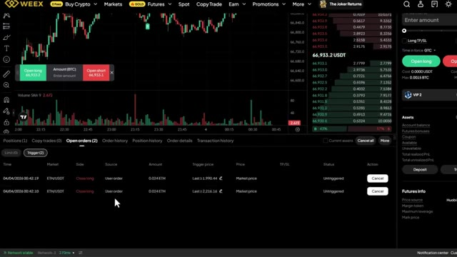
*⏱️ 00:04:50 — Interface de la plateforme de trading WEEX affichant un graphique de prix, un carnet d'ordres et les ordres en cours sur ETH/USDT.*

---

### ⏱️ `[00:04:56 - 00:05:25]` | Segment #13

**🔊 Audio (Transcription Intégrale Mot pour Mot en Français) :**
> C'est fait. Maintenant, laissez-moi vous montrer quelque chose qui m'a vraiment époustouflé la première fois que j'ai exécuté ceci. Donnez-moi un tableau de bord complet de portefeuille. Toutes mes positions, profits et pertes, frais de financement, courbe de capital, sous forme de rapport visuel. Regardez-le fonctionner. Il extrait chaque donnée de mon compte en ce moment même. Et voici ce qu'il génère. Un tableau de bord complet en mode sombre, une courbe de capital, un taux de réussite, un revenu de financement ventilé par crypto-monnaie, chaque position ouverte avec la distance de liquidation mise en surbrillance.

**👁️ Analyse Visuelle d'Écran (gemini-3.5-flash-lite) :**
**Interface & Outils** : Terminal de commandes CLI / Script Python (Claude Code) et interface graphique de tableau de bord de trading WEEX Portfolio Dashboard.

**Contenu textuel & Code** : Détails de la position ETH (Side: LONG, Size: 0.024 ETH, Entry Price: $2052.00, Leverage: 5x, Take Profit: $2216.16, Stop Loss: $1990.44) et métriques de portefeuille (Total Equity: $20.61, Unrealized PnL: -$0.021, Win Rate: 25%, Daily PnL, Equity Curve).

**Action / Démonstration** : Saisie d'une invite textuelle dans le terminal pour générer un tableau de bord complet du portefeuille et affichage consécutif du rapport visuel généré.

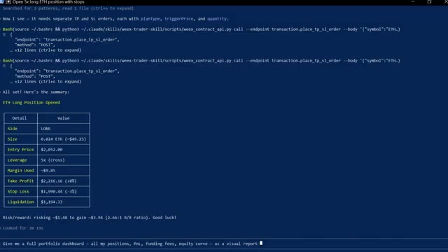
*⏱️ 00:05:03 — Interface de terminal de commande montrant la confirmation d'ouverture d'une position longue sur ETH avec un tableau récapitulatif (prix d'entrée, effet de levier, stop loss, take profit) et un prompt en bas demandant un rapport visuel du portefeuille.*

*⏱️ 00:05:18 — Tableau de bord visuel WEEX Portfolio Dashboard affichant la vue d'ensemble du portefeuille avec les métriques clés (capital total, PnL non réalisé, PnL réalisé du jour, taux de réussite), un graphique des PnL journaliers et une courbe de capital (equity curve).*

---

### ⏱️ `[00:05:26 - 00:06:01]` | Segment #14

**🔊 Audio (Transcription Intégrale Mot pour Mot en Français) :**
> C'est le genre de rapport qu'un bureau de trading professionnel produirait. Je l'ai obtenu en quelques secondes à partir d'une seule consigne et d'ailleurs, si vous trouvez cela utile jusqu'à présent, restez jusqu'à la fin parce que je vais vous montrer comment configurer tout cela vous-même, continuez à regarder. Très bien, laissez-moi vous montrer plus, vous pouvez aussi connecter ceci à votre Telegram pour envoyer des commandes directement depuis votre téléphone, vous pouvez taper scanner toutes les paires futures et trouver les taux de financement les plus élevés en ce moment, il a scanné chaque paire, les a classées par taux de financement, a calculé le rendement annualisé et m'a dit exactement dans quelle direction me positionner pour percevoir ce financement.

**👁️ Analyse Visuelle d'Écran (gemini-3.5-flash-lite) :**
**Interface & Outils** : Navigateur web (guide de configuration) et application Telegram (bot de trading).

**Contenu textuel & Code** : Étapes de configuration (création de compte, installation de Claude Code, clés API, Telegram) et messages de configuration du bot Telegram.

**Action / Démonstration** : Présentation du guide étape par étape pour configurer soi-même l'outil de trading automatisé et démonstration du bot Telegram connecté à Claude Code.

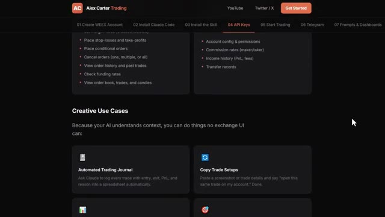
*⏱️ 00:05:34 — Interface web du guide de configuration d'Alex Carter Trading montrant les étapes d'installation et les cas d'utilisation créatifs.*

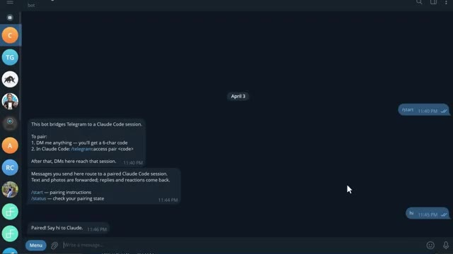
*⏱️ 00:05:43 — Interface de messagerie Telegram montrant un bot de pontage avec une session Claude Code et les instructions de jumelage.*

---

### ⏱️ `[00:06:01 - 00:06:37]` | Segment #15

**🔊 Audio (Transcription Intégrale Mot pour Mot en Français) :**
> instantanément. Maintenant, si vous ne savez pas ce que sont les taux de financement, il s'agit essentiellement d'argent gratuit que l'échange verse toutes les huit heures aux traders qui sont positionnés du bon côté du marché. Lorsque le financement est positif, les positions acheteuses paient les positions vendeuses. Lorsque le financement est négatif, les positions vendeuses paient les positions acheteuses. Et certains de ces taux sont extrêmement élevés. Ce que fait ce scanner, c'est trouver les paires où ce taux est le plus élevé, calculer ce que cela donne sur une base annuelle, parfois 50 %, 100 %, voire plus, et vous dire exactement dans quelle direction ouvrir une position pour vous asseoir et percevoir ce paiement.

**👁️ Analyse Visuelle d'Écran (gemini-3.5-flash-lite) :**
**Interface & Outils** : WEEX (échange crypto) et interface de bot Telegram.

**Contenu textuel & Code** : Graphique de prix BTC/USDT, carnet d'ordres, panneau de passage d'ordres et liste de taux de financement positifs et négatifs pour différentes cryptomonnaies (ACTUSDT, DOGEUSDT, APTUSDT, etc.).

**Action / Démonstration** : Présentation de l'interface de trading et illustration des taux de financement via un bot de scan des marchés.

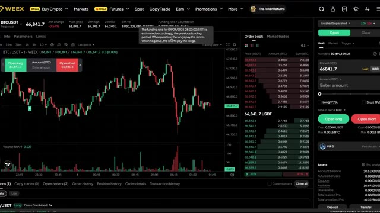
*⏱️ 00:06:10 — Interface de la plateforme d'échange WEEX affichant le graphique du cours de la paire BTC/USDT avec une info-bulle explicative sur le taux de financement et les carnets d'ordres.*

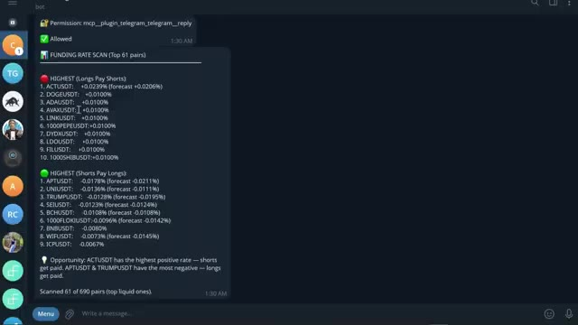
*⏱️ 00:06:19 — Interface d'une application de messagerie ou de bot (Telegram) affichant un scan des taux de financement (« FUNDING RATE SCAN ») pour le top des paires crypto.*

---

### ⏱️ `[00:06:37 - 00:07:15]` | Segment #16

**🔊 Audio (Transcription Intégrale Mot pour Mot en Français) :**
> toutes les huit heures. Vous n'essayez même pas de prédire la direction des prix. Vous faites simplement de l'agriculture de taux. Et maintenant, au lieu de vérifier manuellement chaque paire vous-même, ce que personne ne fait, Claude le fait en quelques secondes et vous sert l'opportunité sur un plateau. Maintenant, cette prochaine section, c'est là que ça devient vraiment intéressant. Et honnêtement, c'est l'une de mes choses préférées que j'ai construites avec Claude. Et si vous pouviez analyser 33 000 portefeuilles sur Hyperliquid ? Trouver les 20 traders les plus rentables. Voir exactement ce qu'ils achètent en ce moment. Leurs prix d'entrée, leur effet de levier, leur P&L non réalisé, et obtenir un plan de trading complet basé sur tout cela. Aucune clé API nécessaire,

**👁️ Analyse Visuelle d'Écran (gemini-3.5-flash-lite) :**
**Interface & Outils** : WEEX et Hyperliquid

**Contenu textuel & Code** : Graphique de prix, carnet d'ordres, liste de paires de trading USDT-M, et tableau des transactions de la blockchain (adresse 0x393d...2109).

**Action / Démonstration** : Navigation et sélection de paires de trading sur l'échange de crypto-monnaies, puis consultation des transactions sur l'explorateur Hyperliquid.

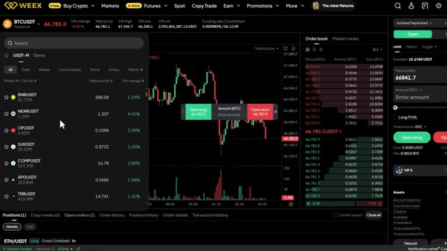
*⏱️ 00:06:46 — Interface de trading WEEX affichant le graphique du BTCUSDT avec un panneau latéral de sélection des paires de crypto-monnaies.*

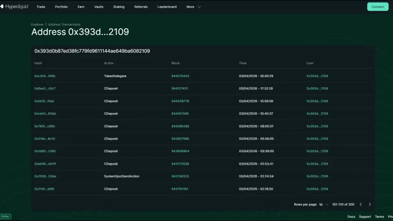
*⏱️ 00:06:56 — Interface de la plateforme Hyperliquid montrant l'historique des transactions d'une adresse de portefeuille spécifique avec les détails des blocs et des actions.*

---

### ⏱️ `[00:07:15 - 00:07:34]` | Segment #17

**🔊 Audio (Transcription Intégrale Mot pour Mot en Français) :**
> Pas de code, pas de recherche manuelle. Maintenant, Hyperliquid. Très rapidement. C'est un échange décentralisé de contrats perpétuels fonctionnant sur sa propre blockchain. Pas de KYC, pas d'intermédiaire. Et comme c'est entièrement sur la chaîne, chaque transaction, chaque position, chaque portefeuille, tout est public. C'est ce qui rend cela possible.

**👁️ Analyse Visuelle d'Écran (gemini-3.5-flash-lite) :**
**Interface & Outils** : Documentation technique Hyperliquid (GitBook) et interface web de l'échange décentralisé Hyperliquid.

**Contenu textuel & Code** : Texte descriptif de la documentation technique de Hyperliquid (aperçu technique, consensus HyperBFT, HyperCore et HyperEVM) et options de connexion par portefeuille Web3.

**Action / Démonstration** : Présentation de la documentation officielle puis démonstration des options de connexion à la plateforme décentralisée sans KYC.

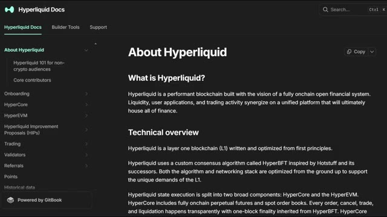
*⏱️ 00:07:20 — Capture d'écran de la documentation officielle de Hyperliquid (GitBook) expliquant le fonctionnement de la blockchain Layer 1 et l'écosystème financier décentralisé.*

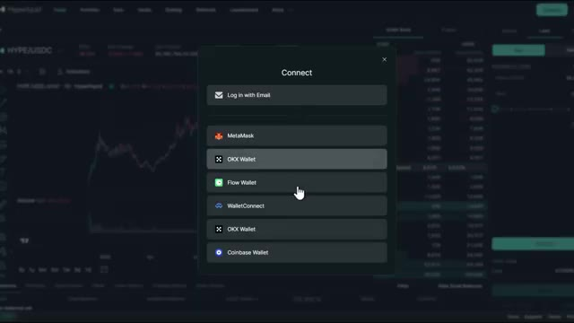
*⏱️ 00:07:24 — Capture d'écran de l'interface de trading de Hyperliquid avec une fenêtre contextuelle de connexion affichant différentes options de portefeuilles (MetaMask, OKX Wallet, WalletConnect, Coinbase Wallet).*

---

### ⏱️ `[00:07:34 - 00:08:08]` | Segment #18

**🔊 Audio (Transcription Intégrale Mot pour Mot en Français) :**
> Très bien, laissez-moi ouvrir Claude Code et vous montrer ça en direct. Voici la première chose que je veux vous montrer. Claude analyse les 20 portefeuilles les plus rentables sur Hyperliquid en ce moment, récupère chaque position ouverte et les classe par rentabilité totale. Tout en un seul coup. Regardez ce qui se passe. Claude se connecte aux points de terminaison publics d'Hyperliquid, commence à récupérer les données des portefeuilles sur 33 000 adresses, les classe par rentabilité et commence à rédiger le rapport. Vous pouvez le voir traiter les portefeuilles en temps réel. Les prix d'entrée, l'effet de levier, les profits et pertes non réalisés, tout arrive en direct. Et voici

**👁️ Analyse Visuelle d'Écran (gemini-3.5-flash-lite) :**
**Interface & Outils** : Terminal de commandes / Script CLI

**Contenu textuel & Code** : Tableaux de données de trading montrant des actifs (SOL, ENA, LINK, FARTCOIN, WLD, AAVE, HYPE, MON, DOGE, PUMP), types de positions (SHORT), tailles, leviers, PnL, ainsi que des statistiques de portefeuilles (All-Time PnL, Monthly PnL, Account Value, Key Positions).

**Action / Démonstration** : Affichage et analyse en direct des positions des portefeuilles de baleines sur le terminal.

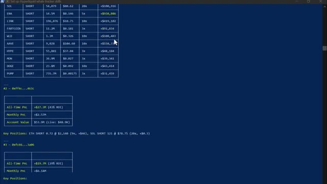
*⏱️ 00:07:43 — Capture d'écran montrant un terminal affichant les données des portefeuilles les plus rentables sur Hyperliquid avec leurs positions.*

---

### ⏱️ `[00:08:08 - 00:08:43]` | Segment #19

**🔊 Audio (Transcription Intégrale Mot pour Mot en Français) :**
> la sortie. Le classement des 20 plus gros investisseurs, chaque position ouverte listée. Et en bas, le résumé du sentiment global : en ce moment, l'argent intelligent est net acheteur sur le bitcoin et net vendeur sur presque tout le reste, surtout sur l'ethereum. C'est le genre de signal qui prenait des heures à reconstituer manuellement. Claude le fait en moins d'une minute. Maintenant, c'est là que ça devient vraiment intéressant. Ce prompt compare les 20 portefeuilles les plus rentables aux 20 portefeuilles les plus perdants et trouve chaque jeton sur lequel ils se trouvent de part et d'autre du trade. Regardez-le extraire les deux groupes simultanément.

**👁️ Analyse Visuelle d'Écran (gemini-3.5-flash-lite) :**
**Interface & Outils** : Terminal de commandes / console CLI sur fond bleu.

**Contenu textuel & Code** : Listes des positions ouvertes (APT, TRX, IP, LDO, etc.), sections "Strong Bearish Consensus", "Strong Bullish Consensus" et "Overall Net Direction" résumant que l'argent intelligent est long BTC et short le reste.

**Action / Démonstration** : Présentation des données agrégées du classement Hyperliquid pour illustrer l'orientation des plus gros investisseurs.

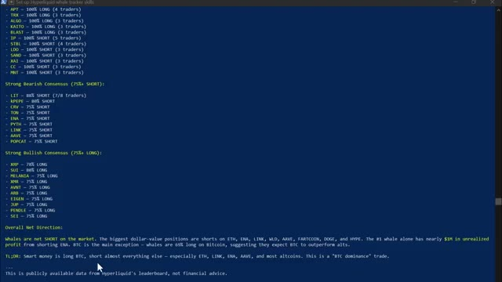
*⏱️ 00:08:17 — Capture d'écran montrant un terminal affichant le classement des positions des baleines sur Hyperliquid avec le détail du consensus haussier/baissier et le résumé global du sentiment du marché.*

---

### ⏱️ `[00:08:43 - 00:09:19]` | Segment #20

**🔊 Audio (Transcription Intégrale Mot pour Mot en Français) :**
> des portefeuilles rentables d'un côté, des portefeuilles perdants de l'autre, et ensuite il commence à croiser les positions. Voici le résultat. Vous pouvez voir là où les deux groupes sont d'accord. Ils sont tous les deux acheteurs sur suey, c'est donc un trade encombré. Mais regardez ça. L'argent intelligent est massivement acheteur sur XMR, TRX, Pendle et Farcoin, tandis que les traders de détail sont vendeurs sur ces cryptos. Cette divergence, juste là, c'est le signal. C'est le genre d'analyse pour laquelle les hedge funds paient. Vous l'obtenez grâce à un outil d'IA à 20 dollars et à une API publique gratuite. Et si vous voulez la configuration complète pour Hyperliquid, le code de compétence, chaque prompt,

**👁️ Analyse Visuelle d'Écran (gemini-3.5-flash-lite) :**
**Interface & Outils** : Terminal de commandes affichant un script de rapport sur les baleines Hyperliquid.

**Contenu textuel & Code** : Métriques de performance (All-Time PnL : +$204.4M, Monthly PnL : +$5.2M, Account Value : $71.8M) et tableau des positions clés (BTC, ETH, SOL, ENA, LINK, FARTCOIN, WLD, AAVE, HYPE, MON, DOGE, PUMP avec directions LONG/SHORT, taille, prix d'entrée, effet de levier et uPnL).

**Action / Démonstration** : Affichage des données on-chain du trader le plus performant pour analyser ses positions ouvertes et son exposition au marché.

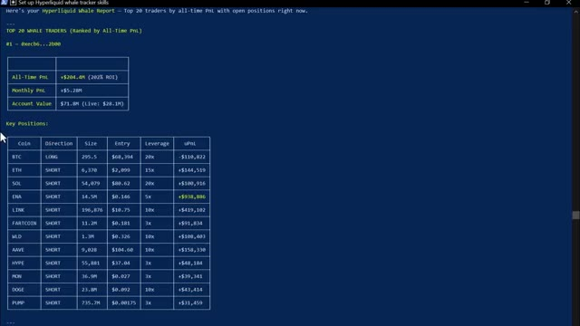
*⏱️ 00:08:52 — Un rapport de suivi de baleines Hyperliquid affichant les performances et les positions ouvertes du meilleur trader (#1 - 0xecb6...2b00) avec son PnL global, sa valeur de compte et un tableau détaillé de ses positions par crypto-monnaie.*

---

### ⏱️ `[00:09:19 - 00:09:54]` | Segment #21

**🔊 Audio (Transcription Intégrale Mot pour Mot en Français) :**
> le système complet de suivi des baleines, je vais vous dire exactement comment obtenir tout cela dans un instant. Continuez à regarder. Maintenant, si vous êtes prêts à aller encore plus loin, vous pouvez utiliser Claude Code pour créer un bot de trading entièrement automatisé de bout en bout pour la cryptographie, les actions, ou n'importe quel marché que vous tradez. Et honnêtement, c'est ainsi que Claude va changer notre façon de trader pour toujours. Et nous l'avons déjà fait auparavant. Laissez-moi vous montrer à quoi ressemble réellement le résultat final. C'est le tableau de bord, une seule URL, chaque position, votre courbe de capital, l'état de votre bot, vos données de baleines, le tout en direct, le tout en un

**👁️ Analyse Visuelle d'Écran (gemini-3.5-flash-lite) :**
**Interface & Outils** : Claude Code, Interactive Brokers, Plateforme de cours en ligne "Trading AI Full Course".

**Contenu textuel & Code** : Lignes de commande Claude Code, présentation des fonctionnalités de trading Interactive Brokers TWS, modules de cours incluant l'installation de Claude + OpenRouter, WEEX, Alpaca, et Interactive Brokers.

**Action / Démonstration** : Navigation et présentation des outils de développement de bots de trading automatisés et des modules de formation.

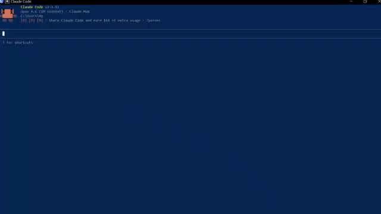
*⏱️ 00:09:28 — Capture d'écran montrant l'interface de terminal de commande de Claude Code v2.1.91.*

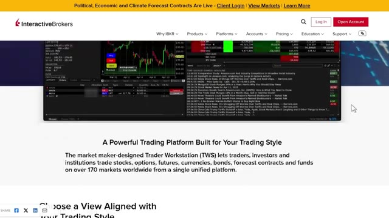
*⏱️ 00:09:37 — Capture d'écran du site Web d'Interactive Brokers présentant la plateforme Trader Workstation (TWS).*

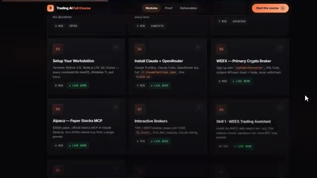
*⏱️ 00:09:45 — Capture d'écran d'un tableau de bord de cours en ligne montrant différents modules de formation au trading assisté par IA.*

---

### ⏱️ `[00:09:54 - 00:10:24]` | Segment #22

**🔊 Audio (Transcription Intégrale Mot pour Mot en Français) :**
> place. Plus besoin de multiples onglets de navigateur. Plus besoin d'hésiter sur les entrées. Et chaque matin, avant même d'ouvrir votre ordinateur portable, ce briefing alpha quotidien est déjà dans votre boîte de réception, tous les jours à l'heure et prêt à être lu. Il a déjà analysé les baleines, lu les graphiques, vérifié votre compte et vous a remis la configuration de conviction la plus élevée de la journée, dimensionnée selon votre risque exact. Une seule invite. Tout la pile. Et le bot lui-même ne se trouve pas sur votre ordinateur portable. Il tourne 24h/24 et 7j/7 sur un serveur cloud.

**👁️ Analyse Visuelle d'Écran (gemini-3.5-flash-lite) :**
**Interface & Outils** : Terminal de commandes (interface CLI / script d'automatisation)

**Contenu textuel & Code** : Commandes MCP TradingView, tableau Core Assets (BTC à 69 894 $, ETH à 2 163 $, SOL à 82,13 $ avec prix, variation sur 24h, distance par rapport à la EMA 200, RSI 14 et biais), ainsi qu'un tableau des zones de réaction EMA en 4H.

**Action / Démonstration** : Génération et affichage automatisé du briefing matinal du marché via un script interagissant avec l'API TradingView.

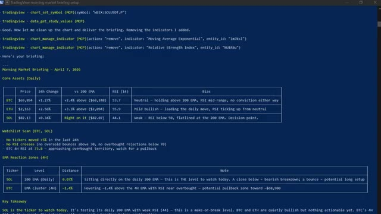
*⏱️ 00:10:01 — Un terminal de commandes affichant le briefing du marché du 7 avril 2026 généré par un assistant (commandes MCP TradingView et tableaux récapitulatifs pour BTC, ETH, SOL).*

---

### ⏱️ `[00:10:24 - 00:10:58]` | Segment #23

**🔊 Audio (Transcription Intégrale Mot pour Mot en Français) :**
> Si ça plante, ça redémarre tout seul. Si votre Wi-Fi se coupe, ça continue. Votre ordinateur portable n'est que la télécommande. Maintenant, la barrière mathématique pour construire tout cela a pour ainsi dire disparu. Avant des modèles performants comme Claude Code, cela aurait pris des semaines, voire des mois, à assembler. Maintenant, vous pouvez passer d'une idée à un système fonctionnel en un après-midi, et c'est important parce que la plupart des stratégies ne fonctionnent pas. L'avantage concurrentiel ne consiste pas à avoir une seule stratégie parfaite. Il réside dans la capacité à tester suffisamment d'idées assez rapidement pour trouver celles qui fonctionnent vraiment. Très bien, et regardez, pour les prochaines

**👁️ Analyse Visuelle d'Écran (gemini-3.5-flash-lite) :**
**Interface & Outils** : Éditeur de texte / Bloc-notes affichant du code Pine Script.

**Contenu textuel & Code** : Code source en Pine Script comprenant des fonctions de gestion de signaux visuels ('plotshape', 'label.new') et des conditions logiques pour les ordres long/short.

**Action / Démonstration** : Sélection et affichage de lignes de code source pour illustrer le développement d'indicateurs et de stratégies automatisées.

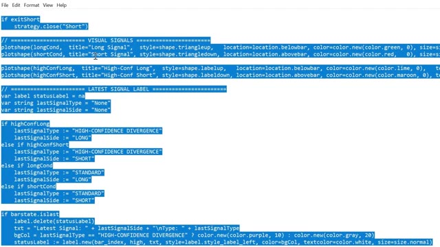
*⏱️ 00:10:50 — Éditeur de texte affichant du code source (Pine Script) avec des blocs de code surlignés liés aux signaux de trading et aux étiquettes.*

---

### ⏱️ `[00:10:58 - 00:11:35]` | Segment #24

**🔊 Audio (Transcription Intégrale Mot pour Mot en Français) :**
> années deux types de traders existeront ceux qui utilisent l'intelligence artificielle et ceux qui font encore tout manuellement même marché des résultats très différents voici comment vous mettre du bon côté de cela j'ai regroupé tout à l'intérieur de la communauté AI trade edge chaque prompt chaque robot chaque modèle chaque guide étape par étape que j'utilise personnellement tout en un seul endroit et tout ce que je construirai à l'avenir sera ajouté directement dans le groupe dès sa sortie il y aussi un cours complet de trading agentique de 2,5 heures du débutant à l'expert sans aucune base en programmation nécessaire d'ici la fin

**👁️ Analyse Visuelle d'Écran (gemini-3.5-flash-lite) :**
**Interface & Outils** : TradingView et interface web de la communauté Alex Carter Trading.

**Contenu textuel & Code** : Graphique de prix BTCUSDT.P en timeframe 5m, et liste des 78 fonctionnalités de contrôle de TradingView par l'IA (lecture de graphiques, données OHLCV, indicateurs techniques, etc.).

**Action / Démonstration** : Visualisation d'un graphique de cryptomonnaie et présentation des fonctionnalités de la plateforme d'aide au trading par IA.

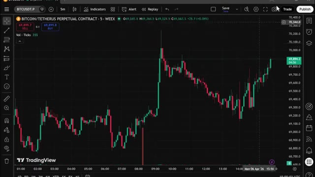
*⏱️ 00:11:08 — Un graphique en chandeliers japonais de TradingView sur une période de 5 minutes pour la paire Bitcoin/Tether (BTCUSDT.P), montrant une forte hausse suivie d'une correction.*

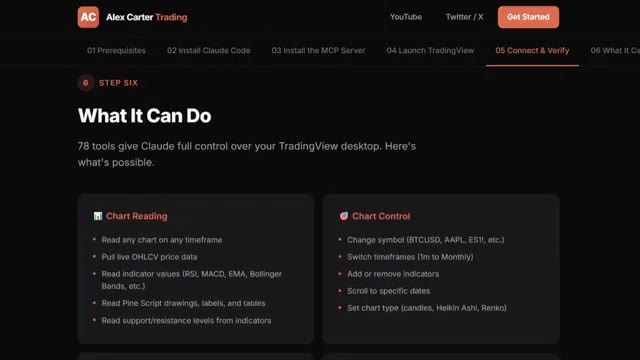
*⏱️ 00:11:17 — Une page web de la communauté "Alex Carter Trading" détaillant les fonctionnalités de l'outil (notamment "Chart Reading" et "Chart Control" avec l'intégration de Claude).*

---

### ⏱️ `[00:11:35 - 00:12:10]` | Segment #25

**🔊 Audio (Transcription Intégrale Mot pour Mot en Français) :**
> et vous aurez votre propre système de trading par IA en fonctionnement réel, quelque chose que la plupart des traders particuliers ne savent même pas être possible en ce moment, 79,99 $ par mois, un seul bon trade le rentabilise et les 100 premiers membres bloquent ce tarif définitivement, après quoi le prix augmente, le lien est dans la description, vous ne pouvez vraiment pas vous permettre de manquer ça. Et c'est tout. C'est ainsi que Claude change le trading pour toujours et comment vous pouvez en faire partie. Si vous voulez approfondir chacun de ces sujets individuellement, le graphique TradingView complet, la présentation pas à pas de Telegram et le suivi des baleines sur Hyperliquid, ces vidéos sont

**👁️ Analyse Visuelle d'Écran (gemini-3.5-flash-lite) :**
**Interface & Outils** : Navigateur web affichant la plateforme de vente Whop.

**Contenu textuel & Code** : Offre d'abonnement "AI Trade Edge" au prix de 79,99 $ par mois (réduit de 99,99 $).

**Action / Démonstration** : Présentation de l'offre commerciale et du tarif d'abonnement pour accéder au système de trading par IA.

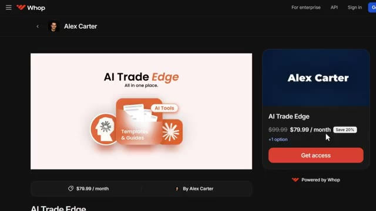
*⏱️ 00:11:44 — Page de vente de la plateforme Whop montrant l'offre "AI Trade Edge" d'Alex Carter à 79,99 $ par mois.*

---

### ⏱️ `[00:12:10 - 00:12:32]` | Segment #26

**🔊 Audio (Transcription Intégrale Mot pour Mot en Français) :**
> qui s'affichent à l'écran en ce moment même. Allez les consulter à votre rythme. Et si vous voulez le guide étape par étape complet sur la façon de construire votre propre système de trading agentique en utilisant Claude, cette vidéo s'affiche à l'écran également. Allez la voir ensuite. Si vous avez trouvé cela utile, laissez un pouce bleu. Cela aide vraiment la chaîne. Abonnez-vous si ce n'est pas déjà fait, et je vous vois dans la prochaine.

**👁️ Analyse Visuelle d'Écran (gemini-3.5-flash-lite) :**
**Interface & Outils** : Aucune interface visible.

**Contenu textuel & Code** : Aucun contenu ou élément graphique affiché.

**Action / Démonstration** : Aucune action en cours.

---

