# 🎬 Your First Crypto Trade on Bitget (Beginner Spot Trading Step-by-Step)

> **Chaîne** : [Alex Carter](https://www.youtube.com/@AlexCarterTrading)  
> **Lien YouTube** : [https://www.youtube.com/watch?v=aswDEa96vkw](https://www.youtube.com/watch?v=aswDEa96vkw)  
> **Date de publication** : 20260103  
> **Durée** : 00:11:37  
> **Identifiant vidéo** : `aswDEa96vkw`  
> **Transcription & Analyse** : `whisper-v3-large-turbo+gemini-3.5-flash-lite`  

---

## 📌 Synthèse Exécutive & Outils

### 💡 Résumé
Cette vidéo présentée par la chaîne Alex Carter propose un guide pratique, méthodique et exhaustif pour appréhender le trading au comptant (Spot) sur la plateforme Bitget, pensé tout particulièrement pour les traders débutants cherchant à structurer leurs premiers pas. L'analyse démontre comment configurer et sécuriser un compte de trading de manière optimale, tout en détaillant les mécanismes fondamentaux pour naviguer efficacement à travers les carnets d'ordres, les graphiques de prix et les différentes typologies d'ordres d'exécution. 

Au-delà de la simple prise en main technique de l'interface, la démonstration met l'accent sur des aspects critiques de la gestion opérationnelle, tels que le choix rigoureux des réseaux de transfert de fonds, l'utilisation de transactions de test pour sécuriser les capitaux, et la distinction stratégique entre l'exécution instantanée au prix du marché et la maîtrise des prix d'entrée via les ordres limités. Cette approche méthodique permet aux utilisateurs d'éviter les pièges courants du marché, comme les erreurs de routage de blockchain ou les risques de phishing liés aux liens non officiels.

### 🛠️ Outils, Modèles & Logiciels Présentés
- **Bitget** : Plateforme d'échange de cryptomonnaies centralisée offrant une liquidité profonde, plus de 500 actifs au comptant, des frais réduits et des bonus d'inscription pour les nouveaux utilisateurs.
- **Google Authenticator** : Outil d'authentification à deux facteurs (2FA) recommandé pour blinder la sécurité d'accès au compte et prévenir les tentatives de piratage.
- **Réseaux Blockchain (ERC-20, TRC-20, BEP-20)** : Infrastructures de transfert de cryptomonnaies indispensables pour acheminer les stablecoins (USDT) en toute sécurité selon des protocoles compatibles.

### 🔑 Points Clés & Enseignements Stratégiques
- **Sécurisation par lien officiel** : Utiliser exclusivement les liens de parrainage validés pour s'inscrire afin de débloquer les bonus de bienvenue (jusqu'à 6 200 USDT) et d'éliminer tout risque d'exposition aux sites de phishing.
- **Hygiène de sécurité renforcée** : Activer immédiatement l'authentification à deux facteurs (2FA) via Google Authenticator dès la création du compte pour sanctuariser les fonds contre les accès non autorisés.
- **Gestion des limites KYC** : Bien que facultative pour débuter, la vérification d'identité (KYC) est fortement conseillée à terme pour relever les plafonds de retrait et débloquer l'ensemble des fonctionnalités de la plateforme.
- **Compatibilité stricte des réseaux** : Lors d'un dépôt de cryptomonnaies, le réseau sélectionné sur Bitget (ex: TRC-20, ERC-20 ou BEP-20) doit impérativement correspondre à celui de la plateforme d'envoi pour éviter la perte définitive des fonds.
- **Protocole de transaction de test** : Toujours initier un premier transfert de faible montant (10 à 20 USDT) pour valider le bon acheminement des fonds avant d'engager le capital principal.
- **Sélection des paires de liquidité** : Privilégier les paires adossées à l'USDT en début de parcours pour leur profondeur de marché supérieure et leur simplicité d'analyse.
- **Lecture du carnet d'ordres** : Analyser la dynamique du marché en distinguant les ordres d'achat (verts) des ordres de vente (rouges) pour évaluer la pression acheteuse et vendeuse en temps réel.
- **Exécution par Ordre au Marché (Market Order)** : Utiliser cette option pour une exécution instantanée au prix courant, idéale pour saisir ou quitter une position dans l'urgence, malgré un risque potentiel de glissement de prix (slippage) en cas de forte volatilité.
- **Maîtrise de l'Ordre Limité (Limit Order)** : Définir un prix d'entrée ou de sortie précis et personnalisé pour optimiser ses points d'achat, acceptant que l'ordre reste en attente (dans les "Ordres ouverts") tant que le marché n'a pas atteint la cible fixée.
- **Gestion flexible du capital** : Dimensionner ses ordres soit en valeur fiat/stablecoin (ex: montant en USDT à dépenser), soit en quantité d'actif cible (ex: fraction d'ETH), la plateforme calculant automatiquement l'équivalence.

---

## ⏱️ Chronologie & Transcription Complète Audio & Visuelle (Mot pour Mot)

### ⏱️ `[00:00:00 - 00:00:33]` | Segment #01

**🔊 Audio (Transcription Intégrale Mot pour Mot en Français) :**
> Dans cette vidéo, je vais vous montrer comment commencer à acheter et à vendre des cryptos grâce au trading au comptant sur BitGit en quelques étapes simples. Je vais vous montrer comment créer un compte, déposer des fonds et naviguer sur l'interface de trading au comptant de BitGit comme un pro. De plus, je vais vous montrer comment réclamer jusqu'à 6 200 USVT en bonus de bienvenue et en récompenses de trading. Mais avant toute chose, vous aurez besoin d'un compte BitGit. Si vous n'en avez pas, cliquez sur le lien dans la description ci-dessous et créez un compte. La beauté de BitGit, c'est que c'est l'une des plateformes les plus adaptées aux débutants

**👁️ Analyse Visuelle d'Écran (gemini-3.5-flash-lite) :**
**Interface & Outils** : Interface web de l'échange de cryptomonnaies Bitget (Trading Spot).

**Contenu textuel & Code** : Graphique TradingView BTC/USDT (unité de temps 1D), prix actuel autour de 88 449 USDT, carnet d'ordres en temps réel, panneau d'achat/vente (Limit, Market, OCO), et solde disponible en USDT.

**Action / Démonstration** : Navigation et présentation de l'interface de trading au comptant de Bitget pour l'achat et la vente de cryptomonnaies.

*⏱️ 00:00:08 — Interface de trading au comptant (Spot) de Bitget affichant le graphique de la paire BTC/USDT en chandelier journalier (1D), le carnet d'ordres et le panneau de passage d'ordres.*

---

### ⏱️ `[00:00:33 - 00:01:07]` | Segment #02

**🔊 Audio (Transcription Intégrale Mot pour Mot en Français) :**
> des échanges avec une exécution ultra-rapide, une liquidité profonde et plus de 500 cryptomonnaies disponibles pour le trading au comptant. Une fois que vous utilisez le lien dans la description ci-dessous, vous débloquerez automatiquement le pack de bonus de bienvenue. Assurez-vous d'utiliser uniquement le lien de la description afin de ne pas vous faire phishing et arnaquer. C'est très courant dans la crypto, alors faites juste attention. Avant de plonger dans le didacticiel, laissez-moi vous expliquer rapidement pourquoi BitGit est devenu l'un des meilleurs choix pour le trading au comptant, surtout si vous débutez. Tout d'abord, BitGit offre l'une des plus grandes sélections de

**👁️ Analyse Visuelle d'Écran (gemini-3.5-flash-lite) :**
**Interface & Outils** : Site web de l'échange de cryptomonnaies Bitget

**Contenu textuel & Code** : Interface utilisateur affichant des bannières promotionnelles (« WIN YOUR $2026 CRYPTO GIFTS! », « SCRATCH YOUR 2026 LUCKY CARD UP TO $5,000! ») et une section dédiée au copy trading avec les performances de différents traders (ROI sur 30 jours allant de +3183.49% à +12826.84%).

**Action / Démonstration** : Navigation sur la page d'accueil de la plateforme d'échange pour présenter les fonctionnalités de trading et les offres promotionnelles associées au lien de parrainage.

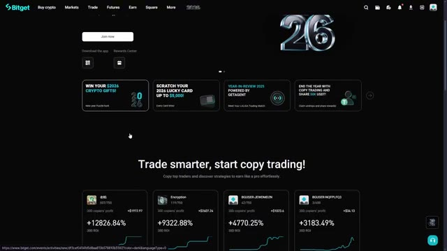
*⏱️ 00:00:41 — Capture d'écran de l'interface de la plateforme Bitget montrant la page d'accueil avec des options de copy trading et des promotions de bonus de bienvenue.*

---

### ⏱️ `[00:01:07 - 00:01:43]` | Segment #03

**🔊 Audio (Transcription Intégrale Mot pour Mot en Français) :**
> cryptomonnaies. Nous parlons de plus de 500 pièces et jetons. Que vous souhaitiez échanger du Bitcoin, de l'Ethereum, du Solana, ou découvrir de nouveaux altcoins avant qu'ils n'arrivent sur les principales plateformes d'échange, BitGit a ce qu'il vous faut. Deuxièmement, la plateforme dispose d'une liquidité incroyablement profonde. Qu'est-ce que cela signifie pour vous ? Cela signifie que vous pouvez acheter et vendre de grands montants sans vous soucier du glissement de prix ou de mauvais tarifs. Vos ordres s'exécutent rapidement et au prix que vous voyez sur l'écran. Troisièmement, BitGit propose certains des frais de transaction les au plus bas de l'industrie. Les frais de trading au comptant standard commencent à seulement 0,1 %, et si vous utilisez mon lien de parrainage, vous allez

**👁️ Analyse Visuelle d'Écran (gemini-3.5-flash-lite) :**
**Interface & Outils** : Site web Bitget (page Marchés / Futures).

**Contenu textuel & Code** : Tableau listant différentes paires de cryptomonnaies en contrats Futures USDT-M (BTCUSDT, ETHUSDT, SOLUSDT, XRPUSDT, etc.), avec leurs prix, variations sur 24h, volumes et graphiques miniatures de tendance.

**Action / Démonstration** : Navigation et présentation des marchés de cryptomonnaies disponibles pour le trading sur Bitget.

*⏱️ 00:01:16 — Capture d'écran de l'interface de la plateforme d'échange Bitget montrant la liste des marchés Futures.*

---

### ⏱️ `[00:01:43 - 00:02:18]` | Segment #04

**🔊 Audio (Transcription Intégrale Mot pour Mot en Français) :**
> bénéficiez de réductions supplémentaires sur les frais en plus de cela. Quatrièmement, l'interface est épurée et intuitive. Contrairement à certaines bourses qui vous submergent de graphiques et de données, BitGit fait les choses simplement tout en offrant aux traders chevronnés tous les outils dont ils ont besoin. Et enfin, le bonus de bienvenue. BitGit offre actuellement aux nouveaux utilisateurs jusqu'à 6 200 USDT de récompenses. Cela comprend des bonus sur dépôt, des remises sur le trading et des fonds d'essai. C'est l'une des offres les plus généreuses dans la crypto en ce moment, et vous passeriez à côté d'argent si vous n'en profitez pas. Donc, que vous achetiez votre

**👁️ Analyse Visuelle d'Écran (gemini-3.5-flash-lite) :**
**Interface & Outils** : Bitget (échange de cryptomonnaies)

**Contenu textuel & Code** : Listes de cryptomonnaies, graphiques de tendance miniatures, volumes d'échange et variations de prix en pourcentage.

**Action / Démonstration** : Navigation sur la plateforme Bitget pour illustrer la simplicité et l'intuitivité de l'interface des marchés et des fonctionnalités proposées.

*⏱️ 00:01:52 — Capture d'écran montrant l'interface des marchés Spot de la plateforme Bitget avec la liste des cryptomonnaies, leurs prix et variations.*

*⏱️ 00:02:09 — Capture d'écran de la page d'accueil de la plateforme Bitget mettant en avant une campagne promotionnelle 'New year Puzzle hunt'.*

---

### ⏱️ `[00:02:18 - 00:02:45]` | Segment #05

**🔊 Audio (Transcription Intégrale Mot pour Mot en Français) :**
> Que vous soyez novice dans le Bitcoin ou un trader expérimenté à la recherche d'une plateforme fiable, BitGet coche toutes les cases. Passons maintenant au tutoriel proprement dit. Très bien, allons-y pour la configuration. Une fois que vous aurez cliqué sur le lien dans la description, vous arriverez sur la page d'inscription de BitGet. Vous pouvez vous inscrire avec votre adresse e-mail et créer un mot pour mot de passe fort. Je parle de majuscules, de minuscules, de chiffres et de symboles. Sécurisez-le, puis cliquez sur créer un compte. Et boum, vous avez votre compte.

**👁️ Analyse Visuelle d'Écran (gemini-3.5-flash-lite) :**
**Interface & Outils** : Plateforme d'échange crypto BitGet (site web).

**Contenu textuel & Code** : Formulaire d'inscription (Email, Mot de passe avec infobulle de complexité, Code de parrainage).

**Action / Démonstration** : Présentation de la page d'accueil de BitGet puis démonstration du formulaire de création de compte.

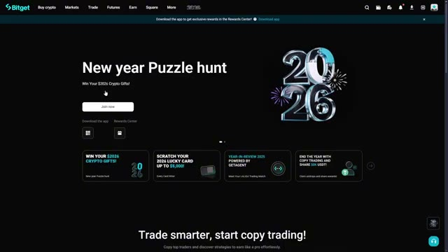
*⏱️ 00:02:25 — Page d'accueil de la plateforme BitGet affichant l'événement 'New year Puzzle hunt'.*

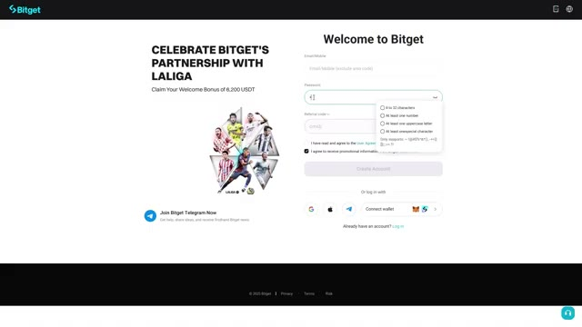
*⏱️ 00:02:38 — Page d'inscription à BitGet avec le formulaire de création de compte et les critères de mot de passe.*

---

### ⏱️ `[00:02:45 - 00:03:14]` | Segment #06

**🔊 Audio (Transcription Intégrale Mot pour Mot en Français) :**
> Maintenant, Bicket va vous envoyer un code de vérification par e-mail. Allez consulter votre boîte de réception, copiez ce code et collez-le dans la case de vérification. Si vous ne le voyez pas, vérifiez votre dossier de spam. Une fois que vous avez vérifié votre e-mail, boum, vous y êtes. Vous avez maintenant un compte Bicket. Aucune vérification KYC n'est requise pour commencer à trader, mais je vous recommande de l'compléter plus tard si vous souhaitez des limites de retrait plus élevées et l'accès à toutes les fonctionnalités. Maintenant, avant de continuer, laissez-moi vous montrer une étape de sécurité rapide que vous devriez faire immédiatement.

**👁️ Analyse Visuelle d'Écran (gemini-3.5-flash-lite) :**
**Interface & Outils** : Interface web de l'échange de cryptomonnaies Bitget.

**Contenu textuel & Code** : Formulaire de saisie d'un code de vérification à 6 chiffres envoyé par e-mail, bannières promotionnelles et menus de navigation (Buy crypto, Markets, Trade, Futures).

**Action / Démonstration** : Saisie du code de vérification à six chiffres pour valider l'inscription sur la plateforme.

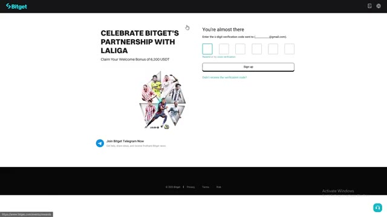
*⏱️ 00:02:53 — Écran de vérification d'e-mail sur l'interface de Bitget avec les six cases à remplir pour le code.*

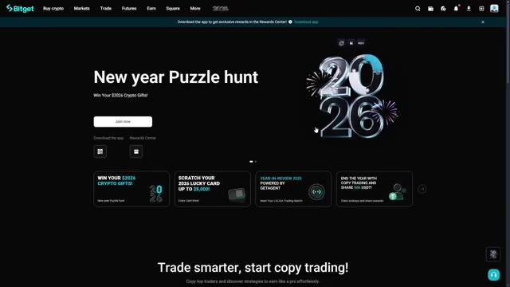
*⏱️ 00:03:07 — Page d'accueil principale de la plateforme Bitget montrant un événement promotionnel "New year Puzzle hunt".*

---

### ⏱️ `[00:03:15 - 00:03:48]` | Segment #07

**🔊 Audio (Transcription Intégrale Mot pour Mot en Français) :**
> Allez dans les paramètres de votre compte, cliquez sur sécurité, et activez l'authentification à deux facteurs. Cela ajoute une couche de protection supplémentaire à votre compte. Vous pouvez utiliser Google Authenticator ou la vérification par SMS. Personnellement, je préfère Google Authenticator car il est plus sécurisé. Très bien, compte créé et sécurisé. Maintenant, mettons des fonds dedans. Maintenant que votre compte est configuré, déposons des fonds pour que vous puissiez commencer à trader. BitGit vous offre plusieurs façons de déposer, je vais donc vous montrer les deux méthodes les plus courantes. Dans le coin supérieur droit de l'écran, vous verrez un bouton qui ressemble

**👁️ Analyse Visuelle d'Écran (gemini-3.5-flash-lite) :**
**Interface & Outils** : Bitget (plateforme d'échange de cryptomonnaies)

**Contenu textuel & Code** : Options de sécurité du compte : Passkey, Google Authenticator, vérification par numéro de téléphone, vérification par e-mail, authentification biométrique et code de fonds.

**Action / Démonstration** : Navigation dans les paramètres de sécurité du compte pour configurer l'authentification à deux facteurs.

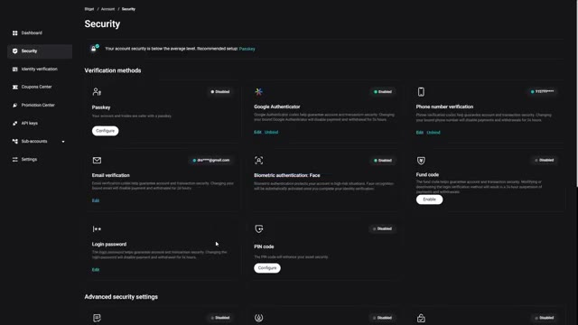
*⏱️ 00:03:23 — La page des paramètres de sécurité de la plateforme Bitget montrant les différentes méthodes de vérification, y compris Google Authenticator.*

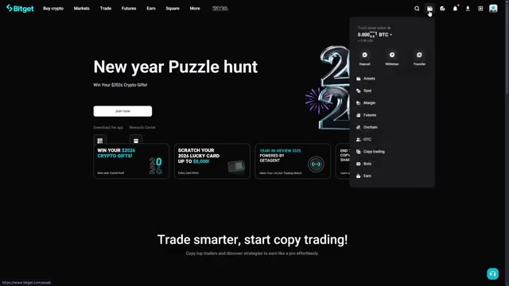
*⏱️ 00:03:39 — La page d'accueil de la plateforme Bitget avec un menu déroulant ouvert affichant les options d'actifs et de trading.*

---

### ⏱️ `[00:03:48 - 00:04:24]` | Segment #08

**🔊 Audio (Transcription Intégrale Mot pour Mot en Français) :**
> comme portefeuille. Survolez-le, puis sélectionnez dépôt dans le menu déroulant. La première méthode consiste à déposer des cryptos à partir d'un autre portefeuille ou d'une autre plateforme d'échange. C'est la méthode la plus courante si vous possédez déjà des cryptos. D'abord, sélectionnez la cryptomonnaie que vous souhaitez déposer. Disons que vous voulez déposer de l'USDT parce que c'est un stablecoin et que la plupart des paires de trading l'utilisent. Ensuite, et c'est très, très important, sélectionnez le bon réseau. BitGet prend en charge plusieurs réseaux pour l'USDT, notamment ERC-20, qui est Ethereum, TRC-20 qui est Tron, BEP-20 qui est Binance Smart Chain, et plusieurs autres.

**👁️ Analyse Visuelle d'Écran (gemini-3.5-flash-lite) :**
**Interface & Outils** : Échange de cryptomonnaies Bitget (interface Web).
[CONTenu] Options de sélection de coin (USDT, ETH, USDC, etc.), menu déroulant pour le choix du réseau et historique des dépôts vide.

**Contenu textuel & Code** : Explications orales des stratégies et mise en contexte méthodologique du marché.

**Action / Démonstration** : Navigation sur la page de dépôt de cryptos pour initier un transfert depuis un autre portefeuille.

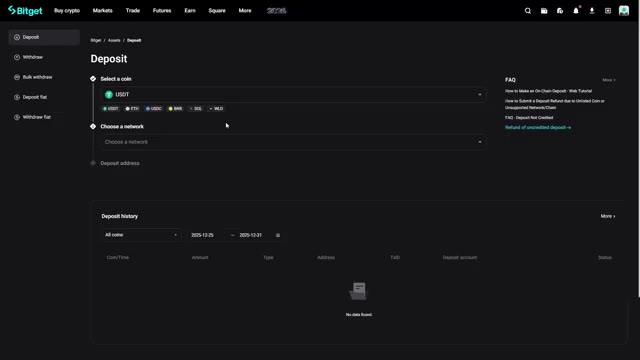
*⏱️ 00:03:57 — Interface de dépôt de la plateforme Bitget montrant la sélection de la cryptomonnaie (USDT) et du réseau.*

---

### ⏱️ `[00:04:24 - 00:04:58]` | Segment #09

**🔊 Audio (Transcription Intégrale Mot pour Mot en Français) :**
> Voici la règle clé. Le réseau que vous sélectionnez sur BitShit doit correspondre au réseau depuis lequel vous envoyez. Si vous envoyez des USDT depuis Binance sur le réseau TRC20, vous devez sélectionner TRC20 sur BitGit. Si les réseaux ne correspondent pas, vos fonds seront perdus à jamais. Donc, vérifiez cela à deux fois avant d'envoyer quoi que ce soit. Une fois que vous avez sélectionné le réseau, BitGit générera une adresse de dépôt pour vous. Copiez l'adresse, allez sur votre portefeuille externe ou votre échange, collez l'adresse, entrez le montant que vous souhaitez envoyer, et confirmez la transaction. Je recommande toujours d'envoyer d'abord un petit montant de test,

**👁️ Analyse Visuelle d'Écran (gemini-3.5-flash-lite) :**
**Interface & Outils** : Échange de cryptomonnaies Bitget (Interface web de dépôt)

**Contenu textuel & Code** : Sélection de la cryptomonnaie USDT et choix du réseau de dépôt avec les options TRC20, BEP20, ERC20 et Morph.

**Action / Démonstration** : Sélection du réseau de dépôt sur la plateforme Bitget pour correspondre au réseau d'envoi.

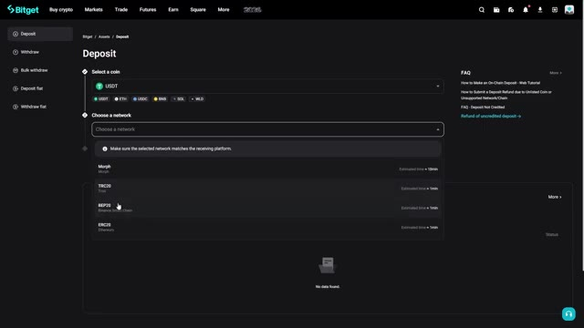
*⏱️ 00:04:32 — Capture d'écran de l'interface de dépôt de la plateforme Bitget montrant la sélection de la crypto USDT et le menu déroulant des réseaux disponibles (Morph, TRC20, BEP20, ERC20).*

---

### ⏱️ `[00:04:58 - 00:05:32]` | Segment #10

**🔊 Audio (Transcription Intégrale Mot pour Mot en Français) :**
> particulièrement si c'est votre première fois. Envoyez 10 ou 20 USDT, attendez qu'ils arrivent, et une fois que vous avez confirmé qu'ils sont sur votre compte Bitget, envoyez le reste. Mieux vaut prévenir que guérir. Selon le réseau que vous avez choisi, votre dépôt devrait arriver en quelques minutes. Ethereum peut prendre plus de temps en cas de trafic élevé, mais Tron et Binance Smart Chain sont généralement très rapides. La deuxième méthode consiste à acheter des crypto-monnaies directement avec une carte de crédit ou de débit. C'est parfait si vous ne possédez pas encore de crypto. Dans le menu supérieur, cliquez sur acheter des crypto. Sélectionnez le dépôt bancaire puis choisissez la devise que vous voulez

**👁️ Analyse Visuelle d'Écran (gemini-3.5-flash-lite) :**
**Interface & Outils** : Échange de cryptomonnaies Bitget (Interface Web)

**Contenu textuel & Code** : Formulaire de dépôt d'actifs : sélection de la cryptomonnaie (USDT), choix du réseau (TRC20 - Tron), affichage du QR code et de l'adresse de dépôt avec les conditions minimales de dépôt.

**Action / Démonstration** : Configuration et visualisation des informations nécessaires pour effectuer un dépôt de cryptomonnaies sur le compte Bitget.

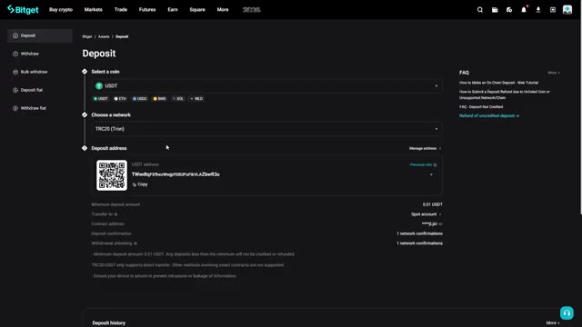
*⏱️ 00:05:07 — Page de dépôt de la plateforme Bitget montrant la sélection de la crypto USDT et du réseau TRC20 avec le QR code et l'adresse de dépôt.*

---

### ⏱️ `[00:05:32 - 00:06:04]` | Segment #11

**🔊 Audio (Transcription Intégrale Mot pour Mot en Français) :**
> acheter. Très bien, votre compte est approvisionné. Passons maintenant au trading au comptant. Allons maintenant sur l'interface de trading au comptant. En haut de l'écran, survolez l'onglet "Trader" et cliquez sur "Comptant" dans le menu déroulant. Cela vous amènera au tableau de bord principal du trading au comptant. Laissez-moi vous décomposer ce que vous voyez, car je sais que cela peut sembler intimidant au début, mais c'est en réalité très simple une fois que l'on comprend la disposition. Sur le côté gauche, vous verrez la liste des paires de trading. Cela montre toutes les cryptomonnaies disponibles que vous pouvez échanger. Tout en haut, vous pouvez rechercher n'importe quelle pièce spécifique. Vous pouvez

**👁️ Analyse Visuelle d'Écran (gemini-3.5-flash-lite) :**
**Interface & Outils** : Bitget (interface Web d'échange de crypto-monnaies)

**Contenu textuel & Code** : Graphique des prix BTC/USDT en chandeliers japonais, carnet d'ordres en temps réel, panneau d'achat/vente au comptant (Limit/Market/OCO) et solde du compte affichant 10 USDT.

**Action / Démonstration** : Navigation vers l'interface de trading au comptant et présentation du tableau de bord principal pour effectuer des transactions.

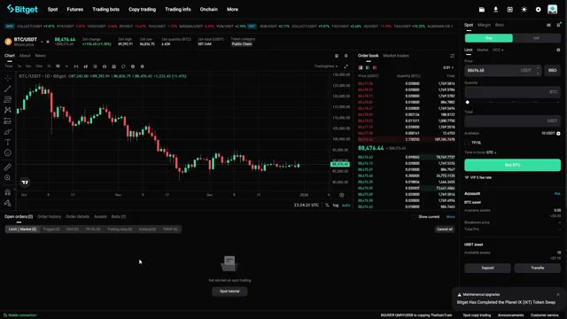
*⏱️ 00:05:48 — Interface principale de trading au comptant (Spot) sur Bitget avec le graphique du BTC/USDT, le carnet d'ordres et le panneau de passage d'ordres.*

---

### ⏱️ `[00:06:04 - 00:06:36]` | Segment #12

**🔊 Audio (Transcription Intégrale Mot pour Mot en Français) :**
> aussi filtrées par différentes catégories comme les paires USDT, les paires BTC ou les paires ETH. Pour les débutants, je recommande de s'en tenir aux paires USDT car elles sont les plus liquides et les plus faciles à comprendre. Disons que je veux échanger de l'Ethereum. Je vais chercher ETH dans la barre de recherche, puis cliquer sur ETH slash USDT. Cela signifie que je trade de l'Ethereum contre l'USDT. Au centre de l'écran, vous avez le graphique des prix. Celui-ci montre l'évolution du prix de votre paire de trading sélectionnée au fil du temps.

**👁️ Analyse Visuelle d'Écran (gemini-3.5-flash-lite) :**
**Interface & Outils** : Interface web de l'échangeur crypto Bitget.

**Contenu textuel & Code** : Liste des paires de trading disponibles sur le marché Spot, onglets de filtrage (All, USDT, USDC, BTC, ETH), et graphique des prix pour BTC/USDT.

**Action / Démonstration** : Sélection des paires de trading et filtrage par catégorie (notamment l'onglet USDT) dans l'interface de l'échange.

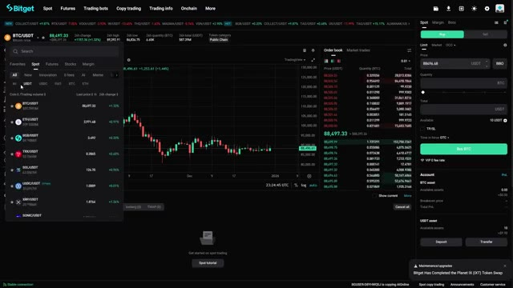
*⏱️ 00:06:12 — Interface de trading de la plateforme Bitget montrant le menu de sélection des paires de cryptomonnaies et les filtres par catégorie (Spot, USDT, BTC, ETH).*

---

### ⏱️ `[00:06:36 - 00:07:11]` | Segment #13

**🔊 Audio (Transcription Intégrale Mot pour Mot en Français) :**
> Vous pouvez basculer entre différentes unités de temps comme une minute, cinq minutes, une heure ou un jour, ou selon vos préférences. Vous pouvez également ajouter des indicateurs techniques si vous aimez l'analyse graphique, mais pour le trading au comptant de base, vous n'avez pas encore à vous en préoccuper. Sur le côté droit, vous verrez le carnet d'ordres. Cela montre tous les ordres d'achat et de vente actuels sur le marché. Les chiffres verts sont les ordres d'achat et les chiffres rouges sont les ordres de vente. Cela vous donne une idée de l'endroit où les autres traders placent leurs ordres et de l'état actuel de la profondeur du marché. Sous le graphique, vous verrez les transactions récentes. Il s'agit d'un flux en direct de

**👁️ Analyse Visuelle d'Écran (gemini-3.5-flash-lite) :**
**Interface & Outils** : Bitget (plateforme d'échange de cryptomonnaies)

**Contenu textuel & Code** : Graphique en chandeliers japonais de la paire ETH/USDT (prix actuel autour de 2 971,19 USD), carnet d'ordres, et panneau de passage d'ordres au comptant (Spot) à droite.

**Action / Démonstration** : Présentation de l'interface de trading spot de Bitget et observation des graphiques de prix.

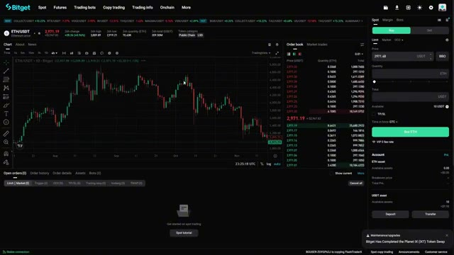
*⏱️ 00:06:45 — Interface de trading de la plateforme Bitget montrant le graphique de la paire ETH/USDT en unité de temps journalière (1D).*

---

### ⏱️ `[00:07:11 - 00:07:46]` | Segment #14

**🔊 Audio (Transcription Intégrale Mot pour Mot en Français) :**
> chaque transaction qui vient d'avoir lieu sur cette paire. Elle se met à jour en temps réel pour que vous puissiez voir les prix exacts auxquels les gens achètent et vendent. Et enfin tout à droite, vous avez votre panneau d'ordres. C'est ici que vous allez réellement passer vos ordres. Laissez-moi vous montrer comment l'utiliser. Très bien, passons votre premier ordre au comptant. Je vais vous montrer les deux principaux types d'ordres, les ordres au marché et les ordres à cours limité. Un ordre au marché est le moyen le plus simple de trader. Lorsque vous passez un ordre au marché, vous achetez ou vendez au prix actuel du marché quel qu'il soit. Votre ordre s'exécute instantanément. C'est idéal lorsque vous voulez obtenir

**👁️ Analyse Visuelle d'Écran (gemini-3.5-flash-lite) :**
**Interface & Outils** : Bitget (Plateforme d'échange de cryptomonnaies)

**Contenu textuel & Code** : Graphique en chandeliers de la paire ETH/USDT en unité de temps 4h, carnet d'ordres (Order book) en temps réel avec les prix d'achat et de vente, et panneau de gestion des ordres Spot.

**Action / Démonstration** : Présentation des différents composants de l'interface de trading, en se concentrant sur le carnet d'ordres et le panneau de passage d'ordres à droite.

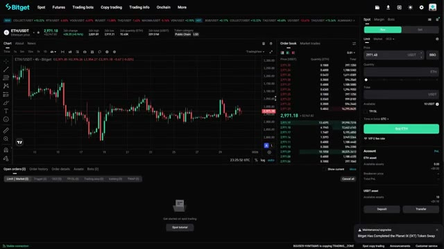
*⏱️ 00:07:20 — Capture d'écran de l'interface de trading Bitget montrant un graphique des prix en chandeliers (ETH/USDT), un carnet d'ordres au centre et un panneau de passage d'ordres à droite.*

---

### ⏱️ `[00:07:46 - 00:08:19]` | Segment #15

**🔊 Audio (Transcription Intégrale Mot pour Mot en Français) :**
> entrer ou sortir d'une position rapidement, mais gardez à l'esprit que vous pourriez ne pas obtenir le prix exact que vous voyez sur l'écran, surtout pendant une forte volatilité. Voici comment placer un ordre au marché. Assurez-vous d'être sur l'onglet d'achat si vous voulez acheter ou sur l'onglet de vente si vous voulez vendre. Tout en haut du panneau d'ordres, cliquez sur marché. Entrez maintenant le montant que vous souhaitez trader. Vous pouvez l'entrer de deux manières. Vous pouvez entrer le montant de USDT que vous voulez dépenser ou vous pouvez entrer le montant d'ETH que vous voulez acheter. BitGit calculera automatiquement l'autre côté pour vous. Disons que je veux dépenser 10 USDT pour acheter

**👁️ Analyse Visuelle d'Écran (gemini-3.5-flash-lite) :**
**Interface & Outils** : Plateforme d'échange de cryptomonnaies Bitget (interface de trading Spot)

**Contenu textuel & Code** : Graphique en chandeliers japonais ETH/USDT (unité 4h, prix autour de 2971,99 USDT), carnet d'ordres en temps réel, et panneau de configuration d'ordre au marché (onglet Buy/Sell, options Limit/Market/OCO).

**Action / Démonstration** : Présentation de l'interface de passage d'ordre au marché sur Bitget pour l'achat de cryptomonnaies.

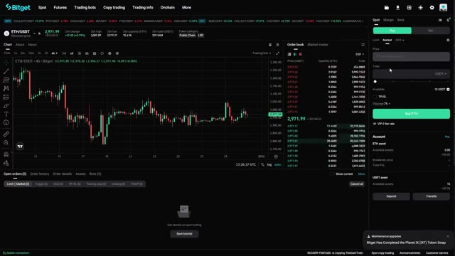
*⏱️ 00:07:54 — Interface de trading de la plateforme Bitget montrant le graphique de la paire ETH/USDT en unités de 4 heures ainsi que le carnet d'ordres et le panneau de passage d'ordre au marché.*

---

### ⏱️ `[00:08:19 - 00:08:55]` | Segment #16

**🔊 Audio (Transcription Intégrale Mot pour Mot en Français) :**
> Ethereum. Je vais entrer 100 dans le champ USDT. BitGit me montre exactement combien d'ETH je vais recevoir après les frais. Si tout a l'air bon, je vais cliquer sur acheter ETH. Confirmer l'ordre, et juste comme ça, je possède maintenant de l'Ethereum. Vous le verrez apparaître dans votre portefeuille au comptant immédiatement. Maintenant, parlons des ordres limités. Un ordre limité vous donne plus de contrôle. Au lieu d'acheter au prix actuel du marché, vous définissez un prix spécifique auquel vous voulez acheter ou vendre. Votre ordre ne s'exécutera que si le marché atteint ce prix. C'est utile lorsque vous voulez obtenir un meilleur point d'entrée ou de sortie, mais il y a

**👁️ Analyse Visuelle d'Écran (gemini-3.5-flash-lite) :**
**Interface & Outils** : Échange de cryptomonnaies Bitget (interface Spot).

**Contenu textuel & Code** : Graphique en chandelier ETH/USDT, carnet d'ordres en temps réel, panneau de passage d'ordre d'achat au marché avec un solde disponible et montant en USDT.

**Action / Démonstration** : Préparation ou passage d'un ordre d'achat spot pour de l'Ethereum (ETH) sur l'échange Bitget.

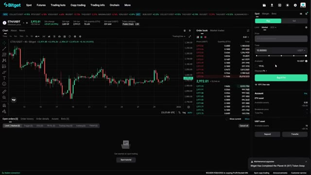
*⏱️ 00:08:28 — Interface de trading spot de Bitget montrant le graphique de la paire ETH/USDT, le carnet d'ordres et le panneau d'achat/vente avec un montant configuré en USDT.*

---

### ⏱️ `[00:08:55 - 00:09:16]` | Segment #17

**🔊 Audio (Transcription Intégrale Mot pour Mot en Français) :**
> Il n'y a aucune garantie que votre ordre soit exécuté si le prix n'atteint pas votre cible. Voici comment passer un ordre limité. Cliquez sur l'onglet limite. Choisissez acheter ou vendre. Saisissez maintenant le prix auquel vous voulez acheter ou vendre. Disons qu'Ethereum se négocie actuellement à 2 900 USDT, mais je veux l'acheter à 2 850 USDT.

**👁️ Analyse Visuelle d'Écran (gemini-3.5-flash-lite) :**
**Interface & Outils** : Bitget (Plateforme d'échange de cryptomonnaies)

**Contenu textuel & Code** : Paire ETH/USDT, prix actuel à 2 971,98 USDT, graphique en chandeliers (unité 4h), carnet d'ordres (Order book) et module de configuration d'ordre limite (Limit order) avec le champ de prix renseigné à 2971.94 USDT.

**Action / Démonstration** : Configuration et démonstration d'un ordre limité d'achat sur Ethereum (ETH/USDT) sur l'exchange Bitget.

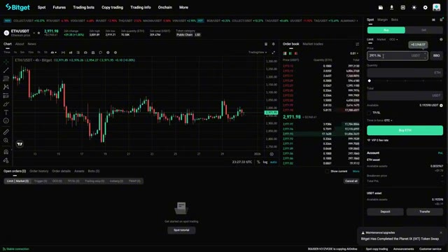
*⏱️ 00:09:00 — Interface de trading de la plateforme Bitget montrant le graphique de la paire ETH/USDT en unités de 4 heures, le carnet d'ordres au centre et le panneau de passage d'ordre limite à droite.*

---

### ⏱️ `[00:09:16 - 00:09:39]` | Segment #18

**🔊 Audio (Transcription Intégrale Mot pour Mot en Français) :**
> Je vais saisir 2 850 dans le champ du prix. Ensuite, je vais saisir le montant d'ETH que je veux acheter. BitGit m'affichera le coût total en USDT. Cliquez sur Acheter ETH et votre ordre est maintenant placé. Vous verrez votre ordre ouvert au bas de l'écran sous Ordres ouverts. Votre ordre restera là jusqu'à ce que quelqu'un vende de l'Ethereum à votre prix ou jusqu'à ce que vous l'annuliez.

**👁️ Analyse Visuelle d'Écran (gemini-3.5-flash-lite) :**
**Interface & Outils** : Bitget (interface de trading Spot)

**Contenu textuel & Code** : Paire ETH/USDT, prix actuel autour de 2 971,94 USDT, graphique en chandeliers japonais en unité 4h, carnet d'ordres (Order book) et panneau de saisie d'ordre Limit (Prix réglé à 2850 USDT, champ Quantité ETH en cours de saisie).

**Action / Démonstration** : Saisie d'un ordre Limit d'achat pour la cryptomonnaie Ethereum (ETH) sur l'échange Bitget en indiquant le prix cible de 2 850 USDT.

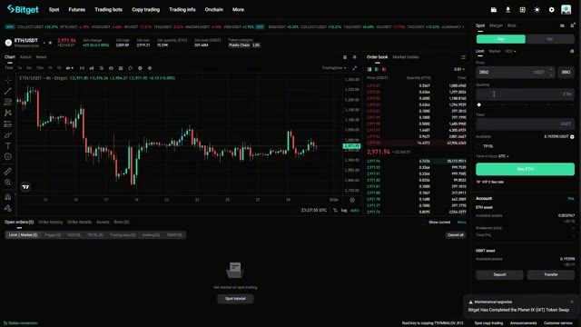
*⏱️ 00:09:22 — Interface de trading de l'échange Bitget montrant le graphique de la paire ETH/USDT en unités 4h, le carnet d'ordres au centre et le panneau de passage d'ordre "Spot" sur la droite avec un ordre Limit configuré à 2850 USDT.*

---

### ⏱️ `[00:09:39 - 00:10:00]` | Segment #19

**🔊 Audio (Transcription Intégrale Mot pour Mot en Français) :**
> Si vous voulez annuler un ordre, cliquez simplement sur le bouton d'annulation à côté de celui-ci. Encore une chose, BitGet propose également des ordres stop limit, qui sont plus avancés. Ceux-ci vous permettent de définir un prix de déclenchement et un prix limite, ce qui est utile pour la gestion des risques. Mais pour vos premiers trades, en tenez-vous aux ordres au marché et limités jusqu'à ce que vous soyez à l'aise. Très bien, vous avez fait votre premier trade. Maintenant, laissez-moi vous montrer comment gérer votre portefeuille.

**👁️ Analyse Visuelle d'Écran (gemini-3.5-flash-lite) :**
**Interface & Outils** : BitGet (échange de cryptomonnaies)

**Contenu textuel & Code** : Paire ETH/USDT, graphique en chandeliers (unité 4h), carnet d'ordres (Order book) en temps réel, panneau d'achat/vente avec options Limit, Market, OCO, et onglets pour les ordres ouverts (Open orders).

**Action / Démonstration** : Présentation de l'interface de l'échange et des différentes options de placement d'ordres spot.

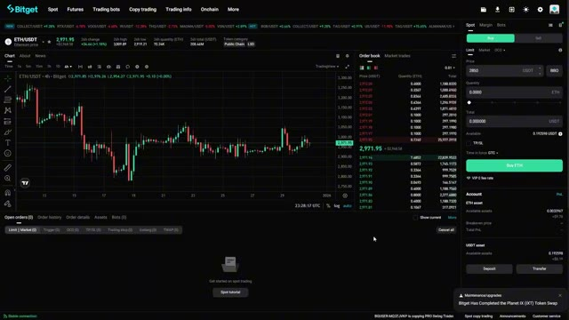
*⏱️ 00:09:44 — Interface de trading de la plateforme BitGet affichant le graphique des prix ETH/USDT, le carnet d'ordres et le panneau de passage d'ordres spot.*

---

### ⏱️ `[00:10:00 - 00:10:20]` | Segment #20

**🔊 Audio (Transcription Intégrale Mot pour Mot en Français) :**
> Cliquez sur actifs en haut à droite, puis sélectionnez compte au comptant. Ici, vous verrez toutes les crypto-monnaies que vous possédez actuellement, ainsi que leur valeur actuelle en USDT. Vous pouvez également voir la valeur totale de votre portefeuille et vos profits et pertes sur 24 heures. Maintenant, lorsque vous êtes prêt à vendre, le processus est exactement le même que pour l'achat, mais en sens inverse.

**👁️ Analyse Visuelle d'Écran (gemini-3.5-flash-lite) :**
**Interface & Outils** : Échange de crypto-monnaies Bitget (interface Web).

**Contenu textuel & Code** : Solde total du portefeuille (0.000112 BTC / ~9.98 USD), PnL sur 24 heures (< 0.01 USD), et liste des actifs (ETH, USDT, UZU, WUF, CATDOG, INVITE) avec leurs soldes disponibles et réservés.

**Action / Démonstration** : Navigation dans le menu des actifs pour consulter le compte au comptant et la répartition des crypto-monnaies.

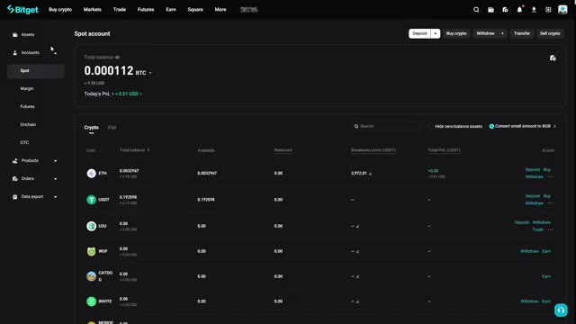
*⏱️ 00:10:05 — Vue d'ensemble du compte au comptant (Spot account) sur la plateforme d'échange Bitget, montrant la balance totale en BTC et USDT, ainsi que la liste des crypto-monnaies détenues.*

---

### ⏱️ `[00:10:20 - 00:10:40]` | Segment #21

**🔊 Audio (Transcription Intégrale Mot pour Mot en Français) :**
> Retournez sur la page de trading au comptant, assurez-vous d'être sur la bonne paire de trading, cliquez sur vendre, entrez le montant que vous souhaitez vendre, et confirmez. Votre crypto sera reconvertie en USDT et vous verrez votre solde USDT augmenter. Si vous souhaitez retirer vos fonds, survolez à nouveau le symbole du portefeuille. Ensuite, dans le menu déroulant, cliquez sur retirer.

**👁️ Analyse Visuelle d'Écran (gemini-3.5-flash-lite) :**
**Interface & Outils** : Interface de l'échange de cryptomonnaies Bitget (Spot trading).

**Contenu textuel & Code** : Graphique en chandeliers japonais de la paire ETH/USDT en unité 15m, carnet d'ordres en temps réel, et panneau de passage d'ordre de vente au marché.

**Action / Démonstration** : Démonstration de la procédure pour vendre des cryptomonnaies (ETH) en USDT sur le marché spot de Bitget.

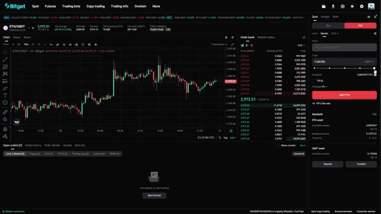
*⏱️ 00:10:25 — Capture d'écran de l'interface de trading au comptant de la plateforme Bitget montrant le graphique de la paire ETH/USDT, le carnet d'ordres et le panneau de vente.*

---

### ⏱️ `[00:10:41 - 00:11:05]` | Segment #22

**🔊 Audio (Transcription Intégrale Mot pour Mot en Français) :**
> Sélectionnez la cryptomonnaie que vous souhaitez retirer. Entrez l'adresse de destination. Choisissez le réseau. Entrez le montant et confirmez. Assurez-vous que l'adresse et le réseau sont correct avant de confirmer, sous peine de perdre vos fonds. Et c'est tout. Vous savez désormais comment utiliser le trading au comptant sur BitGet du début à la fin. Avant de partir, n'oubliez pas d'utiliser le lien dans la description ci-dessous pour réclamer votre bonus de bienvenue allant jusqu'à 6 200 USDT.

**👁️ Analyse Visuelle d'Écran (gemini-3.5-flash-lite) :**
**Interface & Outils** : Bitget (plateforme d'échange de cryptomonnaies)

**Contenu textuel & Code** : Menu de retrait de cryptomonnaie (USDT) avec la liste des réseaux disponibles (Morph, TRC20, BEP20, ERC20) et leurs frais de transaction respectifs.

**Action / Démonstration** : Sélection d'un réseau de retrait pour le transfert de cryptomonnaies.

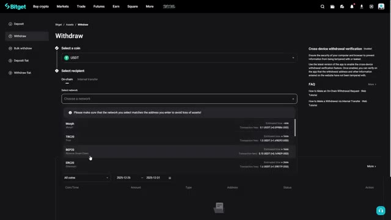
*⏱️ 00:10:47 — Interface de la plateforme Bitget montrant le menu de retrait (Withdraw) avec la sélection de l'USDT et des réseaux de transfert.*

---

### ⏱️ `[00:11:06 - 00:11:25]` | Segment #23

**🔊 Audio (Transcription Intégrale Mot pour Mot en Français) :**
> Ce bonus est uniquement disponible si vous utilisez mon lien, alors ne manquez surtout pas ça. Si cette vidéo a été utile, n'oubliez surtout pas de laisser un pouce bleu en bas et de vous abonner à la chaîne si vous voulez voir plus de contenu crypto comme celui-ci. Je publie des tutoriels sur les stratégies de trading, des guides de plateformes et les dernières opportunités crypto chaque semaine.

**👁️ Analyse Visuelle d'Écran (gemini-3.5-flash-lite) :**
**Interface & Outils** : Interface de la plateforme d'échange de cryptomonnaies Bitget.

**Contenu textuel & Code** : Pourcentages de ROI sur 30 jours de traders à copier (+12826.84%, +9322.88%, +4770.25%, +3183.49%) et profits des copieurs.

**Action / Démonstration** : Présentation des options de copy trading et des performances de traders sur Bitget.

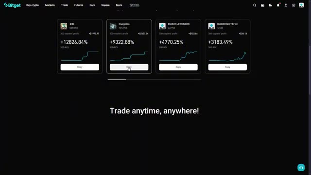
*⏱️ 00:11:20 — Section de copy trading de la plateforme Bitget montrant quatre profils de traders avec leurs performances ROI sur 30 jours.*

---

### ⏱️ `[00:11:25 - 00:11:37]` | Segment #24

**🔊 Audio (Transcription Intégrale Mot pour Mot en Français) :**
> et si vous voulez une analyse complète des fonctionnalités de trading de futures ou de copy trading de BitGet, faites-le-moi savoir dans les commentaires et je ferai une vidéo là-dessus la prochaine fois. Merci d'avoir regardé et je vous vois dans la prochaine. Bon trading !

**👁️ Analyse Visuelle d'Écran (gemini-3.5-flash-lite) :**
**Interface & Outils** : Site web officiel de l'échange de crypto-monnaies Bitget

**Contenu textuel & Code** : Menu de navigation supérieur (Buy crypto, Markets, Trade, Futures, Earn, Square, More), bannière principale "New year Puzzle hunt", bouton "Join now" et sections de promotion pour le copy trading en bas de page.

**Action / Démonstration** : Navigation sur la page principale de Bitget montrant les fonctionnalités et événements de la plateforme.

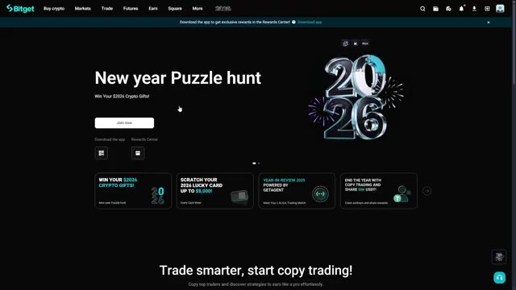
*⏱️ 00:11:28 — Page d'accueil de la plateforme de cryptomonnaies Bitget affichant l'événement promotionnel "New year Puzzle hunt" avec des graphismes 3D pour l'année 2026.*

---

