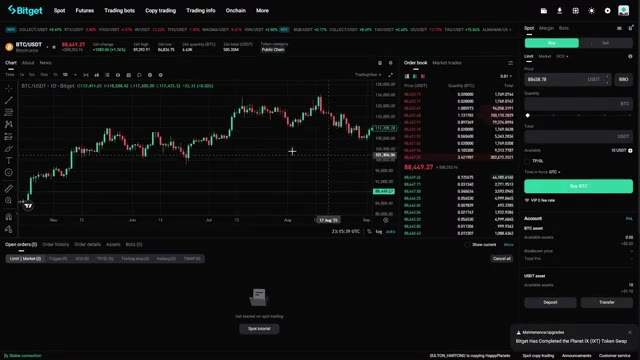
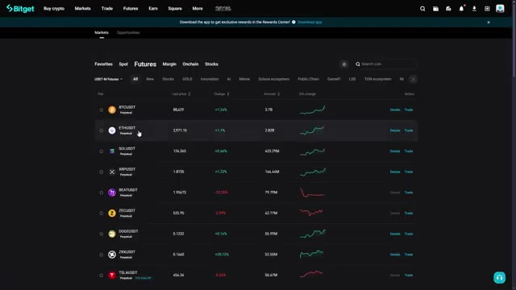
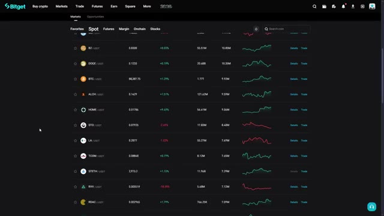
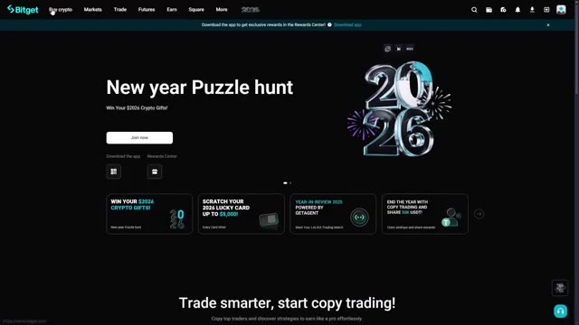

# 🎬 Your First Crypto Trade on Bitget (Beginner Spot Trading Step-by-Step)

> **Chaîne** : [Alex Carter](https://www.youtube.com/@AlexCarterTrading)  
> **Lien YouTube** : [https://www.youtube.com/watch?v=aswDEa96vkw](https://www.youtube.com/watch?v=aswDEa96vkw)  
> **Date de publication** : 20260103  
> **Durée** : 00:11:37  
> **Identifiant vidéo** : `aswDEa96vkw`  
> **Transcription & Analyse** : `whisper-v3-large-turbo+gemini-3.5-flash-lite`  

---

## 📌 Synthèse Exécutive & Outils

### 💡 Résumé
Dans cette vidéo intitulée **Your First Crypto Trade on Bitget (Beginner Spot Trading Step-by-Step)**, Alex Carter détaille une approche stratégique et pratique du trading et de l'automatisation par agents IA.

### 🛠️ Outils, Modèles & Logiciels Présentés
- **TradingView & Claude Code** : Analyse technique avancée et automatisation algorithmique.

### 🔑 Points Clés & Enseignements Stratégiques
- Respect rigoureux du ratio risque/rendement et du money management.
- Automatisation méthodique des déclencheurs d'ordres via des agents intelligents.

---

## ⏱️ Chronologie & Transcription Complète Audio & Visuelle (Mot pour Mot)

### ⏱️ `[00:00:00 - 00:00:33]` | Segment #01

**🔊 Audio (Transcription Intégrale Mot pour Mot en Français) :**
> Dans cette vidéo, je vais vous montrer comment commencer à acheter et à vendre des cryptos grâce au trading au comptant sur BitGit en quelques étapes simples. Je vais vous montrer comment créer un compte, déposer des fonds et naviguer sur l'interface de trading au comptant de BitGit comme un pro. De plus, je vais vous montrer comment réclamer jusqu'à 6 200 USVT en bonus de bienvenue et en récompenses de trading. Mais avant toute chose, vous aurez besoin d'un compte BitGit. Si vous n'en avez pas, cliquez sur le lien dans la description ci-dessous et créez un compte. La beauté de BitGit, c'est que c'est l'une des plateformes les plus adaptées aux débutants

**👁️ Analyse Visuelle d'Écran (gemini-3.5-flash-lite) :**
**Interface & Outils** : Plateforme d'échange Bitget (Trading Spot) avec graphique de prix interactif.

**Contenu textuel & Code** : Graphique en bougies japonaises de la paire BTC/USDT, carnet d'ordres (Order Book) répertoriant les ordres d'achat et de vente, prix du Bitcoin (88 449,27 USDT), volume sur 24h et panneau d'exécution d'ordres (Achat/Vente Limit & Market).

**Action / Démonstration** : Démonstration visuelle et présentation générale du terminal de trading Spot sur Bitget.

*⏱️ 00:00:08 — Capture d'écran de l'interface de trading au comptant (Spot) sur la plateforme Bitget, affichant le graphique BTC/USDT, le carnet d'ordres et le panneau de passage d'ordres.*

---

### ⏱️ `[00:00:33 - 00:01:07]` | Segment #02

**🔊 Audio (Transcription Intégrale Mot pour Mot en Français) :**
> exchanges with lightning-fast execution, deep liquidity, and over 500 cryptocurrencies available for spot trading. Once you use the link in the description below, you will automatically unlock the welcome bonus package. Make sure you only use the link from the description so you do not get phished and get scammed. It is very common in crypto, so just be careful. Before we dive into the tutorial, let me quickly explain why BitGit has become one of the top choices for spot trading, especially if you are just starting out. First, BitGit offers one of the largest selections of

**👁️ Analyse Visuelle d'Écran (gemini-3.5-flash-lite) :**
**Interface & Outils** : Présentation ou face-caméra explicatif du trader sans interface logicielle partagée.

**Contenu textuel & Code** : Explications orales des stratégies et mise en contexte méthodologique du marché.

**Action / Démonstration** : Explications face caméra et analyse conceptuelle des marchés.

---

### ⏱️ `[00:01:07 - 00:01:43]` | Segment #03

**🔊 Audio (Transcription Intégrale Mot pour Mot en Français) :**
> cryptomonnaies. Nous parlons de plus de 500 pièces et jetons. Que vous souhaitiez échanger du Bitcoin, de l'Ethereum, du Solana, ou découvrir de nouveaux altcoins avant qu'ils n'arrivent sur les principales plateformes d'échange, BitGit a ce qu'il vous faut. Deuxièmement, la plateforme dispose d'une liquidité incroyablement profonde. Qu'est-ce que cela signifie pour vous ? Cela signifie que vous pouvez acheter et vendre de grands montants sans vous soucier du glissement de prix ou de mauvais tarifs. Vos ordres s'exécutent rapidement et au prix que vous voyez sur l'écran. Troisièmement, BitGit propose certains des frais de transaction les plus bas de l'industrie. Les frais de trading au comptant standard commencent à seulement 0,1 %, et si vous utilisez mon lien de parrainage, vous allez

**👁️ Analyse Visuelle d'Écran (gemini-3.5-flash-lite) :**
**Interface & Outils** : Plateforme d'échange de cryptomonnaies Bitget (Onglet Markets > Futures > USDT-M Futures).

**Contenu textuel & Code** : Liste des paires de contrats perpétuels (BTCUSDT, ETHUSDT, SOLUSDT, XRPUSDT, BEATUSDT, ZECUSDT, DOGEUSDT, ZRXUSDT, TSLAUSDT), prix récents, variations de prix en pourcentage (+1.24%, +1.1%, etc.), volumes (Amount) et mini-courbes de tendance (sparklines) sur 24h.

**Action / Démonstration** : Navigation et présentation visuelle de la liste des paires disponibles au trading sur Bitget.

*⏱️ 00:01:16 — Vue de la liste des marchés Futures sur la plateforme Bitget, présentant différentes paires de trading perpétuelles avec leurs prix, variations sur 24h et graphiques de tendance.*

---

### ⏱️ `[00:01:43 - 00:02:18]` | Segment #04

**🔊 Audio (Transcription Intégrale Mot pour Mot en Français) :**
> bénéficier de réductions de frais supplémentaires en plus de cela. Quatrièmement, l'interface est claire et intuitive. Contrairement à certaines plateformes qui vous submergent de graphiques et de données, BitGit fait les choses simplement tout en offrant aux traders chevronnés tous les outils dont ils ont besoin. Et enfin, le bonus de bienvenue. BitGit offre actuellement aux nouveaux utilisateurs jusqu'à 6 200 USDT de récompenses. Cela inclut des bonus sur dépôt, des remboursements de frais de trading et des fonds d'essai. C'est l'une des offres les plus généreuses de la crypto en ce moment, et vous passeriez à côté d'argent facile si vous n'en profitez pas. Donc, que vous achetiez vos

**👁️ Analyse Visuelle d'Écran (gemini-3.5-flash-lite) :**
**Interface & Outils** : Échange de cryptomonnaies Bitget (interface web, onglet Marchés Spot et page d'accueil).

**Contenu textuel & Code** : Paires de cryptomonnaies (BTC/USDC, DOGE/USDT, ALCH/USDT, etc.), prix récents, variations en pourcentage, volumes d'échange sur 24h, mini-graphiques de tendance (sparklines) et annonces promotionnelles.

**Action / Démonstration** : Navigation sur la plateforme Bitget pour présenter la clarté et la simplicité de l'interface utilisateur.

*⏱️ 00:01:52 — Liste des marchés Spot sur l'interface Bitget présentant plusieurs paires de cryptomonnaies avec cours, variations de prix et mini-graphiques de tendance.*

*⏱️ 00:02:09 — Page d'accueil du site Bitget affichant la bannière promotionnelle et la section d'incitation au Copy Trading.*

---

### ⏱️ `[00:02:18 - 00:02:45]` | Segment #05

**🔊 Audio (Transcription Intégrale Mot pour Mot en Français) :**
> first Bitcoin or you are an experienced trader looking for a reliable platform, BitGit checks all the boxes. Now let us get into the actual tutorial. All right, let us get you set up. Once you click the link in the description, you will land on the Bicket registration page. You can sign up with your email address and create a strong password. I'm talking uppercase, lowercase numbers and symbols. Make it secure and then hit create account. Then boom, you have got your account.

**👁️ Analyse Visuelle d'Écran (gemini-3.5-flash-lite) :**
**Interface & Outils** : Présentation ou face-caméra explicatif du trader sans interface logicielle partagée.

**Contenu textuel & Code** : Explications orales des stratégies et mise en contexte méthodologique du marché.

**Action / Démonstration** : Explications face caméra et analyse conceptuelle des marchés.

---

### ⏱️ `[00:02:45 - 00:03:14]` | Segment #06

**🔊 Audio (Transcription Intégrale Mot pour Mot en Français) :**
> Now Bicket will send a verification code to your email. Go check your inbox, copy that code, and paste it into the verification box. If you do not see it, check your spam folder. Once you verify your email, boom, you are in. You now have a Bicket account. No KYC required to start trading, but I do recommend completing it later if you want higher withdrawal limits and access to all features. Now, before we move on, let me show you one quick security step you should do right away.

**👁️ Analyse Visuelle d'Écran (gemini-3.5-flash-lite) :**
**Interface & Outils** : Présentation ou face-caméra explicatif du trader sans interface logicielle partagée.

**Contenu textuel & Code** : Explications orales des stratégies et mise en contexte méthodologique du marché.

**Action / Démonstration** : Explications face caméra et analyse conceptuelle des marchés.

---

### ⏱️ `[00:03:15 - 00:03:48]` | Segment #07

**🔊 Audio (Transcription Intégrale Mot pour Mot en Français) :**
> Go to your account settings, click on security, and enable two-factor authentication. This adds an extra layer of protection to your account. You can use Google Authenticator or SMS verification. I personally prefer Google Authenticator because it is more secure. All right, account created and secured. Now let us get some funds in there. Now that your account is set up, let us deposit some funds so you can start trading. BitGit gives you multiple ways to deposit, so I will show you the two most common methods. At the top right corner of the screen, you will see a button that looks

**👁️ Analyse Visuelle d'Écran (gemini-3.5-flash-lite) :**
**Interface & Outils** : Présentation ou face-caméra explicatif du trader sans interface logicielle partagée.

**Contenu textuel & Code** : Explications orales des stratégies et mise en contexte méthodologique du marché.

**Action / Démonstration** : Explications face caméra et analyse conceptuelle des marchés.

---

### ⏱️ `[00:03:48 - 00:04:24]` | Segment #08

**🔊 Audio (Transcription Intégrale Mot pour Mot en Français) :**
> like wallet. Hover it, then select deposit from the drop-down menu. Method one is to deposit crypto from another wallet or exchange. This is the most common method if you already own crypto. First, select the cryptocurrency you want to deposit. Let us say you want to deposit USTD because it is a stable coin and most trading pairs use it. Next, and this is very, very important, select the correct network. BitGit supports multiple networks for USDT, including ERC-20, which is Ethereum, TRC20 which is Tron, BEP20 which is Binance Smart Chain, and several others.

**👁️ Analyse Visuelle d'Écran (gemini-3.5-flash-lite) :**
**Interface & Outils** : Présentation ou face-caméra explicatif du trader sans interface logicielle partagée.

**Contenu textuel & Code** : Explications orales des stratégies et mise en contexte méthodologique du marché.

**Action / Démonstration** : Explications face caméra et analyse conceptuelle des marchés.

---

### ⏱️ `[00:04:24 - 00:04:58]` | Segment #09

**🔊 Audio (Transcription Intégrale Mot pour Mot en Français) :**
> Here's the key rule. The network you select on BitShit must match the network you are sending from. If you are sending USDT from Binance on the TRC20 network, you must select TRC20 on BitGit. If the networks do not match, your funds will be lost forever. So double check this before you send anything. Once you select the network, BitGit will generate a deposit address for you. Copy the address, go to your external wallet or exchange, paste the address, enter the amount you want to send, and confirm the transaction. I always recommend sending a small test amount first,

**👁️ Analyse Visuelle d'Écran (gemini-3.5-flash-lite) :**
**Interface & Outils** : Présentation ou face-caméra explicatif du trader sans interface logicielle partagée.

**Contenu textuel & Code** : Explications orales des stratégies et mise en contexte méthodologique du marché.

**Action / Démonstration** : Explications face caméra et analyse conceptuelle des marchés.

---

### ⏱️ `[00:04:58 - 00:05:32]` | Segment #10

**🔊 Audio (Transcription Intégrale Mot pour Mot en Français) :**
> especially if it is your first time. Send 10 or 20 USCT, wait for it to arrive, and once you confirm it is in your BitGit account, then send the rest. Better safe than sorry. Depending on the network you chose, your deposit should arrive within a few minutes. Ethereum can take longer during high traffic, but Tron and Binance Smart Chain are usually very fast. Method two is to buy crypto directly with a credit or debit card. This is perfect if you do not own any crypto yet. From the top menu, click buy crypto. Select the bank deposit and then choose the currency you want to

**👁️ Analyse Visuelle d'Écran (gemini-3.5-flash-lite) :**
**Interface & Outils** : Présentation ou face-caméra explicatif du trader sans interface logicielle partagée.

**Contenu textuel & Code** : Explications orales des stratégies et mise en contexte méthodologique du marché.

**Action / Démonstration** : Explications face caméra et analyse conceptuelle des marchés.

---

### ⏱️ `[00:05:32 - 00:06:04]` | Segment #11

**🔊 Audio (Transcription Intégrale Mot pour Mot en Français) :**
> buy. All right, your account is funded. Now let us dive into spot trading. Now let us go to the spot trading interface. At the top of the screen, hover over trade and click spot from the drop down menu. This will take you to the main spot trading dashboard. Let me break down what you are looking at because I know it can seem overwhelming at first, but it is actually very simple once you understand the layout. On the left side, you will see the trading pairs list. This shows all the available cryptocurrencies you can trade. At the top, you can search for any specific coin. You can

**👁️ Analyse Visuelle d'Écran (gemini-3.5-flash-lite) :**
**Interface & Outils** : Présentation ou face-caméra explicatif du trader sans interface logicielle partagée.

**Contenu textuel & Code** : Explications orales des stratégies et mise en contexte méthodologique du marché.

**Action / Démonstration** : Explications face caméra et analyse conceptuelle des marchés.

---

### ⏱️ `[00:06:04 - 00:06:36]` | Segment #12

**🔊 Audio (Transcription Intégrale Mot pour Mot en Français) :**
> also filtered by different categories like USDT pairs, BTC pairs, or ETH pairs. For beginners, I recommend sticking with USDT pairs because they are the most liquid and easiest to understand. Let us say I want to trade Ethereum. I will search for ETH in the search bar, then click on ETH slash USDT. This means I am trading Ethereum against USDT. In the center of the screen, you have got the price chart. This shows the price movement of your selected trading pair over time.

**👁️ Analyse Visuelle d'Écran (gemini-3.5-flash-lite) :**
**Interface & Outils** : Présentation ou face-caméra explicatif du trader sans interface logicielle partagée.

**Contenu textuel & Code** : Explications orales des stratégies et mise en contexte méthodologique du marché.

**Action / Démonstration** : Explications face caméra et analyse conceptuelle des marchés.

---

### ⏱️ `[00:06:36 - 00:07:11]` | Segment #13

**🔊 Audio (Transcription Intégrale Mot pour Mot en Français) :**
> You can switch between different time frames like one minute, five minutes, one hour, or one day, or whatever you prefer. You can also add technical indicators if you are into chart analysis, but for basic spot trading you do not need to worry about that yet. On the right side you will see the order book. This shows all the current buy and sell orders on the market. The green numbers are buy orders and the red numbers are sell orders. This gives you an idea of where other traders are placing their orders and what the current market depth looks like. Below the chart you will see recent trades. This is a live feed of

**👁️ Analyse Visuelle d'Écran (gemini-3.5-flash-lite) :**
**Interface & Outils** : Présentation ou face-caméra explicatif du trader sans interface logicielle partagée.

**Contenu textuel & Code** : Explications orales des stratégies et mise en contexte méthodologique du marché.

**Action / Démonstration** : Explications face caméra et analyse conceptuelle des marchés.

---

### ⏱️ `[00:07:11 - 00:07:46]` | Segment #14

**🔊 Audio (Transcription Intégrale Mot pour Mot en Français) :**
> every trade that just happened on this pair. It updates in real time so you can see the exact prices people are buying and selling at. And finally on the far right you have got your order panel. This is where you will actually place your trades. Let me show you how to use it. All right, let us place your first spot trade. I'm going to show you the two main types of orders, market orders and limit orders. A market order is the simplest way to trade. When you place a market order, you are buying or selling at whatever the current market price is. Your order executes instantly. This is great when you want to get

**👁️ Analyse Visuelle d'Écran (gemini-3.5-flash-lite) :**
**Interface & Outils** : Présentation ou face-caméra explicatif du trader sans interface logicielle partagée.

**Contenu textuel & Code** : Explications orales des stratégies et mise en contexte méthodologique du marché.

**Action / Démonstration** : Explications face caméra et analyse conceptuelle des marchés.

---

### ⏱️ `[00:07:46 - 00:08:19]` | Segment #15

**🔊 Audio (Transcription Intégrale Mot pour Mot en Français) :**
> in or out of a position quickly, but keep in mind you might not get the exact price you see on the screen, especially during high volatility. Here is how to place a market order. Make sure you're on the buy tab if you want to buy or the sell tab if you want to sell. At the top of the order panel, click market. Now enter the amount you want to trade. You can enter it in two ways. You can enter the amount of USDT you want to spend or you can enter the amount of ETH you want to buy. BitGit will automatically calculate the other side for you. Let us say I want to spend 10 USDT to buy

**👁️ Analyse Visuelle d'Écran (gemini-3.5-flash-lite) :**
**Interface & Outils** : Présentation ou face-caméra explicatif du trader sans interface logicielle partagée.

**Contenu textuel & Code** : Explications orales des stratégies et mise en contexte méthodologique du marché.

**Action / Démonstration** : Explications face caméra et analyse conceptuelle des marchés.

---

### ⏱️ `[00:08:19 - 00:08:55]` | Segment #16

**🔊 Audio (Transcription Intégrale Mot pour Mot en Français) :**
> Ethereum. I will enter 100 in the USDT field. BitGit shows me exactly how much ETH I will receive after fees. If everything looks good, I will click buy ETH. Confirm the order, and just like that, I now own Ethereum. You will see it show up in your spot wallet immediately. Now let us talk about limit orders. A limit order gives you more control. Instead of buying at the current market price, you set a specific price you want to buy or sell at. Your order will only execute if the market reaches that price. This is useful when you want to get a better entry or exit point, but there is

**👁️ Analyse Visuelle d'Écran (gemini-3.5-flash-lite) :**
**Interface & Outils** : Présentation ou face-caméra explicatif du trader sans interface logicielle partagée.

**Contenu textuel & Code** : Explications orales des stratégies et mise en contexte méthodologique du marché.

**Action / Démonstration** : Explications face caméra et analyse conceptuelle des marchés.

---

### ⏱️ `[00:08:55 - 00:09:16]` | Segment #17

**🔊 Audio (Transcription Intégrale Mot pour Mot en Français) :**
> no guarantee your order will fill if the price does not reach your target. Here's how to place a limit order. Click on the limit tab. Choose buy or sell. Now enter the price you want to buy or sell Let us say Ethereum is currently trading at 2,900 USDT, but I want to buy it at 2,850 USDT.

**👁️ Analyse Visuelle d'Écran (gemini-3.5-flash-lite) :**
**Interface & Outils** : Présentation ou face-caméra explicatif du trader sans interface logicielle partagée.

**Contenu textuel & Code** : Explications orales des stratégies et mise en contexte méthodologique du marché.

**Action / Démonstration** : Explications face caméra et analyse conceptuelle des marchés.

---

### ⏱️ `[00:09:16 - 00:09:39]` | Segment #18

**🔊 Audio (Transcription Intégrale Mot pour Mot en Français) :**
> I will enter 2,850 in the price field. Then I will enter the amount of ETH I want to buy. BitGit will show me the total cost in USDT. Click Buy ETH and your order is now placed. You will see your open order at the bottom of the screen under Open Orders. Your order will sit there until someone sells Ethereum at your price or until you cancel it.

**👁️ Analyse Visuelle d'Écran (gemini-3.5-flash-lite) :**
**Interface & Outils** : Présentation ou face-caméra explicatif du trader sans interface logicielle partagée.

**Contenu textuel & Code** : Explications orales des stratégies et mise en contexte méthodologique du marché.

**Action / Démonstration** : Explications face caméra et analyse conceptuelle des marchés.

---

### ⏱️ `[00:09:39 - 00:10:00]` | Segment #19

**🔊 Audio (Transcription Intégrale Mot pour Mot en Français) :**
> If you want to cancel an order, just click the cancel button next to it. One more thing, BitGet also offers stop limit orders, which are more advanced. These let you set a trigger price and a limit price, which is useful for risk management. But for your first trades, stick with market and limit orders until you get comfortable. All right, you have made your first trade. Now let me show you how to manage your portfolio.

**👁️ Analyse Visuelle d'Écran (gemini-3.5-flash-lite) :**
**Interface & Outils** : Présentation ou face-caméra explicatif du trader sans interface logicielle partagée.

**Contenu textuel & Code** : Explications orales des stratégies et mise en contexte méthodologique du marché.

**Action / Démonstration** : Explications face caméra et analyse conceptuelle des marchés.

---

### ⏱️ `[00:10:00 - 00:10:20]` | Segment #20

**🔊 Audio (Transcription Intégrale Mot pour Mot en Français) :**
> Click on assets at the top right, then select spot account. Here you will see all the cryptocurrencies you currently hold, along with their current value in USDT. You can also see your total portfolio value and your 24-hour profit and loss. Now, when you are ready to sell, the process is exactly the same as buying, just in reverse.

**👁️ Analyse Visuelle d'Écran (gemini-3.5-flash-lite) :**
**Interface & Outils** : Présentation ou face-caméra explicatif du trader sans interface logicielle partagée.

**Contenu textuel & Code** : Explications orales des stratégies et mise en contexte méthodologique du marché.

**Action / Démonstration** : Explications face caméra et analyse conceptuelle des marchés.

---

### ⏱️ `[00:10:20 - 00:10:40]` | Segment #21

**🔊 Audio (Transcription Intégrale Mot pour Mot en Français) :**
> Go back to the spot trading page, make sure you are on the right trading pair, click sell, enter the amount you want to sell, and confirm. Your crypto will be converted back to USTD and you will see your USTD balance increase. If you want to withdraw your funds, hover to the wallet symbol again. Then at the drop down, click the withdraw.

**👁️ Analyse Visuelle d'Écran (gemini-3.5-flash-lite) :**
**Interface & Outils** : Présentation ou face-caméra explicatif du trader sans interface logicielle partagée.

**Contenu textuel & Code** : Explications orales des stratégies et mise en contexte méthodologique du marché.

**Action / Démonstration** : Explications face caméra et analyse conceptuelle des marchés.

---

### ⏱️ `[00:10:41 - 00:11:05]` | Segment #22

**🔊 Audio (Transcription Intégrale Mot pour Mot en Français) :**
> Select the cryptocurrency you want to withdraw. Enter the destination address. Choose the network. Enter the amount and confirm. Make sure the address and network are correct before you confirm or your funds could be lost. And that is it. You now know how to use spot trading on BitGet from start to finish. Before you go, remember to use the link in the description below to claim your welcome bonus of up to 6,200 USDT.

**👁️ Analyse Visuelle d'Écran (gemini-3.5-flash-lite) :**
**Interface & Outils** : Présentation ou face-caméra explicatif du trader sans interface logicielle partagée.

**Contenu textuel & Code** : Explications orales des stratégies et mise en contexte méthodologique du marché.

**Action / Démonstration** : Explications face caméra et analyse conceptuelle des marchés.

---

### ⏱️ `[00:11:06 - 00:11:25]` | Segment #23

**🔊 Audio (Transcription Intégrale Mot pour Mot en Français) :**
> This bonus is only available if you use my link, so definitely do not miss out on that. If this video was helpful, please do not forget to drop a like down below and subscribe to the channel if you want to see more crypto content like this. I post tutorials on trading strategies, platform guides, and the latest crypto opportunities every week.

**👁️ Analyse Visuelle d'Écran (gemini-3.5-flash-lite) :**
**Interface & Outils** : Présentation ou face-caméra explicatif du trader sans interface logicielle partagée.

**Contenu textuel & Code** : Explications orales des stratégies et mise en contexte méthodologique du marché.

**Action / Démonstration** : Explications face caméra et analyse conceptuelle des marchés.

---

### ⏱️ `[00:11:25 - 00:11:37]` | Segment #24

**🔊 Audio (Transcription Intégrale Mot pour Mot en Français) :**
> and if you want a full breakdown of BitGets futures trading or copy trading features, let me know in the comments and I will make a video on that next. Thanks for watching and I will see you in the next one. Happy trading!

**👁️ Analyse Visuelle d'Écran (gemini-3.5-flash-lite) :**
**Interface & Outils** : Présentation ou face-caméra explicatif du trader sans interface logicielle partagée.

**Contenu textuel & Code** : Explications orales des stratégies et mise en contexte méthodologique du marché.

**Action / Démonstration** : Explications face caméra et analyse conceptuelle des marchés.

---

