# 🎬 How to Trade Crypto on KCEX 2026 (Step-by-Step)

> **Chaîne** : [Alex Carter](https://www.youtube.com/@AlexCarterTrading)  
> **Lien YouTube** : [https://www.youtube.com/watch?v=uh_X84k759I](https://www.youtube.com/watch?v=uh_X84k759I)  
> **Date de publication** : 20260113  
> **Durée** : 00:11:16  
> **Identifiant vidéo** : `uh_X84k759I`  
> **Transcription & Analyse** : `whisper-v3-large-turbo+gemini-3.5-flash-lite`  

---

## 📌 Synthèse Exécutive & Outils

### 💡 Résumé
Cette vidéo présentée par Alex Carter constitue un guide pratique et méthodologique complet pour appréhender le trading de cryptomonnaies sur la plateforme KCEX, en mettant un accent particulier sur la transition du marché au comptant (spot) vers le marché des contrats à terme (futures). L'analyse démontre comment naviguer efficacement au sein d'une infrastructure d'échange moderne en combinant une exécution rigoureuse des ordres et une optimisation des incitations financières (bonus de dépôt, de vérification et de volume). Les démonstrations pratiques couvrent l'ensemble du cycle de vie d'un ordre : depuis le dépôt sécurisé de fonds via le réseau TRC20 jusqu'à la configuration des paramètres avancés de position.

Au cœur de la stratégie présentée résident les fondements indispensables du risk management et de l'optimisation structurelle des trades. L'analyste détaille l'utilisation des graphiques TradingView intégrés, le paramétrage des types d'ordres (marché, coût, quantité) et l'application stricte de ratios risque/rendement asymétriques (notamment un ratio de 1:3). À travers des cas pratiques démontrant l'utilisation conjointe d'un effet de levier modéré (5x) et d'un mode de marge isolée, la démonstration illustre comment prémunir son capital contre la liquidation tout en maximisant l'efficacité opérationnelle des capitaux engagés.

Enfin, le tutoriel aborde la psychologie opérationnelle et la gestion active des positions ouvertes. Il est démontré comment sécuriser les profits intermédiaires en déplaçant dynamiquement les niveaux de stop-loss au seuil de rentabilité (*break-even*), tout en exploitant les outils de réduction ou d'augmentation des tailles de positions en cours de route. L'objectif global est d'amener le trader débutant à structurer une approche professionnelle, méthodique et hautement sécurisée des marchés dérivés cryptographiques.

### 🛠️ Outils, Modèles & Logiciels Présentés
* **KCEX** : Plateforme d'échange de cryptomonnaies centralisée offrant des frais réduits, un tableau de bord macroéconomique interactif et des marchés spot et futures avec un effet de levier allant jusqu'à 125x.
* **TradingView** : Moteur de graphiques boursiers de référence intégré à la plateforme pour l'analyse technique des prix et l'étude de l'historique des marchés.
* **USDT (Tether)** : Actif pivot de cotation et de marge utilisé pour standardiser les transactions, le calcul des PNL et l'évaluation des performances sur les contrats à terme.
* **Réseau TRC20** : Protocole blockchain ultrarapide et économique utilisé pour sécuriser les transferts de fonds et minimiser les frais de transaction lors des dépôts.

### 🔑 Points Clés & Enseignements Stratégiques
* **Sécurisation des avantages initiaux** : L'utilisation d'un lien d'affiliation exclusif permet de débloquer des structures de frais maker/taker amoindries et des récompenses cumulatives en USDT liées aux tâches d'apprentissage et de vérification.
* **Analyse macro-contextuelle** : Le tableau de bord de KCEX intègre des données fondamentales cruciales, incluant le sentiment de marché, la dominance du Bitcoin, les liquidations globales et les flux institutionnels des ETF.
* **Architecture des comptes cloisonnés** : La distinction nette entre le compte au comptant (dépôts, détention, trading sans levier) et le compte futures (marge USDT, bonus, gestion du PNL) garantit une organisation rigoureuse du capital.
* **Méthodologie de dépôt sécurisé** : L'adoption systématique d'une transaction test préliminaire (10 à 20 dollars) couplée à la vérification minutieuse du réseau (TRC20) prévient les pertes irréversibles de fonds.
* **Hiérarchisation des types de marge** : L'utilisation impérative du mode de marge isolée pour les débutants compartimente le risque et protège le solde global du compte en cas de liquidation de position, contrairement à la marge croisée.
* **Maîtrise de l'effet de levier** : Un effet de levier élevé (théoriquement disponible jusqu'à 125x) doit être drastiquement restreint à des multiplicateurs conservateurs de 5x ou 10x maximum pour s'éloigner du seuil critique de liquidation.
* **Dimensionnement par la quantité en USDT** : L'utilisation d'ordres par quantité libellés en USDT simplifie le calcul de l'exposition au risque, indépendamment des variations de l'effet de levier appliqué.
* **Inviolabilité du Stop-Loss et Take-Profit** : Aucun trade de futures ne doit être exécuté sans la configuration préalable de seuils de sortie automatique, garantissant une discipline émotionnelle totale.
* **Application d'un ratio risque/rendement asymétrique** : La configuration démontrée cible un ratio de 1:3 (risquer 2 $ pour tenter d'en gagner 6 $), assurant la rentabilité globale de la stratégie même avec un taux de réussite inférieur à 50 %.
* **Gestion dynamique du trade** : Dès qu'une position évolue favorablement, le déplacement du stop-loss au prix d'entrée (*break-even*) permet de transformer le trade en opération sans risque financier.
* **Exploitation des incitations de volume** : L'atteinte de seuils de volume spécifiques sur les marchés spot et futures ainsi que le déclenchement de paramètres TP/SL débloquent automatiquement des bonus de trading incrémentaux.
* **Flexibilité opérationnelle des positions** : Les boutons d'ajout ou de réduction de position permettent d'ajuster dynamiquement l'exposition en cours de route en fonction de l'évolution de la structure de marché.

---

## ⏱️ Chronologie & Transcription Complète Audio & Visuelle (Mot pour Mot)

### ⏱️ `[00:00:00 - 00:00:33]` | Segment #01

**🔊 Audio (Transcription Intégrale Mot pour Mot en Français) :**
> Si vous avez eu envie de trader des cryptomonnaies sur KCX mais que vous ne savez pas par où commencer, ce tutoriel vous emmènera du stade de grand débutant à celui où vous placerez vos premiers trades en toute confiance. Je vais vous guider à travers tout : la configuration du compte, les dépôts, les différentes interfaces de trading, et des instructions étape par étape pour exécuter votre premier trade. KCEX peut sembler compliqué au début, mais une fois que vous aurez compris les bases, c'est en réalité l'une des plateformes d'échange les plus faciles et les plus puissantes à utiliser. La plupart des tutoriels omettent des étapes importantes ou partent du principe que vous savez déjà certaines choses.

**👁️ Analyse Visuelle d'Écran (gemini-3.5-flash-lite) :**
**Interface & Outils** : Échange de cryptomonnaies KCX (interface de trading futures avec graphiques TradingView intégrés).

**Contenu textuel & Code** : Paire BTC/USDT Perpetual, prix du Bitcoin autour de 90 600 - 90 700 USDT, moyennes mobiles (EMA/SMA), carnets d'ordres en temps réel, niveaux de Take Profit configurés à 92 481.1 USDT et Stop Loss à 88 854.4 USDT.

**Action / Démonstration** : Passage d'un ordre d'achat au marché (Market order), configuration des paramètres de gestion des risques (TP/SL) et suivi de position active.

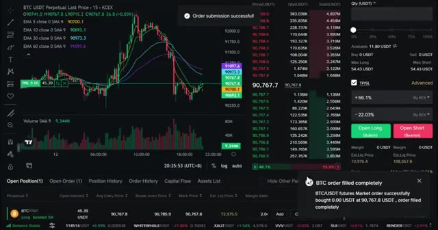
*⏱️ 00:00:08 — Graphique des prix BTC/USDT en bougies japonaises sur l'interface de l'échange KCX avec notification de confirmation de l'ordre d'achat.*

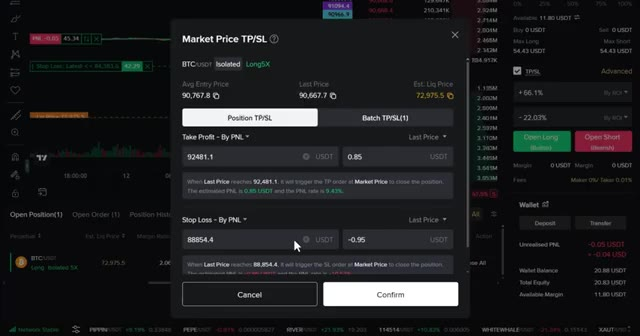
*⏱️ 00:00:16 — Fenêtre modale de configuration des niveaux de Take Profit (TP) et Stop Loss (SL) pour la position ouverte sur le Bitcoin.*

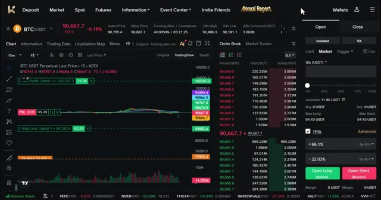
*⏱️ 00:00:25 — Vue d'ensemble de la plateforme KCX affichant le carnet d'ordres, le graphique de trading en direct et le panneau de gestion des positions.*

---

### ⏱️ `[00:00:33 - 00:01:10]` | Segment #02

**🔊 Audio (Transcription Intégrale Mot pour Mot en Français) :**
> les débutants ne le font pas. Cela ne va absolument pas se produire ici. Et avec mon lien exclusif, vous obtenez des frais de maker et de taker plus bas, ainsi que des récompenses en USDT pour la vérification, les tâches d'apprentissage, les trades au comptant et à terme de base, la configuration du TP/SL et la liaison de votre compte X. À la fin de cette vidéo, vous saurez exactement comment utiliser KCEX et comment réclamer chaque bonus disponible. Maintenant, voici pourquoi KCX est l'un de mes meilleurs choix d'échanges. KCX est une plateforme d'échange de confiance et en croissance rapide dans l'industrie de la crypto, conçue à la fois pour les débutants et les traders professionnels, avec pour valeur fondamentale les utilisateurs d'abord,

**👁️ Analyse Visuelle d'Écran (gemini-3.5-flash-lite) :**
**Interface & Outils** : Interface web de la plateforme KCEX et tableau de classement de plateformes d'échange crypto.

**Contenu textuel & Code** : Offres de bonus pour nouveaux utilisateurs, primes en USDT, informations sur les frais de maker/taker et volumes d'échange.
[COMPORTEMENT] Navigation sur la plateforme KCEX et présentation des avantages liés au lien d'affiliation exclusif.

**Action / Démonstration** : Explications face caméra et analyse conceptuelle des marchés.

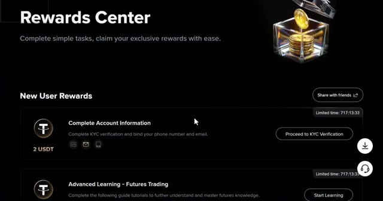
*⏱️ 00:00:42 — Capture montrant le Rewards Center d'une plateforme d'échange, détaillant les tâches pour nouveaux utilisateurs et les récompenses en USDT.*

*⏱️ 00:00:52 — Page d'accueil de la plateforme KCEX mettant en avant les frais de trading réduits et le trading de futures sur altcoins.*

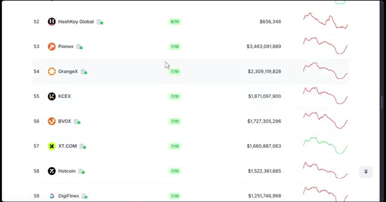
*⏱️ 00:01:01 — Tableau comparatif ou classement d'échanges crypto listant différentes plateformes avec leurs notes, volumes et graphiques de tendance.*

---

### ⏱️ `[00:01:11 - 00:01:49]` | Segment #03

**🔊 Audio (Transcription Intégrale Mot pour Mot en Français) :**
> la sécurité avant tout. KCX a l'un des frais les plus bas du marché. Cela signifie que vos ordres auront moins de coûts que sur les autres plateformes d'échange. Ils proposent une inscription rapide et simple. Ici, vous pouvez commencer à trader en quelques minutes, même sans vérification d'identité pour les fonctionnalités de base. KCX offre un large éventail de pièces, du Bitcoin et de l'Ethereum à des centaines d'altcoins et des milliers de paires de négociation. KCEX propose également de nombreuses options de trading telles que le comptant et les contrats à terme avec un effet de levier élevé pouvant aller jusqu'à 125 fois sur certaines paires. KCEX propose également un tableau de bord interactif où vous pouvez voir l'ensemble du marché des cryptomonnaies.

**👁️ Analyse Visuelle d'Écran (gemini-3.5-flash-lite) :**
**Interface & Outils** : Interface web de la plateforme d'échange de cryptomonnaies KCX.

**Contenu textuel & Code** : Formulaire d'inscription, tableau des tendances du marché (prix et variations en pourcentage), graphique de prix TradingView, carnet d'ordres et panneau de passage d'ordres (Market, Limit, effet de levier).

**Action / Démonstration** : Navigation et présentation de l'interface d'inscription, des paires de trading tendances et du terminal de trading de l'échange KCX.

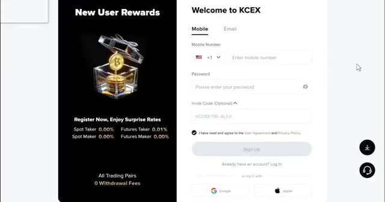
*⏱️ 00:01:20 — Page d'inscription de la plateforme KCX mettant en avant les récompenses pour les nouveaux utilisateurs et les frais bas.*

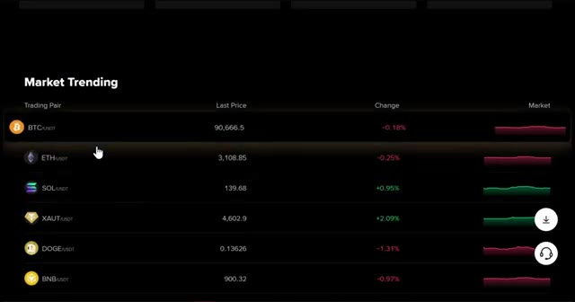
*⏱️ 00:01:30 — Tableau des tendances du marché sur KCX affichant les principales cryptomonnaies (BTC, ETH, SOL, etc.) et leurs variations de prix.*

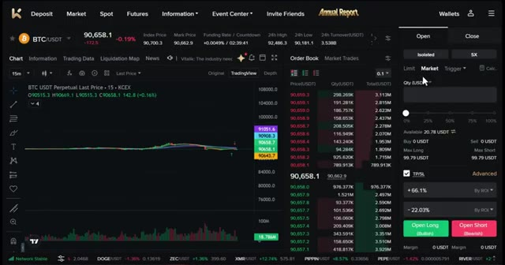
*⏱️ 00:01:39 — Interface de trading principale de KCX montrant un graphique TradingView, le carnet d'ordres et les options d'ordres d'achat/vente (Long/Short).*

---

### ⏱️ `[00:01:49 - 00:02:10]` | Segment #04

**🔊 Audio (Transcription Intégrale Mot pour Mot en Français) :**
> Vous pouvez y accéder via l'option de marché dans la barre de navigation, où vous trouverez le sentiment du marché, la dominance du Bitcoin, les liquidations et les données sur la capitalisation boursière. Vous pouvez également consulter les actifs négociables, les données de la blockchain publique, les indices de marché, les actualités économiques, les entrées et sorties de fonds des ETF des principales institutions, et même les flux de capitaux des investisseurs institutionnels.

**👁️ Analyse Visuelle d'Écran (gemini-3.5-flash-lite) :**
**Interface & Outils** : Interface web de la plateforme de trading avec onglets Market, Assets, Public Blockchain, Market Index, Information, ETF, Smart Money.

**Contenu textuel & Code** : Indicateurs de sentiment du marché (Neutral à 0), dominance du BTC (0,00%), Altcoin Season Index (0/100), liquidations sur 24 heures ($0), capitalisation des stablecoins USDT et USDC, et liste des crypto-monnaies principales (BTC à 90 702,13 $ et ETH à 3 110,17 $).

**Action / Démonstration** : Navigation et présentation des données globales du marché des crypto-monnaies.

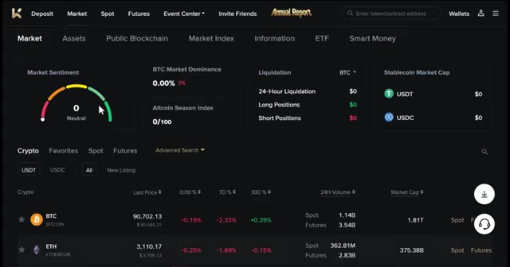
*⏱️ 00:01:54 — Capture d'écran montrant l'interface de l'option de marché sur une plateforme crypto, affichant le sentiment du marché, la dominance du Bitcoin, les liquidations et la capitalisation boursière.*

---

### ⏱️ `[00:02:10 - 00:02:32]` | Segment #05

**🔊 Audio (Transcription Intégrale Mot pour Mot en Français) :**
> KCEX combine facilité d'utilisation, sécurité, diversité et récompenses, ce qui le rend parfait pour les débutants comme pour les traders avancés. Maintenant que vous savez pourquoi j'aime cette plateforme, passons aux choses sérieuses. Tout d'abord, cliquez sur le lien dans la description. Utiliser ce lien est crucial pour débloquer tous les bonus exclusifs. Vous pouvez vous inscrire avec votre e-mail ou votre téléphone, ou vous connecter via Google ou Apple.

**👁️ Analyse Visuelle d'Écran (gemini-3.5-flash-lite) :**
**Interface & Outils** : Site web de la bourse de cryptomonnaies KCEX

**Contenu textuel & Code** : Informations sur les frais de trading (Spot Taker 0.00%, Futures Taker 0.01%, etc.) et formulaire d'inscription avec code de parrainage (KCOX8798-ALEX).

**Action / Démonstration** : Navigation sur le site KCEX et présentation de la page d'inscription pour les nouveaux utilisateurs.

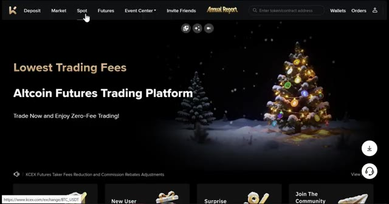
*⏱️ 00:02:16 — Page d'accueil de la plateforme KCEX avec le menu de navigation supérieur et une bannière de Noël.*

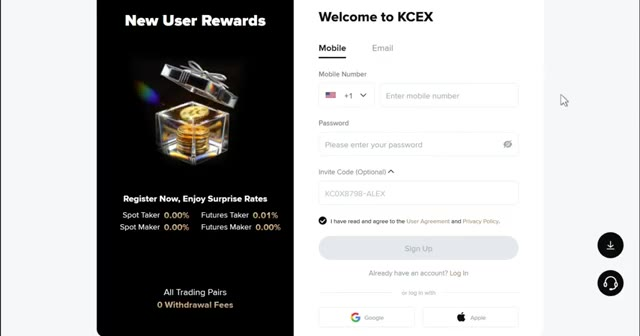
*⏱️ 00:02:21 — Page d'inscription de la plateforme KCEX affichant les détails des frais de transaction et le formulaire de création de compte.*

---

### ⏱️ `[00:02:33 - 00:02:52]` | Segment #06

**🔊 Audio (Transcription Intégrale Mot pour Mot en Français) :**
> Pour ce tutoriel, j'utiliserai Gmail. Une fois que vous êtes inscrit, vous êtes dans votre compte KCX et prêt à commencer. Des bonus seront débloqués au fur et à mesure que vous accomplirez certaines actions, ce que je vais vous montrer. Juste après vous être inscrit, vous pouvez réclamer vos premières récompenses en effectuant la vérification du compte. C'est un moyen simple de gagner deux USDT dès maintenant.

**👁️ Analyse Visuelle d'Écran (gemini-3.5-flash-lite) :**
**Interface & Outils** : Plateforme d'échange de crypto-monnaies KCX (site web).

**Contenu textuel & Code** : Interface utilisateur affichant des offres promotionnelles, des récompenses pour nouveaux utilisateurs (2 USDT), et des options de vérification KYC.

**Action / Démonstration** : Navigation sur la plateforme KCX pour présenter le compte utilisateur et les bonus d'inscription.

*⏱️ 00:02:37 — Page d'accueil de la plateforme KCX mettant en avant les frais de trading bas et une illustration de Noël.*

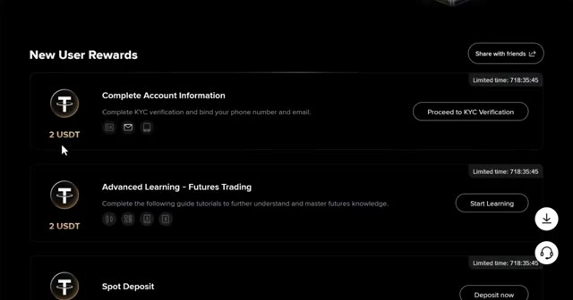
*⏱️ 00:02:47 — Section 'New User Rewards' sur KCX montrant les récompenses en USDT pour la complétion des informations de compte et l'apprentissage.*

---

### ⏱️ `[00:02:52 - 00:03:12]` | Segment #07

**🔊 Audio (Transcription Intégrale Mot pour Mot en Français) :**
> Et si vous terminez les tâches d'apprentissage avancées, c'est encore deux USDT instantanément. Une fois que vous êtes connecté, vous pouvez voir votre tableau de bord principal. Ici, vous pouvez voir en haut différentes options. KCX utilise différents types de comptes pour vous aider à organiser votre trading. Voici ce que signifie chacun des comptes : Compte au comptant. c'est là que vos dépôts atterrissent en premier.

**👁️ Analyse Visuelle d'Écran (gemini-3.5-flash-lite) :**
**Interface & Outils** : Plateforme d'échange de cryptomonnaies KCX (interface web).

**Contenu textuel & Code** : Solde estimé à 0 USDT, PnL du jour à 0.00 USD, frais Maker et Taker à 0 %, liste des actifs et détails du compte Spot.
[DESC_IMAGE_SUIVANTE] Sans objet.

**Action / Démonstration** : Navigation sur le tableau de bord du compte utilisateur pour présenter les différentes options et sections de la plateforme.

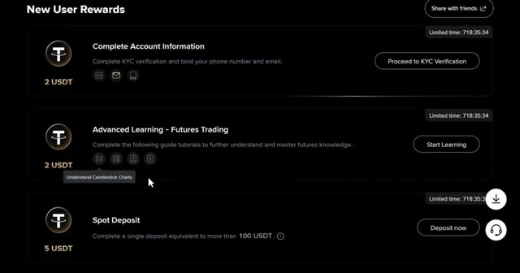
*⏱️ 00:02:57 — Page des récompenses utilisateur de la plateforme KCX, montrant différentes tâches (KYC, apprentissage futures, dépôt spot) avec les gains en USDT associés.*

*⏱️ 00:03:07 — Tableau de bord principal du compte Spot de KCX, affichant le solde estimé, le PnL, les frais de trading (Maker/Taker à 0%) et la liste des actifs.*

---

### ⏱️ `[00:03:12 - 00:03:31]` | Segment #08

**🔊 Audio (Transcription Intégrale Mot pour Mot en Français) :**
> Ici, vous pouvez également acheter et vendre des cryptomonnaies aux prix du marché. C'est idéal pour détenir des actifs ou trader sans effet de levier. Compte futures. C'est pour le trading avec effet de levier, vous permettant de prendre des positions plus importantes que ne le permet votre solde. Il débloque également des récompenses en bonus basées sur vos transferts et votre volume de trading.

**👁️ Analyse Visuelle d'Écran (gemini-3.5-flash-lite) :**
**Interface & Outils** : Interface web d'échange de cryptomonnaies (Blofin / WEEX / Bybit)

**Contenu textuel & Code** : Solde estimé à 0 USDT, PNL du jour à 0.00 USD (0.00%), Frais de Maker et Taker à 0%, et liste des actifs.

**Action / Démonstration** : Présentation de la section Spot du compte pour l'achat et la détention d'actifs sans effet de levier.

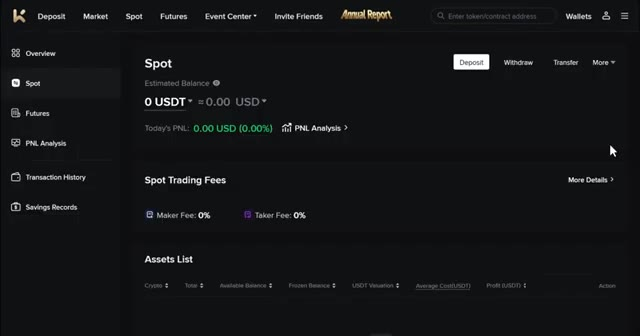
*⏱️ 00:03:17 — Vue d'ensemble du compte Spot sur une plateforme d'échange de cryptomonnaies, affichant le solde estimé et les frais de trading.*

---

### ⏱️ `[00:03:31 - 00:03:53]` | Segment #09

**🔊 Audio (Transcription Intégrale Mot pour Mot en Français) :**
> Ici, vous pouvez trader avec l'USDT comme marge. C'est ici que vous gagnerez vos futures, vos bonus de trading et vos récompenses de tâches quotidiennes. Vous pouvez également voir votre analyse de PNL, votre rapport de transactions et votre historique d'épargne. Sur KCEX, les utilisateurs peuvent gagner jusqu'à 5 % de taux annuel en pourcentage, et les utilisateurs peuvent également retirer des fonds à tout moment, ce qui s'accompagne de rendements stables.

**👁️ Analyse Visuelle d'Écran (gemini-3.5-flash-lite) :**
**Interface & Outils** : Plateforme d'échange de cryptomonnaies KCEX (interface web).

**Contenu textuel & Code** : Tâches de bonus (Futures Trading 2 USDT, TP/SL, liaison de compte X), historique des transactions, épargne flexible (5% APY).
[DESC_IMAGE_1] Navigation dans les sections de récompenses et d'historique de la plateforme KCEX.

**Action / Démonstration** : Explications face caméra et analyse conceptuelle des marchés.

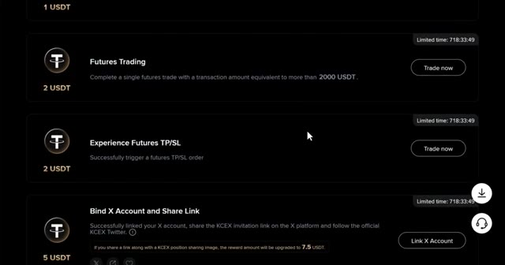
*⏱️ 00:03:37 — Interface montrant des bonus de tâches quotidiennes et de trading sur KCEX (Futures Trading, Experience Futures TP/SL, Bind X Account).*

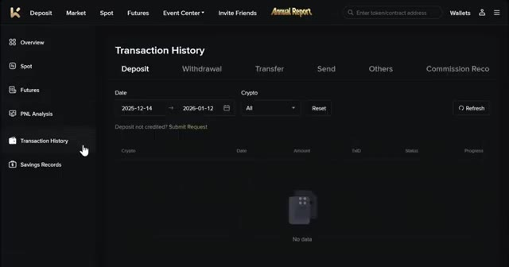
*⏱️ 00:03:42 — Page d'historique des transactions (Transaction History) avec onglets Dépôt, Retrait, Transfert et filtres de dates.*

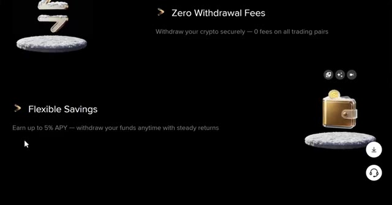
*⏱️ 00:03:48 — Section présentant les options d'épargne flexible avec un rendement allant jusqu'à 5% APY sur KCEX.*

---

### ⏱️ `[00:03:54 - 00:04:14]` | Segment #10

**🔊 Audio (Transcription Intégrale Mot pour Mot en Français) :**
> Sur la barre de navigation, vous pouvez également voir le centre des événements. Ici, vous pouvez voir les récompenses pour les nouveaux utilisateurs, où vous pouvez suivre vos bonus de nouveaux utilisateurs et la progression de vos tâches quotidiennes. Vous pouvez également voir ici le dépôt pour les cotations et la compétition de trading de contrats à terme. Maintenant que vous connaissez les bases, mettons de l'argent sur votre compte et commençons à réclamer des bonus.

**👁️ Analyse Visuelle d'Écran (gemini-3.5-flash-lite) :**
**Interface & Outils** : Interface web de la plateforme d'échange de cryptomonnaies KCEX (KCEX.com).

**Contenu textuel & Code** : Menus de navigation de la plateforme, sections 'Event Center', 'New User Rewards', 'Spot Deposit' (100 USDT), 'Spot Trading' (200 USDT) et gains en USDT.

**Action / Démonstration** : Navigation dans le menu 'Event Center' puis affichage des tâches et récompenses pour nouveaux utilisateurs.

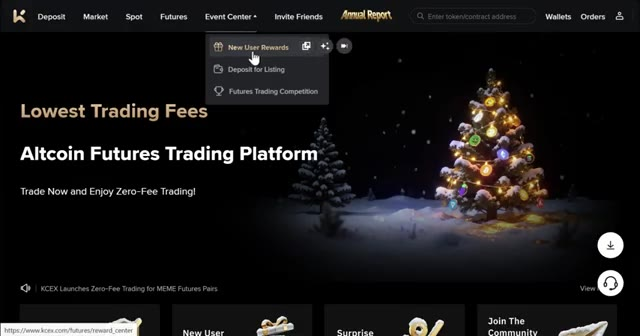
*⏱️ 00:03:59 — Page d'accueil de la plateforme KCEX montrant le menu déroulant 'Event Center' avec l'option 'New User Rewards' sélectionnée.*

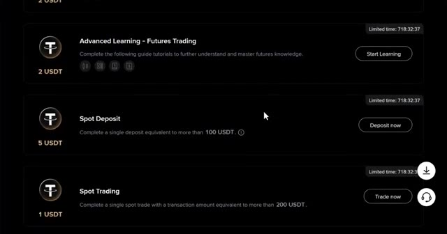
*⏱️ 00:04:04 — Page des récompenses pour nouveaux utilisateurs sur KCEX détaillant les tâches telles que 'Advanced Learning', 'Spot Deposit' et 'Spot Trading'.*

---

### ⏱️ `[00:04:14 - 00:04:33]` | Segment #11

**🔊 Audio (Transcription Intégrale Mot pour Mot en Français) :**
> Cliquez sur votre profil en haut à droite, puis choisissez portefeuilles, puis cliquez sur dépôt. Sur sélectionner une crypto, choisissez USDT. L'USDT est idéal pour le trading, mais Bitcoin ou Ethereum fonctionnent aussi. Lors de la sélection de votre réseau, choisissez le réseau TRC20 pour des frais bas. Vous verrez votre adresse de dépôt personnelle.

**👁️ Analyse Visuelle d'Écran (gemini-3.5-flash-lite) :**
**Interface & Outils** : Interface web d'une plateforme d'échange de cryptomonnaies.

**Contenu textuel & Code** : Menu de sélection de cryptomonnaies et liste des réseaux de dépôt disponibles avec leurs frais ou montants minimums (TRC20, BSC, ERC20, etc.).

**Action / Démonstration** : Navigation dans l'interface de dépôt pour sélectionner une cryptomonnaie (USDT) et son réseau de transfert (TRC20).

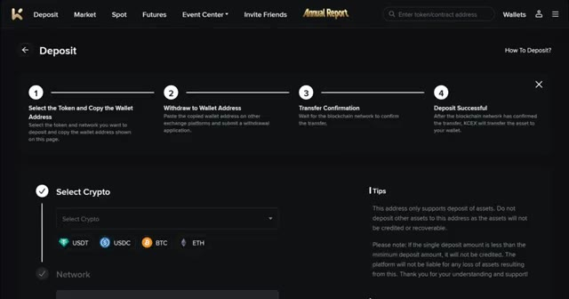
*⏱️ 00:04:19 — Page de dépôt d'une plateforme d'échange avec les options de sélection de crypto (USDT, USDC, BTC, ETH).*

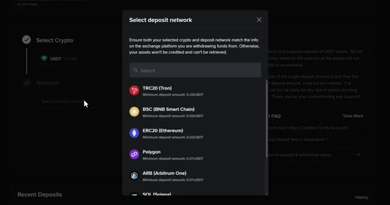
*⏱️ 00:04:28 — Fenêtre modale de sélection du réseau de dépôt affichant TRC20, BSC, ERC20, Polygon et autres.*

---

### ⏱️ `[00:04:33 - 00:05:00]` | Segment #12

**🔊 Audio (Transcription Intégrale Mot pour Mot en Français) :**
> Copiez-la soigneusement. Ensuite, allez sur votre échange ou portefeuille actuel, collez l'adresse et envoyez vos cryptos. Cela prend généralement 5 à 15 minutes. Un conseil de pro, envoyez toujours d'abord un petit montant test, peut-être 10 à 20 dollars, et vérifiez bien que le réseau correspond des deux côtés. C'est là que les bonus commencent à entrer en jeu. Si vous effectuez un seul trade au comptant avec un montant de transaction équivalant à plus de 200 USDT, vous pouvez obtenir un bonus de trading au comptant d'un USDT.

**👁️ Analyse Visuelle d'Écran (gemini-3.5-flash-lite) :**
**Interface & Outils** : Interfaces de plateformes d'échange de cryptomonnaies (Toobit et autre broker).

**Contenu textuel & Code** : Détails de retrait (19 USDT, réseau TRX, frais de 1 USDT), solde du portefeuille spot (20.9 USDT), et programme de bonus pour nouveaux utilisateurs.

**Action / Démonstration** : Validation d'une transaction de retrait et consultation du solde de cryptomonnaies.

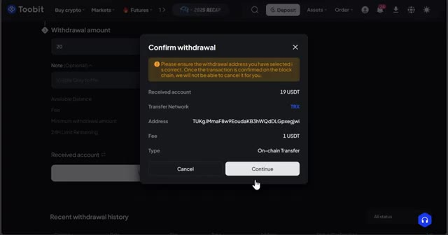
*⏱️ 00:04:40 — Fenêtre de confirmation de retrait sur la plateforme Toobit montrant les détails de la transaction (montant, réseau TRX, frais, adresse).*

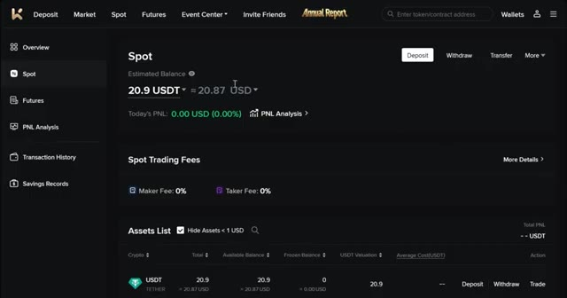
*⏱️ 00:04:47 — Vue du portefeuille Spot sur une plateforme d'échange affichant un solde estimé de 20.9 USDT et la liste des actifs.*

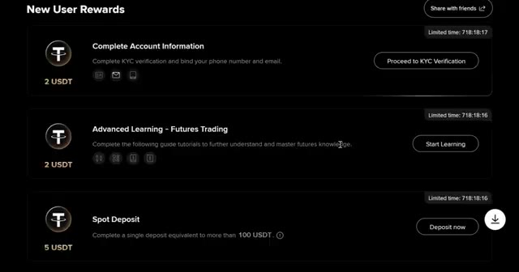
*⏱️ 00:04:53 — Page des récompenses pour nouveaux utilisateurs (New User Rewards) avec des tâches pour gagner des USDT.*

---

### ⏱️ `[00:05:00 - 00:05:22]` | Segment #13

**🔊 Audio (Transcription Intégrale Mot pour Mot en Français) :**
> Si vous effectuez un seul trade de futures avec un montant de transaction équivalant à plus de 2 000 USDT, vous pouvez obtenir un bonus de 2 USDT. Et un autre bonus de 2 USDT si vous déclenchez un TP ou un SL sur le trading de futures. En plus de cela, KCEX propose des taux de frais réduits pour tous vos trades, ce qui signifie que vous économisez de l'argent sur chaque transaction.

**👁️ Analyse Visuelle d'Écran (gemini-3.5-flash-lite) :**
**Interface & Outils** : Interface web de la plateforme d'échange KCEX (section des tâches ou bonus).

**Contenu textuel & Code** : Détails des conditions de bonus : Spot Trading (200 USDT pour 1 USDT), Futures Trading (2000 USDT pour 2 USDT), et Experience Futures TP/SL (2 USDT).

**Action / Démonstration** : Survol ou présentation des différentes tâches de trading permettant de gagner des bonus en USDT.

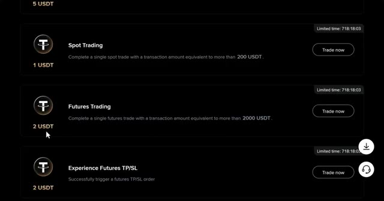
*⏱️ 00:05:06 — Interface montrant les différentes tâches de bonus sur la plateforme KCEX, notamment les conditions pour le trading de futures et les récompenses en USDT.*

---

### ⏱️ `[00:05:22 - 00:05:45]` | Segment #14

**🔊 Audio (Transcription Intégrale Mot pour Mot en Français) :**
> La plateforme vérifie que vous êtes un trader légitime et si vous êtes qualifié, le bonus sera crédité automatiquement. Si vous avez déposé du Bitcoin ou une autre cryptomonnaie mais que vous avez besoin d'USDT pour trader, voici comment le convertir. Allez dans le trading au comptant en cliquant sur comptant. Recherchez votre paire, par exemple, BTC slash USDT. Sélectionnez l'ordre au marché, choisissez vendre, entrez le montant et cliquez sur vendre, BTC.

**👁️ Analyse Visuelle d'Écran (gemini-3.5-flash-lite) :**
**Interface & Outils** : Interface web de l'échange de cryptomonnaies KCEX (Trading Spot).

**Contenu textuel & Code** : Liste des paires de trading (BTC/USDT, ETH/USDT, SOL/USDT, etc.), carnet d'ordres en temps réel, graphiques de prix et panneau d'achat/vente au comptant.

**Action / Démonstration** : Navigation vers l'interface de trading au comptant pour effectuer des conversions de cryptomonnaies.

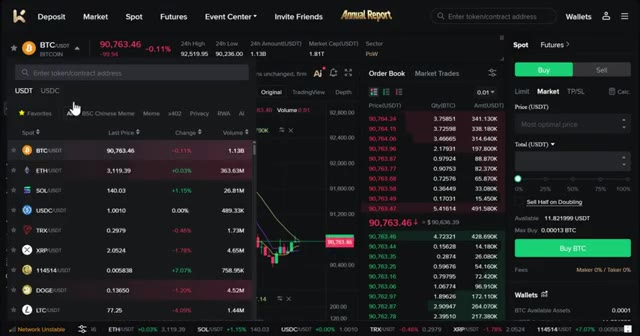
*⏱️ 00:05:39 — Interface de trading au comptant (Spot) de la plateforme KCEX avec le carnet d'ordres, le graphique des prix et la liste des cryptomonnaies.*

---

### ⏱️ `[00:05:45 - 00:06:05]` | Segment #15

**🔊 Audio (Transcription Intégrale Mot pour Mot en Français) :**
> Cela convertit instantanément vos Bitcoins en USDT, qui apparaissent ensuite dans votre portefeuille spot. Passons maintenant à ce que vous attendez, le trading de futures. Pour ouvrir des futures, cliquez sur futures dans la navigation principale. Après avoir cliqué sur futures, cela vous amènera au tableau de bord des futures. C'est ici que vous ferez la plupart de vos transactions.

**👁️ Analyse Visuelle d'Écran (gemini-3.5-flash-lite) :**
**Interface & Outils** : Interface web de l'échange de cryptomonnaies KCEX, comprenant les sections Spot et Futures.

**Contenu textuel & Code** : Soldes de comptes en USDT, graphiques de prix Bitcoin (BTC/USDT) avec indicateurs EMA, et carnet d'ordres en temps réel.

**Action / Démonstration** : Navigation depuis le portefeuille spot vers la section de trading de futures pour préparer l'ouverture de positions.

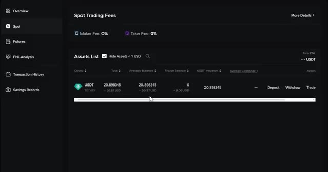
*⏱️ 00:05:50 — Vue du portefeuille spot affichant la liste des actifs avec le solde en USDT.*

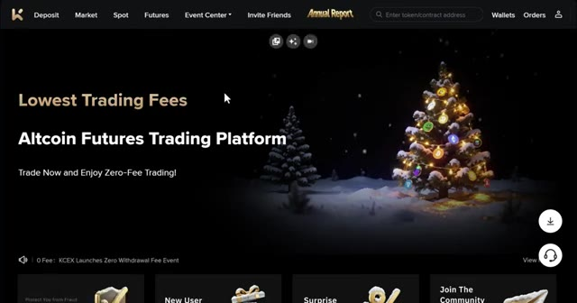
*⏱️ 00:05:55 — Page d'accueil de la plateforme de trading de futures affichant les frais de transaction.*

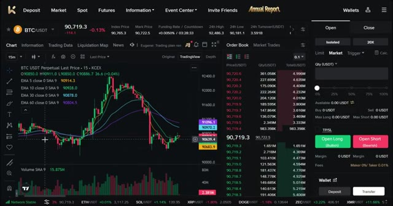
*⏱️ 00:06:00 — Interface complète de trading de futures avec un graphique TradingView du Bitcoin et le carnet d'ordres.*

---

### ⏱️ `[00:06:05 - 00:06:25]` | Segment #16

**🔊 Audio (Transcription Intégrale Mot pour Mot en Français) :**
> Je vais décortiquer chaque section pour que tout soit parfaitement clair. Voici ce que vous verrez sur l'écran de trading. La sélection de la paire de trading se trouve en haut à gauche. C'est ici que vous choisissez quelle crypto trader, comme BTC / USDT ou ETH / USDT ou n'importe quel autre altcoin. KCEX propose des centaines de paires disponibles.

**👁️ Analyse Visuelle d'Écran (gemini-3.5-flash-lite) :**
**Interface & Outils** : Interface de trading web (échange de crypto-monnaies intégrant un graphique TradingView)

**Contenu textuel & Code** : Graphique en chandeliers japonais pour la paire BTC/USDT avec des indicateurs de type moyennes mobiles (EMA 5, 10, 30, 60), un carnet d'ordres (Order Book), le prix actuel autour de 90 719 USDT, et le panneau de gestion des ordres à droite (Open Long / Open Short).

**Action / Démonstration** : Présentation de l'interface de trading et de la sélection de la paire BTC/USDT en haut à gauche.

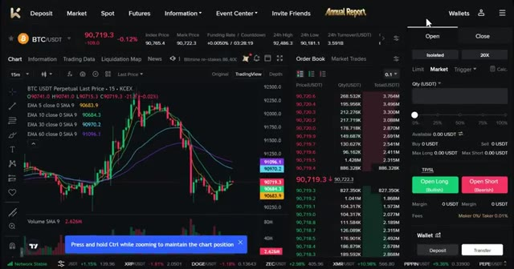
*⏱️ 00:06:10 — Capture d'écran montrant l'interface de trading d'une plateforme d'échange de cryptomonnaies avec le graphique de la paire BTC/USDT en timeframe 15 minutes, le carnet d'ordres et le panneau de passage d'ordres.*

---

### ⏱️ `[00:06:26 - 00:06:45]` | Segment #17

**🔊 Audio (Transcription Intégrale Mot pour Mot en Français) :**
> Le graphique des prix est au centre. Il montre l'historique des mouvements de prix et vous pouvez changer l'horizon temporel comme vous le souhaitez. KCEX utilise des graphiques TradingView qui sont la norme de l'industrie. Sur le côté droit, vous trouverez le carnet d'ordres. Les chiffres rouges sont les ordres de vente et les chiffres verts sont les ordres d'achat. Cela montre la profondeur du marché en temps réel.

**👁️ Analyse Visuelle d'Écran (gemini-3.5-flash-lite) :**
**Interface & Outils** : Interface de l'échange KCEX intégrant des graphiques TradingView.

**Contenu textuel & Code** : Graphique en chandeliers pour BTC/USDT sur l'unité de temps 15 minutes, affichant plusieurs moyennes mobiles (EMA 5, 10, 30, 60), le carnet d'ordres en temps réel avec les chiffres rouges et verts, ainsi que les options de trading (Market, Limit, Open Long/Short).

**Action / Démonstration** : Navigation et présentation de l'interface de trading, pointant sur l'horizon temporel et le carnet d'ordres.

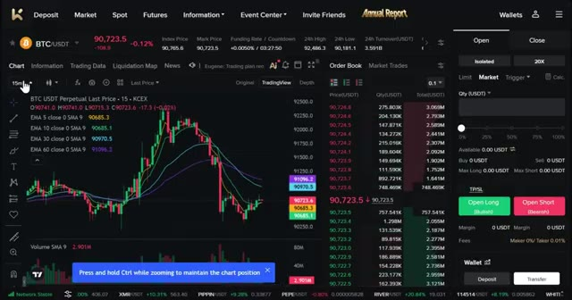
*⏱️ 00:06:31 — Capture d'écran de l'interface de trading KCEX montrant le graphique de prix BTC/USDT au centre, le carnet d'ordres à droite et le panneau de passage d'ordres.*

---

### ⏱️ `[00:06:45 - 00:07:14]` | Segment #18

**🔊 Audio (Transcription Intégrale Mot pour Mot en Français) :**
> Le panneau de passage d'ordres est tout à droite. C'est ici que vous passerez vos transactions, réglerez l'effet de levier et entrerez la taille de votre position. Enfin, tout en bas, se trouve le panneau des positions. Il affiche vos transactions actives, vos ordres ouverts, l'historique des ordres, l'historique de vos transactions, ainsi que les profits et pertes par crypto-monnaie. Tout ce dont vous avez besoin est juste ici, sur un seul écran, prêt à trader. Avant de placer le moindre trade, configurez trois paramètres importants. Premièrement, choisissez votre mode de marge. KCEX propose deux options, la marge isolée.

**👁️ Analyse Visuelle d'Écran (gemini-3.5-flash-lite) :**
**Interface & Outils** : Interface de la plateforme de trading KCEX avec graphiques TradingView.

**Contenu textuel & Code** : Graphique en chandeliers 15m du BTC/USDT, indicateurs EMA (5, 10, 30, 60), carnet d'ordres en temps réel et options de levier (20X).

**Action / Démonstration** : Navigation et présentation des différents panneaux de l'interface de trading de la plateforme (passage d'ordres et gestion des positions).

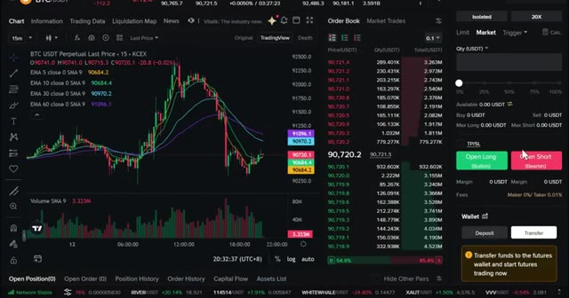
*⏱️ 00:06:53 — Vue d'ensemble de l'interface de trading montrant le graphique BTC/USDT, le carnet d'ordres central et le panneau de passage d'ordres situé tout à droite.*

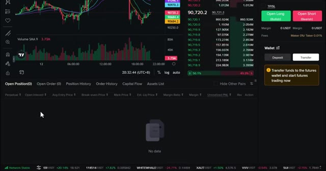
*⏱️ 00:07:00 — Gros plan sur le panneau inférieur des positions affichant les onglets des transactions actives, ordres ouverts et historiques.*

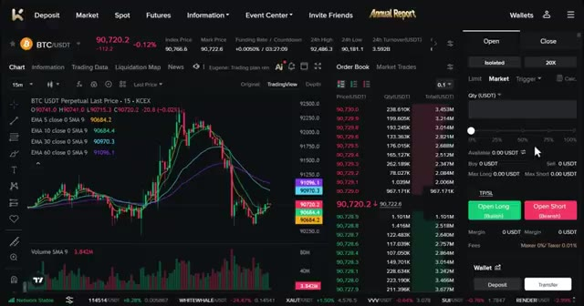
*⏱️ 00:07:07 — Vue générale de la plateforme avec le menu supérieur de la bourse et le récapitulatif du marché BTC/USDT.*

---

### ⏱️ `[00:07:14 - 00:07:35]` | Segment #19

**🔊 Audio (Transcription Intégrale Mot pour Mot en Français) :**
> Cela protège le reste de votre compte. Si le trade tourne mal, vous perdez seulement ce que vous avez mis dans cette position spécifique. En mode marge croisée, toutes les positions partagent le même solde de marge. En cas de liquidation, les traders risquent de perdre l'intégralité du solde de marge ainsi que toutes les positions ouvertes. Pour les débutants, utilisez toujours la marge isolée pour protéger votre compte.

**👁️ Analyse Visuelle d'Écran (gemini-3.5-flash-lite) :**
**Interface & Outils** : Interface de trading d'échange (type KCEX / plateforme similaire) avec graphique de prix et panneau de configuration des ordres.

**Contenu textuel & Code** : Menu de sélection du mode de marge affichant les options « Isolated » (Marge isolée) et « Cross » (Marge croisée) avec leurs descriptions textuelles respectives, ainsi que la case à cocher « Applies to all futures ».

**Action / Démonstration** : Sélection et explication visuelle des modes de marge (isolée et croisée) pour le trading de contrats futures.

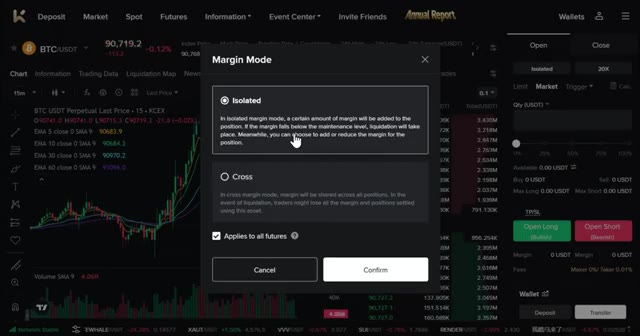
*⏱️ 00:07:20 — Fenêtre modale de sélection du mode de marge (Isolated vs Cross) superposée sur l'interface de trading de crypto-monnaies.*

---

### ⏱️ `[00:07:36 - 00:07:56]` | Segment #20

**🔊 Audio (Transcription Intégrale Mot pour Mot en Français) :**
> Deuxièmement, définissez votre effet de levier. KCX permet un effet de levier élevé, jusqu'à 125 fois sur certaines paires, mais n'utilisez pas un effet de levier élevé en tant que débutant. Limitez-vous à 5 fois ou 10 fois maximum. Voici comment cela fonctionne. Par exemple, si vous avez un solde de 10 dollars avec un effet de levier de 5 fois, vous obtenez 50 dollars de pouvoir d'achat en position.

**👁️ Analyse Visuelle d'Écran (gemini-3.5-flash-lite) :**
**Interface & Outils** : Interface de l'échange KCX (Futures Trading)

**Contenu textuel & Code** : Fenêtre de réglage du levier (réglé à 20X, curseur affichant des paliers de 1x à 125x), graphique du cours BTC/USDT en arrière-plan avec indicateurs EMA.

**Action / Démonstration** : Le présentateur manipule ou montre la fenêtre de sélection de l'effet de levier sur la plateforme KCX.

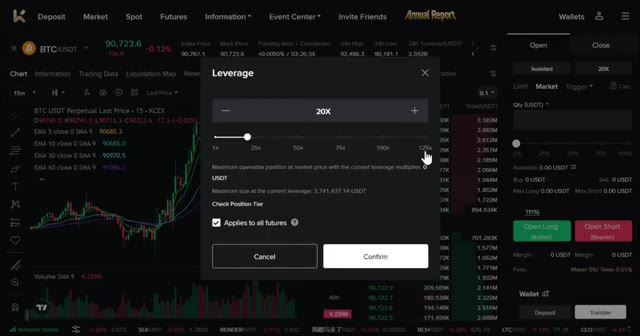
*⏱️ 00:07:41 — Capture d'écran de l'interface de l'échange KCX montrant la fenêtre pop-up de configuration du levier avec un curseur allant jusqu'à 125x.*

---

### ⏱️ `[00:07:57 - 00:08:16]` | Segment #21

**🔊 Audio (Transcription Intégrale Mot pour Mot en Français) :**
> Cela signifie que vous contrôlez pour 50 dollars de Bitcoin avec seulement 10 dollars de votre propre argent. Un effet de levier plus élevé signifie un risque plus élevé. Votre prix de liquidation se rapproche de votre entrée, donc un seul faux pas peut effacer votre position. Pour cet exemple, j'utilise un effet de levier de 5 fois sur marge isolée. Plaçons un ordre d'achat.

**👁️ Analyse Visuelle d'Écran (gemini-3.5-flash-lite) :**
**Interface & Outils** : Interface de trading de cryptomonnaies (KCEX)

**Contenu textuel & Code** : Fenêtre de réglage du levier positionnée à 5X, graphique en arrière-plan BTC/USDT en unité 15 minutes avec indicateurs EMA.

**Action / Démonstration** : Réglage ou sélection du niveau de levier (5X) pour le trading de contrats futures sur Bitcoin.

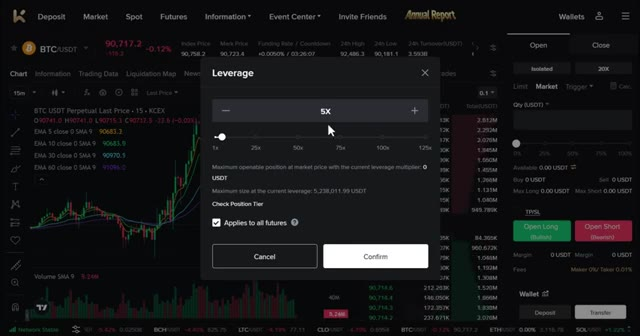
*⏱️ 00:08:02 — Interface d'échange de cryptomonnaies montrant une fenêtre contextuelle pour le réglage du levier (5X) avec un curseur allant de 1x à 125x.*

---

### ⏱️ `[00:08:16 - 00:08:50]` | Segment #22

**🔊 Audio (Transcription Intégrale Mot pour Mot en Français) :**
> Parier que le Bitcoin va monter. Choisissez l'ordre au marché pour qu'il s'exécute instantanément. Vous verrez les options de saisie d'ordre. Ordre par quantité. La quantité de la position de contrats à terme avec effet de levier appliqué. Cela peut être libellé en BTC et en USDT. Ordre par coût. Le coût ici n'est pas affecté par l'effet de levier. Pour ce tutoriel, j'utiliserai l'ordre par quantité en USDT car cela facilite le dimensionnement de la position. Définissez la taille de votre position. Par exemple, une position de 50 dollars. Avec un effet de levier de 5 fois, cela représente 10 dollars de vos propres capitaux. Définissez toujours un stop loss et un take

**👁️ Analyse Visuelle d'Écran (gemini-3.5-flash-lite) :**
**Interface & Outils** : Interface de trading de contrats à terme (Futures) sur une plateforme d'échange de cryptomonnaies.

**Contenu textuel & Code** : Graphique de prix BTC/USDT avec moyennes mobiles (EMA), carnet d'ordres, et configuration de la taille de position (50 USDT, effet de levier 5x).

**Action / Démonstration** : Configuration des paramètres d'unités de contrats à terme puis saisie du montant de l'ordre pour un achat au marché.

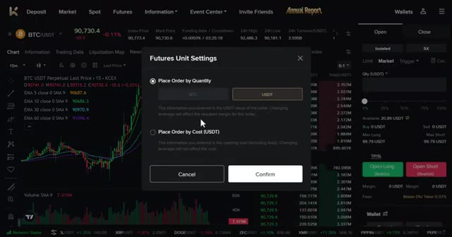
*⏱️ 00:08:25 — Fenêtre contextuelle des paramètres d'unités de contrats à terme affichant les options de saisie d'ordre par quantité (en BTC ou USDT) ou par coût (USDT).*

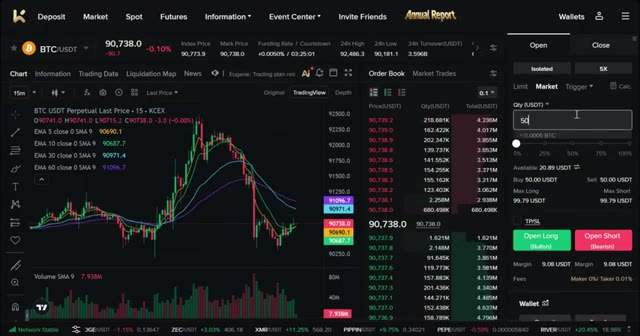
*⏱️ 00:08:41 — Interface de trading affichant le graphique du BTC/USDT en unités de 15 minutes avec le panneau de saisie d'un ordre au marché de 50 USDT.*

---

### ⏱️ `[00:08:50 - 00:09:10]` | Segment #23

**🔊 Audio (Transcription Intégrale Mot pour Mot en Français) :**
> bénéfice. C'est non négociable. Cliquez sur TPSL pour ouvrir les paramètres. Définissez votre stop loss à un prix où vous perdez 2 $ et votre take profit à un prix où vous gagneriez 6 $, soit un ratio risque/rendement de 1 pour 3. Une fois que tout est défini, cliquez sur ouvrir long. Votre trade est maintenant actif. Vous le verrez dans le panneau des positions.

**👁️ Analyse Visuelle d'Écran (gemini-3.5-flash-lite) :**
**Interface & Outils** : Interface de trading crypto (type KCEX ou similaire) avec graphique TradingView, carnet d'ordres et panneau de passage d'ordres.

**Contenu textuel & Code** : Configuration du ratio risque/rendement 1:3 avec un Take Profit de 6 $ et un Stop Loss de -2 $ sur une position Long BTC/USDT.

**Action / Démonstration** : Clic sur TP/SL pour configurer les paramètres de gestion des risques, saisie des valeurs de take profit et de stop loss, puis clic sur le bouton d'ouverture de position longue.

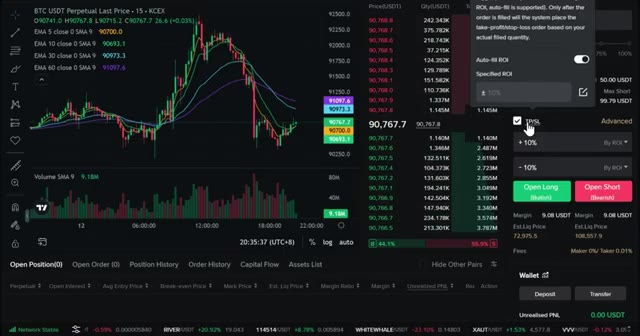
*⏱️ 00:08:55 — Image 1 montre l'interface de trading avec le curseur sur le bouton TP/SL pour configurer les paramètres de sortie de position.*

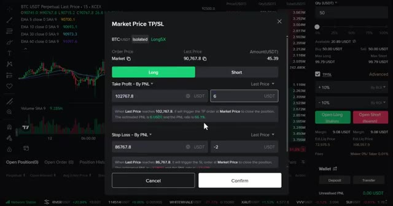
*⏱️ 00:09:00 — Image 2 montre la fenêtre contextuelle de configuration Market Price TP/SL avec le take profit réglé sur 6 $ et le stop loss sur -2 $.*

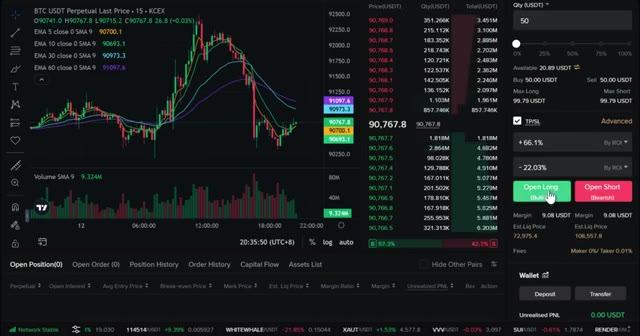
*⏱️ 00:09:05 — Image 3 montre l'interface de trading principale avec les paramètres TP/SL validés et le curseur sur le bouton 'Open Long'.*

---

### ⏱️ `[00:09:10 - 00:09:47]` | Segment #24

**🔊 Audio (Transcription Intégrale Mot pour Mot en Français) :**
> votre prix d'entrée, votre P&L actuel et votre prix de liquidation. Pour shorter les marchés, choisissez simplement ouvrir un short au lieu d'un long. Même processus, mais vous pariez que le prix va baisser. Et n'oubliez pas, votre volume de trading sur les contrats à terme aide à débloquer des bonus comme le bonus de trading de contrats à terme de deux USDT et le bonus d'expérience TPSL de deux USDT. Ne manquez donc surtout pas cela. Au fur et à mesure que votre trade évolue en votre faveur, ajustez votre stop loss pour sécuriser vos profits. Une fois que vous avez gagné quelques dollars, déplacez votre stop loss au seuil de rentabilité. Vous pouvez également augmenter ou réduire votre position pendant qu'elle est active en utilisant l'option d'ajout slash

**👁️ Analyse Visuelle d'Écran (gemini-3.5-flash-lite) :**
**Interface & Outils** : KCEX (plateforme de trading de cryptomonnaies)

**Contenu textuel & Code** : Graphique de prix BTC/USDT Perpetual, indicateurs EMA, carnet d'ordres, panneau de passage d'ordres (Open Long / Open Short), informations sur les positions ouvertes (prix d'entrée, P&L, prix de liquidation) et liste de tâches pour bonus en USDT.

**Action / Démonstration** : Navigation sur la plateforme de trading, observation d'une position longue ouverte et consultation des bonus de trading disponibles.

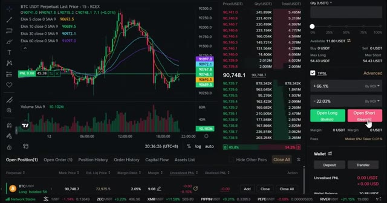
*⏱️ 00:09:19 — Interface de trading crypto montrant un graphique des prix BTC/USDT, un carnet d'ordres et les boutons d'exécution d'ordres long et short.*

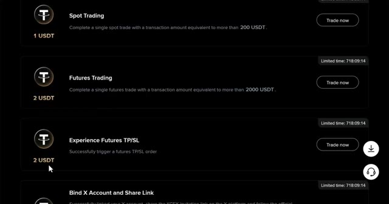
*⏱️ 00:09:28 — Page de récompenses et de bonus de la plateforme affichant différentes tâches de trading et de configuration pour gagner des USDT.*

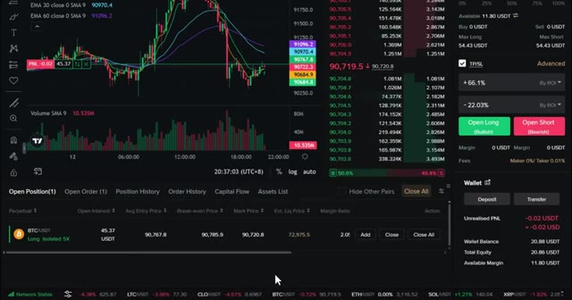
*⏱️ 00:09:37 — Interface de trading affichant les détails d'une position ouverte sur le Bitcoin en mode long avec effet de levier (Isolated 5X).*

---

### ⏱️ `[00:09:47 - 00:10:22]` | Segment #25

**🔊 Audio (Transcription Intégrale Mot pour Mot en Français) :**
> réduire les boutons. Pour fermer, laissez TP ou SL fermer automatiquement. Fermez manuellement avec le bouton de fermeture. Fermez un pourcentage de la position si vous voulez prendre des profits partiels. Ajustez le TP et le SL directement sur le graphique en faisant glisser les lignes. Astuce de pro, ne soyez pas gourmand. Si vous atteignez votre objectif de take profit, fermez le trade. Le marché vous donnera toujours une autre opportunité. Avant de conclure, voici les règles essentielles pour trader. Commencez avec de petites tailles de position. Ne risquez pas plus de 2 à 5 % par trade pour garder votre capital intact. Utilisez toujours des stop-loss. C'est non négociable lorsque vous faites

**👁️ Analyse Visuelle d'Écran (gemini-3.5-flash-lite) :**
**Interface & Outils** : Plateforme de trading crypto (interface de type échange de contrats perpétuels).

**Contenu textuel & Code** : Graphique BTC/USDT en timeframe 15m, carnet d'ordres, informations sur la position ouverte, niveaux de Take Profit (TP) et Stop Loss (SL).

**Action / Démonstration** : Démonstration de la fermeture partielle d'une position et de l'ajustement des niveaux de risque directement sur le graphique.

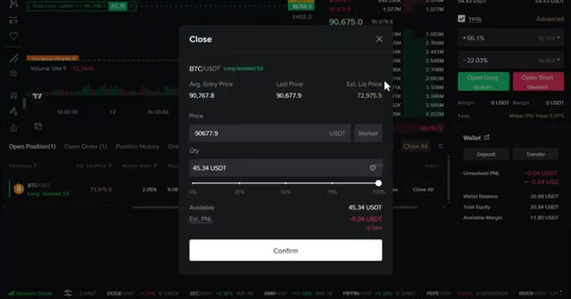
*⏱️ 00:09:55 — Fenêtre contextnelle de fermeture de position sur la plateforme de trading avec curseur de pourcentage.*

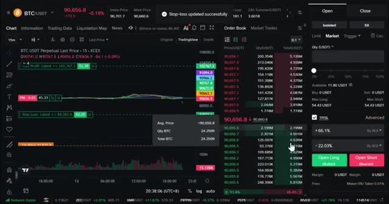
*⏱️ 00:10:04 — Interface de trading affichant un graphique de prix avec des niveaux de TP et SL modifiables.*

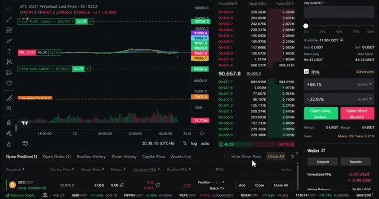
*⏱️ 00:10:13 — Interface complète avec le carnet d'ordres et les positions ouvertes en bas de l'écran.*

---

### ⏱️ `[00:10:22 - 00:11:00]` | Segment #26

**🔊 Audio (Transcription Intégrale Mot pour Mot en Français) :**
> trading. Chaque transaction a besoin d'un stop loss avant d'entrer. Tenez un journal de trading. Notez chaque transaction que vous effectuez. Prix d'entrée, prix de sortie, pourquoi vous l'avez prise, ce que vous avez appris. C'ici que vous vous améliorez. Ne courez jamais après les hausses. Si vous avez raté un mouvement, attendez la configuration suivante. Le FOMO est le moyen le plus rapide de perdre de l'argent. Et enfin, ne risquez jamais plus que ce que vous pouvez vous permettre de perdre. Le trading est une compétence qui peut vous donner de la liberté, mais il peut aussi devenir risqué. Cela demande de la répétition et de la discipline. Très bien, c'est donc l'analyse complète de la façon de trader les contrats à terme sur KCEX. De l'inscription au dépôt jusqu'à l'ouverture

**👁️ Analyse Visuelle d'Écran (gemini-3.5-flash-lite) :**
**Interface & Outils** : Interface de trading d'une plateforme d'échange (type exchange crypto avec graphique TradingView intégré).

**Contenu textuel & Code** : Graphique en chandeliers 15m pour BTC/USDT, indicateurs EMA (5, 10, 30, 60), carnet d'ordres (Order Book), options d'effet de levier (5x puis 20x), et types d'ordres (Market, Limit, TP/SL).

**Action / Démonstration** : Navigation et présentation de l'interface de trading, illustrant le passage d'ordres d'achat/vente (Open Long / Open Short) avec gestion du levier et des risques.

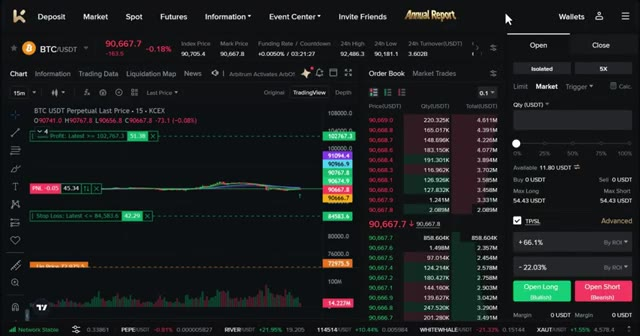
*⏱️ 00:10:31 — Interface de trading montrant un graphique BTC/USDT en unités de 15 minutes avec le carnet d'ordres et les options de passage d'ordres.*

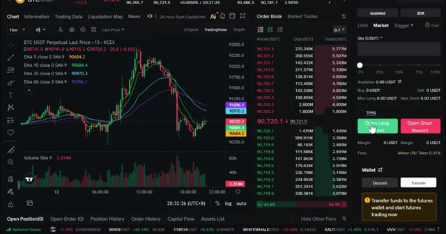
*⏱️ 00:10:50 — Interface de trading avec l'affichage de moyennes mobiles exponentielles (EMA) sur le graphique du cours du Bitcoin (BTC/USDT).*

---

### ⏱️ `[00:11:00 - 00:11:15]` | Segment #27

**🔊 Audio (Transcription Intégrale Mot pour Mot en Français) :**
> et à gérer votre premier trade. Avant de partir, rappelez-vous, utilisez mon lien dans la description pour réclamer tous les bonus. Commencez petit, concentrez-vous sur l'apprentissage, et ne courez pas après les profits au début. Si vous avez des questions, laissez-les dans les commentaires ci-dessous, et je vous vois dans la prochaine vidéo.

**👁️ Analyse Visuelle d'Écran (gemini-3.5-flash-lite) :**
**Interface & Outils** : KCEX (Interface d'échange de cryptomonnaies / Futures)

**Contenu textuel & Code** : Paire BTC/USDT Perpetuel, prix actuel autour de 90 667$, effet de levier 5x en mode isolé, PnL non réalisé à -0.05 USDT.

**Action / Démonstration** : Gestion et visualisation d'une position longue ouverte sur le Bitcoin avec affichage du carnet d'ordres et du solde disponible.

*⏱️ 00:11:07 — Interface de trading de KCEX sur la paire BTC/USDT avec graphique de prix, carnet d'ordres et panneau de passage d'ordre.*

*⏱️ 00:11:11 — Interface de trading de KCEX montrant en bas le panneau des positions ouvertes avec les détails du trade en cours sur le BTC/USDT.*

---

