# 🎬 This Beginner Trading Strategy Helps Me Make $100 Per Day

> **Chaîne** : [Alex Carter](https://www.youtube.com/@AlexCarterTrading)  
> **Lien YouTube** : [https://www.youtube.com/watch?v=OL8C9S7sOYE](https://www.youtube.com/watch?v=OL8C9S7sOYE)  
> **Date de publication** : 20260115  
> **Durée** : 00:06:25  
> **Identifiant vidéo** : `OL8C9S7sOYE`  
> **Transcription & Analyse** : `whisper-v3-large-turbo+gemini-3.5-flash-lite`  

---

## 📌 Synthèse Exécutive & Outils

### 💡 Résumé
Cette vidéo propose une approche structurée du trading de dérivés crypto sur des plateformes sans KYC (KCEX et Bybit), conçue pour générer un objectif visé de 100 $ par jour, particulièrement adaptée aux débutants en scalping et day trading. L'analyste y détaille une stratégie technique s'appuyant sur l'association de deux indicateurs phares sur TradingView : le *RSI VWAP* (avec une longueur spécifique fixée à 15 et des seuils de survente/surachat adaptés à 10) et l'*Extreme Reversal Setup* (multiplicateur réglé à 3 pour filtrer le bruit de marché). 

La méthode repose sur une double confirmation rigoureuse : l'identification d'une zone d'excès via le nuage de couleur du RSI VWAP combinée à l'apparition d'un signal visuel de retournement extrême. L'exécution se fait ensuite en respectant des règles strictes de gestion du risque (utilisation de la marge isolée, effet de levier modéré de 5x à 10x, et ratio risque/rendement de 2:1 ou 3:1). Cette synergie d'outils permet d'aborder les unités de temps courtes (5 et 15 minutes) avec un cadre statistique favorable, tout en minimisant l'exposition au capital global.

### 🛠️ Outils, Modèles & Logiciels Présentés
* **KCEX** : Échange de cryptomonnaies orienté dérivés, sélectionné pour son absence totale de vérification KYC et ses frais réduits.
* **Bybit** : Plateforme alternative recommandée offrant d'importants bonus de trading (jusqu'à 30 000 USDT) pour les utilisateurs ne pouvant accéder à KCEX.
* **TradingView** : Logiciel de cartographie et d'analyse technique incontournable pour configurer les indicateurs graphiques et surveiller les unités de temps.
* **RSI VWAP** : Indicateur technique personnalisé sur TradingView combinant le RSI et le VWAP, paramétré ici avec une longueur de 15 et des seuils à 10 pour identifier les zones de surachat/survente.
* **Extreme Reversal Setup** : Indicateur de retournement de tendance utilisé avec un multiplicateur de 3 pour générer des signaux d'entrée précis et filtrer les faux positifs.
* **TRC20** : Réseau blockchain privilégié pour les dépôts et retraits d'USDT en raison de sa rapidité d'exécution et de la faiblesse de ses frais de transaction.
* **Grok Bots** : Outil d'IA conversationnelle et d'automatisation (mentionné dans le contexte de la chaîne d'Alex Carter pour l'optimisation des flux de trading).
* **Claude Code** : Environnement de développement et d'assistance par IA (associé aux méthodologies de code et d'automatisation de stratégies de la chaîne).
* **Pine Script** : Langage de programmation propriétaire de TradingView utilisé pour coder, backtester et automatiser des stratégies de trading sur mesure.

### 🔑 Points Clés & Enseignements Stratégiques
* **Accessibilité et rapidité d'exécution** : L'utilisation de plateformes sans KYC comme KCEX permet de s'affranchir des frictions administratives et de débuter le trading instantanément après un dépôt.
* **Sélection des actifs et des unités de temps** : La stratégie s'applique idéalement sur des paires liquides comme le BTC/USDT, en privilégiant les graphiques de 5 minutes ou de 15 minutes pour capturer des opportunités de scalping quotidiennes.
* **Paramétrage sur-mesure du RSI VWAP** : Régler la longueur à 15 et les seuils de survente/surachat à 10 permet de générer des signaux plus sélectifs et d'isoler les retournements de marché majeurs.
* **Optimisation de l'indicateur de retournement** : L'application d'un multiplicateur à 3 sur l'indicateur *Extreme Reversal Setup* agit comme un filtre robuste éliminant les faux signaux en période de forte volatilité.
* **Configuration d'achat (Long)** : Attendre que la ligne RSI passe sous les seuils de survente (nuage vert actif), puis valider l'entrée dès l'apparition d'un signal bleu *Extreme Reversal Setup* sous la bougie.
* **Configuration de vente (Short)** : Attendre que la ligne RSI dépasse les seuils de surachat (nuage rouge actif), puis valider l'entrée dès l'apparition d'un signal rouge *Extreme Reversal Setup* au-dessus de la bougie.
* **Gestion du risque par la marge isolée** : L'utilisation de la marge isolée plutôt que croisée cloisonne le risque de chaque trade au seul montant alloué à la position, protégeant ainsi le solde global du compte.
* **Maîtrise de l'effet de levier** : Bien que les plateformes permettent des effets de levier très élevés (jusqu'à 125x), il est fortement conseillé aux débutants de se limiter à un levier de 5x à 10x pour éviter la liquidation rapide.
* **Placement rigoureux du Stop Loss** : Le stop loss doit être positionné de manière systématique juste au-delà du récent creux (pour un long) ou sommet (pour un short), généralement entre 1 % et 2 % de distance par rapport au prix d'entrée.
* **Ratio Risque/Rendement asymétrique** : Viser systématiquement un objectif de profit (Take Profit) équivalent à 2 ou 3 fois le montant risqué (ratio 2:1 ou 3:1) pour garantir une rentabilité globale à long terme, même avec un taux de réussite modéré.
* **Montée en charge progressive** : Recommander de débuter avec des tailles de positions réduites pour valider la psychologie de trading avant d'augmenter progressivement l'engagement financier à mesure que la confiance s'installe.

---

## ⏱️ Chronologie & Transcription Complète Audio & Visuelle (Mot pour Mot)

### ⏱️ `[00:00:00 - 00:00:23]` | Segment #01

**🔊 Audio (Transcription Intégrale Mot pour Mot en Français) :**
> Dans cette vidéo, je vais vous montrer une stratégie de trading éprouvée que les débutants utilisent pour gagner environ 100 dollars par jour sur KCEX. Cette stratégie est simple, puissante et adaptée aux débutants, et le meilleur, c'est qu'elle fonctionne sur n'importe quelle unité de temps, que vous fassiez du scalping ou du day trading. Je vais vous l'expliquer étape par étape et vous montrer les indicateurs exacts et les paramètres que j'utilise personnellement.

**👁️ Analyse Visuelle d'Écran (gemini-3.5-flash-lite) :**
**Interface & Outils** : TradingView

**Contenu textuel & Code** : Graphique des bougies japonaises pour BTC/USDT (MEXC), volume, indicateur ERS (50, 3, 0.5, 0.95), et un indicateur RSI-VWAP en bas avec des zones colorées en rouge et vert. On aperçoit des marqueurs de position "Long" et des ordres de clôture.

**Action / Démonstration** : Le curseur survole un point du graphique pour inspecter les prix et les signaux de trading sur l'unité de temps de 5 minutes.

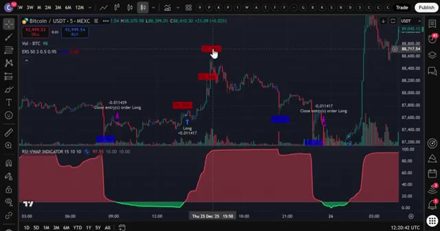
*⏱️ 00:00:06 — Un graphique de trading affichant les prix du Bitcoin (BTC/USDT) en unités de 5 minutes avec des indicateurs techniques et des signaux d'achat/vente.*

---

### ⏱️ `[00:00:23 - 00:00:42]` | Segment #02

**🔊 Audio (Transcription Intégrale Mot pour Mot en Français) :**
> Donc assurez-vous de regarder jusqu'à la fin. Très bien les gars, étape numéro un, inscrivez-vous sur un échange. Pour cette stratégie, nous allons utiliser KCEX. Maintenant, voici la partie importante. KCEX ne requiert absolument aucune vérification KYC, ce qui signifie que vous pouvez commencer à trader immédiatement sans envoyer aucun document personnel.

**👁️ Analyse Visuelle d'Écran (gemini-3.5-flash-lite) :**
**Interface & Outils** : Site web de l'échange KCEX

**Contenu textuel & Code** : Formulaire d'inscription (Mobile Number / Password / Invite Code), mentions des frais de trading à 0% ou très faibles (Spot Taker/Maker 0.00%, Futures Taker 0.01%) et bannières promotionnelles de récompenses.

**Action / Démonstration** : Présentation de l'interface d'inscription de l'échange KCEX sans vérification KYC requise.

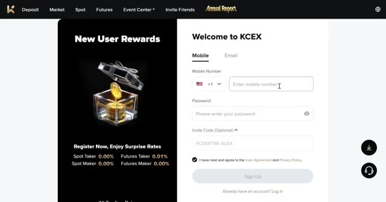
*⏱️ 00:00:28 — Page d'inscription de l'échange KCEX avec un formulaire pour entrer le numéro de mobile ou l'e-mail, et des informations sur les récompenses pour les nouveaux utilisateurs.*

---

### ⏱️ `[00:00:42 - 00:01:01]` | Segment #03

**🔊 Audio (Transcription Intégrale Mot pour Mot en Français) :**
> Si KCEX n'est pas disponible dans votre pays, vous pouvez utiliser Bybit comme alternative. Ils offrent jusqu'à 30 000 USDT de bonus de trading en ce moment. Je mettrai les deux liens en bas. Mais pour cette vidéo, nous utiliserons KCEX. Pour vous inscrire sur KCEX et réclamer vos bonus, cliquez sur le lien tout en haut de la description.

**👁️ Analyse Visuelle d'Écran (gemini-3.5-flash-lite) :**
**Interface & Outils** : Pages web des courtiers crypto Bybit et KCEX

**Contenu textuel & Code** : Offres de bonus de trading, codes de parrainage, formulaires d'inscription et frais de taker/maker (0,00 % / 0,01 %).

**Action / Démonstration** : Présentation des plateformes alternatives de trading et de leurs avantages de parrainage.

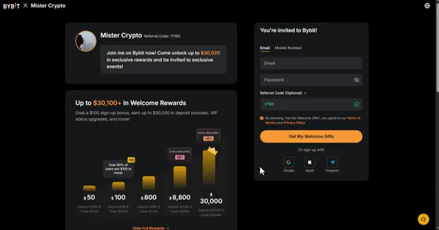
*⏱️ 00:00:47 — Page d'inscription de Bybit affichant les bonus de bienvenue et les détails de parrainage.*

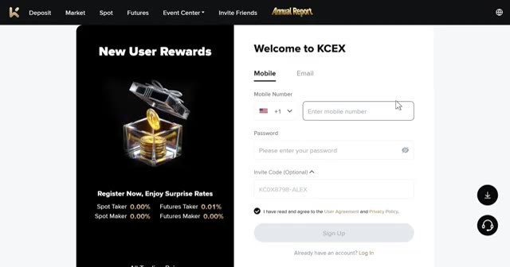
*⏱️ 00:00:57 — Page d'inscription de la plateforme KCEX affichant les récompenses pour les nouveaux utilisateurs et les frais de transaction.*

---

### ⏱️ `[00:01:02 - 00:01:24]` | Segment #04

**🔊 Audio (Transcription Intégrale Mot pour Mot en Français) :**
> Vous serez redirigé vers la page d'inscription où vous avez simplement à entrer votre e-mail, créer un mot de passe, et vous êtes prêts à commencer. Aucune vérification n'est nécessaire. Maintenant, KCX propose de très belles récompenses pour les nouveaux utilisateurs. Vous bénéficiez de frais de transaction réduits, de récompenses pour la vérification du compte, et vous pouvez gagner jusqu'à 5 USDT rien qu'en liant votre compte X et en partageant votre lien de parrainage.

**👁️ Analyse Visuelle d'Écran (gemini-3.5-flash-lite) :**
**Interface & Outils** : Interface web de la plateforme d'échange KCX (page d'inscription et centre de récompenses).

**Contenu textuel & Code** : Formulaire d'inscription, frais de transaction (0% en spot, 0.01% en futures) et bonus en USDT pour les tâches de dépôt et de trading.

**Action / Démonstration** : Navigation sur la page d'inscription et présentation des avantages et récompenses pour les nouveaux utilisateurs de KCX.

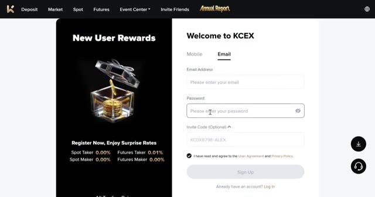
*⏱️ 00:01:07 — Page d'inscription de la plateforme KCX montrant le formulaire avec l'adresse email et le mot de passe, ainsi que les frais de trading (Spot Taker/Maker 0.00%, Futures Taker 0.01%).*

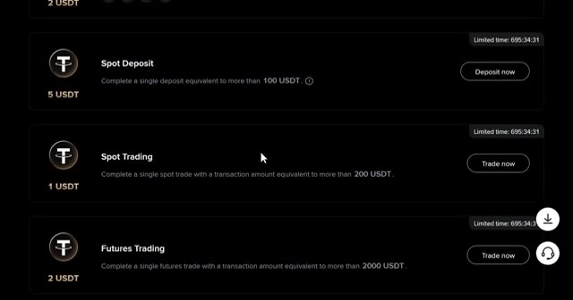
*⏱️ 00:01:18 — Section des récompenses pour nouveaux utilisateurs sur KCX, détaillant les bonus pour le dépôt spot et le trading spot/futures.*

---

### ⏱️ `[00:01:24 - 00:01:47]` | Segment #05

**🔊 Audio (Transcription Intégrale Mot pour Mot en Français) :**
> mais la meilleure partie c'est que vous pouvez commencer à trader immédiatement avec zéro friction. Laissez-moi vous montrer comment vous configurer. L'étape numéro deux consiste à déposer des fonds. Une fois que vous êtes connecté à KCEX, cliquez sur portefeuilles dans le coin supérieur droit puis cliquez sur déposer. Choisissez la pièce que vous voulez déposer. Je recommande l'USDT et sélectionnez le bon réseau blockchain. Assurez-vous de choisir le bon réseau pour éviter de perdre vos fonds.

**👁️ Analyse Visuelle d'Écran (gemini-3.5-flash-lite) :**
**Interface & Outils** : Site web de l'échange de cryptomonnaies KCEX

**Contenu textuel & Code** : Menus de navigation (Deposit, Market, Spot, Futures, Wallets) et options de sélection d'actifs pour le dépôt (USDT, USDC, BTC, ETH).

**Action / Démonstration** : Navigation sur la plateforme KCEX et sélection d'une cryptomonnaie pour effectuer un dépôt de fonds.

*⏱️ 00:01:29 — Page d'accueil de la plateforme d'échange KCEX affichant le menu de navigation supérieur et une bannière promotionnelle de trading de futures.*

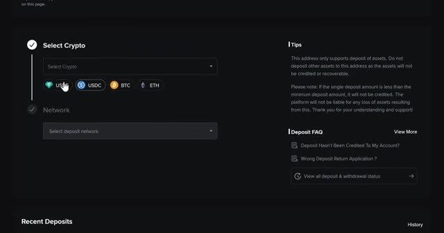
*⏱️ 00:01:41 — Interface de dépôt de fonds sur KCEX avec les options de sélection de cryptomonnaies (USDT, USDC, BTC, ETH) et de réseau.*

---

### ⏱️ `[00:01:47 - 00:02:11]` | Segment #06

**🔊 Audio (Transcription Intégrale Mot pour Mot en Français) :**
> Personnellement, j'aime utiliser le TRC20 parce qu'il est rapide et les frais sont très bas. Confirmez les détails, puis scannez le QR code ou copiez l'adresse de dépôt pour transférer vos fonds depuis votre portefeuille ou un autre échange. Une fois vos fonds déposés, il est temps d'ouvrir une position. L'étape numéro trois consiste à ouvrir votre première position. Cliquez sur "Futures" dans le menu supérieur. Cela vous amènera à l'interface de trading.

**👁️ Analyse Visuelle d'Écran (gemini-3.5-flash-lite) :**
**Interface & Outils** : Interface web de l'échange de cryptomonnaies KCEX (pages de dépôt et d'accueil).

**Contenu textuel & Code** : Adresse de dépôt TRC20, QR code, informations sur le dépôt minimum (0.02 USDT) et bannières promotionnelles de la plateforme.
[DESCR_IMAGE_2] Navigation sur l'interface de l'échange pour présenter les options de dépôt et les caractéristiques de la plateforme.

**Action / Démonstration** : Sélection du réseau TRC20 pour effectuer un dépôt de fonds en USDT avant d'ouvrir une position.

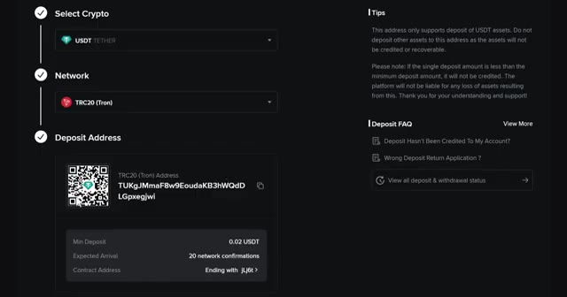
*⏱️ 00:01:53 — Interface de dépôt de cryptomonnaie montrant la sélection du réseau TRC20 (Tron) pour l'USDT, avec le QR code et l'adresse de dépôt correspondante.*

*⏱️ 00:02:05 — Page d'accueil de la plateforme d'échange KCEX mettant en avant les frais de trading bas et le trading de contrats futures sur altcoins.*

---

### ⏱️ `[00:02:11 - 00:02:45]` | Segment #07

**🔊 Audio (Transcription Intégrale Mot pour Mot en Français) :**
> Choisissez l'actif que vous souhaitez trader dans le coin supérieur gauche. Pour cet exemple, j'utiliserai BTC slash USDT. Sélectionnez votre type d'ordre, limite ou au marché. Pour les débutants, je recommande de commencer par des ordres au marché pour une exécution instantanée. Entrez les détails de votre trade, tels que la quantité et le prix. Ensuite, choisissez votre type de effet de levier. Vous pouvez utiliser la marge croisée ou la marge isolée. Personnellement, j'utilise la marge isolée car elle limite votre risque à cette position spécifique uniquement. Donc, si le trade tourne mal, vous perdez seulement ce que vous avez mis dans le trade, et non le solde de tout votre compte. Vous pouvez utiliser jusqu'à

**👁️ Analyse Visuelle d'Écran (gemini-3.5-flash-lite) :**
**Interface & Outils** : Interface d'échange de cryptomonnaies (KCEX)

**Contenu textuel & Code** : Graphique en chandeliers 15m de BTC/USDT, indicateurs EMA, carnet d'ordres en temps réel, options de type d'ordre (Limit, Market) et modes de marge (Isolated, Cross).

**Action / Démonstration** : Sélection du type d'ordre (limite ou au marché) et configuration du mode de marge sur la plateforme d'échange.

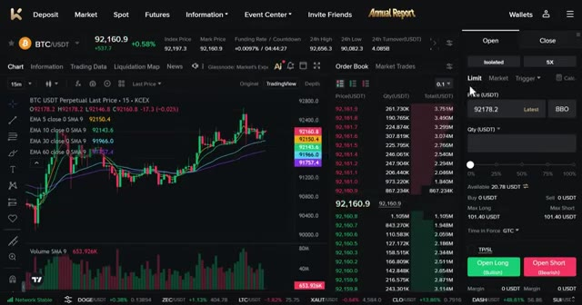
*⏱️ 00:02:20 — Interface de trading montrant la paire BTC/USDT avec le graphique des prix à gauche, le carnet d'ordres au centre et le panneau de passage d'ordres à droite.*

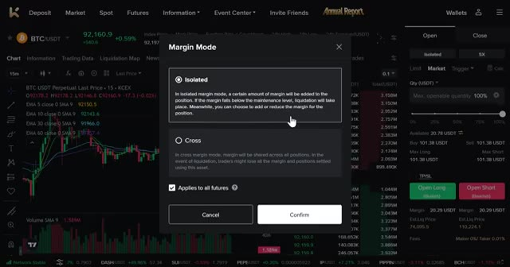
*⏱️ 00:02:36 — Fenêtre modale de sélection du mode de marge (Isolated ou Cross) superposée à l'interface de trading.*

---

### ⏱️ `[00:02:45 - 00:03:21]` | Segment #08

**🔊 Audio (Transcription Intégrale Mot pour Mot en Français) :**
> Un effet de levier de 125 fois sur KCX, mais pour les débutants, je recommande vivement de commencer par un effet de levier de cinq à dix fois jusqu'à ce que vous soyez à l'aise avec le fonctionnement du levier. Confirmez les détails de votre ordre, puis cliquez sur ouvrir long ou ouvrir short pour ouvrir votre position. Une fois votre ordre exécuté, vous pouvez le voir sous l'onglet des positions au bas de l'écran. Maintenant que vous savez comment utiliser les produits dérivés sur KCEX, passons à la stratégie réelle qui peut vous rapporter 100 dollars par jour. Étape numéro quatre, la configuration de vos indicateurs sur Trade and View. Allez sur Trade and View. Si vous n'avez pas Trade and View

**👁️ Analyse Visuelle d'Écran (gemini-3.5-flash-lite) :**
**Interface & Outils** : Échange de cryptomonnaies KCX (interface Futures).

**Contenu textuel & Code** : Graphique BTC/USDT en unité 15m, moyennes mobiles EMA (5, 10, 30, 60), volume, carnet d'ordres, options de levier (5X isolé), notifications d'exécution d'ordre (Order submission successful, BTC order filled completely).

**Action / Démonstration** : Configuration d'un effet de levier de 5X et passage d'un ordre d'achat (Open Long) sur le marché des futures BTC/USDT.

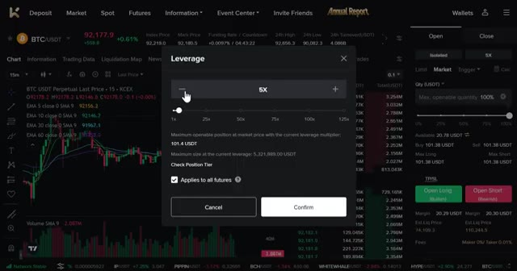
*⏱️ 00:02:54 — Fenêtre de réglage du levier (Leverage) sur KCX avec un multiplicateur fixé à 5X.*

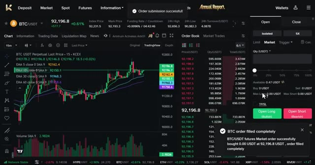
*⏱️ 00:03:03 — Interface de trading KCX montrant le graphique BTC/USDT et une notification de succès de l'ordre.*

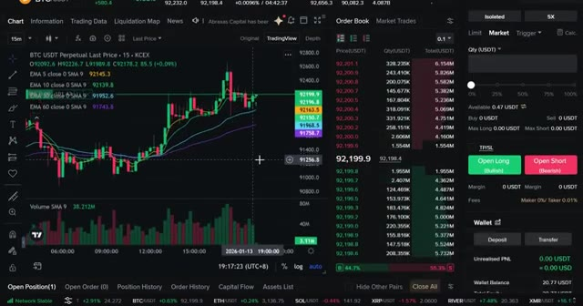
*⏱️ 00:03:12 — Interface complète KCX avec le graphique en chandeliers, le carnet d'ordres et les détails du portefeuille en bas.*

---

### ⏱️ `[00:03:21 - 00:03:56]` | Segment #09

**🔊 Audio (Transcription Intégrale Mot pour Mot en Français) :**
> pourtant, utilisez le lien ci-dessous pour obtenir une réduction. Je recommande d'utiliser la version pro pour les meilleurs indicateurs. Sélectionnez la paire de trading que vous souhaitez trader. Pour cet exemple, j'utiliserai BTCUSDT. Maintenant, choisissez votre unité de temps préférée. Cette stratégie fonctionne sur toutes les unités de temps, y compris les graphiques de 1 minute, 5 minutes, 15 minutes et 1 heure. Pour les débutants visant 100 dollars par jour, je recommande le graphique de 5 minutes ou de 15 minutes. Maintenant, cliquez sur l'onglet des indicateurs en haut et recherchez RSI VWAP. Sélectionnez-le. Ouvrez les paramètres de l'indicateur en cliquant sur l'icône en forme de rouage. Allez dans les entrées

**👁️ Analyse Visuelle d'Écran (gemini-3.5-flash-lite) :**
**Interface & Outils** : Graphique TradingView.

**Contenu textuel & Code** : Paire BTCUSDT, liste des échanges (Binance, Bybit, OKX, MEXC, etc.), et sélecteur d'unités de temps (de 1s à 1M).

**Action / Démonstration** : Sélection de la paire de trading BTCUSDT puis choix de l'unité de temps sur TradingView.

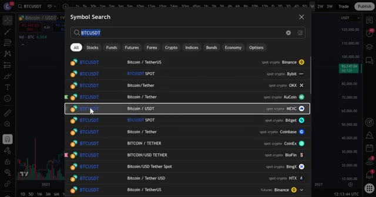
*⏱️ 00:03:30 — Fenêtre de recherche de symboles sur TradingView montrant la sélection de la paire BTCUSDT sur différentes plateformes d'échange.*

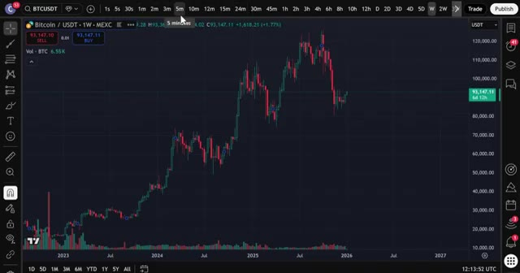
*⏱️ 00:03:39 — Graphique des prix de BTCUSDT sur TradingView avec la barre de sélection des unités de temps mise en avant en haut.*

---

### ⏱️ `[00:03:56 - 00:04:34]` | Segment #10

**🔊 Audio (Transcription Intégrale Mot pour Mot en Français) :**
> et définissez la longueur du RSI VWAP à 15. Survente à 10. Surachat à 10. Ensuite, ajoutez un deuxième indicateur. Retournez dans les indicateurs. Recherchez « extreme reversal setup » et sélectionnez-le. Ouvrez les paramètres. Allez dans les entrées et changez le multiplicateur à 3. Ces paramètres améliorent considérablement la précision des signaux et filtrent les faux signaux. J'ai testé cela sur plusieurs unités de temps et cela fonctionne très, très bien. L'étape numéro cinq concerne les entrées. Pour une configuration d'achat, cette stratégie nécessite la confirmation des deux indicateurs. Tout d'abord, attendez que la ligne RSI passe sous le niveau de survente et forme un vert

**👁️ Analyse Visuelle d'Écran (gemini-3.5-flash-lite) :**
**Interface & Outils** : TradingView

**Contenu textuel & Code** : Menu « Indicators, metrics, and strategies » avec une barre de recherche et une liste d'indicateurs favoris et intégrés (3 Line Strike, Bollinger Bands, etc.).

**Action / Démonstration** : Navigation dans le menu des indicateurs pour en ajouter un nouveau sur le graphique.

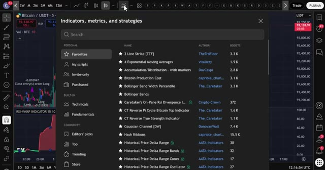
*⏱️ 00:04:06 — Fenêtre de recherche des indicateurs de TradingView ouverte par-dessus un graphique de prix en arrière-plan.*

---

### ⏱️ `[00:04:34 - 00:05:11]` | Segment #11

**🔊 Audio (Transcription Intégrale Mot pour Mot en Français) :**
> nuage. Attendez ensuite qu'un signal bleu de l'indicateur de configuration de retournement extrême apparaisse sous la bougie. Lorsque le signal apparaît, confirmez que le RSI est toujours en dessous du niveau de survente, et que le vert nuage est toujours actif. Entrez en position sur une nouvelle bougie après l'apparition du signal. Placez votre stop loss près du creux récent, généralement 1 à 2 % en dessous de votre entrée. Fixez votre take profit à 2 ou 3 fois votre risque. Donc, si vous risquez 10 $, visez un bénéfice de 20 à 30 $. Cela vous donne un ratio risque/rendement de 2 pour 1 ou de 3 pour 1, ce qui est la clé d'une rentabilité constante. Pour une configuration de vente, le processus est

**👁️ Analyse Visuelle d'Écran (gemini-3.5-flash-lite) :**
**Interface & Outils** : TradingView

**Contenu textuel & Code** : Graphique de prix Bitcoin (MEXC), indicateur "ERS 50 3 0.5 0.95" avec des signaux d'achat (flèches bleues "Long") et de vente (flèches violettes "Close entry(s) order Long"), indicateur "RSI-VWAP INDICATOR" en bas affichant une zone verte de nuage de survente.

**Action / Démonstration** : Analyse graphique illustrant l'apparition d'un signal d'achat bleu de l'indicateur de retournement extrême couplé à la zone verte du nuage RSI.

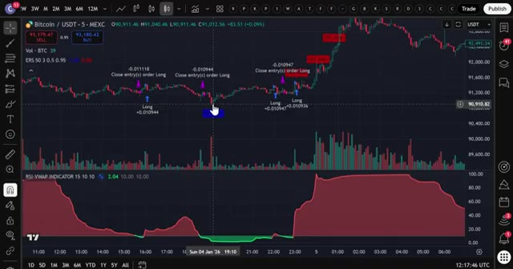
*⏱️ 00:04:43 — Graphique en chandeliers du Bitcoin (BTC/USDT) en unité de temps de 5 minutes sur la plateforme TradingView, affichant des signaux de trading et des indicateurs techniques en bas.*

---

### ⏱️ `[00:05:11 - 00:05:44]` | Segment #12

**🔊 Audio (Transcription Intégrale Mot pour Mot en Français) :**
> exactement l'opposé. Attendez que la ligne du RSI dépasse le niveau de surachat et forme un nuage rouge. Attendez ensuite qu'un signal rouge de l'indicateur de configuration de retournement extrême apparaisse au-dessus de la bougie. Lorsque le signal apparaît, confirmez que le RSI est toujours au-dessus du niveau de surachat. Le nuage rouge est toujours actif. Entrez dans le trade sur une nouvelle bougie après l'apparition du signal. Placez votre stop loss près du récent sommet. Fixez votre take profit à deux ou trois fois votre risque. Avant de conclure, assurez-vous de créer votre compte KCX en utilisant le lien ci-dessous. Rappelez-vous, aucune vérification KYC n'est requise,

**👁️ Analyse Visuelle d'Écran (gemini-3.5-flash-lite) :**
**Interface & Outils** : TradingView (Graphique de trading en ligne)

**Contenu textuel & Code** : Paire Bitcoin/USDT (MEXC), indicateurs techniques (RSI-VWAP, indicateur de configuration de retournement extrême avec signaux d'achat/vente et ordres Long/Close), chandeliers en unités de 5 minutes.

**Action / Démonstration** : Analyse graphique de la configuration de trading illustrant les signaux d'entrée en position longue et de sortie basés sur le RSI et les indicateurs de retournement.

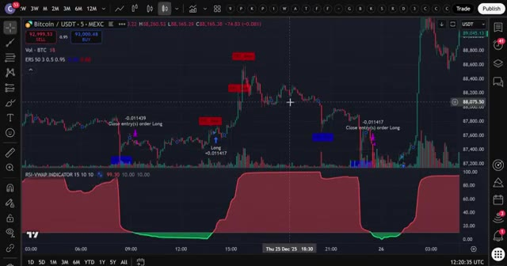
*⏱️ 00:05:19 — Graphique en chandeliers japonais du Bitcoin/USDT en unité de temps 5 minutes sur TradingView, montrant les prix, des indicateurs de retournement et un indicateur RSI-VWAP inférieur avec des zones colorées en rouge et vert.*

---

### ⏱️ `[00:05:45 - 00:06:23]` | Segment #13

**🔊 Audio (Transcription Intégrale Mot pour Mot en Français) :**
> ainsi vous pouvez commencer à trader immédiatement. Effectuez votre premier dépôt pour commencer à utiliser cette stratégie. Réclamez vos bonus, y compris des frais réduits et des récompenses pour avoir complété des trades. Si KCX n'est pas disponible dans votre pays, rappelez-vous que vous pouvez utiliser Bybit. Ils offrent jusqu'à 30 000 USDT de bonus de trading en ce moment. Les deux liens sont dans la description. C'est tout, les gars. Cette stratégie est simple, efficace et parfaite pour les traders débutants. Commencez avec de petites positions, pratiquez vos entrées et augmentez la taille au fur et à mesure que vous gagnez en confiance. Et si vous voulez plus de détails sur le fonctionnement des plateformes KCEX et Bybit, regardez la vidéo qui apparaît à l'écran en ce moment. Bref,

**👁️ Analyse Visuelle d'Écran (gemini-3.5-flash-lite) :**
**Interface & Outils** : Échange de cryptomonnaies KCX et plateforme d'analyse graphique TradingView.

**Contenu textuel & Code** : Frais de trading réduits, codes d'invitation, signaux de trading (ordres Long), et indicateurs techniques sur graphique 5m.

**Action / Démonstration** : Présentation des avantages d'inscription, des bonus de dépôt et analyse technique d'une stratégie de trading sur crypto.

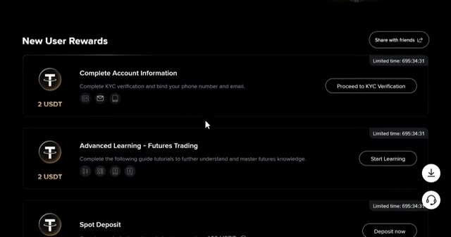
*⏱️ 00:05:54 — Page des récompenses pour nouveaux utilisateurs sur la plateforme KCX, détaillant les bonus de vérification KYC et de dépôt.*

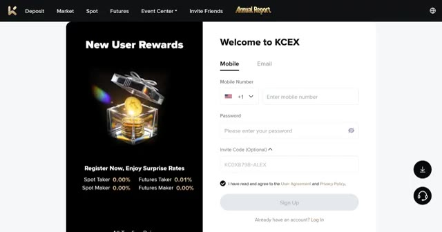
*⏱️ 00:06:04 — Formulaire d'inscription et de connexion de la plateforme KCX, mettant en avant les frais réduits (Spot Taker 0.00%, Futures Taker 0.01%).*

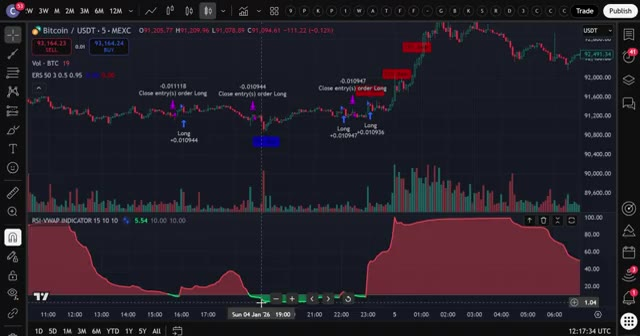
*⏱️ 00:06:13 — Graphique TradingView affichant Bitcoin/USDT en unité de temps 5 minutes sur l'échange MEXC, avec indicateurs techniques et signaux d'achat/vente (Long/Close).*

---

### ⏱️ `[00:06:23 - 00:06:25]` | Segment #14

**🔊 Audio (Transcription Intégrale Mot pour Mot en Français) :**
> Ceci étant dit, je vous vois dans la prochaine.

**👁️ Analyse Visuelle d'Écran (gemini-3.5-flash-lite) :**
**Interface & Outils** : Aucun

**Contenu textuel & Code** : Aucun

**Action / Démonstration** : Aucun

---

