# 🎬 How to Trade Crypto on Bitunix 2026 (Step-By-Step)

> **Chaîne** : [Alex Carter](https://www.youtube.com/@AlexCarterTrading)  
> **Lien YouTube** : [https://www.youtube.com/watch?v=h_4L7ulx-3I](https://www.youtube.com/watch?v=h_4L7ulx-3I)  
> **Date de publication** : 20260117  
> **Durée** : 00:15:00  
> **Identifiant vidéo** : `h_4L7ulx-3I`  
> **Transcription & Analyse** : `whisper-v3-large-turbo+gemini-3.5-flash-lite`  

---

## 📌 Synthèse Exécutive & Outils

### 💡 Résumé

Cette vidéo signée Alex Carter propose un guide pratique et méthodique pour maîtriser la plateforme de trading de cryptomonnaies Bitunix en 2026, s'adressant aussi bien aux débutants qu'aux opérateurs cherchant à optimiser leur exécution. L'analyse détaille l'architecture des comptes de la bourse (comptes Spot, Futures, Staking et Copy Trading) et l'importance cruciale de l'utilisation d'un lien d'affiliation exclusif pour débloquer des bonus de bienvenue incitatifs, tels que 20 USDT offerts pour un dépôt minimum de 100 USDT, ainsi que des dotations matérielles d'envergure. 

Sur le plan opérationnel et stratégique, le tutoriel décortique l'ensemble des méthodes d'alimentation de compte — de l'achat par carte de crédit/débit et virements SEPA aux solutions P2P et aux passerelles tierces. L'accent est mis sur les bonnes pratiques de sécurité, notamment l'utilisation du réseau TRC20 (Tron) pour sa rapidité et la modicité de ses frais, tout en recommandant l'envoi systématique d'un montant test préalable afin d'éviter toute perte de capitaux liée à une erreur de routage.

Enfin, la démonstration technique s'oriente vers la transition opérationnelle des fonds du portefeuille Spot vers le compartiment Futures (USDT-M), prérequis indispensable au trading sur marge. Sont passés en revue l'interface de négociation, les outils graphiques de TradingView intégrés, l'analyse du carnet d'ordres en temps réel ainsi que la gestion rigoureuse des leviers et des types d'ordres, posant les bases méthodologiques d'une exécution de marché maîtrisée.

### 🛠️ Outils, Modèles & Logiciels Présentés

* **Bitunix** : Plateforme centrale d'échange de cryptomonnaies offrant des services de trading Spot, des contrats Futures avec un effet de levier allant jusqu'à 200x, et des programmes d'épargne.
* **TradingView** : Outil d'analyse technique de pointe intégré directement dans l'interface de Bitunix pour l'étude des graphiques de prix et l'application d'indicateurs personnalisés.
* **Réseau TRC20 (Tron)** : Protocole blockchain recommandé pour les transferts d'USDT en raison de ses frais réduits et de ses délais de confirmation rapides.
* **Grok Bots** : Outil d'intelligence artificielle évoqué dans l'écosystème global d'automatisation des stratégies pour assister le trader dans sa prise de décision.
* **Claude Code** : Environnement et assistant de développement IA mobilisé pour concevoir, tester et déboguer des scripts de trading algorithmique.
* **Pine Script** : Langage de programmation dédié à TradingView permettant de coder des indicateurs sur mesure et des stratégies de scalping automatisées.

### 🔑 Points Clés & Enseignements Stratégiques

* **Architecture multicompte cloisonnée** : Utiliser le compte Spot pour l'acquisition et la détention d'actifs au comptant, le compte Futures pour le levier et l'optimisation des bonus, et le compte d'épargne pour générer des rendements passifs (fixes ou flexibles).
* **Optimisation des bonus d'inscription** : S'enregistrer via un lien de parrainage exclusif pour maximiser l'éligibilité aux campagnes promotionnelles, aux airdrops et aux récompenses de volume (ex. : 20 USDT débloqués pour 100 USDT déposés).
* **Protocole de sécurité des transferts** : Effectuer systématiquement une transaction test de faible montant (10 à 20 dollars) avant tout transfert d'envergure pour valider la compatibilité des réseaux et l'exactitude des adresses de dépôt.
* **Sélection rigoureuse des réseaux de paiement** : Privilégier le réseau TRC20 (Tron) pour les transferts d'USDT afin de minimiser l'impact négatif des frais de transaction sur le capital initial.
* **Flexibilité des passerelles d'achat Fiat** : Exploiter l'achat en un clic, les dépôts SEPA, les cartes bancaires (Visa/Mastercard) ou le trading P2P selon les contraintes géographiques et bancaires pour acquérir instantanément des cryptomonnaies.
* **Conversion sans frais sur le carnet Spot** : Utiliser la fonction de conversion instantanée ou les ordres au marché sur les paires Spot (comme BTC/USDT) pour transformer ses actifs sans impacter la performance par des frais superflus.
* **Gestion du collatéral pour les Futures** : Réaliser impérativement le transfert interne des fonds du portefeuille Spot vers le compartiment Futures (USDT-M) pour disposer de la marge nécessaire à l'ouverture de positions à effet de levier.
* **Préférence pour les contrats USDT-M** : Pour les débutants, privilégier les contrats perpétuels réglés en USDT (USDT-M) par rapport au Coin-M en raison d'une liquidité supérieure et d'une lecture du risque plus intuitive.
* **Exploitation de TradingView pour l'analyse technique** : S'appuyer sur les graphiques professionnels intégrés pour identifier les zones de support/résistance et paramétrer des unités de temps adaptées à sa méthodologie de scalping ou de swing trading.
* **Lecture fine du carnet d'ordres** : Analyser la profondeur du marché en temps réel (chiffres rouges pour les ordres de vente, verts pour les ordres d'achat) afin d'anticiper la pression acheteuse/vendeuse et d'éviter les glissements de prix (*slippage*).

---

## ⏱️ Chronologie & Transcription Complète Audio & Visuelle (Mot pour Mot)

### ⏱️ `[00:00:00 - 00:00:29]` | Segment #01

**🔊 Audio (Transcription Intégrale Mot pour Mot en Français) :**
> Si vous avez voulu trader des cryptos sur Bitunix mais que vous ne savez pas par où commencer, ce tutoriel vous emmènera de débutant complet à l'exécution de vos premiers trades en toute confiance. Je vais vous guider à travers tout : la configuration du compte, les dépôts, les différentes interfaces de trading, et des instructions étape par étape pour exécuter votre premier trade. La plateforme Bitunix a l'air compliquée au début, mais une fois que vous aurez compris les bases et les différents types de comptes, c'est en réalité l'une des plateformes d'échange les plus faciles et conviviales à utiliser.

**👁️ Analyse Visuelle d'Écran (gemini-3.5-flash-lite) :**
**Interface & Outils** : Plateforme de trading crypto Bitunix (interface de futures et page d'accueil promotionnelle).

**Contenu textuel & Code** : Graphique BTCUSDT, carnet d'ordres en temps réel, prix du Bitcoin (environ 92 098 $), options de levier (Cross/Isolated, 20X, 5X), et avis d'utilisateurs.

**Action / Démonstration** : Navigation sur la plateforme d'échange, visualisation du carnet d'ordres et démonstration d'exécution d'un ordre d'achat (Open long).

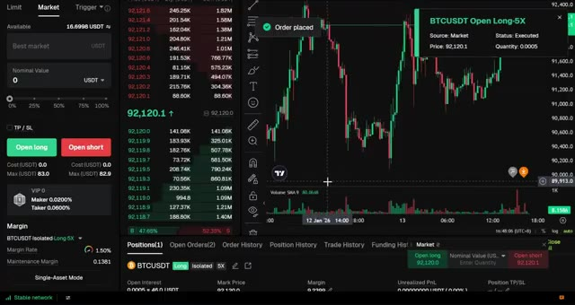
*⏱️ 00:00:07 — Interface de trading de la plateforme Bitunix affichant un graphique des prix BTCUSDT avec un ordre d'achat long exécuté (Market, 5X).*

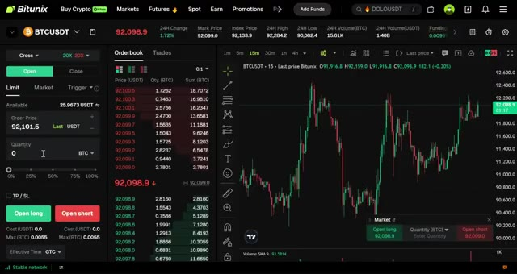
*⏱️ 00:00:15 — Interface de trading Bitunix avec le carnet d'ordres (Orderbook), le graphique en chandeliers et le panneau de passage d'ordres à cours limité (Limit).*

---

### ⏱️ `[00:00:30 - 00:00:49]` | Segment #02

**🔊 Audio (Transcription Intégrale Mot pour Mot en Français) :**
> La plupart des tutoriels sautent soit des étapes et des fonctionnalités importantes, soit partent du principe que vous savez déjà des choses que les nouveaux traders ignorent vraiment. Cela ne va pas se produire ici. Et avec mon lien exclusif dans la description, vous débloquez des récompenses de bienvenue massives. Les nouveaux utilisateurs peuvent gagner jusqu'à 20 USDT rien qu'en déposant 100 USDT ou plus.

**👁️ Analyse Visuelle d'Écran (gemini-3.5-flash-lite) :**
**Interface & Outils** : Site web de la plateforme d'échange Bitunix.

**Contenu textuel & Code** : Section "Reviews of Bitunix" et "Task Center" avec des bannières de récompenses de dépôt.

**Action / Démonstration** : Navigation sur le site de Bitunix pour illustrer les récompenses et la fiabilité de la plateforme.

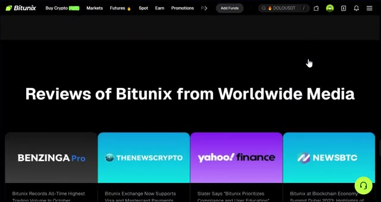
*⏱️ 00:00:35 — Page web de la plateforme Bitunix affichant des critiques de médias mondiaux comme Benzinga Pro, The News Crypto, Yahoo Finance et NewsBTC.*

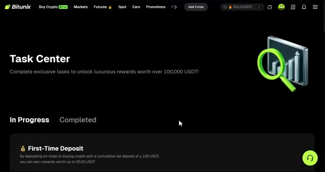
*⏱️ 00:00:40 — Centre des tâches (Task Center) de la plateforme Bitunix montrant les récompenses de dépôt initial.*

---

### ⏱️ `[00:00:50 - 00:01:26]` | Segment #03

**🔊 Audio (Transcription Intégrale Mot pour Mot en Français) :**
> C'est littéralement de l'argent gratuit. En plus de ça, vous avez une chance de gagner une Tesla, une montre Rolex, des iPhones et d'autres prix physiques incroyables. Je vais vous montrer exactement comment réclamer tout cela. À la fin de cette vidéo, vous saurez exactement comment utiliser Bitunix et comment maximiser chaque bonus disponible. Maintenant, voici pourquoi Bitunix est l'un de mes meilleurs choix de plateformes d'échange. Bitunix est une plateforme de confiance et en croissance rapide dans l'industrie de la crypto, conçue à la fois pour les débutants et les traders professionnels. Bitunix offre une inscription rapide et simple, où vous pouvez commencer à trader en quelques minutes, même sans KYC pour les services de base.

**👁️ Analyse Visuelle d'Écran (gemini-3.5-flash-lite) :**
**Interface & Outils** : Plateforme d'échange Bitunix et site d'agrégation CoinGecko.

**Contenu textuel & Code** : Étapes de parrainage/inscription, volume de trading requis, récompenses en USDT, listes de cryptomonnaies (Brevis, Lighter, Dolomite, Safe).

**Action / Démonstration** : Navigation sur la plateforme d'échange pour montrer les bonus de bienvenue et les conditions d'obtention des prix.

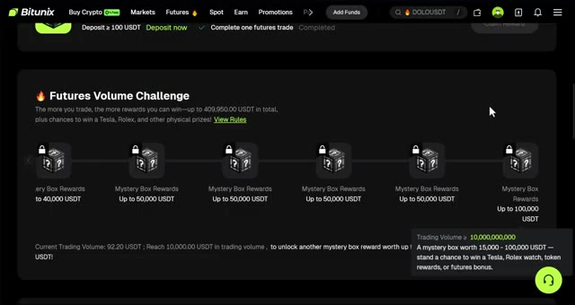
*⏱️ 00:00:59 — Image montrant la section 'Futures Volume Challenge' sur Bitunix avec des coffres mystères et des récompenses potentielles.*

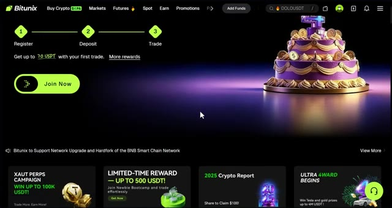
*⏱️ 00:01:08 — Page d'accueil de la plateforme Bitunix avec un guide en 3 étapes (Register, Deposit, Trade) et un bouton 'Join Now'.*

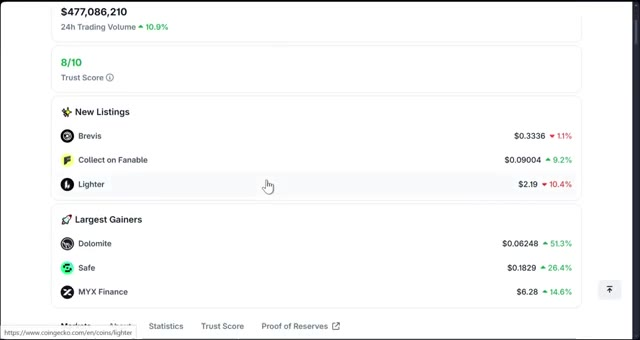
*⏱️ 00:01:17 — Capture d'écran de CoinGecko affichant le volume de trading sur 24h, le score de confiance (8/10), les nouvelles cotations et les plus fortes hausses.*

---

### ⏱️ `[00:01:26 - 00:02:01]` | Segment #04

**🔊 Audio (Transcription Intégrale Mot pour Mot en Français) :**
> fonctionnalités. C'est énorme pour les personnes qui veulent commencer immédiatement. Bitunix dispose d'une forte liquidité. Cela signifie que vos ordres s'exécutent au prix que vous voyez et avec un faible écart acheteur-vendeur, même avec effet de levier. Pas de glissement de prix qui grignote vos profits. Ils offrent une large gamme de pièces, du Bitcoin et de l'Ethereum à des centaines d'altcoins. Bitunix est connu pour lister les nouveaux jetons plus rapidement que la plupart des bourses, ce qui signifie que vous pouvez vous positionner tôt sur les projets. De multiples options de trading, du trading au comptant, des contrats à terme avec un effet de levier allant jusqu'à 200 fois, et même des outils de trading avancés pour les traders expérimentés.

**👁️ Analyse Visuelle d'Écran (gemini-3.5-flash-lite) :**
**Interface & Outils** : Page web d'évaluation/statistiques de marché (Trust Score).

**Contenu textuel & Code** : Volume de trading affiché à 477 086 210 $, écart acheteur-vendeur (Average Bid-Ask Spread) à 0.338%, et percentiles de volume et de carnet d'ordres.

**Action / Démonstration** : Présentation des métriques de liquidité et du spread pour illustrer la fiabilité et la profondeur du marché.

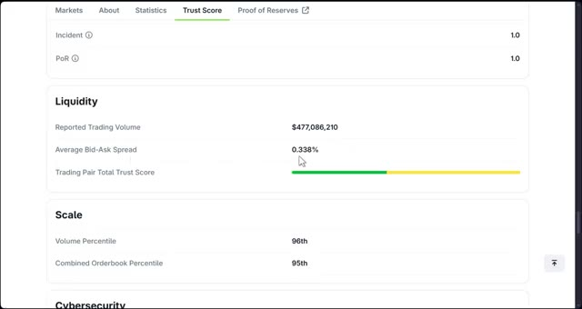
*⏱️ 00:01:35 — Capture d'écran montrant les métriques de liquidité et de score de confiance d'une plateforme de trading sur un site web de type agrégateur (CoinGecko ou CoinMarketCap).*

---

### ⏱️ `[00:02:02 - 00:02:36]` | Segment #05

**🔊 Audio (Transcription Intégrale Mot pour Mot en Français) :**
> Bitunix est aussi connue comme une plateforme généreuse qui offre d'énormes opportunités de bonus. Bitunix combine facilité d'utilisation, sécurité, diversité et récompenses massives, ce qui la rend parfaite pour les débutants comme pour les traders avancés. Maintenant que vous savez pourquoi j'aime la plateforme, commençons. Tout d'abord, cliquez sur le lien dans la description. Utiliser ce lien est crucial pour débloquer tous les bonus exclusifs que je viens de mentionner. Vous pouvez vous inscrire avec votre adresse e-mail ou votre numéro de téléphone, ou continuer avec Google, Apple, et même vos comptes Facebook et X. Pour ce tutoriel, j'utiliserai Gmail. Juste après votre inscription,

**👁️ Analyse Visuelle d'Écran (gemini-3.5-flash-lite) :**
**Interface & Outils** : Site web de l'échange de cryptomonnaies Bitunix.

**Contenu textuel & Code** : Tableau des cryptomonnaies populaires en futures (BTCUSDT à 92 283,3 $, ETHUSDT à 3 139,24 $, SOLUSDT à 141,96 $) avec leurs variations sur 24h, prix haut, volume et graphiques miniatures.

**Action / Démonstration** : Navigation et présentation de la plateforme Bitunix illustrant les opportunités de trading et la diversité des marchés.

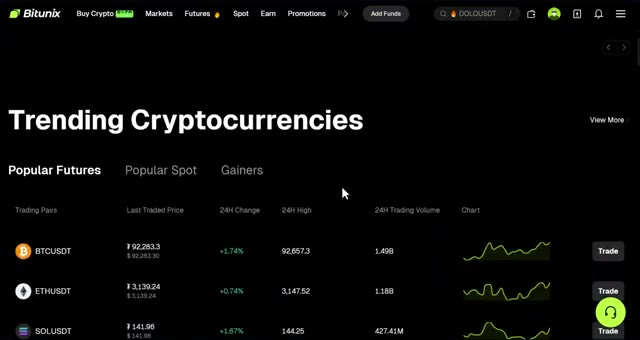
*⏱️ 00:02:10 — Capture d'écran de l'interface de la plateforme d'échange Bitunix montrant la section des cryptomonnaies tendance.*

---

### ⏱️ `[00:02:36 - 00:03:10]` | Segment #06

**🔊 Audio (Transcription Intégrale Mot pour Mot en Français) :**
> votre compte est actif et vous pouvez commencer à déposer des fonds immédiatement. Une fois connecté, vous verrez votre tableau de bord principal. En haut à droite, cliquez sur l'icône du portefeuille. Vous verrez différentes options et types de compte. Bartunix utilise différents types de compte pour vous aider à organiser vos transactions. Voici ce que chacun signifie. Compte au comptant. C'est là que vos dépôts atterrissent en premier. Ici, vous pouvez acheter et vendre des cryptomonnaies aux prix du marché sans effet de levier. C'est idéal pour détenir des actifs ou pour du trading simple. Compte futures. C'est pour le trading avec effet de levier, vous permettant de prendre des positions plus importantes

**👁️ Analyse Visuelle d'Écran (gemini-3.5-flash-lite) :**
**Interface & Outils** : Plateforme d'échange de cryptomonnaies Bitunix

**Contenu textuel & Code** : Types de comptes (Spot, Futures, Earn, Copy), graphique des prix BTC/USDT avec indicateurs techniques, carnet d'ordres et options de commande (Limit Order, Market Order).

**Action / Démonstration** : Navigation dans le menu du portefeuille et présentation de l'interface de trading.

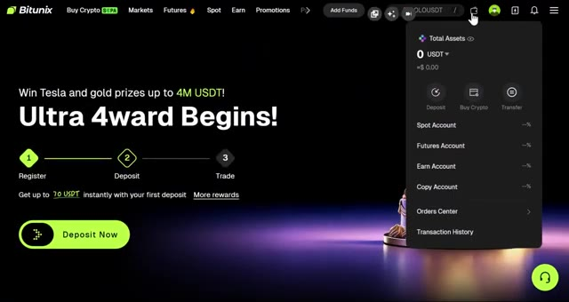
*⏱️ 00:02:44 — Page d'accueil de la plateforme Bitunix avec un menu déroulant affichant le solde total et les différents types de comptes (Spot, Futures, Earn, Copy).*

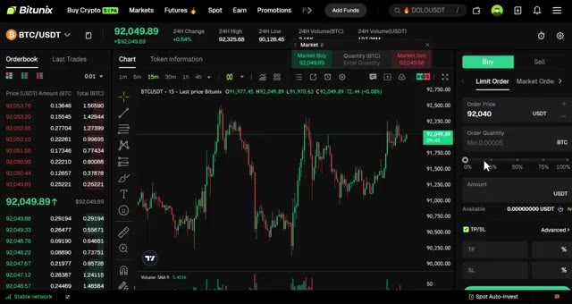
*⏱️ 00:03:01 — Interface de trading spot de Bitunix affichant un graphique des prix du BTC/USDT, le carnet d'ordres et le panneau de passage d'ordres.*

---

### ⏱️ `[00:03:10 - 00:03:45]` | Segment #07

**🔊 Audio (Transcription Intégrale Mot pour Mot en Français) :**
> que ne le permet votre solde. C'est ici que vous utiliserez vos bonus et gagnerez des récompenses basées sur votre volume de trading. Vous pouvez trader avec l'USDT comme marge et cela débloque toutes les récompenses de bonus dont nous avons parlé plus tôt. Ensuite, vous pouvez voir le compte d'épargne. Cela vous permet de staker vos coins et de gagner des récompenses passives au fil du temps. Ici, vous pouvez voir les taux de pourcentage annuel pour chaque coin dans des types de staking comme fixe et flexible. Et puis il y a le compte de copy trading. Cette option vous permet de refléter automatiquement des traders expérimentés sans avoir besoin d'analyser chaque trade vous-même. Pour transférer des fonds entre les comptes, vous allez simplement sur

**👁️ Analyse Visuelle d'Écran (gemini-3.5-flash-lite) :**
**Interface & Outils** : Bitunix (plateforme d'échange de cryptomonnaies et interface de trading)

**Contenu textuel & Code** : Graphique en chandeliers japonais pour BTCUSDT (Timeframe 15m, prix actuel à 91 998,3), liste des contrats Futures (BTCUSDT, ETHUSDT, SOLUSDT, XRPUSDT, DOGEUSDT), options de marge USDT-M, USDC-M, Coin-M, et boutons pour ouvrir des ordres long ou short.

**Action / Démonstration** : Sélection de la paire BTCUSDT dans le panneau de recherche des contrats futures de la plateforme Bitunix.

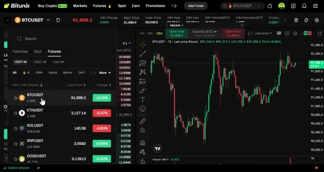
*⏱️ 00:03:19 — Interface de la plateforme de trading Bitunix affichant un graphique de prix BTCUSDT en unités de 15 minutes et un menu déroulant de sélection des paires de cryptomonnaies sur les contrats futures.*

---

### ⏱️ `[00:03:45 - 00:04:19]` | Segment #08

**🔊 Audio (Transcription Intégrale Mot pour Mot en Français) :**
> votre portefeuille, cliquez sur transfert, et déplacez des USDT du compte au comptant vers les futures. Je vais vous montrer exactement comment faire cela dans un instant. Sur la barre de navigation, vous pouvez également voir différentes sections comme les marchés pour un aperçu du marché et les opportunités, les promotions pour les annonces d'airdrops et les campagnes, et ici vous pouvez également voir le centre des tâches pour vos récompenses. Vous pouvez aussi voir ici la section des partenaires pour le programme d'affiliation. Et lorsque vous cliquez sur plus, c'est là que vous pouvez voir les supports d'apprentissage, le blog, la communauté, et tout ce qui concerne la plateforme Bitunix. Tout est clairement organisé pour que vous puissiez

**👁️ Analyse Visuelle d'Écran (gemini-3.5-flash-lite) :**
**Interface & Outils** : Site Web de l'échange de cryptomonnaies Bitunix.

**Contenu textuel & Code** : Barre de navigation supérieure affichant les sections Buy Crypto, Markets, Futures, Spot, Earn, Promotions, ainsi qu'une bannière publicitaire 'Ultra 4ward Begins!' avec un gâteau d'anniversaire graphique.

**Action / Démonstration** : Navigation sur la page d'accueil de la plateforme Bitunix pour présenter les différentes sections du site.

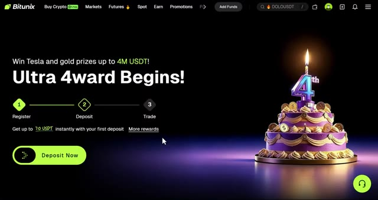
*⏱️ 00:03:53 — Page d'accueil de la plateforme d'échange Bitunix montrant une promotion anniversaire avec une bannière pour gagner des prix en USDT et un bouton 'Deposit Now'.*

---

### ⏱️ `[00:04:19 - 00:04:55]` | Segment #09

**🔊 Audio (Transcription Intégrale Mot pour Mot en Français) :**
> trouvez ce dont vous avez besoin rapidement. Maintenant que vous connaissez les bases, mettons de l'argent sur votre compte et commençons à réclamer des bonus. Allez sur l'icône du portefeuille dans le menu supérieur, puis cliquez sur dépôt. Vous verrez une liste de cryptomonnaies que vous pouvez déposer. Pour ce tutoriel, je vous recommande de choisir l'USDT car c'est la principale paire de trading pour les contrats à terme sur Bitunix. Ensuite, sélectionnez votre réseau. Je recommande d'utiliser le réseau TRC20 Tron car il a des frais très bas et des temps de confirmation rapides. Une fois que vous aurez sélectionné l'USDT et le TRC20, Bitunix générera votre adresse de dépôt personnelle. Copiez-la soigneusement. Faites

**👁️ Analyse Visuelle d'Écran (gemini-3.5-flash-lite) :**
**Interface & Outils** : Bitunix (plateforme d'échange de cryptomonnaies)

**Contenu textuel & Code** : Menus de dépôt, options de sélection de cryptomonnaies (USDT, BTC, ETH, USDC), sélection de réseau (Tron TRC-20) et adresse de dépôt avec QR code.

**Action / Démonstration** : Navigation dans l'interface de la plateforme d'échange pour accéder au menu de dépôt et configurer un transfert de cryptomonnaies.

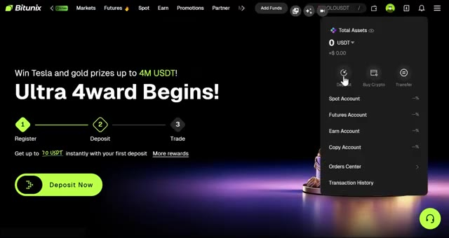
*⏱️ 00:04:28 — Image #1 @ 00:04:28 : Interface de la plateforme Bitunix montrant le menu du portefeuille et l'option "Deposit".*

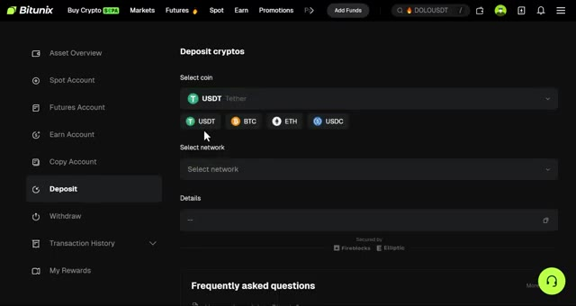
*⏱️ 00:04:37 — Image #2 @ 00:04:37 : Page de dépôt de cryptomonnaies sur Bitunix avec les options de sélection de coin (USDT, BTC, ETH, USDC).*

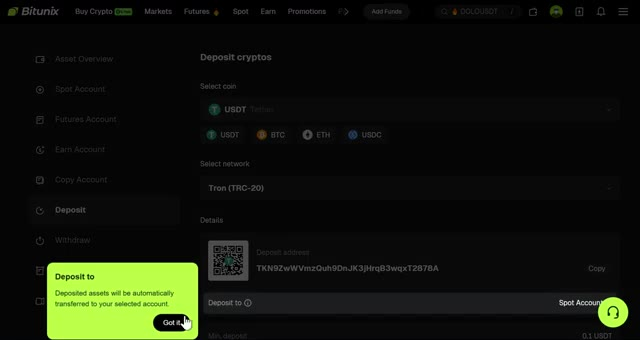
*⏱️ 00:04:46 — Image #3 @ 00:04:46 : Page de dépôt de Bitunix affichant l'adresse de dépôt, le réseau Tron (TRC-20) et le QR code associé.*

---

### ⏱️ `[00:04:55 - 00:05:27]` | Segment #10

**🔊 Audio (Transcription Intégrale Mot pour Mot en Français) :**
> assurez-vous de copier l'adresse entière. Ensuite, allez sur votre échange ou portefeuille actuel. Collez l'adresse et envoyez vos cryptos. Cela prend généralement 5 à 15 minutes pour arriver. Conseil de pro, envoyez toujours d'abord un petit montant test, peut-être 10 à 20 dollars, et vérifiez bien que le réseau correspond des deux côtés. Cela vous évite de perdre des fonds à cause d'un mauvais réseau. Maintenant, c'est là que l'un des principaux bonus commence à entrer en jeu. Si vous déposez au moins 100 USDT, vous pouvez gagner des récompenses d'une valeur allant jusqu'à 20 USDT.

**👁️ Analyse Visuelle d'Écran (gemini-3.5-flash-lite) :**
**Interface & Outils** : Interfaces des plateformes d'échange de crypto-monnaies Toobit et Bitunix.

**Contenu textuel & Code** : Détails d'une transaction de retrait d'USDT, frais de réseau (1 USDT), réseau TRX, adresse de portefeuille et aperçu des actifs du compte (26,76 USDT).

**Action / Démonstration** : Validation d'une opération de retrait de fonds et vérification du solde sur les interfaces de courtage.

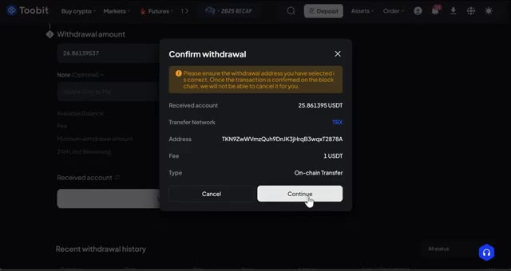
*⏱️ 00:05:03 — Interface de l'échange Toobit montrant une fenêtre pop-up de confirmation de retrait de crypto-monnaie (USDT) avec l'adresse de destination, les frais et le réseau TRX.*

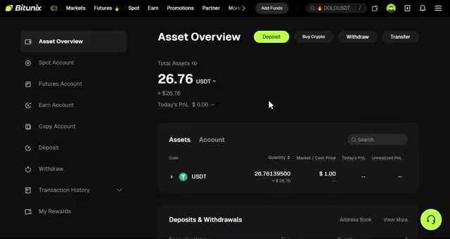
*⏱️ 00:05:11 — Interface de gestion d'actifs de l'échange Bitunix affichant un aperçu du portefeuille avec un solde de 26,76 USDT.*

---

### ⏱️ `[00:05:27 - 00:05:47]` | Segment #11

**🔊 Audio (Transcription Intégrale Mot pour Mot en Français) :**
> C'est littéralement de l'argent gratuit juste pour avoir fait un dépôt. Donc il ne faut vraiment pas passer à côté. Si vous n'avez pas encore de crypto, vous pouvez en acheter directement sur Bitunix en utilisant votre monnaie locale. Allez sur Acheter des cryptos dans le menu supérieur. Vous verrez cinq options : Achat en un clic, Dépôt en monnaie fiat, Carte de crédit ou de débit, Trading P2P, Tiers.

**👁️ Analyse Visuelle d'Écran (gemini-3.5-flash-lite) :**
**Interface & Outils** : Plateforme d'échange de cryptomonnaies Bitunix (pages promotionnelles et de récompenses).

**Contenu textuel & Code** : Offres de bonus de dépôt (« First-Time Deposit », « First Futures Trade ») et gains potentiels en USDT.

**Action / Démonstration** : Navigation sur le site de Bitunix pour présenter les bonus de dépôt et les promotions en cours.

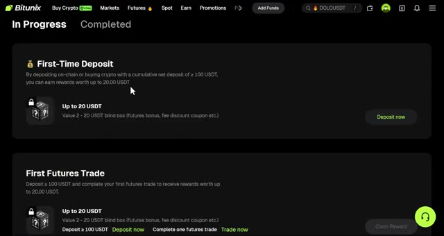
*⏱️ 00:05:32 — Page des récompenses et bonus de premier dépôt sur l'échange Bitunix montrant les différentes offres.*

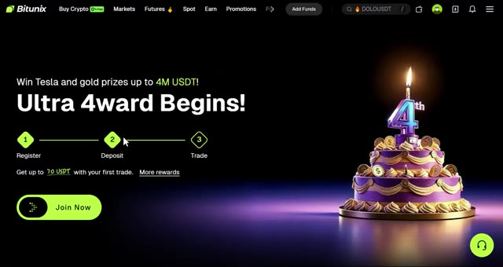
*⏱️ 00:05:37 — Page promotionnelle de l'anniversaire de Bitunix affichant les étapes d'inscription, de dépôt et de trade.*

---

### ⏱️ `[00:05:47 - 00:06:07]` | Segment #12

**🔊 Audio (Transcription Intégrale Mot pour Mot en Français) :**
> Avec l'achat en un clic, vous pouvez acheter de l'USDT instantanément en utilisant Visa, MasterCard ou d'autres méthodes de paiement. Choisissez simplement votre devise et sélectionnez USDT du côté de la réception et choisissez un mode de paiement. Ici, vous pouvez choisir entre le dépôt en monnaie fiat via SEPA, une carte de crédit ou de débit, Google Pay, Apple Pay et plus encore.

**👁️ Analyse Visuelle d'Écran (gemini-3.5-flash-lite) :**
**Interface & Outils** : Interface de la plateforme d'échange cryptographique pour l'achat instantané de jetons.

**Contenu textuel & Code** : Options de paiement (Visa, Mastercard, SEPA, Google Pay, Apple Pay) et formulaires d'achat avec conversion EUR/USD vers USDT.

**Action / Démonstration** : Navigation dans l'interface d'achat instantané et sélection des méthodes de paiement disponibles.

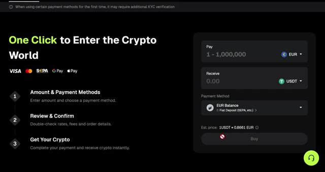
*⏱️ 00:05:52 — Interface d'achat de cryptomonnaie en un clic montrant le choix de la devise (EUR) et le montant à payer pour recevoir de l'USDT, avec les différentes étapes.*

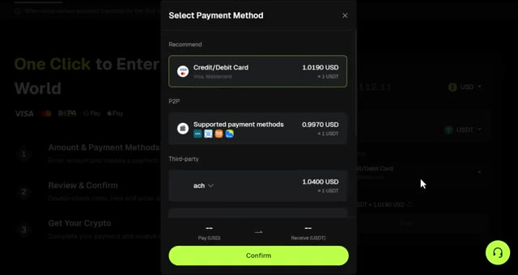
*⏱️ 00:06:02 — Fenêtre modale de sélection du mode de paiement affichant les options par carte bancaire, P2P et tiers (ACH) avec les taux de change correspondants.*

---

### ⏱️ `[00:06:07 - 00:06:26]` | Segment #13

**🔊 Audio (Transcription Intégrale Mot pour Mot en Français) :**
> Avec le dépôt en monnaie fiduciaire, le processus est presque le même. Entrez le montant et choisissez une méthode de dépôt. Batunix ne facture pas de frais, mais votre banque peut appliquer des frais de virement. Si vous utilisez une carte de débit ou de crédit, vous pouvez sélectionner votre devise, sélectionner la crypto que vous souhaitez recevoir, et payer par carte, que vous ayez Visa ou MasterCard.

**👁️ Analyse Visuelle d'Écran (gemini-3.5-flash-lite) :**
**Interface & Outils** : Plateforme d'échange de cryptomonnaies Bitunix (section Fiat Deposit / Credit Card).

**Contenu textuel & Code** : Options de dépôt SEPA, SEPA Instant, questions fréquentes sur les frais de virement et sélection des devises fiat (USD, EUR, PHP, etc.).

**Action / Démonstration** : Navigation dans le processus de dépôt en monnaie fiduciaire et consultation des méthodes de paiement sur l'exchange.

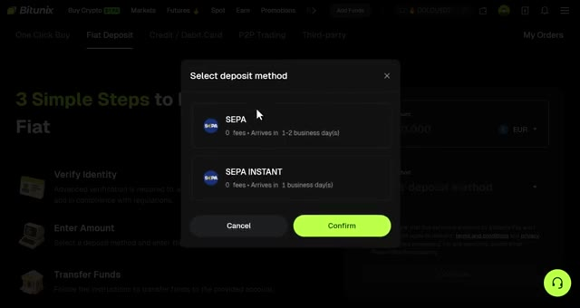
*⏱️ 00:06:12 — Sélection de la méthode de dépôt fiat sur l'interface Bitunix avec les options SEPA et SEPA Instant.*

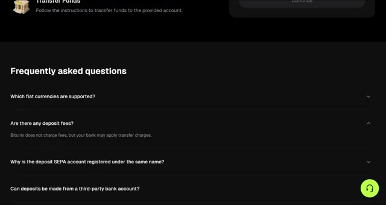
*⏱️ 00:06:17 — Section FAQ sur Bitunix détaillant les frais de dépôt et les conditions de virement bancaire.*

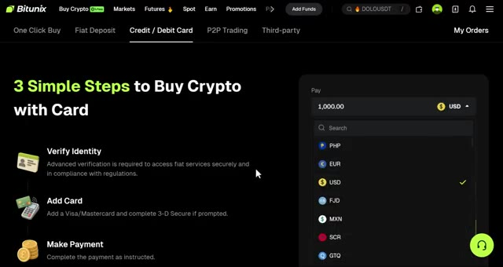
*⏱️ 00:06:21 — Interface d'achat de crypto par carte bancaire sur Bitunix avec sélection de la devise (USD).*

---

### ⏱️ `[00:06:26 - 00:06:46]` | Segment #14

**🔊 Audio (Transcription Intégrale Mot pour Mot en Français) :**
> Vous pouvez également voir le dernier prix d'un USDT dans votre devise préférée. Si vous n'avez pas de compte bancaire ou de carte de crédit ou de débit pour acheter des cryptos, vous pouvez choisir le trading P2P. Ici, vous pouvez acheter des USDT directement auprès d'autres utilisateurs. Vous sélectionnez un vendeur, suivez ses instructions de paiement, et l'USDT est versé sur votre portefeuille au comptant.

**👁️ Analyse Visuelle d'Écran (gemini-3.5-flash-lite) :**
**Interface & Outils** : Interface web de l'échange de cryptomonnaies Bitunix.

**Contenu textuel & Code** : Formulaire d'achat par carte, options de paiement, et carnet d'offres P2P avec les prix (0.997 à 1.000 USD) et limites par marchand.

**Action / Démonstration** : Navigation vers le module de trading P2P et consultation des offres directes entre utilisateurs.

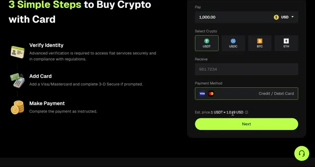
*⏱️ 00:06:31 — Interface d'achat de cryptomonnaie par carte bancaire avec affichage du prix estimé de l'USDT.*

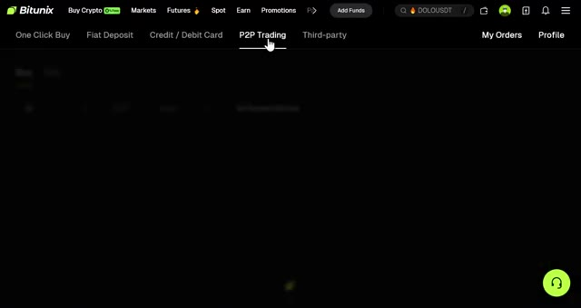
*⏱️ 00:06:36 — Navigation sur la plateforme Bitunix avec le curseur pointant sur l'onglet P2P Trading.*

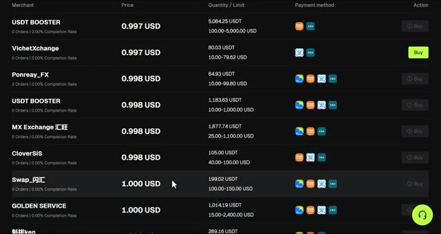
*⏱️ 00:06:41 — Tableau des offres P2P affichant les marchands, les prix en USD, les quantités et les méthodes de paiement.*

---

### ⏱️ `[00:06:46 - 00:07:04]` | Segment #15

**🔊 Audio (Transcription Intégrale Mot pour Mot en Français) :**
> il. La dernière option est d'acheter des cryptos via un tiers. C'est le même processus que l'achat en un clic et c'est pris en charge avec plus de 30 monnaies fiat. Pour la plupart des gens, l'achat par carte est l'option la plus rapide. Si vous avez déposé du Bitcoin ou une autre crypto mais que vous avez besoin d'USDT pour trader, voici comment le convertir.

**👁️ Analyse Visuelle d'Écran (gemini-3.5-flash-lite) :**
**Interface & Outils** : Échange de cryptomonnaies Bitunix (pages d'achat tiers et de gestion de portefeuille).

**Contenu textuel & Code** : Formulaire d'achat de cryptos avec devises fiat (USD vers USDT) et liste des soldes de portefeuilles (0.00010764 BTC, etc.).

**Action / Démonstration** : Navigation sur la plateforme pour présenter l'option d'achat par tiers et l'affichage des soldes de crypto-monnaies déposées.

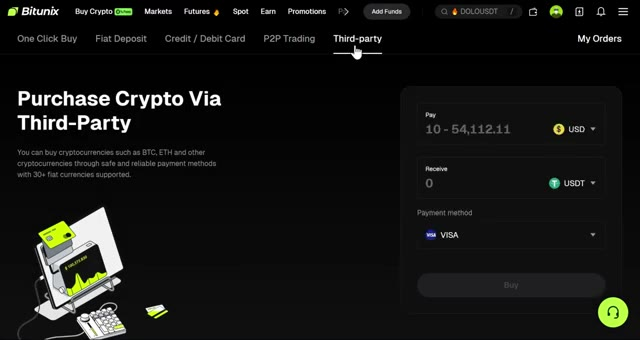
*⏱️ 00:06:50 — Interface Bitunix montrant l'option d'achat de cryptomonnaies via un tiers (Third-party) avec un widget de commande et de paiement par carte.*

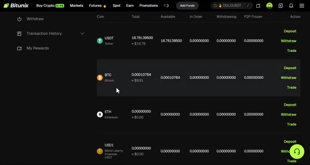
*⏱️ 00:07:00 — Interface de portefeuille Bitunix affichant les soldes des différentes cryptomonnaies détenues (USDT, Bitcoin, Ethereum).*

---

### ⏱️ `[00:07:05 - 00:07:35]` | Segment #16

**🔊 Audio (Transcription Intégrale Mot pour Mot en Français) :**
> Allez dans le Spot Trading depuis le menu principal et cliquez sur Spot. Recherchez votre paire de trading. Par exemple, BTC slash USDT. Sélectionnez un ordre au marché, choisissez vendre, entrez le montant de Bitcoin que vous souhaitez convertir, et cliquez sur vendre BTC. Cela convertit instantanément votre Bitcoin en USDT, qui apparaît ensuite dans votre portefeuille spot. Vous pouvez également choisir de convertir instantanément. Pour ce hacer, allez sur spot et cherchez l'option de conversion. La fonction de conversion de Bitunix n'a aucuns frais et vous offre une conversion instantanée aux taux du marché.

**👁️ Analyse Visuelle d'Écran (gemini-3.5-flash-lite) :**
**Interface & Outils** : Interface web de la plateforme d'échange de cryptomonnaies Bitunix.

**Contenu textuel & Code** : Graphique en chandeliers BTC/USDT, carnet d'ordres (Orderbook), prix en temps réel (92,161.03), menu de navigation Spot avec la liste des paires de trading (BTC/USDT, ETH/USDT, etc.).

**Action / Démonstration** : Navigation dans le menu principal pour accéder au trading spot et sélection de la paire de trading BTC/USDT sur l'échange Bitunix.

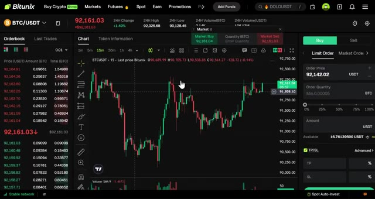
*⏱️ 00:07:12 — Interface de trading spot de Bitunix affichant un graphique de prix en chandeliers pour la paire BTC/USDT, un carnet d'ordres à gauche et le panneau de passage d'ordres à droite.*

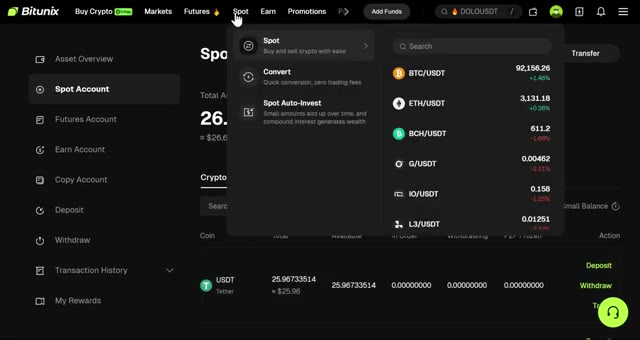
*⏱️ 00:07:28 — Vue du menu principal de la plateforme Bitunix avec le menu déroulant "Spot" ouvert, permettant de sélectionner les options Spot, Convert ou Spot Auto-Invest.*

---

### ⏱️ `[00:07:36 - 00:07:54]` | Segment #17

**🔊 Audio (Transcription Intégrale Mot pour Mot en Français) :**
> Après cela, vos fonds apparaîtront dans votre portefeuille au comptant, prêts à être transférés vers votre compte futures afin que vous puissiez commencer le trading avec effet de levier. Maintenant, avant de pouvoir trader sur les futures, vous devez déplacer vos USDT de votre compte au comptant vers votre compte futures. Allez dans portefeuille et cliquez sur compte au comptant. Après cela, dans le coin supérieur droit, cliquez sur transférer.

**👁️ Analyse Visuelle d'Écran (gemini-3.5-flash-lite) :**
**Interface & Outils** : Échange de cryptomonnaies Bitunix (interface web de gestion des comptes et portefeuille).

**Contenu textuel & Code** : Solde du compte au comptant (Spot Account) affichant 26,67 USDT et le détail des actifs en USDT.

**Action / Démonstration** : Navigation dans le menu du portefeuille de l'échange Bitunix pour accéder au compte Futures depuis le compte Spot.

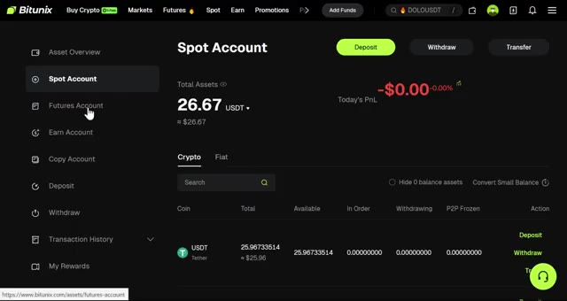
*⏱️ 00:07:40 — Capture d'écran de l'interface de l'échange Bitunix montrant le portefeuille Spot (Spot Account) avec un solde de 26,67 USDT et le curseur de la souris pointant vers le menu du compte Futures.*

---

### ⏱️ `[00:07:55 - 00:08:34]` | Segment #18

**🔊 Audio (Transcription Intégrale Mot pour Mot en Français) :**
> Sélectionnez USDT comme devise. Choisissez parmi le compte au comptant ou futures. Entrez le montant avec lequel vous souhaitez trader et cliquez sur soumettre. Cette étape est importante car si votre USDT reste dans le portefeuille au comptant, vous ne pourrez pas ouvrir de positions futures. Une fois le transfert terminé, vous verrez votre USDT apparaître dans votre compte futures et vous êtes prêt à commencer à trader. Passons maintenant à ce que vous attendez, le trading de futures. Allez dans futures dans la navigation principale, puis cliquez sur futures USDT-M. Vous pouvez également choisir USDCM si vous préférez l'USDC à l'USDT, mais pour les débutants, je recommande d'utiliser USDT-M.

**👁️ Analyse Visuelle d'Écran (gemini-3.5-flash-lite) :**
**Interface & Outils** : Interface de la bourse de cryptomonnaies Bitunix.

**Contenu textuel & Code** : Soldes de comptes spot, cryptomonnaies listées (USDT, BTCUSDT, ETHUSDT, etc.) et options de contrats futures.

**Action / Démonstration** : Navigation et gestion des fonds entre le compte spot et les comptes de trading futures sur l'échange Bitunix.

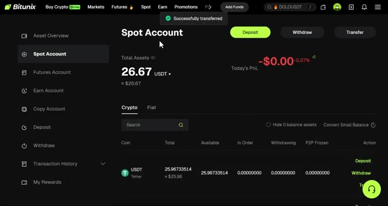
*⏱️ 00:08:05 — Vue du compte Spot (Spot Account) sur la plateforme Bitunix, affichant une notification de transfert réussi et un solde en USDT.*

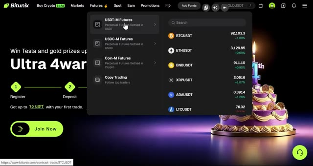
*⏱️ 00:08:24 — Menu déroulant de sélection des marchés Futures (USDT-M Futures, USDC-M Futures, Coin-M Futures) sur la plateforme Bitunix.*

---

### ⏱️ `[00:08:34 - 00:08:57]` | Segment #19

**🔊 Audio (Transcription Intégrale Mot pour Mot en Français) :**
> parce que c'est le plus courant et qu'il a la plus forte liquidité. Vous pouvez également voir une autre option ici appelée Coin-M. Cela vous permet de faire du trading de produits dérivés réglés en crypto, également connu sous le nom de trading inversé. Après avoir cliqué sur USDT et futures, cela vous amènera au tableau de bord du trading de futures. C'est ici que vous ferez la majeure partie de votre trading. Je vais décomposer chaque section pour que tout soit parfaitement clair.

**👁️ Analyse Visuelle d'Écran (gemini-3.5-flash-lite) :**
**Interface & Outils** : Plateforme d'échange de cryptomonnaies Bitunix.

**Contenu textuel & Code** : Menus de sélection des marchés futures (USDT-M, USDC-M, Coin-M) et interface de trading avec graphique en chandeliers, carnet d'ordres et options d'effet de levier.

**Action / Démonstration** : Sélection de l'option Coin-M Futures dans le menu déroulant puis navigation vers l'interface de trading de contrats futures de Bitunix.

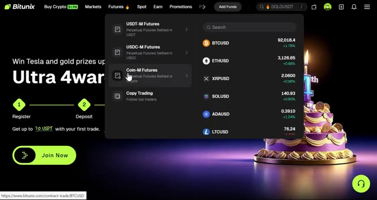
*⏱️ 00:08:40 — Interface de la plateforme Bitunix montrant le menu déroulant des options de futures avec Coin-M Futures mis en surbrillance.*

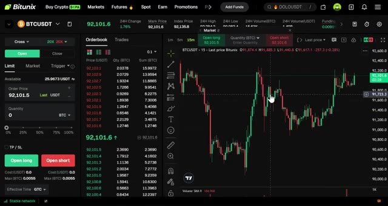
*⏱️ 00:08:52 — Interface de trading de contrats futures sur Bitunix affichant le graphique des prix du Bitcoin (BTCUSDT), le carnet d'ordres et le panneau de passage d'ordres.*

---

### ⏱️ `[00:08:58 - 00:09:30]` | Segment #20

**🔊 Audio (Transcription Intégrale Mot pour Mot en Français) :**
> Voici ce que vous verrez sur l'écran de trading. Sélection de la paire de trading. Tout en haut à gauche, c'est ici que vous choisissez quelle crypto trader comme BTC slash USDT, ETH slash USDT, ou n'importe quel autre altcoin. Bitunix propose des centaines de paires disponibles. Vous pouvez voir le graphique des prix sur le côté droit. Il montre l'historique des mouvements de prix et vous pouvez changer l'unité de temps comme vous le souhaitez. Bitunix utilise les graphiques de TradingView, qui sont la norme de l'industrie et très puissants pour l'analyse technique. Vous pouvez voir le carnet d'ordres au milieu à gauche. Les chiffres rouges sont les ordres de vente,

**👁️ Analyse Visuelle d'Écran (gemini-3.5-flash-lite) :**
**Interface & Outils** : Interface de l'échange de cryptomonnaies Bitunix (vue Futures).

**Contenu textuel & Code** : Liste des paires de trading disponibles (BTCUSDT à 92,098.9, ETHUSDT, SOLUSDT, XRPUSDT, DOGEUSDT) et graphique en chandeliers japonais en unité de temps 15m.

**Action / Démonstration** : Sélection de la paire de trading dans le menu en haut à gauche de l'interface.

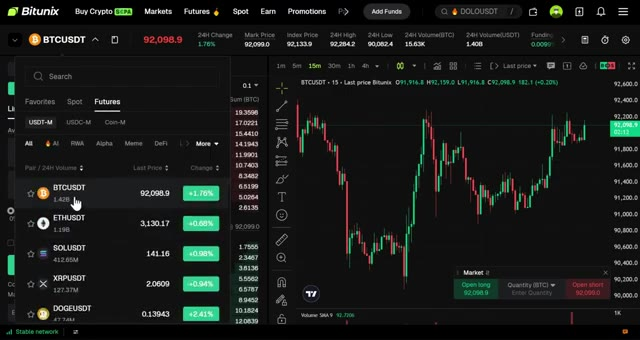
*⏱️ 00:09:06 — Capture d'écran de l'interface de l'échange Bitunix montrant le menu déroulant de sélection de la paire de trading (BTC/USDT, ETH/USDT, etc.) et le graphique des prix du Bitcoin en arrière-plan.*

---

### ⏱️ `[00:09:30 - 00:10:04]` | Segment #21

**🔊 Audio (Transcription Intégrale Mot pour Mot en Français) :**
> et les chiffres verts sont les ordres d'achat. Cela montre la profondeur du marché en temps réel, afin que vous puissiez voir où se trouve la liquidité. Panneau de placement des ordres. Tout à gauche, c'est là que vous placerez vos transactions, définirez l'effet de levier et entrerez la taille de votre position. C'est le centre de contrôle pour ouvrir et fermer les transactions et le panneau des positions. En bas, cela montre vos transactions actives, vos ordres ouverts, l'historique des ordres et l'historique des positions, et plus encore. C'est là que vous surveillez tout une fois que votre transaction est en direct. Tout ce dont vous avez besoin est ici sur un seul écran, prêt à trader. Avant de placer un

**👁️ Analyse Visuelle d'Écran (gemini-3.5-flash-lite) :**
**Interface & Outils** : Interface de l'échange de cryptomonnaies Bitunix.

**Contenu textuel & Code** : Carnet d'ordres (Orderbook) avec les prix d'achat et de vente, panneau de placement des ordres (limite, effet de levier 20x, boutons Open long / Open short), et graphique des chandeliers BTCUSDT en unité 15m.

**Action / Démonstration** : Présentation de l'interface de trading et des différents panneaux de la plateforme (carnet d'ordres et placement des transactions).

*⏱️ 00:09:39 — Capture d'écran de l'interface de trading Bitunix montrant le carnet d'ordres, le panneau de placement des ordres à gauche et le graphique des prix BTCUSDT au centre.*

---

### ⏱️ `[00:10:04 - 00:10:23]` | Segment #22

**🔊 Audio (Transcription Intégrale Mot pour Mot en Français) :**
> trade, you need to configure two important settings. First, choose your margin mode. Batunix offers two options. First is isolated margin. This protects the rest of your account. If the trade goes wrong, you only lose what you put into that specific position. The rest of your balance is safe. Second one is cross margin.

**👁️ Analyse Visuelle d'Écran (gemini-3.5-flash-lite) :**
**Interface & Outils** : Interface de l'exchange Bitunix (Futures)

**Contenu textuel & Code** : Options de configuration : mode Cross (marge partagée avec le solde du compte) et mode Isolated (marge limitée à la position spécifique), avec boutons 'Cancel' et 'Confirm'.

**Action / Démonstration** : Configuration des paramètres de marge pour le trading de contrats futures.

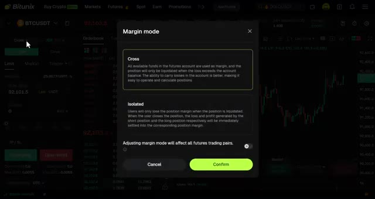
*⏱️ 00:10:09 — Fenêtre modale de sélection du mode de marge (Cross ou Isolated) sur l'interface de trading Bitunix pour la paire BTCUSDT.*

---

### ⏱️ `[00:10:24 - 00:10:42]` | Segment #23

**🔊 Audio (Transcription Intégrale Mot pour Mot en Français) :**
> Toutes les positions partagent le même solde de marge. Si une transaction est liquidée, cela peut affecter l'ensemble de votre compte. C'est plus risqué. Pour les débutants, utilisez toujours la marge isolée pour protéger votre compte. Deuxièmement, définissez votre effet de levier. Bitunix autorise jusqu'à 200 fois l'effet de levier sur certaines paires, mais n'utilisez pas un effet de levier élevé en tant que débutant.

**👁️ Analyse Visuelle d'Écran (gemini-3.5-flash-lite) :**
**Interface & Outils** : Interface de trading de la bourse Bitunix.

**Contenu textuel & Code** : Menu « Margin mode » affichant les options « Cross » (marge croisée) et « Isolated » (marge isolée) avec leurs descriptions respectives, ainsi que les boutons de confirmation.

**Action / Démonstration** : Sélection du mode de marge croisée ou isolée pour la gestion du risque en trading de contrats futures.

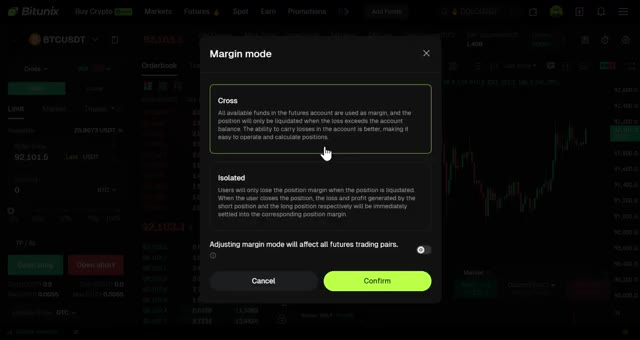
*⏱️ 00:10:28 — Fenêtre modale de sélection du mode de marge (Cross ou Isolated) sur la plateforme d'échange Bitunix.*

---

### ⏱️ `[00:10:42 - 00:11:13]` | Segment #24

**🔊 Audio (Transcription Intégrale Mot pour Mot en Français) :**
> Limitez-vous à 5 fois à 10 fois maximum. Voici comment cela fonctionne. Si vous avez un solde de 10 dollars avec un effet de levier de 5 fois, vous obtenez 50 dollars de pouvoir d'achat de position. Cela signifie que vous contrôlez pour 50 dollars de Bitcoin avec seulement 10 dollars de votre propre argent. Un effet de levier plus élevé signifie un risque plus élevé. Votre prix de liquidation se rapproche de votre entrée, donc un seul faux pas peut anéantir votre position. Pour cet exemple, j'utilise un effet de levier de 5 fois sur marge isolée. Bon, maintenant, plaçons un trade long. Parier que le Bitcoin va monter.

**👁️ Analyse Visuelle d'Écran (gemini-3.5-flash-lite) :**
**Interface & Outils** : Interface de l'exchange de cryptomonnaies Bitunix (fenêtre modale de paramétrage du levier).

**Contenu textuel & Code** : Paramètres de levier réglés à 5X pour "Open Long" et "Open Short", curseur gradué de 1X à 200X, valeur nominale maximale de position (80 000 000 USDT), et message d'avertissement réglementaire.

**Action / Démonstration** : Configuration et ajustement de l'effet de levier sur une position de trading de cryptomonnaies.

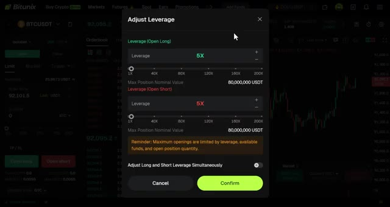
*⏱️ 00:10:50 — Fenêtre pop-up de réglage de l'effet de levier (Adjust Leverage) sur la plateforme d'échange Bitunix montrant un effet de levier réglé sur 5X pour les positions Long et Short.*

---

### ⏱️ `[00:11:14 - 00:11:35]` | Segment #25

**🔊 Audio (Transcription Intégrale Mot pour Mot en Français) :**
> Choisissez un ordre au marché pour qu'il s'exécute instantanément au prix actuel du marché. Vous verrez les options de saisie des ordres. La valeur du montant. Il s'agit d'une quantité de contrats libellée en BTC. La valeur du coût. Il s'agit du coût d'ouverture et il ne change pas avec un effet de levier. La valeur nominale. Il s'agit de la valeur de marché de l'actif sous-jacent où le coût d'ouverture change avec l'effet de levier.

**👁️ Analyse Visuelle d'Écran (gemini-3.5-flash-lite) :**
**Interface & Outils** : Interface de l'échange de cryptomonnaies Bitunix (section Futures).

**Contenu textuel & Code** : Fenêtre de configuration affichant : "BTC (Quantity Unit)", "USDT (Cost Value)" avec la description "When placing orders based on the cost value, adjusting the leverage will not affect the cost", et "USDT (Nominal Value)". En arrière-plan, le carnet d'ordres et le graphique de BTCUSDT.

**Action / Démonstration** : Configuration des unités de saisie des ordres pour le trading de contrats Futures.

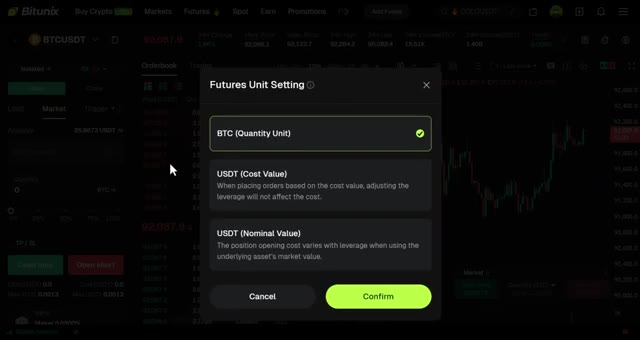
*⏱️ 00:11:19 — Fenêtre modale des paramètres d'unité des contrats Futures sur la plateforme Bitunix, affichant les options BTC (Quantity Unit), USDT (Cost Value) et USDT (Nominal Value).*

---

### ⏱️ `[00:11:35 - 00:11:54]` | Segment #26

**🔊 Audio (Transcription Intégrale Mot pour Mot en Français) :**
> Pour ce tutoriel, j'utiliserai une valeur nominale car elle s'ajuste avec votre effet de levier, ce qui facilite le contrôle de la taille de votre position. Définissez la taille de votre position. Par exemple, une position de 50 $. Avec un effet de levier de 5 fois, cela représente 10 $ de vos propres capitaux. Maintenant, définissez toujours un stop loss et un take profit. C'est non négociable.

**👁️ Analyse Visuelle d'Écran (gemini-3.5-flash-lite) :**
**Interface & Outils** : Interface de l'échange de cryptomonnaies Bitunix (carnet d'ordres, graphique TradingView BTCUSDT en unités 15m, panneau de passage d'ordres au marché).

**Contenu textuel & Code** : Paires de trading BTCUSDT, effet de levier 5x en mode isolé, option de valeur nominale configurée à 50 USDT, coût estimé de 9,41 USDT.

**Action / Démonstration** : Le présentateur configure la taille de la position en saisissant une valeur nominale de 50 $ avec un effet de levier de 5x.

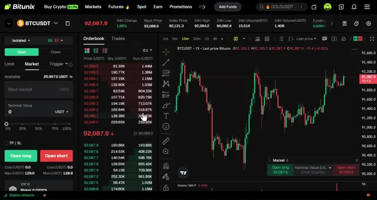
*⏱️ 00:11:40 — Interface de trading Bitunix montrant le carnet d'ordres et le graphique BTCUSDT, avec le champ de valeur nominale à zéro.*

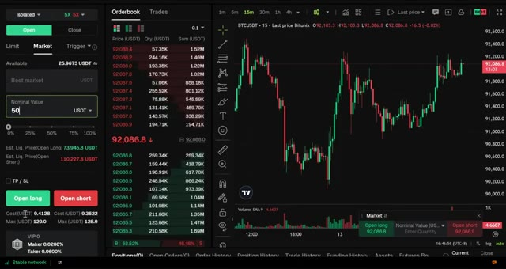
*⏱️ 00:11:49 — Interface de trading Bitunix montrant la configuration d'un ordre avec une valeur nominale de 50 $ et un effet de levier de 5x.*

---

### ⏱️ `[00:11:54 - 00:12:29]` | Segment #27

**🔊 Audio (Transcription Intégrale Mot pour Mot en Français) :**
> Cliquez sur TP slash SL pour ouvrir les paramètres. Définissez votre stop loss à un prix où vous perdriez 2 $ et votre take profit à un prix où vous gagneriez 6 $. Un ratio risque-rendement de 1 sur 3. Une fois que tout est défini, cliquez sur ouvrir un long. Votre trade est maintenant actif. Vous le verrez dans le panneau des positions. Votre prix d'entrée, vos profits et pertes actuels, et votre prix de liquidation. Pour shorter le marché, choisissez simplement ouvrir un court au lieu de long. Même processus, mais vous pariez que le prix va baisser. Et rappelez-vous, votre volume de trading sur les contrats à terme aide à débloquer des bonus comme 20 USDT

**👁️ Analyse Visuelle d'Écran (gemini-3.5-flash-lite) :**
**Interface & Outils** : Interface de trading (broker/échange) avec carnet d'ordres et graphique TradingView intégré.

**Contenu textuel & Code** : Panneau de configuration des ordres avec les champs TP/SL configurés (PnL à 6 $ et -2 $), le sélecteur de taille (Nominal Value 50 USDT), et les boutons d'exécution "Open long" et "Open short".

**Action / Démonstration** : Configuration des paramètres de Take Profit (TP) et Stop Loss (SL) en vue d'ouvrir une position longue avec un ratio risque-rendement défini.

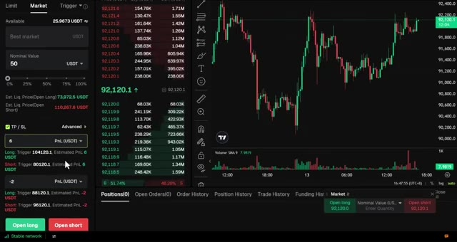
*⏱️ 00:12:03 — Capture d'écran de l'interface de trading montrant le carnet d'ordres, le panneau de configuration des ordres au marché avec l'option TP/SL activée, et un graphique en chandeliers.*

---

### ⏱️ `[00:12:29 - 00:12:49]` | Segment #28

**🔊 Audio (Transcription Intégrale Mot pour Mot en Français) :**
> pour avoir atteint 10 000 USDT de volume d'échange. La boîte mystère vaut jusqu'à 20 000 USDT pour le défi d'enregistrement de 24 semaines. Des chances de gagner une Tesla, une Rolex, des iPhones et plus encore. Ne manquez donc surtout pas ça. Au fur et à mesure que votre trade évolue en votre faveur, vous pouvez ajuster votre stop loss pour sécuriser vos profits.

**👁️ Analyse Visuelle d'Écran (gemini-3.5-flash-lite) :**
**Interface & Outils** : Interface web de l'échange de cryptomonnaies Bitunix.

**Contenu textuel & Code** : Page de promotion affichant les détails du défi de check-in sur 24 semaines, nécessitant un volume de trading hebdomadaire de futures de 20 000 USDT pour gagner des récompenses (boîtes mystères valant jusqu'à 20 000 USDT, bonus, iPhones, etc.).

**Action / Démonstration** : Navigation et présentation des conditions du défi promotionnel et des récompenses associées sur la plateforme d'échange.

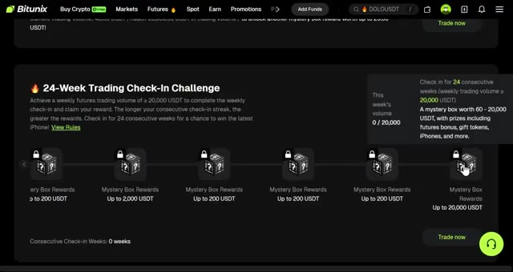
*⏱️ 00:12:34 — Capture d'écran de l'interface de la plateforme Bitunix montrant la page du défi "24-Week Trading Check-In Challenge" avec des boîtes mystères verrouillées.*

---

### ⏱️ `[00:12:49 - 00:13:23]` | Segment #29

**🔊 Audio (Transcription Intégrale Mot pour Mot en Français) :**
> Une fois que vous êtes en bénéfice de quelques dollars, déplacez votre stop loss au seuil de rentabilité afin de ne pas pouvoir perdre d'argent sur le trade. Vous pouvez également augmenter ou réduire votre position pendant qu'elle est active en utilisant les boutons d'ajustement de marge dans le panneau des positions. Pour clôturer votre trade, vous avez plusieurs options. Laissez votre TP ou SL le clôturer automatiquement lorsque le prix atteint votre objectif. Clôturez manuellement avec le bouton de clôture. Clôturez un pourcentage de la position si vous souhaitez prendre des profits partiels. Ajustez le TP slash SL directement sur le graphique en faisant glisser les lignes. Astuce de pro, ne soyez pas trop gourmand. Si vous atteignez votre objectif de take profit,

**👁️ Analyse Visuelle d'Écran (gemini-3.5-flash-lite) :**
**Interface & Outils** : Interface de trading de contrats futures (type exchange crypto/Bitunix) avec graphique de prix et carnet d'ordres.

**Contenu textuel & Code** : Fenêtre pop-up "Adjust Margin" permettant d'augmenter ou de réduire la marge d'une position active, avec affichage des marges actuelle et maximale, ainsi que le prix de liquidation estimé. Graphique en unités 15 minutes montrant une position ouverte sur BTCUSDT avec SL et TP.

**Action / Démonstration** : Démonstration de l'ajustement de la marge d'une position active et visualisation de la gestion du stop loss et du take profit sur le graphique.

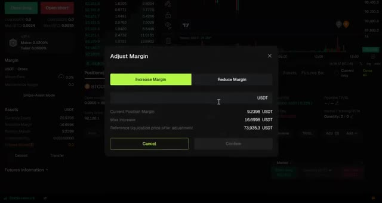
*⏱️ 00:12:58 — Interface de trading affichant une fenêtre modale d'ajustement de marge (Increase/Reduce Margin) avec les détails de la position actuelle en USDT.*

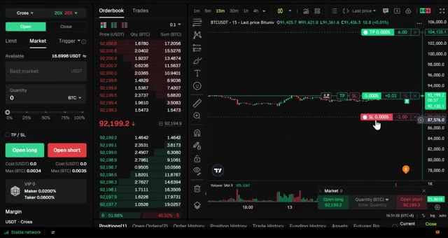
*⏱️ 00:13:06 — Interface de trading complète avec carnet d'ordres à gauche, graphique des prix au centre montrant un ordre long ouvert avec des niveaux de Stop Loss (SL) et Take Profit (TP).*

---

### ⏱️ `[00:13:23 - 00:13:41]` | Segment #30

**🔊 Audio (Transcription Intégrale Mot pour Mot en Français) :**
> clôturez le trade. Le marché vous donnera toujours une autre opportunité. Avant de terminer, voici les règles essentielles pour trader sur Botunics. Première règle, commencez avec de petites tailles de position. Ne risquez pas plus de 2 % à 5 % de votre capital par trade. Cela préserve votre capital même si vous enchaînez quelques trades perdants.

**👁️ Analyse Visuelle d'Écran (gemini-3.5-flash-lite) :**
**Interface & Outils** : Interface de trading de la plateforme Bitunix avec graphique de prix intégré et carnet d'ordres.

**Contenu textuel & Code** : Graphique de la paire BTCUSDT en unité de temps 15m, carnet d'ordres en temps réel, niveaux de Take Profit (TP) et Stop Loss (SL) positionnés sur le graphique, et indicateur de volume (Volume SMA 9).

**Action / Démonstration** : Visualisation d'une position ouverte en cours avec ses paramètres de gestion du risque (TP/SL) sur le graphique du marché.

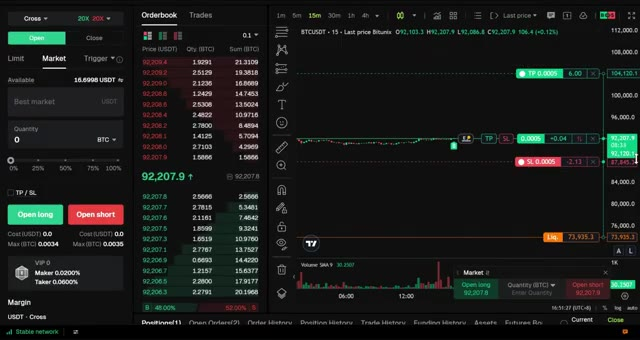
*⏱️ 00:13:28 — Capture d'écran de l'interface de trading montrant un graphique en chandeliers japonais, le carnet d'ordres et le panneau de passage d'ordres.*

---

### ⏱️ `[00:13:42 - 00:14:02]` | Segment #31

**🔊 Audio (Transcription Intégrale Mot pour Mot en Français) :**
> La deuxième règle est d'utiliser toujours des stops de protection. C'est non négociable. Chaque transaction a besoin d'un stop de protection avant d'entrer. Cela vous protège contre des pertes massives. La troisième est de tenir un journal de trading. Notez chaque transaction que vous effectuez, le prix d'entrée, le prix de sortie, pourquoi vous l'avez prise, ce que vous avez appris. C'est ainsi que vous vous améliorez avec le temps.

**👁️ Analyse Visuelle d'Écran (gemini-3.5-flash-lite) :**
**Interface & Outils** : Interface de courtier crypto / exchange avec carnet d'ordres et graphique intégré.

**Contenu textuel & Code** : Paire BTCUSDT, position Long en mode isolé (5x), Open Price à 92120.1, Mark Price à 92176.0, PnL non réalisé positif (+0.02795 USDT / +0.30%).

**Action / Démonstration** : Consultation de la position ouverte et des détails de marge dans l'onglet des positions du courtier.

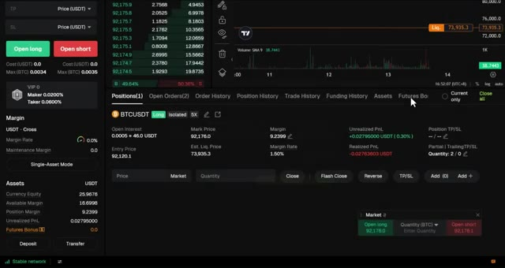
*⏱️ 00:13:47 — Interface de trading affichant une position ouverte sur BTCUSDT avec les détails de marge et le carnet d'ordres.*

---

### ⏱️ `[00:14:02 - 00:14:24]` | Segment #32

**🔊 Audio (Transcription Intégrale Mot pour Mot en Français) :**
> Quatrièmement, ne courez jamais après les pompes. Si vous avez raté un mouvement, attendez la prochaine configuration. Le FOMO est le moyen le plus rapide de perdre de l'argent dans la crypto. Et enfin, ne risquez jamais plus que ce que vous pouvez vous permettre de perdre. Le trading peut vous offrir la liberté financière, mais il peut aussi être risqué si vous ne gérez pas correctement votre risque. Le trading est une compétence qui demande du temps, de la répétition et de la discipline.

**👁️ Analyse Visuelle d'Écran (gemini-3.5-flash-lite) :**
**Interface & Outils** : Échange de cryptomonnaies Bitunix (interface de trading spot/futures).

**Contenu textuel & Code** : Graphique BTCUSDT en unité de temps 15 minutes, carnet d'ordres (Orderbook), prix actuel à 92,169.7, indicateur de volume (SMA 9), et paramètres de prise de profit (TP) / stop loss (SL).

**Action / Démonstration** : Consultation de l'interface de trading et observation des carnets d'ordres en lien avec les conseils de gestion des risques.

*⏱️ 00:14:08 — Capture d'écran de l'interface de trading Bitunix montrant le carnet d'ordres et un graphique de prix pour BTCUSDT.*

---

### ⏱️ `[00:14:24 - 00:14:43]` | Segment #33

**🔊 Audio (Transcription Intégrale Mot pour Mot en Français) :**
> Mais si vous suivez ces règles, vous aurez une longueur d'avance sur la plupart des débutants. Très bien, voilà donc l'analyse complète de la façon de trader les contrats à terme sur Batunix. De l'inscription au dépôt, jusqu'à l'ouverture et la gestion de votre premier trade. Avant de partir, n'oubliez pas, utilisez mon lien dans la description pour réclamer tous les bonus dont j'ai parlé plus tôt.

**👁️ Analyse Visuelle d'Écran (gemini-3.5-flash-lite) :**
**Interface & Outils** : Interface web de l'échange de cryptomonnaies Bitunix.

**Contenu textuel & Code** : Promos, étapes de trading (Register, Deposit, Trade) et centre de tâches pour les dépôts.

**Action / Démonstration** : Navigation sur la plateforme pour présenter les étapes d'inscription et de dépôt.

*⏱️ 00:14:29 — Page d'accueil de la plateforme Bitunix affichant une promotion anniversaire 'Ultra 4ward Begins' avec les étapes d'inscription, de dépôt et de trade.*

*⏱️ 00:14:38 — Centre des tâches ('Task Center') de la plateforme Bitunix montrant les récompenses de dépôt initial.*

---

### ⏱️ `[00:14:43 - 00:15:01]` | Segment #34

**🔊 Audio (Transcription Intégrale Mot pour Mot en Français) :**
> Commencez petit, concentrez-vous sur l'apprentissage, et ne courez pas après les profits au début. Maîtrisez les bases, développez vos compétences, et les profits viendront. Je mettrai également en ligne d'autres tutoriels Batunix. Alors abonnez-vous et activez la cloche de notification pour ne pas les rater. Merci d'avoir regardé et je vous vois dans la prochaine vidéo.

**👁️ Analyse Visuelle d'Écran (gemini-3.5-flash-lite) :**
**Interface & Outils** : Échange de cryptomonnaies Bitunix (interface de trading spot/futures).

**Contenu textuel & Code** : Paire BTCUSDT, prix actuel à 92,169.8, carnet d'ordres (Orderbook), options de levier (20x), panneau de passage d'ordres (Market/Limit), et graphique de prix intégrant des niveaux de Take Profit (TP) et Stop Loss (SL).

**Action / Démonstration** : Visualisation du marché et des positions de trading sur la plateforme Bitunix en lien avec les explications sur la gestion des risques et la maîtrise des bases.

*⏱️ 00:14:48 — Interface de trading de Bitunix affichant la paire BTCUSDT avec le carnet d'ordres et un graphique de prix en temps réel.*

---

