# 🎬 My Super Simple 1 Min Scalping Strategy That Makes $100/Day

> **Chaîne** : [Alex Carter](https://www.youtube.com/@AlexCarterTrading)  
> **Lien YouTube** : [https://www.youtube.com/watch?v=kDyXzOQOpjg](https://www.youtube.com/watch?v=kDyXzOQOpjg)  
> **Date de publication** : 20260119  
> **Durée** : 00:07:04  
> **Identifiant vidéo** : `kDyXzOQOpjg`  
> **Transcription & Analyse** : `whisper-v3-large-turbo+gemini-3.5-flash-lite`  

---

## 📌 Synthèse Exécutive & Outils

### 💡 Résumé

Cette vidéo d'Alex Carter propose une incursion directe dans l'univers du scalping à haute fréquence sur une unité de temps d'une minute, ciblant l'exploitation des micro-mouvements de prix sur les marchés cryptographiques dérivés. L'analyse se concentre sur une méthode mécanique combinant trois indicateurs techniques majeurs pour filtrer le bruit des marchés et générer des opportunités de trading rapides et répétées. L'approche met l'accent sur la simplicité opérationnelle et la rigueur dans l'exécution, tout en s'appuyant sur des plateformes d'échange alternatives pour optimiser l'accès au marché et bénéficier de leviers adaptés.

Au cœur de la stratégie, l'indicateur des bougies de régression linéaire, couplé au fameux *UT Bot Alerts* et à l'indicateur *STC* (Schaff Trend Cycle), sert de système de feux tricolores pour valider chaque impulsion directionnelle. L'intervenant détaille précisément les conditions requises pour s'affranchir des faux signaux : un alignement parfait entre la clôture des prix par rapport à la ligne de régression, le signal d'alerte algorithmique et la polarité chromique du STC. Cette architecture technique vise à maximiser le ratio de réussite sur des actifs à forte volatilité tels que le BTC/USDT.

Enfin, la démonstration intègre une dimension pratique incontournable axée sur l'infrastructure de trading et la gestion du risque. De l'inscription sur des bourses décentralisées ou régulées sans KYC lourd (Bitunix et LBank) jusqu'à la configuration des ordres au marché et de la marge isolée, chaque étape est pensée pour encadrer le capital du trader débutant ou avancé. Le contrôle de l'effet de levier et l'utilisation de stop-loss dynamiques basés sur l'inversion des signaux techniques garantissent une approche structurée pour viser la régularité des gains quotidiens.

### 🛠️ Outils, Modèles & Logiciels Présentés

* **TradingView (mentionné comme Trade Viewer)** : Plateforme de graphisme incontournable utilisée gratuitement pour configurer les indicateurs techniques et surveiller l'unité de temps d'une minute.
* **Bougies de Régression Linéaire (Linear Regression Candles)** : Indicateur graphique paramétré avec un lissage de signal à 7, servant à identifier la dynamique de tendance et à situer les prix par rapport à une ligne directrice médiane.
* **UT Bot Alerts** : Indicateur algorithmique configuré avec une valeur clé de 2 et un ATR de 11, agissant comme le déclencheur principal des signaux d'achat et de vente.
* **STC (Schaff Trend Cycle)** : Indicateur de momentum et de cycle de tendance utilisé comme filtre anti-faux signaux, validant les entrées uniquement lorsqu'il adopte une couleur verte (long) ou rouge (short).
* **Bitunix** : Bourse de produits dérivés principale recommandée pour le trading de contrats à terme (USDT-M), offrant une structure de bonus de dépôt et un effet de levier allant jusqu'à 200x.
* **LBank** : Échange alternatif proposé pour les utilisateurs ne souhaitant pas se soumettre à des vérifications KYC strictes, doté de programmes incitatifs exclusifs.
* **Claude Code / Grok Bots** : Outils d'intelligence artificielle et d'automatisation évoqués dans l'écosystème analytique global de la chaîne pour concevoir, coder et optimiser des stratégies algorithmiques (dans le cadre de l'expertise de la chaîne).

### 🔑 Points Clés & Enseignements Stratégiques

* **Spécificité du Scalping en 1 Minute** : L'horizon temporel à court terme permet de multiplier les prises de position quotidiennes sans subir l'attente prolongée inhérente au swing trading, en capturant des impulsions de prix immédiates.
* **Sélection et Paramétrage de la Régression Linéaire** : L'indicateur de bougies de régression linéaire doit être configuré avec un lissage de signal réglé à 7, et une épaisseur visuelle renforcée pour identifier clairement la cassure de la ligne blanche centrale.
* **Calibrage de l'indicateur UT Bot Alerts** : Pour affiner la sensibilité des signaux d'entrée, la valeur clé doit être fixée à 2 et l'Average True Range (ATR) ajusté à 11, servant de boussole directionnelle incontournable.
* **Filtrage des Faux Signaux via le STC** : L'indicateur Schaff Trend Cycle (STC) agit comme un filtre de confirmation impératif : aucun trade ne doit être exécuté si la couleur de la ligne ne correspond pas strictement au sens de la position (vert pour l'achat, rouge pour la vente).
* **Conditions d'Entrée en Position Longue (Achat)** : L'alignement requis combine un signal d'achat émis par l'UT Bot, une bougie de régression linéaire verte clôturant au-dessus de la ligne blanche, et un indicateur STC de couleur verte.
* **Conditions d'Entrée en Position Courte (Vente)** : L'inverse exact s'applique pour un short : un signal de vente de l'UT Bot, une bougie de régression linéaire rouge clôturant en dessous de la ligne blanche, et un STC de couleur rouge.
* **Gestion du Risque par la Marge Isolée** : L'utilisation de la marge isolée est fortement préconisée pour compartimenter le risque de chaque transaction et empêcher qu'une position perdante ne compromette l'intégralité du capital du compte.
* **Maîtrise de l'Effet de Levier** : Bien que les plateformes proposent des leviers massifs (jusqu'à 200x), il est stratégiquement recommandé aux débutants de se limiter à une fourchette de 5x à 10x, et aux traders avancés de ne pas excéder 25x pour préserver leur capital.
* **Placement et Sortie par Stop-Loss Dynamique** : Le stop-loss initial est placé de part et d'autre de la ligne blanche directrice, mais la sortie effective de position est dictée par l'apparition d'un signal technique opposé (clôture d'une bougie de régression dans le sens inverse).
* **Optimisation des Bonus d'Échange** : L'utilisation de liens affiliés spécifiques sur des plateformes comme Bitunix ou LBank permet de maximiser le capital initial grâce à des bonus de dépôt et des récompenses sur le premier trade de contrats à terme.

---

## ⏱️ Chronologie & Transcription Complète Audio & Visuelle (Mot pour Mot)

### ⏱️ `[00:00:00 - 00:00:36]` | Segment #01

**🔊 Audio (Transcription Intégrale Mot pour Mot en Français) :**
> Dans cette vidéo, je vais vous montrer une stratégie de scalping d'une minute que les débutants et les traders avancés utilisent pour gagner rapidement des centaines, voire des milliers de dollars sur Bitunix et LBank. Nous parlons de plusieurs trades par jour avec des entrées et des sorties rapides. Cette méthode de scalping est parfaite si vous voulez capturer des mouvements de prix rapides tout au long de la journée au lieu d'attendre des heures qu'un setup apparaisse enfin. Je vais vous l'expliquer étape par étape et vous montrer les indicateurs exacts et les paramètres que j'utilise personnellement. Assurez-vous donc de regarder jusqu'à la fin. Très bien, les gars, étape numéro une, inscrivez-vous sur un échange. Pour cette stratégie, nous allons utiliser Bitunix.

**👁️ Analyse Visuelle d'Écran (gemini-3.5-flash-lite) :**
**Interface & Outils** : Interface de la plateforme d'échange Bitunix et graphique TradingView.

**Contenu textuel & Code** : Graphique de prix BTCUSDT, carnet d'ordres (Orderbook), indicateur LinReg Candles, UT Bot Alerts et volumes de trading en bas de page.

**Action / Démonstration** : Présentation de l'interface de trading Bitunix et démonstration d'une stratégie de scalping d'une minute sur graphique TradingView avec des signaux d'achat et de vente.

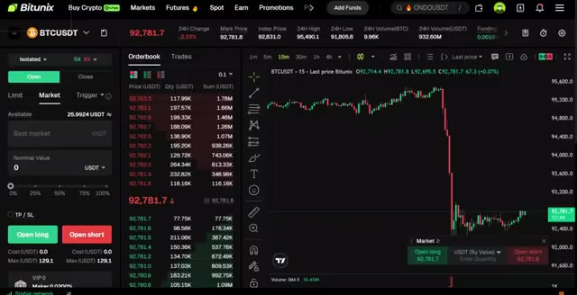
*⏱️ 00:00:09 — Interface de trading de la plateforme Bitunix montrant le carnet d'ordres et un graphique du BTCUSDT avec une forte baisse.*

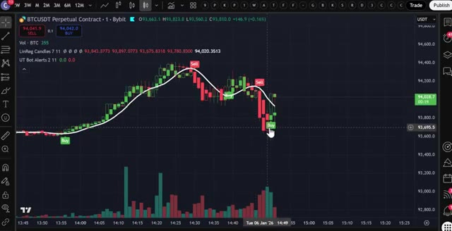
*⏱️ 00:00:18 — Graphique TradingView sur le contrat perpétuel BTCUSDT montrant des bougies en unités de 1 minute, avec des indicateurs techniques et des signaux d'achat/vente (Buy/Sell).*

---

### ⏱️ `[00:00:36 - 00:01:13]` | Segment #02

**🔊 Audio (Transcription Intégrale Mot pour Mot en Français) :**
> C'est l'une des principales bourses que j'utilise en ce moment pour le trading de produits dérivés, et ils proposent des bonus absolument fous en ce moment. Vous pouvez obtenir jusqu'à 20 USDT rien que pour votre premier dépôt, plus 20 USDT supplémentaires pour avoir effectué votre premier trade sur les contrats à terme. Si Bitunix n'est pas disponible dans votre pays ou si vous ne voulez pas faire de KYC, vous pouvez utiliser LBank comme alternative. Et le meilleur dans tout ça ? LBank ne requiert pas de vérification KYC pour le trading de base. LBank propose également 50 000 USDT de bonus exclusifs. Je mettrai les liens des deux ci-dessous, mais pour cette vidéo, nous allons utiliser Bitunix.

**👁️ Analyse Visuelle d'Écran (gemini-3.5-flash-lite) :**
**Interface & Outils** : Interface de la plateforme d'échange Bitunix et site web d'information Crypto Vanguards.

**Contenu textuel & Code** : Offre promotionnelle de bonus "First-Time Deposit" offrant jusqu'à 20 USDT en boîte mystère pour un dépôt minimum de 100 USDT.

**Action / Démonstration** : Navigation sur la page des promotions et des bonus d'inscription de la plateforme d'échange.

*⏱️ 00:00:45 — Capture d'écran de l'interface de la bourse Bitunix montrant la section des récompenses et bonus pour le premier dépôt ("First-Time Deposit").*

---

### ⏱️ `[00:01:13 - 00:01:46]` | Segment #03

**🔊 Audio (Transcription Intégrale Mot pour Mot en Français) :**
> Pour vous inscrire sur Batunix et réclamer vos bonus, cliquez sur le lien tout en haut de la description. Vous serez redirigé vers la page d'inscription où il vous suffit d'entrer votre e-mail, de créer un mot de passe fort et de créer un compte. La deuxième étape consiste à déposer des fonds. Laissez-moi vous montrer comment déposer des fonds avant que nous ne plongeions dans la stratégie. Une fois connecté à Bitunix, allez dans le coin supérieur droit, cliquez sur l'icône du portefeuille, puis cliquez sur dépôt. Choisissez la pièce que vous souhaitez déposer. Je recommande l'USDT et sélectionnez le réseau de blockchain correct. Assurez-vous de choisir le bon réseau pour éviter de perdre

**👁️ Analyse Visuelle d'Écran (gemini-3.5-flash-lite) :**
**Interface & Outils** : Site web de la plateforme d'échange de cryptomonnaies Bitunix.

**Contenu textuel & Code** : Formulaire d'inscription, bannières promotionnelles (« Ultra 4ward Begins! ») et menu de sélection de cryptomonnaies pour le dépôt.

**Action / Démonstration** : Démonstration du processus d'inscription et de dépôt de fonds sur Bitunix.

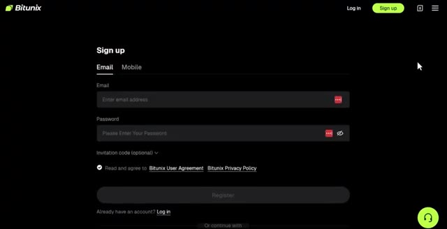
*⏱️ 00:01:21 — Page d'inscription de la plateforme Bitunix avec les champs e-mail et mot de passe.*

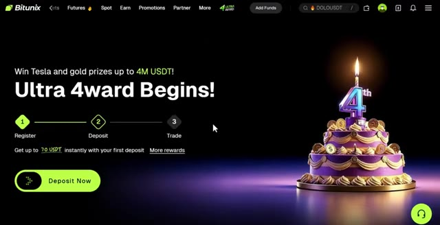
*⏱️ 00:01:29 — Page d'accueil promotionnelle de Bitunix affichant les étapes : Register, Deposit, Trade.*

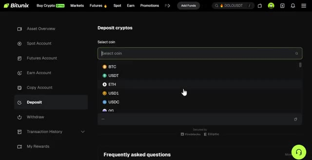
*⏱️ 00:01:38 — Interface de dépôt de cryptomonnaies sur Bitunix avec la liste des actifs sélectionnables (BTC, USDT, ETH, etc.).*

---

### ⏱️ `[00:01:46 - 00:02:22]` | Segment #04

**🔊 Audio (Transcription Intégrale Mot pour Mot en Français) :**
> vos fonds. Confirmez les détails, puis scannez le code QR ou copiez l'adresse de dépôt pour transférer vos fonds depuis votre portefeuille ou un autre échange. Si vous souhaitez déposer en monnaie fiat, cliquez sur Acheter des cryptos en haut du menu, puis sélectionnez Achat en un clic. Choisissez votre devise, entrez le montant, et après cela sélectionnez votre mode de paiement. Une fois vos fonds déposés, il est temps d'ouvrir une position. L'étape numéro trois consiste à ouvrir votre première position. Cliquez sur Futures dans le menu supérieur, puis sélectionnez USDT-M Futures. Cela vous amènera à l'interface de trading. Choisissez l'actif que vous voulez

**👁️ Analyse Visuelle d'Écran (gemini-3.5-flash-lite) :**
**Interface & Outils** : Interface web de l'échange de cryptomonnaies Bitunix.

**Contenu textuel & Code** : Solde du portefeuille de 26.76 USDT, options de dépôt, de retrait et méthodes de paiement par fiat avec différents taux de change.

**Action / Démonstration** : Navigation dans le tableau de bord utilisateur de la plateforme d'échange et sélection des méthodes de paiement pour le dépôt en monnaie fiduciaire.

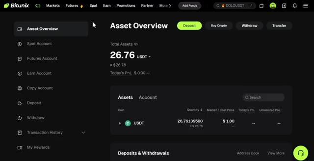
*⏱️ 00:01:55 — Vue d'ensemble des actifs (Asset Overview) sur la plateforme Bitunix affichant un solde total de 26.76 USDT.*

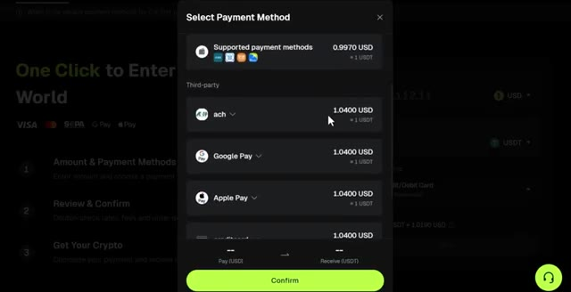
*⏱️ 00:02:04 — Fenêtre contextuelle de sélection du mode de paiement (Select Payment Method) pour l'achat de cryptomonnaies par tiers (ACH, Google Pay, Apple Pay).*

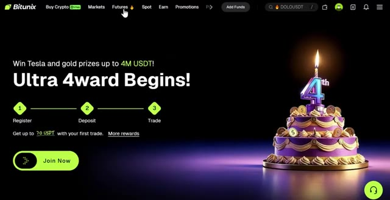
*⏱️ 00:02:13 — Page d'accueil promotionnelle de la plateforme Bitunix affichant un événement anniversaire pour gagner une Tesla et des prix en or.*

---

### ⏱️ `[00:02:22 - 00:02:56]` | Segment #05

**🔊 Audio (Transcription Intégrale Mot pour Mot en Français) :**
> pour placer votre transaction dans le coin supérieur gauche. Pour cet exemple, j'utiliserai BTCUSDT, mais vous pouvez trader n'importe quel altcoin ici si vous le souhaitez. Sélectionnez votre type d'ordre, limite ou au marché. Je recommande de commencer par des ordres au marché pour une exécution instantanée. Entrez les détails de votre transaction tels que la quantité et le prix. Ensuite, choisissez votre type de levier. Vous pouvez utiliser la marge croisée ou la marge isolée. Personnellement, j'utilise la marge isolée car elle limite votre risque uniquement à cette position spécifique. Vous pouvez utiliser jusqu'à 200 fois de levier sur Bitunix, mais il est important de ne pas utiliser un effet de levier élevé car c'est très risqué. Pour les débutants,

**👁️ Analyse Visuelle d'Écran (gemini-3.5-flash-lite) :**
**Interface & Outils** : Interface de la plateforme d'échange Bitunix (trading de futures crypto).

**Contenu textuel & Code** : Graphique de prix BTCUSDT en unités de 15 minutes, carnet d'ordres en temps réel, sélecteur de type d'ordre (Limit/Market) et options de mode de marge (Cross/Isolated).

**Action / Démonstration** : Sélection du type d'ordre au marché et configuration du mode de marge isolé pour la paire BTCUSDT.

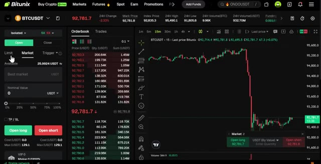
*⏱️ 00:02:31 — Interface de trading Bitunix affichant la paire BTCUSDT avec le panneau de carnet d'ordres et un graphique en chandeliers.*

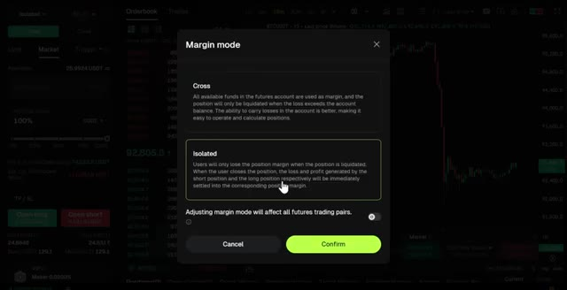
*⏱️ 00:02:48 — Fenêtre modale de sélection du mode de marge (Cross ou Isolated) sur la plateforme Bitunix.*

---

### ⏱️ `[00:02:56 - 00:03:34]` | Segment #06

**🔊 Audio (Transcription Intégrale Mot pour Mot en Français) :**
> Je recommande de commencer par un levier de 5 à 10 fois maximum jusqu'à ce que vous soyez à l'aise. Si vous êtes très avancé, vous pourriez aller jusqu'à peut-être 25 fois. Confirmez les détails de votre ordre, puis cliquez sur ouvrir long si vous pensez que le prix va monter, ou short si vous vous attendez à ce que le prix baisse. Pour cet exemple, je vais cliquer sur long. Une fois votre ordre exécuté, vous pouvez le voir sous l'onglet des positions en bas de l'écran. Maintenant que vous savez comment utiliser les produits dérivés sur Bitunix, passons à la stratégie réelle qui peut vous faire gagner des centaines de dollars par jour. Très bien, il s'agit donc d'une stratégie de scalping et c'est une stratégie de trading à court terme que les traders peuvent utiliser pour réaliser des profits fréquents grâce à

**👁️ Analyse Visuelle d'Écran (gemini-3.5-flash-lite) :**
**Interface & Outils** : Interface de trading crypto (type plateforme d'échange de contrats futures) avec graphique des prix et carnet d'ordres intégré.

**Contenu textuel & Code** : Réglage du levier à 5X, paire BTCUSDT, carnet d'ordres en temps réel, et confirmation d'ordre exécuté ("Order placed" / "Open Long 5X").

**Action / Démonstration** : Ajustement du levier à 5x puis passage et confirmation d'un ordre d'achat au marché (Open Long).

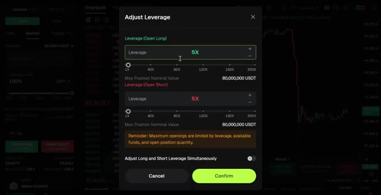
*⏱️ 00:03:06 — Fenêtre de réglage du levier (Adjust Leverage) affichant un effet de levier fixé à 5X pour les positions long et short, avec un curseur allant jusqu'à 200X.*

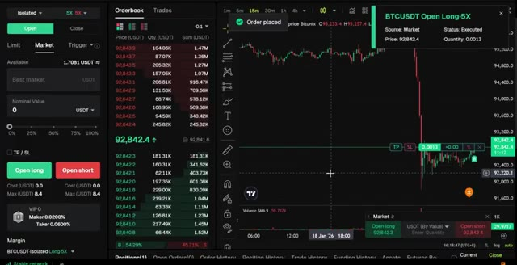
*⏱️ 00:03:15 — Interface de trading complète montrant le carnet d'ordres, un graphique des prix BTCUSDT avec une forte baisse, et une notification confirmant l'exécution d'un ordre d'achat (Open Long) à 5X.*

---

### ⏱️ `[00:03:34 - 00:04:06]` | Segment #07

**🔊 Audio (Transcription Intégrale Mot pour Mot en Français) :**
> petits mouvements de prix au quotidien. Donc nous entrons et sortons rapidement au lieu de faire du swing trading à plus long terme. Passons maintenant directement à la configuration de la stratégie. D'abord, vous devez obtenir un compte Trade Viewer. Le lien sera en bas pour Trade and View. C'est une version gratuite, donc c'est tout à fait bien de l'utiliser sans payer pour la version pro. Sélectionnez maintenant la paire de trading ici. Dans ce cas, je vais choisir BTC contre USDT. La prochaine chose à faire est de sélectionner l'unité de temps juste ici. Comme il s'agit d'une stratégie de scalping d'une minute, je recommande la minute.

**👁️ Analyse Visuelle d'Écran (gemini-3.5-flash-lite) :**
**Interface & Outils** : TradingView

**Contenu textuel & Code** : Graphique en chandeliers japonais, graphiques de volume, sélection d'actifs (BTCUSDT, MEXC, Bybit, OKX, etc.)

**Action / Démonstration** : Navigation et sélection d'un symbole sur la plateforme de graphiques TradingView pour la configuration de la stratégie.

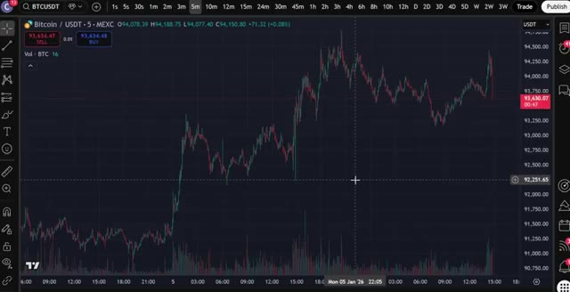
*⏱️ 00:03:42 — Graphique TradingView affichant le cours du Bitcoin (BTCUSDT) en unités de 5 minutes sur la bourse MEXC, montrant l'évolution des prix et des volumes de trading.*

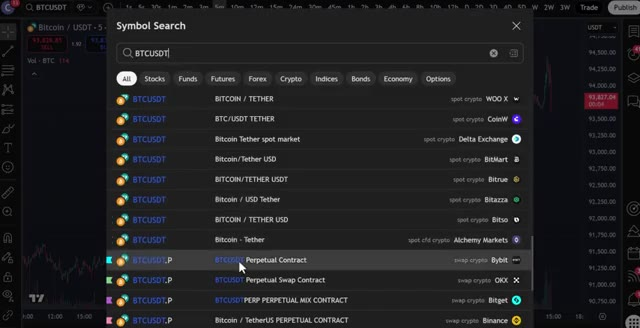
*⏱️ 00:03:58 — Fenêtre de recherche de symboles ("Symbol Search") ouverte sur TradingView avec la requête "BTCUSDT", affichant une liste de contrats perpétuels sur différentes plateformes (Bybit, OKX, Bitget, Binance).*

---

### ⏱️ `[00:04:06 - 00:04:41]` | Segment #08

**🔊 Audio (Transcription Intégrale Mot pour Mot en Français) :**
> période de temps pour obtenir les meilleurs résultats. Allez maintenant dans l'onglet des indicateurs, tapez bougies de régression linéaire et sélectionnez celui-ci ici. Ajoutez-le au graphique et ouvrez les paramètres de l'indicateur en cliquant juste ici. Dans la section des entrées, ajustez le lissage du signal à 7. Cliquez sur le style et augmentez l'épaisseur de la ligne de tracé pour une meilleure visibilité. Encore une fois, retournez dans l'onglet des indicateurs. Recherchez alertes UT bot et sélectionnez celui-ci. Allez dans les paramètres et cliquez ici dans l'onglet des entrées. Changez la valeur clé à 2 et changez l'ATR à 11 et cliquez sur OK. Cet indicateur sera votre confirmation d'entrée. Quand

**👁️ Analyse Visuelle d'Écran (gemini-3.5-flash-lite) :**
**Interface & Outils** : TradingView / Bybit (Graphique de trading en ligne)

**Contenu textuel & Code** : Paire BTCUSDT Perpetual Contract, bougies japonaises et indicateur technique "LinReg Candles 11 11" affiché avec sa courbe de régression linéaire blanche.

**Action / Démonstration** : Sélection et survol des options de l'indicateur Linear Regression Candles sur le graphique pour préparer la modification des paramètres.

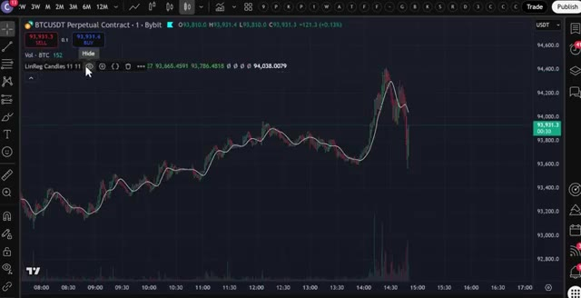
*⏱️ 00:04:15 — Graphique des cours de BTCUSDT sur un échange avec l'indicateur "LinReg Candles" appliqué et un curseur pointant sur les options de l'indicateur.*

---

### ⏱️ `[00:04:41 - 00:05:15]` | Segment #09

**🔊 Audio (Transcription Intégrale Mot pour Mot en Français) :**
> il donne un signal d'achat, vous ouvrez une position acheteuse. Quand il donne un signal de vente, vous ouvrez une position vendeuse. Pour le dernier indicateur, allez dans l'onglet des indicateurs, tapez STC, et choisissez celui-ci ici. Cet indicateur vous aidera à éviter les faux signaux. Vous entrerez uniquement dans un trade acheteur lorsque la ligne devient verte et dans un trade vendeur lorsqu'elle devient rouge. Maintenant, pour avoir les conditions d'ouverture d'un trade, d'abord pour une position acheteuse, l'indicateur UTBOT alerts doit afficher un signal d'achat. Vous avez besoin d'une bougie de régression linéaire verte qui clôture au-dessus de la ligne blanche. L'indicateur STC doit être de couleur verte. Une fois que ces conditions sont réunies,

**👁️ Analyse Visuelle d'Écran (gemini-3.5-flash-lite) :**
**Interface & Outils** : TradingView

**Contenu textuel & Code** : Barre de recherche avec le texte 'stc' et liste des indicateurs correspondants (STC Indicator - A Better MACD, STC Price Action Zone, etc.).

**Action / Démonstration** : Recherche et sélection de l'indicateur STC pour filtrer les faux signaux.

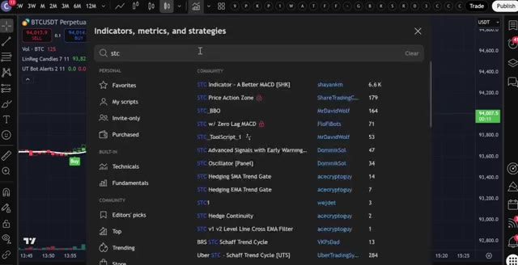
*⏱️ 00:04:50 — Fenêtre de recherche des indicateurs sur TradingView avec la requête 'stc' affichant une liste de résultats communautaires.*

---

### ⏱️ `[00:05:15 - 00:05:42]` | Segment #10

**🔊 Audio (Transcription Intégrale Mot pour Mot en Français) :**
> vous y allez et vous entrez dans une position longue. Et n'oubliez pas, si vous utilisez mon lien sous cette vidéo vers Bitunix, vous pouvez réellement obtenir jusqu'à 40 USDT de bonus juste pour avoir déposé et complété votre premier trade, mais seulement avec mon lien. Une chose cruciale dans n'importe quel trade est de placer un stop loss. Pour cela, vous pouvez placer un stop loss en dessous de la ligne blanche, mais vous attendrez qu'une bougie de régression linéaire clôture en rouge, et c'est à ce moment-là que vous sortez de votre position.

**👁️ Analyse Visuelle d'Écran (gemini-3.5-flash-lite) :**
**Interface & Outils** : Bitunix (échange crypto) et TradingView (graphique financier).

**Contenu textuel & Code** : Offre promotionnelle de 20 à 40 USDT de bonus sur dépôt, graphique en chandeliers BTCUSDT, signaux d'achat/vente et indicateur de momentum/oscillateur en bas de page.

**Action / Démonstration** : Présentation de l'offre de parrainage/bonus d'échange suivie d'une analyse technique illustrant l'ouverture d'une position longue sur le Bitcoin.

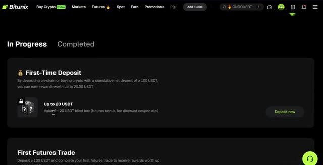
*⏱️ 00:05:22 — Page de promotion de la plateforme Bitunix affichant les récompenses pour le premier dépôt et les bonus de trading.*

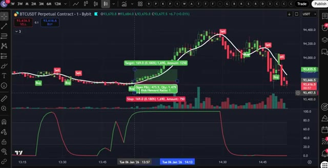
*⏱️ 00:05:35 — Graphique TradingView affichant une position longue en cours sur la paire BTCUSDT avec des indicateurs techniques de type oscillateur.*

---

### ⏱️ `[00:05:42 - 00:06:03]` | Segment #11

**🔊 Audio (Transcription Intégrale Mot pour Mot en Français) :**
> Dans ce cas, vous clôtureriez votre position juste ici. Dans cet exemple, vous pouvez voir que la bougie de régression linéaire est verte et a également clôturé au-dessus de la ligne blanche. Vous pouvez également voir que les alertes UTBOT ont émis un signal d'achat ici, et que la ligne de l'indicateur STC est verte. Pour avoir les conditions nécessaires afin d'entrer dans une position courte, vous ferez l'exact opposé d'une position longue.

**👁️ Analyse Visuelle d'Écran (gemini-3.5-flash-lite) :**
**Interface & Outils** : TradingView

**Contenu textuel & Code** : Graphique BTCUSDT Perpetual Contract, bougies japonaises, indicateur de régression linéaire (ligne blanche), signaux d'achat/vente (UTBOT), indicateur de volume et indicateur de momentum dans le panneau inférieur.

**Action / Démonstration** : Analyse d'un signal d'achat et démonstration de la clôture d'une position de trading.

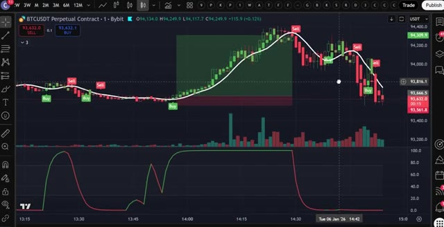
*⏱️ 00:05:47 — Un graphique de trading en chandeliers montrant une bougie verte de régression linéaire clôturant au-dessus d'une ligne blanche, avec un signal d'achat UTBOT.*

---

### ⏱️ `[00:06:03 - 00:06:25]` | Segment #12

**🔊 Audio (Transcription Intégrale Mot pour Mot en Français) :**
> Pour une position vendeuse, vous devez voir une bougie de régression linéaire rouge clôturer en dessous de la ligne blanche. Vous avez besoin que les alertes UTBOT montrent un signal de vente. L'indicateur STC doit être rouge. Vous pouvez voir que toutes ces conditions ont été remplies ici, vous pouvez donc entrer en position vendeuse. Vous placerez un stop loss ici, juste au dessus de la ligne blanche, et laisserez votre trade courir jusqu'à ce que vous voyiez un signal opposé, qui sera votre sortie.

**👁️ Analyse Visuelle d'Écran (gemini-3.5-flash-lite) :**
**Interface & Outils** : TradingView / Bybit (BTCUSDT Perpetual Contract)

**Contenu textuel & Code** : Bougies de prix, ligne de régression linéaire blanche, signaux UTBOT (étiquettes "Sell" et "Buy"), indicateur de volume, et indicateur STC (Schaff Trend Cycle) en bas.

**Action / Démonstration** : Analyse graphique illustrant les conditions requises pour une position vendeuse (bougie rouge clôturant sous la ligne blanche, signal de vente UTBOT et indicateur STC rouge).

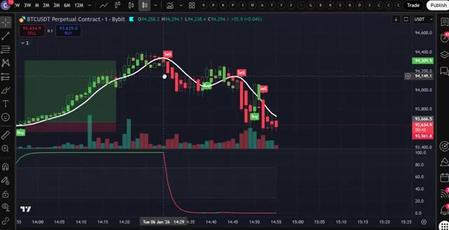
*⏱️ 00:06:09 — Un graphique de trading affichant les bougies de prix, une ligne de régression linéaire blanche, des signaux UTBOT (Sell/Buy) et l'indicateur STC en bas.*

---

### ⏱️ `[00:06:26 - 00:06:47]` | Segment #13

**🔊 Audio (Transcription Intégrale Mot pour Mot en Français) :**
> Et c'est tout, les gars. C'est la stratégie complète de scalping d'une minute pour débutants. Si vous voulez commencer à utiliser cette stratégie dès maintenant, cliquez sur le lien tout en haut de la description pour vous inscrire sur Bitunix et réclamer vos bonus. Et n'oubliez pas, si Bitunix n'est pas disponible dans votre pays ou si vous préférez l'absence de KYC, LBank est votre alternative avec 50 000 USDT de bonus.

**👁️ Analyse Visuelle d'Écran (gemini-3.5-flash-lite) :**
**Interface & Outils** : TradingView, interface d'échange Bitunix, site web Crypto Vanguards.

**Contenu textuel & Code** : Graphique de prix BTCUSDT avec indicateurs techniques, niveaux de take profit et stop loss, bonus de premier dépôt Bitunix, informations sur le KYC de LBank.

**Action / Démonstration** : Présentation d'une stratégie de scalping sur graphique, incitation à l'inscription sur une bourse crypto avec bonus et revue d'informations KYC.

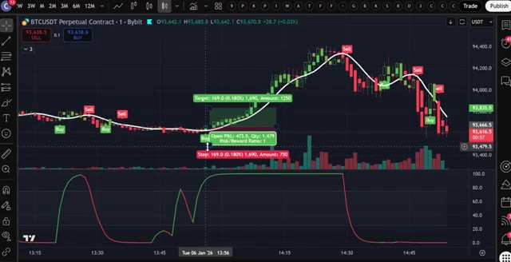
*⏱️ 00:06:31 — Graphique de trading TradingView montrant le contrat perpétuel BTCUSDT avec des signaux d'achat et de vente.*

*⏱️ 00:06:37 — Interface de la plateforme d'échange Bitunix affichant la section des bonus et des dépôts ("First-Time Deposit").*

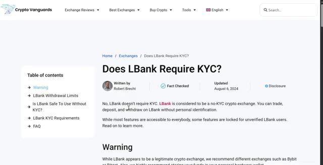
*⏱️ 00:06:42 — Page web du site Crypto Vanguards avec un article concernant les exigences KYC de la bourse LBank.*

---

### ⏱️ `[00:06:48 - 00:07:05]` | Segment #14

**🔊 Audio (Transcription Intégrale Mot pour Mot en Français) :**
> Et si vous voulez plus de détails sur le fonctionnement des plateformes Bitunix et LBank, regardez la vidéo qui s'affiche à l'écran dès maintenant pour une visite guidée complète. Si vous avez apprécié cette vidéo, n'oubliez pas de laisser un pouce bleu et de vous abonner à ma chaîne pour plus de tutoriels de trading. Je vous vois dans la prochaine vidéo.

**👁️ Analyse Visuelle d'Écran (gemini-3.5-flash-lite) :**
**Interface & Outils** : Interface TradingView.

**Contenu textuel & Code** : Paire BTCUSDT Perpetual Contract, indicateurs LinReg Candles et UT Bot Alerts, et histogramme de volume.

**Action / Démonstration** : Visualisation d'un graphique de trading avec des signaux techniques (Buy/Sell).

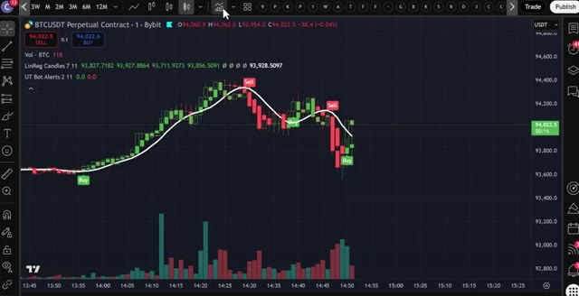
*⏱️ 00:06:52 — Graphique TradingView affichant la paire BTCUSDT en contrat perpétuel avec des bougies japonaises, des indicateurs de régression linéaire et des signaux d'achat/vente.*

---

