# 🎬 How to Trade Crypto on OKX 2026 (Step-By-Step)

> **Chaîne** : [Alex Carter](https://www.youtube.com/@AlexCarterTrading)  
> **Lien YouTube** : [https://www.youtube.com/watch?v=d5vimdz3juY](https://www.youtube.com/watch?v=d5vimdz3juY)  
> **Date de publication** : 20260121  
> **Durée** : 00:12:34  
> **Identifiant vidéo** : `d5vimdz3juY`  
> **Transcription & Analyse** : `whisper-v3-large-turbo+gemini-3.5-flash-lite`  

---

## 📌 Synthèse Exécutive & Outils

### 💡 Résumé

Ce guide opérationnel décortique le processus d'embarquement et d'exécution stratégique sur l'écosystème OKX, l'une des bourses de dérivés crypto les plus liquides du marché. L'analyse couvre l'architecture globale de la plateforme, de la structuration hiérarchique des comptes (Financement, Trading, Grow) jusqu'à la mise en place de flux d'exécution optimisés pour le trading de contrats à terme perpétuels. La démonstration guide l'utilisateur à travers les étapes fondamentales : approvisionnement sécurisé via des réseaux à faibles frais, conversion d'actifs au comptant sans glissement de prix (slippage), et transfert interne des fonds vers les modules de marge.

L'accent est mis sur l'interface d'exécution des *Futures USDT-M*, en décortiquant chaque composant du terminal de trading : le carnet d'ordres en temps réel pour l'évaluation de la profondeur du marché, les graphiques intégrés alimentés par TradingView pour le tracé d'indicateurs techniques, et le panneau de contrôle de position. La vidéo formalise une feuille de route claire pour passer de la phase de configuration initiale à la prise de position à terme avec effet de levier.

Enfin, l'intervention met en avant une approche disciplinée de la gestion des risques et de l'optimisation des fonds. En articulant l'utilisation de la marge isolée, un calibrage strict de l'effet de levier et l'exploitation systématique des programmes de bonus d'inscription, le trader débutant ou intermédiaire dispose d'un cadre méthodologique robuste pour aborder les marchés volatils en toute sécurité.

### 🛠️ Outils, Modèles & Logiciels Présentés

*   **OKX Exchange** : Plateforme mondiale de dérivés et de spot offrant une liquidité profonde, une exécution à faible latence et des contrats à terme réglés en USDT, USD ou crypto-collatéral.
*   **TradingView** : Moteur graphique natif intégré à l'interface OKX, essentiel pour l'analyse technique intraday, le tracé de niveaux clés et la visualisation des flux de prix.
*   **Pine Script** : Langage de programmation de TradingView exploité pour coder des stratégies quantitatives personnalisées, des indicateurs sur mesure et des signaux de scalping.
*   **Claude Code & Grok Bots** : Agents d'IA générative et modèles de langage utilisés pour générer, auditer et optimiser des scripts d'automatisation de trading connectés aux API des plateformes.
*   **Tron Network (TRC-20)** : Réseau de transfert de couche 1 préconisé pour l'acheminement des dépôts USDT en raison de ses frais de transaction quasi nuls et de sa rapidité de confirmation.
*   **Module de Conversion OKX** : Outil d'échange instantané à zéro frais permettant de basculer instantanément des jetons spot (ex: BTC) en USDT collatéral sans impacter le carnet d'ordres.
*   **Carnet d'Ordres & Depth Chart OKX** : Outil de visualisation en temps réel des intentions d'achat (bids) et de vente (asks) permettant de mesurer la liquidité et d'anticiper le slippage.

### 🔑 Points Clés & Enseignements Stratégiques

*   **Segmentation de l'architecture des comptes** : Séparer strictement le *Compte de Financement* (dépôts/retraits) du *Compte de Trading* (marge spot/futures) et du *Compte Grow* (rendement passif) pour prévenir toute exposition involontaire du capital principal.
*   **Priorisation absolue de la Marge Isolée** : Utiliser la marge isolée pour chaque position *Futures* afin de cantonner le risque au capital alloué à ce trade précis, évitant ainsi le risque d'appel de marge global propre à la marge croisée.
*   **Calibration stricte du levier financier** : Limiter l'effet de levier entre 5x et 10x maximum pour les débutants, en neutralisant les risques d'essorage prématuré par la volatilité, malgré le levier maximum de 100x proposé par la plateforme.
*   **Optimisation des coûts de transfert via TRC-20** : Sélectionner systématiquement le réseau Tron (TRC-20) pour les transferts d'USDT afin d'amputer au minimum le capital de départ par les frais de réseau (*gas fees*).
*   **Protocole de sécurité sur les dépôts (Test Transaction)** : Executer systématiquement un virement de contrôle d'un montant résiduel (10$ à 20$) pour valider la correspondance du réseau avant d'acheminer des volumes de capitaux plus élevés.
*   **Gestion du collatéral par conversion à frais zéro** : Migrer les actifs volatils détenus en spot (ex: Bitcoin) vers un stablecoin (USDT) via le convertisseur interne d'OKX pour éliminer les spreads d'exécution avant d'alimenter le compte *Futures*.
*   **Analyse visuelle de la liquidité et du carnet d'ordres** : Observer la répartition des ordres d'achat (verts) et de vente (rouges) sur le carnet d'ordres pour ajuster le type d'ordre (Limit vs Market) et réduire le risque de glissement de prix (*slippage*).
*   **Analyse de la preuve de réserves (Proof of Reserves)** : Consulter régulièrement la section d'audit sur OKX pour vérifier la couverture à 100 % des actifs des clients et valider la solvabilité de la contrepartie.
*   **Contrats Futures USDT-M vs Inverses (Crypto-M)** : Privilégier les contrats sur marge USDT pour maintenir une comptabilité claire du risque en monnaie stable, réservant les contrats inverses aux périodes de marché haussier structurel.
*   **Monétisation de la phase de Onboarding** : Structurer l'activité initiale (premier dépôt minimal de 50 USDT conservé 48 heures) pour capturer les bonus de bienvenue et amortir immédiatement les frais de courtage de départ.

---

## ⏱️ Chronologie & Transcription Complète Audio & Visuelle (Mot pour Mot)

### ⏱️ `[00:00:00 - 00:00:35]` | Segment #01

**🔊 Audio (Transcription Intégrale Mot pour Mot en Français) :**
> Si vous voulez commencer à trader des cryptos sur OKX mais que vous n'avez aucune idée de par où commencer, ce tutoriel va vous emmener de débutant complet à la passation de vos premiers trades en toute confiance. Je vais vous montrer tout étape par étape. Comment configurer votre compte, déposer des fonds, naviguer sur la plateforme de trading et exécuter votre premier trade. OKX peut sembler intimidant quand on le voit pour la première fois, mais uneur fois que vous avez pris le coup de main avec les bases, c'est en fait l'un des exchanges les plus puissants et conviviaux qui soient. La plupart des tutoriels passent sous silence les choses importantes ou partent du principe que vous savez déjà des choses que les débutants ignorent. Ce n'est absolument pas le cas dans cette vidéo.

**👁️ Analyse Visuelle d'Écran (gemini-3.5-flash-lite) :**
**Interface & Outils** : Interface web de l'échange de cryptomonnaies OKX (plateforme de trading et page d'accueil).

**Contenu textuel & Code** : Graphique de prix BTCUSDT Perpetuel en unités de 15 minutes, carnet d'ordres en temps réel, options d'ordres Limit/Market, et soldes disponibles.

**Action / Démonstration** : Présentation de la plateforme OKX et de son interface de passage d'ordres pour débuter le trading.

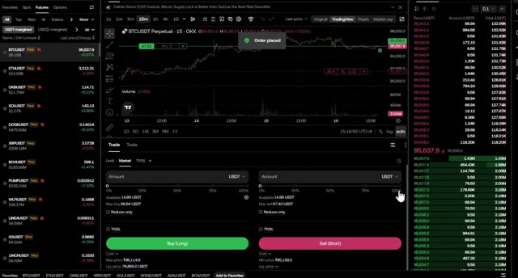
*⏱️ 00:00:09 — Interface de trading futures de la plateforme OKX affichant un graphique de prix BTCUSDT, un carnet d'ordres et les panneaux d'achat/vente.*

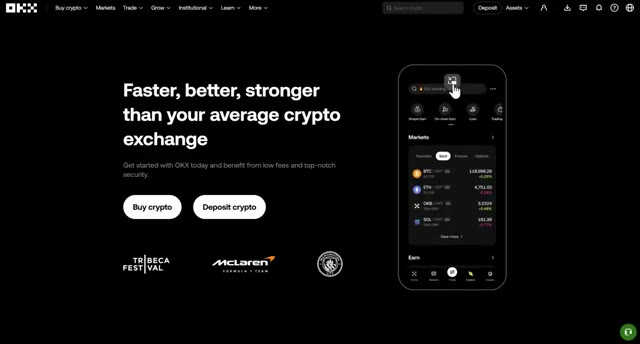
*⏱️ 00:00:27 — Page d'accueil officielle du site web de l'échange de cryptomonnaies OKX, présentant les boutons d'achat et de dépôt de crypto.*

---

### ⏱️ `[00:00:36 - 00:01:00]` | Segment #02

**🔊 Audio (Transcription Intégrale Mot pour Mot en Français) :**
> Et avec mon lien exclusif dans la description, vous débloquez des récompenses de bienvenue massives. Les nouveaux utilisateurs d'OKEx peuvent gagner jusqu'à 145 USDT de bonus simplement en accomplissant des tâches simples comme votre premier dépôt et votre premier trade. Je vais vous montrer exactement comment réclamer tout cela tout au long de la vidéo. Vers la fin, vous saurez exactement comment utiliser OKEx et comment maximiser chaque bonus disponible.

**👁️ Analyse Visuelle d'Écran (gemini-3.5-flash-lite) :**
**Interface & Outils** : Interface web de l'échange de cryptomonnaies OKX (section des tâches et récompenses de bienvenue).

**Contenu textuel & Code** : Détails des bonus de bienvenue : 145 USDT au total, conditions de premier dépôt (>= 50 $), premier trade, premier bot et paliers de volume de trading.

**Action / Démonstration** : Présentation des conditions et des différentes étapes nécessaires pour obtenir les récompenses de bienvenue sur la plateforme OKX.

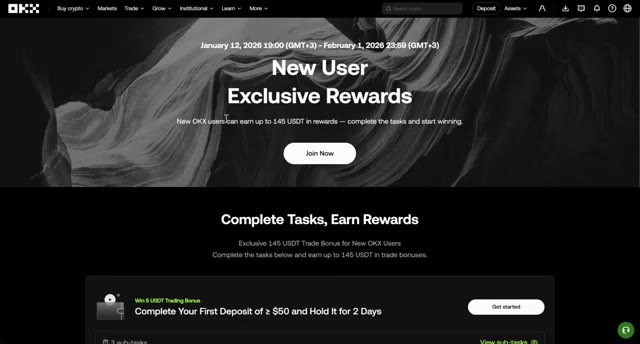
*⏱️ 00:00:42 — Page d'accueil de la plateforme OKX présentant les récompenses exclusives pour les nouveaux utilisateurs avec un bonus pouvant atteindre 145 USDT.*

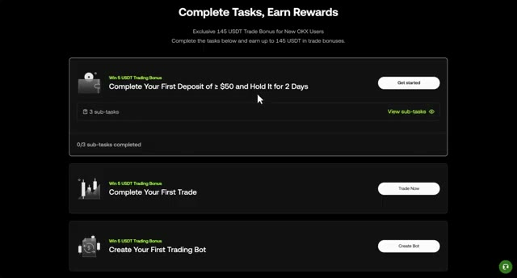
*⏱️ 00:00:48 — Gros plan sur la liste des tâches à accomplir sur OKX, incluant le premier dépôt d'au moins 50 $, le premier trade et la création d'un robot de trading.*

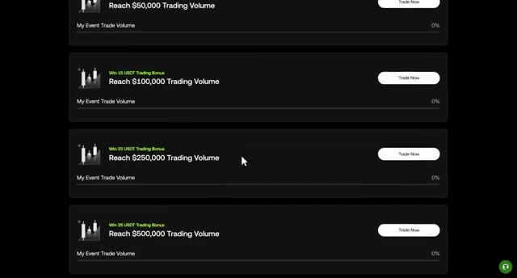
*⏱️ 00:00:54 — Vue détaillée des paliers de volume de trading requis pour débloquer les bonus supplémentaires sur OKX (de 50 000 $ à 500 000 $ de volume).*

---

### ⏱️ `[00:01:01 - 00:01:20]` | Segment #03

**🔊 Audio (Transcription Intégrale Mot pour Mot en Français) :**
> Maintenant, voici pourquoi OKEx est l'un de mes meilleurs choix d'plateformes d'échange. OKEx est l'une des plus grandes et des plus fiables plateformes d'échange de l'industrie des cryptomonnaies, conçue à la fois pour les débutants et les traders professionnels. Elle existe depuis 2017 et se classe régulièrement parmi les cinq premières plateformes d'échange au monde en termes de volume de transactions.

**👁️ Analyse Visuelle d'Écran (gemini-3.5-flash-lite) :**
**Interface & Outils** : Interface web de classement et d'analyse de plateformes d'échange crypto (style CoinGecko / CoinMarketCap).

**Contenu textuel & Code** : Tableau listant les bourses (Binance, Gate, Bybit, Coinbase Exchange, OKX, Bitget) avec leur rang, score de confiance (10/10), volume sur 24h et graphiques d'évolution sur les 7 derniers jours.

**Action / Démonstration** : Affichage des données de marché et du classement officiel des exchanges pour illustrer la fiabilité d'OKX.

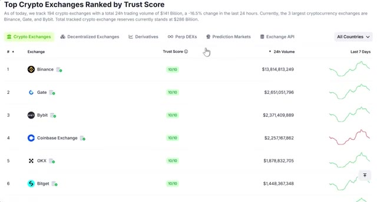
*⏱️ 00:01:06 — Capture d'écran montrant un classement des principales plateformes d'échange de cryptomonnaies par score de confiance (Trust Score).*

---

### ⏱️ `[00:01:20 - 00:01:45]` | Segment #04

**🔊 Audio (Transcription Intégrale Mot pour Mot en Français) :**
> OKEx propose une inscription rapide et simple où vous pouvez commencer à trader en quelques minutes. La plateforme dispose d'une liquidité profonde. Cela signifie que vos ordres s'exécutent au prix que vous voyez avec un glissement minimal, même lorsque vous utilisezeffet de levier. Ils offrent une gamme massive de pièces, du Bitcoin et de l'Ethereum à des centaines d'altcoins. OKEx est connu pour lister tôt des projets prometteurs, ce qui signifie que vous pouvez saisir des opportunités avant qu'elles n'atteignent d'autres bourses.

**👁️ Analyse Visuelle d'Écran (gemini-3.5-flash-lite) :**
**Interface & Outils** : Site web d'analyse de cryptomonnaies / Page des métriques de l'échange OKX.
[CONTenu] OKX Trust Score affiché à 10/10, métriques de liquidité avec un volume de trading rapporté de 1 880 202 833 $, un spread moyen Bid-Ask de 0,148%, ainsi que des scores d'échelle (Volume Percentile 98th) et de cybersécurité.

**Contenu textuel & Code** : Explications orales des stratégies et mise en contexte méthodologique du marché.

**Action / Démonstration** : Présentation visuelle des métriques de liquidité et de sécurité d'OKX pour illustrer la profondeur de marché et la fiabilité de la plateforme.

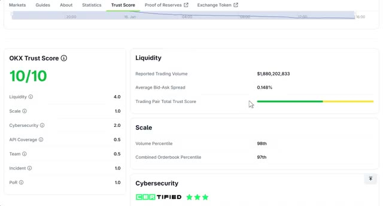
*⏱️ 00:01:27 — Capture d'écran montrant le score de confiance et les métriques de liquidité de la plateforme OKX sur un site d'analyse (type CoinGecko).*

---

### ⏱️ `[00:01:46 - 00:02:08]` | Segment #05

**🔊 Audio (Transcription Intégrale Mot pour Mot en Français) :**
> De multiples options de trading, le trading au comptant, les contrats à terme avec un effet de levier allant jusqu'à 100 fois, le copy trading, et même le trading d'options, que peu d'autres plateformes d'échange proposent. Et voici le gros point fort : OKX se montre extrêmement généreux en matière de bonus. OKX combine sécurité, liquidité, diversité et récompenses massives, ce qui le rend parfait aussi bien pour les débutants que pour les traders avancés.

**👁️ Analyse Visuelle d'Écran (gemini-3.5-flash-lite) :**
**Interface & Outils** : Site web et application mobile de l'échange de cryptomonnaies OKX.

**Contenu textuel & Code** : Menus de navigation de la plateforme OKX listant les instruments (Convert, Spot, Futures, Options, Pre-market Perpetuals) et les outils puissants (Copy trading, Marketplace, Trading bots).

**Action / Démonstration** : Navigation dans les menus de la plateforme OKX pour présenter les options de copy trading et de trading d'options.

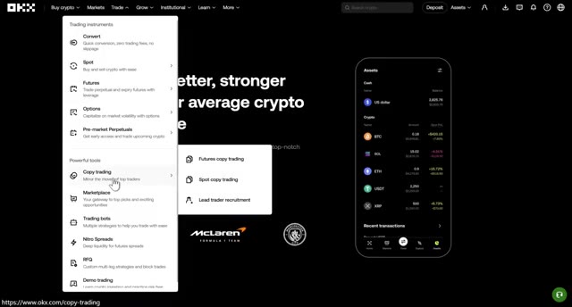
*⏱️ 00:01:51 — Interface du site web OKX montrant le menu déroulant des instruments de trading avec la section "Copy trading" sélectionnée et un aperçu mobile à droite.*

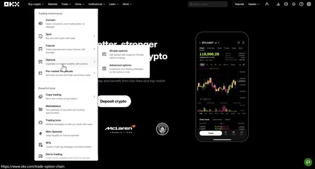
*⏱️ 00:01:57 — Interface du site web OKX avec le menu déroulant des instruments de trading centré sur la section "Options" et un graphique de trading affiché sur le smartphone à droite.*

---

### ⏱️ `[00:02:08 - 00:02:41]` | Segment #06

**🔊 Audio (Transcription Intégrale Mot pour Mot en Français) :**
> Maintenant que vous savez pourquoi j'aime la plateforme, allons-y. D'abord, cliquez sur le lien dans la description. Utiliser ce lien est essentiel pour débloquer tous les bonus exclusifs que je viens de mentionner. Vous pouvez vous inscrire avec votre e-mail ou continuer avec Google, Apple, Telegram, et même leur portefeuille natif OKX. Pour ce tutoriel, je vais m'inscrire en utilisant Gmail. Une fois connecté, vous verrez votre tableau de bord principal. En haut à droite, cliquez sur actifs et cliquez sur mes actifs. Vous verrez différentes options de portefeuille et types de compte. OKX utilise différents types de compte pour vous aider à organiser vos transactions.

**👁️ Analyse Visuelle d'Écran (gemini-3.5-flash-lite) :**
**Interface & Outils** : Site web de la plateforme OKX

**Contenu textuel & Code** : Formulaires d'inscription, options de connexion (Google, Apple, Telegram, Wallet) et menu de gestion des actifs (My assets, Deposit, Withdraw, etc.)

**Action / Démonstration** : Navigation sur la page d'inscription et sur le menu des actifs de la plateforme OKX

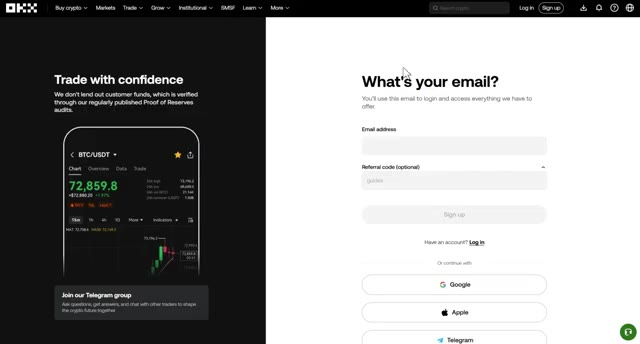
*⏱️ 00:02:16 — Page d'inscription de la plateforme OKX montrant les champs pour l'e-mail et les options de connexion rapide (Google, Apple, Telegram).*

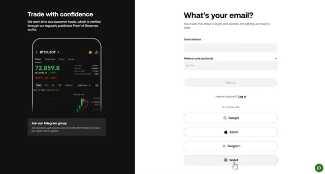
*⏱️ 00:02:24 — Page d'inscription de la plateforme OKX avec le curseur sur l'option de connexion par Wallet au bas de l'écran.*

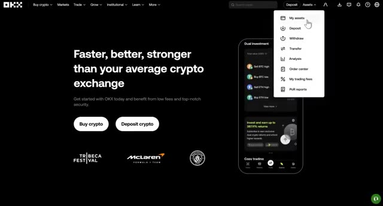
*⏱️ 00:02:32 — Page d'accueil de la plateforme OKX montrant le menu déroulant "Assets" avec les options My assets, Deposit, Withdraw, Transfer, Analysis, Order center, My trading fees et PoR reports.*

---

### ⏱️ `[00:02:41 - 00:03:14]` | Segment #07

**🔊 Audio (Transcription Intégrale Mot pour Mot en Français) :**
> Voici ce que chacun signifie. Compte de financement. C'est là que vos dépôts atterrissent en premier. Considérez-le comme votre portefeuille principal sur OKEx. Compte de trading. Il est destiné au trading au comptant où vous pouvez acheter et vendre des cryptomonnaies aux prix du marché sans effet de levier. Il est idéal pour détenir des actifs ou pour du trading simple. Dans ce compte, vous verrez vos fonds pour votre trading de contrats à terme ou votre trading avec effet de levier, vous permettant de prendre des positions plus importantes que ne le permet votre solde. Compte Grow. C'est le compte où vous pouvez staker vos pièces et gagner des récompenses passives au fil du temps. Ici, vous pouvez voir le taux annuel en pourcentage pour

**👁️ Analyse Visuelle d'Écran (gemini-3.5-flash-lite) :**
**Interface & Outils** : Échange de cryptomonnaies OKEx (interface web de trading et gestion de portefeuille)

**Contenu textuel & Code** : Graphique de prix BTC/USDT (chand japonais 15m), volume, carnet d'ordres en temps réel, onglets de navigation (Overview, Funding, Trading), boutons de dépôt et d'achat.

**Action / Démonstration** : Navigation et présentation des différents types de comptes (compte de trading au comptant) sur la bourse OKEx.

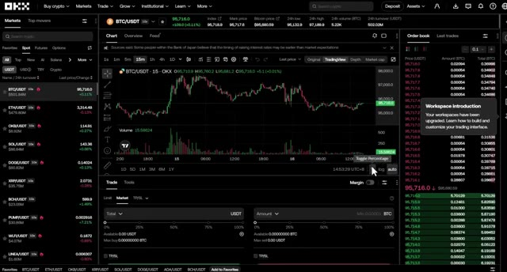
*⏱️ 00:02:57 — Interface de trading spot de la plateforme OKEx montrant le graphique du cours de la paire BTC/USDT, le carnet d'ordres et les options d'achat/vente au prix du marché.*

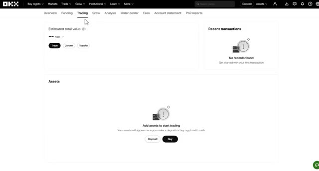
*⏱️ 00:03:05 — Vue détaillée du compte de trading sur OKEx affichant la valeur totale estimée et les options de dépôt ou d'achat d'actifs pour commencer le trading.*

---

### ⏱️ `[00:03:14 - 00:03:49]` | Segment #08

**🔊 Audio (Transcription Intégrale Mot pour Mot en Français) :**
> chaque pièce. Vous pouvez également consulter ici l'analyse PNL de votre compte, telle que l'analyse des actifs, l'analyse au comptant et l'analyse des contrats à terme. Et puis il y a le centre des ordres. Ici, vous pouvez voir votre historique des ordres, votre historique des transactions, les données d'emprunt des bots et l'historique du financement. Vous pouvez également vérifier votre niveau de frais, votre relevé de compte et l'examen de la preuve de réserves pour prouver qu'OKX détient une réserve complète pour tous ses clients. Sur la barre de navigation, vous pouvez également voir différentes sections comme les marchés pour un aperçu général de la sphère crypto et les actualités qui peuvent affecter l'évolution des prix. Grow où vous pouvez

**👁️ Analyse Visuelle d'Écran (gemini-3.5-flash-lite) :**
**Interface & Outils** : Interface web de l'échange de cryptomonnaies OKX.

**Contenu textuel & Code** : Onglets d'analyse de compte (Asset analysis, Spot analysis, Futures analysis), calendrier de trading de janvier 2026, métriques PnL et ratio de gains/pertes vides.

**Action / Démonstration** : Navigation dans le tableau de bord analytique et les outils de reporting du compte de trading OKX.

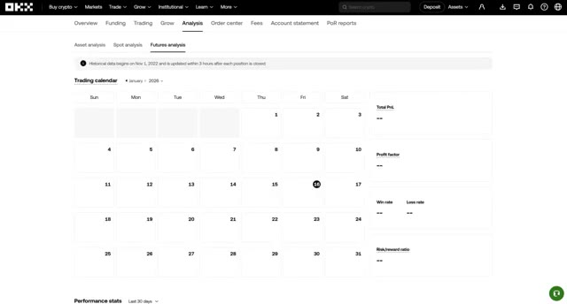
*⏱️ 00:03:23 — Capture d'écran de l'interface OKX montrant la section 'Analysis' avec l'onglet 'Futures analysis' et un calendrier de trading.*

---

### ⏱️ `[00:03:49 - 00:04:22]` | Segment #09

**🔊 Audio (Transcription Intégrale Mot pour Mot en Français) :**
> staker des cryptos et prêter des cryptos. Institutionnel où vous pouvez voir des analyses, des API, un programme de courtage, et plus encore. Sous Apprendre, vous pouvez voir tous les supports pédagogiques fournis par OKEx, de l'achat de votre première crypto aux prix, actualités et blogs. Et lorsque vous cliquez sur plus, vous pouvez voir ici des produits exclusifs à OKX. Ici, vous pouvez également voir le centre de campagne, les récompenses, le parrainage, le programme VIP, le tableau de bord des affiliés, les investissements, et plus encore. Tout est clairement organisé, afin que vous puissiez trouver ce dont vous avez besoin

**👁️ Analyse Visuelle d'Écran (gemini-3.5-flash-lite) :**
**Interface & Outils** : Site web OKEx (exchange de cryptomonnaies)

**Contenu textuel & Code** : Menu déroulant affichant Learn crypto, How to buy crypto, Getting started, Crypto prices, Crypto news et Blog, ainsi que des données de marché en arrière-plan.

**Action / Démonstration** : Navigation et présentation des ressources pédagogiques et des outils d'apprentissage de la plateforme.

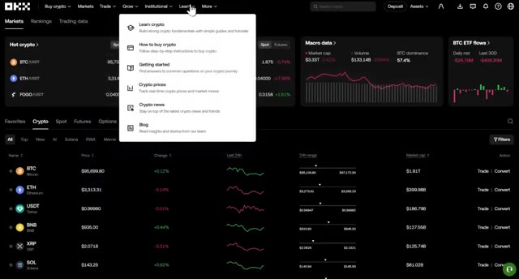
*⏱️ 00:03:57 — Capture d'écran de l'interface de la plateforme OKEx montrant le menu déroulant de la section 'Learn' avec les options éducatives.*

---

### ⏱️ `[00:04:22 - 00:04:54]` | Segment #10

**🔊 Audio (Transcription Intégrale Mot pour Mot en Français) :**
> rapide. Maintenant que vous connaissez les bases, mettons de l'argent sur votre compte. Allez dans Actifs dans le menu supérieur, puis cliquez sur Dépôt. Vous verrez une liste de cryptomonnaies que vous pouvez déposer. Pour ce tutoriel, je vous recommande de choisir USDT car c'est la principale paire de trading pour les contrats à terme sur OKX. Ensuite, sélectionnez votre réseau. Je vous recommande d'utiliser le réseau Tron ou TRC20 car il a des frais très bas et des temps de confirmation rapides. Une fois que vous aurez sélectionné USDT et TRC20, OKX générera votre adresse de dépôt personnelle.

**👁️ Analyse Visuelle d'Écran (gemini-3.5-flash-lite) :**
**Interface & Outils** : OKX Exchange (Interface Web de dépôt)

**Contenu textuel & Code** : Menu de dépôt avec les étapes "1. Select crypto" (champ de recherche avec curseur de souris), "2. Select network", "3. Deposit details", ainsi qu'une section FAQ sur les dépôts.

**Action / Démonstration** : Navigation vers la page de dépôt et survol du menu déroulant pour sélectionner la cryptomonnaie à déposer.

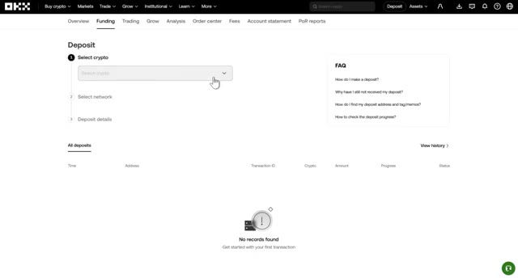
*⏱️ 00:04:30 — Interface de dépôt de la plateforme d'échange OKX montrant l'étape de sélection de la cryptomonnaie.*

---

### ⏱️ `[00:04:54 - 00:05:13]` | Segment #11

**🔊 Audio (Transcription Intégrale Mot pour Mot en Français) :**
> Copiez-la attentivement. Assurez-vous de copier l'adresse entière. Ensuite, allez sur votre échange ou portefeuille actuel, collez l'adresse et envoyez vos cryptos. Cela prend généralement 5 à 15 minutes pour arriver. Conseil de pro, envoyez toujours d'abord un petit montant test, peut-être 10 à 20 dollars. Et vérifiez bien que le réseau correspond des deux côtés.

**👁️ Analyse Visuelle d'Écran (gemini-3.5-flash-lite) :**
**Interface & Outils** : Interface web de la plateforme d'échange de cryptomonnaies (KCEX/OKX).

**Contenu textuel & Code** : Solde de compte affichant 24.60 USDT, options de retrait, de dépôt et historique des transactions récentes.

**Action / Démonstration** : Sélection d'une cryptomonnaie (USDT) en vue d'effectuer un retrait ou une manipulation de fonds.

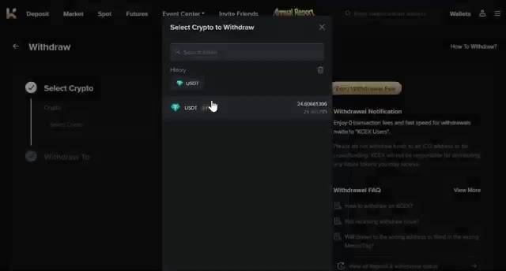
*⏱️ 00:04:59 — Interface d'échange montrant une fenêtre de sélection de cryptomonnaie pour effectuer un retrait (Withdraw).*

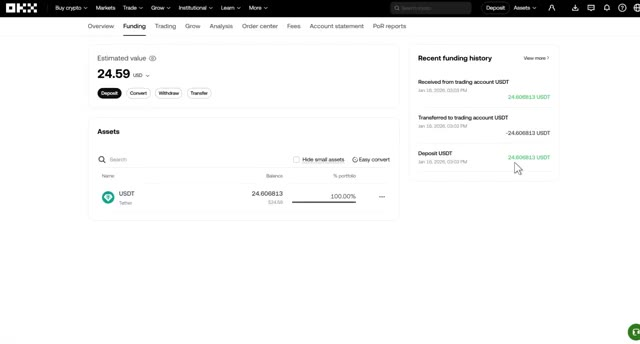
*⏱️ 00:05:04 — Tableau de bord d'un portefeuille d'échange (OKX) affichant le solde en USDT (24.59 USD) et l'historique des fonds.*

---

### ⏱️ `[00:05:13 - 00:05:33]` | Segment #12

**🔊 Audio (Transcription Intégrale Mot pour Mot en Français) :**
> Cela vous évite de perdre des fonds à cause d'un mauvais réseau. C'est là que les bonus commencent. Si vous déposez au moins 50 dollars et que vous les conservez pendant deux jours, vous gagnez un bonus de trading de 5 USDT. C'est littéralement de l'argent gratuit juste pour avoir déposé. Si vous n'avez pas encore de crypto, vous pouvez en acheter directement sur OKEx en utilisant votre devise locale.

**👁️ Analyse Visuelle d'Écran (gemini-3.5-flash-lite) :**
**Interface & Outils** : Interface web de la plateforme d'échange OKX (section des bonus et tâches).

**Contenu textuel & Code** : "Complete Your First Deposit of >= $50 and Hold It for 2 Days" (Bonus de 5 USDT), "Complete Your First Trade", "Create Your First Trading Bot".

**Action / Démonstration** : Présentation des conditions pour obtenir les bonus de trading sur la plateforme.

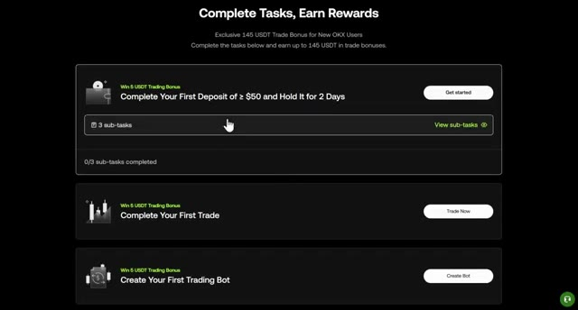
*⏱️ 00:05:18 — Capture d'écran montrant la page des tâches et récompenses de la plateforme OKX avec le bonus de dépôt.*

---

### ⏱️ `[00:05:34 - 00:05:56]` | Segment #13

**🔊 Audio (Transcription Intégrale Mot pour Mot en Français) :**
> Allez dans Acheter des cryptos dans le menu supérieur. Vous verrez deux options pour l'achat et la vente via Express et le trading P2P. Avec Express, vous pouvez acheter des USDT instantanément en utilisant diverses méthodes de paiement. Choisissez simplement votre devise, sélectionnez USDT du côté de la réception, entrez le montant et choisissez un mode de paiement. Si vous utilisez le trading P2P, vous pouvez acheter des USDT directement auprès d'autres utilisateurs.

**👁️ Analyse Visuelle d'Écran (gemini-3.5-flash-lite) :**
**Interface & Outils** : Site web de l'échange OKX (section Express / P2P).

**Contenu textuel & Code** : Formulaire d'achat rapide de cryptomonnaies avec les champs "You pay" (USD) et "You receive" (USDT), ainsi que le taux de référence et le bouton de sélection du mode de paiement.

**Action / Démonstration** : Navigation sur la page d'achat express de la plateforme pour illustrer l'acquisition instantanée de cryptos.

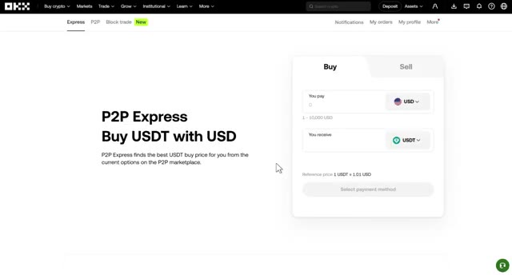
*⏱️ 00:05:39 — Capture d'écran de l'interface de la plateforme OKX montrant la section P2P Express pour l'achat d'USDT avec des USD.*

---

### ⏱️ `[00:05:56 - 00:06:19]` | Segment #14

**🔊 Audio (Transcription Intégrale Mot pour Mot en Français) :**
> Vous sélectionnez un vendeur, suivez ses instructions de paiement, et l'USDT est libéré sur votre compte de financement. Pour la plupart des gens, Buyingworth Express est l'option la plus rapide. Si vous avez déposé du Bitcoin ou une autre cryptomonnaie mais que vous avez besoin d'USDT pour trader, voici comment le convertir. Allez dans Trade depuis le menu principal et cliquez sur Convertir. La fonctionnalité de conversion d'OKEx est super simple.

**👁️ Analyse Visuelle d'Écran (gemini-3.5-flash-lite) :**
**Interface & Outils** : Interface web de l'échange de cryptomonnaies OKX

**Contenu textuel & Code** : Solde total estimé de 24,59 USD, actifs en USDT (24,606813 USDT), et historique des transferts et dépôts récents

**Action / Démonstration** : Navigation sur l'interface du compte de financement d'OKX pour afficher le solde en USDT et l'historique des transactions

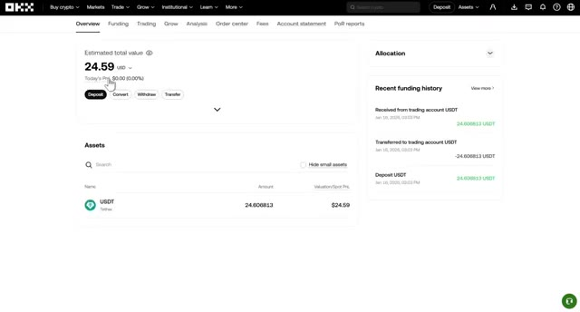
*⏱️ 00:06:02 — Capture d'écran de l'interface de la plateforme OKX montrant l'aperçu du compte de financement avec un solde total estimé à 24,59 USD et l'historique récent des transactions USDT.*

---

### ⏱️ `[00:06:19 - 00:06:52]` | Segment #15

**🔊 Audio (Transcription Intégrale Mot pour Mot en Français) :**
> Sélectionnez la crypto que vous souhaitez convertir, comme le BTC. Ensuite, sélectionnez l'USDT comme la crypto que vous souhaitez recevoir. Entrez le montant de Bitcoin que vous voulez convertir et cliquez sur convertir. Cela convertit instantanément votre Bitcoin en USDT avec zéro frais, ce qui apparaît ensuite dans votre compte. Après cela, vos fonds sont prêts à être transférés vers votre compte futures afin que vous puissiez commencer le trading avec effet de levier. Allez dans actifs, allez dans l'onglet trading et cliquez sur transférer. Sélectionnez l'USDT comme devise, choisissez du compte de financement vers le compte de trading, entrez le montant avec lequel vous voulez trader, et cliquez sur transférer.

**👁️ Analyse Visuelle d'Écran (gemini-3.5-flash-lite) :**
**Interface & Outils** : Site web de l'échange de crypto-monnaies OKX (interface de conversion "Convert").

**Contenu textuel & Code** : Formulaire de conversion avec les champs "From" (BTC, montant 0.00012834) et "To" (USDT, montant 12.24839449), un taux de change affiché (1 BTC = 95,437.07725 USDT) et un bouton "Preview".

**Action / Démonstration** : Sélection et saisie du montant de Bitcoin à convertir en USDT sur la plateforme OKX.

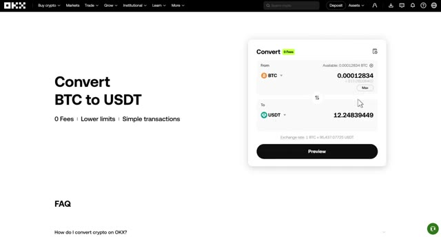
*⏱️ 00:06:28 — Interface de conversion de crypto-monnaies sur la plateforme OKX, montrant la conversion de Bitcoin (BTC) en USDT avec zéro frais.*

---

### ⏱️ `[00:06:53 - 00:07:28]` | Segment #16

**🔊 Audio (Transcription Intégrale Mot pour Mot en Français) :**
> Cette étape est importante parce que si votre USDT reste dans le portefeuille de financement, vous ne pourrez pas ouvrir de positions sur les contrats à terme. Une fois le transfert terminé, vous verrez votre solde USDT dans votre compte de trading et vous serez prêt à commencer à trader. Passons maintenant à ce que vous attendez, le trading de contrats à terme. Allez dans « Trader » dans la navigation principale, puis cliquez sur « Contrats à terme » et sélectionnez « Marge USDT ». Vous pouvez aussi choisir « Marge USD ». Si vous préférez l'USD à l' USDT, vous pouvez également voir tout à droite l'option « Marge crypto ». Il s'agit d'un type de contrat à terme, qui est réglé dans votre propre crypto, également connu

**👁️ Analyse Visuelle d'Écran (gemini-3.5-flash-lite) :**
**Interface & Outils** : Plateforme d'échange de cryptomonnaies OKX (interface web et application mobile).

**Contenu textuel & Code** : Soldes de comptes (USDT, BTC), valeurs estimées en USD, listes de paires de trading futures (BTCUSDT, ETHUSDT, etc.) et options de marge.

**Action / Démonstration** : Navigation dans le compte de trading et sélection des instruments de contrats à terme sur la plateforme OKX.

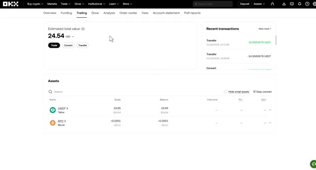
*⏱️ 00:07:02 — Vue du compte de trading OKX affichant les actifs en USDT et BTC ainsi que la valeur totale estimée du portefeuille.*

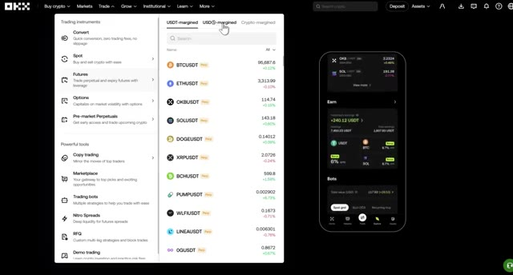
*⏱️ 00:07:20 — Menu de navigation de la plateforme OKX montrant les instruments de trading disponibles, notamment les contrats futures et margés en USDT.*

---

### ⏱️ `[00:07:28 - 00:07:52]` | Segment #17

**🔊 Audio (Transcription Intégrale Mot pour Mot en Français) :**
> comme contrats futures inverses. Mais pour les débutants, je recommande d'utiliser la marge USDT parce qu'elle est la plus courante et possède la plus forte liquidité. Après avoir cliqué sur les futures sur marge USDT, cela vous amènera au tableau de bord du trading de futures. C'est ici que vous ferez la plupart de vos trades. Je vais décomposer chaque section pour que tout soit parfaitement clair. Voici ce que vous verrez sur l'écran de trading, la paire de trading.

**👁️ Analyse Visuelle d'Écran (gemini-3.5-flash-lite) :**
**Interface & Outils** : Interface web de l'échange de cryptomonnaies OKX (tableaux de bord de trading et graphiques TradingView intégrés).

**Contenu textuel & Code** : Liste des paires de cryptomonnaies (BTCUSDT, ETHUSDT, etc.), graphiques en chandeliers sur 15 minutes, volumes de transactions, indicateurs de prix, et carnet d'ordres en temps réel.

**Action / Démonstration** : Navigation dans l'interface de l'échange OKX pour accéder au tableau de bord des contrats futures margés en USDT.

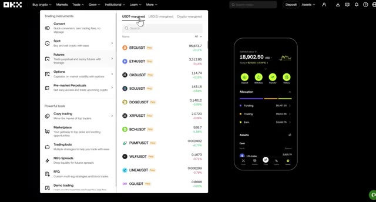
*⏱️ 00:07:34 — Interface de la plateforme OKX montrant le menu de sélection des instruments de trading avec l'onglet 'USDT-margined' sélectionné et une illustration de l'application mobile à droite.*

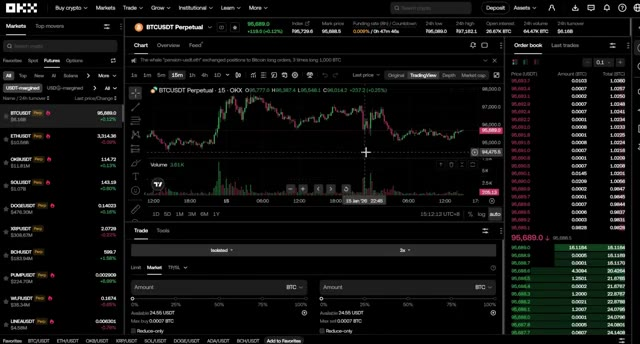
*⏱️ 00:07:46 — Tableau de bord complet de trading de futures sur OKX affichant un graphique de prix BTCUSDT (en bougies japonaises), le carnet d'ordres à droite et le panneau de passage d'ordres en bas.*

---

### ⏱️ `[00:07:52 - 00:08:29]` | Segment #18

**🔊 Audio (Transcription Intégrale Mot pour Mot en Français) :**
> La sélection se trouve sur le côté gauche. C'est ici que vous choisissez quelle cryptomonnaie trader, comme BTCUSDT, ETHUSDT ou n'importe quel autre altcoin. OKX propose des centaines de paires. Vous pouvez voir le graphique des prix au centre. Il montre l'historique des mouvements de prix et vous pouvez modifier l'unité de temps comme vous le souhaitez. OKX utilise les graphiques de TradingView, qui sont la norme de l'industrie et très puissants pour l'analyse technique. Vous pouvez voir le carnet d'ordres sur la droite. Les chiffres rouges sont les ordres de vente et les chiffres verts sont les ordres d'achat. Cela montre la profondeur du marché en temps réel afin que vous puissiez voir où les

**👁️ Analyse Visuelle d'Écran (gemini-3.5-flash-lite) :**
**Interface & Outils** : Interface web de l'échange de cryptomonnaies OKX (TradingView intégré).

**Contenu textuel & Code** : Graphique de prix de la paire BTCUSDT en unités de 15 minutes, indicateur de volume en bas du graphique, carnet d'ordres (Order book) sur le panneau droit et liste des paires de trading dans le panneau de gauche.

**Action / Démonstration** : Présentation de la disposition générale de l'interface de trading d'OKX, ciblant la liste des paires, le graphique central et le carnet d'ordres.

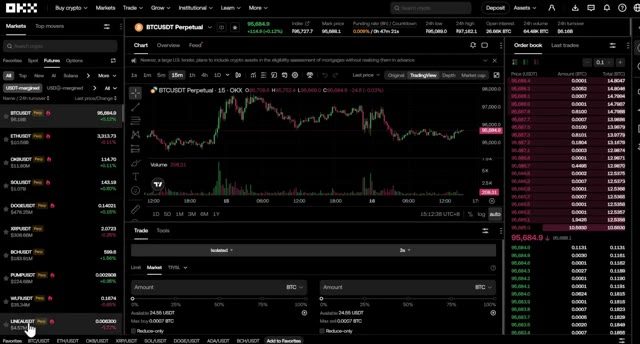
*⏱️ 00:08:01 — Capture d'écran de l'interface de trading OKX montrant la liste des cryptomonnaies à gauche, un graphique des prix au centre et le carnet d'ordres à droite.*

---

### ⏱️ `[00:08:29 - 00:08:52]` | Segment #19

**🔊 Audio (Transcription Intégrale Mot pour Mot en Français) :**
> la liquidité est. Le panneau de passage d'ordres est tout en bas. C'est ici que vous passerez vos transactions, réglerez l'effet de levier et entrerez la taille de votre position. C'est le centre de contrôle pour ouvrir et fermer des transactions. Le panneau des positions se trouve dans la partie la plus basse. Il affiche vos transactions actives, vos ordres ouverts, l'historique des ordres, et plus encore. C'est ici que vous surveillez tout une fois que votre transaction est active.

**👁️ Analyse Visuelle d'Écran (gemini-3.5-flash-lite) :**
**Interface & Outils** : Interface de trading de cryptomonnaies (type exchange de futures).

**Contenu textuel & Code** : Réglage de l'effet de levier (1x, 2x, 3x, 5x, 10x, 20x, 30x), boutons d'achat/vente (Buy/Sell), onglets des ordres ouverts et des positions.

**Action / Démonstration** : Ajustement de l'effet de levier et navigation dans le panneau de gestion des ordres et des positions.

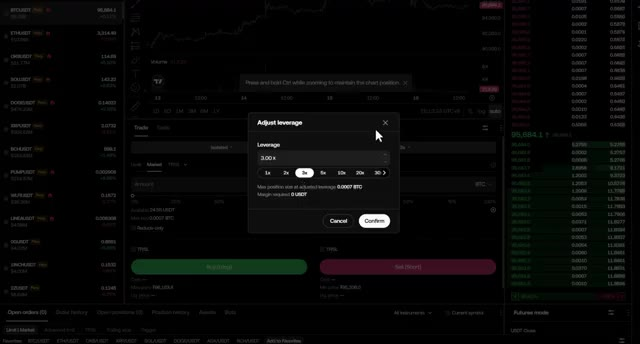
*⏱️ 00:08:35 — Fenêtre contextuelle d'ajustement de l'effet de levier (3.00x) ouverte sur l'interface de trading.*

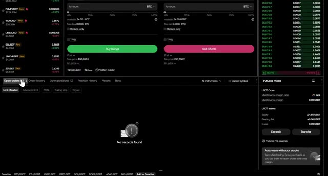
*⏱️ 00:08:46 — Panneau inférieur montrant l'onglet des ordres ouverts et le récapitulatif des actifs en mode futures.*

---

### ⏱️ `[00:08:52 - 00:09:21]` | Segment #20

**🔊 Audio (Transcription Intégrale Mot pour Mot en Français) :**
> Tout ce dont vous avez besoin est juste ici sur un seul écran, prêt à trader. Avant de placer n'importe quel trade, vous devez configurer deux paramètres importants. D'abord, choisissez votre mode de marge. OKEx offre deux options. Marge croisée. Toutes les positions partagent le même solde de marge. Si un trade est liquidé, il peut affecter l'ensemble de votre compte. C'est plus risqué. Marge isolée. Cela protège le reste de votre compte. Si le trade tourne mal, vous perdez seulement ce que vous avez mis dans cette position spécifique.

**👁️ Analyse Visuelle d'Écran (gemini-3.5-flash-lite) :**
**Interface & Outils** : Interface de l'exchange OKX avec graphique TradingView intégré

**Contenu textuel & Code** : Graphique BTCUSDT en unités 15 minutes, carnet d'ordres (order book), boutons d'achat (Buy Long) et de vente (Sell Short), options d'ordres Limit/Market

**Action / Démonstration** : Présentation de l'interface de trading d'OKX et explication des paramètres avant de placer un ordre

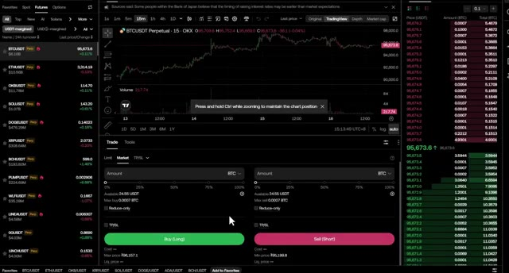
*⏱️ 00:08:59 — Interface de trading de la plateforme OKX affichant un graphique de prix Bitcoin en chandeliers, le carnet d'ordres à droite et le panneau de passage d'ordres en bas.*

---

### ⏱️ `[00:09:22 - 00:09:44]` | Segment #21

**🔊 Audio (Transcription Intégrale Mot pour Mot en Français) :**
> Le reste de votre solde est en sécurité. Pour les débutants, utilisez toujours la marge isolée pour protéger votre compte. Deuxièmement, définissez votre effet de levier. OKX autorise jusqu'à 100 fois l'effet de levier sur certaines paires, mais n'utilisez pas un effet de levier élevé en tant que débutant. Limitez-vous à 5 à 10 fois maximum. Voici comment cela fonctionne. Si vous avez un solde de 10 dollars avec un effet de levier de 5 fois, vous obtenez 50 dollars de pouvoir d'achat en position.

**👁️ Analyse Visuelle d'Écran (gemini-3.5-flash-lite) :**
**Interface & Outils** : Interface de l'échange OKX (section Futures) avec graphique intégré (TradingView) et carnet d'ordres.

**Contenu textuel & Code** : Fenêtre modale "Adjust leverage" avec sélection d'effet de levier réglée sur 3.00x (options rapides : 1x, 2x, 3x, 5x, 10x, 20x, 30x). Graphique des prix BTCUSDT Perpetual, indicateur de volume et carnet d'ordres à droite.

**Action / Démonstration** : Ajustement ou démonstration du réglage de l'effet de levier sur la plateforme OKX en sélectionnant un effet de levier modéré (3x).

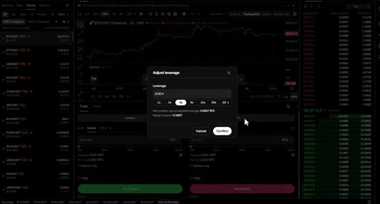
*⏱️ 00:09:27 — Interface de trading de l'échange OKX affichant le graphique du BTCUSDT en unités de 15 minutes avec une fenêtre pop-up pour ajuster l'effet de levier.*

---

### ⏱️ `[00:09:44 - 00:10:04]` | Segment #22

**🔊 Audio (Transcription Intégrale Mot pour Mot en Français) :**
> Cela signifie que vous contrôlez pour 50 dollars de Bitcoin avec seulement 10 dollars de votre propre argent. Un effet de levier plus élevé signifie un risque plus élevé. Votre prix de liquidation se rapproche de votre prix d'entrée, donc un faux pas peut anéantir votre position. Pour cet exemple, j'utilise un effet de levier de cinq fois sur marge isolée. Bien, maintenant, plaçons un ordre d'achat, en pariant que le Bitcoin va monter.

**👁️ Analyse Visuelle d'Écran (gemini-3.5-flash-lite) :**
**Interface & Outils** : Interface d'échange de cryptomonnaies (TradingView / OKX Futures)

**Contenu textuel & Code** : Fenêtre pop-up "Adjust leverage" avec sélection d'effet de levier (1x, 2x, 3x, 5x, 10x, 20x, 30x), affichant 5.00x sélectionné ainsi que les informations de taille de position et de marge requise.

**Action / Démonstration** : Sélection et réglage de l'effet de levier à 5x pour un ordre de futures.

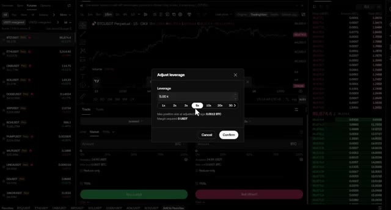
*⏱️ 00:09:49 — Capture d'écran montrant l'interface de trading avec une fenêtre modale pour ajuster l'effet de levier à 5x sur une paire BTC/USDT.*

---

### ⏱️ `[00:10:05 - 00:10:24]` | Segment #23

**🔊 Audio (Transcription Intégrale Mot pour Mot en Français) :**
> Choisissez l'ordre au marché pour qu'il s'exécute instantanément au prix actuel du marché. Vous verrez différentes options de saisie d'ordres. Pour les débutants, je recommande d'utiliser la saisie de montant simple où vous tapez simplement combien de USDT vous voulez utiliser. Définissez la taille de votre position. Par exemple, une position de 50 dollars. Avec un effet de levier de 5 fois, cela représente 10 dollars de votre propre capital.

**👁️ Analyse Visuelle d'Écran (gemini-3.5-flash-lite) :**
**Interface & Outils** : Échange de cryptomonnaies (OKX Futures) avec graphique TradingView intégré.

**Contenu textuel & Code** : Paire BTCUSDT Perpetual, graphique en chandeliers 15m, indicateur de volume, panneau de passage d'ordre avec options "Limit", "Market", "TP/SL" et menu déroulant de sélection d'unités (BTC, USDT, Contracts).

**Action / Démonstration** : Sélection du type d'ordre au marché et visualisation du panneau de saisie du montant en USDT.

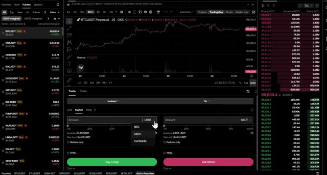
*⏱️ 00:10:10 — Interface de trading affichant le graphique du BTCUSDT en unités 15 minutes avec le panneau de saisie d'ordres au marché et le carnet d'ordres sur la droite.*

---

### ⏱️ `[00:10:25 - 00:10:45]` | Segment #24

**🔊 Audio (Transcription Intégrale Mot pour Mot en Français) :**
> Maintenant, pour chaque trade que vous allez prendre, rappelez-vous de toujours définir un stop loss et un take profit. C'est non négociable. Cliquez sur TP slash SL pour ouvrir les paramètres. Définissez votre stop loss à un prix où vous perdriez 2 dollars et votre take profit à un prix où vous gagneriez 6 dollars, un ratio risque/rendement de 1 pour 3.

**👁️ Analyse Visuelle d'Écran (gemini-3.5-flash-lite) :**
**Interface & Outils** : Interface de l'exchange de cryptomonnaies OKX (TradingView intégré).

**Contenu textuel & Code** : Graphique de prix BTCUSDT (15m), volume, carnet d'ordres (Order Book) en temps réel, panneau de trading Futures avec les options Market, Limit et TP/SL.

**Action / Démonstration** : Le présentateur montre la section de passage d'ordres et survole la case TP/SL pour configurer le Stop Loss et le Take Profit.

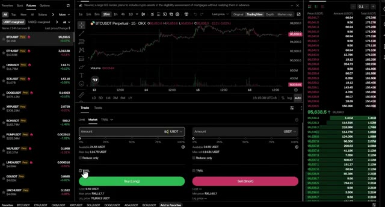
*⏱️ 00:10:30 — Capture d'écran de l'interface de trading OKX affichant le graphique du BTCUSDT en unité de temps 15 minutes, avec le panneau de passage d'ordres Futures en bas et le carnet d'ordres à droite. Le curseur survole la case TP/SL.*

---

### ⏱️ `[00:10:46 - 00:11:21]` | Segment #25

**🔊 Audio (Transcription Intégrale Mot pour Mot en Français) :**
> Une fois que tout est configuré, cliquez sur acheter long. Votre trade est maintenant actif. Vous le verrez dans le panneau des positions, avec votre prix d'entrée, votre profit et perte actuel, et votre prix de liquidation. Pour shorter le marché, choisissez simplement vendre court au lieu d'acheter long. C'est le même processus, mais vous pariez que le prix va baisser. Au fur et à mesure que votre trade évolue en votre faveur, vous pouvez ajuster votre stop loss pour sécuriser vos profits. Une fois que vous avez gagné quelques dollars, déplacez votre stop loss au seuil de rentabilité afin de ne plus pouvoir perdre d'argent sur le trade. Vous pouvez également augmenter ou réduire votre position pendant qu'elle est active en utilisant les boutons d'ajout de marge dans le panneau des positions. Pour fermer votre trade,

**👁️ Analyse Visuelle d'Écran (gemini-3.5-flash-lite) :**
**Interface & Outils** : Interface de trading de contrats à terme (Futures).

**Contenu textuel & Code** : Panneau des positions ouvertes affichant la taille, le prix d'entrée, le prix de liquidation estimé, le PnL flottant et la marge pour une position BTCUSDT Perpetual, avec les boutons d'achat (Buy Long) et de vente (Sell Short).

**Action / Démonstration** : Visualisation d'une position longue active et de ses métriques de trading dans le panneau inférieur.

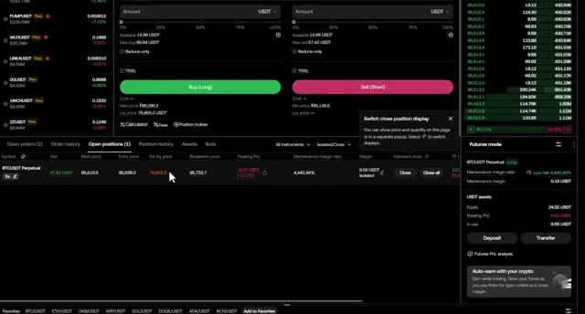
*⏱️ 00:10:54 — Interface d'échange de cryptomonnaies montrant un panneau des positions ouvertes avec une position active sur BTCUSDT Perpetual.*

---

### ⏱️ `[00:11:21 - 00:11:55]` | Segment #26

**🔊 Audio (Transcription Intégrale Mot pour Mot en Français) :**
> vous avez quelques options. Laissez votre TP ou SL le clôturer automatiquement lorsque le prix atteint votre cible. Clôturez manuellement avec le bouton de fermeture dans le panneau des positions. Clôturez un pourcentage de la position si vous souhaitez prendre des profits partiels. Astuce de pro, ne soyez pas trop gourmand. Si vous atteignez votre objectif de take profit, clôturez le trade. Le marché vous donnera toujours une autre opportunité. Petit rappel concernant les bonus OKX avec mon lien. Vous obtenez 5 USDT pour votre premier dépôt, 5 USDT pour votre premier trade, et des bonus pour avoir essayé les robots de trading et le copy trading. À mesure que votre volume de trading augmente,

**👁️ Analyse Visuelle d'Écran (gemini-3.5-flash-lite) :**
**Interface & Outils** : Interface d'échange de cryptomonnaies (type OKX).

**Contenu textuel & Code** : Tableau des positions ouvertes affichant une position BTCUSDT Perpétuel avec effet de levier x5, un prix d'entrée, un PnL flottant, et les options TP/SL.

**Action / Démonstration** : Manipulation de l'interface de trading pour montrer la fermeture d'une position ouverte.

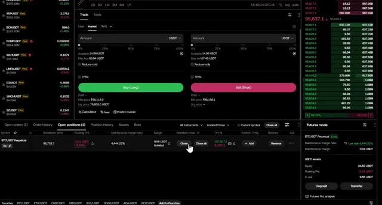
*⏱️ 00:11:29 — Interface de trading de contrats perpétuels montrant le panneau des positions ouvertes avec un clic sur le bouton de fermeture.*

---

### ⏱️ `[00:11:55 - 00:12:21]` | Segment #27

**🔊 Audio (Transcription Intégrale Mot pour Mot en Français) :**
> vous débloquez des récompenses plus importantes, jusqu'à 50 USDT pour un volume de 1 million de dollars. Tout est suivi automatiquement dans votre centre de récompenses. Très bien, voilà donc l'analyse complète de la manière de négocier des contrats à terme sur OKX, de l'inscription au dépôt jusqu'à l'ouverture et la gestion de votre premier trade. Je mettrai également en ligne d'autres tutoriels OKX couvrant des sujets tels que les stratégies de trading avancées, le copy trading, les bots de trading et la façon de maximiser vos récompenses bonus.

**👁️ Analyse Visuelle d'Écran (gemini-3.5-flash-lite) :**
**Interface & Outils** : Interface de la plateforme d'échange de cryptomonnaies OKX (site web et terminal de trading de contrats à terme).

**Contenu textuel & Code** : Page de promotions et de récompenses pour nouveaux utilisateurs avec bonus en USDT, ainsi qu'une interface de trading affichant les détails d'une position ouverte (BTCUSDT Perpetual, prix d'entrée, prix de liquidation, et champs de configuration TP/SL).

**Action / Démonstration** : Navigation sur la page des récompenses de la plateforme OKX puis affichage et configuration des paramètres de Take Profit et Stop Loss pour une position de trading active.

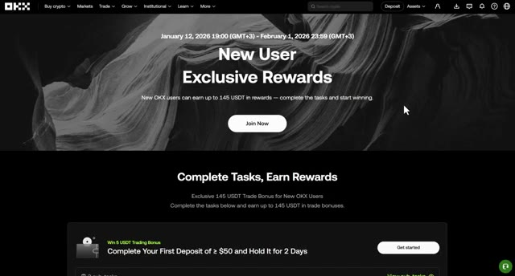
*⏱️ 00:12:01 — Page Web d'OKX affichant les récompenses exclusives pour les nouveaux utilisateurs, avec les détails pour accomplir les tâches et gagner des bonus en USDT.*

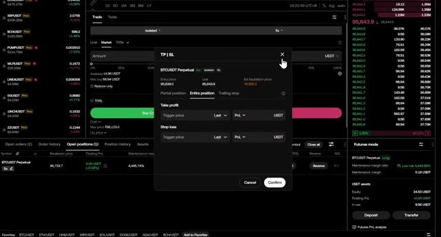
*⏱️ 00:12:08 — Interface de trading de contrats à terme OKX montrant un panneau contextuel de configuration des ordres Take Profit et Stop Loss (TP/SL) sur une position BTCUSDT Perpetual.*

---

### ⏱️ `[00:12:22 - 00:12:34]` | Segment #28

**🔊 Audio (Transcription Intégrale Mot pour Mot en Français) :**
> Alors abonnez-vous et activez la cloche de notification pour ne pas les rater. Si vous avez des questions, posez-les dans les commentaires ci-dessous. Je les lis absolument tous et je ferai de mon mieux pour vous aider. Merci d'avoir regardé et je vous dis à la prochaine vidéo.

**👁️ Analyse Visuelle d'Écran (gemini-3.5-flash-lite) :**
**Interface & Outils** : Interface web de l'exchange OKX (graphique TradingView intégré, carnet d'ordres, panneau de trading).

**Contenu textuel & Code** : Graphique en chandeliers japonais pour BTCUSDT en unités de 15 minutes, indicateur de volume, carnet d'ordres en temps réel (Order book), liste des marchés de cryptomonnaies à gauche et panneau de passage d'ordres en bas.

**Action / Démonstration** : Navigation et affichage de la plateforme de trading OKX avec le curseur de la souris visible sur la liste des paires de cryptomonnaies.

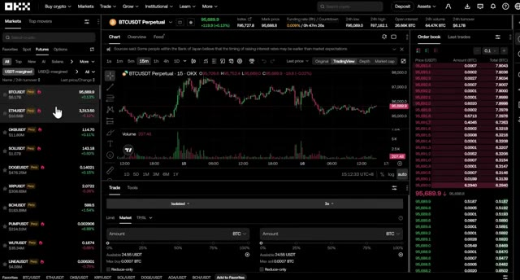
*⏱️ 00:12:25 — Interface de la plateforme d'échange OKX affichant le graphique de prix et le carnet d'ordres pour la paire BTCUSDT Perpetuel.*

---

