# 🎬 How to Use Polymarket 2026 (Step-By-Step)

> **Chaîne** : [Alex Carter](https://www.youtube.com/@AlexCarterTrading)  
> **Lien YouTube** : [https://www.youtube.com/watch?v=0zMZ5X3ZdaU](https://www.youtube.com/watch?v=0zMZ5X3ZdaU)  
> **Date de publication** : 20260123  
> **Durée** : 00:10:45  
> **Identifiant vidéo** : `0zMZ5X3ZdaU`  
> **Transcription & Analyse** : `whisper-v3-large-turbo+gemini-3.5-flash-lite`  

---

## 📌 Synthèse Exécutive & Outils

### 💡 Résumé

Cette vidéo propose un guide stratégique complet pour naviguer et trader sur Polymarket, le principal marché de prédiction décentralisé, à l'horizon 2026. L'analyse démontre comment cette plateforme révolutionnaire s'affranchit des paris sportifs traditionnels et des barrières bureaucratiques (absence de KYC dans la majorité des régions) en introduisant un modèle de carnet d'ordres pair à pair (P2P). Le cœur de la démarche repose sur l'assimilation du mécanisme de cotation : chaque action de type « Oui » ou « Non » oscille dynamiquement entre 0,01 $ et 1 $, reflétant en temps réel la probabilité probabiliste qu'attribue le marché à un événement (politique, macroéconomique, technologique ou culturel). 

L'approche quantitative et tactique présentée va bien au-delà du simple pari attentiste. L'intervenant décortique l'art du trading directionnel et du scalping de probabilités, où l'opérateur n'a pas besoin d'attendre la résolution finale de l'événement pour matérialiser ses gains. En achetant des parts sous-évaluées (par exemple, sur des scénarios de cryptomonnaies ou des nominations institutionnelles) et en revendant dès que le sentiment du marché évolue favorablement, le trader capture de la plus-value sur la volatilité des cotes. Les démonstrations pratiques guident pas à pas le spectateur, de l'optimisation des dépôts en USDC sur le réseau Polygon jusqu'à l'exécution précise des ordres d'achat et de vente via un tableau de bord Web3.

Enfin, la vidéo aborde la dimension analytique indispensable à la survie et à la rentabilité sur ces marchés de prédiction. En combinant l'analyse on-chain — notamment le suivi des portefeuilles de « baleines » dont les transactions publiques révèlent les mouvements de capitaux importants — avec une gestion rigoureuse des risques et une attention constante aux flux d'actualités, les utilisateurs disposent d'un arsenal méthodologique complet. Ce guide insiste particulièrement sur l'analyse de la liquidité et du carnet d'ordres pour éviter les dérapages de slippage sur les marchés à faible volume, tout en mentionnant le potentiel de l'intelligence artificielle et de l'automatisation (via des bots de type Grok ou des scripts d'analyse) pour optimiser les prises de décision dans cet écosystème en plein essor.

### 🛠️ Outils, Modèles & Logiciels Présentés

* **Polymarket** : Plateforme décentralisée de marchés de prédiction pair à pair permettant d'échanger des actions basées sur des probabilités d'événements mondiaux.
* **Polygon** : Réseau blockchain haute performance à faibles frais sur lequel s'exécute l'infrastructure financière de Polymarket (principalement via le token USDC).
* **MetaMask** : Portefeuille Web3 de référence utilisé pour connecter son compte, signer des transactions et interagir de manière décentralisée avec la plateforme.
* **Phantom** : Portefeuille multi-chaînes pris en charge pour la gestion des actifs et l'authentification sur le protocole.
* **OKX Wallet** : Solution de wallet Web3 alternative intégrée pour faciliter les connexions et les transferts de fonds.
* **Flow Wallet** : Portefeuille compatible permettant de gérer les flux d'actifs numériques vers l'écosystème Polymarket.
* **Coinbase Wallet & Exchange** : Portefeuille Web3 et plateforme centralisée permettant des transferts directs de fonds et des ponts de liquidité simplifiés.
* **Wallet Connect** : Protocole de communication universel permettant de relier n'importe quel portefeuille compatible aux applications décentralisées (dApps).
* **MoonPay** : Passerelle de paiement intégrée permettant l'achat direct de cryptomonnaies par carte bancaire ou via PayPal.
* **Grok Bots** : Outils conversationnels et d'intelligence artificielle utilisés pour automatiser l'analyse de données et le suivi des tendances de marché.
* **Pine Script** : Langage de programmation dédié au développement d'indicateurs personnalisés et de stratégies algorithmiques sur TradingView.
* **TradingView** : Plateforme de graphisme avancée pour l'analyse technique, le suivi des prix et l'implémentation de scripts de trading.
* **Claude Code** : Environnement et assistant de développement basé sur l'IA, mobilisé pour concevoir et optimiser des scripts d'automatisation de trading.

### 🔑 Points Clés & Enseignements Stratégiques

* **Modèle de cotation probabiliste** : Comprendre que le prix d'une action (entre 0,01 $ et 1 $) agit comme un indicateur direct de la probabilité estimée par le marché, chaque centime représentant un pour cent de chance perçu.
* **Arbitrage temporel et revente anticipée** : Ne jamais se limiter à attendre la résolution finale d'un événement ; réaliser des plus-values en revendant des parts dès que le sentiment du marché et l'évolution des cotes jouent en votre faveur.
* **Optimisation des flux de capitaux** : Privilégier le réseau Polygon et le stablecoin USDC pour minimiser les frais de transaction et garantir la rapidité des transferts de fonds sur le protocole.
* **Analyse impérative du carnet d'ordres (Order Book)** : Toujours inspecter la profondeur du marché et la liquidité disponible avant d'exécuter de larges positions afin d'éviter un slippage destructeur sur les marchés peu liquides.
* **Utilisation des ordres à cours limité (Limit Orders)** : Remplacer les ordres au marché par des ordres limites pour cibler des prix d'entrée précis et optimiser l'exécution lorsque la volatilité s'emballe.
* **Surveillance on-chain des « Baleines »** : Exploiter la transparence de la blockchain pour auditer et suivre les portefeuilles des gros investisseurs, dont les paris massifs constituent souvent des signaux avancés de marché.
* **Gestion stricte du risque (Risk Management)** : Ne jamais engager de capitaux supérieurs à sa tolérance à la perte, diversifier ses allocations sur plusieurs marchés et refuser de s'exposer massivement sur un unique résultat binaire.
* **Veille informationnelle en temps réel** : Configurer des alertes instantanées sur les flux d'actualités et les réseaux sociaux, les cotes de Polymarket réagissant de manière quasi-instantanée au moindre tweet ou communiqué officiel.
* **Sélection rigoureuse des marchés** : Débuter exclusivement sur des marchés à fort volume et haute liquidité pour se prémunir contre la manipulation potentielle inhérente aux carnets d'ordres restreints.
* **Automatisation par scripts et IA** : Intégrer des outils d'intelligence artificielle (Grok, Claude Code) et des analyses techniques (Pine Script sur TradingView) pour structurer des stratégies de scalping et de prise de décision algorithmique.
* **Sécurité des réseaux de transfert** : Vérifier systématiquement la correspondance des réseaux lors des ponts (bridges) de cryptomonnaies pour éliminer tout risque de perte définitive de fonds.
* **Exploitation des incitations financières** : Utiliser les programmes de parrainage et de bonus de volume pour maximiser la rentabilité globale en s'acquittant des seuils de transaction requis par la plateforme.

---

## ⏱️ Chronologie & Transcription Complète Audio & Visuelle (Mot pour Mot)

### ⏱️ `[00:00:00 - 00:00:32]` | Segment #01

**🔊 Audio (Transcription Intégrale Mot pour Mot en Français) :**
> Imaginez pouvoir parier littéralement sur n'importe quoi se produisant dans le monde. Et je dis bien n'importe quoi. Les élections, les prix des cryptomonnaies, les sorties technologiques, l'actualité des célébrités, et même si les extraterrestres sont confirmés en 2027. C'est exactement ce que Polymarket vous permet de faire. Et c'est absolument dingue. Dans cette vidéo, je vais vous guider à travers tout ce que vous devez savoir pour utiliser Polymarket en 2026. Nous allons aborder la configuration du compte, comment déposer des fonds, placer votre premier trade, et gérer votre position étape par étape. Si vous n'avez jamais utilisé de

**👁️ Analyse Visuelle d'Écran (gemini-3.5-flash-lite) :**
**Interface & Outils** : Plateforme de prédiction en ligne Polymarket (site web officiel) avec interface de trading décentralisée.

**Contenu textuel & Code** : Probabilités en pourcentage, volumes de transactions en dollars, options de paris "Yes/No", et listes de marchés classés par catégories (Trending, Tech, Politique, etc.).

**Action / Démonstration** : Navigation sur la plateforme, consultation d'un marché de prédiction technologique et affichage du panneau de connexion/dépôt.

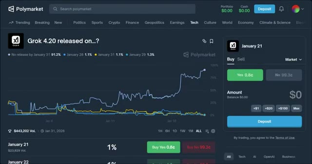
*⏱️ 00:00:08 — Interface de Polymarket affichant un marché de prédiction spécifique lié à la sortie de Grok 4.20, avec des graphiques de probabilités et un panneau d'achat/vente à droite.*

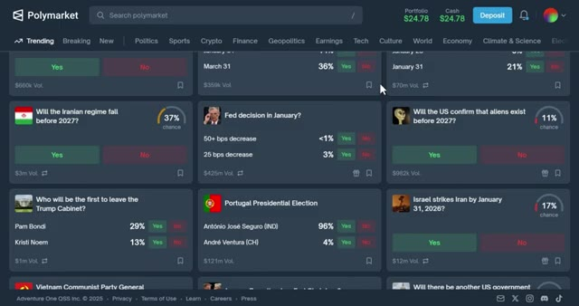
*⏱️ 00:00:16 — Vue d'ensemble de la plateforme Polymarket montrant une grille de plusieurs marchés de prédiction tendance sur des sujets géopolitiques, économiques et d'actualité.*

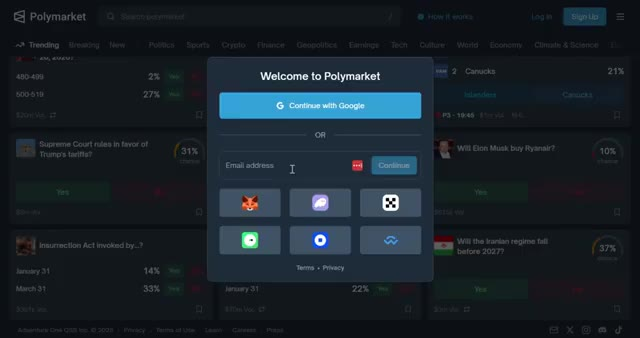
*⏱️ 00:00:24 — Fenêtre modale de connexion et d'inscription sur Polymarket proposant des options par e-mail, Google et divers portefeuilles Web3.*

---

### ⏱️ `[00:00:32 - 00:00:55]` | Segment #02

**🔊 Audio (Transcription Intégrale Mot pour Mot en Français) :**
> marché de prédiction auparavant ou que vous avez été curieux à propos de Polymarket sans avoir encore franchi le pas, ce guide est exactement ce dont vous avez besoin. Au fait, si vous vous inscrivez en utilisant mon lien dans la description, vous pouvez gagner jusqu'à 1 000 dollars de bonus après avoir généré 1 000 000 de dollars de volume de交易 [volume d'échanges] sur la plateforme. Je laisserai tous les détails ci-dessous. Maintenant, commençons. Alors, qu'est-ce que c'est exactement, Polymarket ?

**👁️ Analyse Visuelle d'Écran (gemini-3.5-flash-lite) :**
**Interface & Outils** : Polymarket (site web de marchés de prédiction)

**Contenu textuel & Code** : Probabilités des candidats, graphiques d'évolution des prix/parts de marché, soldes de portefeuille ($24.95) et options d'achat (Buy Yes/No).

**Action / Démonstration** : Navigation sur la plateforme, démonstration du processus de connexion et présentation d'un marché de prédiction avec passage d'ordre.

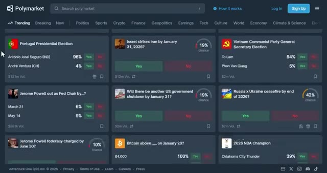
*⏱️ 00:00:38 — Page d'accueil de la plateforme Polymarket montrant une grille de marchés de prédiction tendance avec divers sujets politiques et économiques.*

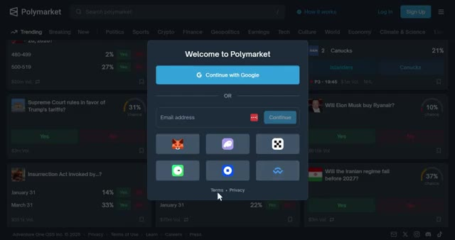
*⏱️ 00:00:43 — Fenêtre modale de connexion et d'inscription sur Polymarket avec options par e-mail, Google et divers portefeuilles Web3.*

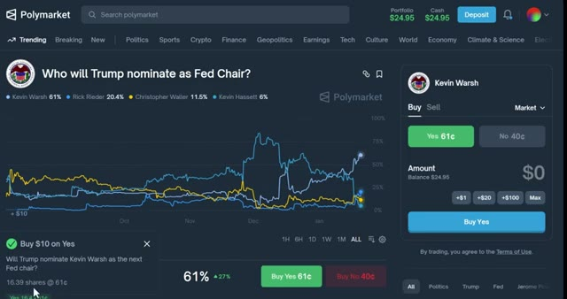
*⏱️ 00:00:49 — Page de détail d'un marché spécifique sur Polymarket (« Who will Trump nominate as Fed Chair? ») avec un graphique historique des probabilités et le panneau de passage d'ordres d'achat.*

---

### ⏱️ `[00:00:55 - 00:01:17]` | Segment #03

**🔊 Audio (Transcription Intégrale Mot pour Mot en Français) :**
> Polymarket est un marché de prédiction décentralisé où vous pouvez parier sur le résultat d'événements du monde réel. Pensez-y comme à des paris sportifs, mais au lieu de parier simplement sur qui va gagner le Super Bowl, vous pouvez parier littéralement sur n'importe quoi. La politique, la technologie, la culture, la crypto, tout ce que vous voulez. Par exemple, vous pourriez parier sur : est-ce qu'Elon Musk va acheter Ryanair ? Quelle équipe sera championne de la NBA en 2026 ?

**👁️ Analyse Visuelle d'Écran (gemini-3.5-flash-lite) :**
**Interface & Outils** : Interface web de Polymarket (marché de prédiction décentralisé)

**Contenu textuel & Code** : Grilles de marchés de prédiction, pourcentages de probabilité, volumes de transaction (ex: $12m Vol.), graphiques d'évolution des cotes et interface de placement de pari (« Buy Yes » / « Buy No »).

**Action / Démonstration** : Navigation et présentation des différentes catégories de paris disponibles sur la plateforme de prédiction.

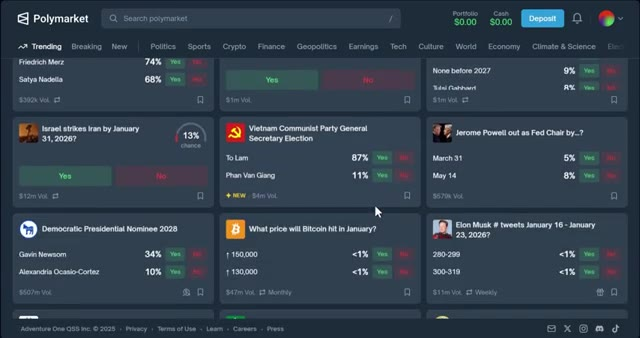
*⏱️ 00:01:00 — Vue d'ensemble de la plateforme Polymarket affichant divers marchés de prédiction tendances, incluant des sujets politiques, géopolitiques et technologiques.*

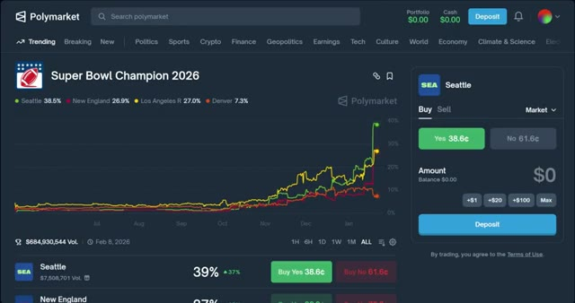
*⏱️ 00:01:06 — Graphique détaillé d'un marché spécifique sur Polymarket (Super Bowl Champion 2026) avec l'historique des probabilités et le panneau de trading à droite.*

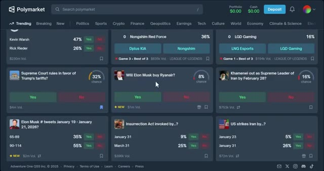
*⏱️ 00:01:11 — Autre vue de la page d'accueil de Polymarket présentant une grille de paris diversifiés allant du sport à l'actualité économique et internationale.*

---

### ⏱️ `[00:01:17 - 00:01:49]` | Segment #04

**🔊 Audio (Transcription Intégrale Mot pour Mot en Français) :**
> Quel est le prix de vente de la carte Pikachu Illustrator de Logan Paul ? Et même quelle sera la température la plus élevée à New York à une certaine date. Quel que soit votre domaine de prédilection, il y a probablement un marché pour cela. Maintenant, voici ce qui différencie Polymarket des plateformes de paris traditionnelles. C'est décentralisé, ce qui signifie qu'aucun KYC n'est requis dans la plupart des régions. Vous n'avez pas besoin de vérifier votre identité pour commencer à trader. De plus, vous ne pariez pas contre la maison. Vous échangez des parts avec d'autres utilisateurs sur un marché pair à pair. Et voici le point le plus important. Vous n'avez pas à attendre que l'événement

**👁️ Analyse Visuelle d'Écran (gemini-3.5-flash-lite) :**
**Interface & Outils** : Site web Polymarket (plateforme de marchés de prédiction).

**Contenu textuel & Code** : Interface utilisateur avec des grilles de marchés de prédiction, des pourcentages de chance, des volumes d'échange et un graphique d'évolution des probabilités.

**Action / Démonstration** : Navigation et présentation de la plateforme de prédiction Polymarket à l'écran.

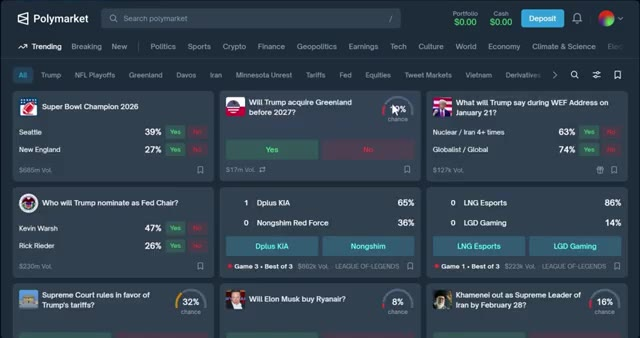
*⏱️ 00:01:25 — Capture d'écran de l'interface principale du site Polymarket affichant divers marchés de prédiction en tendance.*

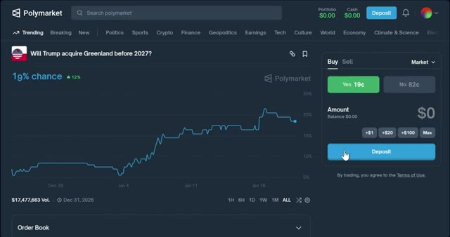
*⏱️ 00:01:41 — Capture d'écran d'une page de marché spécifique sur Polymarket avec un graphique de probabilité et le panneau de trading pour parier.*

---

### ⏱️ `[00:01:49 - 00:02:22]` | Segment #05

**🔊 Audio (Transcription Intégrale Mot pour Mot en Français) :**
> prend la résolution de gagner de l'argent. Vous pouvez acheter et vendre des actions à mesure que les probabilités changent, tout comme pour le trading d'actions ou de cryptos. Nous verrons exactement comment cela fonctionne dans un instant. Bon, passons à la configuration sur Polymarket. Cela va prendre moins de deux minutes. D'abord, cliquez sur le lien dans la description ci-dessous. Cela vous mènera directement à la page d'inscription de Polymarket. Ici, vous pouvez voir que vous pouvez continuer en utilisant votre compte Google ou en utilisant une autre adresse e-mail. Ici, vous pouvez également voir l'option pour connecter votre portefeuille, Polymarket est une plateforme décentralisée donc vous aurez besoin d'un portefeuille web3.

**👁️ Analyse Visuelle d'Écran (gemini-3.5-flash-lite) :**
**Interface & Outils** : Site web Polymarket (plateforme de marchés de prédiction décentralisée).

**Contenu textuel & Code** : Intitulés de marchés de prédiction, pourcentages de probabilité (ex. : 19 %, 20 %), volumes de transaction en dollars et options d'achat (Yes/No).

**Action / Démonstration** : Navigation sur la plateforme Polymarket et exploration de la configuration des différents marchés.

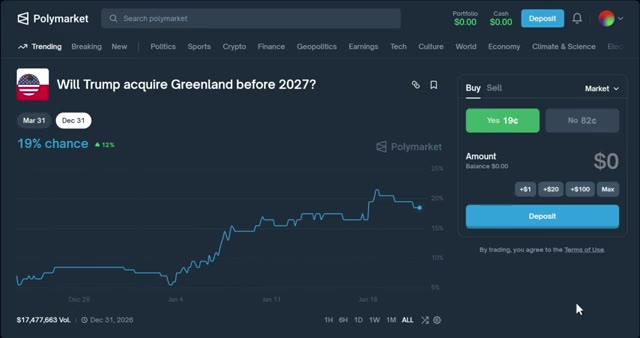
*⏱️ 00:01:58 — Interface Polymarket affichant un marché de prédiction spécifique (« Will Trump acquire Greenland before 2027 ? ») avec un graphique d'évolution des probabilités.*

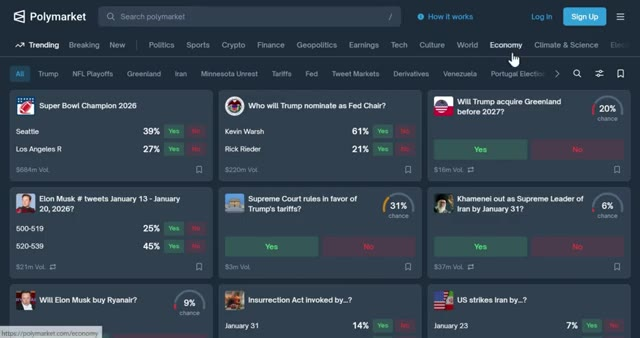
*⏱️ 00:02:06 — Page d'accueil de la plateforme Polymarket montrant une grille de différents marchés de prédiction tendance et thématiques.*

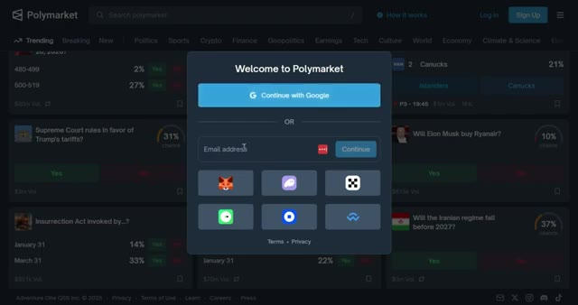
*⏱️ 00:02:14 — Fenêtre pop-up de connexion/inscription sur Polymarket proposant divers modes d'authentification (Google, e-mail, portefeuilles crypto).*

---

### ⏱️ `[00:02:22 - 00:02:58]` | Segment #06

**🔊 Audio (Transcription Intégrale Mot pour Mot en Français) :**
> comme Metamask, Phantom, OKX Wallet, Flow Wallet, Coinbase Wallet ou Wallet Connect, mais pour ce tutoriel, je vais m'inscrire en utilisant mon compte Google. Après cela, vous serez redirigé vers le tableau de bord de Polymarket. Maintenant que vous êtes connecté, vous devez déposer des fonds. En haut à droite, cliquez sur Dépôt. Polymarket fonctionne sur le réseau Polygon et utilise l'USDC comme monnaie principale. Vous avez quatre options ici : transférer des crypto-monnaies, déposer avec une carte, connecter un échange, ou vous pouvez déposer avec PayPal. Si vous avez déjà des crypto-monnaies dans un autre portefeuille ou échange, vous pouvez les transférer directement ou faire un pont.

**👁️ Analyse Visuelle d'Écran (gemini-3.5-flash-lite) :**
**Interface & Outils** : Site web Polymarket avec pop-up de connexion Magic Link.

**Contenu textuel & Code** : Interface utilisateur de Polymarket affichant divers marchés de prédiction (sports, politique, crypto) et une fenêtre de chargement/redirection "Redirecting... Please wait while we redirect you".

**Action / Démonstration** : Connexion et redirection de l'utilisateur sur la plateforme Polymarket via le service d'authentification.

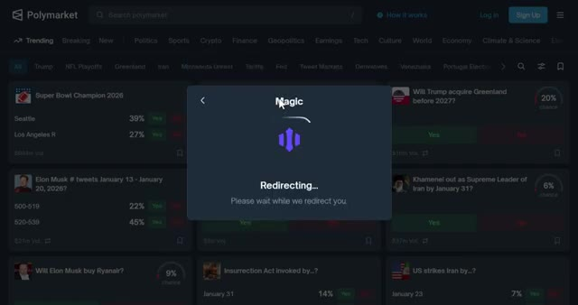
*⏱️ 00:02:31 — Capture d'écran montrant la page d'accueil de Polymarket en arrière-plan sombre avec une fenêtre modale de redirection du service Magic au premier plan.*

---

### ⏱️ `[00:02:58 - 00:03:26]` | Segment #07

**🔊 Audio (Transcription Intégrale Mot pour Mot en Français) :**
> depuis une autre chaîne en commençant par sélectionner votre jeton, vous verrez des jetons pris en charge comme l'USDC, l'ARB, le BNB, le BTCB, le Binance USD et bien d'autres, ensuite choisissez le réseau, les réseaux disponibles incluent Ethereum, Solana, BSC, Base, Polygon et d'autres. Assurez-vous que le réseau que vous sélectionnez correspond au réseau depuis lequel vous envoyez pour éviter de perdre des fonds. Une fois sélectionné, scannez le code QR ou copiez l'adresse du portefeuille.

**👁️ Analyse Visuelle d'Écran (gemini-3.5-flash-lite) :**
**Interface & Outils** : Polymarket (interface Web de prédiction/crypto)

**Contenu textuel & Code** : Liste des jetons pris en charge (USDC, USDC.e, ARB, BNB, BTCB, BUSD, CBBTC, DAI, ETH, HYPE, MATIC, etc.) et menu de sélection de la chaîne blockchain.

**Action / Démonstration** : Sélection d'un jeton dans la liste déroulante pour effectuer un dépôt de crypto-monnaie sur la plateforme.

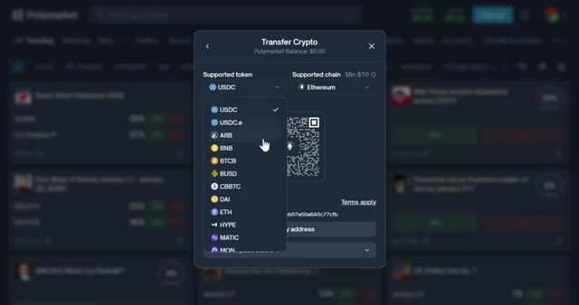
*⏱️ 00:03:05 — Interface de la plateforme montrant la fenêtre de dépôt « Transfer Crypto » avec la liste déroulante des jetons pris en charge.*

---

### ⏱️ `[00:03:26 - 00:03:54]` | Segment #08

**🔊 Audio (Transcription Intégrale Mot pour Mot en Français) :**
> Utilisez le bouton de copie pour éviter les erreurs. Ensuite, collez-le dans votre portefeuille ou sur votre plateforme d'échange. Les fonds arrivent généralement en quelques minutes. Si vous n'avez pas encore de crypto, vous pouvez acheter de l'USDC directement avec une carte de crédit ou de débit. Cliquez simplement sur déposer par carte, entrez le montant et choisissez votre fournisseur de paiement. Suivez les étapes et le tour est joué. Gardez à l'esprit que cette option peut ne pas être disponible dans toutes les régions. Si votre crypto est déjà sur un échange centralisé, vous pouvez la connecter directement.

**👁️ Analyse Visuelle d'Écran (gemini-3.5-flash-lite) :**
**Interface & Outils** : Plateforme de prédiction et de paris Polymarket, interface web de gestion de portefeuille et de dépôt.

**Contenu textuel & Code** : Soldes de portefeuille (Portfolio et Cash à 24,95 $), options de dépôt avec limites et délais (Transfer Crypto, Deposit with Card, Connect Exchange, Deposit with PayPal).

**Action / Démonstration** : Navigation sur la plateforme Polymarket et sélection d'une méthode de dépôt par carte bancaire.

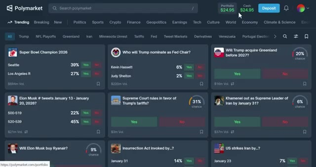
*⏱️ 00:03:33 — Vue d'ensemble de la plateforme Polymarket montrant différents marchés de prédiction et le solde du portefeuille en haut à droite.*

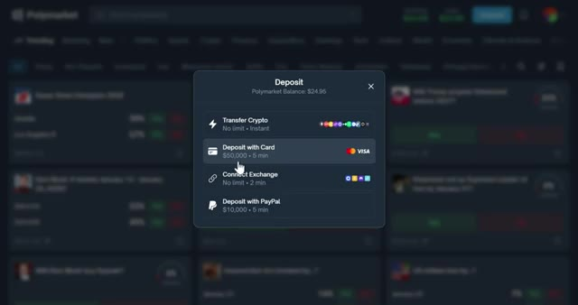
*⏱️ 00:03:40 — Fenêtre contextuelle de dépôt sur Polymarket affichant les différentes options de financement, notamment le virement crypto, la carte bancaire et PayPal.*

---

### ⏱️ `[00:03:54 - 00:04:17]` | Segment #09

**🔊 Audio (Transcription Intégrale Mot pour Mot en Français) :**
> Choisissez simplement votre plateforme d'échange et suivez les étapes à l'écran. À l'heure actuelle, Coinbase est la seule plateforme d'échange qui peut être connectée directement à Polymarket. La prise en charge de Binance, Kraken et Gemini sera bientôt disponible. Vous pouvez également acheter des cryptomonnaies en utilisant PayPal via MoonPay. Connectez-vous simplement à vos comptes PayPal et MoonPay. Entrez le montant que vous souhaitez acheter et vous verrez la quantité de cryptomonnaie que vous recevrez.

**👁️ Analyse Visuelle d'Écran (gemini-3.5-flash-lite) :**
**Interface & Outils** : Interface web de Polymarket, passerelles de paiement (Coinbase et MoonPay Rails).

**Contenu textuel & Code** : Fenêtres modales de dépôt avec options de connexion de compte d'échange et d'achat de cryptomonnaie (USD Coin sur Polygon).

**Action / Démonstration** : Connexion d'un compte d'échange tiers (Coinbase) et démonstration de l'achat de fonds (USDC) pour alimenter le compte Polymarket.

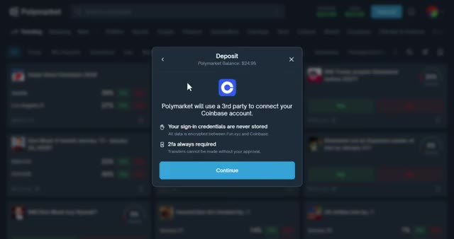
*⏱️ 00:04:00 — Interface de dépôt de Polymarket affichant une pop-up de connexion au compte Coinbase via un tiers.*

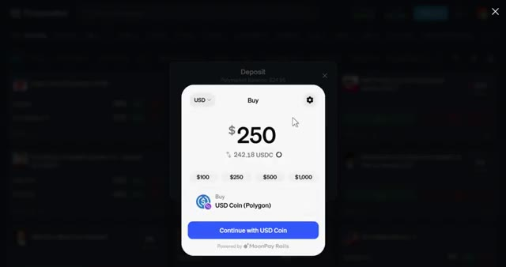
*⏱️ 00:04:11 — Interface de dépôt de Polymarket affichant une pop-up d'achat direct de 250 USD en USDC via MoonPay Rails.*

---

### ⏱️ `[00:04:17 - 00:04:37]` | Segment #10

**🔊 Audio (Transcription Intégrale Mot pour Mot en Français) :**
> Confirmez les détails, puis effectuez le paiement. Une fois votre dépôt validé, vous verrez votre solde en haut de l'écran. Vous êtes maintenant prêt à commencer à trader. Avant de placer un trade, vous devez comprendre le fonctionnement réel de Polymarket. C'est différent des paris traditionnels, alors faites bien attention. Sur Polymarket, vous n'achetez pas de cotes fixes comme vous leisseriez dans les paris sportifs.

**👁️ Analyse Visuelle d'Écran (gemini-3.5-flash-lite) :**
**Interface & Outils** : Site web Polymarket (plateforme de marchés de prédiction)

**Contenu textuel & Code** : Solde du portefeuille (Portfolio : 24.95 $, Cash : 24.95 $), boutons de dépôt et plusieurs cartes de marchés de prédiction (Super Bowl 2026, Fed Chair, etc.) avec pourcentages de probabilité et volumes.

**Action / Démonstration** : Navigation et affichage du tableau de bord utilisateur après le dépôt de fonds sur Polymarket.

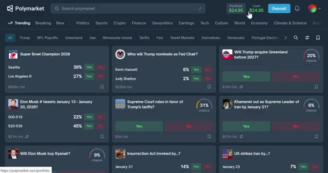
*⏱️ 00:04:22 — Capture d'écran de l'interface principale de la plateforme Polymarket montrant le solde du portefeuille à 24.95 $ et divers marchés de prédiction en tendance.*

---

### ⏱️ `[00:04:38 - 00:05:01]` | Segment #11

**🔊 Audio (Transcription Intégrale Mot pour Mot en Français) :**
> Au lieu de cela, vous achetez des actions de oui ou de non pour un résultat spécifique. Chaque action a un prix compris entre 0,01 $ et 1 $. Le prix représente la probabilité du marché que ce résultat se produise. Par exemple, disons qu'il y a un marché qui demande, quel prix atteindra le Bitcoin en 2026 ? Si les actions de oui se négocient à 0,06 $, cela signifie que le marché pense qu'il y a environ 6 % de chances que cela se produise.

**👁️ Analyse Visuelle d'Écran (gemini-3.5-flash-lite) :**
**Interface & Outils** : Polymarket (plateforme de prédiction décentralisée)

**Contenu textuel & Code** : Question du marché : "What price will Bitcoin hit in 2026?". Différents seuils de prix affichés (250 000 $, 200 000 $, etc.) avec des probabilités en pourcentage (6 %, 10%, etc.) et des boutons d'achat "Buy Yes" et "Buy No" avec des prix exprimés en centimes (ex: 6.5c, 94.2c). Le panneau latéral droit permet de passer un ordre d'achat.

**Action / Démonstration** : Présentation visuelle d'un marché de prédiction illustrant comment acheter des actions de oui ou de non selon le prix cible du Bitcoin.

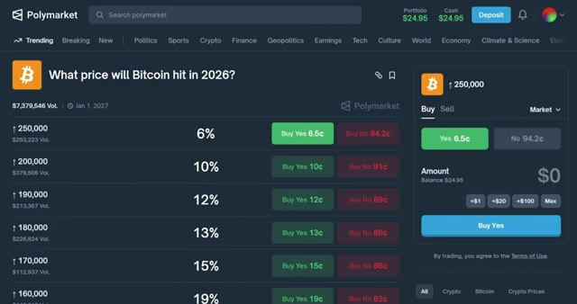
*⏱️ 00:04:44 — Capture d'écran de la plateforme Polymarket montrant un marché de prédiction concernant le prix futur du Bitcoin en 2026.*

---

### ⏱️ `[00:05:01 - 00:05:37]` | Segment #12

**🔊 Audio (Transcription Intégrale Mot pour Mot en Français) :**
> Si vous achetez des actions « oui » à 6,5 centimes et que l'événement se solde par un « oui », chaque action vaut 1 dollar. Vous faites donc un bénéfice de 0,93 dollar par action. Analysons un exemple concret. Si vous dépensez 100 dollars en actions « oui » à 6,5 centimes et que le Bitcoin atteint effectivement 250 000 dollars, vous gagneriez 1 494,62 dollars. C'est près de 1 400 dollars de bénéfice pour un simple pari de 100 dollars. D'un autre côté, les actions « non » se négocieraient à 0,94 dollar. Si vous achetez des actions « non »

**👁️ Analyse Visuelle d'Écran (gemini-3.5-flash-lite) :**
**Interface & Outils** : Interface web de Polymarket (marché de prédiction décentralisé)

**Contenu textuel & Code** : Question du marché « What price will Bitcoin hit in 2026? », avec l'option « 250,000 » affichant un achat « Buy Yes » à 6,5 c (soit 6 %) et « Buy No » à 94,2 c, ainsi que d'autres seuils de prix (200k, 190k, etc.) et le panneau latéral de transaction.

**Action / Démonstration** : Présentation d'un exemple concret d'achat d'actions « oui » à 6,5 centimes pour un événement lié au prix du Bitcoin.

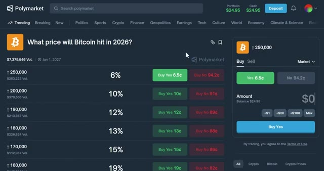
*⏱️ 00:05:10 — Capture d'écran de la plateforme Polymarket montrant le marché de prédiction sur le prix du Bitcoin en 2026, avec différentes options de prix cibles et leurs probabilités associées en pourcentage et en centimes.*

---

### ⏱️ `[00:05:37 - 00:06:14]` | Segment #13

**🔊 Audio (Transcription Intégrale Mot pour Mot en Français) :**
> et l'événement se résout par non, vous ne faites que 5,80 dollars de profit par action. Vous gagneriez seulement 106,11 dollars, juste 6 dollars de profit. C'est beaucoup moins risqué, mais beaucoup moins lucratif. C'est là que ça devient intéressant. Vous n'avez pas besoin d'attendre que l'événement se résolve pour gagner de l'argent. Disons que vous achetez des actions oui à 6,5 cents. Ensuite, le Bitcoin monte en flèche à 200 000 dollars et soudainement, plus de gens pensent que 250 000 dollars est possible. Maintenant, les actions oui se négocient à 10 cents. Vous pouvez vendre vos actions dès maintenant et garantir un profit même si le Bitcoin ne

**👁️ Analyse Visuelle d'Écran (gemini-3.5-flash-lite) :**
**Interface & Outils** : Plateforme de marchés prédictifs Polymarket (interface web).

**Contenu textuel & Code** : Question de marché « What price will Bitcoin hit in 2026? », options de paris avec probabilités en pourcentage et prix d'achat (« Buy Yes » et « Buy No »), montant de la mise (100 $) et gain potentiel affiché à 106,11 $.

**Action / Démonstration** : Simulation d'un achat sur le scénario « No » à 94,2 cents pour illustrer un faible profil de risque et de rentabilité.

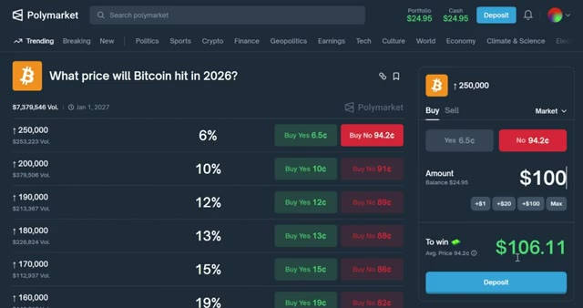
*⏱️ 00:05:46 — Capture d'écran de l'interface Polymarket montrant le marché prédictif sur le prix du Bitcoin en 2026, avec un panneau de commande latéral affichant un montant de 100 $ et un gain potentiel de 106,11 $.*

---

### ⏱️ `[00:06:14 - 00:06:48]` | Segment #14

**🔊 Audio (Transcription Intégrale Mot pour Mot en Français) :**
> atteint réellement 250 000 dollars. Vous échangez simplement les cotes au fur et à mesure qu'elles changent. C'est pourquoi Polymarket ressemble davantage à du trading qu'à des paris traditionnels. Vous échangez sur la base d'informations et du sentiment du marché, et pas seulement sur le résultat final. Comme Polymarket fonctionne en pair à pair, vous tradez contre d'autres utilisateurs. Cela signifie que vous devez consulter le carnet d'ordres avant de passer de 거래 importance, pardon, de grands ordres. Le carnet d'ordres vous montre tous les ordres d'achat et de vente à différents prix. Si vous achetez une grande quantité, vous risquez de ne pas être exécuté au prix que vous voyez sur le graphique. Vous obtiendrez un prix moyen basé sur la liquidité disponible. Vérifiez toujours

**👁️ Analyse Visuelle d'Écran (gemini-3.5-flash-lite) :**
**Interface & Outils** : Polymarket (plateforme de marché de prédiction)

**Contenu textuel & Code** : Question du marché ("What price will Bitcoin hit in 2026?"), graphique de probabilité montrant une cote de 6% (haussière de 1%), volume d'échanges, et un panneau latéral de vente de parts (100 shares pour un montant de 5.80$).

**Action / Démonstration** : Visualisation des cotes en temps réel et du graphique historique de probabilité pour illustrer le trading de contrats de prédiction.

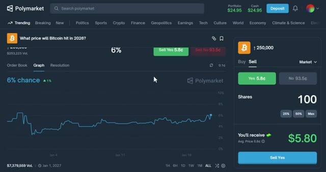
*⏱️ 00:06:22 — Capture d'écran de l'interface Polymarket affichant un marché de prédiction sur le prix du Bitcoin, avec un graphique de probabilité et un panneau de trading à droite.*

---

### ⏱️ `[00:06:48 - 00:07:25]` | Segment #15

**🔊 Audio (Transcription Intégrale Mot pour Mot en Français) :**
> le volume et la liquidité d'un marché avant de trader. Les marchés à faible volume peuvent avoir des écarts énormes, ce qui signifie que vous pourriez perdre de l'argent même si vous avez raison sur le résultat. Très bien, maintenant passons à un vrai trade pour que vous puissiez voir comment cela fonctionne en temps réel. Je vais utiliser un exemple simple ici. Disons que je veux parier sur qui Trump va nommer à la tête de la Fed. Vous verrez les cotes actuelles, le graphique montrant comment les cotes ont évolué au fil du temps, et le carnet d'ordres. Maintenant, décidez si vous pensez que le résultat sera oui ou non. Pour cet exemple, je vais parier oui. Sur Kevin Warsh, entrez le montant que vous souhaitez dépenser. Disons que je veux parier 10 dollars. Vous verrez combien d'actions

**👁️ Analyse Visuelle d'Écran (gemini-3.5-flash-lite) :**
**Interface & Outils** : Polymarket (plateforme de marchés prédictifs)

**Contenu textuel & Code** : Liste de marchés tendance, volumes de transactions (ex: $219m Vol.), probabilités en pourcentage (ex: Kevin Warsh à 61%), options d'achat/vente (Yes/No) et interface de passage d'ordre.

**Action / Démonstration** : Navigation sur la plateforme puis sélection d'un marché de prédiction pour préparer l'exécution d'un trade réel.

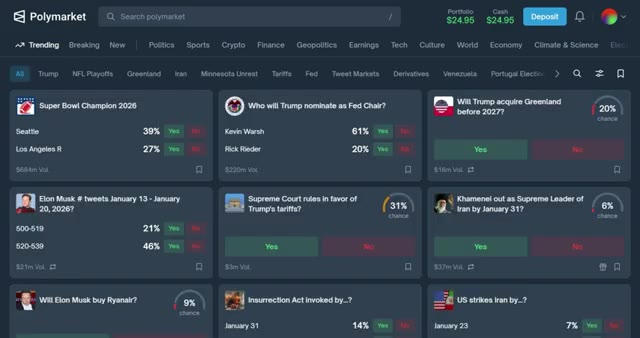
*⏱️ 00:06:57 — Page d'accueil de la plateforme Polymarket montrant une grille de différents marchés de prédiction tendance avec leurs volumes et pourcentages respectifs.*

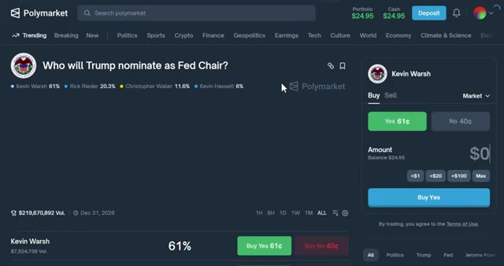
*⏱️ 00:07:07 — Vue détaillée d'un marché spécifique sur Polymarket ("Who will Trump nominate as Fed Chair?") avec le panneau de trading à droite.*

---

### ⏱️ `[00:07:25 - 00:08:00]` | Segment #16

**🔊 Audio (Transcription Intégrale Mot pour Mot en Français) :**
> vous obtiendrez et quel est votre profit potentiel si vous avez raison. Vérifiez tout deux fois. Si tout semble correct, cliquez sur acheter oui. Votre portefeuille s'affichera pour vous demander de confirmer la transaction, approuvez-la, et boum, vous y êtes. Maintenant, si vous allez sur votre profil et cliquez sur positions, vous verrez votre trade actif. Vous pouvez voir combien de shares vous possédez, votre prix d'entrée moyen, votre profit ou perte actuel, le prix actuel du marché. Si vous voulez sortir de votre position, cliquez simplement sur vendre. Entrez combien de shares vous voulez vendre et confirmez. Vos fonds seront de retour sur votre compte instantanément. Gardez en

**👁️ Analyse Visuelle d'Écran (gemini-3.5-flash-lite) :**
**Interface & Outils** : Polymarket (plateforme de prédiction et de trading décentralisée)

**Contenu textuel & Code** : Conditions d'utilisation, détails du marché de prédiction (nomination de Kevin Warsh), montant de la transaction de 10 $ avec un profit potentiel estimé à 16,39 $, et récapitulatif du portefeuille.

**Action / Démonstration** : Acceptation des conditions d'utilisation et confirmation de la transaction sur Polymarket.

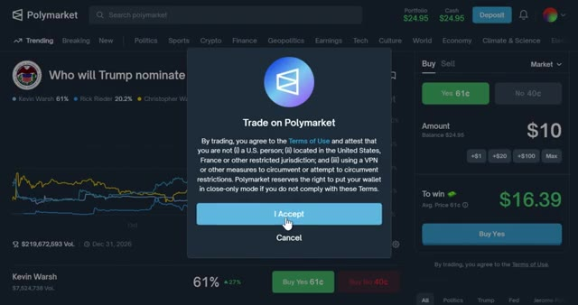
*⏱️ 00:07:34 — Interface de la plateforme Polymarket affichant une pop-up de confirmation des conditions d'utilisation pour le trading.*

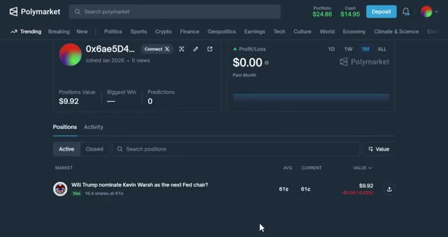
*⏱️ 00:07:43 — Vue du profil utilisateur et du portefeuille sur Polymarket montrant la position active et la valeur actuelle du compte.*

---

### ⏱️ `[00:08:00 - 00:08:34]` | Segment #17

**🔊 Audio (Transcription Intégrale Mot pour Mot en Français) :**
> attention si le marché n'est pas liquide, vous risquez de ne pas obtenir le prix exact que vous voyez sur le graphique. Vérifiez toujours le carnet d'ordres avant de vendre de grandes positions. Petit rappel, si vous tradez un volume important sur Polymarket, vous pouvez gagner jusqu'à 1 000 dollars après avoir généré 1 million de dollars de chiffre d'affaires. Tous les détails du bonus se trouvent dans la description ci-dessous. Maintenant que vous connaissez les bases, laissez-moi vous donner quelques conseils pour trader plus intelligemment sur Polymarket. Conseil numéro 1, utilisez des ordres à cours limité. Au lieu d'acheter au prix du marché, vous pouvez définir un ordre limité pour acheter des actions à un prix spécifique. C'est utile si vous pensez que les cotes vont

**👁️ Analyse Visuelle d'Écran (gemini-3.5-flash-lite) :**
**Interface & Outils** : Plateforme de prédiction décentralisée Polymarket avec interface web de trading.

**Contenu textuel & Code** : Graphiques de probabilités et carnets de commandes pour des prédictions politiques et économiques, affichant des volumes de transaction et des pourcentages de chance.

**Action / Démonstration** : Navigation sur la plateforme et sélection d'un marché pour observer les options d'achat et de vente ainsi que le type d'ordre (Market/Limit).

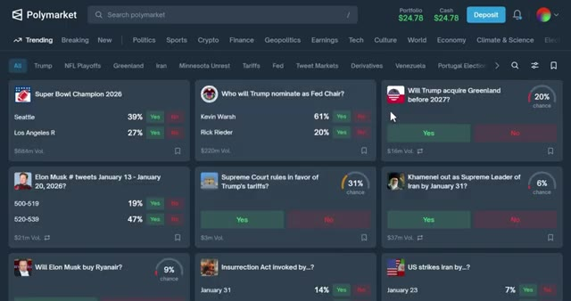
*⏱️ 00:08:09 — Capture d'écran de la page d'accueil de la plateforme Polymarket montrant une grille de différents marchés de prédiction tendance.*

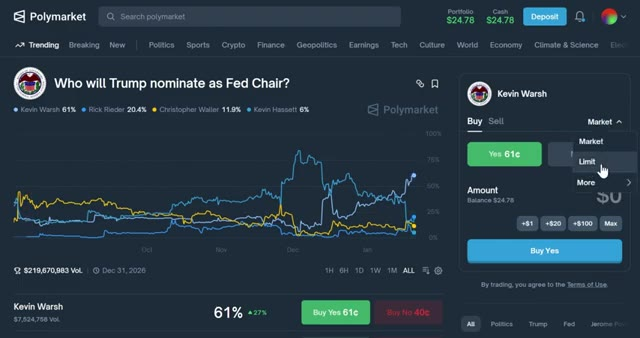
*⏱️ 00:08:26 — Interface détaillée d'un marché spécifique sur Polymarket (« Who will Trump nominate as Fed Chair? ») avec un graphique de prix et le panneau de passage d'ordres à droite.*

---

### ⏱️ `[00:08:34 - 00:09:09]` | Segment #18

**🔊 Audio (Transcription Intégrale Mot pour Mot en Français) :**
> tourne en votre faveur. Entrez le prix et la quantité souhaités et soumettez. Si le marché atteint votre prix, votre ordre s'exécutera automatiquement. Conseil numéro deux, suivez les portefeuilles des baleines. Comme Polymarket fonctionne sur la chaîne de blocs, toutes les transactions sont publiques. Vous pouvez suivre les gros traders et voir sur quoi ils parient. Si vous voyez une baleine miser massivement sur un certain résultat, cela peut être un signal. Mais attention, certains de ces traders pourraient détenir des informations privilégiées. Conseil numéro trois, faites attention aux actualités. Les cotes de Polymarket changent en fonction d'informations du monde réel. Un simple tweet, un article de presse ou une annonce peut faire basculer radicalement les cotes.

**👁️ Analyse Visuelle d'Écran (gemini-3.5-flash-lite) :**
**Interface & Outils** : Plateforme Web Polymarket

**Contenu textuel & Code** : Marchés de prédiction, statistiques de portefeuille, pourcentages de probabilité et classement des utilisateurs (Leaderboard)

**Action / Démonstration** : Navigation sur la plateforme Polymarket et consultation des portefeuilles et des marchés tendance

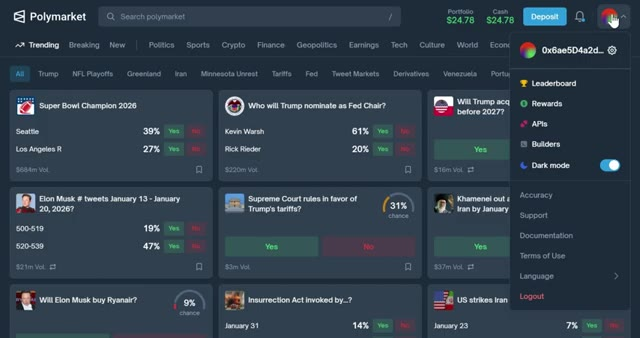
*⏱️ 00:08:43 — Interface principale de la plateforme Polymarket affichant les marchés de prédiction tendance et un menu déroulant de profil utilisateur.*

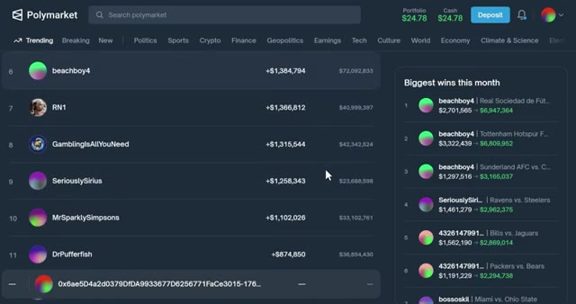
*⏱️ 00:08:52 — Page du classement (Leaderboard) de Polymarket montrant les portefeuilles les plus performants et les plus gros gains du mois.*

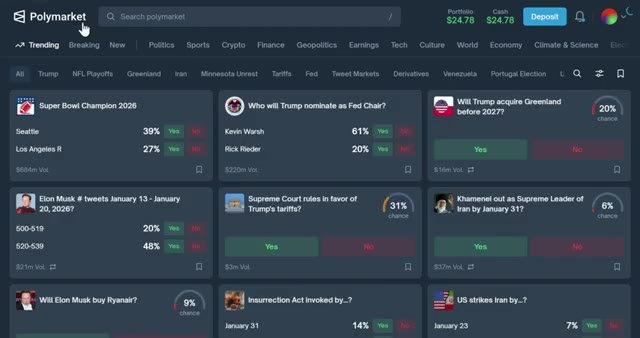
*⏱️ 00:09:00 — Vue d'accueil de la plateforme Polymarket présentant différents marchés de paris sous forme de cartes avec pourcentages de probabilité.*

---

### ⏱️ `[00:09:09 - 00:09:32]` | Segment #19

**🔊 Audio (Transcription Intégrale Mot pour Mot en Français) :**
> Configurez des alertes pour les événements que vous tradez afin de pouvoir réagir rapidement. Quatrième conseil, gérez votre risque. Ne misez jamais plus que ce que vous pouvez vous permettre de perdre. Les marchés de prédiction sont volatils et même les paris sûrs peuvent mal tourner. Diversifiez vos paris et ne misez pas tout sur un seul résultat. Cinquième conseil, comprenez la manipulation de marché. Parce que Polymarket est décentralisé et anonyme, il y a un potentiel de manipulation.

**👁️ Analyse Visuelle d'Écran (gemini-3.5-flash-lite) :**
**Interface & Outils** : Polymarket (plateforme de prédiction décentralisée).

**Contenu textuel & Code** : Graphiques de probabilités historiques, volumes de transaction, soldes de portefeuille ($24.95), boutons d'achat "Yes/No" et montants de mise.

**Action / Démonstration** : Navigation sur la plateforme et sélection d'un marché de prédiction pour configurer un ordre de trading.

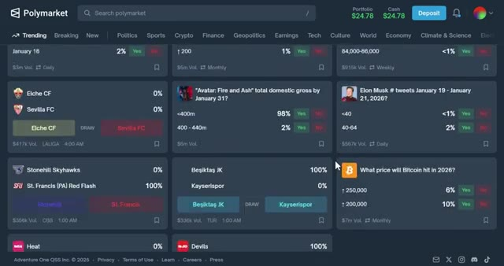
*⏱️ 00:09:15 — Capture d'écran de la plateforme Polymarket montrant une vue d'ensemble des marchés tendances avec divers paris disponibles (politique, sport, crypto).*

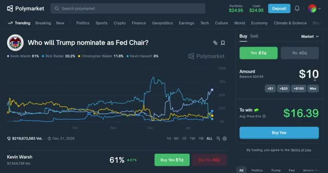
*⏱️ 00:09:27 — Interface détaillée d'un marché spécifique sur Polymarket ("Who will Trump nominate as Fed Chair?") avec un graphique d'évolution des probabilités et le panneau d'achat/vente à droite.*

---

### ⏱️ `[00:09:33 - 00:09:53]` | Segment #20

**🔊 Audio (Transcription Intégrale Mot pour Mot en Français) :**
> Les personnes qui possèdent des informations privilégiées peuvent manipuler les marchés, en particulier ceux à faible volume. En débutant, tenez-vous-en aux marchés à fort volume et à haute liquidité. Ceux-ci sont plus difficiles à manipuler et présentent des écarts plus serrés. Maintenant, avant de conclure, je dois dire ceci. Je ne suis pas un conseiller financier. Les marchés de prédiction sont risqués. Vous mettez de l'argent réel en jeu et vous pouvez le perdre.

**👁️ Analyse Visuelle d'Écran (gemini-3.5-flash-lite) :**
**Interface & Outils** : Site web de Polymarket (marchés de prédiction décentralisés).

**Contenu textuel & Code** : Différents marchés affichés (ex: Super Bowl Champion 2026, Fed Chair nomination, etc.) avec des volumes en millions de dollars (ex: 684m Vol., 220m Vol., 16m Vol.) et des options de pari Oui/Non.

**Action / Démonstration** : Navigation et présentation des différents marchés de prédiction et de leurs volumes de liquidité respectifs sur la plateforme.

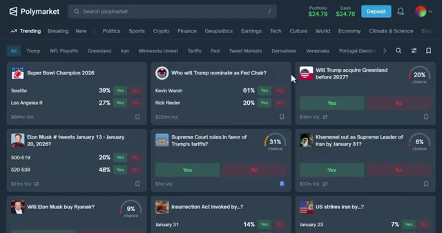
*⏱️ 00:09:38 — Capture d'écran de l'interface de la plateforme Polymarket montrant une grille de marchés de prédiction populaires avec leurs volumes d'échange et pourcentages de probabilité.*

---

### ⏱️ `[00:09:53 - 00:10:11]` | Segment #21

**🔊 Audio (Transcription Intégrale Mot pour Mot en Français) :**
> Faites toujours vos propres recherches. Et c'est tout. Vous savez désormais exactement comment utiliser Polymarket en 2026. Nous avons vu comment configurer votre compte, l'alimenter, comprendre le fonctionnement des actions, placer votre premier trade et même quelques stratégies avancées pour trader plus intelligemment. Polymarket est l'avenir des marchés de prédiction.

**👁️ Analyse Visuelle d'Écran (gemini-3.5-flash-lite) :**
**Interface & Outils** : Polymarket (plateforme de marchés de prédiction décentralisée).

**Contenu textuel & Code** : Soldes du portefeuille ($24.78 / $24.95), volumes de transactions des différents marchés, carnets d'ordres avec prix en centimes (ex: 5.8c), nombre d'actions et montants totaux.
[DESC_IMAGE_2] Navigation sur la plateforme, exploration des différents marchés de prédiction et démonstration du placement d'ordres.

**Action / Démonstration** : Explications face caméra et analyse conceptuelle des marchés.

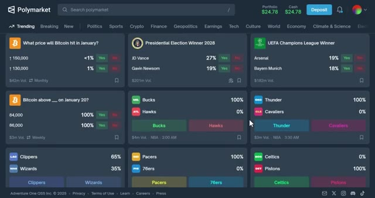
*⏱️ 00:09:58 — Vue d'ensemble de la plateforme Polymarket montrant une grille de marchés de prédiction populaires classés par catégories (Trending, Politique, Sports, Crypto, etc.).*

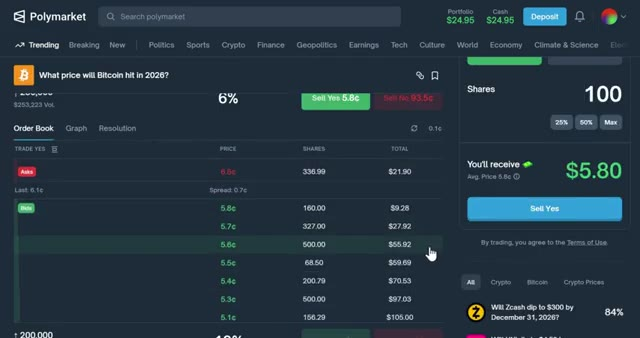
*⏱️ 00:10:07 — Interface de trading détaillée sur Polymarket pour un marché spécifique (prix du Bitcoin), affichant le carnet d'ordres (Order Book), les prix d'achat/vente et le panneau de passage d'ordres à droite.*

---

### ⏱️ `[00:10:12 - 00:10:32]` | Segment #22

**🔊 Audio (Transcription Intégrale Mot pour Mot en Français) :**
> C'est décentralisé, transparent, et cela vous donne la possibilité de tirer profit de vos connaissances et de vos analyses sur des événements du monde réel. Et n'oubliez pas, si vous vous inscrivez avec mon lien dans la description, vous pouvez gagner jusqu'à 1 000 dollars de bonus après avoir atteint 1 million de dollars de volume de transaction. Ne laissez pas de l'argent gratuit sur la table. Maintenant, je veux vous entendre.

**👁️ Analyse Visuelle d'Écran (gemini-3.5-flash-lite) :**
**Interface & Outils** : Polymarket (site web de marchés de prédiction)

**Contenu textuel & Code** : Carnet d'ordres (Order Book), prix des actions, options de vente/achat (Sell Yes/No), et options de connexion (Google, MetaMask, etc.)

**Action / Démonstration** : Navigation et présentation de l'interface utilisateur de la plateforme de prédiction Polymarket.

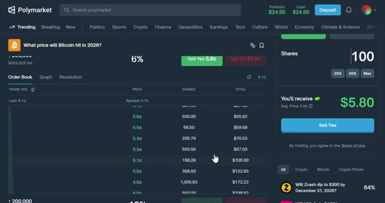
*⏱️ 00:10:17 — Interface de la plateforme de prédiction Polymarket montrant le carnet d'ordres et les détails de paris sur le Bitcoin.*

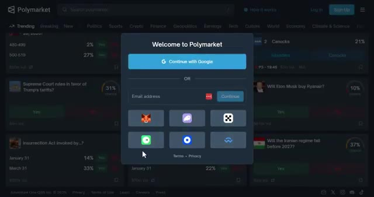
*⏱️ 00:10:22 — Fenêtre contextuelle d'inscription et de connexion de la plateforme Polymarket avec diverses options d'authentification.*

---

### ⏱️ `[00:10:32 - 00:10:45]` | Segment #23

**🔊 Audio (Transcription Intégrale Mot pour Mot en Français) :**
> Quels marchés avez-vous le plus hâte de trader sur Polymarket ? Laissez un commentaire ci-dessous et faites-le-moi savoir. Et si vous avez trouvé ce tutoriel utile, explosez ce bouton J'aime et abonnez-vous pour plus de tutoriels sur la crypto et de guides de trading. Et je vous vois dans le prochain.

**👁️ Analyse Visuelle d'Écran (gemini-3.5-flash-lite) :**
**Interface & Outils** : Polymarket (Plateforme de marchés de prédiction)

**Contenu textuel & Code** : Liste de marchés de prédiction incluant des sujets politiques, géopolitiques et économiques avec le volume des transactions et les pourcentages de chance (ex: "Fed decision in January?", "Will the Iranian regime fall before 2027?"). Solde du portefeuille visible en haut à droite ($24.78).

**Action / Démonstration** : Navigation et présentation des différents marchés disponibles sur la plateforme de prédiction Polymarket.

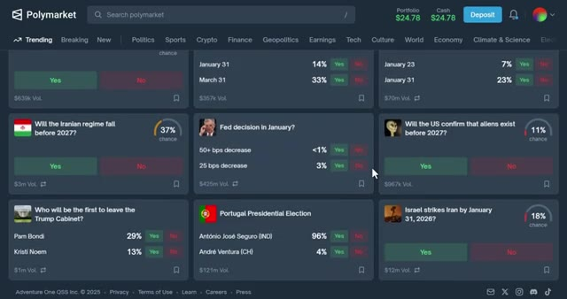
*⏱️ 00:10:35 — Capture d'écran de la plateforme Polymarket affichant divers marchés de prédiction tendance avec des probabilités et des boutons d'achat Yes/No.*

---

