# 🎬 Crypto Market Crash (Watch This Before You Panic Sell)

> **Chaîne** : [Alex Carter](https://www.youtube.com/@AlexCarterTrading)  
> **Lien YouTube** : [https://www.youtube.com/watch?v=iyXscYJ3mfc](https://www.youtube.com/watch?v=iyXscYJ3mfc)  
> **Date de publication** : 20260206  
> **Durée** : 00:07:34  
> **Identifiant vidéo** : `iyXscYJ3mfc`  
> **Transcription & Analyse** : `whisper-v3-large-turbo+gemini-3.5-flash-lite`  

---

## 📌 Synthèse Exécutive & Outils

### 💡 Résumé
Dans cette vidéo intitulée **Krach sur le marché crypto (Regardez ceci avant de vendre dans la panique)**, Alex Carter détaille une approche stratégique et pratique du trading et de l'automatisation par agents IA.

### 🛠️ Outils, Modèles & Logiciels Présentés
- **TradingView & Claude Code** : Analyse technique avancée et automatisation algorithmique.

### 🔑 Points Clés & Enseignements Stratégiques
- Respect rigoureux du ratio risque/rendement et du money management.
- Automatisation méthodique des déclencheurs d'ordres via des agents intelligents.

---

## ⏱️ Chronologie & Transcription Complète Audio & Visuelle (Mot pour Mot)

### ⏱️ `[00:00:00 - 00:00:35]` | Segment #01

**🔊 Audio (Transcription Intégrale Mot pour Mot en Français) :**
> Ethereum vient de s'effondrer de 19 % en 24 heures. Le Bitcoin a atteint son niveau le plus bas depuis 14 mois. Plus d'un milliard de dollars de liquidations ont été balayés en une seule journée. Le marché des cryptos est dans un chaos absolu en ce moment, et je vois de la panique partout. Mais voici ce que personne ne vous dit. Ce crash suit exactement le même schéma que celui que nous avons vu avant chaque hausse majeure dans l'histoire de la crypto. Et dans les cinq prochaines minutes, je vais vous montrer exactement ce qui se passe, pourquoi cela prépare en réalité l'une des plus grandes opportunités de ce cycle. Et surtout, ce que vous devez faire dès maintenant pour vous positionner avant le retournement.

**👁️ Analyse Visuelle d'Écran (gemini-3.5-flash-lite) :**
**Interface & Outils** : TradingView

**Contenu textuel & Code** : Niveaux de support horizontaux ("Major Support Level" à 2 344 USDT, 1 768 USDT et 1 370 USDT), lignes verticales de repère temporel (mai/juin 2025), volume en bas d'écran, cours actuel chutant vers 1 787 USDT.

**Action / Démonstration** : Identification technique des niveaux clés de support historiques suite à un crash violent du marché crypto.

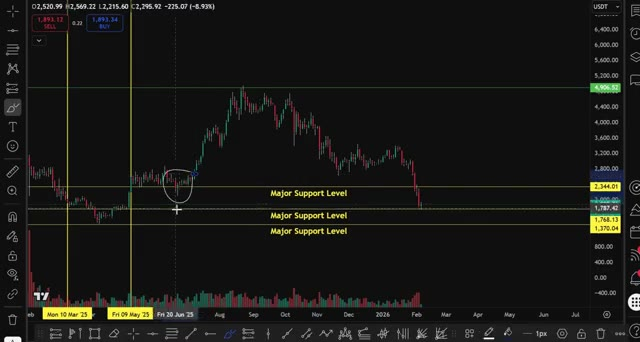
*⏱️ 00:00:18 — Graphique TradingView en chandeliers montrant une chute brutale du cours avec plusieurs niveaux horizontaux étiquetés "Major Support Level" (notamment à 2344.01, 1768.13 et 1370.04).*

---

### ⏱️ `[00:00:36 - 00:00:55]` | Segment #02

**🔊 Audio (Transcription Intégrale Mot pour Mot en Français) :**
> Parce que si vous comprenez ce que je m'apprête à vous montrer, ce krach pourrait bien être la meilleure chose qui soit arrivée à votre portefeuille. Plongeons dans le vif du sujet. Très bien, décortiquons exactement ce qui vient de se passer sur le marché des cryptomonnaies. Ethereum est passé d'environ 2 150 dollars à 1 740 dollars en seulement 24 heures.

**👁️ Analyse Visuelle d'Écran (gemini-3.5-flash-lite) :**
**Interface & Outils** : TradingView / Bybit (Graphique de prix crypto)

**Contenu textuel & Code** : Paire ETHUSDT SPOT, UT 2D, niveaux de support horizontal ('Major Support Level'), curseur de volume en bas, prix actuels et données OHLC en haut à gauche.

**Action / Démonstration** : Analyse technique du cours d'Ethereum mettant en évidence des zones de support clés et la baisse récente du marché.

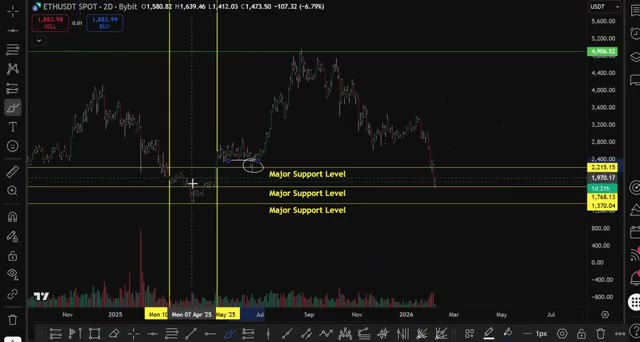
*⏱️ 00:00:41 — Graphique en chandeliers japonais de l'ETHUSDT sur l'échange Bybit en unité de temps 2D, montrant l'évolution des prix avec des lignes horizontales étiquetées comme 'Major Support Level' et des repères temporels verticaux.*

---

### ⏱️ `[00:00:55 - 00:01:18]` | Segment #03

**🔊 Audio (Transcription Intégrale Mot pour Mot en Français) :**
> C'est un crash de 19 %. Le Bitcoin a chuté de plus de 17 %, passant de 71 900 $ à 60 000 $, atteignant son niveau le plus bas depuis octobre 2024. Et ce n'était pas juste un petit repli. Nous avons vu plus d'un milliard de dollars de liquidations sur l'ensemble du marché crypto au cours des dernières 24 heures. C'est massif.

**👁️ Analyse Visuelle d'Écran (gemini-3.5-flash-lite) :**
**Interface & Outils** : Présentation ou face-caméra explicatif du trader sans interface logicielle partagée.

**Contenu textuel & Code** : Explications orales des stratégies et mise en contexte méthodologique du marché.

**Action / Démonstration** : Explications face caméra et analyse conceptuelle des marchés.

---

### ⏱️ `[00:01:19 - 00:01:37]` | Segment #04

**🔊 Audio (Transcription Intégrale Mot pour Mot en Français) :**
> Maintenant, voici ce qui a déclenché ce krach. Premièrement, nous avons eu Vitalik Buterin, le cofondateur d'Ethereum, qui a vendu 2 962 Ethereum. Cela représente environ 6,69 millions de dollars sur seulement trois jours. Maintenant, avant de paniquer, c'était très probablement à des fins philanthropiques. Mais le marché se moque des intentions.

**👁️ Analyse Visuelle d'Écran (gemini-3.5-flash-lite) :**
**Interface & Outils** : Navigateur web affichant un site d'actualité sur les cryptomonnaies (CryptoCurrency News).

**Contenu textuel & Code** : Articles de presse avec des chiffres précis : 2 962 Ethereum vendus, prix d'Ethereum sous 2 000 dollars, volume d'environ 6,69 millions de dollars.

**Action / Démonstration** : Présentation d'articles de presse et de rapports de données sur la chute du marché et les transactions de Vitalik Buterin.

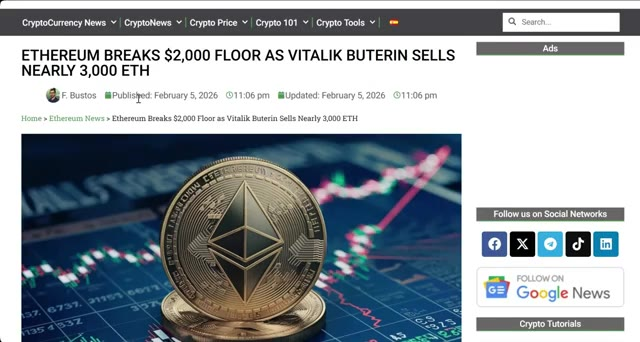
*⏱️ 00:01:23 — Capture d'écran d'un article d'actualité crypto montrant le titre 'Ethereum breaks $2,000 floor as Vitalik Buterin sells nearly 3,000 ETH'.*

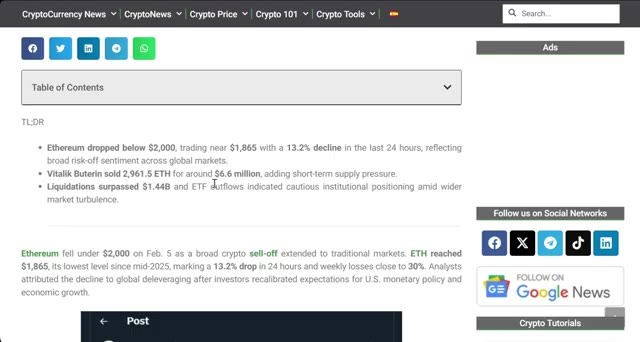
*⏱️ 00:01:28 — Capture d'écran de la suite de l'article détaillant les points clés (TL;DR) de la chute d'Ethereum et la vente de Vitalik Buterin.*

---

### ⏱️ `[00:01:38 - 00:02:14]` | Segment #05

**🔊 Audio (Transcription Intégrale Mot pour Mot en Français) :**
> Quand les gens voient le fondateur vendre, ils paniquent. Deuxièmement, nous avons eu la nomination de Kevin Warsh comme nouveau président de la Fed, et le marché intègre une politique monétaire plus stricte. Cela signifie des taux d'intérêt plus élevés pendant plus longtemps, ce qui est traditionnellement baissier pour les actifs risqués comme la crypto. Et troisièmement, et c'est la partie la plus importante, nous avons cassé des niveaux de support technique clés. Ethereum a chuté sous les 2 200 dollars, ce qui était un support majeur, et Bitcoin a testé le support des 74 200 dollars qu'il tenait depuis fin 2024. Mais voici le hic, et c'est là que ça devient intéressant. Nous avons vu exactement ce

**👁️ Analyse Visuelle d'Écran (gemini-3.5-flash-lite) :**
**Interface & Outils** : Navigateur web (Invesco) / Plateforme de graphiques boursiers (TradingView).

**Contenu textuel & Code** : Texte biographique sur Kevin Warsh / Graphique de prix avec des niveaux de "Major Support Level" étiquetés à 2250, 1768 et 1370, et des volumes de trading élevés.

**Action / Démonstration** : Présentation du contexte macroéconomique puis analyse technique d'un graphique montrant une forte baisse des prix cassant les supports.

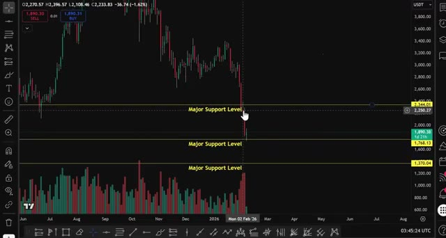
*⏱️ 00:01:56 — Graphique en chandeliers affichant un mouvement de baisse important et cassant des niveaux de support majeurs.*

---

### ⏱️ `[00:02:14 - 00:02:48]` | Segment #06

**🔊 Audio (Transcription Intégrale Mot pour Mot en Français) :**
> déjà en place auparavant. À de multiples reprises et à chaque fois, ce qui ressemblait à un krach s'est transformé en la configuration pour la prochaine jambe explosive à la hausse. Laissez-moi vous montrer quelque chose qui va vous épater. Si vous regardez l'évolution du prix d'Ethereum au cours de l'année écoulée, nous avons vu ce schéma se répéter encore et encore. En mars dernier, Ethereum a balayé la liquidité sous les creux précédents. Tout le monde a paniqué. Et qu'est-ce qui s'est passé ensuite ? Un retournement massif à la hausse. Puis en mai, exactement la même chose s'est produite. Nous avons cassé sous le support, déclenché des ordres stop, le sentiment est devenu extrêmement baissier. Et puis boum,

**👁️ Analyse Visuelle d'Écran (gemini-3.5-flash-lite) :**
**Interface & Outils** : TradingView / WEEX (contrat perpétuel BTC/USDT en vue journalière 1D).

**Contenu textuel & Code** : Niveaux de support horizontaux identifiés en jaune à 74 236,3 USDT (« Major Support Level November 2024 ») et 59 080,5 USDT (« Major Support Level Oct 2024 »), indicateur de volume, annotations manuelles mettant en évidence une précédente zone de consolidation.

**Action / Démonstration** : Analyse chartiste mettant en parallèle les précédentes corrections de marché avec la configuration actuelle pour illustrer la mise en place d'un rebond haussier.

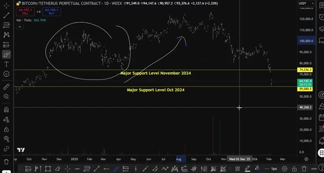
*⏱️ 00:02:22 — Graphique journalier du Bitcoin (BTC/USDT) sur WEEX montrant une structure corrective avec deux niveaux de support clés annotés et un tracé comparatif au stylet.*

---

### ⏱️ `[00:02:49 - 00:03:15]` | Segment #07

**🔊 Audio (Transcription Intégrale Mot pour Mot en Français) :**
> Un retournement violent à la hausse. Et là, en ce moment même, nous le voyons se reproduire. L'Ethereum vient de balayer la liquidité sous le niveau de support des 2 300 dollars. Le Bitcoin a testé les 65 000 dollars. Et comme réglé comme du papier à musique, tout le monde panique. Je vois des gens sur Twitter annoncer un Bitcoin à 50 000 dollars, un Ethereum à 1 500 dollars. Certains disent même que le marché haussier est terminé. Mais c'est exactement ce qui se produit avant chaque retournement majeur.

**👁️ Analyse Visuelle d'Écran (gemini-3.5-flash-lite) :**
**Interface & Outils** : Graphique de TradingView (Bybit) et interface de navigation sur le réseau social X.

**Contenu textuel & Code** : Niveaux de support étiquetés « Major Support Level », graphiques de prix ETHUSDT, volumes de transactions et fils d'actualité sur le Bitcoin.

**Action / Démonstration** : Analyse technique des niveaux de support d'Ethereum et consultation des réactions de la communauté sur les réseaux sociaux suite à la baisse du marché.

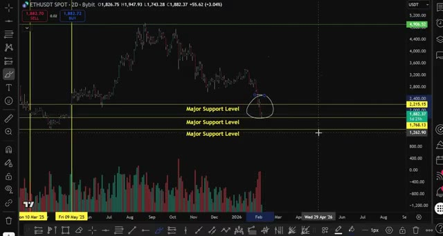
*⏱️ 00:02:55 — Graphique en chandeliers japonais sur deux jours (2D) de la paire ETHUSDT Spot sur Bybit, montrant les niveaux de support majeurs et une cassure de prix encerclée.*

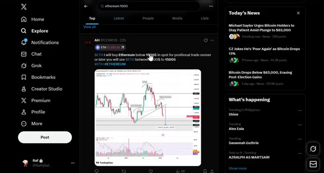
*⏱️ 00:03:08 — Interface du réseau social X (Twitter) affichant un tweet concernant Ethereum sous les 1500$, avec des actualités sur le marché crypto à droite.*

---

### ⏱️ `[00:03:15 - 00:03:44]` | Segment #08

**🔊 Audio (Transcription Intégrale Mot pour Mot en Français) :**
> C'est un prélèvement de liquidité typique de manuel. Les teneurs de marché éliminent les mains faibles, déclenchent tous les ordres stop, puis repartent violemment à la hausse. Et voici la partie intéressante. Nous sommes actuellement en train de retester l'ancienne résistance comme nouveau support. Regardez ce graphique. Ethereum a été rejeté au niveau de son précédent record historique, autour de 4 900 dollars. Maintenant, nous sommes redescendus et ce niveau commence à agir comme un support. C'est l'un des signaux haussiers les plus puissants que l'on puisse obtenir en analyse technique.

**👁️ Analyse Visuelle d'Écran (gemini-3.5-flash-lite) :**
**Interface & Outils** : Graphique TradingView intégré sur la plateforme Bybit.

**Contenu textuel & Code** : Paire ETHUSDT SPOT, unité de temps 2D, niveaux étiquetés « Major Support Level » autour de 2215.15, 1879.50, 1768.13 et 1370.04, ainsi que des histogrammes de volume en bas.

**Action / Démonstration** : Analyse technique du cours de l'Ethereum illustrant un mouvement baissier violent testant les niveaux de support clés.

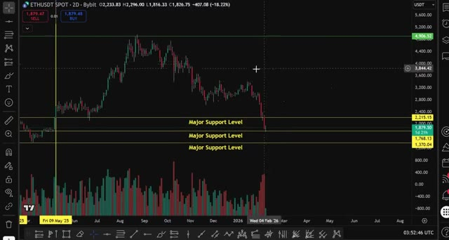
*⏱️ 00:03:22 — Graphique en chandeliers (2D) de la paire ETHUSDT Spot sur Bybit montrant une forte baisse des prix avec des volumes importants et des niveaux de support majeurs tracés.*

---

### ⏱️ `[00:03:44 - 00:04:17]` | Segment #09

**🔊 Audio (Transcription Intégrale Mot pour Mot en Français) :**
> We saw it here, we saw it here, and now we're seeing it again. Every single time this happens, the result is the same. A powerful breakout to the upside. Back in June, when we fell below the major support, what happened next? A massive reversal. This is a classic shakeout pattern before the next leg up. So here's exactly what you need to do right now, and this is critical, so pay attention. Step one, do not panic sell. I know it's tempting. I know it feels like the market is going to zero, but this is exactly when the smart money is accumulating. When everyone

**👁️ Analyse Visuelle d'Écran (gemini-3.5-flash-lite) :**
**Interface & Outils** : TradingView (données de marché Bybit ETHUSDT Spot)

**Contenu textuel & Code** : Paire ETHUSDT SPOT 2D, prix actuel à 1 883,98 USDT, niveaux clés « Major Support Level » à 2 215,15, 1 768,13 et 1 370,04 USDT, repères temporels verticaux (mars et mai 2025), histogramme des volumes.

**Action / Démonstration** : Analyse technique comparative mettant en évidence des configurations récurrentes de fausses cassures sous des supports clés (« shakeouts ») suivies de puissants retournements haussiers.

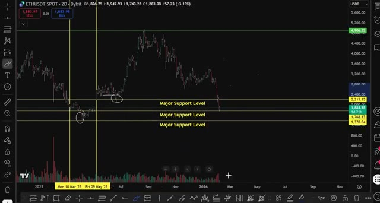
*⏱️ 00:03:52 — Graphique TradingView de la paire ETH/USDT en bougies 2 jours (2D) sur Bybit, montrant des niveaux horizontaux de support majeurs et des zones de fausses cassures (shakeouts) entourées en blanc.*

---

### ⏱️ `[00:04:17 - 00:04:55]` | Segment #10

**🔊 Audio (Transcription Intégrale Mot pour Mot en Français) :**
> else is panicking, that's when you need to be greedy. Step two, start accumulating spot positions. If you have capital on the sidelines, this is your opportunity. I'm personally using Bybit for my spot accumulation right now. The reason I like Bybit for spot is simple. Low fees, deep liquidity, and they have some of the best execution in the market. For spot accumulation, you want to dollar cost average into positions. Don't try to catch the exact bottom. Instead, scale in at key support levels. For Ethereum, I'm looking at $1,800, $1,900, and $2,000 as accumulation zones. For Bitcoin,

**👁️ Analyse Visuelle d'Écran (gemini-3.5-flash-lite) :**
**Interface & Outils** : Présentation ou face-caméra explicatif du trader sans interface logicielle partagée.

**Contenu textuel & Code** : Explications orales des stratégies et mise en contexte méthodologique du marché.

**Action / Démonstration** : Explications face caméra et analyse conceptuelle des marchés.

---

### ⏱️ `[00:04:56 - 00:05:33]` | Segment #11

**🔊 Audio (Transcription Intégrale Mot pour Mot en Français) :**
> $65,000, $63,000, and $60,000 if we get there. Step three, if you're an experienced trader and you want to trade this volatility, use 2Bit for futures trading. Now I'm not telling you to go 100 times leverage and gamble your life savings, but if you understand risk management and you want to take advantage of these swings, 2Bit has some of the lowest fees in the market. And the key here is a risk management. Use isolated margin, keep your leverage low, five times to 10 times maximum if you're just starting out, and always, always use stop losses. Step four, watch the key levels.

**👁️ Analyse Visuelle d'Écran (gemini-3.5-flash-lite) :**
**Interface & Outils** : Présentation ou face-caméra explicatif du trader sans interface logicielle partagée.

**Contenu textuel & Code** : Explications orales des stratégies et mise en contexte méthodologique du marché.

**Action / Démonstration** : Explications face caméra et analyse conceptuelle des marchés.

---

### ⏱️ `[00:05:33 - 00:06:05]` | Segment #12

**🔊 Audio (Transcription Intégrale Mot pour Mot en Français) :**
> for Ethereum if we hold above $1,800 I'm extremely bullish that's the line in the sand for Bitcoin $63,000 is the critical support if we hold these levels I expect a violent bounce back toward $2,400 for ETH and $70,000 for Bitcoin and here's the thing once we reclaim those levels the FOMO is going to be insane everyone who panicked sold at the bottom is going to be rushing back in and that's when we see the explosive moves. Now let's zoom out and look at the bigger picture because

**👁️ Analyse Visuelle d'Écran (gemini-3.5-flash-lite) :**
**Interface & Outils** : Graphique TradingView / WEEX (BITCOIN / TETHERUS PERPETUAL CONTRACT 1h).

**Contenu textuel & Code** : Cours de BTC/USDT (prix actuel à ~64 119,5 $), histogramme de volume, lignes de niveaux clés à 74 236,3 USDT et 59 080,5 USDT, annotation manuscrite circulaire autour du récent rebond sur le support.

**Action / Démonstration** : Analyse technique de la structure de prix du Bitcoin montrant le test et le maintien du niveau de support critique autour de 63 000 - 64 000 $.

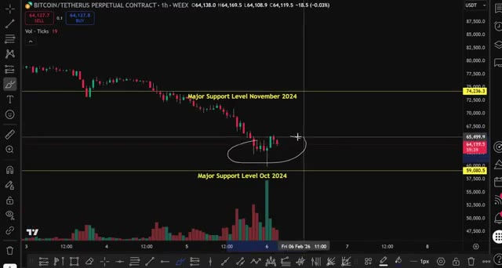
*⏱️ 00:05:41 — Graphique en bougies 1h du contrat perpétuel BTC/USDT montrant la zone de prix actuelle entourée en blanc entre les niveaux de support majeurs ("Major Support Level November 2024" à 74 236,3 $ et "Major Support Level Oct 2024" à 59 080,5 $).*

---

### ⏱️ `[00:06:05 - 00:06:42]` | Segment #13

**🔊 Audio (Transcription Intégrale Mot pour Mot en Français) :**
> Oui, ce crash a l'air effrayant sur les graphiques à court terme, mais quand on dézoome, nous sommes toujours dans un marché haussier. La liquidité mondiale continue d'augmenter. Le Bitcoin et l'Ethereum ont simplement été à la traîne, et c'est en réalité haussier car cela signifie que nous avons de la marge pour rattraper notre retard. Mes objectifs prudents pour ce cycle sont toujours de 5 000 à 7 000 pour l'Ethereum et de 100 000 à 120 000 pour le Bitcoin, et honnêtement, je ne serais pas surpris que l'on voie l'ETH à 10 000 avant la fin du cycle. Mais tout dépend du maintien de ces niveaux de support clés. Si nous perdons les 1 800 $ sur l'ETH ou les 60 000 $ sur le Bitcoin, alors oui, nous pourrions avoir besoin de réévaluer la situation.

**👁️ Analyse Visuelle d'Écran (gemini-3.5-flash-lite) :**
**Interface & Outils** : Présentation ou face-caméra explicatif du trader sans interface logicielle partagée.

**Contenu textuel & Code** : Explications orales des stratégies et mise en contexte méthodologique du marché.

**Action / Démonstration** : Explications face caméra et analyse conceptuelle des marchés.

---

### ⏱️ `[00:06:43 - 00:07:03]` | Segment #14

**🔊 Audio (Transcription Intégrale Mot pour Mot en Français) :**
> But as long as we hold, I'm extremely bullish. So here's the bottom line. This crypto crash is not the end. It's an opportunity. History is repeating itself. And if you understand the pattern, you know exactly what's coming next. Start accumulating spot on Bybit. If you're a trading futures, use 2-bit with proper risk management. Both exchanges are linked down below.

**👁️ Analyse Visuelle d'Écran (gemini-3.5-flash-lite) :**
**Interface & Outils** : Présentation ou face-caméra explicatif du trader sans interface logicielle partagée.

**Contenu textuel & Code** : Explications orales des stratégies et mise en contexte méthodologique du marché.

**Action / Démonstration** : Explications face caméra et analyse conceptuelle des marchés.

---

### ⏱️ `[00:07:04 - 00:07:29]` | Segment #15

**🔊 Audio (Transcription Intégrale Mot pour Mot en Français) :**
> Watch those key support levels. And most importantly, do not panic. The smart money is accumulating right now while everyone else is panicking. And in a few weeks, when Ethereum is back at $2,500 and Bitcoin is back at $75,000, you're going to be glad you acted when others were afraid. If you found this video helpful, smash that like button, subscribe to the channel, and drop a comment below telling me what you're buying in this dip.

**👁️ Analyse Visuelle d'Écran (gemini-3.5-flash-lite) :**
**Interface & Outils** : Présentation ou face-caméra explicatif du trader sans interface logicielle partagée.

**Contenu textuel & Code** : Explications orales des stratégies et mise en contexte méthodologique du marché.

**Action / Démonstration** : Explications face caméra et analyse conceptuelle des marchés.

---

### ⏱️ `[00:07:29 - 00:07:33]` | Segment #16

**🔊 Audio (Transcription Intégrale Mot pour Mot en Français) :**
> I'll see you in the next video. Stay safe out there, and remember, this is your opportunity.

**👁️ Analyse Visuelle d'Écran (gemini-3.5-flash-lite) :**
**Interface & Outils** : Présentation ou face-caméra explicatif du trader sans interface logicielle partagée.

**Contenu textuel & Code** : Explications orales des stratégies et mise en contexte méthodologique du marché.

**Action / Démonstration** : Explications face caméra et analyse conceptuelle des marchés.

---

