# 🎬 How I Made OpenClaw AI Trade Crypto For Me 24/7 (Step-By-Step Guide)

> **Chaîne** : [Alex Carter](https://www.youtube.com/@AlexCarterTrading)  
> **Lien YouTube** : [https://www.youtube.com/watch?v=PshrkEjf2kA](https://www.youtube.com/watch?v=PshrkEjf2kA)  
> **Date de publication** : 20260220  
> **Durée** : 00:06:29  
> **Identifiant vidéo** : `PshrkEjf2kA`  
> **Transcription & Analyse** : `whisper-v3-large-turbo+gemini-3.5-flash-lite`  

---

## 📌 Synthèse Exécutive & Outils

### 💡 Résumé
Cette vidéo présentée par Alex Carter expose une méthode de trading algorithmique entièrement automatisée basée sur l'utilisation d'OpenClaw, un agent IA d'un genre nouveau. Contrairement aux chatbots traditionnels comme ChatGPT ou Claude, limités à la génération de texte ou de code statique, OpenClaw se distingue par sa capacité d'exécution autonome : il écrit, teste, déploie et gère du code en temps réel tout en interagissant directement avec les marchés financiers. La démonstration illustre la transition du trader d'un rôle d'exécutant à un rôle de superviseur stratégique, exploitant la puissance du machine learning et de l'automatisation pour éliminer l'intervention émotionnelle humaine sur les marchés des cryptomonnaies 24h/24 et 7j/7.

Le cœur de la stratégie repose sur le déploiement d'agents IA capables de concevoir, backtester et faire tourner des stratégies de trading en parallèle sur des plateformes de produits dérivés comme Blowfin, via des clés API sécurisées. La vidéo met en lumière un concept de sélection naturelle des algorithmes : lancer simultanément plusieurs bots aux logiques, cadres temporels (Timeframes) et paramètres distincts, pour n'allouer du capital qu'aux structures s'étant avérées rentables après une phase d'évaluation empirique. De plus, l'intégration des signaux de trading de TradingView via des webhooks permet de coupler des scripts techniques personnalisés à une exécution automatisée instantanée.

Enfin, l'approche globale démontre l'importance capitale d'une rigueur absolue en matière de gestion du risque (Risk Management), soulignant des configurations de levier maîtrisées, des objectifs de Take Profit (TP) et de Stop Loss (SL) stricts, ainsi que des mesures de sécurité indispensables comme la désactivation des permissions de retrait sur les clés API. Cette synergie entre agents autonomes, indicateurs techniques et infrastructure d'échange moderne offre un aperçu concret et actionnable de ce que sera le trading quantitatif accessible aux particuliers à l'ère de l'intelligence artificielle agentique.

### 🛠️ Outils, Modèles & Logiciels Présentés
- **OpenClaw** : Agent IA orienté développeur capable d'écrire, d'exécuter du code, de s'interfacer avec des API d'échanges et de gérer des stratégies de trading de manière totalement autonome.
- **Blowfin** : Plateforme d'échange de cryptomonnaies utilisée pour l'exécution des ordres en direct, offrant des bonus de dépôt et une configuration sans KYC strict.
- **TradingView** : Logiciel de graphisme et d'analyse technique de référence utilisé pour concevoir des stratégies visuelles et envoyer des alertes automatisées via webhooks.
- **Claude Code / Grok Bots** : Outils d'assistance au codage et à l'analyse mentionnés pour l'ingénierie et l'élaboration des logiques algorithmiques sous-jacentes.
- **Pine Script** : Langage de programmation propriétaire de TradingView dédié à la création d'indicateurs et de stratégies de backtesting automatisés.

### 🔑 Points Clés & Enseignements Stratégiques
- **Supériorité des agents IA exécutables** : Contrairement aux LLM classiques, OpenClaw ne se limite pas à des conseils théoriques ; il installe ses propres dépendances, rédige du code exécutable et interagit de manière proactive avec les marchés.
- **Architecture de sécurité des API** : Lors de la connexion à un exchange, il est impératif d'activer les permissions de trading tout en désactivant strictement les autorisations de retrait pour prémunir les fonds contre toute faille ou mauvaise manipulation.
- **Contexte utilisateur initial** : Avant d'initialiser OpenClaw, fournir un contexte exhaustif (objectifs, appétence au risque, expérience, avantages concurrentiels) optimise drastiquement la pertinence des stratégies générées.
- **Évolution et sélection naturelle des stratégies** : Lancer un parc de plusieurs bots en parallèle (par exemple, 5 agents avec 100 dollars chacun) sur une période test permet d'éliminer les algorithmes perdants et de concentrer le capital uniquement sur les plus rentables.
- **Automatisation du suivi de tendance** : Utilisation d'instructions en langage naturel pour commander à l'IA de concevoir des stratégies de suivi de tendance (ex. Bitcoin en unité de temps 1 heure) basées sur des données historiques sur 30 jours.
- **Exécution d'ordres granulaires** : Capacité à dicter des ordres précis intégrant directement la taille de position, l'effets de levier (ex. levier x5), le Take Profit à 3 % et le Stop Loss à 1 %.
- **Analyse macro et structurelle automatisée** : Possibilité de demander à l'agent d'analyser en temps réel un graphique (ex. BTC en 4 heures) pour identifier si le marché évolue en range ou en tendance prononcée avant de se positionner.
- **Intégration transparente avec TradingView** : Connexion des alertes techniques de TradingView vers OpenClaw via des webhooks pour déclencher instantanément des positions longues ou courtes sur l'exchange sans latence humaine.
- **Scalabilité 24h/24 et 7j/7** : Le principal avantage de l'automatisation par agent réside dans la couverture permanente des marchés crypto, capturant des opportunités de scalping et de swing trading de nuit comme de jour.
- **Gestion rigoureuse du capital initial** : Recommandation d'utiliser des réseaux rapides et économiques (comme TRC20 pour l'USDT) pour l'approvisionnement des comptes de trading automatisés afin de minimiser les frais de transaction.

---

## ⏱️ Chronologie & Transcription Complète Audio & Visuelle (Mot pour Mot)

### ⏱️ `[00:00:00 - 00:00:21]` | Segment #01

**🔊 Audio (Transcription Intégrale Mot pour Mot en Français) :**
> Dans cette vidéo, je vais vous montrer comment j'utilise OpenClaw pour automatiser mon trading de cryptomonnaies. Et je vais être franc avec vous, c'est absolument insensé. Ça élabore des stratégies, les teste et fait du trading 24h/24 et 7j/7 sans que je n'aie à surveiller. Alors restez bien là, car je vais vous montrer exactement comment configurer tout cela et le connecter à votre plateforme d'échange. Commençons.

**👁️ Analyse Visuelle d'Écran (gemini-3.5-flash-lite) :**
**Interface & Outils** : Tableau de bord OpenClaw, interface de terminal/code source, graphique de trading BloFin

**Contenu textuel & Code** : Tableau des agents de trading, tableau de résultats de backtest (Return, Win%, PF, MaxDD, Alpha), graphique de prix Bitcoin avec chandeliers 4h

**Action / Démonstration** : Présentation du tableau de bord des agents, exécution d'un backtest de stratégie et visualisation du graphique de marché crypto

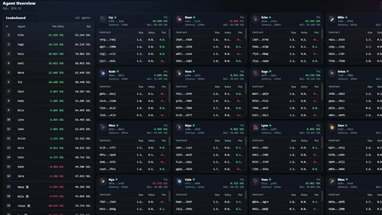
*⏱️ 00:00:05 — Vue d'ensemble d'un tableau de bord affichant plusieurs agents de trading automatisés avec leurs performances et soldes en temps réel.*

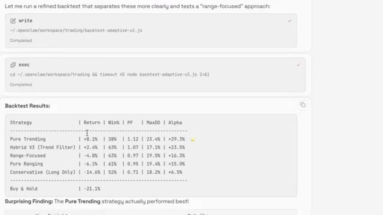
*⏱️ 00:00:10 — Interface de terminal affichant les résultats d'un backtest de différentes stratégies de trading automatisées avec leurs rendements.*

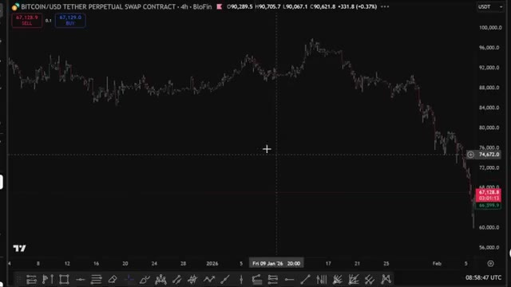
*⏱️ 00:00:15 — Graphique en chandeliers japonais de Bitcoin (BTC/USDT) en unité de temps 4 heures sur la plateforme BloFin.*

---

### ⏱️ `[00:00:21 - 00:00:58]` | Segment #02

**🔊 Audio (Transcription Intégrale Mot pour Mot en Français) :**
> Très bien, alors qu'est-ce que c'est exactement qu'OpenClaw ? Voilà le truc, OpenClaw n'est pas juste un autre chatbot. C'est ce qu'on appelle un agent IA. Ça veut dire qu'il peut réellement faire des choses, pas seulement parler. Les IA classiques comme ChatGPT ou Claude, elles peuvent vous donner des conseils, écrire du code, répondre à des questions, mais elles ne peuvent rien exécuter concrètement. Elles vous donnent juste des informations et ça s'arrête là. OpenClaw est complètement différent. Il peut écrire du code, exécuter ce code, installer les paquets logiciels dont il a besoin, et le plus important pour nous, il peut se connecter directement aux API des exchanges, analyser les marchés, tester des stratégies et trader automatiquement 24 heures sur 24, 7 jours sur 7.

**👁️ Analyse Visuelle d'Écran (gemini-3.5-flash-lite) :**
**Interface & Outils** : Navigateur web affichant la documentation OpenClaw et l'interface de ChatGPT.

**Contenu textuel & Code** : Lignes de commande d'installation (`curl -fsSL https://openclaw.ai/install.sh`), spécifications techniques d'agents IA, prompts pour stratégies quantitatives et métriques de backtest (taux de réussite, rendement, positions SHORT).

**Action / Démonstration** : Présentation des capacités de l'agent IA OpenClaw et affichage de prompts et résultats de backtest de stratégies de trading.

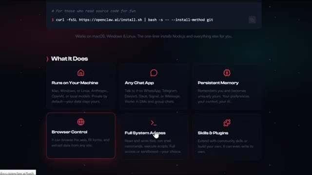
*⏱️ 00:00:30 — Page de documentation officielle de OpenClaw montrant les fonctionnalités principales de l'agent IA (exécution locale, applications de chat, mémoire persistante, contrôle du navigateur, accès complet au système et compétences/plugins).*

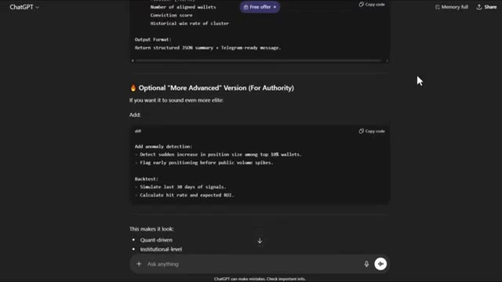
*⏱️ 00:00:40 — Interface de ChatGPT affichant des instructions de configuration de stratégie de trading, incluant la détection d'anomalies, le backtest sur 30 jours et le calcul du taux de réussite.*

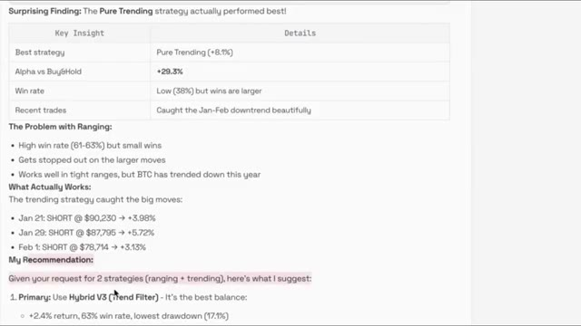
*⏱️ 00:00:49 — Rapport de performance textuel affichant les résultats d'une stratégie de trading ('Pure Trending' avec +8.1% et Alpha vs Buy&Hold de +29.3%) ainsi que des recommandations de stratégies hybrides.*

---

### ⏱️ `[00:00:59 - 00:01:33]` | Segment #03

**🔊 Audio (Transcription Intégrale Mot pour Mot en Français) :**
> Et il faut que vous compreniez, cela change littéralement tout. Les personnes qui s'adaptent au trading par IA dès le début vont avoir un avantage massif. Celles qui l'ignorent vont se faire dépasser. Bon, alors, première chose à faire, vous devez télécharger OpenClaw. Rendez-vous sur openclaw.ai et vous verrez la page de téléchargement juste ici. Gardez bien à l'esprit qu'OpenClaw est un outil axé sur les développeurs, donc le processus d'installation peut être un peu technique. Vous devrez suivre les instructions sur leur site web en fonction de votre système d'exploitation. Ils ont des versions pour Mac, Linux et Windows.

**👁️ Analyse Visuelle d'Écran (gemini-3.5-flash-lite) :**
**Interface & Outils** : Navigateur web, site officiel OpenClaw (openclaw.ai), interfaces de ligne de commande (PowerShell, terminal Bash).

**Contenu textuel & Code** : Commandes d'installation rapide d'OpenClaw (`iwr -useb https://openclaw.ai/install.ps1 | iex` et `curl -fsSL https://openclaw.ai/install.sh | bash`), logs d'installation du package npm.

**Action / Démonstration** : Présentation du processus d'installation et de téléchargement de l'outil OpenClaw mentionné dans l'audio.

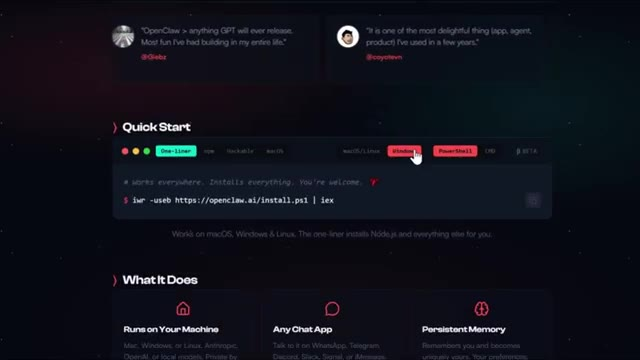
*⏱️ 00:01:16 — Page web d'OpenClaw montrant la section Quick Start avec les scripts d'installation rapide (PowerShell).*

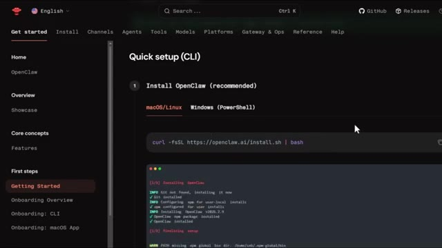
*⏱️ 00:01:24 — Documentation officielle d'OpenClaw présentant le guide d'installation rapide en ligne de commande (CLI) avec un terminal intégré.*

---

### ⏱️ `[00:01:34 - 00:02:06]` | Segment #04

**🔊 Audio (Transcription Intégrale Mot pour Mot en Français) :**
> Il suffit de cliquer sur votre système d'exploitation et de suivre le guide d'installation. Une fois que vous l'aurez installé et qu'il fonctionnera, vous verrez une interface qui ressemble à une fenêtre de chat, semblable à ChatGPT, mais avec beaucoup plus de puissance sous le capot. Maintenant, voici mon conseil avant même de cliquer sur le bouton d'achat ou de commencer l'installation. Notez tout ce qui vous intéresse. Votre expérience en trading, vos objectifs, les stratégies que vous aimez, l'avantage que vous avez, tout cela. Parce que plus vous donnez de contexte à OpenClaw au départ, mieux il pourra travailler pour vous. Pour qu'OpenClaw puisse réellement trader pour vous, il doit se connecter à votre exchange

**👁️ Analyse Visuelle d'Écran (gemini-3.5-flash-lite) :**
**Interface & Outils** : Tableau de bord OpenClaw (Gateway Dashboard) avec menu latéral de navigation.

**Contenu textuel & Code** : Page de chat nommée "Chat" avec la description "Direct gateway chat session for quick interventions" et un sélecteur d'agent (agent:main:main).

**Action / Démonstration** : Navigation et présentation de l'interface utilisateur d'OpenClaw semblable à une fenêtre de chat.

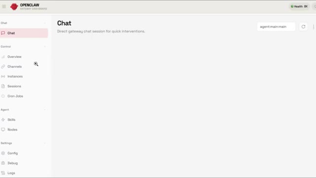
*⏱️ 00:01:42 — Interface du tableau de bord OpenClaw affichant une section de chat direct pour les interventions rapides.*

---

### ⏱️ `[00:02:06 - 00:02:38]` | Segment #05

**🔊 Audio (Transcription Intégrale Mot pour Mot en Français) :**
> compte via une API. Et l'échange que j'utilise pour cela est Blowfin. Si vous n'avez pas encore de compte Blowfin ? Cliquez sur le lien dans la description ci-dessous. Vous obtiendrez jusqu'à 5 USDT rien qu'en vous inscrivant, plus jusqu'à 30 USDT de bonus lorsque vous effectuez un dépôt. Étape 1. Créez votre compte Bluffin et déposez. Allez sur Bluffin, inscrivez-vous avec votre e-mail et faites votre premier dépôt. Je recommande d'utiliser TRC20 pour l'USDT car c'est rapide et les frais sont très bas. Étape 2. Générez votre API

**👁️ Analyse Visuelle d'Écran (gemini-3.5-flash-lite) :**
**Interface & Outils** : Interface web de l'échange de cryptomonnaies BloFin (pages d'inscription et Rewards Hub).

**Contenu textuel & Code** : Offres promotionnelles et bonus de bienvenue : 5 USDT à l'inscription, bonus de dépôt jusqu'à 30 USDT, et récompenses pour le trading et le copy trading.

**Action / Démonstration** : Présentation des étapes pour s'inscrire sur l'échange BloFin et bénéficier des bonus de parrainage et de dépôt.

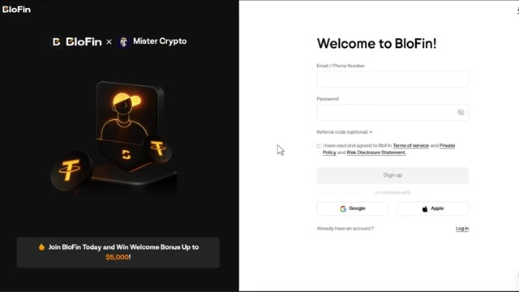
*⏱️ 00:02:14 — Page d'inscription de la plateforme BloFin avec des champs pour l'e-mail/téléphone et le mot de passe.*

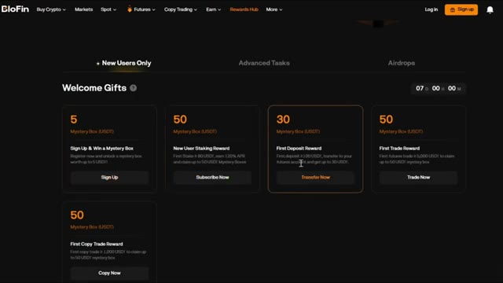
*⏱️ 00:02:22 — Page du centre de récompenses (Rewards Hub) de BloFin montrant les différents bonus de bienvenue (Mystery Box de 5 USDT, bonus de dépôt de 30 USDT, etc.).*

---

### ⏱️ `[00:02:38 - 00:03:14]` | Segment #06

**🔊 Audio (Transcription Intégrale Mot pour Mot en Français) :**
> clés. Maintenant, allez dans les paramètres de votre compte et cliquez sur API. Cliquez sur créer une nouvelle clé API et donnez-lui un nom, quelque chose comme open claw trading. Vous verrez le nom de votre application, votre clé API et éventuellement une phrase de passe selon les paramètres. Gardez bien à l'esprit que ces clés sont extrêmement sensibles. Ne les partagez jamais avec personne. Voici une astuce intelligente pour configurer cela. Activez les autorisations de trading, mais laissez les autorisations de retrait désactivées. De cette façon, même si quelque chose tourne mal, vos fonds ne pourront pas être retirés. Cliquez sur suivant et enregistrez votre clé API et votre clé secrète dans un endroit sûr comme un gestionnaire de mots de passe.

**👁️ Analyse Visuelle d'Écran (gemini-3.5-flash-lite) :**
**Interface & Outils** : Interface web de l'échange Blofin (section API Management)

**Contenu textuel & Code** : Formulaire de création de clé API comprenant l'usage, le nom de l'application, le nom de la clé API (OpenClawTrading), les permissions et le champ de phrase de passe.

**Action / Démonstration** : Saisie du nom de la clé API pour configurer l'accès programmatique sur Blofin.

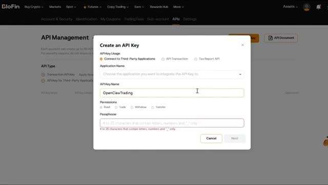
*⏱️ 00:02:47 — Fenêtre de création d'une clé API sur la plateforme Blofin avec le nom 'OpenClawTrading' saisi.*

---

### ⏱️ `[00:03:15 - 00:03:48]` | Segment #07

**🔊 Audio (Transcription Intégrale Mot pour Mot en Français) :**
> Troisième étape, connectez OpenClaw à Blowfin. Ouvrez maintenant OpenClaw et vous allez lui donner une consigne pour vous connecter à votre compte Blowfin. Voici la consigne exacte que vous allez utiliser. Je veux que tu te connectes à mon compte sur l'échange Blowfin en utilisant ces clés API. Une fois fait, vérifie le solde de mon compte pour que je puisse voir que tu as réellement accès à mon compte. Et c'est aussi simple que ça, OpenClaw est maintenant connecté à votre échange et prêt à trader. Quatrième étape, commencez à trader. Vous pouvez maintenant lui donner des commandes comme ouvrir une position acheteuse sur le Bitcoin avec 10 dollars en utilisant un effet de levier de cinq fois. Définissez un objectif de take profit à 3 % et un stop loss.

**👁️ Analyse Visuelle d'Écran (gemini-3.5-flash-lite) :**
**Interface & Outils** : Éditeur de texte / Google Docs et plateforme de trading Blofin.

**Contenu textuel & Code** : Texte du prompt avec clé API Wallet Address et Private Key, graphique de prix BTCUSDT, carnet d'ordres.
[DESC_IMAGE_1] Présentation du prompt pour connecter OpenClaw à l'échange Blofin.
[DESC_IMAGE_2] Affichage de l'interface de l'échange Blofin pour illustrer le compte connecté.

**Action / Démonstration** : Explications face caméra et analyse conceptuelle des marchés.

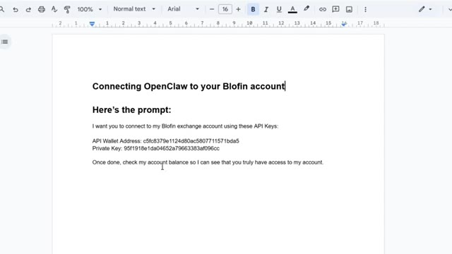
*⏱️ 00:03:23 — Un éditeur de texte affichant le prompt exact pour connecter OpenClaw au compte Blofin avec les clés API.*

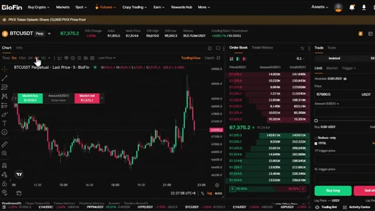
*⏱️ 00:03:40 — L'interface de trading de la plateforme Blofin affichant le graphique du BTCUSDT Perpetuel, le carnet d'ordres et le panneau de passage d'ordres.*

---

### ⏱️ `[00:03:48 - 00:04:23]` | Segment #08

**🔊 Audio (Transcription Intégrale Mot pour Mot en Français) :**
> à 1 %. OpenClaw exécutera cet échange immédiatement sur votre compte Blofen. Vous pouvez également lui demander d'analyser le marché. Analysez l'évolution actuelle du cours du Bitcoin sur le graphique de quatre heures. Dites-moi si nous sommes dans un marché en tendance ou en range et suggérez si je dois me positionner à l'achat, à la vente, ou rester à l'écart. Ou vous pouvez créer des stratégies automatisées. Créez une stratégie simple de suivi de tendance pour le Bitcoin sur le graphique d'une heure. Testez-la en utilisant les données des 30 derniers jours, puis planifiez-la pour qu'elle s'exécute automatiquement toutes les heures. C'est là que ça devient insensé. OpenClaw va écrire le code, tester la stratégie,

**👁️ Analyse Visuelle d'Écran (gemini-3.5-flash-lite) :**
**Interface & Outils** : Traitement de texte (Google Docs ou équivalent).

**Contenu textuel & Code** : Texte affiché : "Analyzing Market" et la question "Analyze the current Bitcoin price action on the 4-hour chart. Tell me if we're in a trending or ranging market, and suggest whether I should go long, short, or stay out".

**Action / Démonstration** : Saisie ou affichage du prompt textuel destiné à l'assistant de trading.

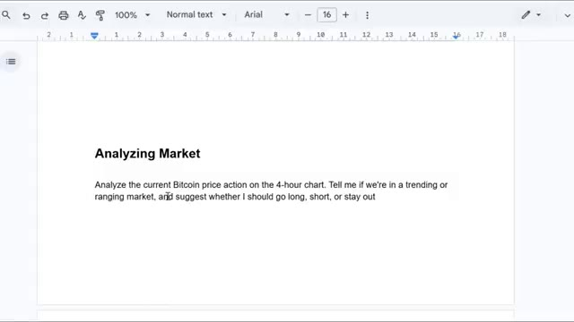
*⏱️ 00:03:57 — Un document texte affichant le prompt de la requête d'analyse de marché pour le Bitcoin.*

---

### ⏱️ `[00:04:23 - 00:04:58]` | Segment #09

**🔊 Audio (Transcription Intégrale Mot pour Mot en Français) :**
> vous montrer les résultats, puis de le programmer pour qu'il tourne 24 heures sur 24 et 7 jours sur 7 sans que vous ayez à le surveiller. L'une des meilleures choses que je fais en ce moment, c'est que je fais tourner plusieurs stratégies en parallèle, comme une compétition entre différents agents IA. Vous pouvez faire cela en disant à Open Claw, crée cinq stratégies de trading Bitcoin différentes avec des paramètres, des cadres temporels et une logique différents. Faites tourner les cinq stratégies en parallèle avec 100 dollars chacune. Après une semaine, analysez quelles stratégies sont rentables et lesquelles perdent de l'argent. Arrêtez celles qui ne sont pas rentables et laissez les gagnantes continuer à tourner. C'est fondamentalement

**👁️ Analyse Visuelle d'Écran (gemini-3.5-flash-lite) :**
**Interface & Outils** : Tableau de bord de suivi d'agents de trading et traitement de texte.

**Contenu textuel & Code** : Classement des agents (Echo, Sage, Voss, etc.) avec leurs performances en SOL, et texte descriptif de la stratégie de trading multi-agents.

**Action / Démonstration** : Présentation du système de compétition entre différents agents d'intelligence artificielle tournant en parallèle.

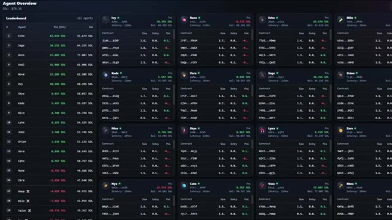
*⏱️ 00:04:32 — Capture d'écran montrant un tableau de bord (Agent Overview) avec un classement (Leaderboard) de plusieurs agents de trading IA en compétition.*

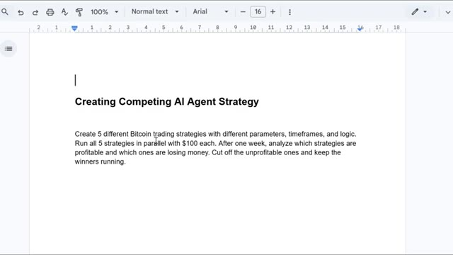
*⏱️ 00:04:41 — Document texte numérique affichant le titre "Creating Competing AI Agent Strategy" décrivant la logique de création de stratégies en parallèle.*

---

### ⏱️ `[00:04:58 - 00:05:32]` | Segment #10

**🔊 Audio (Transcription Intégrale Mot pour Mot en Français) :**
> évolution des stratégies de trading. Les meilleures surviennent, les plus faibles sont éliminées, et avec le temps, je me retrouve avec un portefeuille de stratégies hautement rentables. Maintenant, si vous avez déjà des stratégies sur TradingView que vous aimez, vous pouvez connecter OpenClaw à TradingView en utilisant des webhooks. Voici comment cela fonctionne. Lorsque votre stratégie TradingView déclenche une alerte, comme un signal d'entrée ou de sortie, le webhook avertit automatiquement OpenClaw et il exécute le trade sur votre compte Blofin. Pour configurer cela, donnez simplement une instruction à OpenClaw comme ceci : crée un webhook pour mon

**👁️ Analyse Visuelle d'Écran (gemini-3.5-flash-lite) :**
**Interface & Outils** : Tableau de bord propriétaire de gestion d'agents de trading et interface graphique de TradingView.

**Contenu textuel & Code** : Classement des agents (Echo, Sage, Voss, etc.) avec leurs soldes et PnL en SOL, ainsi qu'une boîte de dialogue de création d'alerte configurée en JSON (`{"text": "BTCUSD Greater Than 9000"}`).

**Action / Démonstration** : Présentation du portefeuille de stratégies de trading automatisées performantes suivie d'une démonstration de configuration d'alerte Webhook sur TradingView.

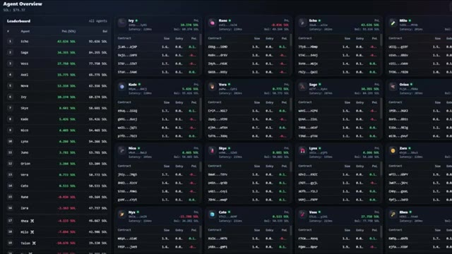
*⏱️ 00:05:07 — Tableau de bord « Agent Overview » montrant un classement (Leaderboard) et une grille de suivi des différents agents de trading automatisés avec leurs performances en PnL.*

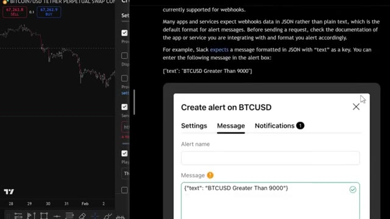
*⏱️ 00:05:23 — Interface de configuration d'alerte TradingView sur une paire BTCUSD, avec un champ de message JSON pour les webhooks.*

---

### ⏱️ `[00:05:32 - 00:06:05]` | Segment #11

**🔊 Audio (Transcription Intégrale Mot pour Mot en Français) :**
> alertes TradingView. Lorsque je reçois un signal d'entrée, exécute un trade long sur mon compte Blofin. Lorsque je reçois un signal de sortie, ferme la position. OpenClaw génère l'URL du webhook et il vous suffit de la coller dans les paramètres de vos alertes TradingView. Désormais, vos stratégies TradingView sont entièrement automatisées. Et c'est tout les amis. C'est ainsi que j'utilise OpenClaw pour automatiser mon trading de cryptomonnaies, de la simple exécution de trade à l'utilisation de plusieurs agents IA en compétition les uns avec les autres. Si vous souhaitez commencer avec Blofin et réclamer ces bonus, cliquez sur le lien tout en haut de la description.

**👁️ Analyse Visuelle d'Écran (gemini-3.5-flash-lite) :**
**Interface & Outils** : Document texte, interface de configuration TradingView, tableau de bord d'agents de trading.

**Contenu textuel & Code** : URL de webhook OpenClaw (c5fc8379e1124d80ac5807711571bda5), paramètres de notification TradingView (Webhook URL, Play sound), classement des agents avec PnL (SOL).

**Action / Démonstration** : Saisie d'une URL de webhook dans les paramètres d'alerte TradingView et affichage d'un tableau de bord de suivi d'agents.

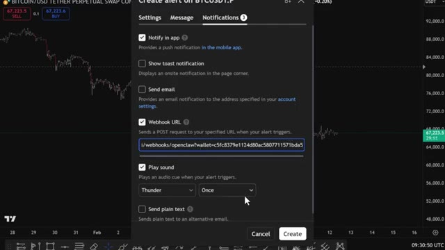
*⏱️ 00:05:48 — Fenêtre de création d'alerte TradingView affichant l'onglet "Notifications" avec le champ "Webhook URL" renseigné.*

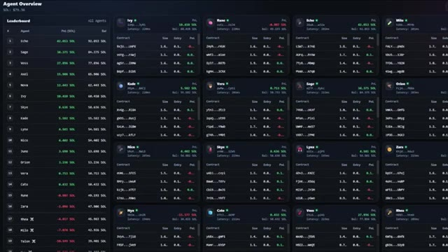
*⏱️ 00:05:57 — Tableau de bord "Agent Overview" affichant un classement d'agents de trading avec leurs métriques de PnL et soldes.*

---

### ⏱️ `[00:06:05 - 00:06:28]` | Segment #12

**🔊 Audio (Transcription Intégrale Mot pour Mot en Français) :**
> Remember, you get up to $5,000 in bonuses just for signing up and depositing and it's completely no KYC. If you want more details on how OpenClaw and Blowfin's platform works, check out the videos popping on screen right now for a full walkthrough. If you enjoyed this video, don't forget to leave a thumbs up and subscribe to my channel for more crypto tutorials. I'll see you in the next one.

**👁️ Analyse Visuelle d'Écran (gemini-3.5-flash-lite) :**
**Interface & Outils** : Plateforme d'échange de cryptomonnaies BloFin (site web)

**Contenu textuel & Code** : Offres de bonus, récompenses de premier dépôt, boîtes mystères en USDT et promotions exclusives de trading.

**Action / Démonstration** : Navigation sur la plateforme BloFin pour présenter les bonus d'inscription et le hub de récompenses.

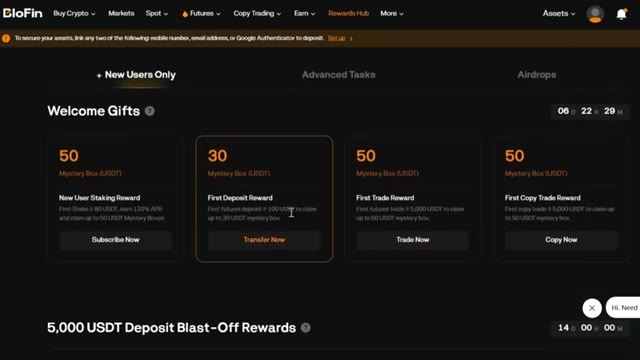
*⏱️ 00:06:11 — Interface de la plateforme BloFin affichant la section 'Rewards Hub' et les cadeaux de bienvenue pour les nouveaux utilisateurs.*

*⏱️ 00:06:17 — Page d'accueil de la plateforme BloFin avec le slogan 'BloFin - Where Whales are Made' et le bouton 'Trade Now'.*

---

