# 🎬 My Easy and Simple Fibonacci Strategy That Makes $100 Per Day

> **Chaîne** : [Alex Carter](https://www.youtube.com/@AlexCarterTrading)  
> **Lien YouTube** : [https://www.youtube.com/watch?v=RtkWSMUBimg](https://www.youtube.com/watch?v=RtkWSMUBimg)  
> **Date de publication** : 20260222  
> **Durée** : 00:09:44  
> **Identifiant vidéo** : `RtkWSMUBimg`  
> **Transcription & Analyse** : `whisper-v3-large-turbo+gemini-3.5-flash-lite`  

---

## 📌 Synthèse Exécutive & Outils

### 💡 Résumé
Cette vidéo de la chaîne Alex Carter propose une méthode de scalping de crypto-actifs sur dérivés (visant environ 100 dollars par jour) basée sur une utilisation rigoureuse et confluente du retracement de Fibonacci. Loin d'utiliser Fibonacci de manière isolée — erreur commise par la majorité des débutants —, l'analyste démontre comment filtrer les mouvements de prix avec l'indicateur des fractales (réglé à une période de 10) pour identifier des sommets et des creux de swing fiables sur des unités de temps courtes (notamment le graphique en 5 minutes).

Le cœur de la stratégie repose sur le concept de la « zone dorée », située entre les niveaux de Fibonacci 0,382 et 0,618. Pour transformer cette zone en un signal à très haute probabilité, la méthodologie exige l'alignement de quatre confluences techniques majeures : le retracement dans la zone dorée, un retest de niveau de support ou de résistance (ancien pivot cassé), la présence de la Moyenne Mobile Exponentielle (EMA) à 200 périodes, et l'utilisation d'un VWAP ancré positionné au point d'origine de la tendance. 

Enfin, la vidéo aborde l'aspect opérationnel en présentant des plateformes de trading de crypto-dérivés adaptées (Blowfin et Mexi) et pose des bases strictes de *Risk Management*. L'utilisation de la marge isolée, le placement méthodique du stop-loss sous le niveau 0,618 de Fibonacci, et la fixation d'objectifs via un ratio risque-rendement de 1:2 ou 1:3 permettent d'encadrer rigoureusement chaque position acheteuse ou vendeuse.

---

### 🛠️ Outils, Modèles & Logiciels Présentés
* **TradingView** : Plateforme de graphitage incontournable utilisée pour configurer les indicateurs techniques, tracer les niveaux de Fibonacci et analyser l'action des prix en temps réel.
* **Retracement de Fibonacci** : Outil d'analyse technique configuré avec les niveaux clés (0, 0,382, 0,5, 0,618, 1) pour anticiper les replis et la continuation des tendances de marché.
* **Indicateur de Fractales** : Outil de détection de sommets et creux configuré ici sur une période de 10 pour filtrer le bruit de marché et identifier les points de swing majeurs.
* **Moyenne Mobile Exponentielle (EMA 200)** : Indicateur de tendance à long terme jouant un rôle de support ou de résistance dynamique fort au sein de la zone de confluence.
* **VWAP Ancré** : Indicateur de volume et de prix moyen pondéré ancré au début d'une forte impulsion haussière ou baissière pour repérer des zones dynamiques de rebond.
* **Blowfin** : Exchange de crypto-dérivés principal recommandé pour son absence de KYC obligatoire sur les comptes basiques et ses bonus incitatifs pour nouveaux utilisateurs.
* **Mexi** : Plateforme alternative de trading offrant un large choix de paires et une flexibilité entre CEX et perpétuels décentralisés (avec vérification KYC rapide).
* **Claude Code** : Outil d'assistance en intelligence artificielle et automatisation mentionné dans le positionnement d'analyse quantitatif de la chaîne.
* **Grok Bots** : Assistants conversationnels et agents d'IA utilisés pour le développement et l'optimisation de scripts de trading algorithmique.
* **Pine Script** : Langage de programmation propriétaire de TradingView dédié à la création d'indicateurs et de stratégies automatisées sur mesure.

---

### 🔑 Points Clés & Enseignements Stratégiques
* **Sélection de l'unité de temps** : Privilégier le graphique en 5 minutes ou 15 minutes pour le scalping rapide, tout en sachant que la logique de Fibonacci s'applique jusqu'au TF 4 heures.
* **Maîtrise de la « Zone Dorée »** : Concentrer toute l'attention sur la zone comprise entre les niveaux 0,382 et 0,618 de Fibonacci, reconnue comme la zone statistique optimale de retournement et de continuation.
* **Filtrage par les Fractales** : Ajuster la période de l'indicateur de fractales à 10 pour éliminer les fluctuations erratiques et isoler uniquement les swing lows et swing highs pertinents.
* **Tracé méthodique de Fibonacci** : Toujours relier le fractal rouge (le plus bas d'une forte impulsion haussière) au fractal vert (le plus haut) pour tracer correctement le retracement.
* **Confluence des 4 indicateurs** : Ne valider un trade que lorsque la zone dorée de Fibonacci coïncide simultanément avec un retest de support/résistance, l'EMA 200 et le VWAP ancré.
* **Validation par l'action des prix** : Attendre l'apparition d'une figure de chandelier japonais de rebond (comme un chandelier haussier de confirmation) à l'intérieur de la zone dorée avant d'exécuter l'entrée.
* **Gestion du risque par la Marge Isolée** : Utiliser systématiquement la marge isolée sur les plateformes de dérivés pour cloisonner le risque à un seul trade et éviter la liquidation du portefeuille global.
* **Effet de levier mesuré** : Limiter l'effet de levier entre 5x et 10x pour les débutants, le temps d'assimiler la volatilité des crypto-monnaies sur les graphiques à court terme.
* **Placement chirurgical du Stop-Loss** : Positionner l'ordre de stop-loss juste en dessous de la zone dorée (généralement sous le niveau critique de 0,618) pour invalider rapidement le scénario en cas de cassure.
* **Ratio Risque-Rendement (RRR)** : Viser des objectifs de take profit situés au sommet précédent du mouvement ou appliquer un ratio strict de 1:2 ou 1:3 pour garantir la rentabilité à long terme.
* **Phase d'entraînement obligatoire** : Tester et valider la stratégie sur un compte de simulation (paper trading) avant d'engager le moindre capital réel sur les marchés dérivés.
* **Optimisation des bonus de plateforme** : Profiter des programmes de bienvenue et des volumes de dépôt sur Blowfin ou Mexi pour maximiser le capital initial de trading sans risque additionnel.

---

## ⏱️ Chronologie & Transcription Complète Audio & Visuelle (Mot pour Mot)

### ⏱️ `[00:00:00 - 00:00:26]` | Segment #01

**🔊 Audio (Transcription Intégrale Mot pour Mot en Français) :**
> In this video, I'm going to show you how to use Fibonacci retracement the right way, because most traders are using it completely wrong and losing money. This is a simple high probability strategy that beginners are using to make around $100 per day trading crypto derivatives. It works on the five minute chart and higher timeframes. And I'm going to break down every single step from drawing your fib levels correctly to timing your entries perfectly.

**👁️ Analyse Visuelle d'Écran (gemini-3.5-flash-lite) :**
**Interface & Outils** : TradingView

**Contenu textuel & Code** : Paramètres de l'indicateur "Auto Fib Retracement" avec les niveaux de Fibonacci (0, 0.382, 0.618, etc.), graphiques en chandeliers de Bitcoin/USDT, volume en bas de l'écran.

**Action / Démonstration** : Le curseur de la souris clique pour modifier ou configurer les niveaux de l'indicateur de retracement de Fibonacci.

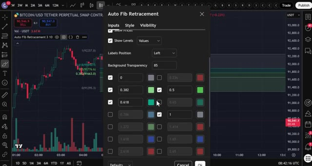
*⏱️ 00:00:07 — Fenêtre de configuration de l'indicateur Auto Fib Retracement par-dessus un graphique en chandeliers japonais affichant le cours du Bitcoin.*

---

### ⏱️ `[00:00:26 - 00:00:45]` | Segment #02

**🔊 Audio (Transcription Intégrale Mot pour Mot en Français) :**
> So make sure you watch until the end. All right, guys, step number one, choosing the right crypto exchange. For this strategy, we're going to be using Blowfin as our primary platform. Blowfin doesn't require mandatory KYC verification for basic trading, which means you can start trading immediately.

**👁️ Analyse Visuelle d'Écran (gemini-3.5-flash-lite) :**
**Interface & Outils** : Navigateur web affichant l'échange de cryptomonnaies BloFin et un site de revue spécialisé (Crypto Vanguards).

**Contenu textuel & Code** : Tableau des bonus de dépôt BloFin (de 30$ à 1000$ selon le montant) et texte confirmant l'absence de KYC obligatoire sur BloFin.

**Action / Démonstration** : Présentation de la plateforme BloFin et de ses conditions d'utilisation sans vérification d'identité (KYC).

*⏱️ 00:00:31 — Page d'inscription de la plateforme BloFin avec un tableau des bonus de dépôt affiché à gauche.*

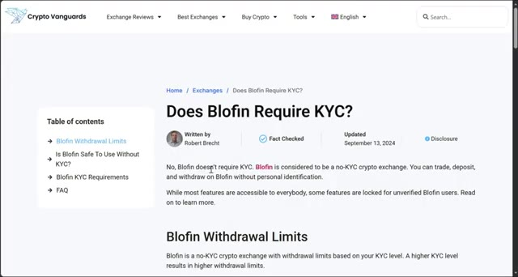
*⏱️ 00:00:40 — Article du site Crypto Vanguards répondant à la question "Does Blofin Require KYC?".*

---

### ⏱️ `[00:00:45 - 00:01:07]` | Segment #03

**🔊 Audio (Transcription Intégrale Mot pour Mot en Français) :**
> Plus, new users can earn up to 5,000 USDT through deposit and trading volume bonuses. Now, if you want an alternative with even more trading pairs and the ability to toggle between centralized exchange features and decentralized perpetuals trading, you can use Mexi. They're offering up to 10,000 USDT in bonuses for new users right now.

**👁️ Analyse Visuelle d'Écran (gemini-3.5-flash-lite) :**
**Interface & Outils** : BloFin, MEXC (interface de trading et DEX/Airdrop).

**Contenu textuel & Code** : Bonus de dépôt (5 000 USDT), paires de trading perpétuelles USDT-M, carnets d'ordres, liquidité et capitalisation boursière de tokens Solana.

**Action / Démonstration** : Navigation et présentation des interfaces de courtage et des programmes de bonus/airdrops pour les nouveaux utilisateurs.

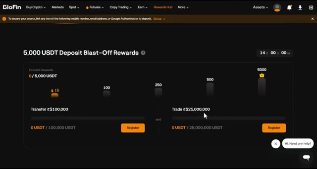
*⏱️ 00:00:51 — Interface de la plateforme BloFin montrant le programme de récompenses "5,000 USDT Deposit Blast-Off Rewards".*

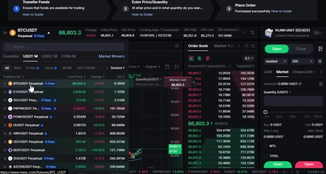
*⏱️ 00:00:56 — Interface de trading de la plateforme MEXC affichant les paires de contrats perpétuels (BTCUSDT, ETHUSDT) et le carnet d'ordres.*

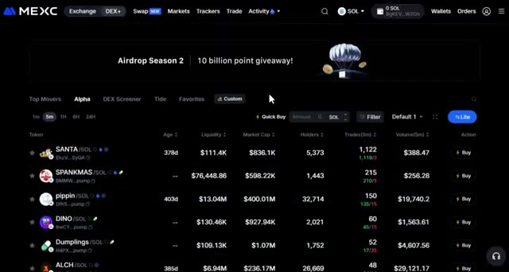
*⏱️ 00:01:01 — Tableau de bord MEXC affichant la section "Airdrop Season 2" avec la liste des tokens (SANTA/SOL, SPANKMAS/SOL, etc.) et leurs métriques.*

---

### ⏱️ `[00:01:07 - 00:01:39]` | Segment #04

**🔊 Audio (Transcription Intégrale Mot pour Mot en Français) :**
> Both platforms work perfectly for this strategy, so choose whichever fits your needs. To sign up for Blofen, click the first link in the description. You'll be taken to the signup page where you simply enter your details and create an account. no KYC needed you can start trading right away if you prefer Mexi use the second link below you will need to complete quick KYC verification on Mexi but it's fast and secure personally I have accounts on both platforms depending on what I'm trading step number two is depositing funds let me

**👁️ Analyse Visuelle d'Écran (gemini-3.5-flash-lite) :**
**Interface & Outils** : Site web de l'échange BloFin (page de création de compte et promotion des bonus).

**Contenu textuel & Code** : Formulaire d'inscription (Email/Téléphone, Mot de passe, code de parrainage) et tableau des bonus (de 30$ à 1 000$ selon le montant du dépôt en USDT).

**Action / Démonstration** : Présentation de la page d'inscription de la plateforme BloFin et des bonus de dépôt associés.

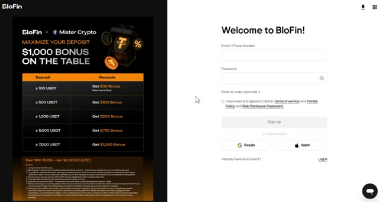
*⏱️ 00:01:15 — Page d'inscription de l'échange BloFin avec un tableau des bonus de dépôt affiché sur le côté gauche.*

---

### ⏱️ `[00:01:39 - 00:02:00]` | Segment #05

**🔊 Audio (Transcription Intégrale Mot pour Mot en Français) :**
> show you how to do this quickly before we jump into the strategy once you're logged into your platform click assets at the top right then choose overview Once you're on the overview page, click on deposit. Choose the coin you want to deposit. I recommend USDT and select the correct blockchain network. Make sure you choose the right network to avoid losing your funds.

**👁️ Analyse Visuelle d'Écran (gemini-3.5-flash-lite) :**
**Interface & Outils** : Interface web de l'exchange de cryptomonnaies BloFin.

**Contenu textuel & Code** : Soldes de compte à zéro, sections Funding, Spot et Futures, et options de gestion de portefeuille (Deposit, Buy Crypto, Withdraw, Transfer).

**Action / Démonstration** : Navigation sur la plateforme BloFin pour montrer comment accéder à la section des actifs et effectuer un dépôt.

*⏱️ 00:01:44 — Page d'accueil de la plateforme d'échange BloFin montrant le menu principal avec le bouton 'Assets' en haut à droite.*

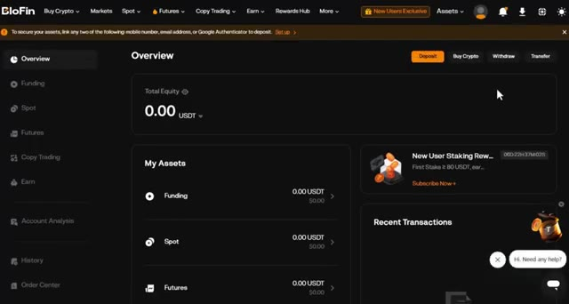
*⏱️ 00:01:50 — Page 'Overview' des actifs sur BloFin affichant un solde total de 0.00 USDT et les options de dépôt, retrait et transfert.*

---

### ⏱️ `[00:02:01 - 00:02:21]` | Segment #06

**🔊 Audio (Transcription Intégrale Mot pour Mot en Français) :**
> Confirmez les détails, puis scannez le code QR ou copiez l'adresse de dépôt pour transférer vos fonds depuis votre portefeuille ou un autre échange. Si vous souhaitez déposer en monnaie fiduciaire, cherchez l'option d'achat de crypto en haut du menu, puis sélectionnez l'achat rapide. Choisissez votre devise, entrez le montant, sélectionnez votre mode de paiement et cliquez sur continuer.

**👁️ Analyse Visuelle d'Écran (gemini-3.5-flash-lite) :**
**Interface & Outils** : Interfaces des plateformes d'échange Bybit et Blofin.

**Contenu textuel & Code** : Détails de retrait (TRC20, frais de 1 USDT), cours des cryptomonnaies (BTC, ETH, SOL, XRP) et interface d'achat par carte bancaire (Visa/Mastercard).

**Action / Démonstration** : Navigation sur la plateforme Blofin et démonstration des options de dépôt et d'achat de crypto en monnaie fiduciaire.

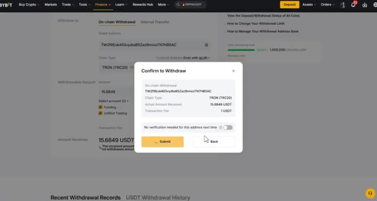
*⏱️ 00:02:06 — Fenêtre de confirmation de retrait sur Bybit montrant les détails de la transaction (adresse, réseau TRON, montant et frais).*

*⏱️ 00:02:11 — Page d'accueil de la plateforme Blofin mettant en avant le programme exclusif pour les nouveaux utilisateurs et les récompenses.*

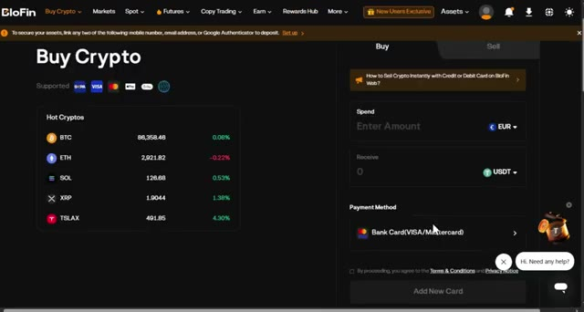
*⏱️ 00:02:16 — Interface « Buy Crypto » sur Blofin permettant d'acheter des cryptomonnaies par carte bancaire avec conversion en EUR/USDT.*

---

### ⏱️ `[00:02:21 - 00:02:41]` | Segment #07

**🔊 Audio (Transcription Intégrale Mot pour Mot en Français) :**
> Une fois vos fonds déposés, il est temps d'ouvrir une position. L'étape numéro trois consiste à ouvrir votre première position. Survolez l'onglet « futures » dans le menu supérieur, puis sélectionnez « USDT-M futures ». Cela vous mènera à l'interface de trading où toute la magie opère. Choisissez l'actif que vous souhaitez négocier dans le coin supérieur gauche.

**👁️ Analyse Visuelle d'Écran (gemini-3.5-flash-lite) :**
**Interface & Outils** : Plateforme d'échange de cryptomonnaies Blofin (interface web et interface de trading futures).

**Contenu textuel & Code** : Paires de trading (BTCUSDT Perpetual), prix en temps réel (91,114.9), options de menu (Futures, USDT-M Futures, Spot, etc.), carnet d'ordres et panneau d'achat/vente (Buy long / Sell short).

**Action / Démonstration** : Navigation dans les menus de la plateforme Blofin pour sélectionner l'option USDT-M futures et accéder à l'interface de trading.

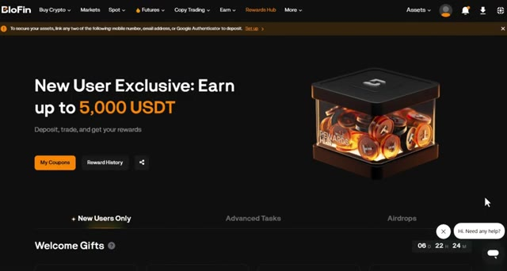
*⏱️ 00:02:26 — Page d'accueil de la plateforme Blofin affichant l'onglet "Rewards Hub" et les options de menu supérieur.*

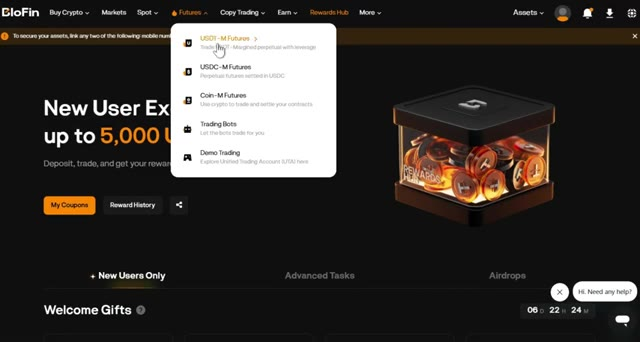
*⏱️ 00:02:31 — Menu déroulant sur la plateforme Blofin montrant l'option "USDT-M Futures" survolée par le curseur.*

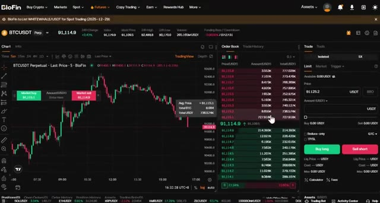
*⏱️ 00:02:36 — Interface de trading de contrats futures BTCUSDT sur Blofin, avec le graphique en chandeliers, le carnet d'ordres et le panneau de passage d'ordres.*

---

### ⏱️ `[00:02:41 - 00:03:18]` | Segment #08

**🔊 Audio (Transcription Intégrale Mot pour Mot en Français) :**
> Pour cet exemple, je vais utiliser Bitcoin, BTC slash USDT, mais cette stratégie fonctionne sur n'importe quelle paire crypto. Après cela, sélectionnez votre type d'ordre, limite ou marché. Pour les débutants, je recommande de commencer par des ordres au marché pour une exécution instantanée. Ensuite, choisissez votre type de levier. Vous pouvez utiliser la marge croisée ou la marge isolée. Personnellement, j'utilise toujours la marge isolée car elle limite votre risque à cette position spécifique seulement. Si le trade tourne mal, vous perdez seulement ce que vous avez mis dans le trade. Vous pouvez utiliser un effet de levier élevé sur ces plateformes, mais pour les débutants, je recommande de commencer par un levier de cinq à dix fois jusqu'à ce que vous soyez à l'aise avec les mouvements du marché.

**👁️ Analyse Visuelle d'Écran (gemini-3.5-flash-lite) :**
**Interface & Outils** : Blofin (plateforme d'échange de crypto-monnaies - section Futures).

**Contenu textuel & Code** : Paire BTCUSDT Perpétuel, graphique en chandeliers 5 minutes, carnet d'ordres en temps réel, options de types d'ordres (Limit, Market, Trigger) et modes de marge (Cross, Isolated).

**Action / Démonstration** : Sélection du type d'ordre (Market) et du mode de marge pour configurer une position sur le Bitcoin.

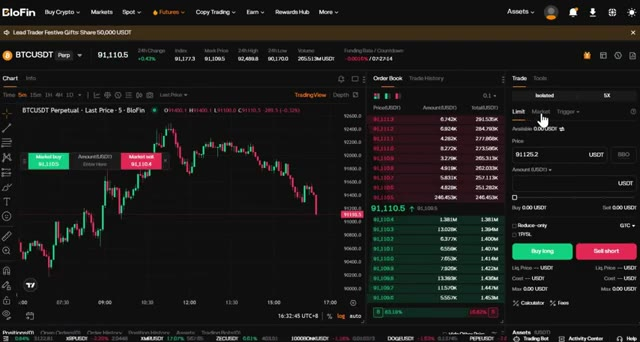
*⏱️ 00:02:50 — Interface de trading Blofin affichant le graphique BTCUSDT et le panneau de passage d'ordres avec sélection entre Limit et Market.*

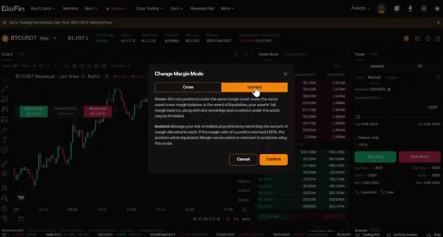
*⏱️ 00:03:00 — Fenêtre modale "Change Margin Mode" sur Blofin permettant de basculer entre Cross et Isolated.*

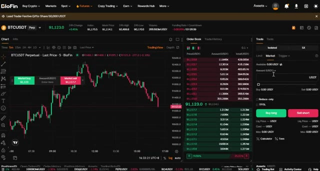
*⏱️ 00:03:09 — Interface de trading Blofin centrée sur le panneau de saisie du montant pour un ordre au marché.*

---

### ⏱️ `[00:03:18 - 00:03:47]` | Segment #09

**🔊 Audio (Transcription Intégrale Mot pour Mot en Français) :**
> Entrez les détails de votre trade, vérifiez que tout est correct, puis cliquez sur acheter (long) ou vendre (short) pour ouvrir votre position. Une fois vos ordres exécutés, vous pouvez les voir sous l'onglet des positions en bas de l'écran. Maintenant que vous savez comment naviguer sur la plateforme, passons à la stratégie proprement dite qui peut vous faire gagner 100 dollars par jour. Très bien les gars, c'est là que ça devient excitant. Cette stratégie utilise l'outil de retracement de Fibonacci combiné à des indicateurs techniques clés pour identifier des points d'entrée à forte probabilité.

**👁️ Analyse Visuelle d'Écran (gemini-3.5-flash-lite) :**
**Interface & Outils** : BloFin, TradingView

**Contenu textuel & Code** : Paire BTCUSDT Perp, prix du marché à 86,551.6, carnet d'ordres, panneau d'exécution d'ordres (Buy long / Sell short), tableau des positions ouvertes avec levier 5X et prix de liquidation.

**Action / Démonstration** : Exécution d'un ordre d'achat (long) sur Bitcoin et vérification de la position ouverte dans l'onglet dédié en bas de l'interface.

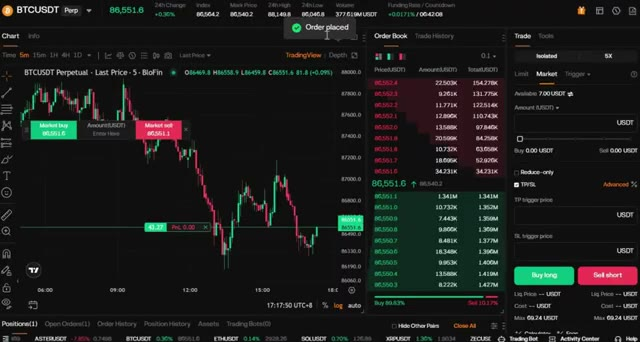
*⏱️ 00:03:25 — Interface de trading BloFin affichant un graphique de prix BTCUSDT avec une notification de confirmation d'ordre "Order placed".*

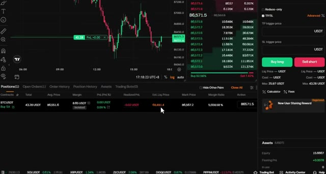
*⏱️ 00:03:32 — Vue de l'onglet des positions ouvertes en bas de l'écran sur BloFin montrant la position BTCUSDT active (Buy 5X).*

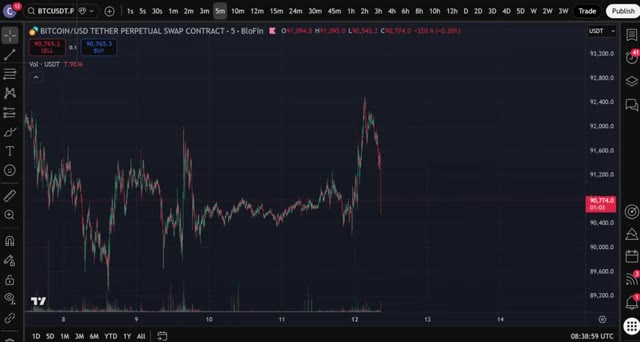
*⏱️ 00:03:40 — Graphique TradingView intégré montrant l'évolution du contrat perpétuel Bitcoin/USD sur l'exchange BloFin.*

---

### ⏱️ `[00:03:47 - 00:04:08]` | Segment #10

**🔊 Audio (Transcription Intégrale Mot pour Mot en Français) :**
> Les traders utilisent Fibonacci depuis des années pour identifier les niveaux de support et de résistance, et les informations recueillies vous aident à placer des ordres au bon moment. Identifiez les niveaux de stop loss et définissez des objectifs de prix précis. Tout d'abord, rendez-vous sur TradingView. J'ai un lien dans la description qui vous offre une réduction si vous voulez la version premium. Choisissez la paire de trading que vous souhaitez trader.

**👁️ Analyse Visuelle d'Écran (gemini-3.5-flash-lite) :**
**Interface & Outils** : Plateforme de trading intégrée (type TradingView / interface de courtier BloFin).

**Contenu textuel & Code** : Paire BITCOIN/USD TETHER PERPETUAL SWAP CONTRACT, indicateur "Auto Fib Retracement 3 10", niveaux de Fibonacci (1, 0.786, 0.618, 0.5, 0.382, 0.236, 0) avec les prix associés, et volumes en bas de graphique.

**Action / Démonstration** : Analyse technique d'une baisse des cours de Bitcoin à l'aide des niveaux de support et résistance de Fibonacci.

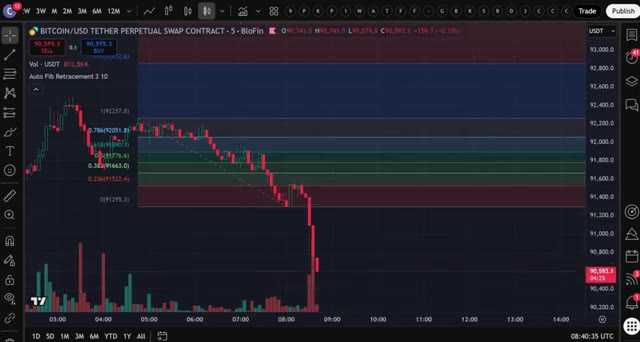
*⏱️ 00:03:52 — Graphique en chandeliers japonais illustrant l'indicateur de retracement de Fibonacci automatique sur une paire crypto.*

---

### ⏱️ `[00:04:09 - 00:04:42]` | Segment #11

**🔊 Audio (Transcription Intégrale Mot pour Mot en Français) :**
> Pour cet exemple, j'utilise Bitcoin contre USDT. Configurez votre graphique sur l'unité de temps de cinq minutes. C'est parfait pour les trades de scalping rapides. Mais rappelez-vous, cette stratégie fonctionne sur n'importe quelle unité de temps, de cinq minutes jusqu'au graphique de quatre heures. Allez dans l'onglet des indicateurs tout en haut, tapez retracement de Fibonacci, et sélectionnez l'outil Fibonacci standard. Maintenant, voici quelque chose de vraiment important. Le marché évolue par schémas. Vous verrez une grande tendance haussière ou baissière, puis un repli ou retracement, et enfin une continuation. L'outil de retracement de Fibonacci

**👁️ Analyse Visuelle d'Écran (gemini-3.5-flash-lite) :**
**Interface & Outils** : TradingView (intégré à la plateforme Blofin)

**Contenu textuel & Code** : Paire BTC/USDT en unité de temps 5m, affichant le cours actuel autour de 90 750 $ et le volume des transactions en bas de graphique.

**Action / Démonstration** : Configuration du graphique sur l'unité de temps de 5 minutes pour illustrer la stratégie de scalping sur Bitcoin.

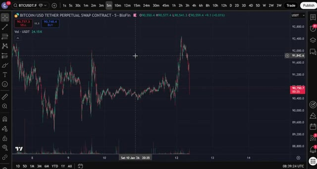
*⏱️ 00:04:17 — Graphique en chandeliers japonais du contrat perpétuel Bitcoin/USD sur l'unité de temps de 5 minutes.*

---

### ⏱️ `[00:04:42 - 00:05:04]` | Segment #12

**🔊 Audio (Transcription Intégrale Mot pour Mot en Français) :**
> nous aide à prédire exactement où ce repli va se terminer, afin que nous puissions entrer au moment parfait et maximiser les gains tout en minimisant le risque. Cliquez sur les paramètres de Fibonacci et assurez-vous d'utiliser ces niveaux : 0, 0,382, 0,5, 0,618 et 1. Ce sont les niveaux de Fibonacci les plus importants.

**👁️ Analyse Visuelle d'Écran (gemini-3.5-flash-lite) :**
**Interface & Outils** : Interface de trading BioFin avec graphique de prix intégré (style TradingView).

**Contenu textuel & Code** : Niveaux de retracement de Fibonacci affichés (0, 0.236, 0.382, 0.5, 0.618, 0.786, 1), volumes de transactions en bas, et paires de devises BITCOIN/USD TETHER PERPETUAL SWAP CONTRACT.

**Action / Démonstration** : Analyse technique du repli du marché du Bitcoin à l'aide des niveaux de Fibonacci et des zones de support/résistance.

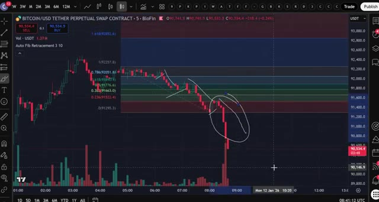
*⏱️ 00:04:48 — Graphique en chandeliers japonais illustrant le contrat perpétuel Bitcoin/USD sur l'échange BioFin, avec l'utilisation de l'outil de retracement de Fibonacci pour analyser la baisse des prix.*

---

### ⏱️ `[00:05:05 - 00:05:39]` | Segment #13

**🔊 Audio (Transcription Intégrale Mot pour Mot en Français) :**
> La zone entre 0,382 et 0,618 est appelée la zone dorée. C'est là que le prix a le plus de chances de se retourner et de continuer dans la direction de la tendance initiale. Maintenant, une erreur fréquente que font les traders est de ne pas savoir où placer l'outil de Fibonacci. Pour y remédier, nous allons utiliser les fractales. Retournez dans l'onglet des indicateurs, tapez fractales, et sélectionnez l'indicateur. Vous verrez des flèches vertes pour les fractales haussières et des flèches rouges pour les fractales baissières. Mais vous remarquerez qu'il y a trop de fractales qui s'affichent. Pour ne filtrer que les principaux points de retournement, cliquez sur l'indicateur de fractales.

**👁️ Analyse Visuelle d'Écran (gemini-3.5-flash-lite) :**
**Interface & Outils** : Interface de trading BloFin / graphique type TradingView.

**Contenu textuel & Code** : Paire BITCOIN/USD TETHER PERPETUAL SWAP CONTRACT, indicateur Auto Fib Retracement avec les niveaux 0 (91295.3), 0.382 (91663.0), 0.5 (91776.6), 0.618 (91890.1) et 1 (92257.8).

**Action / Démonstration** : Analyse technique illustrant le placement du retracement de Fibonacci et la zone dorée (Golden Zone) lors d'une tendance baissière.

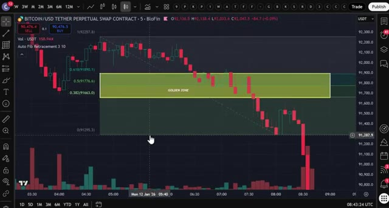
*⏱️ 00:05:14 — Graphique en chandeliers japonais du Bitcoin (BTC/USD) sur BloFin affichant l'outil de retracement de Fibonacci avec la « GOLDEN ZONE » mise en évidence en jaune entre les niveaux 0.382 et 0.618.*

---

### ⏱️ `[00:05:39 - 00:06:13]` | Segment #14

**🔊 Audio (Transcription Intégrale Mot pour Mot en Français) :**
> paramètres et changez les périodes à 10. Maintenant, vous ne verrez plus que les points de swing les plus forts. Concentrez-vous sur les tendances fortes. N'utilisez pas ceci sur une action de prix faible et saccadée. Une fois que vous repérez une forte tendance haussière, utilisez l'outil de retracement de Fibonacci pour la marquer du fractal rouge, le bas, au fractal vert, le haut. Vous verrez la zone dorée apparaître sur votre graphique. Lorsque le prix retrace dans cette zone, c'est votre signal pour chercher une entrée. Mais nous n'avons pas terminé. Pour rendre cette stratégie encore plus puissante, nous devons ajouter de la confluence. Cherchez des niveaux de support et de résistance qui s'alignent avec le

**👁️ Analyse Visuelle d'Écran (gemini-3.5-flash-lite) :**
**Interface & Outils** : Plateforme de trading BloFin (TradingView intégré).

**Contenu textuel & Code** : Graphique en chandeliers (bougies vertes et rouges), volumes en bas, niveaux de retracement de Fibonacci (Auto Fib Retracement 3 10), et une "Golden Zone" surlignée en jaune.

**Action / Démonstration** : Analyse technique du cours du Bitcoin et affichage des niveaux de retracement de Fibonacci avec la zone dorée.

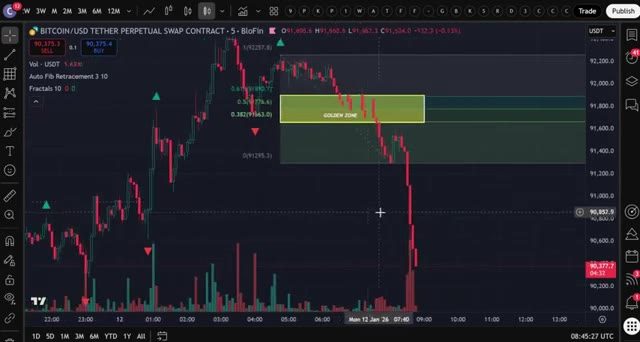
*⏱️ 00:05:48 — Un graphique en chandeliers japonais montrant le contrat perpétuel Bitcoin/USD sur BloFin, avec l'indicateur Auto Fib Retracement et une zone dorée ("Golden Zone").*

---

### ⏱️ `[00:06:13 - 00:06:44]` | Segment #15

**🔊 Audio (Transcription Intégrale Mot pour Mot en Français) :**
> zone dorée. Par exemple, si le prix franchit un niveau de résistance puis y revient, cette ancienne résistance agit désormais comme un support. C'est ce qu'on appelle un retest. Si ce niveau de retest se situe dans la zone dorée, vous avez une forte confirmation pour votre trade. Ensuite, allez dans l'onglet des indicateurs, tapez EMA et sélectionnez la moyenne mobile exponentielle. Cliquez sur les paramètres et changez la longueur à 200. La moyenne mobile exponentielle à 200 sur des unités de temps plus grandes agit comme un niveau fort de support et de résistance.

**👁️ Analyse Visuelle d'Écran (gemini-3.5-flash-lite) :**
**Interface & Outils** : Graphique TradingView intégré à l'interface de l'exchange BloFin (unité de temps 5 minutes).

**Contenu textuel & Code** : Contrat perpétuel BITCOIN/USD TETHER (BTC/USDT), indicateurs Auto Fib Retracement, Fractals, niveaux de support et zone dorée de Fibonacci.

**Action / Démonstration** : Analyse technique illustrant le franchissement d'un niveau de résistance devenu support (retest) dans la zone dorée de Fibonacci.

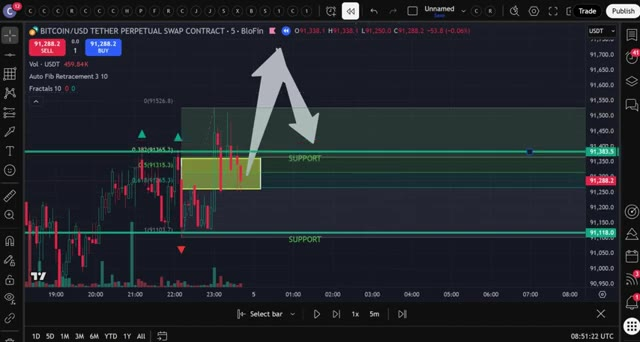
*⏱️ 00:06:21 — Graphique TradingView sur l'exchange BloFin montrant Bitcoin (BTC/USDT) avec des niveaux de Fibonacci, une zone dorée mise en évidence et des flèches illustrant le retest d'un support.*

---

### ⏱️ `[00:06:45 - 00:07:18]` | Segment #16

**🔊 Audio (Transcription Intégrale Mot pour Mot en Français) :**
> Dans une tendance haussière, le prix rebondit souvent sur la moyenne mobile exponentielle à 200 périodes comme support. Dans une tendance baissière, elle agit comme une résistance. Si la moyenne mobile exponentielle à 200 périodes se situe également dans votre zone dorée, c'est une couche de confirmation supplémentaire. Enfin, cliquez sur la barre d'outils de gauche, trouvez le VWAP ancré, et placez-le au début de votre forte tendance, juste là où se trouve le fractal rouge. Allez dans les paramètres, cliquez sur style, et décochez toutes les lignes supplémentaires afin de ne voir que la ligne VWAP principale. Le VWAP ancré fonctionne de manière similaire.

**👁️ Analyse Visuelle d'Écran (gemini-3.5-flash-lite) :**
**Interface & Outils** : Interface de trading TradingView (plateforme de graphiques financiers).

**Contenu textuel & Code** : Indicateurs techniques : EMA 200, Auto Fib Retracement, Fractals, et Anchored VWAP.

**Action / Démonstration** : Analyse graphique de la réaction du prix sur la moyenne mobile exponentielle à 200 périodes et configuration de l'indicateur VWAP ancré.

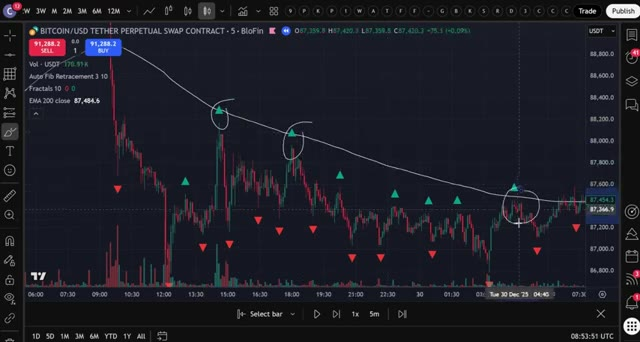
*⏱️ 00:06:53 — Graphique TradingView de Bitcoin montrant l'EMA 200 agissant comme une résistance dans une tendance baissière.*

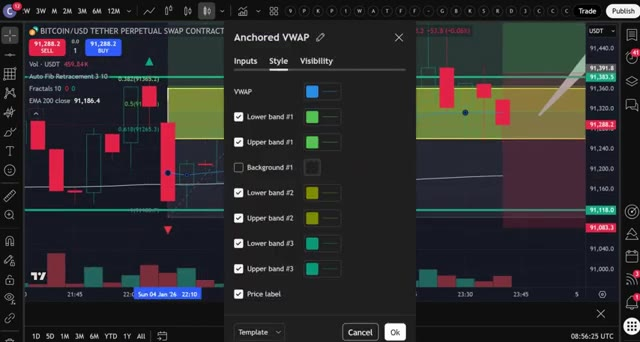
*⏱️ 00:07:10 — Interface de configuration des paramètres de l'indicateur Anchored VWAP par-dessus le graphique des prix.*

---

### ⏱️ `[00:07:18 - 00:07:56]` | Segment #17

**🔊 Audio (Transcription Intégrale Mot pour Mot en Français) :**
> à la EMA. Le prix a tendance à rebondir sur cette ligne et elle agit comme un support ou une résistance dynamique. Maintenant, vous avez quatre confluences puissantes. La zone dorée, le retest du support ou de la résistance, la EMA 200 et le VWAP ancré. Lorsque ces quatre éléments s'alignent, vous avez une configuration de trade à très forte probabilité. Laissez-moi vous montrer un exemple. Regardez ce fort mouvement haussier sur le graphique en cinq minutes. En utilisant les fractales, j'identifie le bas et le haut du mouvement et je dessine mon retracement de Fibonacci. La zone dorée apparaît juste ici. Maintenant, je vérifie : y a-t-il un retest de support ou de résistance ? Oui, le prix

**👁️ Analyse Visuelle d'Écran (gemini-3.5-flash-lite) :**
**Interface & Outils** : Interface de trading BloFin intégrée avec les graphiques et outils graphiques.

**Contenu textuel & Code** : Bitcoin/USD Tether Perpetual Swap, indicateurs Volume, Auto Fib Retracements, Fractals, et EMA 200 close.

**Action / Démonstration** : Analyse technique illustrant le rebond du prix sur les niveaux de support, la zone dorée et la moyenne mobile exponentielle 200.

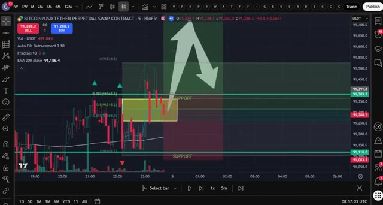
*⏱️ 00:07:28 — Graphique en chandelier du Bitcoin sur l'échange BloFin (unité de temps 5 minutes) montrant une zone de support dorée avec un retracement de Fibonacci et une flèche explicative.*

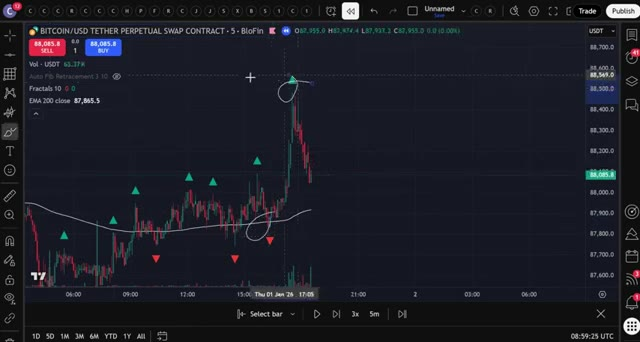
*⏱️ 00:07:47 — Graphique du cours du Bitcoin sur BloFin avec la moyenne mobile EMA 200, des indicateurs fractals et des annotations manuscrites sur le graphique.*

---

### ⏱️ `[00:07:56 - 00:08:30]` | Segment #18

**🔊 Audio (Transcription Intégrale Mot pour Mot en Français) :**
> a cassé ce niveau de résistance et maintenant il agit comme un support. Est-ce que la moyenne mobile exponentielle à 200 périodes s'aligne ? Oui, elle est juste dans la zone dorée. Est-ce que le VWAP ancré s'aligne ? Oui, il est aussi dans la zone dorée. Les quatre confluences sont présentes. C'est un signal d'entrée parfait. Voici comment exécuter le trade. Entrez votre position acheteuse lorsque le prix touche la zone dorée et montre des signes de rebond, comme une figure de chandelier haussière. Placez votre ordre stop loss juste en dessous de la zone dorée, généralement sous le niveau 0,618. Fixez votre take profit au sommet précédent du mouvement ou utilisez un

**👁️ Analyse Visuelle d'Écran (gemini-3.5-flash-lite) :**
**Interface & Outils** : Graphique TradingView intégré à la plateforme BloFin.

**Contenu textuel & Code** : Paire BITCOIN/USD TETHER PERPETUAL SWAP CONTRACT (intervalle de 5 minutes), indicateur Auto Fib Retracement 3 10, EMA 200 (réglée à 87,917.3), Fractals, et une zone de retracement de Fibonacci dorée surlignée en jaune (niveaux 0.382 à 0.618).

**Action / Démonstration** : Analyse de la confluence des indicateurs techniques, montrant le prix s'alignant avec la moyenne mobile exponentielle à 200 périodes et la zone dorée de Fibonacci.

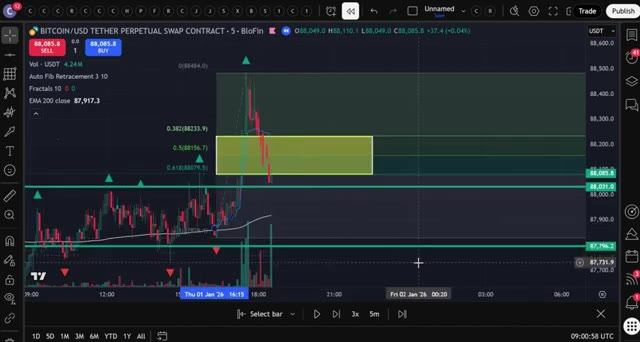
*⏱️ 00:08:05 — Graphique en chandeliers japonais du Bitcoin (BTC/USD) sur BloFin montrant l'analyse technique avec des niveaux de Fibonacci et la zone dorée.*

---

### ⏱️ `[00:08:30 - 00:09:04]` | Segment #19

**🔊 Audio (Transcription Intégrale Mot pour Mot en Français) :**
> un ratio risque-rendement de 2 pour 1 ou de 3 pour 1. Dans cet exemple, le prix rebondit parfaitement sur la zone dorée et s'envole pour atteindre notre objectif de profit. C'est un gain net de plus de 100 dollars selon la taille de votre position et votre effet de levier. Et les gars, si vous ne vous êtes pas encore inscrits, assurez-vous d'utiliser mes liens ci-dessous pour réclamer ces bonus. C'est littéralement de l'argent gratuit qui peut augmenter votre capital de trading. Et c'est ainsi que vous utilisez la stratégie de retracement de Fibonacci pour trouver des trades à haute probabilité et réaliser des profits réguliers en faisant du trading de produits dérivés cryptographiques. Cette stratégie fonctionne sur n'importe quelle unité de temps, mais personnellement, j'adore l'utiliser sur

**👁️ Analyse Visuelle d'Écran (gemini-3.5-flash-lite) :**
**Interface & Outils** : TradingView, BloFin, MEXC

**Contenu textuel & Code** : Auto Fib Retracement, Fractals 10, EMA 200, ratio risque/rendement (Risk/Reward Ratio: 1.99), niveaux de prix Bitcoin.

**Action / Démonstration** : Analyse d'un trade sur le Bitcoin montrant le rebond sur une zone dorée de Fibonacci et l'atteinte de l'objectif de profit.

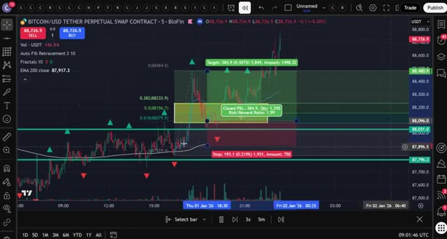
*⏱️ 00:08:39 — Graphique de trading en chandeliers montrant une position Bitcoin/USDT avec les niveaux de retracement de Fibonacci et un ratio risque/rendement validé.*

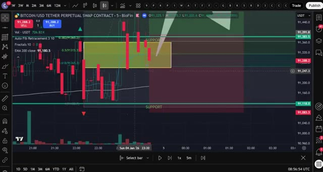
*⏱️ 00:08:56 — Graphique de trading montrant le cours du Bitcoin/USDT avec des zones de support et un indicateur technique de retracement de Fibonacci.*

---

### ⏱️ `[00:09:04 - 00:09:38]` | Segment #20

**🔊 Audio (Transcription Intégrale Mot pour Mot en Français) :**
> les graphiques de 5 minutes et de 15 minutes pour des scalps rapides tout au long de la journée. Assurez-vous de vous entraîner d'abord sur un compte de démonstration avant risquer de l'argent réel. Familiarisez-vous avec l'identification des tendances fortes, le tracé de vos niveaux de Fibonacci et le repérage de ces confluences. Et si vous voulez une présentation plus détaillée sur le fonctionnement de Blowfin ou de Mexi, incluant les fonctionnalités avancées, les taux de financement et la gestion des risques, consultez les guides complets de la plateforme que j'ai, les vidéos apparaissent sur l'écran en ce moment même, si vous avez trouvé cette vidéo utile, explosez ce bouton J'aime et abonnez-vous à la chaîne, je créerai encore plus de contenu avancé

**👁️ Analyse Visuelle d'Écran (gemini-3.5-flash-lite) :**
**Interface & Outils** : BloFin (interface Futures & Demo Trading), graphiques TradingView intégrés.

**Contenu textuel & Code** : BTCUSDT Perpetual, indicateur Auto Fib Retracement, EMA 200, carnet d'ordres (Order Book), outil de mesure de risque/rendement (Risk/Reward Ratio).

**Action / Démonstration** : Analyse technique et configuration de niveaux de Fibonacci sur le graphique en unités de 5 minutes pour la préparation de scalps.

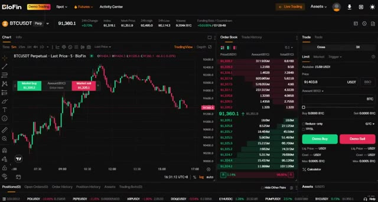
*⏱️ 00:09:13 — Interface de trading BloFin en mode compte démo montrant le graphique 5 minutes du Bitcoin (BTCUSDT) avec le carnet d'ordres et le panneau d'exécution.*

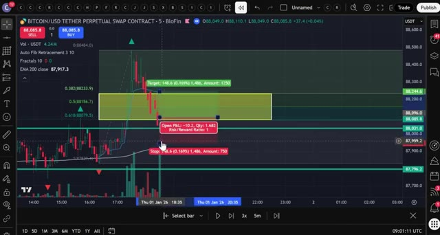
*⏱️ 00:09:21 — Graphique TradingView intégré montrant un contrat perpétuel Bitcoin avec des niveaux de retracement de Fibonacci, une moyenne mobile EMA 200 et un outil de gestion de position (Stop Loss / Take Profit).*

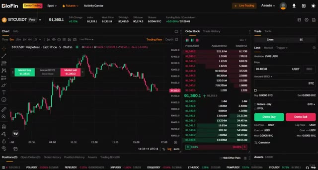
*⏱️ 00:09:30 — Interface de trading BloFin en mode compte démo affichant les données du marché en temps réel pour le BTCUSDT sur un graphique de 5 minutes.*

---

### ⏱️ `[00:09:38 - 00:09:46]` | Segment #21

**🔊 Audio (Transcription Intégrale Mot pour Mot en Français) :**
> stratégies et partager ma configuration de trading personnelle avec vous les gars merci d'avoir regardé et je vous vois dans la prochaine

**👁️ Analyse Visuelle d'Écran (gemini-3.5-flash-lite) :**
**Interface & Outils** : Aucune interface visible.

**Contenu textuel & Code** : Aucun contenu informatif ou technique affiché.

**Action / Démonstration** : Aucune action ou démonstration en cours.

---

