# 🎬 This is How I Trade Automatically 24/7 with OKX Trading Bots (Step-by-Step Guide)

> **Chaîne** : [Alex Carter](https://www.youtube.com/@AlexCarterTrading)  
> **Lien YouTube** : [https://www.youtube.com/watch?v=ipTa_xQaVsE](https://www.youtube.com/watch?v=ipTa_xQaVsE)  
> **Date de publication** : 20260224  
> **Durée** : 00:11:59  
> **Identifiant vidéo** : `ipTa_xQaVsE`  
> **Transcription & Analyse** : `whisper-v3-large-turbo+gemini-3.5-flash-lite`  

---

## 📌 Synthèse Exécutive & Outils

### 💡 Résumé
Dans cette vidéo intitulée **This is How I Trade Automatically 24/7 with OKX Trading Bots (Step-by-Step Guide)**, Alex Carter détaille une approche stratégique et pratique du trading et de l'automatisation par agents IA.

### 🛠️ Outils, Modèles & Logiciels Présentés
- **TradingView & Claude Code** : Analyse technique avancée et automatisation algorithmique.

### 🔑 Points Clés & Enseignements Stratégiques
- Respect rigoureux du ratio risque/rendement et du money management.
- Automatisation méthodique des déclencheurs d'ordres via des agents intelligents.

---

## ⏱️ Chronologie & Transcription Complète Audio & Visuelle (Mot pour Mot)

### ⏱️ `[00:00:00 - 00:00:38]` | Segment #01

**🔊 Audio (Transcription Intégrale Mot pour Mot en Français) :**
> Trading bots can trade crypto for you 24-7, automatically buying dips, selling peaks, and compounding gains while you sleep, work, or travel. In this video, I'll show you exactly how to set up and use every single trading bot on OKEx step-by-step. Whether you want to profit from choppy markets with grid trading, capture funding rate difference with smart arbitrage, or use Futures Martingale to turn your red positions into green automatically, I got you covered. By the end of this video, you'll know exactly which bot to use and how to get it running in just a few minutes. First things first, you need an OKEx account. If you don't have

**👁️ Analyse Visuelle d'Écran (gemini-3.5-flash-lite) :**
**Interface & Outils** : Plateforme d'échange de cryptomonnaies OKEx (Marketplace des bots et interface de trading spot).

**Contenu textuel & Code** : Statistiques de performance de bots (APR backtestés, PnL en pourcentage), paramètres de configuration de grille (fourchette de prix, quantité de grilles, montant d'investissement) et carnets d'ordres.

**Action / Démonstration** : Navigation et présentation des différentes catégories de bots de trading automatisés disponibles sur la plateforme OKEx.

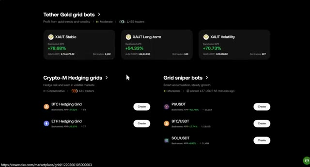
*⏱️ 00:00:09 — Capture d'écran du marché des bots sur OKEx montrant les stratégies de grille pour Tether Gold et les paires Crypto-M.*

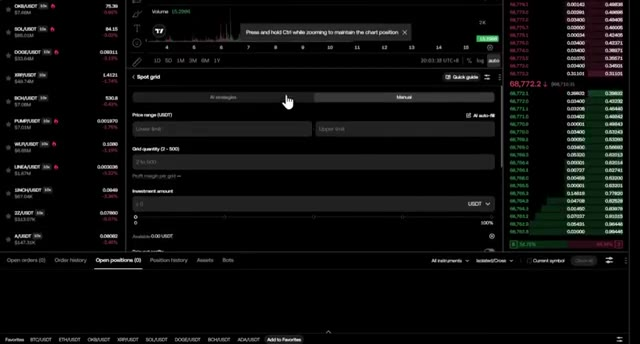
*⏱️ 00:00:19 — Interface de trading spot d'OKEx avec les paramètres de configuration d'un robot de grille (Spot grid) et le graphique des prix.*

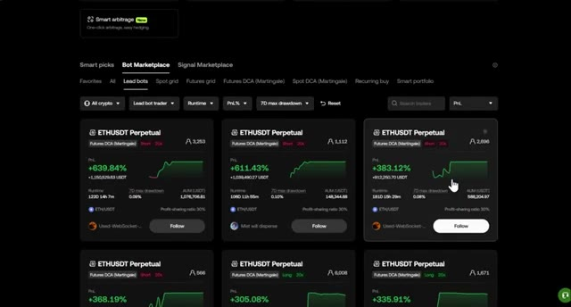
*⏱️ 00:00:28 — Vue de la place de marché des bots (Bot Marketplace) sur OKEx affichant les performances de robots de type Futures DCA (Martingale).*

---

### ⏱️ `[00:00:38 - 00:01:15]` | Segment #02

**🔊 Audio (Transcription Intégrale Mot pour Mot en Français) :**
> pas encore, cliquez sur le lien dans la description. Les nouveaux utilisateurs peuvent gagner jusqu'à 145 USDT de récompenses rien qu'en s'inscrivant et en franchissant des étapes simples comme votre premier échange ou la création de votre premier bot. Je vous montrerai exactement comment réclamer ces bonus à la fin de la vidéo. Une fois connecté, assurez-vous d'avoir des fonds sur votre compte. Survolez simplement les actifs, cliquez sur dépôt, sélectionnez USDT, et envoyez vos fonds. Ils arrivent généralement en quelques minutes et nous pourrons ensuite commencer l'automatisation. Maintenant, trouvons les bots. Survolez "Trader" dans le menu supérieur et, dans la section inférieure, cliquez sur "Bots de trading". C'est votre

**👁️ Analyse Visuelle d'Écran (gemini-3.5-flash-lite) :**
**Interface & Outils** : Échange de cryptomonnaies OKX (site web et application mobile).

**Contenu textuel & Code** : Soldes de compte en USDT (24,59 USDT), bonus de trading, étapes de quêtes pour nouveaux utilisateurs (premier trade, bot, copy trading, volume de 10 000 $).

**Action / Démonstration** : Navigation sur la plateforme OKX pour présenter les étapes de récompense et le solde du compte.

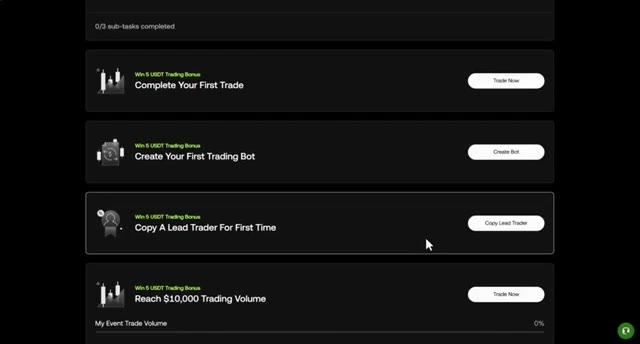
*⏱️ 00:00:47 — Image #1 (@ 00:00:47) : Interface présentant la liste des tâches et bonus sur l'échange (compléter son premier échange, créer un bot, copier un trader).*

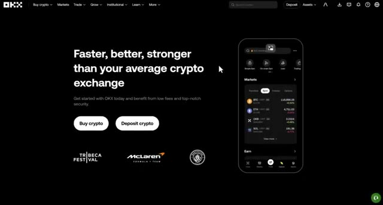
*⏱️ 00:00:56 — Image #2 (@ 00:00:56) : Page d'accueil de la plateforme de cryptomonnaies OKX avec un aperçu de l'application mobile.*

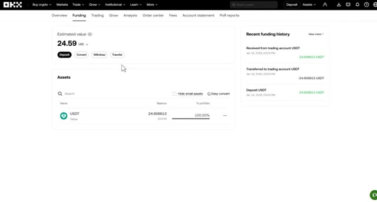
*⏱️ 00:01:05 — Image #3 (@ 00:01:05) : Vue du compte de financement sur OKX affichant un solde de 24,59 USDT et l'historique des fonds récents.*

---

### ⏱️ `[00:01:15 - 00:01:49]` | Segment #03

**🔊 Audio (Transcription Intégrale Mot pour Mot en Français) :**
> tableau de bord du bot. Juste en haut, vous pouvez voir le P&L d'aujourd'hui et la valeur totale de vos USDT sur tous les bots. Lorsque vous descendez un peu, vous verrez la section des bots et des signaux. C'est là que la magie opère. Vous verrez des options pour la grille spot, la grille futures, le DCA futures, et des bots spécialisés comme l'arbitrage intelligent et le flywheel. Vous pouvez même les filtrer en fonction de votre biais de marché, haussier, baissier ou neutre. Avant d'en créer un, jetez un œil au marché des bots. Ici, vous pouvez voir les statistiques des bots leaders, la cryptomonnaie spécifique qu'ils tradent, la direction,

**👁️ Analyse Visuelle d'Écran (gemini-3.5-flash-lite) :**
**Interface & Outils** : Interface web de la plateforme d'échange de cryptomonnaies OKX (section Trading Bots).

**Contenu textuel & Code** : P&L d'aujourd'hui (0.00 USDT), valeur totale estimée, et options de bots de trading : Spot grid, Futures grid, Futures grid (Crypto-M), Futures DCA, Smart arbitrage, Flywheel, Spot DCA, Recurring buy.

**Action / Démonstration** : Présentation visuelle des différentes catégories de bots de trading automatisés disponibles sur la plateforme.

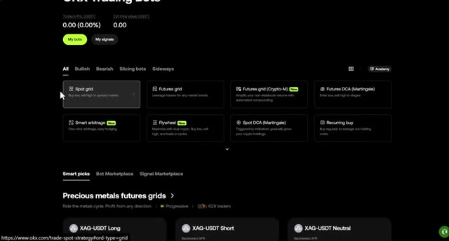
*⏱️ 00:01:23 — Capture d'écran montrant le tableau de bord des bots de trading OKX avec les différentes stratégies de trading disponibles.*

---

### ⏱️ `[00:01:49 - 00:02:25]` | Segment #04

**🔊 Audio (Transcription Intégrale Mot pour Mot en Français) :**
> le levier, et leur P&L basé sur des pourcentages. Vous pouvez même voir l'AUM, qui est le montant total d'argent qui suit ce bot, et le ratio de partage des profits, afin de savoir exactement ce que le lead trader gagne sur vos trades gagnants. Si vous êtes pressé, regardez les OKX SmartPix. Ce sont des bots préconçus conçus pour des actifs spécifiques, comme la grille de futures sur métaux précieux, les bots Tether Gold, ou le sniper de grille à haute fréquence. Vous pouvez voir leur APR back-testé, l'AUM actuel, et combien d'autres traders de bots les utilisent en ce moment même. Je vous montrerai un peu plus tard comment utiliser

**👁️ Analyse Visuelle d'Écran (gemini-3.5-flash-lite) :**
**Interface & Outils** : Interface de la plateforme d'échange de cryptomonnaies OKX (section Bot Marketplace).

**Contenu textuel & Code** : Pourcentages de P&L, AUM (actifs sous gestion), ratio de partage des profits (30%), effet de levier (20x) et durée de fonctionnement (runtime).

**Action / Démonstration** : Navigation et présentation des différentes options de copy trading et des performances des bots sur l'exchange.

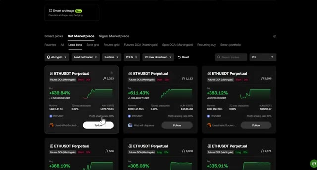
*⏱️ 00:01:58 — Interface du marché des bots de trading montrant les performances de différents lead traders sur ETHUSDT Perpétuel.*

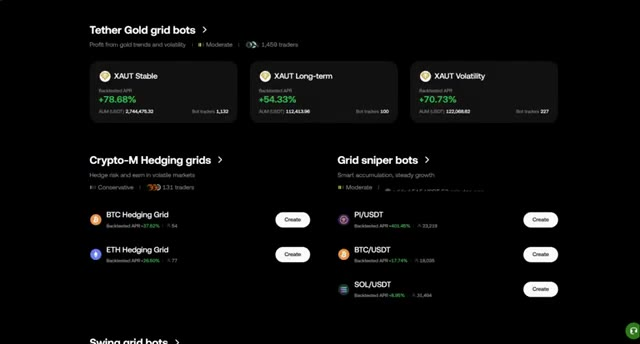
*⏱️ 00:02:16 — Interface de la plateforme affichant les catégories de bots, notamment les Tether Gold grid bots et Crypto-M Hedging grids.*

---

### ⏱️ `[00:02:25 - 00:02:58]` | Segment #05

**🔊 Audio (Transcription Intégrale Mot pour Mot en Français) :**
> ces sélections intelligentes. C'est le raccourci ultime qui prend moins d'une minute pour mettre un bot en ligne. Maintenant, créons un bot de grille au comptant à partir de zéro. C'est parfait pour les marchés sans tendance où vous voulez acheter bas et vendre haut automatiquement sans utiliser aucun effet de levier. Lorsque vous cliquez dessus, OKX ouvre ce tableau de bord. Une chose que j'adore absolument ici, c'est qu'ils vous montrent le graphique interactif complet exactement comme celui que vous utilisez pour le trading manuel, ce qui vous donne un énorme avantage pour voir où se trouvent réellement vos grilles. Lorsque vous faites défiler vers le bas, vous verrez deux modes, les stratégies IA et le mode manuel.

**👁️ Analyse Visuelle d'Écran (gemini-3.5-flash-lite) :**
**Interface & Outils** : Échange de cryptomonnaies OKX (section Trading Bots et interface de trading spot)

**Contenu textuel & Code** : Options de bots (Spot grid, Futures grid, Futures DCA), graphique TradingView de la paire BTC/USDT en arrière-plan, carnet d'ordres en temps réel et champs de configuration de grille (Price range, Grid quantity).

**Action / Démonstration** : Sélection de la stratégie de bot 'Spot grid' pour configurer un trading automatisé sur un marché sans tendance.

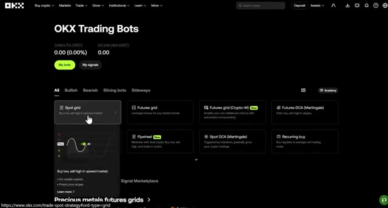
*⏱️ 00:02:33 — Interface OKX Trading Bots affichant les différentes catégories de bots de trading automatisé, avec le curseur pointant sur l'option 'Spot grid'.*

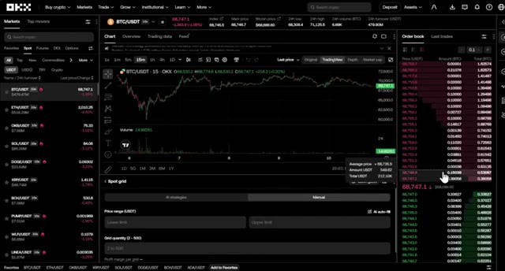
*⏱️ 00:02:42 — Interface de trading d'OKX sur la paire BTC/USDT en mode 'Spot grid', montrant le graphique des prix, le carnet d'ordres à droite et les paramètres de configuration du bot de grille en bas.*

---

### ⏱️ `[00:02:58 - 00:03:33]` | Segment #06

**🔊 Audio (Transcription Intégrale Mot pour Mot en Français) :**
> La stratégie IA est le mode facile. Elle utilise des données testées sur l'historique pour définir automatiquement votre fourchette de prix et vos grilles. Le mode manuel est celui où vous obtenez un contrôle total. Parlons des deux paramètres les plus importants ici, la fourchette de prix et le nombre de grilles. La fourchette de prix est votre terrain de jeu. Si le prix reste dans ces limites, votre bot continue de générer de l'argent. S'il en sort, le bot se met en pause. Ensuite, vous avez le nombre de grilles, qui se situe généralement entre deux et 500 grilles. Voyez les choses ainsi. Plus vous avez de grilles, plus le mouvement de prix doit être petit pour déclencher une transaction. Plus de grilles signifie

**👁️ Analyse Visuelle d'Écran (gemini-3.5-flash-lite) :**
**Interface & Outils** : Plateforme d'échange de crypto-monnaies (Blofin) montrant le module de bot Spot Grid, un graphique de cours et le carnet d'ordres.

**Contenu textuel & Code** : Onglets "AI strategies" et "Manual", champs "Price range (USDT)" (Lower limit, Upper limit), "Grid quantity (2 - 500)", "Investment amount", carnet d'ordres en temps réel.

**Action / Démonstration** : Configuration manuelle des paramètres d'un bot Spot Grid (fourchette de prix et nombre de grilles) sur l'échange.

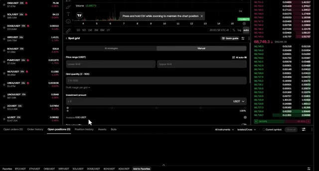
*⏱️ 00:03:07 — Interface de trading affichant le panneau de configuration "Spot grid" en mode Manuel avec les paramètres de fourchette de prix et de grilles.*

---

### ⏱️ `[00:03:33 - 00:03:55]` | Segment #07

**🔊 Audio (Transcription Intégrale Mot pour Mot en Français) :**
> des transactions plus fréquentes, mais un profit plus petit par transaction. Moins de grilles signifient de plus grands filets de pêche qui capturent de plus fortes fluctuations de prix pour des profits individuels plus élevés. Avant de cliquer sur créer, consultez les paramètres avancés. Vous verrez l'allocation Simple Earn. C'est un bonus massif. Tous les fonds qui ne sont pas actuellement utilisés pour des ordres ouverts sont automatiquement transférés vers OKX Simple Earn pour générer des intérêts.

**👁️ Analyse Visuelle d'Écran (gemini-3.5-flash-lite) :**
**Interface & Outils** : Interface de trading d'une plateforme d'échange (exchange crypto).

**Contenu textuel & Code** : Paramètres de « Spot grid », champs « Price range (USDT) », « Grid quantity (2 - 500) », « Investment amount », et carnet d'ordres à droite.

**Action / Démonstration** : Configuration des paramètres du bot de grille au comptant (Spot Grid) en vue d'ajuster le nombre de grilles et la fourchette de prix.

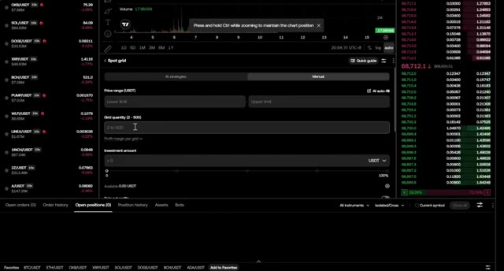
*⏱️ 00:03:39 — Interface de configuration d'un bot de trading « Spot grid » montrant les paramètres de plage de prix et de quantité de grilles.*

---

### ⏱️ `[00:03:56 - 00:04:17]` | Segment #08

**🔊 Audio (Transcription Intégrale Mot pour Mot en Français) :**
> Vous gagnez littéralement des rendements sur votre argent en attente. Vous verrez également des paramètres de suivi. Le suivi vers le haut permet à l'ensemble de la grille de monter si le marché commence à suivre une tendance haussière, afin que vous ne soyez pas distancé lorsque le prix sort de votre plage. Le suivi vers le bas fait l'inverse, en déplaçant la grille plus bas pour vous maintenir dans le jeu lors d'une baisse. Enfin, n'oubliez pas votre take profit et votre stop loss.

**👁️ Analyse Visuelle d'Écran (gemini-3.5-flash-lite) :**
**Interface & Outils** : Interface de trading (plateforme d'échange de cryptomonnaies)

**Contenu textuel & Code** : Paramètres de configuration du bot de grille (Spot grid, Trailing up, Trailing down, Stop Loss, Grid mode Arithmetic), infobulle descriptive du fonctionnement du trailing up en cas de dépassement de la limite supérieure.

**Action / Démonstration** : Survol ou présentation de l'option 'Trailing up' pour les bots de grille de trading.

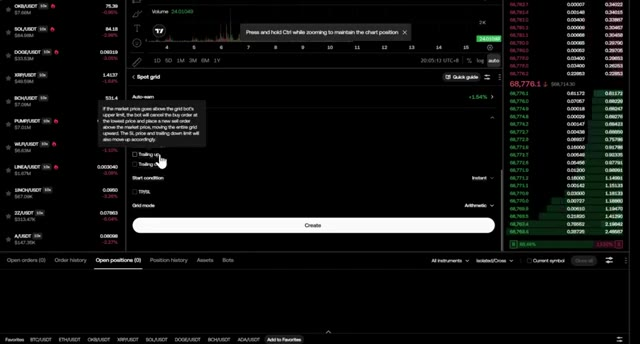
*⏱️ 00:04:01 — Interface de configuration d'un bot de trading Spot Grid avec une infobulle explicative sur le paramètre 'Trailing up' et la liste des paires crypto à gauche.*

---

### ⏱️ `[00:04:17 - 00:04:52]` | Segment #09

**🔊 Audio (Transcription Intégrale Mot pour Mot en Français) :**
> Vous pouvez les définir en fonction d'un prix spécifique ou d'un pourcentage. C'est votre filet de sécurité ultime. Si le marché évolue complètement contre vous, le bot fermera la position automatiquement pour protéger votre capital. Choisissez votre mode de grille, soit arithmétique pour des écarts de prix égaux, soit géométrique pour des écarts de pourcentage égaux. Saisissez votre investissement et cliquez sur créer. Vient ensuite la grille de futures. Cela fonctionne exactement comme le spot mais avec de l'levier et trois directions : long, short ou neutre. Vous verrez également une option crypto-m ici. C'est la même logique, mais au lieu d'être réglé en USDT, vos profits sont

**👁️ Analyse Visuelle d'Écran (gemini-3.5-flash-lite) :**
**Interface & Outils** : Plateforme d'échange de cryptomonnaies OKX (interface de trading spot et futures grid).

**Contenu textuel & Code** : Paramètres de grille de trading (Take Profit, Stop Loss, mode Arithmétique, fourchettes de prix, quantité de grilles) et graphique technique BTC/USDT.

**Action / Démonstration** : Configuration des paramètres de gestion des risques (Stop Loss / Take Profit) et des modes de grilles pour un robot de trading automatisé.

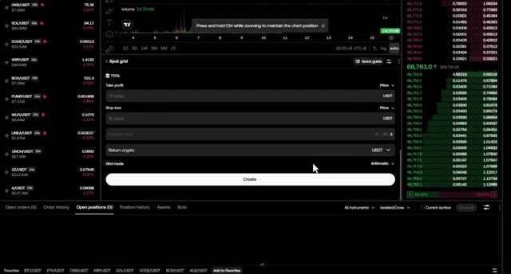
*⏱️ 00:04:26 — Interface de configuration d'un robot de trading Spot Grid sur OKX, affichant les champs de Take Profit, Stop Loss et le choix du mode de grille (Arithmétique).*

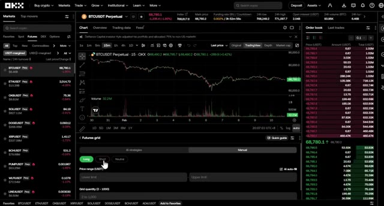
*⏱️ 00:04:43 — Interface de trading OKX montrant un graphique des prix du BTC/USDT en unités 15 minutes ainsi que les paramètres de configuration d'un bot 'Futures grid' (onglets Long/Short/Neutral).*

---

### ⏱️ `[00:04:52 - 00:05:27]` | Segment #10

**🔊 Audio (Transcription Intégrale Mot pour Mot en Français) :**
> établi dans la pièce elle-même comme bitcoin, ethereum ou solana. C'est génial si vous voulez accumuler davantage de l'actif sous-jacent pendant que vous tradez. Lorsque vous passez en mode manuel, vous pouvez vraiment affiner le comportement du bot. Dans les paramètres avancés, vous pouvez choisir votre condition de départ. Au lieu de démarrer simplement de manière instantanée, vous pouvez dire au bot d'attendre un prix spécifique, un certain niveau de RSI, ou même un signal trading view. Cela garantit que vous n'entrez sur le marché que lorsque le timing est le bon. Vous pouvez également activer l'option d'ouverture de position à la création. Si vous êtes haussier, cela achète une position de départ immédiatement afin que vous soyez

**👁️ Analyse Visuelle d'Écran (gemini-3.5-flash-lite) :**
**Interface & Outils** : Interface web de l'échange de cryptomonnaies OKX (section Futures Grid Trading).

**Contenu textuel & Code** : Graphique de prix BTCUSDT en haut, carnet d'ordres à droite, liste des paires de trading à gauche, et trois cartes de stratégies de grille avec leurs performances historiques (APR), plages de prix et quantités de grilles.

**Action / Démonstration** : Survol ou sélection de l'option de configuration des bots de trading de grille (stratégies IA ou mode manuel).

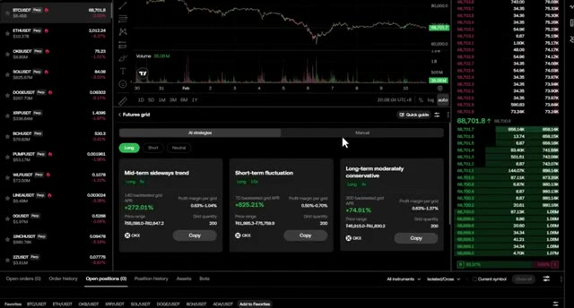
*⏱️ 00:05:01 — Capture d'écran de l'interface de trading OKX montrant le panneau de stratégie "Futures grid" avec différentes options de bots de trading automatisés (Mid-term sideways trend, Short-term fluctuation, Long-term moderately conservative).*

---

### ⏱️ `[00:05:27 - 00:06:03]` | Segment #11

**🔊 Audio (Transcription Intégrale Mot pour Mot en Français) :**
> déjà dans le vert si le prix bondit. Tout comme avant, vous pouvez choisir entre les modes de grille arithmétique ou géométrique. Et le plus important, définissez vos Take Profit et Stop Loss (TP/SL). Je vous recommande vivement d'activer cette option, surtout lorsque vous utilisez un effet de levier, pour éviter la liquidation. Une fois que tout est bien configuré, cliquez sur créer un long si vous êtes haussier, un short si vous êtes baissier, ou neutre si vous vous attendez à ce que le marché consolide. Votre bot est maintenant actif et négocie sur le marché des futures pour vous 24h/24 et 7j/7. Passons maintenant au bot DCA futures ou Martingale. Celui-ci est conçu spécifiquement pour se refaire après des baisses du marché. En

**👁️ Analyse Visuelle d'Écran (gemini-3.5-flash-lite) :**
**Interface & Outils** : Interface web d'une plateforme d'échange de cryptomonnaies (type exchange futures) avec graphique des prix en arrière-plan.

**Contenu textuel & Code** : Panneau de configuration du "Futures grid" affichant les champs pour le "Take profit" et le "Stop loss", ainsi que le sélecteur de mode de grille (Arithmetic).

**Action / Démonstration** : Configuration des paramètres de gestion des risques (TP/SL) pour la création d'une grille de trading de type Futures (Long).

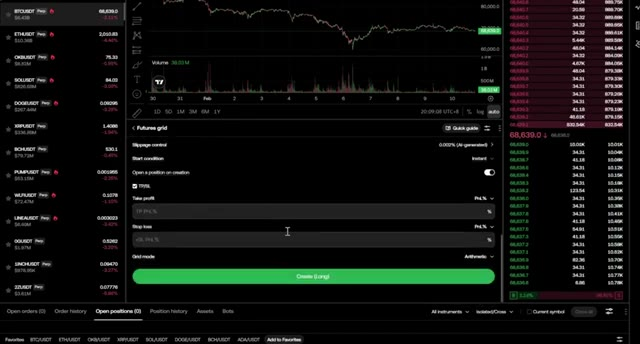
*⏱️ 00:05:36 — Capture d'écran montrant l'interface de configuration d'un bot de trading "Futures grid" sur une plateforme d'échange, avec les options pour définir le Take Profit (TP) et le Stop Loss (SL).*

---

### ⏱️ `[00:06:03 - 00:06:37]` | Segment #12

**🔊 Audio (Transcription Intégrale Mot pour Mot en Français) :**
> faire une moyenne de votre prix d'entrée à mesure que le marché évolue contre vous. Tout comme pour la grille de contrats à terme, vous verrez d'abord les stratégies d'IA ici. OKEx vous montre le nom du bot, la direction, long ou court, et l'effet de levier. Vous pouvez également voir la logique exacte qu'il utilise, comme le premier ratio d'ordre de sécurité, qui correspond à la baisse de prix nécessaire pour que le bot achète davantage, et le nombre maximal d'ordres de sécurité, qui est le nombre total de fois où le bot va doubler la mise. Il y a aussi le take profit par cycle, qui est le gain cible nécessaire pour fermer toute la position et recommencer à neuf. Si vous préférez une approche plus pratique,

**👁️ Analyse Visuelle d'Écran (gemini-3.5-flash-lite) :**
**Interface & Outils** : Plateforme de trading OKX (Module Futures DCA Martingale, graphique de prix et carnet d'ordres).

**Contenu textuel & Code** : Stratégies IA (Mid-term moderate bullish, Short-term aggressive bullish, Long-term conservative bullish), leviers (8x, 12x), APR backtestés (+130.27%, +184.79%, +89.12%), Take Profit par cycle (1.70%, 0.80%, 1.50%), nombre d'ordres de sécurité max (7 à 12).

**Action / Démonstration** : Démonstration de la configuration et sélection d'un bot de trading automatique Martingale/DCA à l'aide des stratégies IA intégrées.

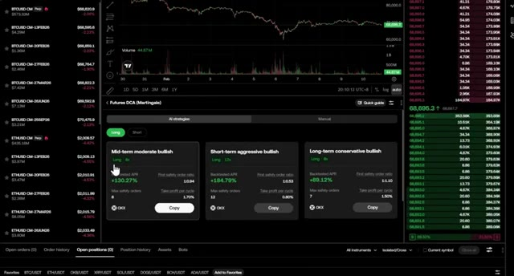
*⏱️ 00:06:12 — Interface de trading OKX affichant la section des bots Futures DCA (Martingale) avec diverses stratégies d'IA présélectionnées (rendements APR, levier et paramètres d'ordres de sécurité).*

---

### ⏱️ `[00:06:37 - 00:06:58]` | Segment #13

**🔊 Audio (Transcription Intégrale Mot pour Mot en Français) :**
> passez en mode manuel. Ici, vous pouvez définir vos propres paliers de prix et vos objectifs de take profit. Vous définirez également la marge de votre ordre initial ou de votre premier trade, ainsi que la marge de votre ordre de sécurité ou le montant que vous ajoutez lors d'une baisse. Si vous êtes optimiste, vous pouvez même activer l'option de réinvestissement des profits pour capitaliser automatiquement vos gains. OKEx dispose ici d'une fonctionnalité remarquable appelée transfert automatique de marge.

**👁️ Analyse Visuelle d'Écran (gemini-3.5-flash-lite) :**
**Interface & Outils** : Plateforme d'échange de cryptomonnaies (section Futures DCA / Bot de trading).

**Contenu textuel & Code** : Configuration manuelle du bot avec les options "Trigger settings" (Price steps à 0.5 %, Take profit per cycle à 1 %) et "Leverage and margin" (Initial order margin, Safety order margin à 2.06 USDT, Max safety orders à 8).

**Action / Démonstration** : Présentation du mode de configuration manuelle du bot DCA sur la plateforme.

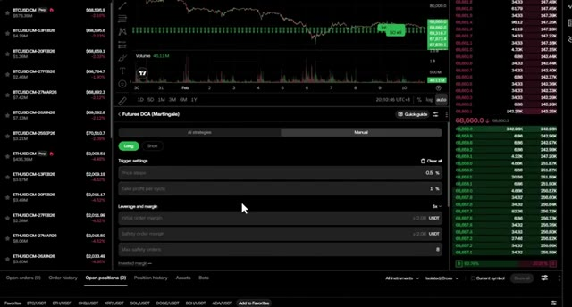
*⏱️ 00:06:42 — Interface de trading affichant les paramètres manuels pour un bot Futures DCA (Martingale).*

---

### ⏱️ `[00:06:58 - 00:07:31]` | Segment #14

**🔊 Audio (Transcription Intégrale Mot pour Mot en Français) :**
> Si le marché devient volatil et que votre niveau de risque atteint un seuil élevé, le bot retirera automatiquement des fonds de votre compte de trading pour réapprovisionner votre marge et éviter une liquidation forcée. C'est un excellent filet de sécurité pour les stratégies à effet de levier élevé. Pour les professionnels, si vous vous rendez dans les paramètres avancés, vous pouvez affiner votre multiplicateur de montant et votre multiplicateur de pas de prix, ceux-ci vous permettent d'échelonner vos ordres d'achat de manière agressive ou conservatrice. Vous pouvez également définir une condition d'arrêt, comme un prix spécifique ou simplement en indiquant au bot de s'arrêter à la fin du cycle actuel.

**👁️ Analyse Visuelle d'Écran (gemini-3.5-flash-lite) :**
**Interface & Outils** : Plateforme d'échange de cryptomonnaies (type bot de trading Futures DCA / Martingale).

**Contenu textuel & Code** : Paramètres de configuration du bot incluant "Auto-transfer margin", "Safety order margin", "Max safety orders" et le carnet d'ordres en temps réel.

**Action / Démonstration** : Un curseur clique sur l'option "Auto-transfer margin" pour activer le réapprovisionnement automatique de la marge.

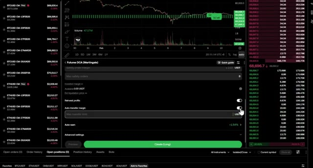
*⏱️ 00:07:07 — Interface de configuration d'un bot de trading avec des paramètres avancés de gestion du risque et du carnet d'ordres.*

---

### ⏱️ `[00:07:31 - 00:08:04]` | Segment #15

**🔊 Audio (Transcription Intégrale Mot pour Mot en Français) :**
> et bien sûr un ordre stop loss pour protéger votre risque de baisse une fois que vous êtes prêt cliquez sur créer et rappelez-vous si vous voulez cette même stratégie de lissage puissante mais sans le risque du effet de levier il existe une version DCA sur le marché au comptant qui fonctionne exactement de la même manière c'est idéal pour accumuler des pièces pendant un marché baissier c'est là que OKX se démarque vraiment l'arbitrage intelligent est une stratégie qui détient simultanément une position au comptant et une position courte sur les contrats à terme l'objectif est de gagner des frais de financement avec un risque de marché presque nul

**👁️ Analyse Visuelle d'Écran (gemini-3.5-flash-lite) :**
**Interface & Outils** : Présentation ou face-caméra explicatif du trader sans interface logicielle partagée.

**Contenu textuel & Code** : Explications orales des stratégies et mise en contexte méthodologique du marché.

**Action / Démonstration** : Explications face caméra et analyse conceptuelle des marchés.

---

### ⏱️ `[00:08:04 - 00:08:28]` | Segment #16

**🔊 Audio (Transcription Intégrale Mot pour Mot en Français) :**
> C'est un moyen très stable de gagner de l'argent, surtout pendant les marchés haussiers où les taux de financement sont élevés. Le suivant est le bot Flywheel. C'est une stratégie unique conçue pour maximiser vos rendements en utilisant la double cryptomonnaie. Voici la logique. Il est conçu pour vous aider à acheter bas, à vendre haut et à trader en cycles continus. C'est essentiellement un moyen automatisé de générer du rendement en attendant que vos prix cibles d'achat ou de vente soient atteints.

**👁️ Analyse Visuelle d'Écran (gemini-3.5-flash-lite) :**
**Interface & Outils** : Interface web de l'échange de cryptomonnaies OKX (section Trading Bots).

**Contenu textuel & Code** : Liste des bots de trading (Spot grid, Futures grid, Smart arbitrage, Flywheel) et paramètres de stratégie Flywheel (Conservative avec un APY estimé, Aggressive, paire BTC/USDT).

**Action / Démonstration** : Navigation dans le catalogue des bots de trading puis sélection et affichage des détails du bot Flywheel sur OKX.

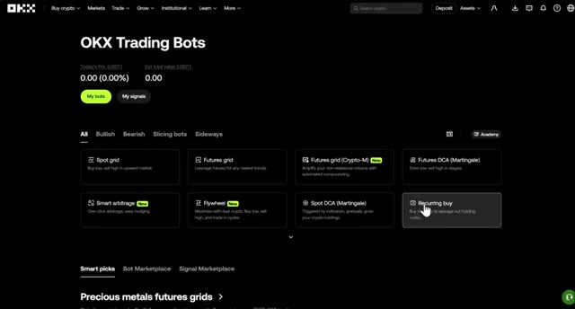
*⏱️ 00:08:10 — Vue d'ensemble du tableau de bord des bots de trading sur la plateforme OKX, affichant différentes stratégies disponibles telles que Spot grid, Futures grid, Smart arbitrage et Flywheel.*

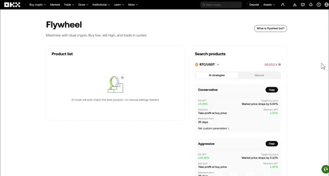
*⏱️ 00:08:16 — Interface de configuration du bot Flywheel sur OKX, présentant les options de stratégies automatisées (Conservative et Aggressive) basées sur la paire BTC/USDT.*

---

### ⏱️ `[00:08:28 - 00:08:52]` | Segment #17

**🔊 Audio (Transcription Intégrale Mot pour Mot en Français) :**
> Pour commencer, sélectionnez votre produit dans la liste sur la droite. Vous pouvez choisir parmi les principaux actifs comme le Bitcoin, l'Ethereum, le Solana ou même le Doge. Vous verrez deux voies principales, conservatrice ou agressive. OKEx vous indiquera l'APY estimé, votre prix d'achat cible et votre prix de vente. Elle vous montre même l'APY minimum et la durée maximale, afin que vous sachiez exactement combien de temps votre capital pourrait être engagé.

**👁️ Analyse Visuelle d'Écran (gemini-3.5-flash-lite) :**
**Interface & Outils** : Interface web de la plateforme d'échange (bot de type Flywheel / Earn).

**Contenu textuel & Code** : Liste de sélection d'actifs crypto (BTC/USDT, ETH/USDT, SOL/USDT, DOGE/USDT) et options de configuration de stratégie (Conservative, Aggressive).

**Action / Démonstration** : Sélection d'un actif crypto dans la liste déroulante pour configurer les paramètres du bot.

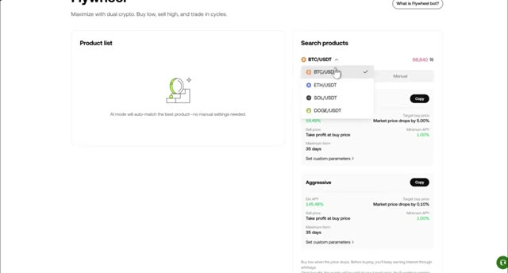
*⏱️ 00:08:34 — Capture d'écran montrant l'interface d'un bot de trading (Flywheel) avec un menu déroulant pour sélectionner un produit (BTC/USDT, ETH/USDT, SOL/USDT, DOGE/USDT) et les options de stratégie (Conservative, Aggressive).*

---

### ⏱️ `[00:08:53 - 00:09:14]` | Segment #18

**🔊 Audio (Transcription Intégrale Mot pour Mot en Français) :**
> Si vous voulez entrer dans les détails, vous pouvez ajuster ces paramètres vous-même, ce qui vous fait passer en mode manuel. Cela vous permet de définir les niveaux exacts auxquels vous voulez que le bot achète lorsque le prix baisse. Vous pouvez également définir vos propres conditions, comme un rendement annuel en pourcentage minimum spécifique que vous êtes prêt à accepter. Une fois que vous avez trouvé un produit correspondant à votre stratégie, cliquez sur Suivant.

**👁️ Analyse Visuelle d'Écran (gemini-3.5-flash-lite) :**
**Interface & Outils** : Interface web de trading / bot crypto (Flywheel).

**Contenu textuel & Code** : Paire BTC/USDT à 68,655.4, mode manuel sélectionné, configuration "Buy when price drops" (réglé sur 5%), "Minimum APY" (1%), et "Maximum term" (35 days).

**Action / Démonstration** : Configuration des paramètres manuels du bot pour définir le pourcentage de baisse d'achat et les conditions de rendement.

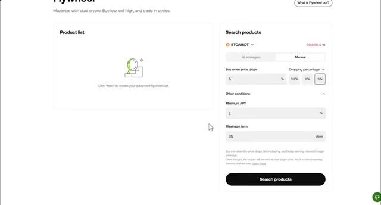
*⏱️ 00:08:58 — Interface de configuration manuelle du bot "Flywheel" avec les paramètres de chute de prix et de conditions additionnelles.*

---

### ⏱️ `[00:09:14 - 00:09:33]` | Segment #19

**🔊 Audio (Transcription Intégrale Mot pour Mot en Français) :**
> Une barre latérale apparaîtra où vous saisirez votre montant d'investissement et choisirez votre mode de prise de bénéfices. Vous pouvez définir cela par un prix d'achat cible ou par un pourcentage de hausse. Une fois ces paramètres réglés, cliquez sur créer, et votre roue d'inertie est en mouvement, générant du rendement et négociant les cycles pour vous automatiquement. Le dernier bot est l'achat récurrent.

**👁️ Analyse Visuelle d'Écran (gemini-3.5-flash-lite) :**
**Interface & Outils** : Interface web de la plateforme d'échange OKX

**Contenu textuel & Code** : Paramètres du bot Flywheel pour la paire BTC/USDT : APY estimé à +30.79%, champ « Investment amount », options de prix cible (« By target buy price ») et bouton de création « Create ».

**Action / Démonstration** : Le curseur de la souris survole les paramètres de configuration des prix et des modes de prise de bénéfices avant la création du bot.

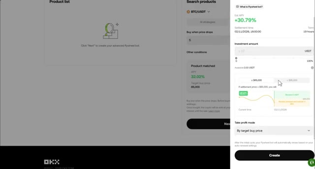
*⏱️ 00:09:19 — Interface de configuration d'un bot de trading « Flywheel » sur la plateforme OKX, affichant une barre latérale avec les paramètres d'investissement et le mode de prise de bénéfices.*

---

### ⏱️ `[00:09:33 - 00:09:52]` | Segment #20

**🔊 Audio (Transcription Intégrale Mot pour Mot en Français) :**
> C'est parfait pour les investisseurs à long terme. Première étape, sélectionnez votre pièce ou plusieurs pièces. Deuxième étape, définissez votre fréquence, de toutes les heures à tous les mois. Troisième étape, entrez le montant de l'investissement par achat. Le robot achètera automatiquement quel que soit le prix, éliminant ainsi l'émotion de votre investissement.

**👁️ Analyse Visuelle d'Écran (gemini-3.5-flash-lite) :**
**Interface & Outils** : Interface de trading de l'échange OKX (Graphique TradingView, carnet d'ordres à droite, liste des paires à gauche et module de configuration d'investissement automatique en bas).

**Contenu textuel & Code** : Graphique en chandeliers japonais de la paire BTC/USDT en unité de temps 15 minutes, indicateur de volume, panneau de configuration "Recurring buy" avec sélection de cryptomonnaies (BTC à 100%), fréquence d'achat et montant en USDT.

**Action / Démonstration** : Configuration d'un plan d'achat récurrent (Dollar-Cost Averaging) avec sélection des cryptomonnaies et de la fréquence d'investissement.

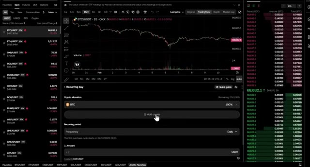
*⏱️ 00:09:38 — Interface d'échange de cryptomonnaies montrant un graphique de prix pour la paire BTC/USDT et un panneau de configuration d'achat récurrent (Recurring buy).*

---

### ⏱️ `[00:09:52 - 00:10:13]` | Segment #21

**🔊 Audio (Transcription Intégrale Mot pour Mot en Français) :**
> Dans les paramètres avancés, vous pouvez même définir une fourchette de prix spécifique afin que le bot n'achète que lorsque le prix se trouve dans votre zone d'achat. Si vous n'avez pas le temps de créer votre propre stratégie à partir de zéro, vous pouvez toujours compter sur les sélections intelligentes. C'est l'une des fonctionnalités les plus puissantes sur OKEx, car elle agit comme un marché organisé pour les bots les plus performants de la plateforme.

**👁️ Analyse Visuelle d'Écran (gemini-3.5-flash-lite) :**
**Interface & Outils** : Interface de plateforme d'échange de cryptomonnaies avec outils de configuration de bots de trading.

**Contenu textuel & Code** : Paramètres de fourchette de prix d'achat ('Lower' et 'Upper') et sélections de bots de trading avec performances affichées en APR (ex: +640,32%, +78,68%).

**Action / Démonstration** : Configuration des paramètres avancés d'un bot de trading et navigation dans l'onglet des sélections intelligentes.

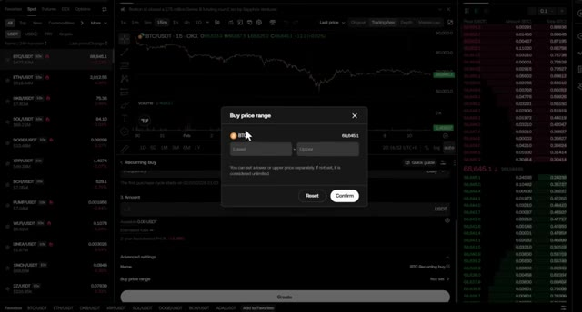
*⏱️ 00:09:58 — Interface de trading affichant une pop-up de configuration pour définir une fourchette de prix d'achat ('Buy price range') avec des champs pour les prix inférieur et supérieur.*

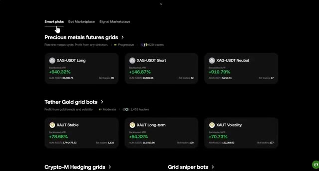
*⏱️ 00:10:08 — Écran de sélection 'Smart picks' montrant différentes catégories de bots de trading (Precious metals futures grids, Tether Gold grid bots) avec leurs performances en APR et volumes.*

---

### ⏱️ `[00:10:14 - 00:10:33]` | Segment #22

**🔊 Audio (Transcription Intégrale Mot pour Mot en Français) :**
> Au lieu de deviner vos paramètres, vous pouvez parcourir des catégories comme CryptoM Hedging, GridSniper et Swing Grid Bots. Pour chaque SmartPick, OKEx vous donne l'analyse complète des données, le taux annuel en pourcentage testé rétrospectivement, la durée d'exécution totale, les actifs sous gestion et même le nombre total de traders de bots qui l'utilisent actuellement.

**👁️ Analyse Visuelle d'Écran (gemini-3.5-flash-lite) :**
**Interface & Outils** : Interface web de l'échange de cryptomonnaies OKEx.

**Contenu textuel & Code** : Catégories de bots (Crypto-M Hedging, Grid Sniper, Swing Grid), métriques de performance (Backtested APR +37.62%, Runtime 28D 1h 19m, AUM de 863,006.11 USDT, 54 bot traders), et interface de création de bot.

**Action / Démonstration** : Navigation à travers les différentes catégories de stratégies de trading automatisées et consultation des détails et performances d'un bot spécifique (BTC Hedging Grid).

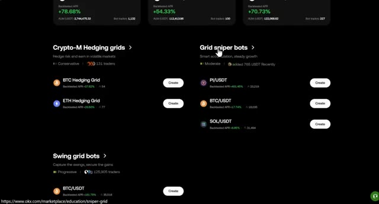
*⏱️ 00:10:18 — Vue d'ensemble de la plateforme OKEx montrant les catégories de bots de trading (Crypto-M Hedging grids, Grid sniper bots, Swing grid bots).*

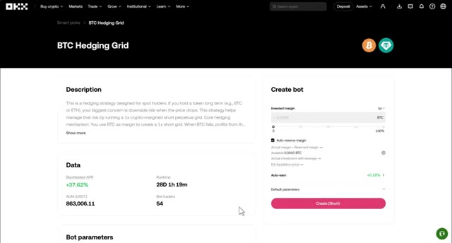
*⏱️ 00:10:23 — Page détaillée du bot "BTC Hedging Grid" sur OKEx, affichant la description, le taux annuel testé rétrospectivement et le panneau de création.*

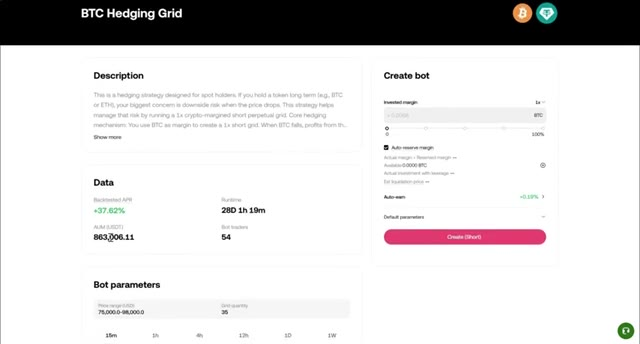
*⏱️ 00:10:28 — Suite de la page détaillée du bot "BTC Hedging Grid" avec l'affichage des données de performance (APR de +37,62%, runtime 28D 1h 19m) et les paramètres du bot.*

---

### ⏱️ `[00:10:33 - 00:10:55]` | Segment #23

**🔊 Audio (Transcription Intégrale Mot pour Mot en Français) :**
> Lorsque vous en trouvez un qui vous plaît, vous pouvez simplement sélectionner les paramètres par défaut et entrer votre montant d'investissement pour le lancer instantanément. Mais si vous voulez un peu plus de contrôle, vous pouvez également basculer vers des paramètres personnalisés pour ajuster les réglages tout en utilisant la logique principale de SmartPick. Une fois que vous avez vérifié les paramètres, cliquez sur Créer. Avant de conclure, parlons des récompenses lorsque vous vous inscrivez en utilisant mon lien.

**👁️ Analyse Visuelle d'Écran (gemini-3.5-flash-lite) :**
**Interface & Outils** : Interface web de trading de bots de cryptomonnaies (stratégie BTC Hedging Grid).

**Contenu textuel & Code** : Paramètres du bot incluant la marge investie, les limites de prix (75 000 - 98 000 USD), la quantité de grille (35) et le rendement backtesté (+37,62%).

**Action / Démonstration** : Saisie du montant d'investissement et basculement entre les paramètres par défaut et personnalisés pour configurer le bot de trading.

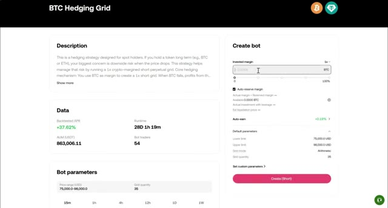
*⏱️ 00:10:39 — Interface de configuration du bot 'BTC Hedging Grid' montrant le champ de saisie du montant d'investissement avec des paramètres par défaut.*

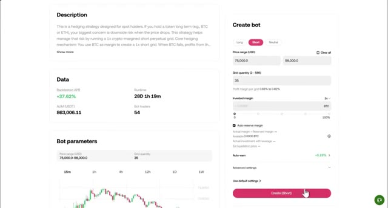
*⏱️ 00:10:49 — Interface du bot montrant les paramètres personnalisés ouverts avec les champs de fourchette de prix et la quantité de grille ajustables.*

---

### ⏱️ `[00:10:55 - 00:11:13]` | Segment #24

**🔊 Audio (Transcription Intégrale Mot pour Mot en Français) :**
> Les nouveaux utilisateurs d'OKEX peuvent gagner jusqu'à 145 USDT de récompenses rien qu'en explorant la plateforme. Voici les détails. 5 USDT pour votre premier dépôt, 5 USDT pour votre premier trade, et 5 USDT pour la création de votre tout premier bot de trading. Encore 5 USDT pour avoir copié un trader leader pour la première fois.

**👁️ Analyse Visuelle d'Écran (gemini-3.5-flash-lite) :**
**Interface & Outils** : Site web de l'échange de cryptomonnaies OKX (page des récompenses nouvel utilisateur).

**Contenu textuel & Code** : Détails des bonus : 5 USDT pour le premier dépôt de 50$, 5 USDT pour le premier trade, 5 USDT pour le premier bot, et 5 USDT pour le copy trading.

**Action / Démonstration** : Navigation et défilement sur la page web des récompenses utilisateur de la plateforme OKX.

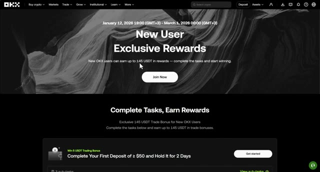
*⏱️ 00:11:00 — Page d'accueil du programme de récompenses OKX montrant l'en-tête et la première tâche de dépôt.*

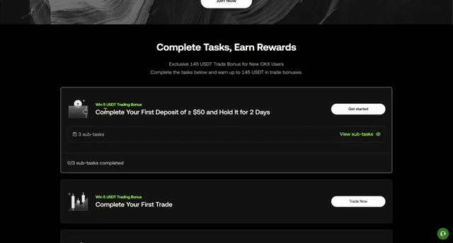
*⏱️ 00:11:04 — Liste des tâches de la plateforme OKX avec le premier dépôt et le premier trade.*

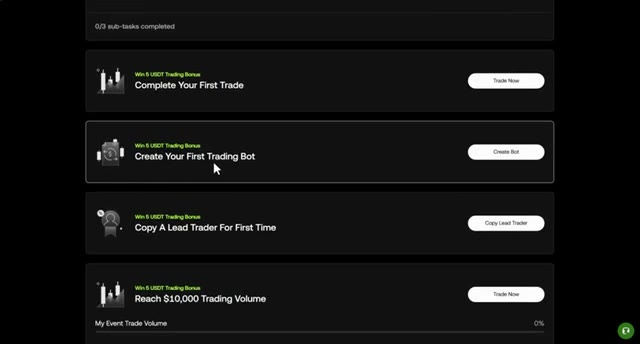
*⏱️ 00:11:09 — Suite de la liste des tâches OKX affichant la création d'un bot de trading et le copy trading.*

---

### ⏱️ `[00:11:14 - 00:11:47]` | Segment #25

**🔊 Audio (Transcription Intégrale Mot pour Mot en Français) :**
> Ensuite, vous obtenez des bonus progressifs au fil de vos trades, à commencer par 5 USDT pour 10 000 dollars de volume, et jusqu'à 50 USDT une fois que vous atteignez le cap du million de dollars. Puisque vos bots tradent 24h/24 et 7j/7, vous serez surpris de la rapidité avec laquelle vous franchirez ces paliers de volume. Vous voilà donc entièrement équipé pour utiliser tous les bots qu'OKX a à offrir. Que vous souhaitiez capturer la volatilité avec des grilles, gagner des financements passifs grâce à l'arbitrage, ou faire croître votre portefeuille à long terme avec le DCA, vous avez les outils en main. Si vous souhaitez une présentation plus détaillée de l'ensemble d'OKEX

**👁️ Analyse Visuelle d'Écran (gemini-3.5-flash-lite) :**
**Interface & Outils** : Présentation ou face-caméra explicatif du trader sans interface logicielle partagée.

**Contenu textuel & Code** : Explications orales des stratégies et mise en contexte méthodologique du marché.

**Action / Démonstration** : Explications face caméra et analyse conceptuelle des marchés.

---

### ⏱️ `[00:11:47 - 00:12:10]` | Segment #26

**🔊 Audio (Transcription Intégrale Mot pour Mot en Français) :**
> plateforme, y compris comment trader des contrats à terme manuellement et comment utiliser le copy trading, cliquez sur la vidéo qui apparaît sur votre écran en ce moment même. Elle vous guidera à travers tout le reste de ce que vous devez savoir. merci d'avoir regardé et je vous vois dans la prochaine

**👁️ Analyse Visuelle d'Écran (gemini-3.5-flash-lite) :**
**Interface & Outils** : Interface web d'échange crypto / plateforme de trading (section Futures copy trading).

**Contenu textuel & Code** : Statistiques de traders professionnels : pourcentages de PnL positifs (ex: +843.37%, +341.00%), montants d'AUM et courbes de performance individuelles.

**Action / Démonstration** : Navigation et présentation des différents traders disponibles pour le copy trading de contrats à terme.

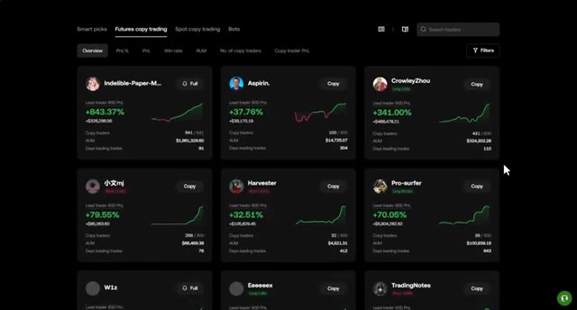
*⏱️ 00:11:53 — Capture d'écran montrant l'interface de copy trading sur futures avec une grille de profils de traders performants affichant leurs statistiques (PnL, AUM, nombre de suiveurs).*

---

