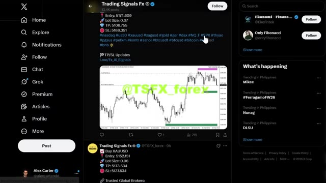
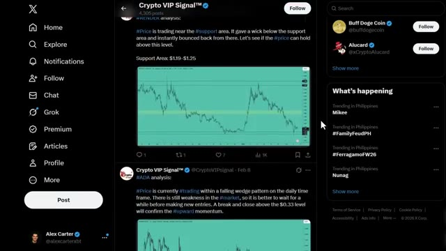
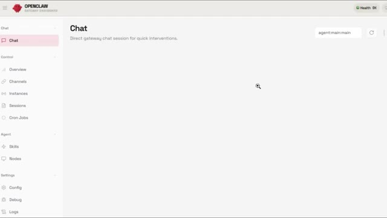

# 🎬 This Is How I Cloned the World’s Best Crypto Trader Using OpenClaw

> **Chaîne** : [Alex Carter](https://www.youtube.com/@AlexCarterTrading)  
> **Lien YouTube** : [https://www.youtube.com/watch?v=jhUY6CMeDDo](https://www.youtube.com/watch?v=jhUY6CMeDDo)  
> **Date de publication** : 20260226  
> **Durée** : 00:10:15  
> **Identifiant vidéo** : `jhUY6CMeDDo`  
> **Transcription & Analyse** : `whisper-v3-large-turbo+gemini-3.5-flash-lite`  

---

## 📌 Synthèse Exécutive & Outils

### 💡 Résumé
Dans cette vidéo intitulée **Comment j'ai cloné le meilleur trader crypto du monde grâce à OpenClaw**, Alex Carter détaille une approche stratégique et pratique du trading et de l'automatisation par agents IA.

### 🛠️ Outils, Modèles & Logiciels Présentés
- **TradingView & Claude Code** : Analyse technique avancée et automatisation algorithmique.

### 🔑 Points Clés & Enseignements Stratégiques
- Respect rigoureux du ratio risque/rendement et du money management.
- Automatisation méthodique des déclencheurs d'ordres via des agents intelligents.

---

## ⏱️ Chronologie & Transcription Complète Audio & Visuelle (Mot pour Mot)

### ⏱️ `[00:00:00 - 00:00:20]` | Segment #01

**🔊 Audio (Transcription Intégrale Mot pour Mot en Français) :**
> Dans cette vidéo, je vous montre comment transformer les données publiques de n'importe quel trader en un agent de trading IA automatisé. Vous pouvez prendre tout l'historique de trading d'un trader pro, chaque entrée, chaque sortie, chaque stratégie, et le cloner en utilisant OpenClaw AI. Je trade de la crypto depuis des années et c'est absolument fou.

**👁️ Analyse Visuelle d'Écran (gemini-3.5-flash-lite) :**
**Interface & Outils** : X (Twitter), OpenClaw Gateway Dashboard

**Contenu textuel & Code** : Niveaux d'ordres (Entry: 5174.609, TP: 5108.755, SL: 5188.351), graphiques en chandeliers avec zones de liquidité/support, menu OpenClaw (Channels, Instances, Sessions, Cron Jobs, Skills, Nodes).

**Action / Démonstration** : Démonstration de signaux et données publiques de traders sur X avant d'accéder à l'interface OpenClaw pour configurer l'agent IA de clonage de stratégie.

*⏱️ 00:00:05 — Flux X (Twitter) présentant un compte de signaux de trading forex avec ordres détaillés (Entry, TP, SL sur l'or/XAUUSD) et graphique technique associé.*

*⏱️ 00:00:10 — Flux X (Twitter) affichant des analyses de cours crypto (RENDER, ADA) avec identification de zones de support et graphiques.*

*⏱️ 00:00:15 — Tableau de bord OpenClaw Gateway Dashboard sur l'onglet Chat avec le menu de gestion des agents, compétences (skills) et configurations.*

---

### ⏱️ `[00:00:20 - 00:00:56]` | Segment #02

**🔊 Audio (Transcription Intégrale Mot pour Mot en Français) :**
> Alors restez bien là, parce que je vais vous montrer les prompts exacts et la configuration pour faire cela vous-même et le connecter à votre plateforme d'échange. C'est parti. D'accord, alors voici le concept : il y a des milliers de traders qui partagent publiquement leurs trades sur Twitter, dans des groupes Discord ou dans des journaux de trading publics. Ils publient leurs entrées, leurs sorties, leurs taux de réussite, leurs stratégies. Maintenant, la plupart des gens se contentent de faire défiler ce genre de contenu. Mais et si vous pouviez prendre toutes ces données et les transmettre à une IA qui en tire des enseignements ? C'est exactement ce que je vais vous montrer comment faire. Vous pouvez trouver des traders qui partagent publiquement des centaines de trades. Et avec OpenClaw,

**👁️ Analyse Visuelle d'Écran (gemini-3.5-flash-lite) :**
**Interface & Outils** : Présentation ou face-caméra explicatif du trader sans interface logicielle partagée.

**Contenu textuel & Code** : Explications orales des stratégies et mise en contexte méthodologique du marché.

**Action / Démonstration** : Explications face caméra et analyse conceptuelle des marchés.

---

### ⏱️ `[00:00:56 - 00:01:30]` | Segment #03

**🔊 Audio (Transcription Intégrale Mot pour Mot en Français) :**
> you can analyze all of that data and create an AI agent that trades just like them. Now, here's how OpenClaw works. You give it what's called a skill file or a strategy file. This is basically a set of instructions and rules that the AI follows when it trades. Think of it like a game cartridge. You have your OpenClaw AI agent and you can plug in different strategies. You're going to create a strategy file based on a real trader's past performance. And that creates what I'm calling a clone trader AI agent. So the first step is gathering the data. And you guys, there's

**👁️ Analyse Visuelle d'Écran (gemini-3.5-flash-lite) :**
**Interface & Outils** : Présentation ou face-caméra explicatif du trader sans interface logicielle partagée.

**Contenu textuel & Code** : Explications orales des stratégies et mise en contexte méthodologique du marché.

**Action / Démonstration** : Explications face caméra et analyse conceptuelle des marchés.

---

### ⏱️ `[00:01:30 - 00:01:55]` | Segment #04

**🔊 Audio (Transcription Intégrale Mot pour Mot en Français) :**
> Il y a tellement de données de trading publiques disponibles que la plupart des gens ignorent simplement. Voici ce que vous devez collecter. Numéro un, l'historique de trading. C'est chaque trade que le trader publie publiquement. Prix d'entrée, prix de sortie, gain ou perte, taille de la position. Numéro deux, le taux de réussite. C'est la fréquence à laquelle ils gagnent par rapport à la fréquence à laquelle ils perdent. Numéro trois, le ratio risque/récompense. C'est la taille de leurs trades gagnants comparée à celle de leurs trades perdants.

**👁️ Analyse Visuelle d'Écran (gemini-3.5-flash-lite) :**
**Interface & Outils** : Présentation ou face-caméra explicatif du trader sans interface logicielle partagée.

**Contenu textuel & Code** : Explications orales des stratégies et mise en contexte méthodologique du marché.

**Action / Démonstration** : Explications face caméra et analyse conceptuelle des marchés.

---

### ⏱️ `[00:01:56 - 00:02:15]` | Segment #05

**🔊 Audio (Transcription Intégrale Mot pour Mot en Français) :**
> Number four, market conditions. This is the kind of market they trade best in, trending, ranging, or volatile. Number five, timeframes. Do they trade on the 15-minute chart, four-hour, or daily? Now, I've created a template document here that shows you exactly how to organize this data.

**👁️ Analyse Visuelle d'Écran (gemini-3.5-flash-lite) :**
**Interface & Outils** : Présentation ou face-caméra explicatif du trader sans interface logicielle partagée.

**Contenu textuel & Code** : Explications orales des stratégies et mise en contexte méthodologique du marché.

**Action / Démonstration** : Explications face caméra et analyse conceptuelle des marchés.

---

### ⏱️ `[00:02:15 - 00:02:35]` | Segment #06

**🔊 Audio (Transcription Intégrale Mot pour Mot en Français) :**
> Vous pouvez voir que j'ai des colonnes pour la date d'entrée, le prix d'entrée, le prix de sortie, les profits/pertes, l'unité de temps et les conditions du marché. Vous pouvez faire cela manuellement en parcourant leur fil Twitter ou leur journal de trading et en copiant tous leurs trades dans une feuille de calcul comme celle-ci. Ou vous pouvez utiliser des outils pour extraire automatiquement les données.

**👁️ Analyse Visuelle d'Écran (gemini-3.5-flash-lite) :**
**Interface & Outils** : Présentation ou face-caméra explicatif du trader sans interface logicielle partagée.

**Contenu textuel & Code** : Explications orales des stratégies et mise en contexte méthodologique du marché.

**Action / Démonstration** : Explications face caméra et analyse conceptuelle des marchés.

---

### ⏱️ `[00:02:35 - 00:02:54]` | Segment #07

**🔊 Audio (Transcription Intégrale Mot pour Mot en Français) :**
> Once you have all this data collected and organized like this, you're ready for the next step. All right, so now that you have the data organized, you need to feed it into OpenClaw and tell it to analyze it. Now, I prepared all the prompts you need in this document right here. I'm going to walk you through each one. Here's the exact prompt you're going to use for the initial analysis.

**👁️ Analyse Visuelle d'Écran (gemini-3.5-flash-lite) :**
**Interface & Outils** : Présentation ou face-caméra explicatif du trader sans interface logicielle partagée.

**Contenu textuel & Code** : Explications orales des stratégies et mise en contexte méthodologique du marché.

**Action / Démonstration** : Explications face caméra et analyse conceptuelle des marchés.

---

### ⏱️ `[00:02:55 - 00:03:16]` | Segment #08

**🔊 Audio (Transcription Intégrale Mot pour Mot en Français) :**
> I have collected trading data from a professional trader. Here is their trade history. Analyze these trades and identify. One, their average win rate. Two, their risk to reward ratio. Three, what entry signals they use most often. Four, what timeframes they trade on. Five, what market conditions they perform best in.

**👁️ Analyse Visuelle d'Écran (gemini-3.5-flash-lite) :**
**Interface & Outils** : Présentation ou face-caméra explicatif du trader sans interface logicielle partagée.

**Contenu textuel & Code** : Explications orales des stratégies et mise en contexte méthodologique du marché.

**Action / Démonstration** : Explications face caméra et analyse conceptuelle des marchés.

---

### ⏱️ `[00:03:16 - 00:03:34]` | Segment #09

**🔊 Audio (Transcription Intégrale Mot pour Mot en Français) :**
> Based on this analysis, create a trading strategy file that replicates their approach as closely as possible. So you're going to copy this prompt, paste it into OpenClaw, and then paste your trader data where it says paste your data here. Now what OpenClaw will do is analyze all that data and give you a breakdown.

**👁️ Analyse Visuelle d'Écran (gemini-3.5-flash-lite) :**
**Interface & Outils** : Présentation ou face-caméra explicatif du trader sans interface logicielle partagée.

**Contenu textuel & Code** : Explications orales des stratégies et mise en contexte méthodologique du marché.

**Action / Démonstration** : Explications face caméra et analyse conceptuelle des marchés.

---

### ⏱️ `[00:03:35 - 00:03:53]` | Segment #10

**🔊 Audio (Transcription Intégrale Mot pour Mot en Français) :**
> Once you get that analysis back from OpenClaw, you're going to use this second prompt. Create a strategy file based on this analysis. The strategy should only trade Bitcoin and Solana. Use liquidity sweeps as entry signals. Set stop loss at 1% and take profit at 2.5%.

**👁️ Analyse Visuelle d'Écran (gemini-3.5-flash-lite) :**
**Interface & Outils** : Présentation ou face-caméra explicatif du trader sans interface logicielle partagée.

**Contenu textuel & Code** : Explications orales des stratégies et mise en contexte méthodologique du marché.

**Action / Démonstration** : Explications face caméra et analyse conceptuelle des marchés.

---

### ⏱️ `[00:03:53 - 00:04:29]` | Segment #11

**🔊 Audio (Transcription Intégrale Mot pour Mot en Français) :**
> Only trade when volatility is high. Execute trades automatically on my exchange. Monitor the market 24-7 and log all trades and OpenClaw will create the complete strategy file for you that you can use. For OpenClaw to actually trade for you, it needs to connect to your exchange account through an API. And the exchange I'm using for this is Blofen. If you don't have a Blofen account yet, click the link in the description below. You'll get up to 5 USDT just for signing up, plus up to 30 USDT in bonuses when you deposit. Step one, create your Blofen account

**👁️ Analyse Visuelle d'Écran (gemini-3.5-flash-lite) :**
**Interface & Outils** : Présentation ou face-caméra explicatif du trader sans interface logicielle partagée.

**Contenu textuel & Code** : Explications orales des stratégies et mise en contexte méthodologique du marché.

**Action / Démonstration** : Explications face caméra et analyse conceptuelle des marchés.

---

### ⏱️ `[00:04:29 - 00:05:01]` | Segment #12

**🔊 Audio (Transcription Intégrale Mot pour Mot en Français) :**
> and deposit. Go to Blofen, sign up with your email, and make your first deposit. I recommend using TRC20 for USDT because it's fast and the fees are very low. Step two, generate your API keys. Now go to your account settings and click on API. Click on create new API key and give it a name, something like open claw trading. You'll see your application name, your API key, and possibly a passphrase depending on the settings. Do keep in mind, these keys are extremely sensitive. Never

**👁️ Analyse Visuelle d'Écran (gemini-3.5-flash-lite) :**
**Interface & Outils** : Présentation ou face-caméra explicatif du trader sans interface logicielle partagée.

**Contenu textuel & Code** : Explications orales des stratégies et mise en contexte méthodologique du marché.

**Action / Démonstration** : Explications face caméra et analyse conceptuelle des marchés.

---

### ⏱️ `[00:05:01 - 00:05:35]` | Segment #13

**🔊 Audio (Transcription Intégrale Mot pour Mot en Français) :**
> share them with anyone. Here's a smart way to set this up. Enable trading permissions but leave withdrawal permissions disabled. That way, even if something goes wrong, your funds can't be withdrawn. Click next and save your API key and secret key somewhere safe, like a password manager. Step three, connect OpenClaw to Blowfin. Now open up OpenClaw and you're going to give it a prompt to connect to your Blowfin account. Here's the exact prompt you'll use. I want you to connect to my Blofin Exchange account using these API keys. Once done, check my account balance so I can see

**👁️ Analyse Visuelle d'Écran (gemini-3.5-flash-lite) :**
**Interface & Outils** : Présentation ou face-caméra explicatif du trader sans interface logicielle partagée.

**Contenu textuel & Code** : Explications orales des stratégies et mise en contexte méthodologique du marché.

**Action / Démonstration** : Explications face caméra et analyse conceptuelle des marchés.

---

### ⏱️ `[00:05:35 - 00:05:58]` | Segment #14

**🔊 Audio (Transcription Intégrale Mot pour Mot en Français) :**
> that you truly have access to my account. And just like that, OpenClaw is now connected to your exchange and ready to trade. Step four, activate your trading agent. Now here's the final prompt to get your clone trader AI agent running. Load the trader clone strategy file we created earlier. Use this strategy to trade Bitcoin and Solana on my Blofin account. Start with a $1,000 budget.

**👁️ Analyse Visuelle d'Écran (gemini-3.5-flash-lite) :**
**Interface & Outils** : Présentation ou face-caméra explicatif du trader sans interface logicielle partagée.

**Contenu textuel & Code** : Explications orales des stratégies et mise en contexte méthodologique du marché.

**Action / Démonstration** : Explications face caméra et analyse conceptuelle des marchés.

---

### ⏱️ `[00:05:58 - 00:06:16]` | Segment #15

**🔊 Audio (Transcription Intégrale Mot pour Mot en Français) :**
> monitor the market 24-7, and execute trades automatically based on the strategy. Log all trades and send me a summary every 24 hours. All right, so now that you have your clone trader AI agent set up, I've prepared some advanced prompts to optimize it. Prompt number one, backtesting.

**👁️ Analyse Visuelle d'Écran (gemini-3.5-flash-lite) :**
**Interface & Outils** : Présentation ou face-caméra explicatif du trader sans interface logicielle partagée.

**Contenu textuel & Code** : Explications orales des stratégies et mise en contexte méthodologique du marché.

**Action / Démonstration** : Explications face caméra et analyse conceptuelle des marchés.

---

### ⏱️ `[00:06:17 - 00:06:42]` | Segment #16

**🔊 Audio (Transcription Intégrale Mot pour Mot en Français) :**
> Before you let the AI trade with real money, use this prompt to backtest the strategy. Backtest this strategy on Bitcoin and Solana price data from the last six months. Show me. Total number of trades. Win rate percentage. Average profit per winning trade. Average loss per losing trade. Maximum drawdown. Overall profit slash loss. Present the results in a clear table format.

**👁️ Analyse Visuelle d'Écran (gemini-3.5-flash-lite) :**
**Interface & Outils** : Présentation ou face-caméra explicatif du trader sans interface logicielle partagée.

**Contenu textuel & Code** : Explications orales des stratégies et mise en contexte méthodologique du marché.

**Action / Démonstration** : Explications face caméra et analyse conceptuelle des marchés.

---

### ⏱️ `[00:06:42 - 00:07:02]` | Segment #17

**🔊 Audio (Transcription Intégrale Mot pour Mot en Français) :**
> This will give you an idea of how the strategy would have performed in the past. Prompt number two. Risk management. Use this prompt to add better risk management. Add these risk management rules to the strategy. Never risk more than 2% of total account balance per trade. If three consecutive losses occur, pause trading for 24 hours.

**👁️ Analyse Visuelle d'Écran (gemini-3.5-flash-lite) :**
**Interface & Outils** : Présentation ou face-caméra explicatif du trader sans interface logicielle partagée.

**Contenu textuel & Code** : Explications orales des stratégies et mise en contexte méthodologique du marché.

**Action / Démonstration** : Explications face caméra et analyse conceptuelle des marchés.

---

### ⏱️ `[00:07:02 - 00:07:24]` | Segment #18

**🔊 Audio (Transcription Intégrale Mot pour Mot en Français) :**
> If daily loss exceeds 5%, stop trading for the day. Only trade during a high liquidity hours, 8 a.m. to 8 p.m. UTC. Prompt number three, multi-trader strategy. Here's how you can clone multiple traders and run them in parallel. I want to run three different trading strategies in parallel. Allocate $500 to each strategy and track their performance separately.

**👁️ Analyse Visuelle d'Écran (gemini-3.5-flash-lite) :**
**Interface & Outils** : Présentation ou face-caméra explicatif du trader sans interface logicielle partagée.

**Contenu textuel & Code** : Explications orales des stratégies et mise en contexte méthodologique du marché.

**Action / Démonstration** : Explications face caméra et analyse conceptuelle des marchés.

---

### ⏱️ `[00:07:25 - 00:07:44]` | Segment #19

**🔊 Audio (Transcription Intégrale Mot pour Mot en Français) :**
> Send me a daily report comparing all three strategies. This way, you're diversifying your approach and not relying on just one strategy. Prompt number four, strategy combination. You can also combine the best parts of multiple traders. I've analyzed three different traders. Trader A has the best entry signals that has 70% accuracy.

**👁️ Analyse Visuelle d'Écran (gemini-3.5-flash-lite) :**
**Interface & Outils** : Présentation ou face-caméra explicatif du trader sans interface logicielle partagée.

**Contenu textuel & Code** : Explications orales des stratégies et mise en contexte méthodologique du marché.

**Action / Démonstration** : Explications face caméra et analyse conceptuelle des marchés.

---

### ⏱️ `[00:07:45 - 00:08:04]` | Segment #20

**🔊 Audio (Transcription Intégrale Mot pour Mot en Français) :**
> Trader B has the best risk management with 2.5 to 1 reward ratio. Trader C has the best exit strategy that captures 80% of moves. Create a new strategy that combines entry signals from Trader A, risk management from Trader B, exit strategy from Trader C.

**👁️ Analyse Visuelle d'Écran (gemini-3.5-flash-lite) :**
**Interface & Outils** : Présentation ou face-caméra explicatif du trader sans interface logicielle partagée.

**Contenu textuel & Code** : Explications orales des stratégies et mise en contexte méthodologique du marché.

**Action / Démonstration** : Explications face caméra et analyse conceptuelle des marchés.

---

### ⏱️ `[00:08:05 - 00:08:24]` | Segment #21

**🔊 Audio (Transcription Intégrale Mot pour Mot en Français) :**
> This is where it gets really powerful. All right, so let me recap the exact steps you need to take to clone a trader's strategy with OpenClaw. I've created this complete checklist in the document that you can follow. Step one, find a trader with public data. Look for traders on Twitter, Discord, or trading journals who publicly share their trades.

**👁️ Analyse Visuelle d'Écran (gemini-3.5-flash-lite) :**
**Interface & Outils** : Présentation ou face-caméra explicatif du trader sans interface logicielle partagée.

**Contenu textuel & Code** : Explications orales des stratégies et mise en contexte méthodologique du marché.

**Action / Démonstration** : Explications face caméra et analyse conceptuelle des marchés.

---

### ⏱️ `[00:08:25 - 00:08:48]` | Segment #22

**🔊 Audio (Transcription Intégrale Mot pour Mot en Français) :**
> You need at least 100 to 200 trades to analyze. Step two, collect and organize the data. Use the template I showed you earlier to organize their trade history. Entries, exits, win rate, risk to reward ratio, time frames, market conditions. Step three, feed it into OpenClaw. Use prompt number one from the document to have OpenClaw analyze the data and create a strategy file.

**👁️ Analyse Visuelle d'Écran (gemini-3.5-flash-lite) :**
**Interface & Outils** : Présentation ou face-caméra explicatif du trader sans interface logicielle partagée.

**Contenu textuel & Code** : Explications orales des stratégies et mise en contexte méthodologique du marché.

**Action / Démonstration** : Explications face caméra et analyse conceptuelle des marchés.

---

### ⏱️ `[00:08:49 - 00:09:11]` | Segment #23

**🔊 Audio (Transcription Intégrale Mot pour Mot en Français) :**
> Step four, connect OpenClaw to Blofen. Use the API connection prompt to connect OpenClaw to your Blofen account. Step five, backtest the strategy. Use the backtesting prompt to test the strategy on historical data before going live. Step six, start with a small budget. Let the AI trade with $500 or $1,000 and monitor the results.

**👁️ Analyse Visuelle d'Écran (gemini-3.5-flash-lite) :**
**Interface & Outils** : Présentation ou face-caméra explicatif du trader sans interface logicielle partagée.

**Contenu textuel & Code** : Explications orales des stratégies et mise en contexte méthodologique du marché.

**Action / Démonstration** : Explications face caméra et analyse conceptuelle des marchés.

---

### ⏱️ `[00:09:11 - 00:09:29]` | Segment #24

**🔊 Audio (Transcription Intégrale Mot pour Mot en Français) :**
> Step seven, optimize and scale. Use the advanced prompts to add risk management, combine strategies, or run multiple agents in parallel. All of these prompts are available in the document I've shown you throughout this video. I'll put a link to it in the description below so you can copy and use them yourself. And that's it, you guys.

**👁️ Analyse Visuelle d'Écran (gemini-3.5-flash-lite) :**
**Interface & Outils** : Présentation ou face-caméra explicatif du trader sans interface logicielle partagée.

**Contenu textuel & Code** : Explications orales des stratégies et mise en contexte méthodologique du marché.

**Action / Démonstration** : Explications face caméra et analyse conceptuelle des marchés.

---

### ⏱️ `[00:09:30 - 00:09:50]` | Segment #25

**🔊 Audio (Transcription Intégrale Mot pour Mot en Français) :**
> That's exactly how you can clone any pro trader strategy using OpenClaw and automate your trading. Look, I'm going to be real with you. This is the future of trading. If you're not using AI right now, you're going to be out-competed by people who do. If you want to get started with Blofen and claim those bonuses, click the link at the top of the description.

**👁️ Analyse Visuelle d'Écran (gemini-3.5-flash-lite) :**
**Interface & Outils** : Présentation ou face-caméra explicatif du trader sans interface logicielle partagée.

**Contenu textuel & Code** : Explications orales des stratégies et mise en contexte méthodologique du marché.

**Action / Démonstration** : Explications face caméra et analyse conceptuelle des marchés.

---

### ⏱️ `[00:09:51 - 00:10:13]` | Segment #26

**🔊 Audio (Transcription Intégrale Mot pour Mot en Français) :**
> Remember, you get up to $5,000 in bonuses just for signing up and depositing, and it's completely no KYC. If you want a full walkthrough of how to use OpenClaw and manually trading with Blofen, check out the video popping on screen right now. If you enjoyed this video, smash that like button and subscribe to the channel for more crypto trading tutorials.

**👁️ Analyse Visuelle d'Écran (gemini-3.5-flash-lite) :**
**Interface & Outils** : Présentation ou face-caméra explicatif du trader sans interface logicielle partagée.

**Contenu textuel & Code** : Explications orales des stratégies et mise en contexte méthodologique du marché.

**Action / Démonstration** : Explications face caméra et analyse conceptuelle des marchés.

---

### ⏱️ `[00:10:13 - 00:10:15]` | Segment #27

**🔊 Audio (Transcription Intégrale Mot pour Mot en Français) :**
> and I'll see you in the next one.

**👁️ Analyse Visuelle d'Écran (gemini-3.5-flash-lite) :**
**Interface & Outils** : Présentation ou face-caméra explicatif du trader sans interface logicielle partagée.

**Contenu textuel & Code** : Explications orales des stratégies et mise en contexte méthodologique du marché.

**Action / Démonstration** : Explications face caméra et analyse conceptuelle des marchés.

---

