# 🎬 Improved Your Win Rate With These 5 Polymarket Strategies + Secret Tool

> **Chaîne** : [Alex Carter](https://www.youtube.com/@AlexCarterTrading)  
> **Lien YouTube** : [https://www.youtube.com/watch?v=hplbjnoDU20](https://www.youtube.com/watch?v=hplbjnoDU20)  
> **Date de publication** : 20260228  
> **Durée** : 00:10:51  
> **Identifiant vidéo** : `hplbjnoDU20`  
> **Transcription & Analyse** : `whisper-v3-large-turbo+gemini-3.5-flash-lite`  

---

## 📌 Synthèse Exécutive & Outils

### 💡 Résumé
Cette vidéo présentée par la chaîne Alex Carter décortique les mécanismes avancés du trading systématique et des marchés de prédiction sur Polymarket, en s'éloignant totalement de la spéculation naïve pour adopter une approche purement quantitative et comportementale. L'analyste y détaille des méthodes chirurgicales permettant de capitaliser sur la psychologie des foules, les inefficacités du carnet d'ordres et les anticipations macroéconomiques. Les démonstrations en direct illustrent comment exploiter les surréactions émotionnelles face aux flux d'actualités, automatiser la réplication de portefeuilles institutionnels ultras-performants, et trader des variables comportementales hautement prévisibles, telles que les tics de langage de personnalités politiques ou les signaux cachés de la Réserve fédérale.

L'accent est mis sur une exécution méthodique et rigoureuse, où chaque stratégie repose sur un avantage statistique mathérable : la décrue inévitable du battage médiatique (« il ne se passe jamais rien »), le momentum fulgurant du scalping post-news, ou encore le décalage temporel des prix face aux annonces de banques centrales. Couplées à un écosystème d'outils spécialisés et à des règles strictes de gestion des risques, ces approches transforment les marchés de prédiction en un terrain de jeu redoutable pour le trader quantitatif et systématique.

---

### 🛠️ Outils, Modèles & Logiciels Présentés
* **Polymarket** : Plateforme décentralisée de marchés de prédiction fonctionnant sur le réseau Polygon avec l'USDC comme devise de règlement.
* **TradeFox** : Agrégateur de marchés de prédiction professionnel et plateforme de copy trading automatisé dédiée à Polymarket, intégrant un système de parrainage à trois niveaux.
* **MetaMask** : Portefeuille Web3 incontournable pour interagir avec les applications décentralisées et approvisionner son compte.
* **Phantom** : Portefeuille Web3 multi-chaînes alternatif utilisé pour la connexion et les transferts de fonds.
* **OKEx Wallet** : Portefeuille numérique pris en charge pour la gestion des actifs sur les réseaux compatibles.
* **Coinbase Wallet** : Solution de portefeuille Web3 sécurisée facilitant l'accès aux protocoles décentralisés.
* **Wallet Connect** : Protocole de communication universel permettant de lier n'importe quel portefeuille compatible à la plateforme Polymarket.
* **FederalReserve.gov** : Portail officiel de la Réserve fédérale fournissant les discours, comptes rendus et communications en temps réel.
* **CME FedWatch** : Outil de suivi probabiliste permettant d'analyser le décalage des prix du marché par rapport aux anticipations de taux.

---

### 🔑 Points Clés & Enseignements Stratégiques
* **La stratégie « Il ne se passe jamais rien »** : Exploiter le biais émotionnel des particuliers qui achètent massivement du « oui » à chaque titre géopolitique alarmiste, en prenant systématiquement position sur le « non » face aux impasses et retours au calme prévisibles.
* **Pièges d'alertes en temps réel** : Configurer des veilles automatisées sur X, Telegram ou Discord pour repérer les sursauts injustifiés du « oui » (hausse de 15 % en quelques heures) afin de charger du « non » à prix cassé.
* **Gestion des sorties contrariennes** : Viser des prises de profits rapides comprises entre 15 % et 30 %, ou attendre le retranchement complet du marché vers sa réalité fondamentale.
* **Le copy trading de baleines via TradeFox** : Automatiser la réplication des transactions de portefeuilles à sept chiffres affichant des rendements constants, tout en configurant des paramètres de prise de risque personnalisés (take profits, stop losses, trailing stops).
* **Allocation granulaire des copy trades** : Limiter l'exposition à 1 % ou 2 % maximum par gros investisseur et sélectionner un pool de 5 baleines au plus pour éviter de diluer sa performance en un fonds indiciel.
* **Protection du capital propre** : Conserver 60 % à 70 % de sa bankroll totale pour ses propres stratégies et cesser immédiatement de copier une baleine après deux semaines consécutives de pertes supérieures à 20 %.
* **Le scalping d'actualités (Acheter le titre, vendre le rebond)** : Intervenir dans les 30 premières secondes suivant une annonce à fort impact (décisions de la Fed, déclarations de Trump, cessez-le-feu) pour surfer sur le momentum avant l'essoufflement du carnet d'ordres.
* **Le trading basé sur la personnalité** : Miser sur la prévisibilité comportementale des orateurs (répétitions de mots clés lors de longs monologues non scriptés) pour trader des occurrences statistiques plutôt que des issues politiques incertaines.
* **Anticipation des baisses de taux de la Fed** : Traquer les signaux avancés émis par les figures clés (Jerome Powell, John C. Williams, Philip Jefferson, Christopher Waller) et les fuites médiatiques de Nick Timiraos (Wall Street Journal) pour devancer le réajustement des marchés.
* **Exploitation du temps de retard de la liquidité** : Profiter de la lenteur avec laquelle les investisseurs particuliers intègrent les données macroéconomiques ennuyeuses pour trader le différentiel de prix.
* **Rigueur absolue dans le risk management** : Lire systématiquement les règles de résolution des marchés sur Polymarket afin d'éviter les pièges de formulation et les pertes de capital évitables.

---

## ⏱️ Chronologie & Transcription Complète Audio & Visuelle (Mot pour Mot)

### ⏱️ `[00:00:00 - 00:00:35]` | Segment #01

**🔊 Audio (Transcription Intégrale Mot pour Mot en Français) :**
> Dans cette vidéo, je vais vous révéler cinq stratégies avancées que les meilleurs traders de Polymarket utilisent en ce moment même pour gagner régulièrement de l'argent grâce aux marchés de prédiction. Et je ne parle pas ici de chance ou de jeu de hasard. Je parle de véritables stratégies systématiques où vous contrecarrez le battage médiatique, exploitez les erreurs de prix et tradez sur des quasi-garanties qui se produisent littéralement chaque jour sur Polymarket. Je vais vous expliquer exactement comment configurer votre compte, comment lire correctement ces marchés et, plus important encore, les cinq stratégies exactes que j'utilise personnellement pour trouver des hauts

**👁️ Analyse Visuelle d'Écran (gemini-3.5-flash-lite) :**
**Interface & Outils** : Interface web de Polymarket (marché de prédiction)

**Contenu textuel & Code** : Graphique de probabilité historique d'un marché (« Will Apple release a new product line before 2027? ») avec options d'achat (Yes 68¢ / No 34¢) et options de connexion (Google, MetaMask, email, etc.).

**Action / Démonstration** : Navigation sur la plateforme Polymarket et visualisation d'un marché spécifique.

*⏱️ 00:00:09 — Interface Polymarket affichant un marché de prédiction sur Apple avec un graphique de probabilité et un panneau d'achat.*

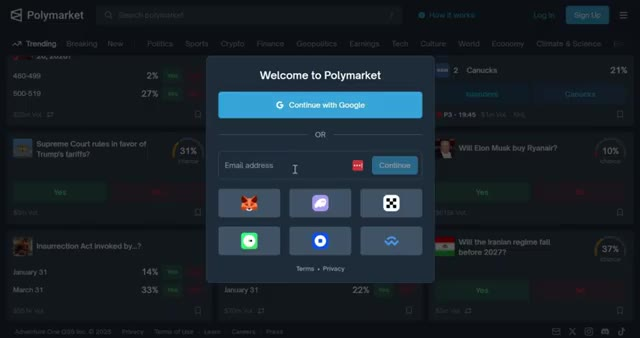
*⏱️ 00:00:26 — Fenêtre modale de connexion de la plateforme Polymarket proposant plusieurs options d'authentification.*

---

### ⏱️ `[00:00:35 - 00:00:59]` | Segment #02

**🔊 Audio (Transcription Intégrale Mot pour Mot en Français) :**
> probabilité de transactions gagnantes. Restez donc jusqu'à la fin car je vais vous montrer de vrais exemples en direct de chaque stratégie et comment vous pouvez commencer à les utiliser dès aujourd'hui pour gagner de l'argent sur Polymarket. Commençons. Et d'ailleurs, si vous vous inscrivez en utilisant mon lien dans la description, vous pouvez gagner 10 dollars lorsque votre filleul effectue son premier dépôt. De plus, débloquez des primes massives, jusqu'à 1 000 dollars après avoir généré seulement 1 million de dollars de chiffre d'affaires.

**👁️ Analyse Visuelle d'Écran (gemini-3.5-flash-lite) :**
**Interface & Outils** : Interface web de Polymarket (marchés de prédiction et page d'authentification).

**Contenu textuel & Code** : Listes de marchés politiques avec des pourcentages de probabilité (83%, 94%, 98%) et interface de connexion par e-mail ou portefeuille numérique.

**Action / Démonstration** : Navigation et démonstration des marchés de paris sur Polymarket suivies d'une illustration du processus d'inscription.

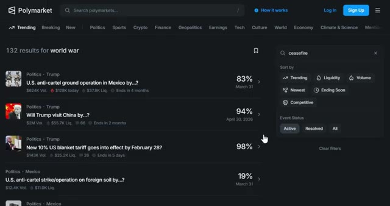
*⏱️ 00:00:41 — Capture d'écran de la plateforme Polymarket montrant une liste de marchés de prédiction avec des probabilités et des volumes de transactions.*

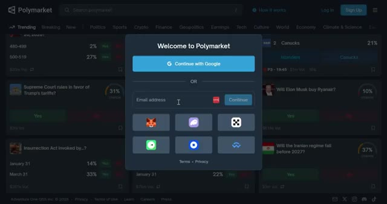
*⏱️ 00:00:47 — Fenêtre contextuelle d'inscription/connexion sur la plateforme Polymarket avec les options Google, e-mail et portefeuilles Web3.*

---

### ⏱️ `[00:00:59 - 00:01:18]` | Segment #03

**🔊 Audio (Transcription Intégrale Mot pour Mot en Français) :**
> Le lien est juste en dessous. Mais d'abord, allons vous inscrire sur Polymarket. Ça prend moins de deux minutes, mais il y a une étape cruciale que la plupart des débutants ratent et qui peut vous coûter de l'argent. Je vais vous montrer exactement comment éviter ça. Très bien, allons vous inscrire sur Polymarket. D'abord, cliquez sur le lien dans la description ci-dessous. Cela vous mènera directement à la page d'inscription de Polymarket.

**👁️ Analyse Visuelle d'Écran (gemini-3.5-flash-lite) :**
**Interface & Outils** : Site web Polymarket

**Contenu textuel & Code** : Divers marchés de prédiction et cotes (ex: Super Bowl Champion 2026, Fed Chair, etc.) avec pourcentages et boutons "Yes/No".

**Action / Démonstration** : Navigation et présentation de la page d'accueil de la plateforme de prédiction Polymarket.

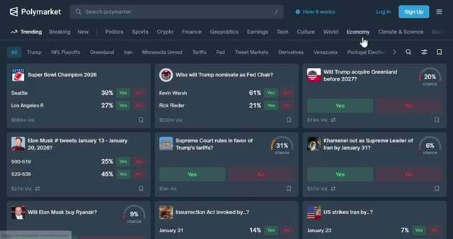
*⏱️ 00:01:04 — Capture d'écran de l'interface principale de la plateforme Polymarket montrant une grille de marchés de prédiction avec différentes catégories et cotes en pourcentage.*

---

### ⏱️ `[00:01:19 - 00:01:51]` | Segment #04

**🔊 Audio (Transcription Intégrale Mot pour Mot en Français) :**
> Vous verrez que vous pouvez continuer à utiliser votre compte Google ou en utilisant une autre adresse e-mail. Vous verrez également l'option pour connecter votre portefeuille. Polymarket est une plateforme décentralisée donc vous aurez besoin d'un portefeuille Web 3 comme MetaMask, Phantom, le portefeuille OKEx, le portefeuille Coinbase ou Wallet Connect. Pour ce tutoriel, je m'inscris en utilisant mon compte Google parce que c'est le moyen le plus rapide. Après cela, vous serez redirigé vers le tableau de bord de Polymarket. Maintenant que vous êtes connecté, vous devez déposer des fonds. En haut à droite, cliquez sur déposer. Polymarket fonctionne sur Polygon

**👁️ Analyse Visuelle d'Écran (gemini-3.5-flash-lite) :**
**Interface & Outils** : Polymarket (Plateforme de prédiction décentralisée, navigateur Web)

**Contenu textuel & Code** : Fenêtre de connexion avec options de comptes (Google, Email) et icônes de portefeuilles Web3 (MetaMask, Phantom). Grille de marchés de prédiction avec volumes et pourcentages (ex: Super Bowl, Fed Chair, etc.).

**Action / Démonstration** : Présentation des différentes méthodes de connexion et de création de compte sur la plateforme Polymarket.

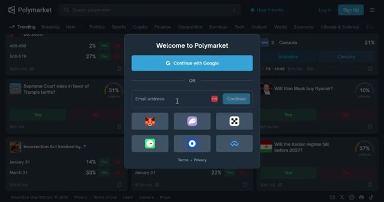
*⏱️ 00:01:27 — Interface de la plateforme Polymarket affichant la fenêtre contextuelle de connexion avec les options Google, e-mail et portefeuilles Web3 (MetaMask, Phantom, etc.).*

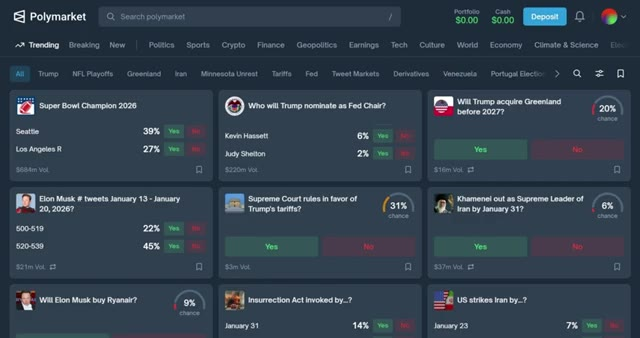
*⏱️ 00:01:43 — Page d'accueil principale de la plateforme Polymarket montrant les marchés de prédiction tendance sous forme de cartes avec les pourcentages de probabilité.*

---

### ⏱️ `[00:01:51 - 00:02:25]` | Segment #05

**🔊 Audio (Transcription Intégrale Mot pour Mot en Français) :**
> réseau et utilise l'USDC comme devise principale. Vous avez quatre options ici. Transférer de la crypto, déposer par carte, connecter un échange et déposer avec PayPal. Si vous avez déjà de la crypto dans un autre portefeuille ou un autre échange, vous pouvez la transférer directement ou faire un pont depuis une autre chaîne. Commencez par sélectionner votre jeton. Vous verrez les jetons pris en charge comme l'USDC, l'ARB, le BNB, le BTCB, le Binance, l'USD, et plus encore. Ensuite, choisissez le réseau. Les réseaux disponibles incluent Ethereum, Solana, BSC, Base, Polygon et d'autres.

**👁️ Analyse Visuelle d'Écran (gemini-3.5-flash-lite) :**
**Interface & Outils** : Polymarket (interface web de prédiction et de paris)

**Contenu textuel & Code** : Options de dépôt : "Transfer Crypto" (sans limite, instantané), "Deposit with Card" (limite 50 000 $, 5 min, logos Mastercard et Visa), "Connect Exchange" (sans limite, 2 min), "Deposit with PayPal" (limite 10 000 $, 5 min). Solde Polymarket actuel : 0,00 $.

**Action / Démonstration** : Présentation des différentes méthodes de dépôt pour approvisionner le compte Polymarket.

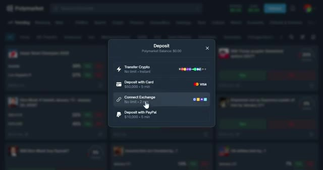
*⏱️ 00:02:00 — Fenêtre modale de dépôt sur la plateforme Polymarket montrant les différentes options de financement disponibles.*

---

### ⏱️ `[00:02:26 - 00:02:47]` | Segment #06

**🔊 Audio (Transcription Intégrale Mot pour Mot en Français) :**
> C'est crucial. Assurez-vous que le réseau que vous sélectionnez correspond au réseau depuis lequel vous envoyez. Si vous envoyez des USDC sur Ethereum mais que vous sélectionnez Polygon, vos fonds seront perdus à jamais. Une fois sélectionné, scannez le code QR ou copiez l'adresse du portefeuille à l'aide du bouton de copie pour éviter les erreurs, puis collez-la dans votre portefeuille ou votre plateforme d'échange. Les fonds arrivent généralement en quelques minutes.

**👁️ Analyse Visuelle d'Écran (gemini-3.5-flash-lite) :**
**Interface & Outils** : Polymarket (fenêtre de dépôt) et Bitunix (interface de retrait).

**Contenu textuel & Code** : Configuration du dépôt en USDC sur Solana, génération d'adresse, et interface de retrait Bitunix avec sélection du réseau et saisie de l'adresse.

**Action / Démonstration** : Copie de l'adresse de dépôt et configuration du transfert de crypto-monnaie.

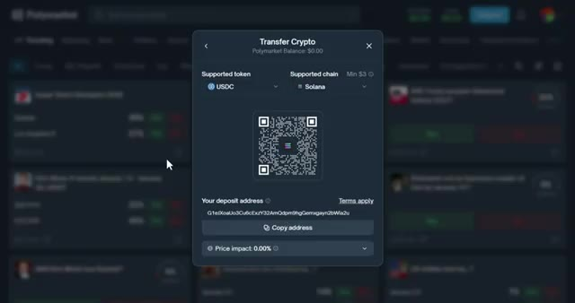
*⏱️ 00:02:31 — Interface de dépôt Polymarket affichant une fenêtre de transfert de crypto avec un jeton USDC, une chaîne Solana, un code QR et une adresse de dépôt.*

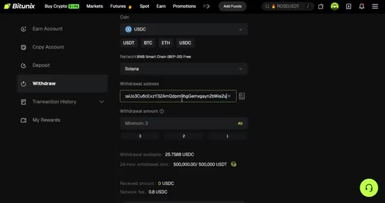
*⏱️ 00:02:42 — Interface de retrait Bitunix montrant le formulaire de retrait d'USDC avec l'adresse de portefeuille copiée.*

---

### ⏱️ `[00:02:47 - 00:03:17]` | Segment #07

**🔊 Audio (Transcription Intégrale Mot pour Mot en Français) :**
> Très bien, passons à la première stratégie. J'appelle celle-ci « il ne se passe jamais rien ». La plupart des traders perdent parce qu'ils pensent que les grands titres comptent. Ils pensent que chaque rumeur est le début de la Troisième Guerre mondiale. Pendant ce temps, les professionnels connaissent la vérité. Il ne se passe jamais rien. 90 % du battage médiatique géopolitique se solde par des impasses, le silence, ou « on se retrouve jeudi prochain ». Les particuliers voient un titre et achètent rapidement du « oui ». Après avoir analysé, vous achetez stratégiquement du « non ». Voici pourquoi cela fonctionne.

**👁️ Analyse Visuelle d'Écran (gemini-3.5-flash-lite) :**
**Interface & Outils** : Polymarket (plateforme de prédiction décentralisée)

**Contenu textuel & Code** : Marchés de prédiction avec pourcentages de probabilité (ex: 94%, 98%, 2%), volumes de transactions ($2M Vol), dates d'échéance et boutons de pari Oui/Non.

**Action / Démonstration** : Navigation et recherche sur la plateforme pour illustrer l'analyse des marchés de prédiction face aux rumeurs géopolitiques.

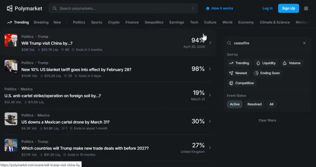
*⏱️ 00:02:55 — Capture d'écran du site Polymarket montrant une liste de marchés de prédiction axés sur la politique et les actualités internationales, avec des pourcentages de probabilité élevés pour le maintien du statu quo.*

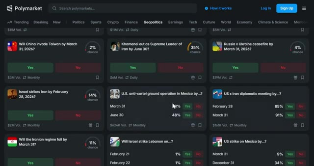
*⏱️ 00:03:10 — Vue de la section Géopolitique de Polymarket affichant divers contrats avec des options « Yes » et « No » sur des conflits ou des événements majeurs (Chine/Taïwan, Iran, Ukraine, etc.) montrant de faibles probabilités d'escalade.*

---

### ⏱️ `[00:03:18 - 00:03:55]` | Segment #08

**🔊 Audio (Transcription Intégrale Mot pour Mot en Français) :**
> Les grands titres émotionnels créent des pics de prix temporaires, mais les fondamentaux ne changent pas. Vous jouez contre la psychologie humaine, pas contre l'événement. Voici comment vous pouvez faire cela. Configurez des pièges d'alertes en temps réel sur X, Telegram ou Discord. Vous voulez que les accros à la dopamine travaillent pour vous. Chaque fois que le "oui" s'envole de 15 % en quelques heures, achetez du "non" instantanément. Chaque fois qu'une rumeur récurrente fait monter le "oui" pour la troisième, quatrième ou cinquième fois, vous chargez du "non". Chaque fois qu'un nouveau marché s'ouvre avec un prix du "oui" ridiculement bas, vous achetez du "non" tôt et vous le laissez redescendre à la réalité. Rendez votre sortie simple. Prenez 15 à 30 % de profit ou

**👁️ Analyse Visuelle d'Écran (gemini-3.5-flash-lite) :**
**Interface & Outils** : Réseau social X (Twitter) et plateforme de prédiction Polymarket.

**Contenu textuel & Code** : Fil d'actualité, tweets, graphique de probabilité de marché avec des variations en pourcentage et panneau d'achat/vente (Buy/Sell).

**Action / Démonstration** : Navigation et présentation d'une interface de marché de prédiction illustrant la volatilité liée aux actualités géopolitiques.

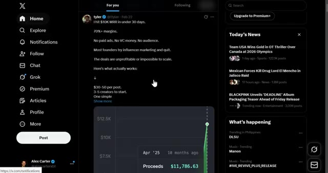
*⏱️ 00:03:27 — Capture d'écran du réseau social X (Twitter) montrant un fil d'actualité avec un tweet sur les performances de revenus et les actualités du jour.*

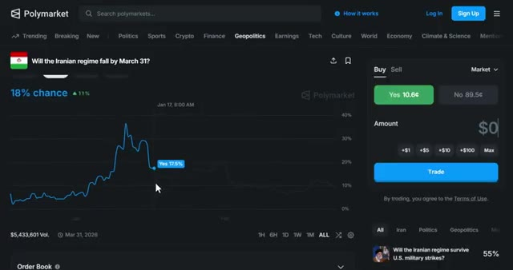
*⏱️ 00:03:36 — Interface de la plateforme de prédiction Polymarket affichant un marché géopolitique ('Will the Iranian regime fall by March 31?') avec un graphique de probabilité et un panneau de trading.*

---

### ⏱️ `[00:03:55 - 00:04:29]` | Segment #09

**🔊 Audio (Transcription Intégrale Mot pour Mot en Français) :**
> attendez le retranchement complet. Et sortez toujours tôt si des preuves concrètes tombent. Vous vendez le battage médiatique, vous achetez l'ennui. Vous tradez la nature humaine. Comme vous pouvez le voir, ce marché a grimpé en flèche sur un titre. puis a lentement saigné à nouveau. Si vous avez acheté au moment du pic, vous avez gagné de l'argent facilement. La deuxième stratégie consiste à copier le trading de baleines rentables. Et pour cela, vous avez besoin de TradeFox. Certains portefeuilles sont des monstres, des rendements constants à sept chiffres. Ils ne devinent pas. Ils ont des systèmes, de l'arbitrage, des paires delta neutres, des flux de données, parfois de véritables initiés. Avec ces facteurs en place, vous ne pouvez pas

**👁️ Analyse Visuelle d'Écran (gemini-3.5-flash-lite) :**
**Interface & Outils** : Polymarket (site web de marchés de prédiction)

**Contenu textuel & Code** : Graphique de probabilité montrant un pic à 25-30% suivi d'une baisse (Yes à 1.4¢, No à 98.8¢, volume total supérieur à 4,2 millions de dollars).

**Action / Démonstration** : Visualisation du graphique de prix d'un événement géopolitique reflétant le battage médiatique et sa baisse ultérieure (analyse de sentiment et de prix).

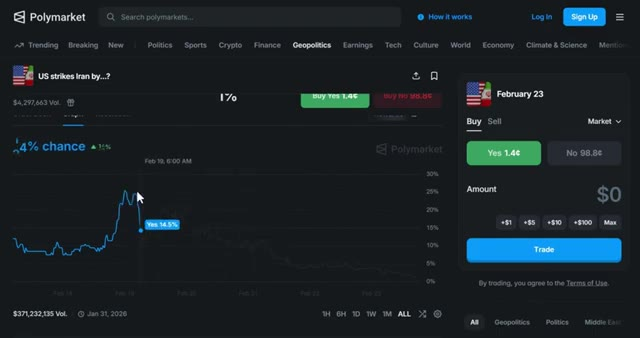
*⏱️ 00:04:03 — Capture d'écran de la plateforme Polymarket montrant un graphique de marché de prédiction géopolitique sur un événement hypothétique (frappes américaines sur l'Iran). Le graphique illustre une hausse soudaine suivie d'un déclin progressif.*

---

### ⏱️ `[00:04:29 - 00:05:02]` | Segment #10

**🔊 Audio (Transcription Intégrale Mot pour Mot en Français) :**
> battez ces traders, mais vous pouvez les copier. TradeFox est le seul outil dont vous avez besoin pour cela. C'est un agrégateur de marchés de prédiction professionnel et une plateforme de copy trading spécialement conçue pour Polymarket. Voici ce qui rend TradeFox puissant. Vous pouvez automatiquement refléter les transactions des traders les plus performants avec des paramètres personnalisables. Vous pouvez définir des montants fixes par transaction ou utiliser des pourcentages. Par exemple, si une baleine parie 500 dollars, vous pouvez automatiquement parier 10 % de cela, soit 50 dollars. Vous pouvez définir des take profits, des stop losses et même des trailing stops pour protéger votre capital.

**👁️ Analyse Visuelle d'Écran (gemini-3.5-flash-lite) :**
**Interface & Outils** : TradeFox (agrégateur de marchés de prédiction et plateforme de copy trading pour Polymarket)

**Contenu textuel & Code** : Graphiques de probabilités, carnets d'ordres, classement de traders avec métriques de profits et volumes, et paramètres de configuration de copy trading (fonds alloués, montants par trade).

**Action / Démonstration** : Navigation sur l'interface de TradeFox, consultation des marchés et configuration du copy trading.

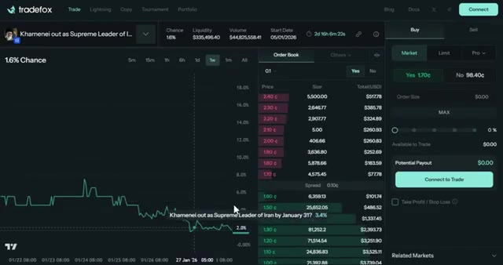
*⏱️ 00:04:37 — Interface de TradeFox affichant un graphique de probabilité de marché de prédiction avec carnet d'ordres et panneau d'achat.*

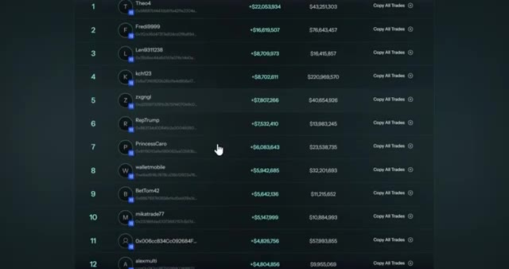
*⏱️ 00:04:45 — Classement des meilleurs traders sur la plateforme TradeFox avec leurs profits et volumes de transactions.*

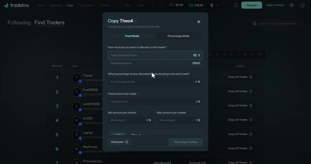
*⏱️ 00:04:54 — Fenêtre de configuration du copy trading pour un trader spécifique (Theo4) sur TradeFox, montrant les modes d'allocation de fonds.*

---

### ⏱️ `[00:05:03 - 00:05:21]` | Segment #11

**🔊 Audio (Transcription Intégrale Mot pour Mot en Français) :**
> Tradefox suit les performances des traders en temps réel. Certains de ces gros investisseurs affichent des gains allant jusqu'à 8 000 %. Vous pouvez également coller manuellement des adresses de portefeuille si vous trouvez un gros investisseur que vous souhaitez copier en dehors de la plateforme. Voici comment procéder correctement. Pas de « all-in ». N'autorisez que des allocations de 1 % à 2 % par gros investisseur. Vous voulez 5 gros investisseurs maximum.

**👁️ Analyse Visuelle d'Écran (gemini-3.5-flash-lite) :**
**Interface & Outils** : Plateforme de copy trading Tradefox

**Contenu textuel & Code** : Valeur totale du portefeuille (30,04 $), PnL global (+22 053 934,00 $), volume total (43 251 303,17 $), récompenses LP (1 712,84 $), graphique d'historique de PnL et tableau de l'historique des transactions.

**Action / Démonstration** : Consultation des performances et de l'historique des trades d'un investisseur spécifique sur Tradefox.

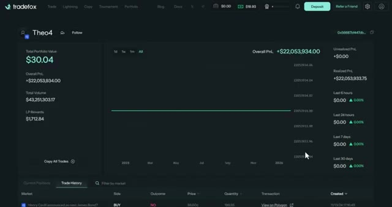
*⏱️ 00:05:07 — Capture d'écran de l'interface de Tradefox affichant le profil et les performances d'un trader (Theo4), avec des métriques de portefeuille et un graphique de PnL global.*

---

### ⏱️ `[00:05:21 - 00:05:41]` | Segment #12

**🔊 Audio (Transcription Intégrale Mot pour Mot en Français) :**
> Copiez-en trop et vous devenez un fonds indiciel. Votre travail est de rouler derrière eux sans devenir gourmand. Ayez une gestion des risques solide. Ne copiez jamais à 100 %. Gardez 60 à 70 % de votre bankroll pour vos propres trades. Arrêtez de copier n'importe quelle baleine après deux semaines consécutives de moins 20 %. Comme vous pouvez le voir, ces portefeuilles génèrent des rendements constants.

**👁️ Analyse Visuelle d'Écran (gemini-3.5-flash-lite) :**
**Interface & Outils** : Plateforme de trading TradeFox (Interface de tournoi et de copy trading)

**Contenu textuel & Code** : Tableau de classement affichant les adresses des participants (ex: 0x3215...dA0e4C, 0x3E0E...0a2d99), le volume échangé (ex: $484,516.37), les variations sur 24h et les boutons "Follow" et "Copy Trades".

**Action / Démonstration** : Navigation et consultation du classement des meilleurs traders du tournoi TradeFox pour sélectionner les portefeuilles à copier.

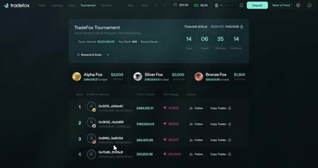
*⏱️ 00:05:26 — Capture d'écran de l'interface de TradeFox montrant le tableau de classement (Leaderboard) d'un tournoi de trading de copy trading avec les adresses des traders, leur volume et les boutons de copie.*

---

### ⏱️ `[00:05:42 - 00:06:06]` | Segment #13

**🔊 Audio (Transcription Intégrale Mot pour Mot en Français) :**
> Tu n'essaies pas d'être plus intelligent qu'eux. Tu fais simplement suivre l'argent intelligent. TradeFox rend cela complètement automatisé. Tu le configures une seule fois et ça tourne en arrière-plan. Tu peux découvrir TradeFox via le lien ci-dessous. Et voici le meilleur. Si tu utilises mon lien TradeFox, tu peux gagner 35 % de tous les frais de tes filleuls directs, 10 % des filleuls de second degré et 5 % des filleuls de troisième degré.

**👁️ Analyse Visuelle d'Écran (gemini-3.5-flash-lite) :**
**Interface & Outils** : Site web et interface de trading de la plateforme TradeFox

**Contenu textuel & Code** : Section "About" textuelle, graphique de prix pour XRP, carnet d'ordres (Order Book), options de type d'ordre (Market, Limit, Stop-Limit), soldes et gestion des positions.

**Action / Démonstration** : Navigation sur la documentation de la plateforme TradeFox puis affichage de l'interface de trading interactive avec le graphique et le carnet d'ordres.

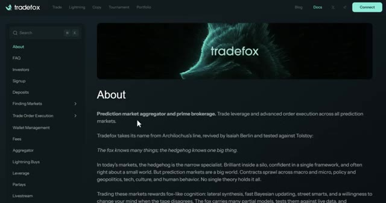
*⏱️ 00:05:48 — Page "About" de la plateforme TradeFox avec le menu latéral et le logo.*

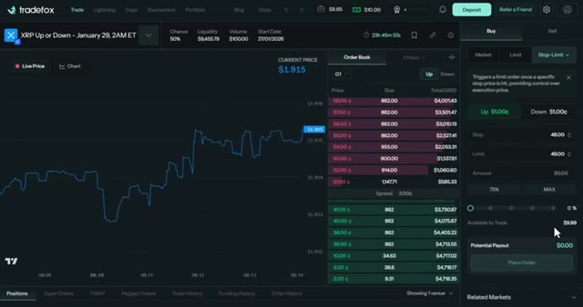
*⏱️ 00:05:54 — Interface de trading TradeFox montrant un graphique de prix pour XRP, un carnet d'ordres (Order Book) et un panneau de passage d'ordres à droite.*

---

### ⏱️ `[00:06:06 - 00:06:43]` | Segment #14

**🔊 Audio (Transcription Intégrale Mot pour Mot en Français) :**
> Donc c'est un système de parrainage à trois niveaux, ce qui est assez dingue si vous partagez cela avec votre communauté. La stratégie numéro trois est le scalping d'actualités, ou ce que j'aime appeler acheter le titre, vendre le rebond. C'est pour les traders qui sont chroniquement en ligne. Quand une nouvelle de dernière minute tombe, le momentum explose avant que quiconque ne comprenne ce qui se passe. Si vous êtes rapide, vous surfez sur la première vague. Si vous êtes en retard, vous devenez de la nourriture pour les baleines. Voici l'action que vous pouvez réellement faire. Dès qu'un titre à fort impact tombe, tel qu'une annonce de Trump, une décision de la Fed, un cessez-le-feu, de nouveaux tarifs douaniers, un scandale politique de dernière minute, vous achetez alors le côté qui s'envole. Vous n'avez pas besoin de trop réfléchir. Le momentum l'emporte sur la logique.

**👁️ Analyse Visuelle d'Écran (gemini-3.5-flash-lite) :**
**Interface & Outils** : Polymarket (Plateforme de prédiction décentralisée)

**Contenu textuel & Code** : Liste de marchés de prédiction classés par catégories (Trending, Politics, Tech, etc.), volumes de transaction (ex: $371M Vol.), pourcentages de probabilité (ex: 85% chance) et interface de trading (options Yes/No).

**Action / Démonstration** : Navigation à travers les marchés tendance et sélection d'un événement spécifique lié à une actualité technologique pour illustrer le scalping d'actualités.

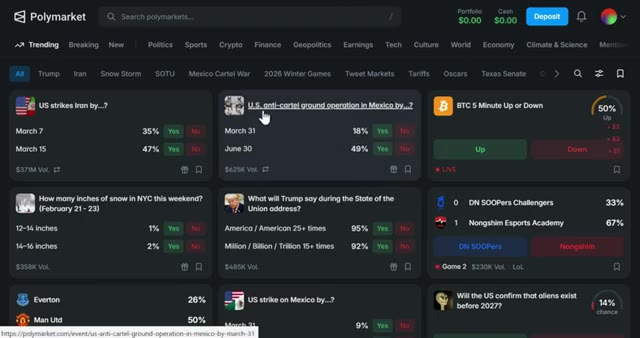
*⏱️ 00:06:15 — Capture d'écran de l'interface principale de la plateforme Polymarket montrant une grille de différents marchés de prédiction tendance (politique, crypto, actualités).*

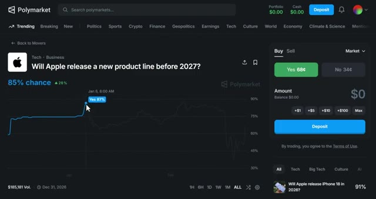
*⏱️ 00:06:25 — Vue détaillée d'un marché spécifique sur Polymarket concernant Apple ("Will Apple release a new product line before 2027?") avec un graphique de probabilité et le panneau d'achat à droite.*

---

### ⏱️ `[00:06:44 - 00:07:11]` | Segment #15

**🔊 Audio (Transcription Intégrale Mot pour Mot en Français) :**
> Ensuite, vous revendez aux acheteurs paniqués en quelques minutes. Cette stratégie repose sur la vitesse pure. Les 30 premières secondes comptent. Si vous êtes en retard, ne courez pas après le cours. Vous vendez avant que le carnet d'ordres ne s'amincisse. L'argent se fait avant l'arrivée des investisseurs particuliers. Regardez ça. Le marché a bondi de 77 % dans la première minute, puis a lentement reflué. Si vous avez acheté au moment du pic et vendu cinq minutes plus tard, vous avez fait 70 à 75 % en quelques minutes. C'est ce qui se rapproche le plus de l'adrénaline du day trading que vous trouverez sur la chaîne.

**👁️ Analyse Visuelle d'Écran (gemini-3.5-flash-lite) :**
**Interface & Outils** : Plateforme de prédiction Polymarket (site web)

**Contenu textuel & Code** : Listes de marchés de prédiction ("Breaking News"), pourcentages de probabilité (ex: 100%, 84%, 90%), graphiques d'évolution des chances, volume de transactions ($694,452 Vol.).

**Action / Démonstration** : Navigation sur la plateforme Polymarket et visualisation d'un graphique de probabilité de marché pour illustrer la rapidité des mouvements de prix et la réactivité nécessaire.

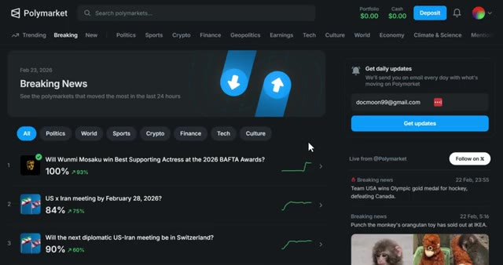
*⏱️ 00:06:51 — Vue d'ensemble de la plateforme Polymarket montrant les marchés de prédiction en tendance avec des pourcentages de probabilité et de variation.*

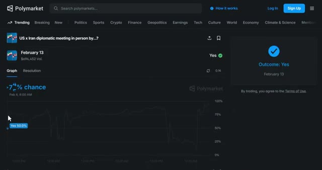
*⏱️ 00:06:58 — Graphique détaillé des probabilités d'un marché spécifique sur Polymarket montrant l'évolution des pourcentages de chance au fil du temps.*

---

### ⏱️ `[00:07:12 - 00:07:45]` | Segment #16

**🔊 Audio (Transcription Intégrale Mot pour Mot en Français) :**
> La stratégie numéro quatre est le trading basé sur la personnalité. Certaines personnes parlent trop. Certains politiciens font des monologues d'une heure et répètent des phrases six fois. D'autres politiciens font des déclarations de 12 minutes avec des prompteurs et zéro surprise. Cette prévisibilité est un avantage. Voici la stratégie. Pariez oui sur les mentions prévisibles lors de longs discours ou pariez non lorsque l'orateur est contrôlé, scripté, ou peu susceptible de s'écarter du texte. Vous tradez le comportement humain, pas la politique. Les événements dont la durée est prévue de longue date et qui présentent des enjeux émotionnels élevés sont des mines d'or parce que

**👁️ Analyse Visuelle d'Écran (gemini-3.5-flash-lite) :**
**Interface & Outils** : Polymarket (plateforme de prédiction décentralisée)

**Contenu textuel & Code** : Marchés de prédiction politique, pourcentages de probabilité, volumes de transaction ($33,861, $23.8K, etc.), boutons d'achat "Yes" et "No" avec leurs prix en centimes, filtres de recherche.

**Action / Démonstration** : Navigation et consultation de différents marchés de prédiction politique sur la plateforme Polymarket en lien avec le comportement et les déclarations de politiciens.

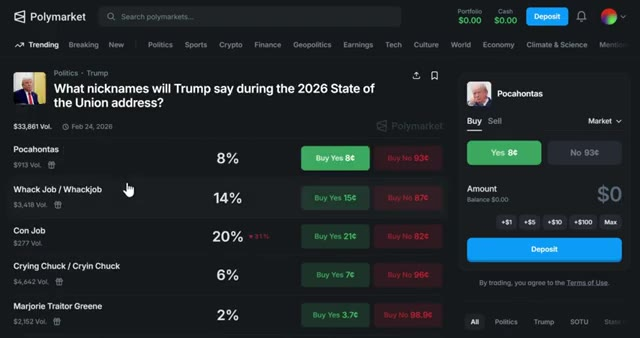
*⏱️ 00:07:20 — Capture d'écran de la plateforme Polymarket montrant un marché de prédiction politique lié aux surnoms que Donald Trump pourrait utiliser lors d'un discours, avec les probabilités et volumes associés pour chaque option (ex: Pocahontas à 8%, Con Job à 20%).*

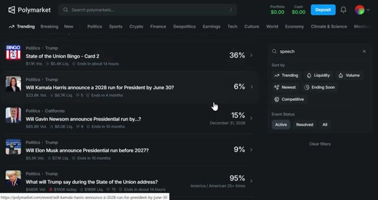
*⏱️ 00:07:37 — Capture d'écran de Polymarket affichant une liste de marchés de prédiction politique incluant des paris sur les déclarations ou annonces de personnalités politiques (Kamala Harris, Gavin Newsom, Elon Musk, Donald Trump).*

---

### ⏱️ `[00:07:45 - 00:08:14]` | Segment #17

**🔊 Audio (Transcription Intégrale Mot pour Mot en Français) :**
> Les gens oublient les schémas des orateurs et parient de manière émotionnelle au lieu de le faire de façon statistique. Par exemple, le discours du président américain Donald Trump avait un marché de prédiction. Qu'allait dire Trump au Sommet de l'énergie et de l'innovation le 15 juillet ? Oui, le fait qu'il dise millions, milliard ou billion se négociait à 30,5 cents. Le discours a duré plus de deux heures, et il l'a mentionné 15 fois. Oui, résolu, ce qui donne près de 70 pour cent de profit. Vous ne prédisez pas la politique. Vous prédisez la personnalité.

**👁️ Analyse Visuelle d'Écran (gemini-3.5-flash-lite) :**
**Interface & Outils** : Polymarket et YouTube

**Contenu textuel & Code** : Marché de prédiction Polymarket avec le marché « What will Trump say at the Energy and Innovation Summit on July 15? », affichant le volume ($256,347 Vol.), les probabilités sous forme de graphique linéaire, et des marchés associés dans la barre latérale droite.

**Action / Démonstration** : Présentation d'un marché de prédiction Polymarket illustrant comment les utilisateurs parient sur des événements spécifiques basés sur les discours politiques.

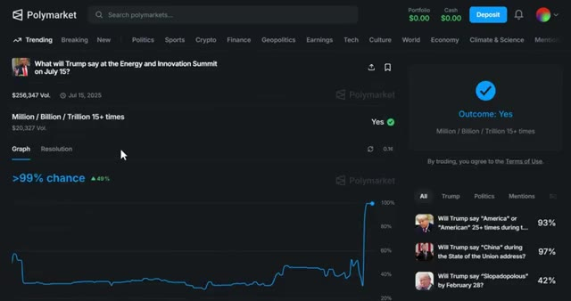
*⏱️ 00:07:53 — Capture d'écran de la plateforme Polymarket affichant un marché de prédiction lié au discours de Donald Trump au Sommet de l'énergie et de l'innovation du 15 juillet, avec un graphique montrant une forte probabilité (>99%) pour l'issue « Yes ».*

---

### ⏱️ `[00:08:15 - 00:08:44]` | Segment #18

**🔊 Audio (Transcription Intégrale Mot pour Mot en Français) :**
> La stratégie numéro cinq concerne spécifiquement les baisses de taux de la Fed. La Réserve fédérale annonce tout à l'avance. Ils vous préviennent dans des discours. Ils font des fuites par l'intermédiaire de leurs journalistes préférés. Ils publient des comptes rendus. Ils disent en gros, nous allons baisser les taux le mois prochain. Pourtant, d'une manière ou d'une autre, les marchés se trompent encore dans leurs prix. Les voix clés à suivre sont Jerome Powell, John C. Williams, Philip Jefferson, Christopher Waller, et surtout Nick Timiraos du Wall Street Journal, le messager non officiel de la Fed.

**👁️ Analyse Visuelle d'Écran (gemini-3.5-flash-lite) :**
**Interface & Outils** : Site web officiel de la Réserve fédérale (Federal Reserve) et outil CME FedWatch.

**Contenu textuel & Code** : Données de probabilités de taux (Ease: 4.1%, No Change: 95.9%, Hike: 0.0%) et calendrier des réunions du FOMC.

**Action / Démonstration** : Navigation sur les sites officiels pour illustrer les annonces et prévisions de taux de la Fed.

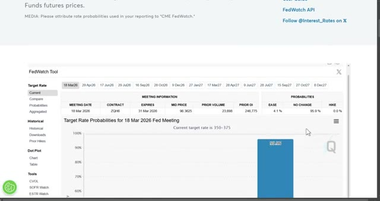
*⏱️ 00:08:29 — Interface de l'outil CME FedWatch affichant les probabilités des taux directeurs pour la réunion de la Fed du 18 mars 2026.*

---

### ⏱️ `[00:08:44 - 00:09:03]` | Segment #19

**🔊 Audio (Transcription Intégrale Mot pour Mot en Français) :**
> Votre travail consiste à lire ces signaux plus rapidement que les particuliers en suivant leurs discours sur federalreserve.gov, en regardant Timur House sur X, en vérifiant CME FedWatch pour repérer le moment où les probabilités du marché prennent du retard par rapport au nouveau narratif. Lorsque la banque centrale fait allusion à un mouvement, vous tradez avant la réévaluation.

**👁️ Analyse Visuelle d'Écran (gemini-3.5-flash-lite) :**
**Interface & Outils** : Navigateur web affichant federalreserve.gov, X (anciennement Twitter), et l'outil CME FedWatch.

**Contenu textuel & Code** : Filtres de recherche de communiqués de presse, publications de Nick Timiraos sur X, graphique en barres des probabilités de taux directeurs (95.9% pour 350-375 bps et 4.1% pour 325-350 bps).

**Action / Démonstration** : Navigation et consultation de sources officielles, de fils d'actualités sur les réseaux sociaux et d'outils de probabilités de marché pour analyser les anticipations de taux.

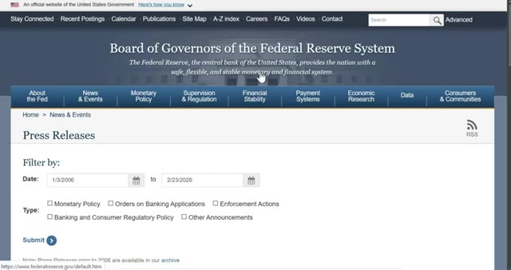
*⏱️ 00:08:49 — Capture d'écran du site web federalreserve.gov affichant la section des communiqués de presse (Press Releases) avec des options de filtrage par date et type.*

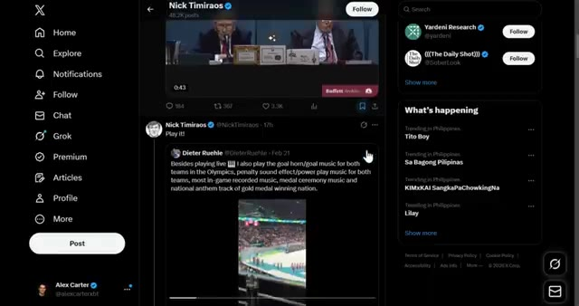
*⏱️ 00:08:53 — Capture d'écran de la plateforme X montrant le profil de Nick Timiraos avec des publications et des vidéos intégrées.*

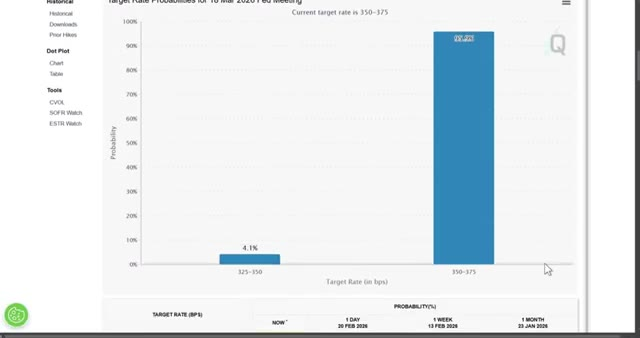
*⏱️ 00:08:58 — Capture d'écran du tableau de bord CME FedWatch affichant les probabilités des taux cibles pour la réunion de la Fed avec un graphique en barres.*

---

### ⏱️ `[00:09:04 - 00:09:40]` | Segment #20

**🔊 Audio (Transcription Intégrale Mot pour Mot en Français) :**
> Ça fonctionne parce que les investisseurs particuliers sous-estiment à quel point les marchés s'ajustent lentement aux actualités macroéconomiques ennuyeuses. La liquidité n'est pas instantanée. Les prix ont un temps de retard. Vous tradez ce temps de retard et vous encaissez. Maintenant, avant de tout miser sur Polymarket, il y a quelques erreurs critiques que vous devez éviter. Laissez-moi vous montrer comment vous protéger. Très bien, parlons gestion des risques parce que c'est là que la plupart des débutants grillent leurs comptes. Conseil numéro un, lisez toujours les règles. Je n'insisterez jamais assez là-dessus. Les règles sont primordiales. Si vous ne lisez pas les règles, vous jouez. Si vous lisez les règles, vous tradez. Conseil numéro deux, commencez petit. Ne

**👁️ Analyse Visuelle d'Écran (gemini-3.5-flash-lite) :**
**Interface & Outils** : Polymarket (Plateforme de marchés de prédiction décentralisée)

**Contenu textuel & Code** : Graphiques de probabilités, volumes de transaction, options d'achat/vente (Buy/Sell Yes/No), pourcentages de prédiction et montants en jeu.

**Action / Démonstration** : Navigation et consultation de marchés macroéconomiques et politiques sur une plateforme de prédiction.

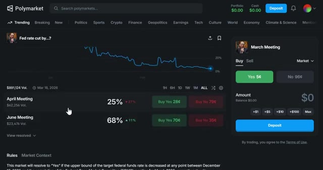
*⏱️ 00:09:13 — Capture d'écran de la plateforme Polymarket montrant un marché de prédiction lié à la Fed (taux d'intérêt), avec des probabilités et un graphique d'évolution temporelle.*

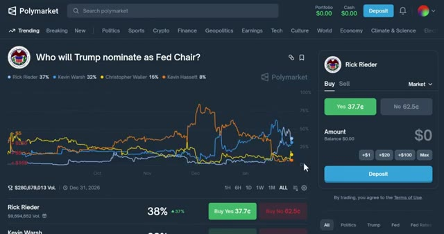
*⏱️ 00:09:22 — Capture d'écran de Polymarket montrant un autre marché de prédiction concernant la nomination du prochain président de la Fed par Trump, avec plusieurs courbes de probabilité comparées.*

---

### ⏱️ `[00:09:40 - 00:10:10]` | Segment #21

**🔊 Audio (Transcription Intégrale Mot pour Mot en Français) :**
> allez-y à fond sur votre premier trade. Commencez avec 10 à 20 dollars et apprenez à vous familiariser avec le fonctionnement de la plateforme. Une fois que vous êtes à l'aise, vous pouvez augmenter la mise. Conseil numéro trois, diversifiez vos trades. Ne mettez pas tout votre argent sur un seul marché. Répartissez-le sur plusieurs opportunités de gains garantis. De cette façon, même si un trade tourne mal, vous restez globalement rentable. Conseil numéro quatre, suivez vos trades. Tenez un simple tableur de chaque trade que vous effectuez. Notez le marché, la cote à laquelle vous avez acheté, les règles et le résultat. Cela vous aidera à identifier des tendances et à vous améliorer avec le temps.

**👁️ Analyse Visuelle d'Écran (gemini-3.5-flash-lite) :**
**Interface & Outils** : Polymarket, Google Sheets

**Contenu textuel & Code** : Interface de trading de Polymarket avec choix d'options 'Yes'/'No', montants et soldes de portefeuille, ainsi qu'un tableur pour organiser les paris.

**Action / Démonstration** : Navigation sur la plateforme de paris prédictifs Polymarket et organisation des différentes catégories de trades.

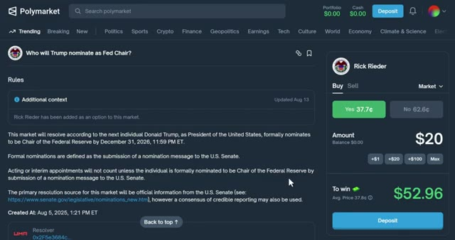
*⏱️ 00:09:47 — Interface détaillée d'un marché spécifique sur Polymarket concernant la nomination par Trump du président de la Fed, avec un montant de trade de 20 dollars affiché.*

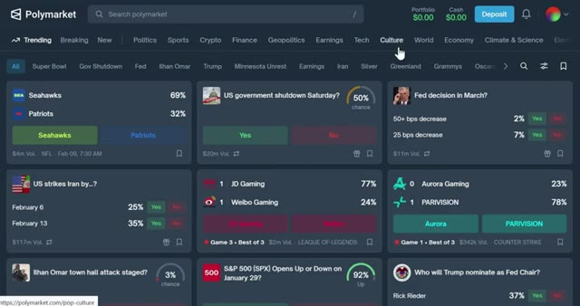
*⏱️ 00:09:55 — Vue d'ensemble de la page d'accueil de la plateforme Polymarket montrant plusieurs marchés de prédiction classés par catégories.*

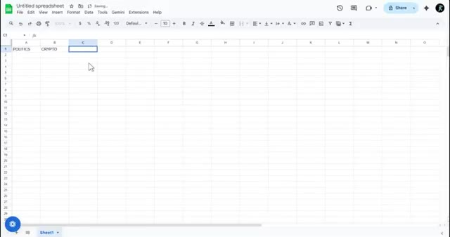
*⏱️ 00:10:03 — Un tableur Google Sheets vide avec les en-têtes de colonnes 'POLITICS' et 'CRYPTO', servant à la diversification des trades.*

---

### ⏱️ `[00:10:11 - 00:10:33]` | Segment #22

**🔊 Audio (Transcription Intégrale Mot pour Mot en Français) :**
> Je vais également sortir d'autres vidéos sur le trading et les marchés de prédiction concernant les stratégies Polymarket avancées, y compris les parties deux et trois de cette série. Assurez-vous donc de vous abonner et de cliquer sur l'icône de cloche pour ne pas les rater. Et si vous voulez automatiser votre copy trading et suivre les baleines, allez voir Tradebox. C'est le seul outil que j'utilise pour le copy trading sur Polymarket.

**👁️ Analyse Visuelle d'Écran (gemini-3.5-flash-lite) :**
**Interface & Outils** : Interface web de Polymarket (marchés de prédiction décentralisés).

**Contenu textuel & Code** : Pourcentages de probabilité des différents événements, graphiques d'évolution temporelle des prix (ex: 37% de chance), carnets d'ordres et options de trading (boutons d'achat/vente Oui/Non).

**Action / Démonstration** : Navigation et présentation des marchés de prédiction et des graphiques de probabilités sur Polymarket.

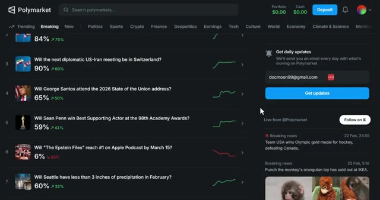
*⏱️ 00:10:16 — Capture d'écran de la plateforme Polymarket montrant une liste de marchés de prédiction en tendance avec leurs pourcentages de probabilité et des graphiques d'évolution miniatures.*

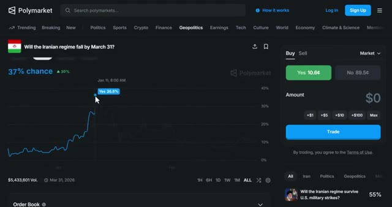
*⏱️ 00:10:27 — Vue détaillée d'un marché spécifique sur Polymarket ("Will the Iranian regime fall by March 31?") avec un graphique d'historique des prix, les options d'achat/vente (Yes/No) et un carnet d'ordres.*

---

### ⏱️ `[00:10:33 - 00:10:53]` | Segment #23

**🔊 Audio (Transcription Intégrale Mot pour Mot en Français) :**
> Le lien est dans la description si vous avez trouvé cette vidéo utile, laissez un pouce bleu en bas si vous avez des questions, posez-les dans les commentaires et je répondrai à chacune d'elles, et si vous voulez un guide complet sur le fonctionnement de la plateforme Polymarket, regardez la vidéo qui s'affiche à l'écran dès maintenant, merci d'avoir regardé et je vous dis à la prochaine.

**👁️ Analyse Visuelle d'Écran (gemini-3.5-flash-lite) :**
**Interface & Outils** : Site web de Polymarket (plateforme de marchés de prédiction).

**Contenu textuel & Code** : Divers marchés de prédiction (Seahawks vs Patriots, US government shutdown, Fed decision, etc.) avec leurs pourcentages de probabilité et volumes.

**Action / Démonstration** : Navigation et présentation de l'interface d'accueil de la plateforme de prédiction Polymarket.

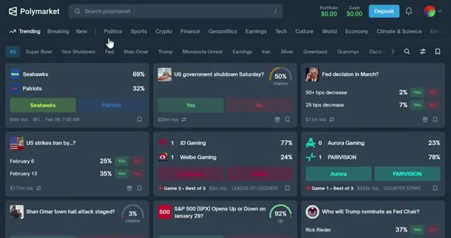
*⏱️ 00:10:38 — Interface principale de la plateforme Polymarket montrant plusieurs marchés de prédiction et de paris (sport, politique, économie).*

---

