# 🎬 How To Trade 24/7 with MEXC Trading Bots (Step-by-Step Guide)

> **Chaîne** : [Alex Carter](https://www.youtube.com/@AlexCarterTrading)  
> **Lien YouTube** : [https://www.youtube.com/watch?v=-BPizIQvDqg](https://www.youtube.com/watch?v=-BPizIQvDqg)  
> **Date de publication** : 20260302  
> **Durée** : 00:11:18  
> **Identifiant vidéo** : `-BPizIQvDqg`  
> **Transcription & Analyse** : `whisper-v3-large-turbo+gemini-3.5-flash-lite`  

---

## 📌 Synthèse Exécutive & Outils

### 💡 Résuboite
Cette vidéo propose une incursion complète et pragmatique dans l'univers de l'automatisation des investissements cryptographiques, en mettant l'accent sur les outils de trading algorithmique 24h/24 et 7j/7 de la plateforme MEXC. L'animateur y décortique méthodiquement trois piliers majeurs pour générer du rendement en pilotage automatique : l'accumulation passive via les bots Spot DCA (Dollar Cost Averaging), l'exploitation de la volatilité à court et moyen terme grâce aux bots de grille Futures, et la délégation stratégique par le biais de l'AI Copy Trading. Loin de se limiter à de simples présentations d'interfaces, le guide détaille les mécaniques de paramétrage fin (choix des horizons temporels, modes arithmétique ou géométrique, gestion de l'effet de levier) pour transformer des stratégies complexes en plans d'action accessibles, tout en insistant lourdement sur la préservation du capital.

L'analyse technique et opérationnelle déployée dans ce tutoriel s'articule autour de la maîtrise du risque et de l'optimisation des points d'entrée. Qu'il s'agisse de configurer des plages de prix d'achat pour éviter les sommets de marché en DCA, de calibrer le nombre de grilles sur les contrats Futures pour moduler la fréquence et la taille des profits, ou de sélectionner rigoureusement un trader algorithmique via des ratios de réplication intelligents, chaque concept est pensé pour industrialiser la prise de décision. En combinant des approches quantitatives basées sur des données historiques (ROI sur différentes périodes) et des gardes-fous stricts (Stop Loss, Take Profit, contrôle du ratio de liquidation), la méthode enseignée permet d'éliminer les biais émotionnels inhérents au trading manuel.

### 🛠️ Outils, Modèles & Logiciels Présentés
* **MEXC Spot DCA Bots** : Outil d'investissement programmé permettant d'automatiser des achats périodiques d'actifs numériques (Bitcoin, Ethereum, etc.) sans anticipation du marché.
* **MEXC Futures Grid Trading** : Solution de trading algorithmique par grille sur les contrats à terme, conçue pour générer des profits automatiques lors des phases de forte volatilité latérale ou directionnelle.
* **MEXC AI Copy Trade** : Fonctionnalité de social/algorithmic trading permettant de répliquer en temps réel et de manière automatisée les performances de traders et d'intelligences artificielles rentables.
* **TRC20** : Réseau blockchain recommandé pour l'acheminement des fonds (USDT) sur la plateforme en raison de la rapidité et de la modicité de ses frais de transaction.
* **Plans DCA Pré-faits** : Modèles d'investissement clés en main proposés par la plateforme, pré-configurés avec des allocations d'actifs et des intervalles optimisés pour les utilisateurs débutants.
* **Modes de grille Arithmétique et Géométrique** : Algorithmes de distribution des ordres d'achat/vente, le premier répartissant les grilles de façon équitable et le second concentrant les ordres près du prix actuel pour les marchés agités.
* **Smart Ratio (Copy Trading)** : Mode de réplication intelligent qui ajuste automatiquement l'exposition du portefeuille suiveur en fonction de la stratégie de risque du trader expert.

### 🔑 Points Clés & Enseignements Stratégiques
* **Accumulation sans biais émotionnel** : Le bot Spot DCA supprime la nécessité de chronométrer parfaitement le marché en lissant le prix d'achat moyen d'actifs majeurs (BTC, ETH, SOL) sur des échelles de temps allant d'un mois à cinq ans.
* **Diversification multi-actifs automatisée** : La possibilité de regrouper jusqu'à 10 jetons distincts au sein d'un même plan DCA avec des ratios d'allocation personnalisés permet de construire un panier indiciel sur-mesure.
* **Optimisation des zones d'accumulation** : L'activation des paramètres avancés (plage de prix d'achat) permet de restreindre l'action du bot aux seules phases de correction ou de consolidation, évitant ainsi d'exposer le capital lors de surchauffes haussières.
* **Exploitation de la volatilité latérale** : Le bot de grille Futures transforme les oscillations horizontales des cours en une source de profits récurrents, en achetant automatiquement sur les replis et en revendant sur les rebonds au sein d'une fourchette définie.
* **Hiérarchisation des horizons temporels IA** : L'utilisation des configurations pilotées par l'intelligence artificielle (allant de 7 jours à 6 mois) permet d'adapter instantanément la structure des grilles au profil de risque et à l'horizon d'investissement de l'opérateur.
* **Maîtrise de l'effet de levier et du risque de liquidation** : Sur les marchés dérivés, l'utilisation d'un effet de levier modéré (entre 5x et 10x maximum pour les débutants) est impérative pour éviter une liquidation prématurée du collatéral en cas de mouvement de marché violent.
* **Validation des modes de grille (Arithmétique vs Géométrique)** : Le choix d'une grille géométrique doit être privilégié sur les cryptomonnaies hautement volatiles, car elle resserre les ordres autour du prix spot actuel pour maximiser le nombre de micro-transactions rentables.
* **Implémentation systématique de Stop Loss et Take Profit** : La configuration obligatoire de seuils d'invalidation (par prix ou par pourcentage de PNL) sur les bots Futures garantit une gestion rigoureuse du risque de ruine et protège les gains accumulés.
* **Sélection multicritère des traders en Copy Trading** : L'évaluation d'un trader ne doit pas se limiter à son rendement sur 7 jours, mais doit intégrer son PNL sur 180 jours, son taux de réussite et son historique de pertes pour valider la robustesse de sa stratégie.
* **Allocation granulaire du capital de suivi** : Il est fortement déconseillé de concentrer l'intégralité de son capital sur un seul opérateur en copy trading ; la diversification des sources de réplication protège le portefeuille global d'un cygne noir individuel.
* **Préférer le Smart Ratio pour débuter** : Le mode de réplication par ratio intelligent est le paramètre par défaut recommandé pour les novices en copy trading, car il délégue la gestion proportionnelle du risque au trader expert tout en s'adaptant à la taille du portefeuille suiveur.

---

## ⏱️ Chronologie & Transcription Complète Audio & Visuelle (Mot pour Mot)

### ⏱️ `[00:00:00 - 00:00:25]` | Segment #01

**🔊 Audio (Transcription Intégrale Mot pour Mot en Français) :**
> Dans cette vidéo, je vais vous montrer exactement comment configurer des bots de trading sur Mexi qui fonctionnent 24h/24 et 7j/7 en pilotage automatique. Je vais aborder les bots DCA pour l'achat automatique, les bots de grille pour profiter de la volatilité, et le copy trading par IA où vous copiez automatiquement des traders rentables. Tout est expliqué étape par étape et vous aurez votre premier bot actif en moins de cinq minutes. Commençons. Première chose à faire, vous avez besoin d'un compte Mexi. Si vous n'en avez pas encore un, cliquez sur le lien dans la description.

**👁️ Analyse Visuelle d'Écran (gemini-3.5-flash-lite) :**
**Interface & Outils** : Interface web de l'échange de cryptomonnaies MEXC (sections plans DCA et copy trading).

**Contenu textuel & Code** : Liste de cryptomonnaies (BTC, ETH, SOL, XRP, GOLD, USDC, BNB, DOGE), pourcentages de ROI historique, profils de traders en copy trading avec rendements sur 7 jours (+120.64%, +448.28%, +89.22%) et messages de confirmation.

**Action / Démonstration** : Navigation à travers les options de configuration de bots d'investissement automatisé (DCA et copy trading) et création d'un plan DCA.

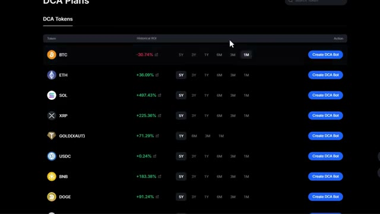
*⏱️ 00:00:06 — Interface de plans DCA sur une plateforme d'échange affichant une liste de tokens avec leur RSI historique et un bouton de création de bot.*

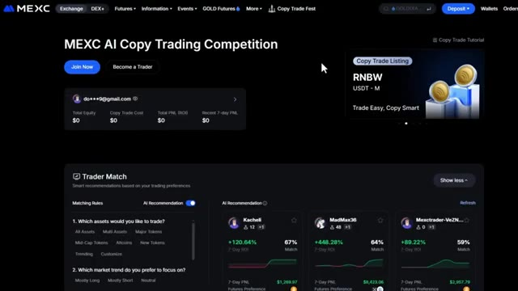
*⏱️ 00:00:12 — Page de la compétition de copy trading par IA sur l'échange MEXC, montrant des recommandations de traders avec leurs performances.*

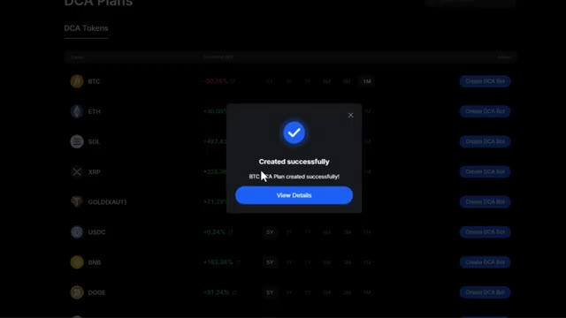
*⏱️ 00:00:19 — Fenêtre pop-up de confirmation indiquant qu'un plan DCA pour le Bitcoin (BTC) a été créé avec succès.*

---

### ⏱️ `[00:00:25 - 00:00:45]` | Segment #02

**🔊 Audio (Transcription Intégrale Mot pour Mot en Français) :**
> Vous obtiendrez un bon d'achat de 10 USDT rien qu'en créant un nouveau compte. Un autre bon d'achat de 10 USDT lorsque vous téléchargez et vous connectez sur l'application Mexi. En plus de cela, vous obtenez 770 USDT de récompenses pour les nouveaux utilisateurs, y compris des bonus futures, des airdrops de positions et des bons d'achat. Alors utilisez définitivement le lien dans la description.

**👁️ Analyse Visuelle d'Écran (gemini-3.5-flash-lite) :**
**Interface & Outils** : Site web de l'échange de cryptomonnaies MEXC.

**Contenu textuel & Code** : Bons d'achat de 10 USDT, bonus futures de 50 USDT, et récompenses totales de 770 USDT pour les nouveaux utilisateurs.

**Action / Démonstration** : Navigation sur la page des récompenses pour nouveaux utilisateurs de la plateforme MEXC.

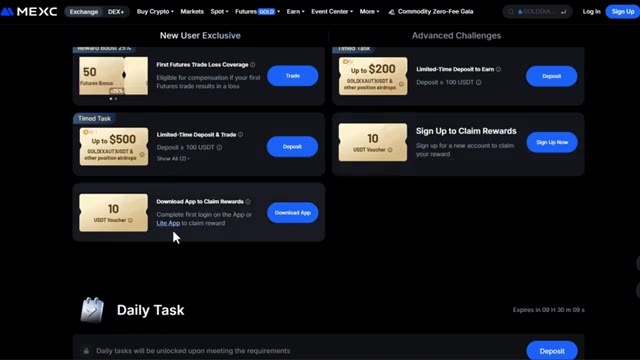
*⏱️ 00:00:30 — Interface de la plateforme MEXC montrant les tâches quotidiennes et les récompenses pour nouveaux utilisateurs, notamment un bon d'achat de 10 USDT pour le téléchargement de l'application.*

*⏱️ 00:00:35 — Interface de la plateforme MEXC affichant les récompenses exclusives pour les nouveaux utilisateurs, avec un total pouvant atteindre 770 USDT en bonus.*

---

### ⏱️ `[00:00:45 - 00:01:11]` | Segment #03

**🔊 Audio (Transcription Intégrale Mot pour Mot en Français) :**
> Ces bonus sont uniquement disponibles via mon lien, et c'est littéralement de l'argent gratuit avec lequel vous pouvez commencer à trader. Une fois connecté, assurez-vous d'avoir des fonds sur votre compte. Si vous devez faire un dépôt, cliquez sur dépôt dans le coin supérieur droit et cliquez sur dépôt en chaîne. Sélectionnez USDT, choisissez votre réseau. Je recommande TRC20 pour des frais bas et envoyez vos fonds depuis votre autre exchange ou portefeuille. Ils arriveront en quelques minutes. Maintenant, passons aux bots.

**👁️ Analyse Visuelle d'Écran (gemini-3.5-flash-lite) :**
**Interface & Outils** : Site web de l'échange de cryptomonnaies MEXC.

**Contenu textuel & Code** : Promitions promotionnelles de trading, frais à 0%, options de dépôt en cryptomonnaies (USDT, TRX).

**Action / Démonstration** : Navigation sur le site MEXC et visualisation de la procédure de dépôt de fonds.

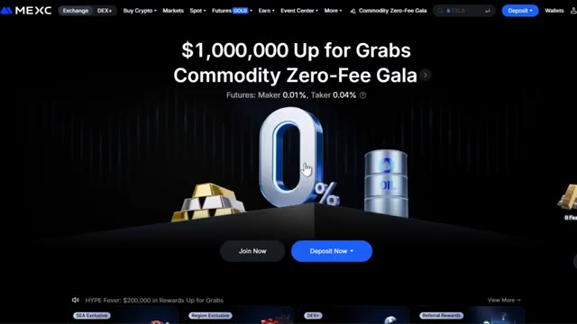
*⏱️ 00:00:52 — Page d'accueil de la plateforme d'échange MEXC mettant en avant une promotion 'Commodity Zero-Fee Gala' avec un grand '0%' et un bouton 'Deposit Now'.*

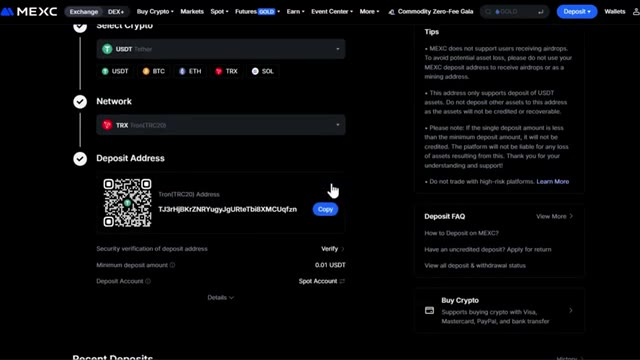
*⏱️ 00:01:05 — Interface de dépôt de la plateforme MEXC montrant la sélection de la crypto (USDT), du réseau (Tron TRC20) et l'adresse de dépôt avec un QR code.*

---

### ⏱️ `[00:01:12 - 00:01:30]` | Segment #04

**🔊 Audio (Transcription Intégrale Mot pour Mot en Français) :**
> Le premier endroit que nous allons couvrir est le bot SpotDCA. C'est parfait si vous voulez faire des achats périodiques par dollar (dollar cost average) en Bitcoin, en Ethereum, ou dans n'importe quelle autre cryptomonnaie automatiquement sans avoir à anticiper le marché. Pour y accéder, passez votre curseur sur Spot dans le menu supérieur et sélectionnez Spot DCA Bots. Cela vous amène au tableau de bord.

**👁️ Analyse Visuelle d'Écran (gemini-3.5-flash-lite) :**
**Interface & Outils** : Interface web de l'échangeur de cryptomonnaies MEXC.

**Contenu textuel & Code** : Allocation des jetons (BTC à 100%, ETH à 1%), intervalle DCA (tous les 1 jours à 15:00), montant par tour en USDT.

**Action / Démonstration** : Navigation dans les menus pour accéder au service Spot DCA et configuration d'un plan d'investissement automatique.

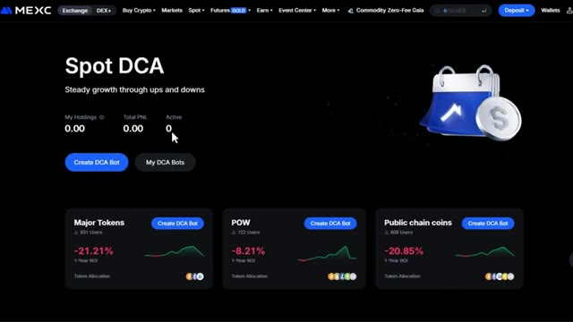
*⏱️ 00:01:16 — Page d'accueil du bot Spot DCA sur l'échangeur MEXC avec les options de création de bot.*

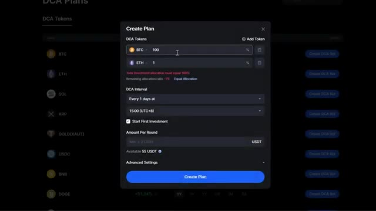
*⏱️ 00:01:21 — Fenêtre modale de configuration pour créer un plan DCA avec sélection des jetons (BTC, ETH), intervalle et montant.*

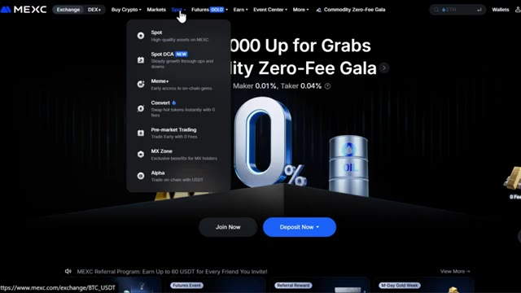
*⏱️ 00:01:25 — Menu déroulant de la plateforme MEXC montrant l'accès à la section Spot DCA.*

---

### ⏱️ `[00:01:31 - 00:01:49]` | Segment #05

**🔊 Audio (Transcription Intégrale Mot pour Mot en Français) :**
> Tout en haut, vous pouvez voir vos avoirs, vos profits et pertes, et combien de bots vous avez actuellement actifs. Faites défiler un peu vers le bas et vous verrez différentes catégories. Vous avez les principaux jetons, les jetons POW ou preuve de travail, les pièces de chaînes publiques, et plus encore. Cela facilite la recherche du type d'actifs dans lequel vous souhaitez investir.

**👁️ Analyse Visuelle d'Écran (gemini-3.5-flash-lite) :**
**Interface & Outils** : Interface web de l'échange de cryptomonnaies MEXC (section Spot DCA).

**Contenu textuel & Code** : Métriques du compte (My Holdings, Total PNL, Active bots), catégories de jetons avec leurs ROI sur 1 an (Major Tokens à -21,21 %, POW à -8,21 %, Public chain coins à -20,85 %) et listes de plans DCA.

**Action / Démonstration** : Navigation et présentation des différentes options de bots DCA et des catégories de jetons sur la plateforme MEXC.

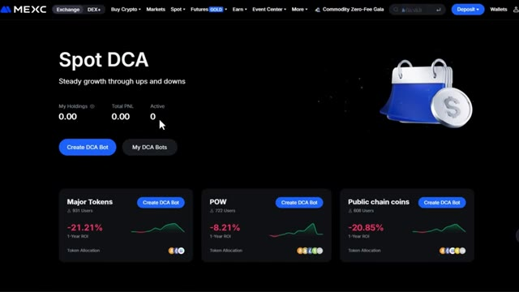
*⏱️ 00:01:35 — Interface MEXC Spot DCA affichant le solde, le PNL total, les bots actifs et les catégories de jetons (Major Tokens, POW, Public chain coins).*

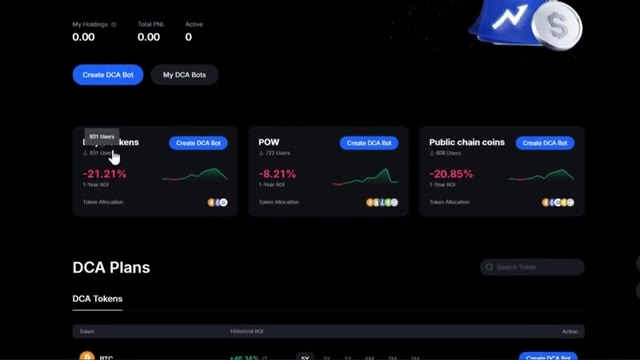
*⏱️ 00:01:40 — Défilement de la page MEXC Spot DCA révélant les différentes catégories de plans DCA et les jetons disponibles.*

---

### ⏱️ `[00:01:49 - 00:02:08]` | Segment #06

**🔊 Audio (Transcription Intégrale Mot pour Mot en Français) :**
> Maintenant, dans le cadre des plans DCA, vous pouvez voir des jetons individuels comme Bitcoin, Ethereum et Solana. Pour chaque jeton, vous pouvez voir le ROI historique. Cela vous montre à quel point une stratégie DCA aurait performé au fil du temps. Vous pouvez basculer le ROI historique en fonction de différentes périodes ici.

**👁️ Analyse Visuelle d'Écran (gemini-3.5-flash-lite) :**
**Interface & Outils** : Application ou plateforme Web de gestion de plans DCA (Dollar Cost Averaging) avec interface sombre.

**Contenu textuel & Code** : Liste des jetons avec leur retour sur investissement (ROI) historique sur différentes périodes (5Y, 3Y, 1Y, 6M, 3M, 1M) et boutons de création de bot DCA.

**Action / Démonstration** : Survol ou sélection de la ligne Ethereum (ETH) pour afficher les détails du ROI historique.

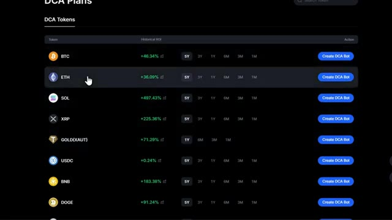
*⏱️ 00:01:54 — Tableau des plans DCA affichant la liste des jetons (BTC, ETH, SOL, XRP, GOLD, USDC, BNB, DOGE), leur ROI historique et les options temporelles associées.*

---

### ⏱️ `[00:02:08 - 00:02:36]` | Segment #07

**🔊 Audio (Transcription Intégrale Mot pour Mot en Français) :**
> Vous pouvez choisir entre cinq ans, trois ans, un an, et tout descendre jusqu'à un mois. Cela vous donne une bonne idée de la régularité du DCA pour cet actif spécifique. Une fois que vous avez trouvé la crypto-monnaie dans laquelle vous souhaitez investir, cliquez sur Créer un bot DCA. C'est ici que vous créez votre plan. D'abord, vous pouvez ajouter des jetons. Vous pouvez sélectionner jusqu'à 10 jetons différents si vous souhaitez diversifier votre stratégie de DCA sur plusieurs pièces. Ensuite, vous verrez le ratio d'allocation.

**👁️ Analyse Visuelle d'Écran (gemini-3.5-flash-lite) :**
**Interface & Outils** : Interface web de bot DCA / plateforme crypto.

**Contenu textuel & Code** : Liste des jetons avec ROI historique (ex: BTC à -30.74%, ETH à +36.09%, SOL à +497.43%) et boutons "Create DCA Bot".

**Action / Démonstration** : Un curseur de souris clique sur la période d'un mois (1M) pour la ligne du Bitcoin.

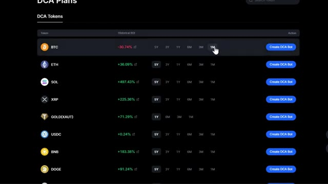
*⏱️ 00:02:15 — Interface de plans DCA affichant une liste de cryptomonnaies (BTC, ETH, SOL, XRP, etc.) avec leurs performances historiques (ROI) et des options de sélection temporelle (5Y, 3Y, 1Y, 6M, 3M, 1M).*

---

### ⏱️ `[00:02:37 - 00:03:12]` | Segment #08

**🔊 Audio (Transcription Intégrale Mot pour Mot en Français) :**
> Voici comment vous voulez répartir votre investissement par crypto-monnaie. Par exemple, si vous investissez dans le Bitcoin et l'Ethereum, vous pouvez allouer 50 % à chacun ou 70 % au Bitcoin et 30 % à l'Ethereum, selon vos préférences. Maintenant, définissez votre intervalle de DCA. Vous pouvez choisir entre horaire, quotidien, hebdomadaire ou mensuel. Cliquez sur plus d'options ici pour voir tous les intervalles disponibles. Vous pouvez également sélectionner à quelle heure de la journée vous voulez que le bot achète. C'est utile si vous voulez acheter à un moment précis où vous pensez que le marché est généralement plus bas. Il y a aussi une option pour lancer le premier investissement immédiatement. Si vous activez ceci,

**👁️ Analyse Visuelle d'Écran (gemini-3.5-flash-lite) :**
**Interface & Outils** : Interface web de DCA (Dollar-Cost Averaging) sur une plateforme crypto.

**Contenu textuel & Code** : Allocation de 70 % pour le BTC et 30 % pour l'ETH, sélection de l'intervalle DCA et du montant par cycle.

**Action / Démonstration** : Configuration et paramétrage d'un plan d'investissement automatisé (DCA).

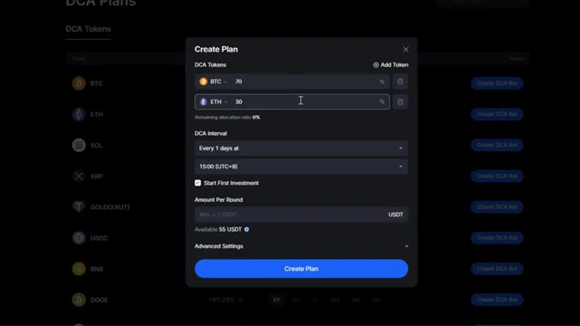
*⏱️ 00:02:46 — Fenêtre de création d'un plan de DCA montrant la répartition des pourcentages entre le Bitcoin et l'Ethereum.*

---

### ⏱️ `[00:03:13 - 00:03:47]` | Segment #09

**🔊 Audio (Transcription Intégrale Mot pour Mot en Français) :**
> le bot fera son premier achat dès que vous l'activerez. Ensuite, entrez combien d'USDT vous voulez investir par tour. C'est le montant que le bot dépensera à chaque fois qu'il achètera selon votre intervalle. Maintenant, si vous cliquez sur les paramètres avancés, vous obtenez encore plus de contrôle. Ici, vous pouvez modifier le nom de votre bot DCA. C'est utile si vous faites fonctionner plusieurs bots et que vous voulez les garder organisés. Vous pouvez également activer la plage de prix d'achat. Lorsque vous activez ceci, vous pouvez définir un prix inférieur et un prix supérieur. Cela signifie que le bot n'achètera que lorsque le prix sera dans cette plage. C'est utile

**👁️ Analyse Visuelle d'Écran (gemini-3.5-flash-lite) :**
**Interface & Outils** : Interface web de création de bot DCA (Type DCA Plans / Exchange crypto).

**Contenu textuel & Code** : Configuration du plan DCA : DCA Tokens (BTC 70%, ETH 30%), DCA Interval (Every 1 days at 15:00), case "Start First Investment" cochée, champ "Amount Per Round" avec solde disponible de 55 USDT, et section "Advanced Settings".

**Action / Démonstration** : Le curseur de la souris survole le champ de saisie du montant par tour ("Amount Per Round") pour configurer le capital investi à chaque intervalle.

*⏱️ 00:03:21 — Fenêtre modale de création d'un plan DCA montrant l'allocation des tokens (BTC et ETH), l'intervalle, l'option de premier investissement et le champ du montant par tour en USDT.*

---

### ⏱️ `[00:03:47 - 00:04:20]` | Segment #10

**🔊 Audio (Transcription Intégrale Mot pour Mot en Français) :**
> si vous voulez éviter d'acheter pendant des hausses extrêmes et seulement accumuler pendant les baisses ou la consolidation. Une fois que vous avez terminé, cliquez sur créer un plan et votre bot DCA est actif. Il va maintenant investir automatiquement à l'intervalle que vous avez choisi sans que vous ayez à faire quoi que ce soit. Maintenant, si vous voulez rendre cela encore plus facile, remontez et découvrez les plans pré-faits. Ici, Mexi a déjà créé des plans DCA pour vous. Vous pouvez voir les pièces, l'allocation, les intervalles, et plus encore. Tout est fait pour vous. Tout ce que vous avez à faire est d'entrer le montant par tour que vous voulez investir. Une fois que vous avez entré votre montant, il suffit

**👁️ Analyse Visuelle d'Écran (gemini-3.5-flash-lite) :**
**Interface & Outils** : Interface web de trading et de gestion de robots d'investissement DCA (Dollar Cost Averaging).

**Contenu textuel & Code** : Allocation des actifs (BTC, ETH, SOL), fréquences d'investissement, montants par tour en USDT et performances historiques (ROI).

**Action / Démonstration** : Configuration et paramétrage d'un plan d'investissement automatisé (bot DCA) en sélectionnant les cryptomonnaies et les intervalles de temps.

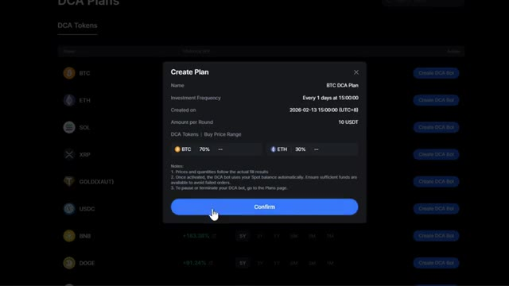
*⏱️ 00:03:55 — Fenêtre modale "Create Plan" affichant les détails du plan DCA pour Bitcoin et Ethereum avec un bouton de confirmation.*

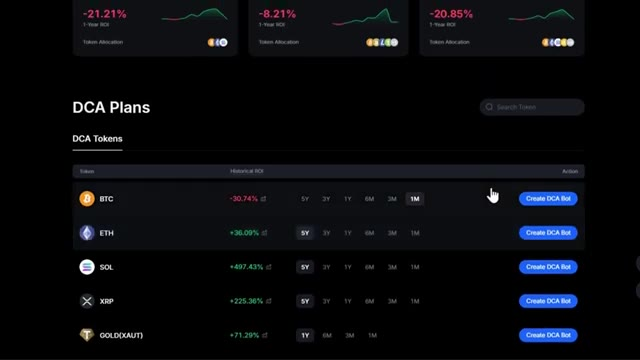
*⏱️ 00:04:04 — Interface principale de gestion des "DCA Plans" listant différents jetons (BTC, ETH, SOL, XRP, GOLD) avec leurs performances et options de bot.*

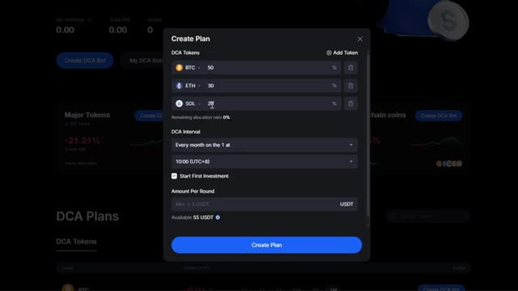
*⏱️ 00:04:12 — Fenêtre modale de création de plan DCA permettant d'allouer des pourcentages de jetons (BTC 50%, ETH 30%, SOL 20%) et de définir l'intervalle d'investissement.*

---

### ⏱️ `[00:04:20 - 00:04:42]` | Segment #11

**🔊 Audio (Transcription Intégrale Mot pour Mot en Français) :**
> cliquez sur créer un plan et vous avez terminé. C'est le moyen le plus rapide de commencer avec le DCA si vous ne voulez pas tout personnaliser vous-même. Le suivant est le robot de grille Futures. C'est idéal pour les marchés volatils où vous voulez profiter automatiquement des fluctuations de prix. Pour y accéder, survolez futures dans le menu supérieur et sélectionnez grid trading. Cela vous amène au panneau de trading sur grille futures.

**👁️ Analyse Visuelle d'Écran (gemini-3.5-flash-lite) :**
**Interface & Outils** : Échange de cryptomonnaies MEXC (interface de trading Futures Grid).

**Contenu textuel & Code** : Graphique de prix en chandeliers 15m, moyennes mobiles (MA10, MA30, MA60), et options de robot de grille Futures (Short-to-Mid Term Volatility, Mid-Term Volatility).

**Action / Démonstration** : Présentation et configuration d'un robot de grille Futures sur MEXC.

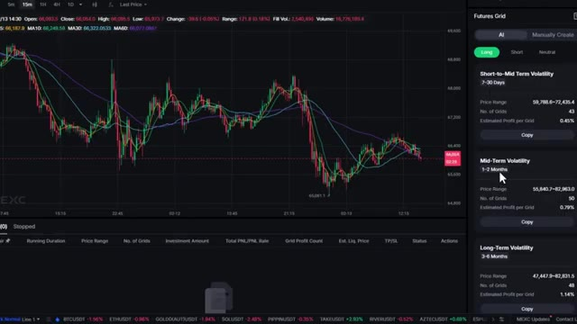
*⏱️ 00:04:31 — Interface de trading MEXC montrant un graphique de prix en chandelier (15m) avec moyennes mobiles et le panneau 'Futures Grid' sur le côté droit.*

---

### ⏱️ `[00:04:42 - 00:05:20]` | Segment #12

**🔊 Audio (Transcription Intégrale Mot pour Mot en Français) :**
> Cela ressemble à une interface de contrats à terme normale. Vous avez votre graphique de trading au milieu, le panneau de configuration sur le côté droit, et vos positions en bas. Vous pouvez sélectionner votre paire de trading en haut à gauche. Prenons BTC slash USDT pour cet exemple. Vous pouvez rechercher n'importe quelle paire que vous voulez ici. Faites maintenant défiler vers le bas jusqu'au panneau des positions en bas. Une fois que vous avez un bot en cours d'exécution, vous verrez tous les détails importants ici. La paire de trading, la durée de fonctionnement, la fourchette de prix, le nombre de grilles, le montant de l'investissement, le PNL total, le nombre de profits de grille, le prix de liquidation, le take profit et le stop loss, le statut du bot et les actions que vous pouvez entreprendre. Sur le côté droit,

**👁️ Analyse Visuelle d'Écran (gemini-3.5-flash-lite) :**
**Interface & Outils** : Échange de cryptomonnaies MEXC (Interface Futures Grid)

**Contenu textuel & Code** : Graphique en chandelier ( timeframe 15m), prix actuel du BTC/USDT à 66,037.2, moyennes mobiles (MA5, MA10, MA30, MA60), panneau de configuration des bots de grille (Futures Grid) à droite, et tableau des positions en cours en bas.

**Action / Démonstration** : Présentation de l'interface de trading de contrats à terme, sélection de la paire BTC/USDT et explication de la disposition des différents panneaux.

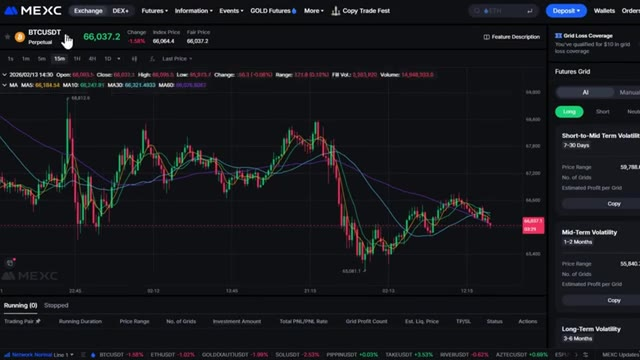
*⏱️ 00:04:52 — Interface de trading de contrats à terme de la plateforme MEXC montrant le graphique de la paire BTC/USDT.*

---

### ⏱️ `[00:05:20 - 00:05:40]` | Segment #13

**🔊 Audio (Transcription Intégrale Mot pour Mot en Français) :**
> vous verrez deux options, Mexi AI et créer manuellement. Commençons par la sélection de Mexi AI. Ici, vous pouvez choisir entre long, court et neutre, selon vos perspectives de marché. Mexi propose une sélection de bots IA selon votre horizon temporel. Vous pouvez choisir de 7 à 30 jours, de 1 à 2 mois, ou même de 3 à 6 mois.

**👁️ Analyse Visuelle d'Écran (gemini-3.5-flash-lite) :**
**Interface & Outils** : Interface web de l'échange de cryptomonnaies MEXC (section Futures Grid)

**Contenu textuel & Code** : Graphique de prix BTCUSDT avec moyennes mobiles (MA), options du bot de grille (AI / Manually Create), sélections Long/Short/Neutral et plages de volatilité (Short-to-Mid Term Volatility 7-30 Days, Mid-Term Volatility 1-2 Months).

**Action / Démonstration** : Sélection de l'option IA (AI) et du paramètre Long pour configurer un bot de trading de grille automatisé.

*⏱️ 00:05:25 — Interface de trading de la plateforme MEXC montrant un graphique des prix de BTCUSDT en chandelier 15m à gauche, et le panneau de configuration d'un bot 'Futures Grid' avec les options 'AI' et 'Manually Create' ainsi que les perspectives de marché 'Long', 'Short', 'Neutral' à droite.*

---

### ⏱️ `[00:05:40 - 00:06:05]` | Segment #14

**🔊 Audio (Transcription Intégrale Mot pour Mot en Français) :**
> C'est formidable parce que vous pouvez adapter le bot à votre style de trading. Pour chaque bot IA, vous pouvez voir le nom, la fourchette de prix, le nombre de grilles à utiliser et le profit estimé par grille. Lorsque vous cliquez sur copier, cela montre sur le graphique exactement où les grilles vont acheter ou vendre. Cela vous donne une représentation visuelle de la façon dont le bot va trader. Sur le côté droit, vous pouvez voir toutes vos informations. Ici, vous saisissez votre montant d'investissement et votre effet de levier.

**👁️ Analyse Visuelle d'Écran (gemini-3.5-flash-lite) :**
**Interface & Outils** : Interface d'échange de cryptomonnaies (MEXC) avec module Futures Grid.

**Contenu textuel & Code** : Graphique en unités de 15 minutes avec moyennes mobiles (MA5, MA10, MA30) et panneaux de bots IA ("Short-to-Mid Term Volatility" avec Price Range: 59,788.6 - 72,435.4, No. of Grids: 43, Estimated Profit per Grid: 0.45%).

**Action / Démonstration** : Consultation et survol des options de bots de grille IA disponibles sur la plateforme.

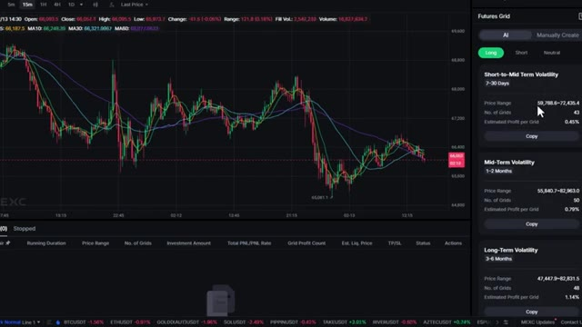
*⏱️ 00:05:47 — Interface de trading affichant un graphique de prix en chandeliers japonais à gauche et un panneau de configuration de bots de grille IA sur le côté droit.*

---

### ⏱️ `[00:06:05 - 00:06:40]` | Segment #15

**🔊 Audio (Transcription Intégrale Mot pour Mot en Français) :**
> Vous pouvez sélectionner jusqu'à cinquante fois de effet de levier ici, mais si vous êtes débutant, restez sur un faible effet de levier, peut-être cinq à dix fois. Un effet de levier élevé augmente votre risque de liquidation, alors faites vraiment attention à cela. Maintenant, si vous cliquez sur les paramètres avancés, vous verrez des options supplémentaires. La première est le mode de contrôle des risques. Décocher cette option diminue l'exigence d'investissement et augmente la taille de la position, mais cela augmente également le risque de liquidation. La cocher réduit le risque, mais peut ne pas réduire les besoins d'investissement si vous utilisez un effet de levier élevé et des grilles larges. Je recommande de garder cette option cochée.

**👁️ Analyse Visuelle d'Écran (gemini-3.5-flash-lite) :**
**Interface & Outils** : Interface de trading de contrats futures (MEXC)

**Contenu textuel & Code** : Réglage de l'effet de levier (10x), curseur de levier, paramètres de grille, options de gestion des risques (Risk-Controlled Mode).

**Action / Démonstration** : Configuration et ajustement de l'effet de levier et des paramètres de risque du bot de trading.

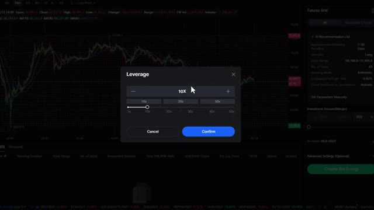
*⏱️ 00:06:14 — Fenêtre contextuelle de sélection de l'effet de levier réglée sur 10x avec un curseur allant de 1x à 50x.*

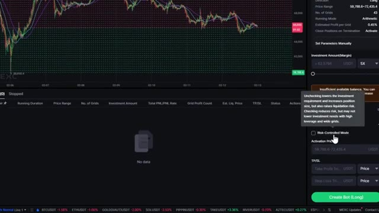
*⏱️ 00:06:23 — Interface de trading affichant les paramètres du bot de grille avec une infobulle sur le mode contrôlé par le risque.*

---

### ⏱️ `[00:06:40 - 00:07:14]` | Segment #16

**🔊 Audio (Transcription Intégrale Mot pour Mot en Français) :**
> si vous ne faites que débuter. Vous pouvez également voir le prix d'activation. C'est le prix auquel le bot commencera à trader. Ensuite, vous pouvez définir votre take profit et votre stop loss. Vous pouvez les définir par prix, par PNL, ou par pourcentage de PNL. Je recommande vivement de définir un stop loss pour protéger votre capital. Une fois que vous avez tout examiné, cliquez sur créer le bot et votre bot de grille futures est lancé. Maintenant, si vous voulez une approche plus manuelle, cliquez sur définir les paramètres manuellement. Ici, vous pouvez soit créer à partir de zéro, soit modifier les paramètres fournis par l'IA. Cela vous donne un contrôle total sur chaque aspect

**👁️ Analyse Visuelle d'Écran (gemini-3.5-flash-lite) :**
**Interface & Outils** : Interface d'échange de cryptomonnaies (MEXC)

**Contenu textuel & Code** : Panneau de configuration du bot incluant les paramètres avancés, le prix d'activation, et les champs TP/SL (Take Profit/Stop Loss).

**Action / Démonstration** : Configuration des paramètres de Take Profit et de Stop Loss pour le bot de trading.

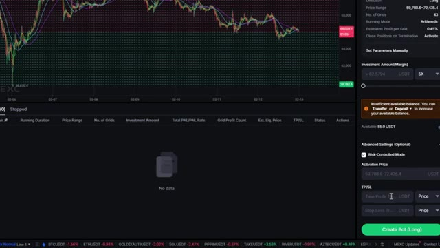
*⏱️ 00:06:48 — Interface de configuration d'un bot de trading avec un graphique en arrière-plan et le panneau latéral affichant les options de configuration comme le prix d'activation et le TP/SL.*

---

### ⏱️ `[00:07:14 - 00:07:32]` | Segment #17

**🔊 Audio (Transcription Intégrale Mot pour Mot en Français) :**
> du bot. Vous pouvez toujours voir la direction, long, court ou neutre. Ensuite, définissez votre plage de prix. C'est la plage où le bot placera les ordres d'achat et de vente. Choisissez ensuite le nombre de grilles. Vous pouvez définir entre 200 et 300 grilles. Plus de grilles signifient des transactions plus fréquentes mais des profits plus petits par transaction.

**👁️ Analyse Visuelle d'Écran (gemini-3.5-flash-lite) :**
**Interface & Outils** : Interface de l'échange de cryptomonnaies MEXC (graphique et panneau Futures Grid)

**Contenu textuel & Code** : Graphique BTCUSDT 15m avec moyennes mobiles, panneau de configuration de bot de grille (options Long/Short/Neutral, Price Range 59788.6 - 72435.4, No. of Grids 43, effet de levier 10X)

**Action / Démonstration** : Configuration et paramétrage d'un bot de trading de type Futures Grid sur la plateforme MEXC (sélection de la direction, de la plage de prix et du nombre de grilles).

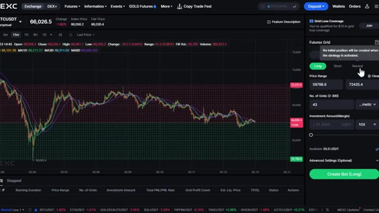
*⏱️ 00:07:19 — Interface d'échange affichant un graphique de prix BTCUSDT avec le panneau de configuration d'un bot de trading 'Futures Grid' sur la droite.*

---

### ⏱️ `[00:07:33 - 00:08:07]` | Segment #18

**🔊 Audio (Transcription Intégrale Mot pour Mot en Français) :**
> Moins de grilles signifie des transactions moins fréquentes mais des profits plus importants par transaction. Vous pouvez également choisir le mode, arithmétique ou géométrique. L'arithmétique place les grilles de manière égale sur toute la plage de prix. La géométrique place plus de grilles près du prix actuel, ce qui est meilleur pour les marchés volatils. Après cela, vous avez toujours les mêmes paramètres qu'avant : le montant de l'investissement, l'effet de levier, et les mêmes paramètres avancés disponibles dans le mode IA. Une fois que tout semble correct, cliquez sur Créer le bot. Vous pouvez voir tous vos bots en cours d'exécution dans la partie inférieure du panneau. C'est ici que vous surveillerez leurs performances et effectuerez des ajustements si nécessaire.

**👁️ Analyse Visuelle d'Écran (gemini-3.5-flash-lite) :**
**Interface & Outils** : Interface web de l'échange de cryptomonnaies MEXC (Futures Grid Bot)

**Contenu textuel & Code** : Graphique du BTCUSDT en unité 15m avec moyennes mobiles, paramètres du bot Grid (plage de prix 59788.6 - 72435.4, sélection du mode Arithmetic/Geometric visible, montant d'investissement 55.0 USDT disponibles).

**Action / Démonstration** : Configuration et explication des paramètres d'un bot de trading de type Grid, en se concentrant sur le choix entre les modes arithmétique et géométrique.

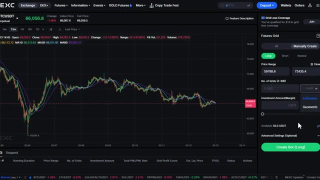
*⏱️ 00:07:41 — Capture d'écran de l'interface de trading montrant le panneau de configuration d'un Bot Futures Grid avec le menu déroulant du mode de grille (Arithmetic/Geometric) ouvert.*

---

### ⏱️ `[00:08:07 - 00:08:27]` | Segment #19

**🔊 Audio (Transcription Intégrale Mot pour Mot en Français) :**
> La dernière fonctionnalité de bot que je veux vous montrer est l'AI Copy Trade. Cela vous permet de copier automatiquement des traders IA rentables sur Mexi. Pour y accéder, passez votre curseur sur Futures et sélectionnez AI Copy Trade. Une fois sur le tableau de bord, vous pouvez voir vos capitaux, les coûts de copy trade, le P&L total et le P&L des 7 derniers jours en haut.

**👁️ Analyse Visuelle d'Écran (gemini-3.5-flash-lite) :**
**Interface & Outils** : MEXC Exchange (Interface Web)

**Contenu textuel & Code** : Menus de navigation Futures, paramètres de Copy Trade (Smart Ratio), statistiques de traders (ROI sur 7 jours, PNL, correspondance IA)

**Action / Démonstration** : Navigation dans les menus de la plateforme MEXC et sélection des options de configuration du Copy Trading IA.

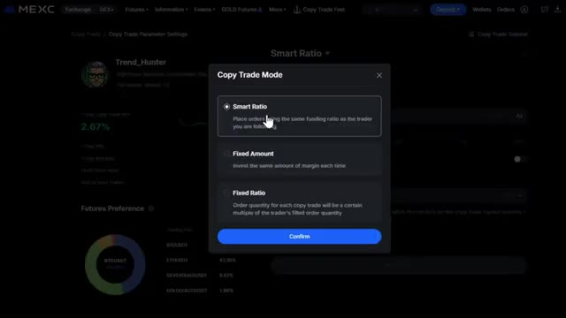
*⏱️ 00:08:12 — Interface MEXC affichant les paramètres de configuration du mode Copy Trade (Smart Ratio, Fixed Amount, Fixed Ratio).*

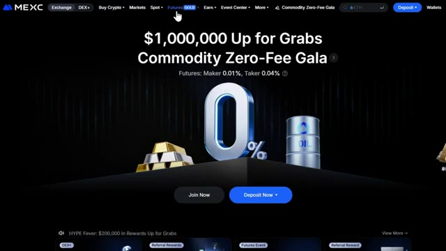
*⏱️ 00:08:17 — Page d'accueil de la plateforme MEXC montrant la navigation supérieure avec le menu "Futures".*

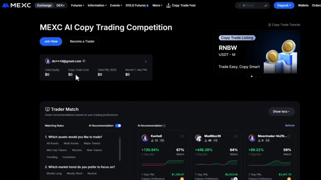
*⏱️ 00:08:22 — Tableau de bord MEXC AI Copy Trading montrant les soldes du compte et les suggestions de traders recommandés par l'IA.*

---

### ⏱️ `[00:08:27 - 00:08:50]` | Segment #20

**🔊 Audio (Transcription Intégrale Mot pour Mot en Français) :**
> Maintenant, faites défiler vers le bas et regardez sur le côté gauche. Mexi propose cette fonctionnalité appelée Trader Match. Cela vous mettra en correspondance avec le trader IA le plus proche en fonction de vos préférences, comme les actifs que vous souhaitez négocier, votre tolérance au risque et la fréquence de vos transactions. Sur le côté droit, vous pouvez voir les recommandations de l'IA. Pour chaque trader, vous pouvez voir son retour sur investissement sur 7 jours, le nombre de ses abonnés et sa préférence en matière de jetons.

**👁️ Analyse Visuelle d'Écran (gemini-3.5-flash-lite) :**
**Interface & Outils** : Interface web de la plateforme Mexi (section copy trading / Trader Match).

**Contenu textuel & Code** : Règles de correspondance (choix des actifs, tendance de marché), et cartes de recommandation de traders IA affichant les performances (ROI sur 7 jours, taux de correspondance, PNL et boutons « Copy Trade »).

**Action / Démonstration** : Navigation et sélection des préférences utilisateur pour associer les traders IA correspondants.

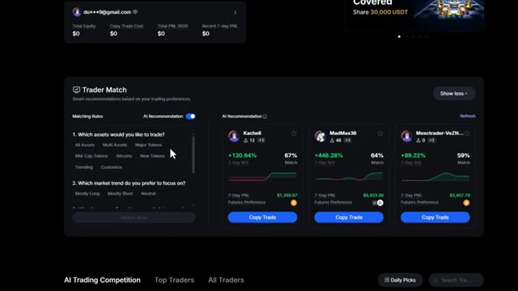
*⏱️ 00:08:33 — Capture d'écran montrant l'interface de la fonctionnalité « Trader Match » sur la plateforme Mexi, avec les options de préférences de trading à gauche et les profils de traders IA recommandés à droite.*

---

### ⏱️ `[00:08:51 - 00:09:13]` | Segment #21

**🔊 Audio (Transcription Intégrale Mot pour Mot en Français) :**
> Faites défiler vers le bas et vous verrez le classement complet des traders en IA avec leur PNL sur 180 jours, leur PNL sur 7 jours, leur meilleur trade et leur taux de réussite. Cela vous donne une vue d'ensemble de leurs performances. Une fois que vous avez trouvé un trader qui vous plaît, cliquez sur le bouton Copier le trade sur le côté droit de son profil. Mexi propose trois modes de copy trading : Ratio intelligent, Montant fixe et Ratio fixe.

**👁️ Analyse Visuelle d'Écran (gemini-3.5-flash-lite) :**
**Interface & Outils** : Plateforme d'échange de cryptomonnaies MEXC (section Copy Trade).

**Contenu textuel & Code** : Classement des bots/traders IA (Trend_Hunter, Greed_Ninja, Pair_Trader, AI_Grid), métriques de PNL, taux de réussite, et options de configuration de copy trading (montant, stop-loss).

**Action / Démonstration** : Navigation dans le classement des traders IA et sélection d'un trader pour configurer le copy trading.

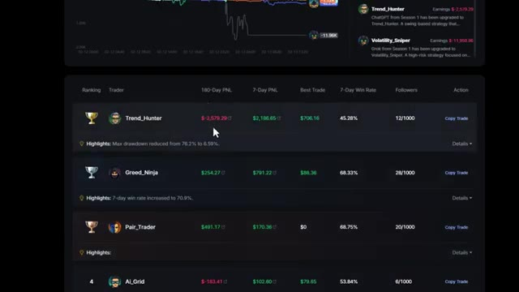
*⏱️ 00:08:57 — Tableau de classement des traders en IA sur une plateforme avec leurs performances (PNL 180j, PNL 7j, meilleur trade, taux de réussite, abonnés).*

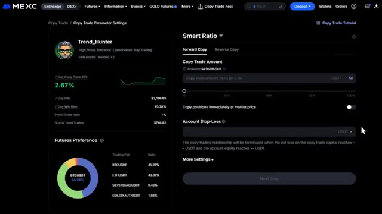
*⏱️ 00:09:08 — Interface de paramètres de copy trading sur MEXC pour le trader sélectionné (Trend_Hunter), incluant les préférences de futures et les réglages de montant.*

---

### ⏱️ `[00:09:14 - 00:09:47]` | Segment #22

**🔊 Audio (Transcription Intégrale Mot pour Mot en Français) :**
> Smart Ratio est recommandé pour les débutants. Il permet au trader expert de gérer automatiquement le risque de votre portefeuille. Montant Fixe signifie que vous copiez un montant en dollars fixe par trade, comme 10 $ par position. Ratio Fixe copie un pourcentage de votre portefeuille qui correspond à l'allocation du trader. Pour les débutants, je recommande smart ratio. D'abord, entrez votre montant de copy trading. C'est le total que vous investirez pour copier ce trader. Ne mettez pas tous vos fonds sur un seul trader. Ensuite, définissez le stop loss de votre compte. Lorsque vos capitaux propres atteignent ce niveau, le copy trading s'arrêtera automatiquement.

**👁️ Analyse Visuelle d'Écran (gemini-3.5-flash-lite) :**
**Interface & Outils** : Échange de cryptomonnaies MEXC (interface Web).

**Contenu textuel & Code** : Fenêtre modale "Copy Trade Mode" avec les options : Smart Ratio, Fixed Amount (sélectionné par un curseur de souris) et Fixed Ratio.

**Action / Démonstration** : Sélection du mode de copy trading "Fixed Amount" pour configurer la gestion des risques et des montants investis par position.

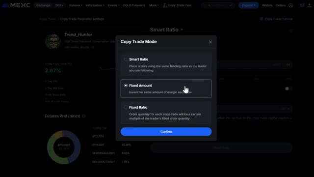
*⏱️ 00:09:22 — Interface de configuration du Copy Trading sur la plateforme MEXC montrant les différents modes de trading (Smart Ratio, Fixed Amount et Fixed Ratio).*

---

### ⏱️ `[00:09:47 - 00:10:21]` | Segment #23

**🔊 Audio (Transcription Intégrale Mot pour Mot en Français) :**
> et fermez toutes les positions. Cliquez sur plus de paramètres pour des options supplémentaires. Ici, vous pouvez choisir quelles paires de contrats à terme copier. Je recommande de commencer uniquement avec Bitcoin et Ethereum. Vous pouvez également définir des ratios de take profit et de stop loss pour un ordre unique. Par exemple, définissez un take profit à 20 % et un stop loss à 10 % pour gérer automatiquement chaque trade. Pour le mode de marge, je recommande vivement la marge isolée pour les débutants car elle limite votre risque à ce trade spécifique. Vous pouvez également personnaliser votre effet de levier. Vous pouvez suivre l'effet de levier du trader ou définir votre propre effet de levier fixe. Sur le côté gauche,

**👁️ Analyse Visuelle d'Écran (gemini-3.5-flash-lite) :**
**Interface & Outils** : Interface web de copy trading (échange crypto)

**Contenu textuel & Code** : Menu "More Settings" avec les sections "Futures for Copy Trade" (BTCUSDT, ETHUSDT, etc.), "Risk Control Settings", "Margin Mode" et "Leverage & Slippage Settings", ainsi qu'un graphique en camembert des préférences futures à gauche.

**Action / Démonstration** : Navigation et explication des options avancées et des paramètres de risque pour configurer le copy trading.

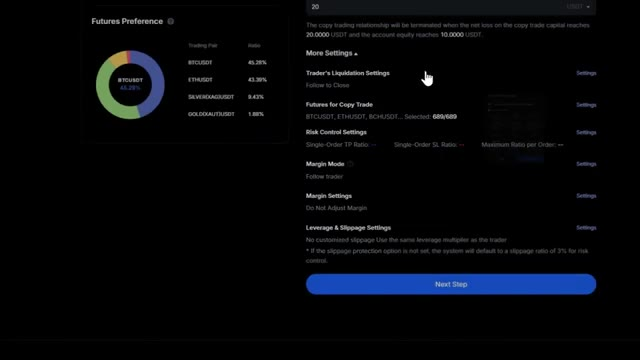
*⏱️ 00:09:56 — Capture d'écran montrant les paramètres avancés de copy trading sur une plateforme d'échange, avec des options de sélection de paires de contrats à terme et de gestion du risque.*

---

### ⏱️ `[00:10:21 - 00:10:56]` | Segment #24

**🔊 Audio (Transcription Intégrale Mot pour Mot en Français) :**
> vous pouvez voir l'aperçu du profil du trader, y compris son P&L sur sept jours, son taux de réussite et son ratio de partage des profits, qui se situe généralement entre 10 et 20 %. C'est ce que le trader gagne sur vos bénéfices. Une fois que tout semble correct, cliquez sur l'étape suivante et soumettez. Votre copy trading est désormais actif. Très bien, vous savez donc maintenant exactement comment utiliser chaque bot de trading sur Mexi. Que vous souhaitiez automatiser votre stratégie DCA, profiter du grid trading sur des marchés volatils, ou copier des traders IA qui génèrent déjà des rendements réguliers, vous avez les outils en main. Et n'oubliez pas, si vous vous êtes inscrit

**👁️ Analyse Visuelle d'Écran (gemini-3.5-flash-lite) :**
**Interface & Outils** : MEXC (Exchange crypto) - Paramètres de Copy Trading et Interface de Grid Trading.

**Contenu textuel & Code** : ROI sur 7 jours (2,67%), P&L (2 186,65 $), taux de réussite (45,20%), ratio de partage des profits (1%), graphiques de prix BTCUSDT avec moyennes mobiles (MA10, MA30, MA60) et options de configuration de bot (prix, nombre de grilles, effet de levier 10X).

**Action / Démonstration** : Configuration des paramètres de copy trading et paramétrage d'un bot de trading en grille sur MEXC.

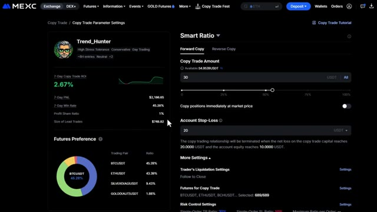
*⏱️ 00:10:30 — Aperçu du profil d'un trader nommé Trend_Hunter sur la plateforme MEXC, affichant son P&L sur sept jours, son taux de réussite et ses préférences de futures.*

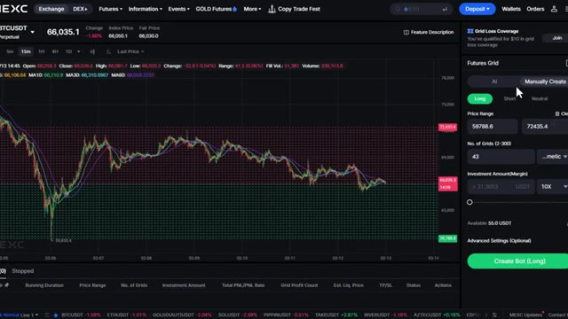
*⏱️ 00:10:47 — Interface de trading de contrats futures et configuration de bot en grille (Futures Grid) sur MEXC avec un graphique des prix du BTCUSDT.*

---

### ⏱️ `[00:10:56 - 00:11:18]` | Segment #25

**🔊 Audio (Transcription Intégrale Mot pour Mot en Français) :**
> avec mon lien dans la description, vous pouvez réclamer jusqu'à 10 000 USDT de bonus rien qu'en utilisant la plateforme. Vous obtenez des coupons pour votre inscription, le téléchargement de l'application et l'exécution de transactions. Alors n'hésitez surtout pas à y jeter un œil. Si vous voulez plus de tutoriels sur le trading de cryptos ou voir une présentation complète de la plateforme MEXC, regardez la vidéo qui s'affiche à l'écran. Merci d'avoir regardé et je vous retrouve dans la prochaine.

**👁️ Analyse Visuelle d'Écran (gemini-3.5-flash-lite) :**
**Interface & Outils** : Site web de l'échange de cryptomonnaies MEXC.

**Contenu textuel & Code** : Offres promotionnelles, bonus en USDT (jusqu'à 10 000 USDT), conditions de dépôt et de volume de trading futures.
[DESC_IMAGE_1] Présentation de la page d'inscription et des bonus de bienvenue sur l'exchange MEXC.

**Action / Démonstration** : Explications face caméra et analyse conceptuelle des marchés.

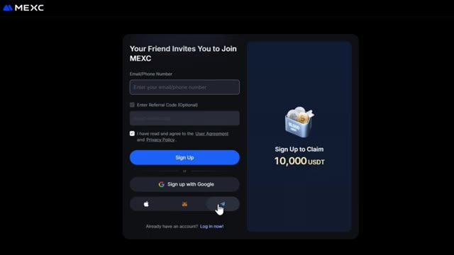
*⏱️ 00:11:01 — Page d'inscription de la plateforme MEXC affichant une offre de bonus de 10 000 USDT pour les nouveaux utilisateurs.*

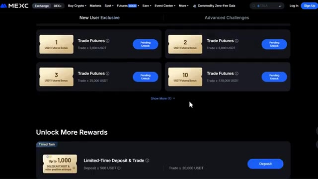
*⏱️ 00:11:07 — Interface de la plateforme MEXC montrant les défis pour nouveaux utilisateurs et les récompenses liées au trading de futures.*

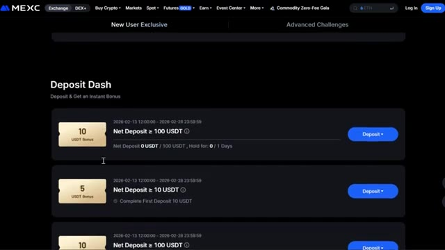
*⏱️ 00:11:13 — Section "Deposit Dash" de la plateforme MEXC affichant des bonus instantanés basés sur les dépôts nets en USDT.*

---

