# 🎬 The Exact Method I Use to Connect OpenClaw to ANY Crypto Exchange (Step-By-Step Guide)

> **Chaîne** : [Alex Carter](https://www.youtube.com/@AlexCarterTrading)  
> **Lien YouTube** : [https://www.youtube.com/watch?v=ydKBpgOCISs](https://www.youtube.com/watch?v=ydKBpgOCISs)  
> **Date de publication** : 20260304  
> **Durée** : 00:10:09  
> **Identifiant vidéo** : `ydKBpgOCISs`  
> **Transcription & Analyse** : `whisper-v3-large-turbo+gemini-3.5-flash-lite`  

---

## 📌 Synthèse Exécutive & Outils

### 💡 Résumé

Cette vidéo propose un guide technique et stratégique de niveau supérieur présenté par Alex Carter, centré sur l'automatisation du trading multi-exchange grâce à l'agent IA OpenClaw. L'objectif principal est de s'affranchir des limites du trading manuel sur une seule plateforme en connectant simultanément plusieurs bourses majeures. Cette approche permet non seulement de diversifier l'exécution des ordres et d'accéder à des paires de cryptomonnaies exclusives, mais aussi d'optimiser les performances en comparant la qualité d'exécutabilité des stratégies et en cumulant les différents programmes de bonus et structures de frais réduits offerts par les plateformes.

Au-delà de la simple connexion multi-plateforme, la vidéo détaille méthodiquement les procédures de sécurisation indispensables pour déployer un agent de trading algorithmique. L'analyse met en lumière l'utilisation de sous-comptes dédiés et de clés API aux permissions strictement cloisonnées — autorisant uniquement le passage d'ordres et la gestion des positions sur les contrats à terme ou le marché au comptant, tout en verrouillant impérativement les options de retraits de fonds. À travers des démonstrations pas à pas sur Bybit, MEXC et Blofin, la méthode enseignée garantit une architecture de trading robuste, capable d'exécuter des stratégies de scalping ou de swing de manière totalement autonome tout en minimisant drastiquement le risque systémique et opérationnel.

---

### 🛠️ Outils, Modèles & Logiciels Présentés

* **OpenClaw** : Agent d'intelligence artificielle et d'automatisation de pointe conçu pour centraliser, exécuter et piloter des stratégies de trading sur plusieurs exchanges en simultané.
* **Bybit** : Exchange crypto majeur offrant des comptes de trading unifiés, des options de clés API générées par le système ou l'utilisateur, et des programmes de récompenses substantiels pour les nouveaux utilisateurs.
* **MEXC** : Plateforme d'échange cryptographique disposant de sous-comptes spécifiques axés sur le trading exclusif par API et de bonus incitatifs pour l'automatisation.
* **Blofin** : Exchange partenaire permettant d'isoler le capital via des sous-comptes dédiés et de connecter des agents algorithmiques sécurisés pour le trading de contrats à terme.
* **Gestionnaire de mots de passe** : Outil de cybersécurité recommandé pour stocker de manière chiffrée et sécurisée les clés API et clés secrètes générées.

---

### 🔑 Points Clés & Enseignements Stratégiques

* **Architecture Multi-Exchange** : Connecter OpenClaw à plusieurs plateformes permet d'exécuter la même stratégie en parallèle, d'identifier les bourses offrant la meilleure exécution et de tirer parti de liquidités et de paires de négociation variées.
* **Optimisation des Bonus et Frais** : L'utilisation de liens d'affiliation spécifiques permet de maximiser les retours sur investissement initiaux grâce aux programmes de bonus de dépôt, de KYC et de paliers de volume sur les différents exchanges.
* **Isolation par Sous-Compte** : Il est impératif de créer un sous-compte dédié à l'agent IA (ex. "OpenClaw AI Agent") sur chaque exchange pour séparer hermétiquement le capital de trading automatisé du capital géré manuellement.
* **Granularité des Permissions API** : Lors de la création des clés API, seules les autorisations strictement nécessaires au trading doivent être activées (placement/gestion des ordres et des positions sur les dérivés ou le spot).
* **Verrouillage Absolu des Retraits** : L'option de retrait de fonds sur les clés API doit impérativement rester désactivée pour neutraliser tout risque de fuite de capital en cas de compromission de l'agent.
* **Gestion des Restrictions IP** : Bien qu'une configuration sans restriction IP offre plus de flexibilité pour le cloud, l'utilisation d'adresses IP dédiées ou statiques renforce considérablement la sécurité si l'infrastructure le permet.
* **Sélection des Clés API** : Privilégier les clés générées par le système pour simplifier la configuration initiale tout en garantissant un niveau de sécurité optimal avec les interfaces des exchanges.
* **Sauvegarde Unique des Secrets** : La clé secrète (*Secret Key*) n'étant affichée qu'une seule et unique fois lors de sa création, son enregistrement immédiat dans un gestionnaire de mots de passe est une étape critique non négociable.
* **Vérification Initiale du Solde** : Après l'initialisation d'OpenClaw, l'envoi d'une instruction de vérification du solde permet de valider de manière empirique la bonne communication bidirectionnelle entre l'IA et l'API de l'exchange.
* **Audits et Revues Régulières** : Maintenir une surveillance active de l'historique des connexions et des activités des clés API dans les paramètres des exchanges pour détecter rapidement toute anomalie comportementale.
* **Procédure d'Urgence en Cas de Compromission** : En cas de doute sur la sécurité d'une clé API, la suppression immédiate de cette dernière et la génération de nouvelles paires de clés constituent la seule réponse adaptée pour préserver le portefeuille.
* **Responsabilité et Risk Management** : L'automatisation par IA décuple l'efficacité opérationnelle mais exige une discipline de fer en matière de gestion des risques, d'hygiène informatique et de paramétrage des ordres de stop-loss.

---

## ⏱️ Chronologie & Transcription Complète Audio & Visuelle (Mot pour Mot)

### ⏱️ `[00:00:00 - 00:00:26]` | Segment #01

**🔊 Audio (Transcription Intégrale Mot pour Mot en Français) :**
> Dans cette vidéo, je connecte OpenClock à trois bourses, afin que vous puissiez automatiser le trading sur toutes en même temps. Et regardez, c'est vraiment insensé. Alors que la plupart des traders placent manuellement des transactions sur une seule plateforme, vous exécuterez des stratégies sur plusieurs bourses simultanément, en testant celle qui vous offre la meilleure exécution et en cumulant les bonus des trois. C'est de l'automatisation de niveau supérieur, alors restez dans les parages car je vais vous montrer exactement comment configurer cela étape par étape.

**👁️ Analyse Visuelle d'Écran (gemini-3.5-flash-lite) :**
**Interface & Outils** : Interfaces Web des bourses crypto (compte et gestion des clés API, page Rewards Hub de Bybit).

**Contenu textuel & Code** : Paramètres de sous-comptes, formulaires de création de clés API, offres de bonus de bienvenue en USDT.
[DESC_IMAGE_3] Navigation dans les menus de la plateforme d'échange pour configurer l'accès et consulter les offres promotionnelles.

**Action / Démonstration** : Explications face caméra et analyse conceptuelle des marchés.

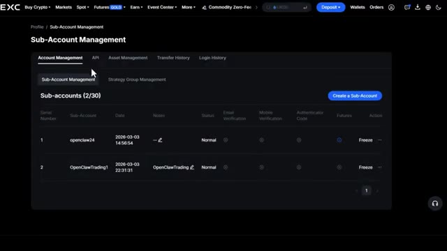
*⏱️ 00:00:07 — Interface de gestion des sous-comptes sur une bourse crypto affichant les sous-comptes créés (openclaw24 et OpenClawTrading1).*

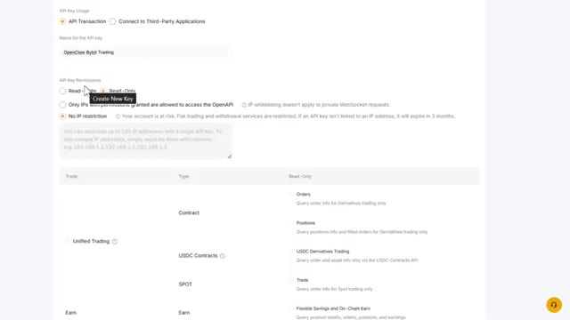
*⏱️ 00:00:13 — Page de configuration et de création de clés API avec les options de permissions et restrictions d'IP.*

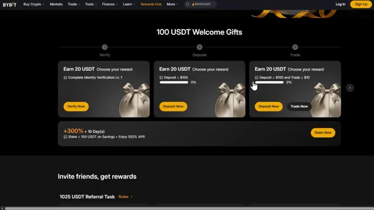
*⏱️ 00:00:20 — Page des récompenses et bonus de bienvenue ("100 USDT Welcome Gifts") de la plateforme Bybit.*

---

### ⏱️ `[00:00:26 - 00:00:59]` | Segment #02

**🔊 Audio (Transcription Intégrale Mot pour Mot en Français) :**
> C'est parti. Très bien, donc avant de plonger dans la configuration technique, laissez-moi vous expliquer pourquoi connecter plusieurs plateformes d'échange à OpenClaw est si puissant. Voici le truc : différentes plateformes ont une liquidité différente, des paires de négociation différentes et des structures de frais différentes. En connectant OpenClaw à plusieurs plateformes d'échange, vous pouvez exécuter la même stratégie sur différentes plateformes et voir laquelle est la plus performante. Accédez à des crypto-monnaies qui ne sont peut-être listées que sur une seule plateforme. Vous pouvez également profiter de différentes structures de bonus et de frais réduits. De plus, vous pouvez diversifier votre risque sur plusieurs

**👁️ Analyse Visuelle d'Écran (gemini-3.5-flash-lite) :**
**Interface & Outils** : Interface OpenClaw et plateforme d'échange MEXC (Spot).

**Contenu textuel & Code** : Menus de configuration d'OpenClaw et liste des paires de trading spot avec prix, variations sur 24h, plus hauts/plus bas et volumes sur MEXC.

**Action / Démonstration** : Navigation dans le tableau de bord OpenClaw et présentation des marchés spot de la plateforme d'échange.

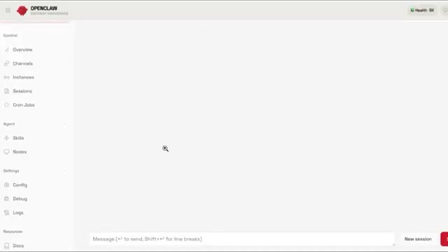
*⏱️ 00:00:35 — Interface OpenClaw affichant le panneau de configuration du tableau de bord avec le menu latéral (Overview, Channels, Instances, etc.).*

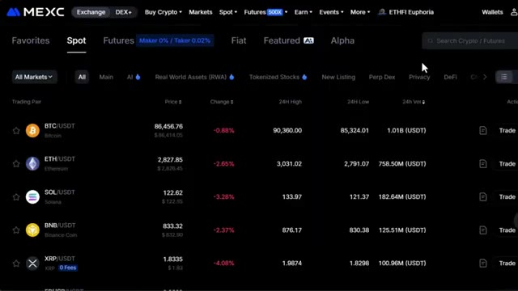
*⏱️ 00:00:51 — Interface de la plateforme d'échange MEXC montrant les marchés spot avec des paires de cryptomonnaies majeures (BTC/USDT, ETH/USDT, SOL/USDT) et leurs données de prix en temps réel.*

---

### ⏱️ `[00:00:59 - 00:01:31]` | Segment #03

**🔊 Audio (Transcription Intégrale Mot pour Mot en Français) :**
> plateformes. Et le meilleur, OpenClaw peut gérer tout cela automatiquement. Vous le configurez une seule fois et il s'occupe de tout. Maintenant, laissez-moi vous montrer exactement comment faire. Très bien, commençons par Bybit, l'un des échanges de cryptomonnaies les plus grands et les plus populaires. Si vous n'avez pas encore de compte Bybit, cliquez sur le lien dans la description. Si vous vous êtes inscrit avec mon lien, vous pouvez réclamer des bonus simplement en déposant et en tradant. Consultez le centre des récompenses dans votre compte. Il y a jusqu'à 30 000 USDT disponibles, ainsi que d'autres récompenses pour avoir complété le KYC et atteint des paliers de volume de trading.

**👁️ Analyse Visuelle d'Écran (gemini-3.5-flash-lite) :**
**Interface & Outils** : Page web de la plateforme Bybit et éditeur de texte.

**Contenu textuel & Code** : Interface d'inscription Bybit, montrant les détails des récompenses de bienvenue allant jusqu'à 30 100 $ et les étapes de vérification, dépôt et trading.

**Action / Démonstration** : Navigation et présentation de la page d'inscription et des bonus de la plateforme d'échange de cryptomonnaies Bybit.

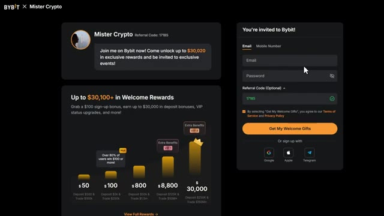
*⏱️ 00:01:15 — Page d'inscription de la plateforme Bybit avec les bonus de bienvenue et le code de parrainage.*

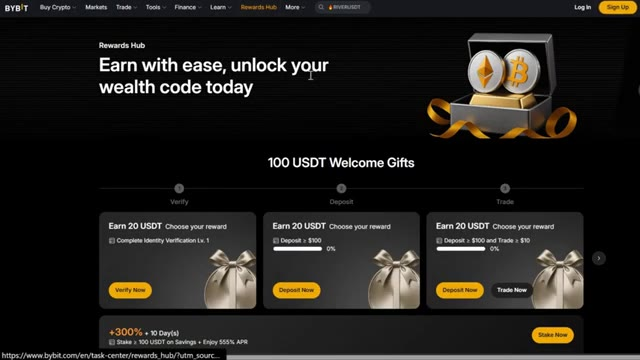
*⏱️ 00:01:23 — Page du "Rewards Hub" de Bybit affichant les différentes étapes et récompenses en USDT (Verify, Deposit, Trade).*

---

### ⏱️ `[00:01:32 - 00:02:06]` | Segment #04

**🔊 Audio (Transcription Intégrale Mot pour Mot en Français) :**
> La première étape consiste à créer et à vous connecter à votre compte Bybit. Ensuite, cliquez sur l'icône de votre profil dans le coin supérieur droit et sélectionnez API. Dans le coin supérieur droit, vous verrez un bouton qui indique créer une nouvelle clé. Cliquez dessus. C'est là que Bybit est un peu différent. Vous verrez deux options, des clés API générées par le système et générées par l'utilisateur. Les clés API générées par le système signifient que Bybit génère les deux clés pour vous. Simple et sécurisé. Clés API générées par l'utilisateur. Cela signifie simplement que vous pouvez créer les clés vous-même et ne partager que la clé publique avec Bybit. Pour la plupart des utilisateurs, je recommande de choisir

**👁️ Analyse Visuelle d'Écran (gemini-3.5-flash-lite) :**
**Interface & Outils** : Interface web de l'échange de cryptomonnaies Bybit (section de gestion des clés API).

**Contenu textuel & Code** : Page de gestion des clés API, paramètres de sécurité et options de configuration de clé API (générée par le système ou par l'utilisateur).

**Action / Démonstration** : Navigation dans l'interface de Bybit et clic sur le bouton pour créer une nouvelle clé API, suivi de l'affichage de la boîte de dialogue de sélection du type de clé.

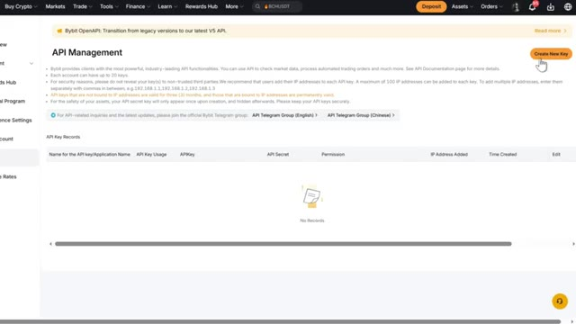
*⏱️ 00:01:41 — Vue de la page "API Management" sur Bybit avec un curseur pointant sur le bouton orange "Create New Key" dans le coin supérieur droit.*

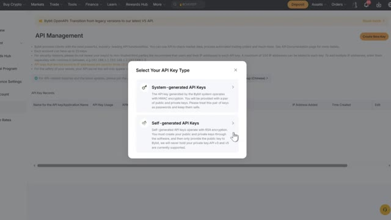
*⏱️ 00:01:49 — Fenêtre modale "Select Your API Key Type" ouverte sur Bybit, proposant le choix entre "System-generated API Keys" et "Self-generated API Keys".*

---

### ⏱️ `[00:02:06 - 00:02:27]` | Segment #05

**🔊 Audio (Transcription Intégrale Mot pour Mot en Français) :**
> les clés d'API générées par le système si vous ne faites que débuter. C'est plus simple et cela fonctionne parfaitement pour OpenClaw. Ensuite, vous verrez deux options pour l'utilisation des clés d'API. Application tierce est préférable si vous avez d'autres applications tierces. Vous pouvez choisir ceci et sélectionner votre application dans la liste. Mais puisque nous allons utiliser OpenClaw, choisissez transaction d'API.

**👁️ Analyse Visuelle d'Écran (gemini-3.5-flash-lite) :**
**Interface & Outils** : Interface web d'échange de cryptomonnaies (page de création de clé API).

**Contenu textuel & Code** : Paramètres de clé API avec les options "API Transaction" et "Connect to Third-Party Applications", ainsi que les permissions de lecture/écriture et les restrictions IP.

**Action / Démonstration** : Configuration et sélection des options pour la génération d'une nouvelle clé API.

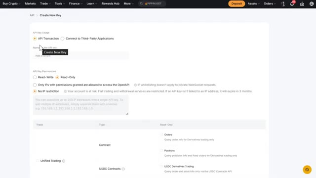
*⏱️ 00:02:12 — Interface de création d'une clé API sur une plateforme d'échange de cryptomonnaies, montrant les options d'utilisation et les permissions.*

---

### ⏱️ `[00:02:28 - 00:02:48]` | Segment #06

**🔊 Audio (Transcription Intégrale Mot pour Mot en Français) :**
> Lorsque vous faites défiler vers le bas, vous pouvez choisir votre nom d'API. Je recommande quelque chose comme OpenClaw Bybit Trading. Ainsi, vous pouvez facilement déterminer quelles clés API vous consultez si vous en avez beaucoup. Viennent ensuite les autorisations de la clé API. Maintenant, vous devez choisir lecture et écriture afin d'exécuter des ordres sur votre bourse. Ensuite, vous verrez la liste blanche des adresses IP.

**👁️ Analyse Visuelle d'Écran (gemini-3.5-flash-lite) :**
**Interface & Outils** : Interface web de Bybit

**Contenu textuel & Code** : Paramètres de création de clé API (nom de la clé, options Read-Write/Read-Only, restrictions IP et permissions détaillées par type de compte).

**Action / Démonstration** : Saisie du nom de la clé API et sélection des permissions de lecture/écriture.

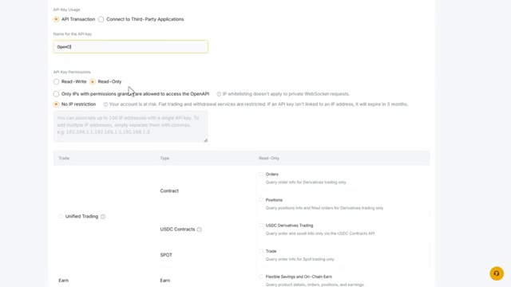
*⏱️ 00:02:33 — Interface de configuration d'une clé API sur un échange, montrant le champ de nom et les options de permissions.*

---

### ⏱️ `[00:02:48 - 00:03:09]` | Segment #07

**🔊 Audio (Transcription Intégrale Mot pour Mot en Français) :**
> Vous avez deux options ici : IP dédiée. Cela signifie que l'API ne peut être consultée que depuis une adresse IP spécifique, ou aucune restriction IP. Cela signifie qu'elle peut être consultée depuis n'importe quelle connexion IP. Pour la plupart des utilisateurs, je recommande aucune restriction IP pour plus de flexion, en particulier si vous accédez à OpenClaw depuis différents emplacements.

**👁️ Analyse Visuelle d'Écran (gemini-3.5-flash-lite) :**
**Interface & Outils** : Interface web de gestion de clés API d'un exchange (Bybit).

**Contenu textuel & Code** : Paramètres de configuration de clé API incluant les options 'Only IPs with permissions granted' et 'No IP restriction', ainsi que les permissions de lecture/écriture (Read-Write).

**Action / Démonstration** : Le curseur survole les options de restriction IP pour la configuration de la clé API.

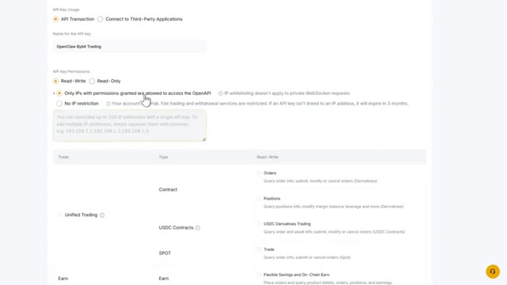
*⏱️ 00:02:54 — Interface de configuration d'une clé API montrant les options de restriction par adresse IP (IP dédiée ou sans restriction).*

---

### ⏱️ `[00:03:09 - 00:03:33]` | Segment #08

**🔊 Audio (Transcription Intégrale Mot pour Mot en Français) :**
> mais si vous voulez une sécurité supplémentaire et que vous avez une IP statique, vous pouvez l'ajouter ici. Vous pouvez ajouter jusqu'à 100 adresses IP. Maintenant, lorsque vous faites défiler vers le bas, vous verrez des permissions détaillées. C'est crucial. Vous voulez seulement que votre agent IA fasse du trading et non pas qu'il retire des fonds ou fasse autre chose. Pour ce faire, activez uniquement les ordres pour placer et gérer les trades. Les positions pour gérer les positions ouvertes.

**👁️ Analyse Visuelle d'Écran (gemini-3.5-flash-lite) :**
**Interface & Outils** : Interface web de configuration de clé API (probablement un échange de cryptomonnaies tel que Bybit).

**Contenu textuel & Code** : Options de configuration d'une clé API : champ de saisie pour les adresses IP autorisées, options de permissions (Read-Write, Read-Only, restrictions IP, types de trading unifiés, contrats USDC, Spot).

**Action / Démonstration** : Configuration des paramètres de sécurité et des restrictions par adresse IP pour la création d'une nouvelle clé API.

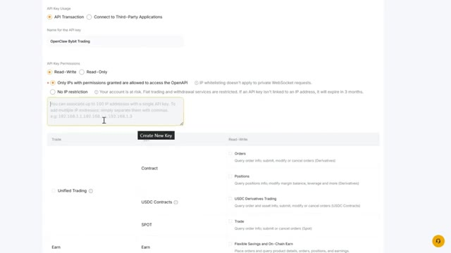
*⏱️ 00:03:15 — Interface de configuration d'une clé API avec l'option de restriction par adresse IP (jusqu'à 100 IP) et sélection des permissions détaillées (Read-Write ou Read-Only).*

---

### ⏱️ `[00:03:33 - 00:04:06]` | Segment #09

**🔊 Audio (Transcription Intégrale Mot pour Mot en Français) :**
> Trading de produits dérivés USDC si vous tradez des paires USDC. Trading au comptant si vous voulez trader sur les marchés au comptant. Vous pouvez également vérifier les autres autorisations, mais puisque nous allons trader sur les contrats à terme, activez uniquement celles-ci. Lorsque vous faites défiler vers le bas jusqu'aux actifs, assurez-vous que les retraits sont désactivés. C'est crucial pour protéger vos fonds contre toute sortie de votre compte. Une fois que vous avez vérifié tout ce dont vous avez besoin, cliquez sur soumettre. Il vous sera demandé de vérifier votre identité par vérification par e-mail et par authentification à deux facteurs. Après la vérification, vous verrez une page de confirmation avec le nom de l'API,

**👁️ Analyse Visuelle d'Écran (gemini-3.5-flash-lite) :**
**Interface & Outils** : Interface web de l'échange de cryptomonnaies Bybit (paramètres de création de clés API).

**Contenu textuel & Code** : Cases à cocher pour les permissions de trading (Orders, Positions, USDC Contracts, Spot Trade, Account Transfer) et bouton orange "Submit".

**Action / Démonstration** : Configuration des permissions d'une clé API sur Bybit en activant spécifiquement les options de trading requises pour l'utilisation de contrats à terme.

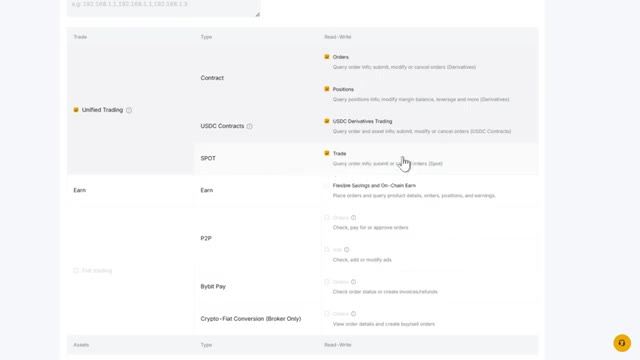
*⏱️ 00:03:42 — Capture d'écran montrant le panneau des autorisations d'API de Bybit avec les options de trading unifié, contrats et spot (Unified Trading, Spot, Contracts).*

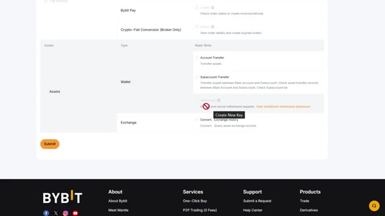
*⏱️ 00:03:50 — Suite du panneau de configuration des clés API sur Bybit affichant les autorisations liées aux actifs (Wallet, Exchange) et le bouton de soumission final.*

---

### ⏱️ `[00:04:07 - 00:04:28]` | Segment #10

**🔊 Audio (Transcription Intégrale Mot pour Mot en Français) :**
> Clé API, clé secrète API et résumé des autorisations. Vous verrez un bouton de copie à côté de chaque clé, copiez-les et enregistrez-les en lieu sûr. Cela ne sera affiché qu'une seule fois, donc si vous l'oubliez, vous devrez créer une nouvelle clé. Vous pouvez gérer et modifier les restrictions de vos clés API dans la section de gestion des clés API. Vous pouvez également créer un sous-compte dédié à votre agent IA sur Bybit.

**👁️ Analyse Visuelle d'Écran (gemini-3.5-flash-lite) :**
**Interface & Outils** : Bybit (Plateforme d'échange de cryptomonnaies)

**Contenu textuel & Code** : Clé API, clé secrète API, permissions Read-Write et options de restriction IP.

**Action / Démonstration** : Copie de la clé API et consultation des paramètres de permissions sur le compte Bybit.

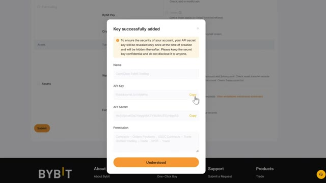
*⏱️ 00:04:12 — Pop-up de confirmation sur l'interface Bybit affichant la clé API et la clé secrète nouvellement générées, avec des boutons de copie.*

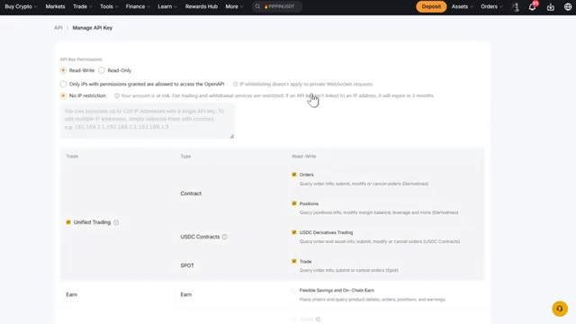
*⏱️ 00:04:23 — Page de gestion des clés API sur l'échange Bybit montrant les configurations de permissions et de restrictions IP.*

---

### ⏱️ `[00:04:28 - 00:04:48]` | Segment #11

**🔊 Audio (Transcription Intégrale Mot pour Mot en Français) :**
> Pour faire cela, cliquez sur votre profil et cliquez sur basculer slash créer un compte. Une fenêtre pop-up apparaîtra. Entrez le nom du sous-compte, quelque chose comme OpenClaw AI Agent. Choisissez Compte de Trading Unifié comme type de compte. Vous pouvez exiger un mot de passe pour la connexion si vous voulez plus de sécurité. Une fois que tout est correct, cliquez sur Confirmer.

**👁️ Analyse Visuelle d'Écran (gemini-3.5-flash-lite) :**
**Interface & Outils** : Bybit (Plateforme d'échange crypto - Interface de gestion des comptes et API)

**Contenu textuel & Code** : Menus 'Switch/Create Account', options de création de sous-compte, champ de nom, sélection du type de compte (Unified Trading Account) et option de mot de passe.

**Action / Démonstration** : Navigation dans l'interface de Bybit pour créer et configurer un nouveau sous-compte dédié au bot de trading.

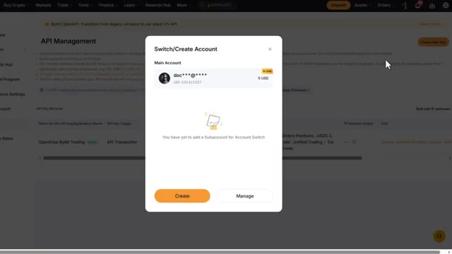
*⏱️ 00:04:33 — Fenêtre pop-up de gestion des comptes sur Bybit montrant le menu 'Switch/Create Account' avec le compte principal et le bouton 'Create'.*

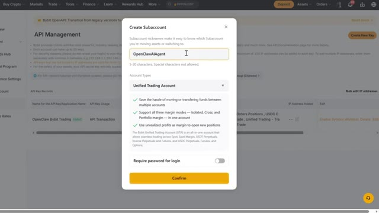
*⏱️ 00:04:38 — Formulaire de création d'un sous-compte sur Bybit avec le nom 'OpenClaw AIAgent' et le type 'Unified Trading Account' sélectionné.*

---

### ⏱️ `[00:04:49 - 00:05:10]` | Segment #12

**🔊 Audio (Transcription Intégrale Mot pour Mot en Français) :**
> Ensuite, répétez les étapes de création de l'API pour le sous-compte. Très bien, maintenant connectons-nous à Mexi. Le processus est très similaire, mais Mexi possède des fonctionnalités uniques. Si vous n'avez pas encore de compte Mexi, cliquez sur le lien dans la description. Vous obtiendrez un bon de 10 USDT rien que pour la création d'un nouveau compte. Un autre bon de 10 USDT lorsque vous téléchargez et terminez la connexion sur l'application Mexi.

**👁️ Analyse Visuelle d'Écran (gemini-3.5-flash-lite) :**
**Interface & Outils** : Site web de l'échange de cryptomonnaies MEXC.

**Contenu textuel & Code** : Interface utilisateur de la plateforme d'échange MEXC, bannières promotionnelles de bonus (10 000 USDT), options d'inscription et de parrainage.

**Action / Démonstration** : Navigation sur le site web de MEXC pour présenter la création de compte et les bonus d'inscription.

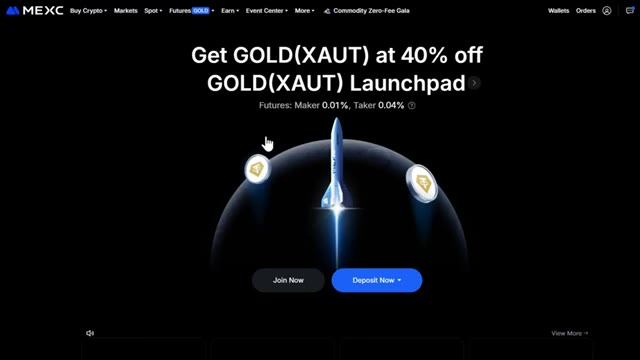
*⏱️ 00:04:54 — Page d'accueil du site d'échange de cryptomonnaies MEXC avec une bannière promotionnelle pour le Launchpad GOLD (XAUT).*

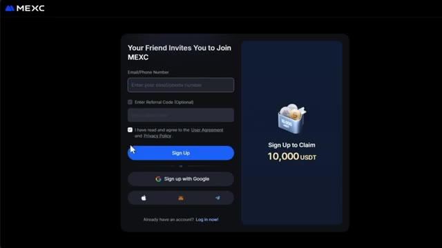
*⏱️ 00:04:59 — Formulaire d'inscription sur la plateforme MEXC permettant de créer un compte avec un e-mail ou un numéro de téléphone.*

*⏱️ 00:05:05 — Page "Rewards Hub" de MEXC affichant les bonus et récompenses disponibles pour les nouveaux utilisateurs (jusqu'à 10 000 USDT).*

---

### ⏱️ `[00:05:10 - 00:05:43]` | Segment #13

**🔊 Audio (Transcription Intégrale Mot pour Mot en Français) :**
> En plus de ça, vous obtenez 870 USDT de récompenses pour les nouveaux utilisateurs, incluant des bonus futures, des airdrops de positions et des coupons. La première étape est de créer un sous-compte. Je vous recommande de créer d'abord un sous-compte pour votre agent IA OpenClaw. Cliquez sur votre profil puis sur gestion des sous-comptes. Dans le coin supérieur milieu-droit, vous verrez "créer un sous-compte". Cliquez dessus. Vous verrez deux options : API uniquement, ce qui restreint le sous-compte au trading par API uniquement, et compte standard, qui vous permet de trader manuellement sur le sous-compte. Pour cet exemple

**👁️ Analyse Visuelle d'Écran (gemini-3.5-flash-lite) :**
**Interface & Outils** : Échange de cryptomonnaies MEXC (Interface Web).

**Contenu textuel & Code** : Menus de configuration de compte, options de sous-compte ("API Only (No Web/App Login)" et "Standard Account (Web Login)").

**Action / Démonstration** : Navigation dans les menus du compte utilisateur et sélection du type de sous-compte pour l'agent IA OpenClaw.

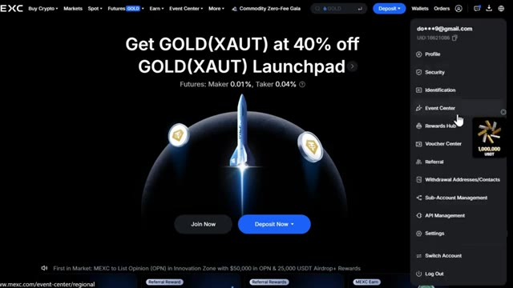
*⏱️ 00:05:27 — Interface principale de MEXC montrant le menu déroulant du profil avec l'option "Sub-Account Management".*

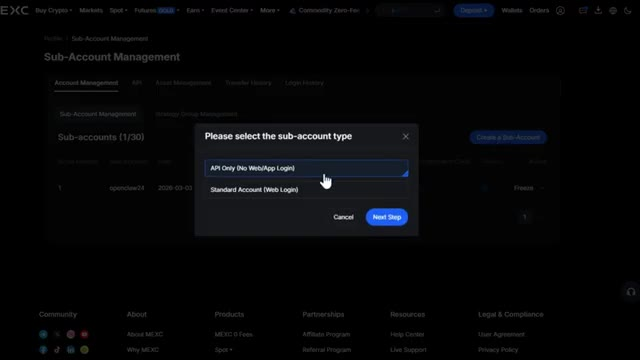
*⏱️ 00:05:35 — Page de gestion des sous-comptes sur MEXC avec une fenêtre modale pour sélectionner le type de sous-compte ("API Only" ou "Standard Account").*

---

### ⏱️ `[00:05:43 - 00:06:02]` | Segment #14

**🔊 Audio (Transcription Intégrale Mot pour Mot en Français) :**
> nous choisirons API uniquement puisque nous utilisons OpenClaw. Cliquez sur l'étape suivante. Choisissez un nom d'utilisateur pour ce sous-compte et ajoutez toutes les remarques que vous voulez comme trading OpenClaw. MEXI enverra un code de vérification de sécurité à votre e-mail ou à votre téléphone. Entrez le code et cliquez sur Soumettre. Vous verrez maintenant votre sous-compte sur le tableau de bord.

**👁️ Analyse Visuelle d'Écran (gemini-3.5-flash-lite) :**
**Interface & Outils** : Interface web de l'échange de cryptomonnaies MEXC (section Sub-Account Management).

**Contenu textuel & Code** : Tableau de gestion des sous-comptes affichant le nom du sous-compte (openclaw24), la date de création (2026-03-03 14:56:54), le statut (Normal) et les options de vérification et d'action (Freeze).

**Action / Démonstration** : Visualisation et gestion des sous-comptes créés pour la configuration de l'API OpenClaw.

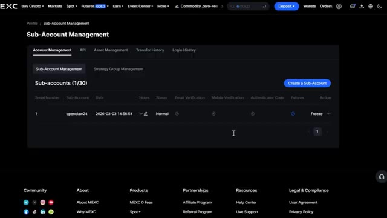
*⏱️ 00:05:48 — Capture d'écran de l'interface de gestion des sous-comptes sur la plateforme d'échange MEXC, affichant un sous-compte créé nommé 'openclaw24'.*

---

### ⏱️ `[00:06:02 - 00:06:20]` | Segment #15

**🔊 Audio (Transcription Intégrale Mot pour Mot en Français) :**
> Sur le même tableau de bord, cliquez sur la section API. Vous verrez un menu déroulant de sous-compte. Cliquez dessus et sélectionnez le sous-compte que vous venez de créer. Maintenant, vous verrez des cases à cocher pour différentes permissions. Je vous recommanderais d'activer uniquement les options de trading et rien d'autre. Tradez sur le marché au comptant si vous voulez faire du trading au comptant.

**👁️ Analyse Visuelle d'Écran (gemini-3.5-flash-lite) :**
**Interface & Outils** : Interface web d'échange de cryptomonnaies (page de gestion des clés API et des sous-comptes).

**Contenu textuel & Code** : Menu déroulant de sélection de sous-compte, cases à cocher pour les permissions Spot (View Account Details, Trade, Transfer) et Futures, champ Notes, et option de liaison d'adresse IP.

**Action / Démonstration** : Sélection des permissions et configuration de la clé API pour le sous-compte.

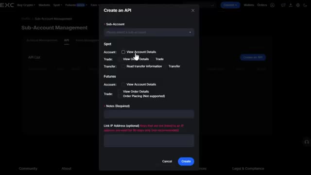
*⏱️ 00:06:07 — Fenêtre de création d'une clé API sur l'interface d'un exchange, montrant le menu déroulant du sous-compte et les options de permissions.*

---

### ⏱️ `[00:06:20 - 00:06:39]` | Segment #16

**🔊 Audio (Transcription Intégrale Mot pour Mot en Français) :**
> passation d'ordres pour les contrats à terme pour le trading de contrats à terme. Afficher les détails de la commande, facultatif mais utile. Tout ce qui concerne le retrait ou le transfert. Gardez-les décochés. Cela protège vos fonds. Vous pouvez ajouter quelques notes ici pour votre référence, et vous pouvez également lier des adresses IP spécifiques si vous voulez plus de sécurité.

**👁️ Analyse Visuelle d'Écran (gemini-3.5-flash-lite) :**
**Interface & Outils** : Interface de courtier / échange crypto (fenêtre de configuration API).

**Contenu textuel & Code** : Paramètres de clé API avec sections Spot et Futures, options pour les permissions de trading et de consultation des détails d'ordres, champ de notes et liaison d'adresse IP.

**Action / Démonstration** : Configuration des permissions de l'API avec un curseur sur la case 'View Order Details' pour le Spot, et des cases cochées pour l'affichage des détails et le passage d'ordres en Futures.

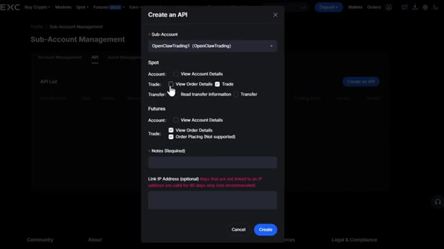
*⏱️ 00:06:25 — Fenêtre modale de création d'une clé API sur une plateforme d'échange, montrant la sélection des permissions de sous-compte et de trading Futures.*

---

### ⏱️ `[00:06:40 - 00:06:58]` | Segment #17

**🔊 Audio (Transcription Intégrale Mot pour Mot en Français) :**
> Une fois que tout est correct, cliquez sur créer. Vous verrez une vérification de sécurité réapparaître. Entrez le code. Vous verrez alors la clé d'accès, qui est votre clé API, et la clé secrète juste en dessous. Copiez les deux à l'aide du bouton de copie, puis cliquez sur confirmer. Une fois que vous l'avez, vous pouvez la voir sur le tableau de bord de l'API, prête à être connectée.

**👁️ Analyse Visuelle d'Écran (gemini-3.5-flash-lite) :**
**Interface & Outils** : Interface de gestion de clé API d'un exchange crypto.

**Contenu textuel & Code** : Champs de saisie pour le code de vérification à 6 chiffres envoyé par e-mail et le code d'authentification (2FA).

**Action / Démonstration** : Saisie des codes de sécurité pour valider la création de la clé API.

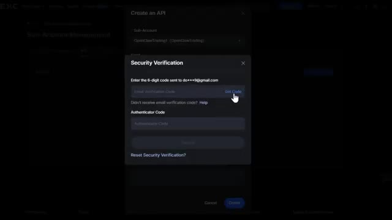
*⏱️ 00:06:44 — Fenêtre de vérification de sécurité demandant un code de confirmation par e-mail et un code d'authentification à double facteur.*

---

### ⏱️ `[00:06:59 - 00:07:17]` | Segment #18

**🔊 Audio (Transcription Intégrale Mot pour Mot en Français) :**
> Maintenant, connectons-nous à Blofin. Si vous n'avez pas encore de compte Blofin, cliquez sur le lien dans la description ci-dessous. Si vous vous êtes inscrit avec mon lien dans la description, vous pouvez réclamer jusqu'à 5 000 $ US de bonus rien que pour vous et la plateforme. Vous obtenez des coupons pour votre inscription et pour avoir réalisé des transactions, alors allez・certainement voir ça.

**👁️ Analyse Visuelle d'Écran (gemini-3.5-flash-lite) :**
**Interface & Outils** : Site web de l'échange de cryptomonnaies Blofin (formulaires d'inscription et interface utilisateur).

**Contenu textuel & Code** : Offre promotionnelle de bienvenue « Join Blofin Today and Win Welcome Bonus Up to $5,000! » et détails des récompenses par étapes (inscription, staking, dépôt, trade).

**Action / Démonstration** : Présentation de la page d'inscription et du programme de bonus pour inciter les spectateurs à utiliser le lien affilié.

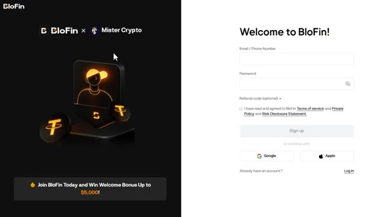
*⏱️ 00:07:03 — Page d'inscription de la plateforme Blofin montrant une offre de bonus de bienvenue en partenariat avec Mister Crypto.*

*⏱️ 00:07:08 — Page du centre des récompenses (Rewards Hub) de la plateforme Blofin détaillant les bonus pour nouveaux utilisateurs jusqu'à 5 000 USDT.*

---

### ⏱️ `[00:07:17 - 00:07:52]` | Segment #19

**🔊 Audio (Transcription Intégrale Mot pour Mot en Français) :**
> Avant de créer des clés API, je vous recommande vivement de créer un sous-compte dédié à votre agent IA OpenClaw. Cela permet de séparer votre trading automatisé de votre trading manuel. Pour ce faire, cliquez sur votre profil, puis sur sous-compte. Vous verrez le tableau de bord de gestion des sous-comptes. Vous pouvez maintenant créer un nouveau sous-compte spécifiquement pour OpenClaw. Maintenant, que vous utilisiez votre compte principal ou un sous-compte, allez dans les paramètres de votre compte et cliquez sur API. Cliquez sur créer une nouvelle clé API dans le coin supérieur droit. Vous verrez le champ du nom de l'application. Donnez-lui un nom comme trading open claw.

**👁️ Analyse Visuelle d'Écran (gemini-3.5-flash-lite) :**
**Interface & Outils** : Interface web de l'échange de cryptomonnaies BloFin.

**Contenu textuel & Code** : Menus de navigation du compte, options de sécurité, onglets "Sub-account" et "APIs", ainsi que le bouton de création de sous-compte.

**Action / Démonstration** : Navigation dans le menu du profil pour accéder à la section des sous-comptes afin de séparer le trading automatisé du trading manuel.

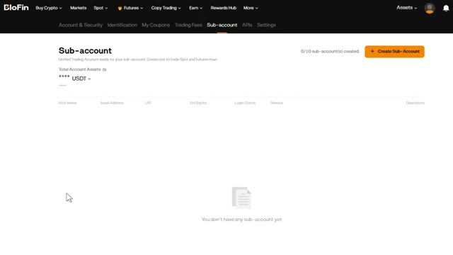
*⏱️ 00:07:35 — Tableau de bord de gestion des sous-comptes sur la plateforme BloFin, permettant de créer et configurer un sous-compte dédié à l'agent IA.*

*⏱️ 00:07:43 — Menu déroulant du profil utilisateur sur BloFin avec les options de gestion du compte, des sous-comptes et des clés API.*

---

### ⏱️ `[00:07:52 - 00:08:29]` | Segment #20

**🔊 Audio (Transcription Intégrale Mot pour Mot en Français) :**
> Voici la partie cruciale. Vous devez définir les bonnes autorisations. Voici la méthode intelligente pour configurer cela. Activez les autorisations de trading, mais laissez l'autorisation de retrait désactivée. De cette façon, même si un problème survient, vos fonds ne pourront pas être retirés. Cliquez sur Suivant et vous verrez votre clé API, votre clé secrète, et éventuellement une phrase secrète selon les paramètres. Copiez-les et enregistrez-les dans un endroit sûr, comme un gestionnaire de mots de passe. Vous ne verrez la clé secrète qu'une seule fois, alors assurez-vous de l'enregistrer maintenant. Très bien, maintenant que vous avez toutes vos clés API de Bybit, Mexi et Blowfin, connectons-les toutes à OpenClaw. Ouvrez OpenClaw et vous allez

**👁️ Analyse Visuelle d'Écran (gemini-3.5-flash-lite) :**
**Interface & Outils** : Interface web de l'échange Blofin (section API Management).

**Contenu textuel & Code** : Formulaire de création de clé API avec les champs 'Application Name' (Aping), 'API Key Name' (OpenClawTrading), et les cases à cocher pour les permissions (Read, Trade, Withdraw, Transfer) ainsi que la 'Passphrase'.

**Action / Démonstration** : Le curseur de la souris survole ou décoche la case 'Withdraw' pour désactiver l'autorisation de retrait des fonds via l'API.

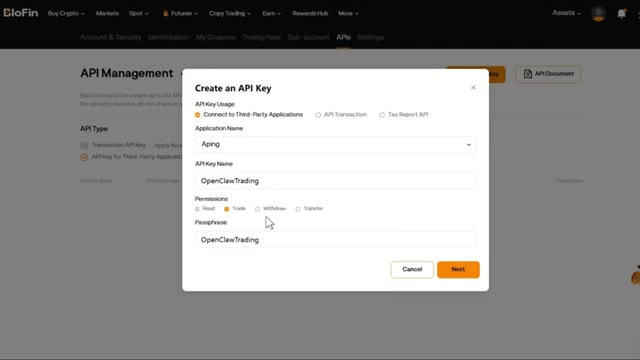
*⏱️ 00:08:02 — Fenêtre de création d'une clé API sur la plateforme Blofin montrant les options de configuration et les permissions de sécurité.*

---

### ⏱️ `[00:08:29 - 00:09:03]` | Segment #21

**🔊 Audio (Transcription Intégrale Mot pour Mot en Français) :**
> donne-lui des instructions pour se connecter à chaque échange. Je veux que tu te connectes à mon compte en utilisant ces identifiants de clé API et de clé secrète. Une fois que c'est fait, vérifie le solde de mon compte afin que je puisse voir que tu as réellement accès à mon compte. Et c'est aussi simple que ça, OpenClaw est maintenant connecté aux trois échanges et prêt à trader sur l'ensemble d'entre eux. Écoute, je dois être complètement honnête avec toi concernant la sécurité. Les clés API sont extrêmement puissantes. Si quelqu'un obtient l'accès à tes clés API, il peut contrôler ton compte de trading. Voici ce que tu dois faire. Un, ne partage jamais tes clés API avec qui que ce soit. Deux,

**👁️ Analyse Visuelle d'Écran (gemini-3.5-flash-lite) :**
**Interface & Outils** : Document texte (Google Docs / Word) et interface de plateforme de trading crypto.

**Contenu textuel & Code** : Texte explicatif de configuration d'API, graphique technique BTCUSDT avec moyennes mobiles, et menu de gestion des clés API (Read-Only / Read-Write).

**Action / Démonstration** : Présentation des étapes de configuration et de connexion d'un bot ou d'une intelligence artificielle aux clés API de l'échange.

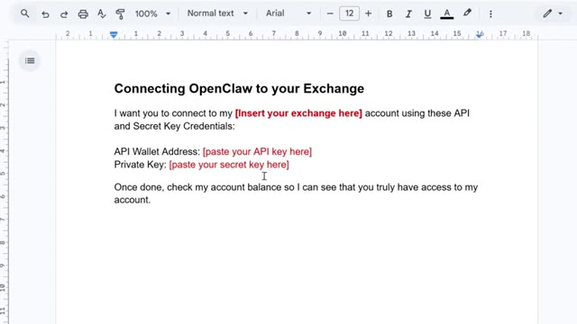
*⏱️ 00:08:38 — Document de traitement de texte montrant des instructions pour connecter OpenClaw à un échange de cryptomonnaies à l'aide de clés API.*

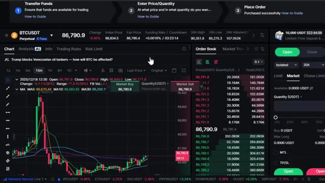
*⏱️ 00:08:46 — Interface de trading d'une plateforme d'échange affichant un graphique des prix BTCUSDT en bougies japonaises, le carnet d'ordres et les options de passage d'ordres.*

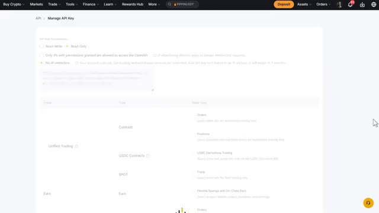
*⏱️ 00:08:54 — Page de gestion des clés API sur une interface de courtier ou d'échange de cryptomonnaies montrant les paramètres de configuration des permissions.*

---

### ⏱️ `[00:09:03 - 00:09:25]` | Segment #22

**🔊 Audio (Transcription Intégrale Mot pour Mot en Français) :**
> 2. Désactivez toujours les autorisations de retrait sur vos clés API. 3. Utilisez des sous-comptes pour isoler votre trading automatisé. 4. Stockez vos clés en toute sécurité dans un gestionnaire de mots de passe. 5. Examinez régulièrement l'activité de vos API dans les paramètres de votre échange. Si vous soupçonnez un jour que vos clés API ont été compromises, supprimez-les immédiatement et créez-en de nouvelles.

**👁️ Analyse Visuelle d'Écran (gemini-3.5-flash-lite) :**
**Interface & Outils** : Interface web d'un échange de cryptomonnaies (MEXC), section gestion des sous-comptes et configuration des clés API.

**Contenu textuel & Code** : Menus de configuration des comptes, tableaux de gestion des sous-comptes, options de permissions d'API (Read-Write, Read-Only, restrictions IP, contrats, spot).

**Action / Démonstration** : Navigation dans l'interface d'administration de l'échange pour montrer comment isoler le trading avec des sous-comptes et configurer les clés API en toute sécurité.

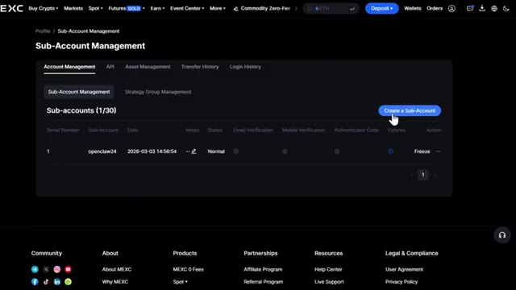
*⏱️ 00:09:08 — Interface de gestion des sous-comptes sur un échange crypto avec un tableau listant les sous-comptes et un bouton pour en créer un nouveau.*

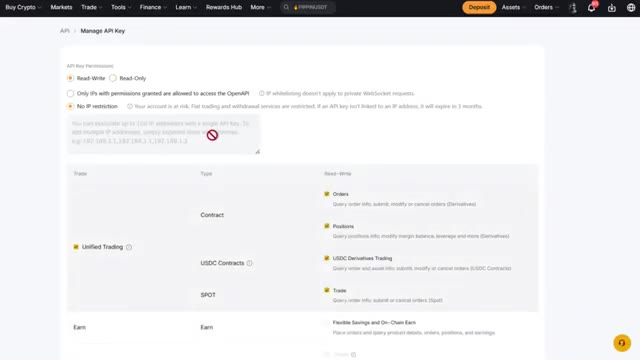
*⏱️ 00:09:20 — Page de configuration et de gestion des clés API sur un échange, montrant les différentes permissions de lecture/écriture et de restriction IP.*

---

### ⏱️ `[00:09:26 - 00:09:54]` | Segment #23

**🔊 Audio (Transcription Intégrale Mot pour Mot en Français) :**
> Gardez bien à l'esprit qu'OpenClaw est un outil puissant, mais vous devez l'utiliser de manière responsable. Et c'est tout, les gars. C'est ainsi que vous connectez OpenClaw à plusieurs plateformes d'échange et que vous commencez à automatiser vos transactions sur différentes plateformes. Si vous voulez commencer et réclamer ces bonus, comme jusqu'à 30 000 dollars sur Bybit, 10 000 USDT sur Mexi et 5 000 dollars de bonus sur Blofen, cliquez sur les liens dans la description ci-dessous. N'oubliez pas, ces bonus ne sont disponibles que si vous vous inscrivez via mes liens.

**👁️ Analyse Visuelle d'Écran (gemini-3.5-flash-lite) :**
**Interface & Outils** : Pages web de courtiers/échanges de cryptomonnaies (Bybit, Blofin) et éditeur de texte.

**Contenu textuel & Code** : Modèles de connexion API pour OpenClaw, paliers de bonus de bienvenue et offres promotionnelles d'échange.
[DESC_IMAGE_1] Modèle de prompt textuel pour l'automatisation des échanges via API.
[DESC_IMAGE_2] Interface d'inscription Bybit avec codes de parrainage et bonus de dépôt.
[DESC_IMAGE_3] Interface Blofin affichant le centre de récompenses et les bonus de bienvenue.

**Action / Démonstration** : Présentation des plateformes d'échange compatibles avec l'outil d'automatisation.

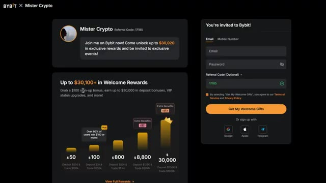
*⏱️ 00:09:40 — La page d'inscription de la plateforme Bybit affichant les bonus de bienvenue et le code de parrainage.*

*⏱️ 00:09:47 — La page d'accueil de la plateforme Blofin montrant les récompenses exclusives pour les nouveaux utilisateurs.*

---

### ⏱️ `[00:09:54 - 00:10:09]` | Segment #24

**🔊 Audio (Transcription Intégrale Mot pour Mot en Français) :**
> Si vous voulez plus de détails sur la façon dont OpenClaw, Bybit, Mexi et Blofenworks fonctionnent, consultez les vidéos qui apparaissent à l'écran dès maintenant. Si vous avez apprécié cette vidéo, n'oubliez pas de laisser un pouce bleu et de vous abonner à ma chaîne pour plus de tutoriels sur la crypto. Je vous vois dans la prochaine.

**👁️ Analyse Visuelle d'Écran (gemini-3.5-flash-lite) :**
**Interface & Outils** : Bybit (Interface de trading Spot/Dérivés avec graphique TradingView intégré).

**Contenu textuel & Code** : Graphique de prix BTC/USDT avec indicateurs techniques, carnet d'ordres (Order Book) en temps réel et panneau de passage d'ordres (Long/Short).

**Action / Démonstration** : Visualisation du marché des cryptomonnaies et des interfaces de trading présentées en fin de vidéo.

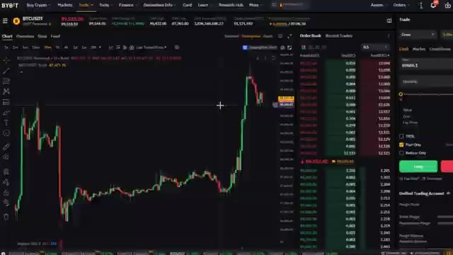
*⏱️ 00:09:57 — Interface de trading de la plateforme Bybit affichant un graphique en chandeliers japonais de la paire BTC/USDT, un carnet d'ordres et le panneau d'exécution des ordres à droite.*

---

