# 🎬 Improved Your Win Rate With These 5 MORE Polymarket Strategies

> **Chaîne** : [Alex Carter](https://www.youtube.com/@AlexCarterTrading)  
> **Lien YouTube** : [https://www.youtube.com/watch?v=TeoADsKRmig](https://www.youtube.com/watch?v=TeoADsKRmig)  
> **Date de publication** : 20260306  
> **Durée** : 00:10:51  
> **Identifiant vidéo** : `TeoADsKRmig`  
> **Transcription & Analyse** : `whisper-v3-large-turbo+gemini-3.5-flash-lite`  

---

## 📌 Synthèse Exécutive & Outils

### 💡 Résumé
Dans cette vidéo, Alex Carter décortique cinq stratégies de trading quantitatif avancées appliquées aux marchés de prédiction Polymarket, conçues pour s'affranchir des biais psychologiques des investisseurs particuliers. Loin des paris spéculatifs et de la loterie émotionnelle, l'approche repose sur l'exploitation des inefficacités structurelles du marché, l'analyse fondamentale de terrain, et la modélisation mathématique des probabilités. En combinant des stratégies à espérance mathématique positive (EV+) et l'arbitrage de narratifs médiatiques ou de règles juridiques ambiguës, les professionnels parviennent à générer des flux de rendement constants et réguliers.

Les démonstrations présentées illustrent concrètement comment exploiter des actifs sous-évalués à forte probabilité (comme le maintien de Jerome Powell à la tête de la Fed), ou encore comment contrer les biais comportementaux de la foule sur des marchés de niche (culture pop, géopolitique, ou marchés de mentions). L'objectif central est de transformer le trader en "maison de casino", c'est-à-dire en acteur rationnel exploitant les failles des parieurs impulsifs tout en optimisant le capital grâce à des programmes de primes et de volumes.

---

### 🛠️ Outils, Modèles & Logiciels Présentés
* **Polymarket** : Plateforme principale de marchés de prédiction décentralisée où s'exécutent les stratégies d'arbitrage, de grinding à EV+ et de résolution partielle.
* **Canaux Telegram Indépendants** : Sources de renseignements géopolitiques de premier plan pour analyser les mouvements de terrain réels avant l'ajustement des grands médias.
* **Imagerie Satellitaire & Cartes de Première Ligne** : Outils de vérification fondamentale utilisés pour contrer les narratifs médiatiques occidentaux erronés sur les conflits armés.
* **Modèles d'Analyse Comportementale et Culturelle (Alpha du sondage de copine)** : Méthodologie empirique consistant à sonder l'écosystème cible (fans, cercles proches) pour capter le véritable sentiment sur la culture pop.

---

### 🔑 Points Clés & Enseignements Stratégiques
* **Le Grinding à EV Positive** : Consiste à acheter des résultats ayant 90 à 95 % de chances de se produire mais cotés à 75-80 % en raison de l'attrait des particuliers pour les outsiders à fort effet de levier.
* **Rendements Composés Silencieux** : Viser des gains constants de 5 à 15 % sur des marchés quasi-certains (comme le maintien de Jerome Powell à la Fed) plutôt que des multiplicateurs aléatoires, agissant comme des obligations à haut rendement.
* **Arbitrage des Narratifs Géopolitiques** : Ne pas trader les titres de presse mais la réalité du terrain en s'appuyant sur des faits vérifiés, des analyses de lignes de ravitaillement et des sources locales pour contrer les hausses de prix irrationnelles.
* **L'Alpha du Sondage de Culture Pop** : Exploiter l'asymétrie d'information sur les marchés du divertissement en sondant des cercles proches (ex: fans de Taylor Swift) dont l'intuition collective surpasse les modèles basés sur le battage médiatique.
* **Position par Défaut sur les Marchés de Mentions** : Appliquer systématiquement le "Non" sur les marchés de citations ou de mentions à courte durée, les particuliers surévaluant la probabilité qu'une personnalité s'écarte de son script formel.
* **Analyse Contextuelle des Discours** : Évaluer rigoureusement l'agenda public, le type d'événement (discours politique formel vs meeting de campagne) avant de parier sur l'utilisation de slogans ou expressions familières.
* **Exploitation des Plaidoyers de Résolution Partielle** : Anticiper les batailles de règles et les ambiguïtés sémantiques ou juridiques (ex: la définition légale et littérale d'une "annonce" de candidature par une personnalité inéligible).
* **Arbitrage de l'Ambiguïté des Règles** : Acheter à bas coût (10 à 20 cents) des positions sur des scénarios improbables mais sémantiquement ambigus, tablant sur un crédit partiel du comité de résolution pour générer un profit net.
* **Gestion des Incitations Financières** : Maximiser la rentabilité globale en capitalisant sur les programmes de primes massives de Polymarket (jusqu'à 1 000 $ par million de volume) et les bonus de parrainage.
* **Posture Psychologique de la Maison** : Agir en tant qu'entité rationnelle et mathématique face à des parieurs particuliers motivés par l'excitation, le bruit médiatique et l'espoir d'un gain rapide.

---

## ⏱️ Chronologie & Transcription Complète Audio & Visuelle (Mot pour Mot)

### ⏱️ `[00:00:00 - 00:00:33]` | Segment #01

**🔊 Audio (Transcription Intégrale Mot pour Mot en Français) :**
> Dans cette vidéo, je vous révèle cinq autres stratégies absurdes que les meilleurs traders de Polymarket utilisent en ce moment pour imprimer de l'argent. Des stratégies que 99 % des gens ignorent totalement. Ce sont exactement ces stratégies qui séparent les professionnels qui gagnent régulièrement de l'argent des traders particuliers qui font juste de la loterie et espèrent le meilleur. Alors restez bien là, car je vais décortiquer chaque stratégie étape par étape avec des exemples concrets et vous montrer exactement comment commencer à les utiliser dès aujourd'hui pour gagner de l'argent sur Polymarket. Commençons. Et d'ailleurs, si vous générez

**👁️ Analyse Visuelle d'Écran (gemini-3.5-flash-lite) :**
**Interface & Outils** : Polymarket (site web de prédiction et de paris)

**Contenu textuel & Code** : Marché de prédiction "Taylor Swift pregnant in 2025?" avec différentes échéances (31 mars 2026 à 2%, 31 décembre 2026 à 37%), boutons d'achat ("Buy Yes" à 2,6¢ et "Buy No" à 98,9¢), panneau de passage d'ordres à droite avec un montant de 0$, et sections de règles et commentaires.

**Action / Démonstration** : Navigation et présentation d'un marché de prédiction absurde ou insolite sur la plateforme Polymarket pour illustrer les stratégies de trading.

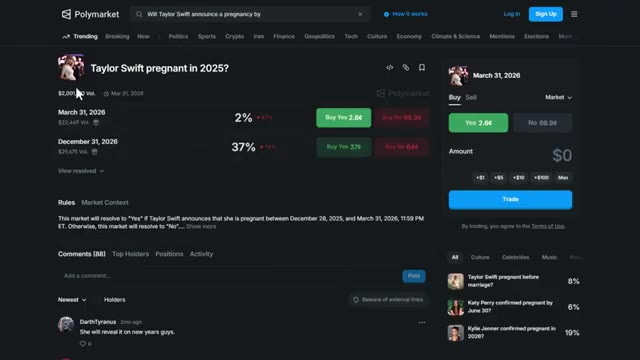
*⏱️ 00:00:08 — Capture d'écran de l'interface de la plateforme de prédiction Polymarket montrant un marché spécifique.*

---

### ⏱️ `[00:00:33 - 00:01:09]` | Segment #02

**🔊 Audio (Transcription Intégrale Mot pour Mot en Français) :**
> un volume important sur Polymarket, vous pouvez débloquer des primes massives allant jusqu'à 1 000 $ après avoir généré seulement 1 000 000 $ de chiffre d'affaires. Cela s'ajoute au bonus de parrainage de 10 $ lorsque votre filleul effectue son premier dépôt. Le lien est ci-dessous. Très bien, passons directement à la première stratégie. J'appelle celle-ci le grinding à EV positive. Certains événements ont 90 ou 95 pour cent de chances qu'un résultat se produise, mais le marché les cote toujours à 75 ou 80 pour cent parce que les traders particuliers ne peuvent pas résister au rêve d'un outsider qui rapporte 10 fois la mise. C'est là que les mathématiques pures font imprimer de l'argent. La stratégie est simple.

**👁️ Analyse Visuelle d'Écran (gemini-3.5-flash-lite) :**
**Interface & Outils** : Polymarket (plateforme de prédiction et de paris)

**Contenu textuel & Code** : Listes de marchés de prédiction, graphiques de probabilités et actualités en temps réel.

**Action / Démonstration** : Navigation et consultation des différents marchés disponibles sur la plateforme Polymarket.

*⏱️ 00:00:42 — Capture d'écran du site Polymarket affichant la page d'accueil avec les actualités et marchés récents.*

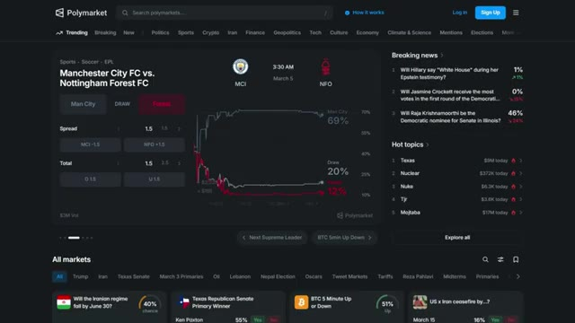
*⏱️ 00:00:51 — Capture d'écran du site Polymarket montrant un marché spécifique de football (Manchester City vs Nottingham Forest) avec un graphique des cotes.*

---

### ⏱️ `[00:01:10 - 00:01:46]` | Segment #03

**🔊 Audio (Transcription Intégrale Mot pour Mot en Français) :**
> Vous achetez le résultat hautement probable à prix réduit, vous le ramenez vers sa juste valeur, ou vous le conservez tout simplement jusqu'à son dénouement. Ce ne sont pas des transactions tape-à-l'œil. Elles n'achèteront pas votre Lambo aujourd'hui, mais elles font fructifier l'argent de manière constante et silencieuse. Pensez-y comme à l'achat d'obligations sûres qui rapportent régulièrement entre 5 et 10 pour cent. En voici un exemple parfait. Le 12 janvier, le marché pour le maintien de Jerome Powell à la tête de la Fed, les actions « oui » se négociaient autour de 7,7 pour cent. Cela signifie que les actions « non » se négociaient alors autour de 92,3 centimes par action « non ». Vers le 4 mars, la probabilité du « oui » tombe à 1,2 pour cent et les actions « non »

**👁️ Analyse Visuelle d'Écran (gemini-3.5-flash-lite) :**
**Interface & Outils** : Polymarket (site web de marchés de prédiction)

**Contenu textuel & Code** : Catégories de marchés (Tech, IA, Elon Musk, etc.), pourcentages de probabilité (ex: 41%, 33%, 79%), boutons "Yes" / "No" et volumes de transactions (ex: $17M Vol., $978K Vol.).

**Action / Démonstration** : Navigation et présentation des différents marchés de prédiction et de leurs cotes sur la plateforme Polymarket.

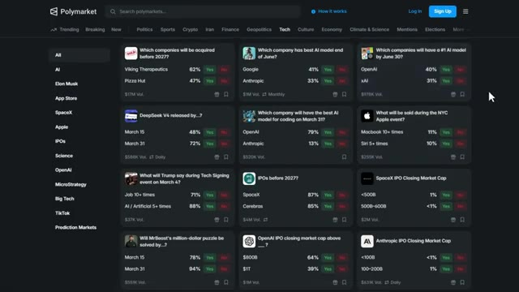
*⏱️ 00:01:19 — Capture d'écran de la plateforme Polymarket affichant divers marchés de prédiction technologiques avec les probabilités en pourcentage (Oui/Non) et les volumes associés.*

---

### ⏱️ `[00:01:46 - 00:02:24]` | Segment #04

**🔊 Audio (Transcription Intégrale Mot pour Mot en Français) :**
> est monté jusqu'à environ 98,9 cents. C'est un gain net de 6,6 points, soit près de 7 % de bénéfice en seulement quelques semaines pour quelque chose qui est fondamentalement déjà garanti de se produire. La clé ici est de trouver des marchés où l'issue est presque certaine, mais où le marché intègre encore un certain doute parce que les investisseurs particuliers adorent parier sur le chaos. Vous ne cherchez pas des rendements multipliés par 100 ici. Vous cherchez des gains constants de 5 à 15 % qui se cumulent avec le temps. Voici comment trouver ces opportunités. Cherchez des marchés avec des issues à très haute probabilité. Des choses comme est-ce que X restera en fonction ou est-ce que Y se produira d'ici un avenir lointain

**👁️ Analyse Visuelle d'Écran (gemini-3.5-flash-lite) :**
**Interface & Outils** : Polymarket (site web de marchés de prédiction)

**Contenu textuel & Code** : Graphique de probabilité montrant une baisse vers 1 % de chance ("1% chance") et des boutons d'achat/vente ("Buy Yes 1.4¢", "Buy No 98.8¢").

**Action / Démonstration** : Consultation et analyse d'un marché de prédiction sur Polymarket concernant un événement politique/économique.

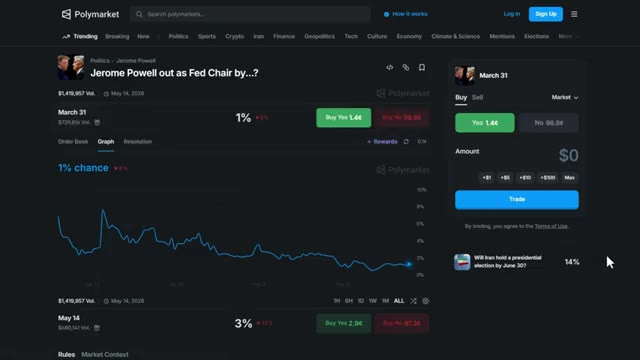
*⏱️ 00:01:56 — Capture d'écran de l'interface Polymarket affichant un marché de prédiction lié au départ de Jerome Powell.*

---

### ⏱️ `[00:02:24 - 00:02:45]` | Segment #05

**🔊 Audio (Transcription Intégrale Mot pour Mot en Français) :**
> date. Vérifiez si le marché cote en dessous de 90 cents alors qu'il devrait être entre 95 et 98 cents. Achetez le côté sous-évalué et conservez jusqu'à la résolution ou jusqu'à ce qu'il se recote plus près de sa juste valeur. C'est de mathématiques pures. Vous enchaînez des transactions à espérance mathématique positive constante. La stratégie numéro deux consiste entièrement à briser les narratifs médiatiques et à négocier la réalité.

**👁️ Analyse Visuelle d'Écran (gemini-3.5-flash-lite) :**
**Interface & Outils** : Navigateur web affichant l'interface de Polymarket.

**Contenu textuel & Code** : Question du marché « Will the US confirm that aliens exist before 2027? » avec une probabilité affichée à 19 % pour le « Yes » et un volume total de 13 576 329 $.

**Action / Démonstration** : Survol ou interaction de la souris sur le bouton de vente du côté « No » (82 ¢) dans le module de trading.

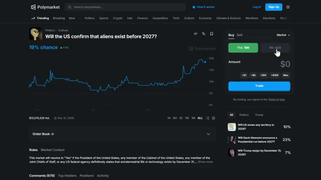
*⏱️ 00:02:29 — Capture d'écran de la plateforme Polymarket montrant un marché de prédiction avec un graphique d'évolution des prix et le panneau d'achat/vente à droite.*

---

### ⏱️ `[00:02:46 - 00:03:11]` | Segment #06

**🔊 Audio (Transcription Intégrale Mot pour Mot en Français) :**
> Dans la géopolitique et les élections, le plus grand avantage vient du fait de voir la réalité plus tôt et plus précisément que la foule. Les médias occidentaux interprètent mal ou poussent certains récits qui ne correspondent pas à ce qui se passe réellement sur le terrain, créant ainsi des erreurs d'évaluation massives sur Polymarket. Voici comment cela fonctionne. Si vous parlez la langue locale, suivez des influenceurs régionaux ou comprenez le sentiment culturel, vous voyez immédiatement lorsque les traders mondiaux parient sur le mauvais récit.

**👁️ Analyse Visuelle d'Écran (gemini-3.5-flash-lite) :**
**Interface & Outils** : Polymarket, réseau social X (Twitter)

**Contenu textuel & Code** : Cotes de prédiction électorales, marchés de paris géopolitiques et flux de publications sur X illustrant le traitement de l'information.

**Action / Démonstration** : Navigation et consultation de données de prédiction sur Polymarket puis d'un fil d'actualité sur X.

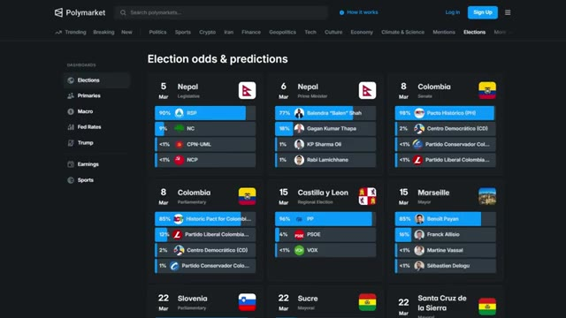
*⏱️ 00:02:52 — Capture d'écran du site Polymarket montrant une page de prédictions sur les élections mondiales avec plusieurs cartes de marchés politiques.*

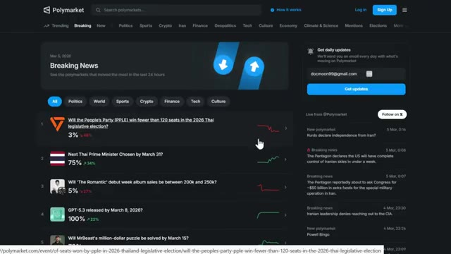
*⏱️ 00:02:59 — Vue de l'interface Polymarket (onglet Breaking News) affichant des marchés de prédiction et des graphiques d'évolution récents.*

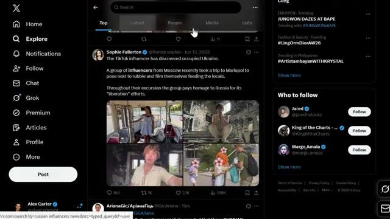
*⏱️ 00:03:05 — Capture d'écran du réseau social X (anciennement Twitter) montrant un fil de discussion avec des tweets et des images de publications d'influenceurs.*

---

### ⏱️ `[00:03:12 - 00:03:31]` | Segment #07

**🔊 Audio (Transcription Intégrale Mot pour Mot en Français) :**
> Cela seul devient un avantage reproductible, mais vous pouvez aller encore plus loin avec une analyse fondamentale de base. Au lieu de faire confiance aux grands titres, vous reconstruisez la situation à partir de faits vérifiés, de positions de troupes, de cartes de première ligne, d'imagerie satellitaire, de fuites locales, de schémas historiques. Par exemple, avec le conflit russo-ukrainien.

**👁️ Analyse Visuelle d'Écran (gemini-3.5-flash-lite) :**
**Interface & Outils** : Navigateur web affichant une carte interactive de l'Institut pour l'étude de la guerre (ISW).

**Contenu textuel & Code** : Carte géopolitique de l'Europe de l'Est et de l'Ukraine détaillant les lignes de front et les zones de conflit.

**Action / Démonstration** : Consultation de cartes de première ligne pour illustrer l'analyse fondamentale de base basée sur des faits vérifiés.

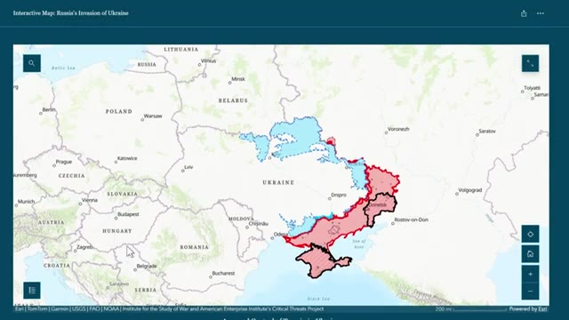
*⏱️ 00:03:27 — Carte interactive de l'Institut pour l'étude de la guerre (ISW) montrant le front en Ukraine avec les zones contrôlées.*

---

### ⏱️ `[00:03:32 - 00:03:51]` | Segment #08

**🔊 Audio (Transcription Intégrale Mot pour Mot en Français) :**
> Cela signifie souvent de surveiller des canaux Telegram indépendants qui publient de véritables mouvements et des images bien avant que les grands médias n'ajustent leur récit. Une fois que vous avez les faits, vous modelez les quelques mois à venir. Lorsque les marchés s'envolent sur du battage médiatique, un discours, une rumeur, une mise à jour vague provenant de "sources", mais que rien ne change sur le terrain ou dans le sentiment local.

**👁️ Analyse Visuelle d'Écran (gemini-3.5-flash-lite) :**
**Interface & Outils** : Navigateur web affichant une carte interactive, l'interface Reddit et la plateforme X (Twitter).

**Contenu textuel & Code** : Articles de presse, fils de discussion et cartes géographiques sur le conflit russo-ukrainien.

**Action / Démonstration** : Navigation et consultation de sources d'information alternatives et de réseaux sociaux.

---

### ⏱️ `[00:03:51 - 00:04:10]` | Segment #09

**🔊 Audio (Transcription Intégrale Mot pour Mot en Français) :**
> Tu le fades. Tu ne trades pas des narratifs. Tu trades la réalité, là où tout le monde réagit au bruit. Laisse-moi te montrer un exemple. Disons qu'il y a un marché qui demande, est-ce que la Russie va capturer une ville spécifique d'ici une date spécifique ? Les médias occidentaux pourraient amplifier les avancées russes, ce qui fait grimper le oui à 66 %.

**👁️ Analyse Visuelle d'Écran (gemini-3.5-flash-lite) :**
**Interface & Outils** : Polymarket (plateforme de prédiction décentralisée)

**Contenu textuel & Code** : Marché de prédiction "Will Russia capture Kostyantynivka by...?", graphique d'évolution des prix/probabilités, options de trading d'achat/vente (Buy Yes 22¢, etc.), et volume des transactions.

**Action / Démonstration** : Navigation et présentation d'un marché de prédiction sur Polymarket illustrant l'exemple de trading géopolitique évoqué dans l'audio.

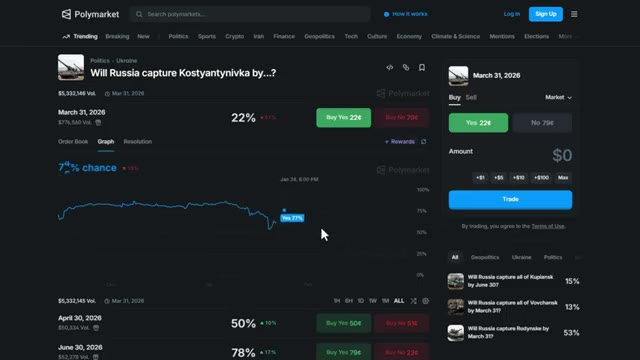
*⏱️ 00:03:56 — Capture d'écran de la plateforme Polymarket montrant un marché de prédiction géopolitique concernant la Russie et l'Ukraine, avec graphique de probabilités et interface de trading.*

---

### ⏱️ `[00:04:10 - 00:04:30]` | Segment #10

**🔊 Audio (Transcription Intégrale Mot pour Mot en Français) :**
> Mais si vous suivez les chaînes Telegram locales et l'imagerie satellitaire, et que vous voyez que les forces russes sont en fait bloquées à 50 kilomètres sans lignes de ravitaillement, vous achetez « non » à 51 centimes et vous attendez que le marché réalise que le récit médiatique était faux. Lorsque la date limite passe et que la ville n'a pas été capturée, vous touchez votre profit.

**👁️ Analyse Visuelle d'Écran (gemini-3.5-flash-lite) :**
**Interface & Outils** : Navigateur web affichant une carte interactive (Institute for the Study of War) et la plateforme de prédiction Polymarket.

**Contenu textuel & Code** : Carte géographique des zones contrôlées en Ukraine et graphique de probabilité sur Polymarket montrant une cote à 50% / "Buy No 51¢".

**Action / Démonstration** : Illustration visuelle du raisonnement d'analyse géopolitique comparé aux cotes du marché de prédiction Polymarket.

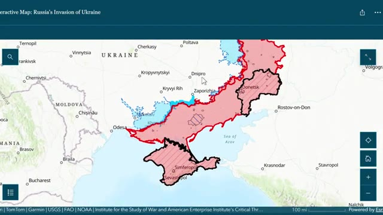
*⏱️ 00:04:15 — Carte interactive montrant la situation militaire en Ukraine avec les zones de front.*

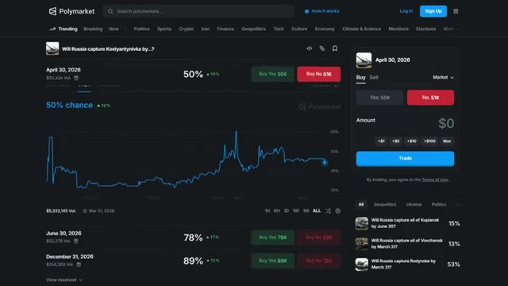
*⏱️ 00:04:25 — Interface de la plateforme Polymarket affichant un marché de prédiction géopolitique avec les cotes d'achat "Yes" et "No".*

---

### ⏱️ `[00:04:30 - 00:04:55]` | Segment #11

**🔊 Audio (Transcription Intégrale Mot pour Mot en Français) :**
> Cette stratégie demande plus de travail, mais l'avantage est massif parce que la plupart des traders se contentent de lire les titres et tradent dans la panique. La troisième stratégie a l'air drôle, mais c'est du vrai alpha. J'appelle ça l'alpha du sondage de copine. La télé-réalité, les rumeurs de grossesse de Taylor Swift, les sorties d'albums surprises, le drama de Kanye West. Ces marchés de la pop culture sont constamment mal évalués parce que les traders masculins pensent qu'ils comprennent ce qui se passe, mais ce n'est pas le cas. Votre copine et vos amies, si.

**👁️ Analyse Visuelle d'Écran (gemini-3.5-flash-lite) :**
**Interface & Outils** : Navigateur web affichant le site TASS et la plateforme de marchés prédictifs Polymarket.

**Contenu textuel & Code** : Articles de presse internationale et interface de trading Polymarket avec des pourcentages de probabilité pour différents candidats de télé-réalité.

**Action / Démonstration** : Navigation sur des sites d'actualité et de marchés de prédiction pour illustrer l'analyse des tendances et des paris alternatifs.

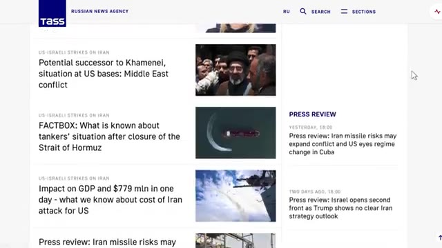
*⏱️ 00:04:36 — Capture d'écran du site d'actualités russe TASS montrant des articles sur les tensions géopolitiques au Moyen-Orient.*

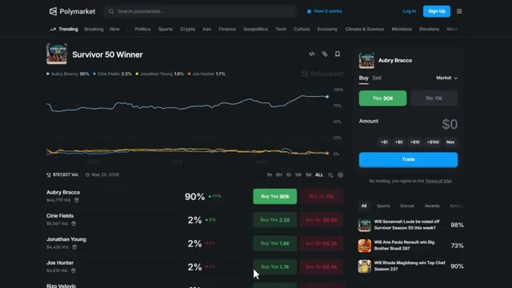
*⏱️ 00:04:43 — Capture d'écran de la plateforme de prédiction Polymarket affichant un marché de paris sur la télé-réalité (Survivor 50 Winner).*

---

### ⏱️ `[00:04:56 - 00:05:15]` | Segment #12

**🔊 Audio (Transcription Intégrale Mot pour Mot en Français) :**
> Voici la stratégie. Vous sondez cinq à dix d'entre eux avec des questions simples. Pensez-vous que Taylor sort un album le mois prochain ? Est-ce que cette rumeur de grossesse de Swift semble réelle ? Est-ce que Kanye West va réellement se faire arrêter cette semaine ou est-ce juste du bruit sur Internet ? Leur intuition collective est souvent plus précise que n'importe quel modèle parce qu'ils consomment cet écosystème quotidiennement.

**👁️ Analyse Visuelle d'Écran (gemini-3.5-flash-lite) :**
**Interface & Outils** : Polymarket (site web de marchés de prédiction)

**Contenu textuel & Code** : Question du marché "Which artists will release new albums in 2026?" avec la liste des artistes (Harry Styles, Nettspend, Luke Combs, Drake, Kanye West, Lana Del Rey, Olivia Rodrigo, Playboi Carti) et leurs probabilités respectives ainsi que les options d'achat (Buy Yes / Buy No).

**Action / Démonstration** : Navigation et consultation des prédictions de marché concernant les sorties d'albums d'artistes célèbres.

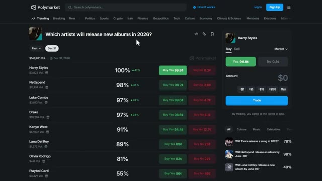
*⏱️ 00:05:01 — Capture d'écran de la plateforme Polymarket affichant un marché de prédiction lié à la sortie d'albums par divers artistes.*

---

### ⏱️ `[00:05:16 - 00:05:43]` | Segment #13

**🔊 Audio (Transcription Intégrale Mot pour Mot en Français) :**
> Ils comprennent les cycles émotionnels, le comportement des fans et les rebondissements dramatiques. Laissez-moi vous donner un exemple concret. Il y a avait un marché qui demandait : est-ce que Taylor Swift annoncera une grossesse d'ici la fin de l'année ? Le « oui » s'échangeait à 37 centimes parce que des traders masculins avaient vu des rumeurs sur Twitter et pensaient que c'était possible. Mais si vous demandez à 10 femmes qui suivent Taylor Swift de près, 9 sur 10 vous diraient que c'est complètement absurde en se basant sur sa tournée, ses récentes interviews et sa chronologie amoureuse.

**👁️ Analyse Visuelle d'Écran (gemini-3.5-flash-lite) :**
**Interface & Outils** : Polymarket et X (Twitter)

**Contenu textuel & Code** : Données de marché Polymarket (probabilités d'achat "Oui" / "Non", volume de transactions) et publications sur les réseaux sociaux.

**Action / Démonstration** : Consultation d'un marché de prédiction illustrant l'analyse des comportements de fans et des tendances virales.

*⏱️ 00:05:23 — Capture d'écran de la plateforme Polymarket montrant le marché de prédiction lié à Taylor Swift avec les probabilités et le carnet d'ordres.*

---

### ⏱️ `[00:05:43 - 00:06:04]` | Segment #14

**🔊 Audio (Transcription Intégrale Mot pour Mot en Français) :**
> Tu achètes le "non" à 64 centimes et tu ramasses de l'argent facile quand ça se résout. Ça marche parce que les marchés de la culture pop sont motivés par le battage médiatique et la spéculation, pas par les données. Les gens qui comprennent réellement ces écosystèmes, principalement des femmes, ne sont pas ceux qui tradent sur Polymarket. Tu combles ce fossé d'information et tu en profites. Alors la prochaine fois que tu vois un marché de la culture pop, ne devine pas.

**👁️ Analyse Visuelle d'Écran (gemini-3.5-flash-lite) :**
**Interface & Outils** : Polymarket (site web de marchés de prédiction)

**Contenu textuel & Code** : Graphique d'évolution des probabilités (affichant 37% de chances pour le "Oui" et un volume de plus de 2 millions de dollars), boutons de transaction avec les prix respectifs ("Yes 38¢", "No 64¢"), et carnet d'ordres latéral.

**Action / Démonstration** : Le curseur de la souris survole et sélectionne l'option d'achat du "Non" (No) à 64¢ sur le marché de prédiction de la culture pop.

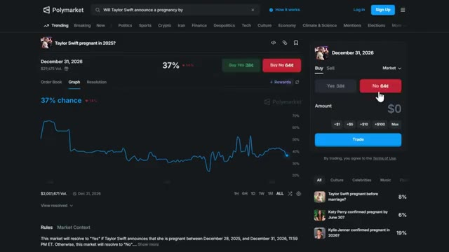
*⏱️ 00:05:48 — Capture d'écran de la plateforme Polymarket montrant le marché de prédiction concernant une annonce de grossesse de Taylor Swift en 2026, avec un curseur positionné sur le bouton rouge d'achat "No" à 64 centimes.*

---

### ⏱️ `[00:06:05 - 00:06:23]` | Segment #15

**🔊 Audio (Transcription Intégrale Mot pour Mot en Français) :**
> Demandez à quelqu'un qui sait vraiment. La stratégie numéro quatre est simple mais puissante. Les marchés mentionnés reviennent toujours par défaut à non. Les marchés mentionnés sont un piège addictif pour les investisseurs particuliers. Chaque semaine, quelqu'un pense que le président va mentionner la crypto. Il ne le fera pas. Chaque semaine, quelqu'un pense qu'un PDG va nommer un concurrent sur scène. Ils ne le feront pas.

**👁️ Analyse Visuelle d'Écran (gemini-3.5-flash-lite) :**
**Interface & Outils** : Polymarket (site web de marchés de prédiction)

**Contenu textuel & Code** : Liste de paris sur des mentions (« What will Karoline Leavitt say... », « What will be said during the NYC Apple event? », « What will Trump say during Tech Signing event... ») avec des boutons de trading et des volumes affichés.

**Action / Démonstration** : Navigation et présentation des marchés de prédiction axés sur les mentions de mots ou phrases spécifiques lors d'événements.

*⏱️ 00:06:09 — Capture d'écran de la plateforme Polymarket affichant la section 'Mentions' avec une liste de marchés de prédiction basés sur des mots ou phrases prononcés lors d'événements publics.*

---

### ⏱️ `[00:06:23 - 00:06:41]` | Segment #16

**🔊 Audio (Transcription Intégrale Mot pour Mot en Français) :**
> Voici pourquoi cela fonctionne. Les marchés de mentions à courte durée sont largement surévalués, oui, parce que c'est excitant. Les investisseurs particuliers adorent l'idée d'un gain multiplié par 5 ou 10 si la personne prononce juste un mot. Mais la réalité, c'est que la plupart des intervenants s'en tiennent à leurs scripts. Ils ne mentionnent pas des choses au hasard à moins qu'il n'y ait une raison très spécifique.

**👁️ Analyse Visuelle d'Écran (gemini-3.5-flash-lite) :**
**Interface & Outils** : Interface web de la plateforme de prédiction Polymarket.

**Contenu textuel & Code** : Marché "What will Jensen Huang say during the NVIDIA GTC Keynote?", options de pari avec pourcentages (94% pour "AI / Artificial Intelligence 10+ times"), carnet d'ordres (Order Book) et panneau de trading latéral.

**Action / Démonstration** : Consultation et navigation sur un marché de mentions à courte durée pour analyser les cotes et les probabilités de prix.

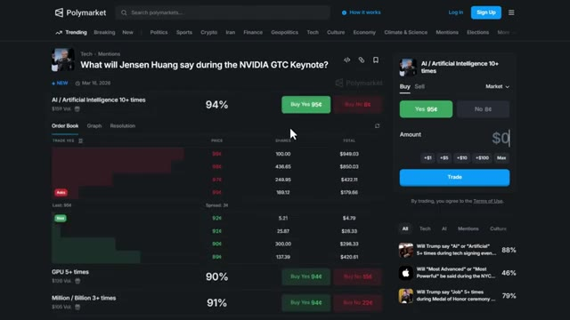
*⏱️ 00:06:28 — Capture d'écran de la plateforme Polymarket affichant un marché de prédiction lié à la keynote NVIDIA GTC de Jensen Huang et aux mentions de mots-clés.*

---

### ⏱️ `[00:06:42 - 00:07:01]` | Segment #17

**🔊 Audio (Transcription Intégrale Mot pour Mot en Français) :**
> Votre position par défaut devrait toujours être non, à moins que... Il y a un long historique de mentions similaires dans les discours passés. L'orateur est un grand bavard qui sort constamment du script. Le mot ou le sujet correspond parfaitement au narratif attendu du discours. Sinon, vous atténuez tout le reste. Laissez-moi vous montrer un exemple.

**👁️ Analyse Visuelle d'Écran (gemini-3.5-flash-lite) :**
**Interface & Outils** : Site Web de Polymarket (marché de prédiction)

**Contenu textuel & Code** : Question de marché sur les propos de Jensen Huang lors de la keynote GTC de NVIDIA, affichant des probabilités à 80 % et 60 %, un graphique historique des chances, un panneau de trading à droite (Buy/Sell, boutons Yes/No, montant en USD) et le volume des transactions associées.

**Action / Démonstration** : Navigation et consultation du marché de prédiction avec affichage du graphique de probabilité et sélection d'un pari.

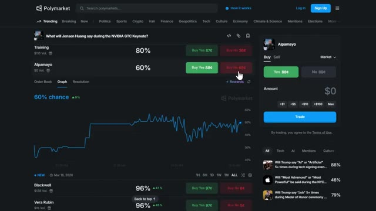
*⏱️ 00:06:47 — Capture d'écran de la plateforme Polymarket montrant un marché de prédiction lié à la keynote NVIDIA GTC et Jensen Huang, avec un graphique de probabilité et un panneau de passage d'ordres à droite.*

---

### ⏱️ `[00:07:02 - 00:07:39]` | Segment #18

**🔊 Audio (Transcription Intégrale Mot pour Mot en Français) :**
> Il y a un marché qui demande, que va dire Trump en mars ? Fore, bébé, fore. Le "oui" s'échange à 76 centimes. Maintenant, voici le problème. Même si Trump a déjà utilisé cette expression, vous devez examiner le contexte spécifique de l'événement. s'il s'agit d'un discours politique formel, d'une réunion diplomatique ou d'un discours préparé, les chances qu'il utilise un slogan familier comme fore, bébé, fore baissent considérablement. Trump pourrait parler de politique énergétique, de production pétrolière et de l'indépendance énergétique américaine, mais il n'utilisera pas nécessairement cette phrase exacte à moins qu'il ne s'agisse d'un rassemblement ou d'un événement de style campagne. Vous pouvez vérifier le rôle du président

**👁️ Analyse Visuelle d'Écran (gemini-3.5-flash-lite) :**
**Interface & Outils** : Polymarket (site web de marchés de prédiction)

**Contenu textuel & Code** : Marché "What will Trump say in March?", options "Secret Word" (52%), "Debate" (70%), "Drill Baby Drill" (67% avec un prix d'achat "Yes" à 76¢), ainsi qu'un graphique de l'évolution des probabilités et un panneau de trade à droite.

**Action / Démonstration** : Le curseur de la souris survole le bouton d'achat "Buy Yes 76¢" pour l'option "Drill Baby Drill".

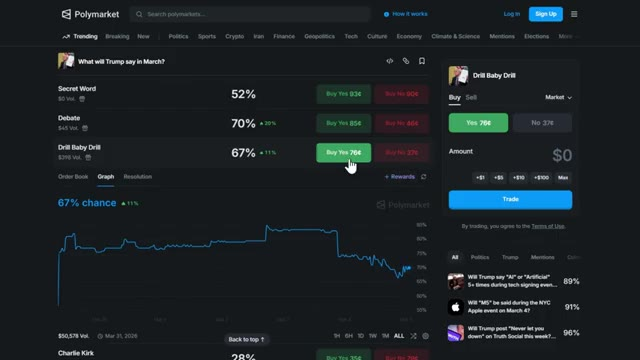
*⏱️ 00:07:11 — Capture d'écran de la plateforme Polymarket montrant le marché de prédiction lié aux phrases de Trump en mars, avec en surbrillance l'option "Drill Baby Drill" et un graphique de probabilité associé.*

---

### ⏱️ `[00:07:39 - 00:08:11]` | Segment #19

**🔊 Audio (Transcription Intégrale Mot pour Mot en Français) :**
> appel où vous pouvez voir l'agenda public du président. Donc même à 76 centimes, oui, c'est peut-être surévalué parce que les traders particuliers parient sur l'excitation et les comportements passés sans tenir compte du contexte. Vous achetez le non à 37 centimes et vous encaissez quand le discours se termine sans que cette phrase spécifique n'ait été prononcée. La clé, c'est de ne pas se laisser prendre au piège du battage médiatique. La plupart des marchés mentionnés ne sont que des jeux de hasard de particuliers motivés par l'excitation. Le contexte importe. Même si quelqu'un a déjà dit quelque chose auparavant, cela ne signifie pas qu'il le dira à nouveau dans toutes les situations. Vous êtes la maison et vous pariez contre les joueurs

**👁️ Analyse Visuelle d'Écran (gemini-3.5-flash-lite) :**
**Interface & Outils** : Polymarket (plateforme de prédiction décentralisée).

**Contenu textuel & Code** : Prix des contrats (ex. : Buy Yes à 76¢, Buy No à 37¢), pourcentages de probabilité, graphiques d'évolution des cotes et calendrier des événements politiques.

**Action / Démonstration** : Navigation sur la plateforme et sélection d'un pari sur les mots prononcés lors d'un discours présidentiel.

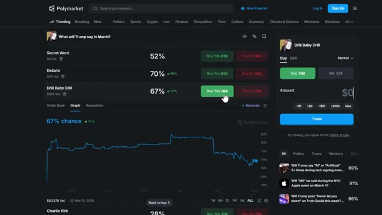
*⏱️ 00:07:47 — Capture d'écran de la plateforme Polymarket montrant le marché prédictif "What will Trump say in March?" avec un graphique des chances d'évolution et les options d'achat "Yes" et "No".*

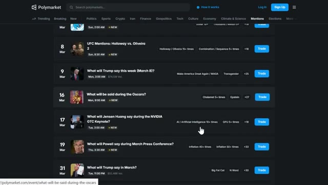
*⏱️ 00:08:03 — Capture d'écran de Polymarket affichant une liste de marchés de prédiction classés par dates et événements, illustrant l'agenda des conférences et discours à venir.*

---

### ⏱️ `[00:08:11 - 00:08:33]` | Segment #20

**🔊 Audio (Transcription Intégrale Mot pour Mot en Français) :**
> qui ne pensent pas au contexte. La stratégie numéro cinq est avancée, mais elle est incroyablement rentable si vous la comprenez. J'appelle cela le plaidoyer de résolution partielle. Certains marchés Polymarket n'échouent pas parce que l'événement est incertain. Ils échouent parce que les règles sont incertaines. Cela se transforme en batailles de règles, et si vous les voyez venir, vous pouvez faire du profit même lorsque l'événement va contre vous.

**👁️ Analyse Visuelle d'Écran (gemini-3.5-flash-lite) :**
**Interface & Outils** : Polymarket (plateforme de prédiction décentralisée)

**Contenu textuel & Code** : Probabilités de marchés, pourcentages de votes, volumes d'échange et listes de prédictions géopolitiques et électorales.

**Action / Démonstration** : Présentation visuelle de marchés de prédiction Polymarket pour illustrer les règles et le contexte des options de résolution.

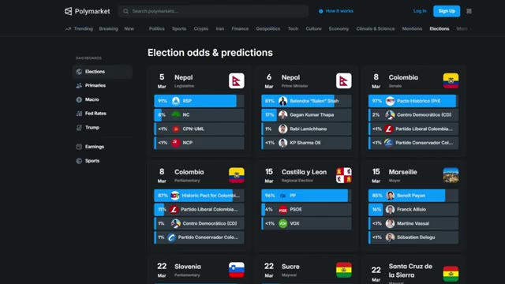
*⏱️ 00:08:17 — Capture d'écran de l'interface Polymarket affichant le tableau de bord des prédictions électorales ("Election odds & predictions") avec des marchés sur le Népal, la Colombie, la Castille-et-León et Marseille.*

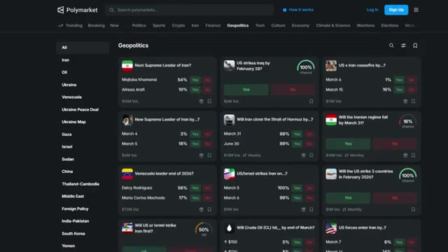
*⏱️ 00:08:22 — Capture d'écran de l'interface Polymarket dans la catégorie Géopolitique ("Geopolitics"), présentant divers marchés de prédiction sur l'Iran, l'Irak et le Venezuela.*

---

### ⏱️ `[00:08:33 - 00:09:08]` | Segment #21

**🔊 Audio (Transcription Intégrale Mot pour Mot en Français) :**
> Voici comment cela fonctionne. Disons qu'il y a un marché qui demande, est-ce qu'Elon Musk annoncera une candidature présidentielle avant 2027. Maintenant, le mot annoncer est incroyablement vague ici. Est-ce que cela signifie une annonce de campagne formelle avec des documents déposés auprès de la FEC ? Un tweet disant, je suis candidat à la présidence ? Une blague sur un podcast ? Une réponse à quelqu'un qui lui demande s'il se présenterait ? C'est là que ça devient encore plus complique. Elon Musk n'est pas né aux États-Unis, il est donc inéligible par la Constitution pour se présenter à la présidence. Mais et s'il tweete, je suis candidat à la présidentielle comme une blague ou une déclaration politique, même s'il ne le peut pas légalement ?

**👁️ Analyse Visuelle d'Écran (gemini-3.5-flash-lite) :**
**Interface & Outils** : Navigateur web affichant les plateformes Polymarket et Google.

**Contenu textuel & Code** : Interface de trading de prédiction Polymarket (graphique de probabilité, carnet d'ordres, options "Yes" à 4₵ et "No" à 96,7₵) et page de résultats de recherche Google avec encart Wikipédia.

**Action / Démonstration** : Navigation et présentation de données sur un marché de prédiction en lien avec Elon Musk, suivies d'une recherche sur ses origines.

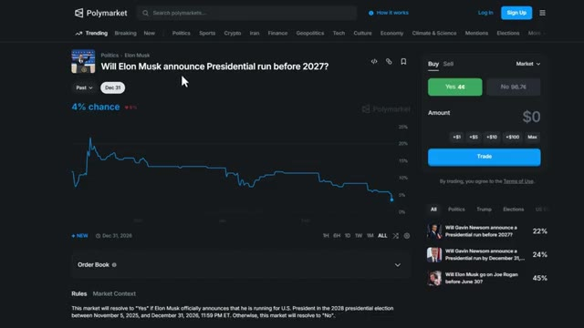
*⏱️ 00:08:42 — Capture d'écran du site Polymarket montrant le marché de prédiction "Will Elon Musk announce Presidential run before 2027?" avec une probabilité actuelle de 4%.*

*⏱️ 00:08:59 — Capture d'écran d'une recherche Google sur Elon Musk, affichant des informations biographiques (lieu de naissance, date de naissance, fortune estimée).*

---

### ⏱️ `[00:09:08 - 00:09:26]` | Segment #22

**🔊 Audio (Transcription Intégrale Mot pour Mot en Français) :**
> La moitié des traders soutiendront que cela compte comme une annonce. L'autre moitié dira que cela ne compte pas parce qu'il est inéligible et que ce n'est clairement pas sérieux. Le débat traîne en longueur et aboutit à une résolution partielle, peut-être 30 à 70 ou 40 à 60, selon la façon dont le comité interprète le mot « annonce ».

**👁️ Analyse Visuelle d'Écran (gemini-3.5-flash-lite) :**
**Interface & Outils** : Interface web de Polymarket (marché de prédiction décentralisé).

**Contenu textuel & Code** : Question du marché : "Will Elon Musk announce Presidential run in 2025?", probabilité actuelle affichée à "<1% chance", graphique d'évolution des prix/probabilités, volume total de 324,779 $, et règles de résolution du marché.

**Action / Démonstration** : Consultation de la page d'un marché spécifique sur Polymarket pour analyser l'évolution des probabilités et les règles de résolution associées au sujet débattu.

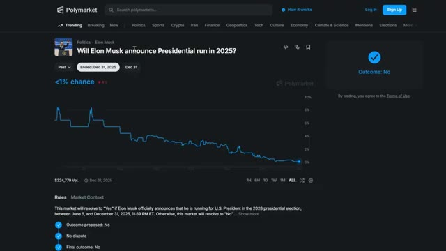
*⏱️ 00:09:12 — Capture d'écran de la plateforme Polymarket montrant un marché de prédiction sur le thème de la course présidentielle d'Elon Musk, avec un graphique de probabilité et les règles du marché.*

---

### ⏱️ `[00:09:26 - 00:09:45]` | Segment #23

**🔊 Audio (Transcription Intégrale Mot pour Mot en Français) :**
> Si vous aviez acheté oui à 10 ou 20 cents en anticipant cette ambiguïté, un crédit partiel transforme une position médiocre en un bénéfice net. Même si Elon fait une sorte de déclaration qui pourrait être interprétée comme une annonce, vous faites quand même du bénéfice parce que vous avez acheté suffisamment bas pour que la résolution partielle vous paie. Voici donc la stratégie.

**👁️ Analyse Visuelle d'Écran (gemini-3.5-flash-lite) :**
**Interface & Outils** : Interface web de Polymarket (marché de prédiction décentralisé).

**Contenu textuel & Code** : Question du marché : "Will Elon Musk announce Presidential run in 2025?", probabilité actuelle affichée à "<1% chance", graphique d'évolution historique des prix montrant une baisse continue vers zéro, volume total de 324 779 $, et section des règles du marché en bas de page.

**Action / Démonstration** : Affichage et analyse du graphique de probabilités du marché de prédiction Polymarket illustrant l'effondrement de la cote du pari "Oui".

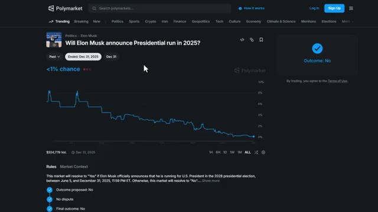
*⏱️ 00:09:31 — Capture d'écran de la plateforme Polymarket montrant le marché de prédiction concernant une éventuelle annonce de candidature présidentielle par Elon Musk en 2025.*

---

### ⏱️ `[00:09:46 - 00:10:07]` | Segment #24

**🔊 Audio (Transcription Intégrale Mot pour Mot en Français) :**
> Repérez les termes vagues dans les règles du marché. Des mots comme annoncer, confirmer, officiel, déclarer. Recherchez des marchés où l'événement lui-même comporte une ambiguïté inhérente, comme une personne inéligible qui annonce une candidature. Achetez tôt entre 0,10 $ et 0,30 $ lorsque vous anticipez une ambiguïté. Lorsque la bataille des règles commence, poussez pour un règlement partiel dans les commentaires ou sur discord.

**👁️ Analyse Visuelle d'Écran (gemini-3.5-flash-lite) :**
**Interface & Outils** : Interface web de Polymarket.

**Contenu textuel & Code** : Le marché affiché est "Tesla and SpaceX merger officially announced by June 30?", avec une probabilité actuelle de 8% pour "Yes" (côté à 9 cents) et 92% pour "No" (93 cents). Le volume s'élève à 114,041 $. En bas, on aperçoit les règles du marché et d'autres marchés suggérés sur le côté droit.

**Action / Démonstration** : Le curseur de la souris survole le titre du marché pour illustrer l'analyse des termes vagues comme "officially announced" dans les règles du marché.

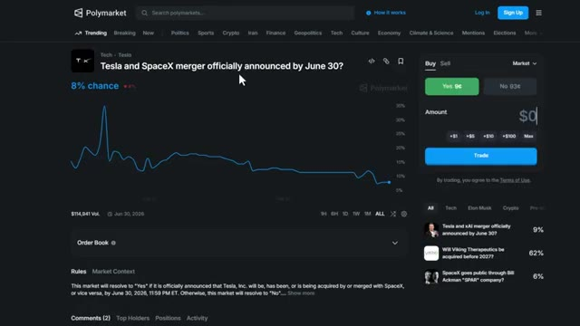
*⏱️ 00:09:51 — Capture d'écran de la plateforme Polymarket montrant un marché de prédiction spécifique lié à une fusion entre Tesla et SpaceX.*

---

### ⏱️ `[00:10:08 - 00:10:30]` | Segment #25

**🔊 Audio (Transcription Intégrale Mot pour Mot en Français) :**
> Tu ne prédis pas l'événement, tu prédis l'argument. C'est avancé, mais si tu le maîtrises, tu peux faire des profits même lorsque le résultat est incertain. Je vais également sortir la troisième partie de cette série avec des stratégies encore plus avancées, alors assure-toi de t'abonner et de cliquer sur l'icône de la cloche pour ne pas la rater. Et si tu veux automatiser ton copy trading et suivre les baleines, va voir Tradefox.

**👁️ Analyse Visuelle d'Écran (gemini-3.5-flash-lite) :**
**Interface & Outils** : Polymarket (site web de marchés de prédiction)

**Contenu textuel & Code** : Marché "Will Elon Musk announce Presidential run in 2025?", section de commentaires des utilisateurs et affichage du résultat "Outcome: No".

**Action / Démonstration** : Navigation et consultation d'un marché de prédiction et des discussions associées sur Polymarket.

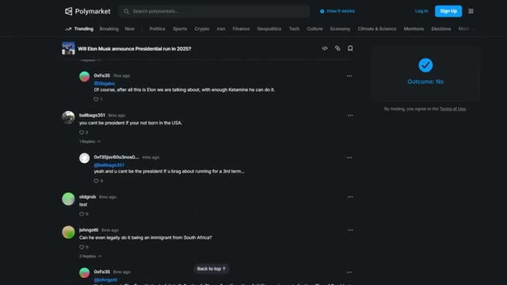
*⏱️ 00:10:13 — Capture d'écran de la plateforme Polymarket montrant un marché de prédiction avec des commentaires et le résultat "No".*

---

### ⏱️ `[00:10:30 - 00:10:48]` | Segment #26

**🔊 Audio (Transcription Intégrale Mot pour Mot en Français) :**
> C'est le seul outil que j'utilise pour le copy trading sur Polymarket. Le lien est dans la description. Si vous avez trouvé cette vidéo utile, laissez un pouce bleu en bas. Si vous avez des questions, posez-les dans les commentaires et je répondrai à chacune d'elles. Et si vous avez raté la première partie de cette série, regardez la vidéo qui apparaît à l'écran en ce moment même.

**👁️ Analyse Visuelle d'Écran (gemini-3.5-flash-lite) :**
**Interface & Outils** : Tradefox et Polymarket (plateformes web de trading et de marchés prédictifs).

**Contenu textuel & Code** : Classements de traders, volumes de tournoi, soldes de compte, pourcentages de change sur 24h et divers marchés de prédiction avec cotes (Yes/No, Up/Down).

**Action / Démonstration** : Navigation et présentation des outils de copy trading et des marchés disponibles.

*⏱️ 00:10:34 — Capture d'écran de l'interface Tradefox affichant le tableau des tournois et le classement des traders pour le copy trading.*

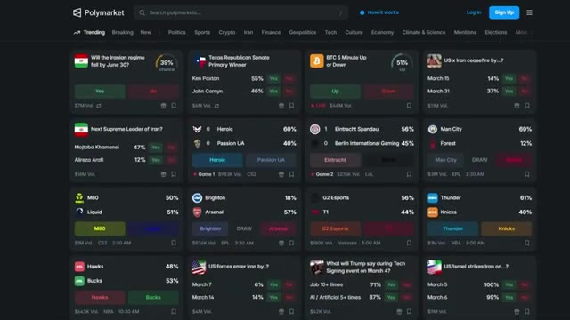
*⏱️ 00:10:39 — Capture d'écran de la page d'accueil de la plateforme de prédictions Polymarket montrant différents marchés tendance.*

---

### ⏱️ `[00:10:48 - 00:10:51]` | Segment #27

**🔊 Audio (Transcription Intégrale Mot pour Mot en Français) :**
> Merci d'avoir regardé et je vous vois dans le prochain.

**👁️ Analyse Visuelle d'Écran (gemini-3.5-flash-lite) :**
**Interface & Outils** : Aucune interface visible.

**Contenu textuel & Code** : Aucun contenu technique, graphique ou de code affiché.

**Action / Démonstration** : Aucune action démontrée.

---

