# 🎬 How To Trade 24/7 with Blofin Trading Bots (Step-by-Step Guide)

> **Chaîne** : [Alex Carter](https://www.youtube.com/@AlexCarterTrading)  
> **Lien YouTube** : [https://www.youtube.com/watch?v=AliMfs-D0xA](https://www.youtube.com/watch?v=AliMfs-D0xA)  
> **Date de publication** : 20260308  
> **Durée** : 00:13:14  
> **Identifiant vidéo** : `AliMfs-D0xA`  
> **Transcription & Analyse** : `whisper-v3-large-turbo+gemini-3.5-flash-lite`  

---

## 📌 Synthèse Exécutive & Outils

### 💡 Résumé
Cette vidéo de la chaîne Alex Carter propose un guide pratique et approfondi sur l'automatisation complète des stratégies de trading crypto grâce aux bots de la plateforme Blofin. L'analyse met en lumière la configuration d'outils de trading algorithmique fonctionnant 24h/24 et 7j/7, permettant aux investisseurs de s'affranchir de la surveillance constante des graphiques et de la charge émotionnelle inhérente au trading manuel. À travers une démonstration pas à pas, le tutoriel explore la mise en place de stratégies avancées telles que le Futures Grid, le Spot Grid, le Dollar Cost Averaging (DCA) avec ou sans effet de levier, ainsi que l'utilisation des signaux de trading automatisés.

L'approche repose sur une double méthodologie : l'utilisation de l'intelligence artificielle de Blofin pour le matching automatique de bots optimisés selon les conditions du marché (haussières, baissières, volatiles ou latérales) et le contrôle manuel pour les traders cherchant une personnalisation accrue des paramètres. Sont ainsi décortiqués les mécanismes d'optimisation des grilles arithmétiques et géométriques, l'ajustement des ordres de sécurité, ainsi que l'intégration indispensable d'une gestion rigoureuse des risques via des ordres de prise de bénéfices (*Take Profit*) et de stop-loss.

### 🛠️ Outils, Modèles & Logiciels Présentés
* **Blofin** : Plateforme centrale de trading de contrats à terme et au comptant, hébergeant l'ensemble des bots d'automatisation et les outils de dépôt sécurisé (notamment via le réseau TRC20).
* **Blofin AI Bots / EasyBot** : Moteur d'intelligence artificielle intégré qui analyse les préférences de l'utilisateur et les conditions du marché pour recommander et faire correspondre instantanément les bots les plus performants basés sur le backtesting.
* **Futures Grid (Grille de contrats à terme)** : Modèle de bot algorithmique conçu pour capitaliser sur la volatilité des marchés en plaçant simultanément des ordres d'achat et de vente dans une fourchette définie avec effet de levier.
* **Futures DCA (Dollar Cost Averaging sur contrats à terme)** : Outil d'accumulation périodique à paliers intégrant un effet de levier pour amplifier les rendements lors de stratégies de positionnement progressif.
* **Spot Grid (Grille au comptant)** : Stratégie automatisée similaire au grid futures mais opérant sans effet de levier, idéale pour l'optimisation des rendements sur des marchés stagnants ou latéraux sans risque de liquidation.
* **Spot DCA (Dollar Cost Averaging au comptant)** : Bot d'investissement périodique pur, sans effet de levier, éliminant totalement le risque de liquidation et la composante émotionnelle pour une constitution de portefeuille à long terme.
* **SignalBot** : Outil d'automatisation avancé permettant de déclencher des transactions en direct basées sur des flux de signaux externes (notamment issus de TradingView).
* **TWAP (Time-Weighted Average Price)** : Algorithme de répartition d'ordres massifs sur une période définie pour lisser l'exécution et minimiser le glissement de prix (*slippage*).

### 🔑 Points Clés & Enseignements Stratégiques
* **Automatisation intégrale sans code** : Les bots Blofin permettent de configurer des stratégies complexes en quelques clics, assurant une exécution continue 24h/24 et 7j/7 sans nécessiter de compétences en programmation.
* **Optimisation par l'IA et Backtesting** : L'utilisation de l'assistant IA de Blofin permet d'accéder instantanément à des statistiques de performance rétro-calculées (APR), facilitant le choix du bot en fonction du profil de risque et de la direction du marché.
* **Dualité des modes de configuration** : Possibilité de basculer entre la stratégie automatisée par l'IA pour un déploiement rapide et le mode manuel (*Ajuster les paramètres*) pour un contrôle absolu des variables techniques.
* **Maîtrise du Futures Grid pour la volatilité** : Ce bot exploite les fluctuations de prix au sein d'une fourchette définie en exécutant des micro-achats et micro-ventes, optimisant le rendement dans les phases de marché agitées.
* **Sécurisation par le Spot DCA** : Présenté comme l'option la plus sûre du marché, le DCA au comptant supprime l'effet de levier et le risque de liquidation, permettant une accumulation sereine et dénuée de biais émotionnels.
* **Paramétrage des grilles (Arithmétique vs Géométrique)** : Utiliser le mode arithmétique (espacement de prix égal) pour les marchés stables et le mode géométrique (espacement en pourcentage égal) pour s'adapter dynamiquement aux variations de prix des marchés hautement volatils.
* **Gestion rigoureuse du risque (*Risk Management*)** : Activation systématique recommandée des ordres de Take Profit (TP) et de Stop Loss (SL) pour prémunir le capital contre les retournements de tendance violents.
* **Mécanique des ordres de sécurité en DCA** : Configuration précise des paliers de prix (distance de baisse nécessaire avant rachat) et du nombre maximal d'ordres de sécurité pour lisser efficacement le prix d'entrée moyen (*cost averaging*).
* **Trading sans effet de levier sur le Spot** : Le choix des grilles et du DCA au comptant garantit l'utilisation exclusive du capital propre de l'investisseur, éliminant le stress lié aux appels de marge (*margin calls*).
* **Gestion des flux de capitaux** : Recommandation d'utiliser le réseau TRC20 pour les dépôts en USDT sur Blofin afin de minimiser les frais de transaction et d'accélérer la mise à disposition des fonds.
* **Approche « Configurer et Oublier »** : Transmutation du trading actif en une gestion passive de portefeuille, adaptée aux horizons d'investissement à moyen et long terme (semaines, mois, années).

---

## ⏱️ Chronologie & Transcription Complète Audio & Visuelle (Mot pour Mot)

### ⏱️ `[00:00:00 - 00:00:33]` | Segment #01

**🔊 Audio (Transcription Intégrale Mot pour Mot en Français) :**
> Et si je vous disais que vous pouviez automatiser toute votre stratégie de trading crypto dès maintenant ? Pas de code, pas besoin de surveiller les graphiques. Vous configurez et vous oubliez. Dans cette vidéo, je vous présente les six bots de trading de Blowfin. À la fin de cette vidéo, vous aurez un bot qui tourne 24h/24 et 7j/7 et qui trade pour vous. C'est parti. Première chose à faire, vous avez besoin d'un compte Blowfin. Si vous n'en avez pas encore un, cliquez sur le lien dans la description. Vous aurez accès à des bonus exclusifs rien qu'en vous inscrivant et en faisant du trading. Je vous montrerai exactement comment les réclamer plus tard dans la vidéo. Cela prend moins d'un

**👁️ Analyse Visuelle d'Écran (gemini-3.5-flash-lite) :**
**Interface & Outils** : Plateforme d'échange crypto Blofin (interface de trading spot/futures et page Rewards Hub)

**Contenu textuel & Code** : Graphique de prix BTCUSDT Perpetual, carnet d'ordres en temps réel, stratégies de grid trading automatisées avec backtests (APY +309.61%, +403.73%)

**Action / Démonstration** : Présentation de l'interface de trading et des fonctionnalités de bots de trading automatisés sur Blofin

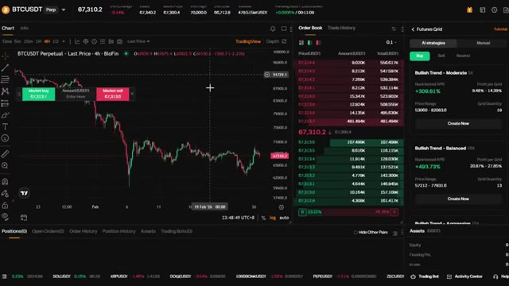
*⏱️ 00:00:08 — Capture d'écran montrant l'interface de trading de la plateforme Blofin avec un graphique de prix BTCUSDT en unités 4h, le carnet d'ordres et les stratégies de bots Futures Grid.*

*⏱️ 00:00:25 — Page d'accueil du site Blofin affichant l'offre promotionnelle 'New User Exclusive: Earn up to 5,000 USDT' dans la section Rewards Hub.*

---

### ⏱️ `[00:00:33 - 00:00:55]` | Segment #02

**🔊 Audio (Transcription Intégrale Mot pour Mot en Français) :**
> minute pour créer votre compte. Une fois connecté, assurez-vous d'avoir des fonds sur votre compte. Si vous devez faire un dépôt, allez simplement dans actifs, cliquez sur dépôt, sélectionnez USDT, choisissez votre réseau. Je recommande TRC20 pour des frais bas et envoyez vos fonds. Ils arriveront en quelques minutes. Passons maintenant aux bots. Survolez futures dans le menu supérieur et cliquez sur bots de trading. C'est votre tableau de bord des bots.

**👁️ Analyse Visuelle d'Écran (gemini-3.5-flash-lite) :**
**Interface & Outils** : Site web de la bourse de cryptomonnaies BloFin.

**Contenu textuel & Code** : Menus de gestion d'actifs, options de dépôt en cryptomonnaies (USDT) et sélection des réseaux blockchain (Tron TRC20, Ethereum ERC20, BNB Smart Chain BEP20, Polygon POS, AVAX C-Chain).

**Action / Démonstration** : Navigation dans le menu des actifs et sélection du réseau de dépôt TRC20 pour l'USDT.

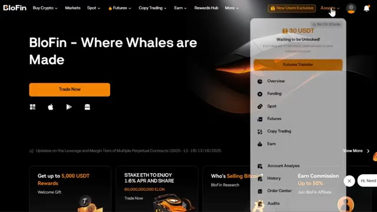
*⏱️ 00:00:38 — Page d'accueil de la plateforme BloFin avec un menu déroulant sur l'onglet 'Assets' affichant les différentes options de gestion de compte.*

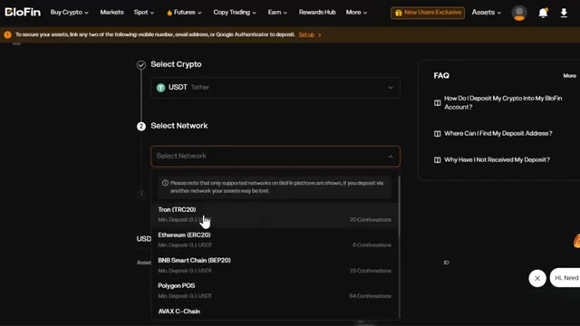
*⏱️ 00:00:44 — Écran de dépôt de la plateforme BloFin montrant la sélection de la cryptomonnaie USDT et le choix du réseau avec Tron (TRC20) en surbrillance.*

---

### ⏱️ `[00:00:55 - 00:01:16]` | Segment #03

**🔊 Audio (Transcription Intégrale Mot pour Mot en Français) :**
> En haut, vous verrez votre P&L total, vos actifs totaux et vos bots en cours d'exécution. Maintenant, faites un peu défiler vers le bas et vous verrez quelque chose de vraiment sympa. Blowfin va réellement vous faire correspondre au bon bot de trading en fonction de vos préférences. Cliquez sur Essayer EasyBot. Ici, vous pouvez répondre à quelques questions comme : sur quels contrats ou quelle devise aimeriez-vous vous concentrer ?

**👁️ Analyse Visuelle d'Écran (gemini-3.5-flash-lite) :**
**Interface & Outils** : Site web BloFin (Interface de Trading Bots)

**Contenu textuel & Code** : P&L total (0 USDT), Actifs totaux (0.00 USDT), Bots en cours d'exécution (0), options de création de bots (Futures Grid, Futures DCA, Spot Grid, Spot DCA, Signal Bot, TWAP)

**Action / Démonstration** : Présentation du tableau de bord des robots de trading et mise en avant de la fonction de correspondance des bots ("Match With the Right Trading Bot").

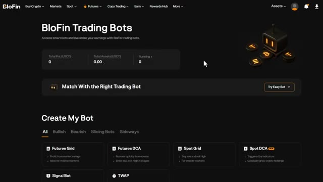
*⏱️ 00:01:00 — Capture d'écran de l'interface BloFin montrant la page des robots de trading avec le tableau de bord du P&L, des actifs totaux et l'option de correspondance de bots.*

---

### ⏱️ `[00:01:16 - 00:01:35]` | Segment #04

**🔊 Audio (Transcription Intégrale Mot pour Mot en Français) :**
> Quelle direction de marché attendez-vous ? Haussière, baissière ou volatile ? Une fois que vous avez terminé, cliquez sur Obtenir ma correspondance. L'IA de Blowfin choisira la meilleure correspondance en fonction de vos critères. Vous pouvez voir le type de bot, l'APR testé rétroactivement, la période suggérée, et même la raison pour laquelle l'IA de Blowfin vous a associé à ce bot.

**👁️ Analyse Visuelle d'Écran (gemini-3.5-flash-lite) :**
**Interface & Outils** : Site web de l'échange BloFin (section Trading Bots)

**Contenu textuel & Code** : Formulaire de sélection de robot (« Match With the Right Trading Bot ») avec le choix de l'actif (BTCUSDT) et de la direction de marché (Bullish, Bearish, Volatile), ainsi que les statistiques globales du compte (Total PnL, Total Assets).

**Action / Démonstration** : Le curseur de la souris survole et clique sur l'option de direction de marché haussière (« Bullish ») pour configurer le bot de trading.

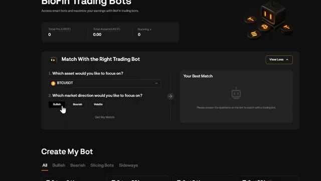
*⏱️ 00:01:21 — Interface du site web BloFin montrant l'outil de configuration des robots de trading avec le questionnaire interactif et le choix de la direction du marché (Bullish, Bearish, Volatile).*

---

### ⏱️ `[00:01:35 - 00:02:00]` | Segment #05

**🔊 Audio (Transcription Intégrale Mot pour Mot en Français) :**
> C'est parfait si vous voulez simplement vous lancer rapidement sans trop réfléchir. Maintenant, faites défiler un peu plus bas et vous verrez la section Créer mon bot. Ici, vous pouvez voir tous les bots disponibles. Vous pouvez également voir la direction du marché et le bon bot pour cette condition de marché : des bots haussiers, baissiers, de découpage et latéraux. Nous reviendrons sur la façon d'en créer un vous-même dans quelques minutes. Faites encore un peu défiler vers le bas et vous verrez les bots IA fournis par Blowfin.

**👁️ Analyse Visuelle d'Écran (gemini-3.5-flash-lite) :**
**Interface & Outils** : Interface web de trading / plateforme d'échange de cryptomonnaies

**Contenu textuel & Code** : Options de bots de trading : Futures Grid, Futures DCA, Spot Grid, Spot DCA, Signal Bot, TWAP, ainsi que des exemples de bots IA (DOGEUSDT, BTCUSDT, SUIUSDT) avec des performances de backtest (APR) et des configurations de tendance.

**Action / Démonstration** : Navigation et présentation des différentes catégories de bots de trading automatisé disponibles sur la plateforme.

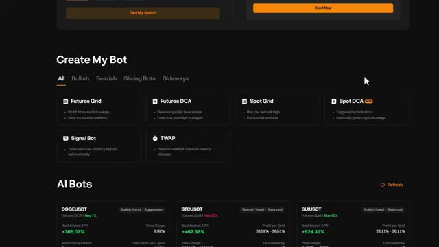
*⏱️ 00:01:42 — Capture d'écran montrant la section 'Create My Bot' avec les différentes stratégies de trading disponibles (Futures Grid, Futures DCA, Spot Grid, Spot DCA, Signal Bot, TWAP) et des bots IA.*

---

### ⏱️ `[00:02:01 - 00:02:37]` | Segment #06

**🔊 Audio (Transcription Intégrale Mot pour Mot en Français) :**
> Ici, vous pouvez voir la crypto, quel genre de tendance elle suit, quel type de bot est recommandé, le biais et le levier utilisé. Vous pouvez également voir l'APR testé par rétro-calcul, le profit par grille, la fourchette de prix et la quantité de grilles. Cela vous donne une tonne de données pour décider si vous voulez copier l'un de ces bots. Une fois que vous cliquez sur créer maintenant sur l'un de ces bots, cela vous amène au tableau de bord de trading où vous pouvez voir tous les paramètres. Tout ce que vous avez à faire est de saisir votre montant d'investissement et de cliquer sur créer, qu'il s'agisse d'une position d'achat ou de vente. Maintenants que vous savez comment naviguer sur le tableau de bord, parlons de tous les types de bots disponibles. Ici, vous pouvez voir différents types de

**👁️ Analyse Visuelle d'Écran (gemini-3.5-flash-lite) :**
**Interface & Outils** : Interface web de trading algorithmique (section "AI Bots")

**Contenu textuel & Code** : Cartes de bots pour différentes cryptomonnaies (DOGEUSDT, BTCUSDT, SUIUSDT, SOLUSDT, ETHUSDT, XRPUSDT) affichant le type de bot (Futures DCA ou Futures Grid), la tendance, le levier (ex: Buy 7X, Sell 10X), l'APR testé par rétro-calcul (ex: +368.57%, +467.36%), le profit par grille, la fourchette de prix et la quantité de grilles.

**Action / Démonstration** : Présentation et survol des différentes stratégies de bots de trading automatisé basées sur l'IA avec leurs métriques de performance.

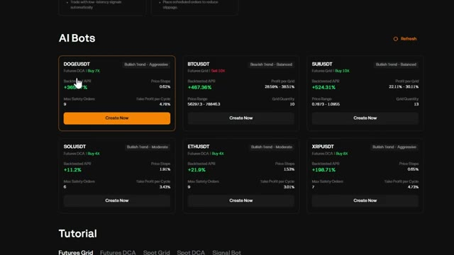
*⏱️ 00:02:10 — Capture d'écran montrant l'interface des bots de trading automatisés propulsés par l'IA, avec plusieurs paires de cryptomonnaies et leurs performances de backtest.*

---

### ⏱️ `[00:02:37 - 00:03:09]` | Segment #07

**🔊 Audio (Transcription Intégrale Mot pour Mot en Français) :**
> robots. Grille de contrats à terme. C'est idéal pour les marchés volatils. Elle tire profit des fluctuations de prix en plaçant des ordres d'achat et de vente dans une fourchette de prix définie. DCA sur contrats à terme. Il s'agit d'un achat périodique par dollar constant pour les contrats à terme. Elle achète à intervalles réguliers indépendamment du prix, ce qui est parfait pour une accumulation à long terme avec effet de levier. Grille au comptant. Cela fonctionne comme une grille de contrats à terme, mais sans effet de levier. Idéal pour les marchés stagnants où vous voulez acheter bas et vendre haut automatiquement. DCA au comptant. C'est l'option la plus sûre.

**👁️ Analyse Visuelle d'Écran (gemini-3.5-flash-lite) :**
**Interface & Outils** : Interface web de trading automatisé / bot de cryptomonnaies.

**Contenu textuel & Code** : Menu de sélection des bots : Futures Grid, Futures DCA, Spot Grid, Spot DCA, Signal Bot, TWAP, et section AI Bots.

**Action / Démonstration** : Sélection de la stratégie Futures Grid avec le curseur de la souris.

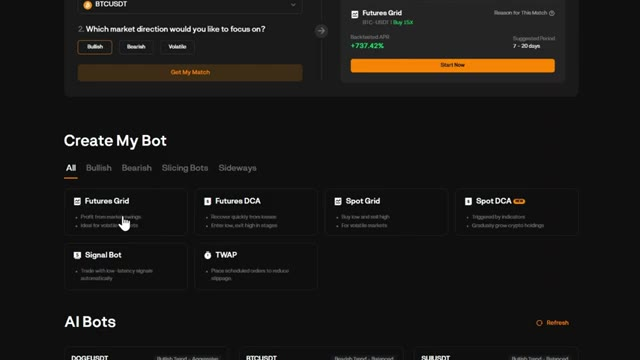
*⏱️ 00:02:45 — Capture d'écran montrant l'interface de création de bots de trading avec différentes options disponibles comme Futures Grid et Futures DCA.*

---

### ⏱️ `[00:03:09 - 00:03:28]` | Segment #08

**🔊 Audio (Transcription Intégrale Mot pour Mot en Français) :**
> Il achète la cryptomonnaie de votre choix à intervalles réguliers sans effet de levier, ce qui élimine l'émotion de l'investissement. SignalBot, celui-ci est unique. Il vous permet d'automatiser des transactions basées sur des signaux TradingView. TWAP ou prix moyen pondéré dans le temps. Cela répartit votre ordre sur une période définie pour éviter le glissement.

**👁️ Analyse Visuelle d'Écran (gemini-3.5-flash-lite) :**
**Interface & Outils** : Interface web de trading automatisé / exchange crypto

**Contenu textuel & Code** : Options de bots : Futures Grid, Futures DCA, Spot Grid, Spot DCA, Signal Bot et TWAP.

**Action / Démonstration** : Sélection ou survol d'une option de bot de trading (Spot DCA).

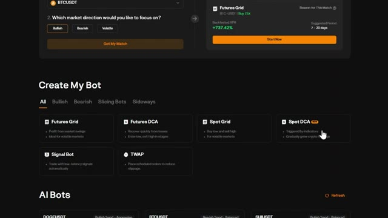
*⏱️ 00:03:14 — Interface de création de bots de trading affichant différentes options de bots comme Futures Grid, Futures DCA, Spot Grid, Spot DCA, Signal Bot et TWAP.*

---

### ⏱️ `[00:03:28 - 00:03:48]` | Segment #09

**🔊 Audio (Transcription Intégrale Mot pour Mot en Français) :**
> Maintenant, laissez-moi vous montrer comment créer chacun d'eux, en commençant par le plus populaire, FuturesGrid. Créons un bot FuturesGrid à partir de zéro. C'est l'un des bots les plus populaires car il tire profit de la volatilité. Cliquez sur Futures Grid. En haut à gauche, vous pouvez sélectionner votre paire de trading. Prenons Bitcoin USDT.

**👁️ Analyse Visuelle d'Écran (gemini-3.5-flash-lite) :**
**Interface & Outils** : Blofin (plateforme d'échange de cryptomonnaies)

**Contenu textuel & Code** : Graphique de prix BTCUSDT en chandelier (unité 4h), carnet d'ordres en temps réel, options de bots de trading (Futures Grid, Futures DCA, Spot Grid) et stratégies automatisées avec taux de rendement (APR) de +309.61% et +493.73%.

**Action / Démonstration** : Navigation et sélection de l'option de bot Futures Grid pour commencer la configuration.

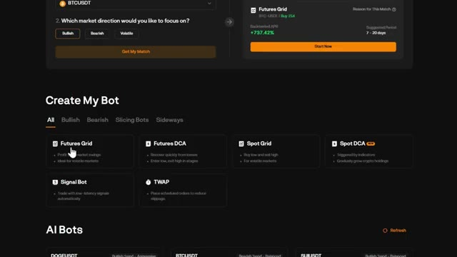
*⏱️ 00:03:33 — Interface de création de bot sur Blofin montrant différentes options de trading dont Futures Grid avec le curseur de la souris pointant dessus.*

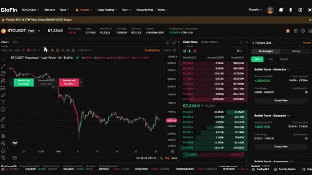
*⏱️ 00:03:43 — Interface de trading de Blofin montrant un graphique des prix du BTCUSDT en unités 4h, le carnet d'ordres et le panneau Futures Grid sur le côté droit.*

---

### ⏱️ `[00:03:48 - 00:04:23]` | Segment #10

**🔊 Audio (Transcription Intégrale Mot pour Mot en Français) :**
> Vous pouvez rechercher n'importe quelle paire que vous voulez ici. Sur le côté droit, vous verrez les choix de Blowfin AI. Ce sont des robots pré-construits avec leurs statistiques si vous voulez les utiliser comme référence. Vous avez deux modes, les stratégies IA et le mode manuel. Commençons par la stratégie IA. Ici, l'IA de Blowfin vous montrera les robots pré-fabriqués. Vous pouvez choisir la direction ici comme achat, vente et neutre, ici vous pouvez également voir le nom du robot, l'effet de levier utilisé, l'APR testé, la fourchette de prix, les profits par grille et la quantité de grilles basée sur les conditions actuelles du marché. Une fois que vous cliquez sur créer maintenant, tout ce que vous avez à faire est d'entrer votre total

**👁️ Analyse Visuelle d'Écran (gemini-3.5-flash-lite) :**
**Interface & Outils** : Interface de l'échange Blofin, graphique TradingView.

**Contenu textuel & Code** : Graphique de la paire BTCUSDT Perpetuel en unité 4h, carnet d'ordres (Order Book) en direct, et sélecteur de stratégies de bots de trading IA (Futures Grid) avec des statistiques de performance (ex : Backtested APR +309.61% et +403.73%).

**Action / Démonstration** : Navigation et présentation des options de stratégies IA et des performances des robots de trading sur Blofin.

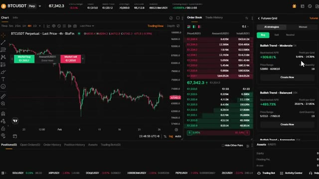
*⏱️ 00:03:57 — Capture d'écran de l'interface de trading Blofin affichant un graphique de prix BTCUSDT en 4H à gauche, le carnet d'ordres au centre et les stratégies IA de grid trading à droite.*

---

### ⏱️ `[00:04:23 - 00:04:56]` | Segment #11

**🔊 Audio (Transcription Intégrale Mot pour Mot en Français) :**
> montant de l'investissement que vous pouvez voir sur le graphique sur le côté gauche les grilles de prévisualisation où il achètera ou vendra en fonction de vos paramètres maintenant si vous voulez un contrôle total vous pouvez passer en mode manuel en cliquant sur ajuster les paramètres. Ici, vous pouvez définir manuellement la plage de prix, le nombre de grilles et l'effet de levier vous-même. Vous pouvez également voir le take profit et le stop loss, que je recommande vivement d'activer. Ceux-ci sont optionnels, mais ils vous donnent un contrôle supplémentaire sur la gestion des risques. Vous pouvez également définir le mode de grille tel que arithmétique et géométrique. Arithmétique signifie que la différence de prix entre chaque grille est égale.

**👁️ Analyse Visuelle d'Écran (gemini-3.5-flash-lite) :**
**Interface & Outils** : Interface de la plateforme d'échange de cryptomonnaies Blofin (section Futures / Trading Bots).

**Contenu textuel & Code** : Graphique du cours BTCUSDT, carnet d'ordres, paramètres du Futures Grid (plage de prix 53558.9 - 81584.7, quantité de grilles 17, effet de levier 5x, Take Profit, Stop Loss).

**Action / Démonstration** : Configuration des paramètres d'un bot de trading de grille, ajustement de l'effet de levier et configuration des options de gestion des risques (TP/SL).

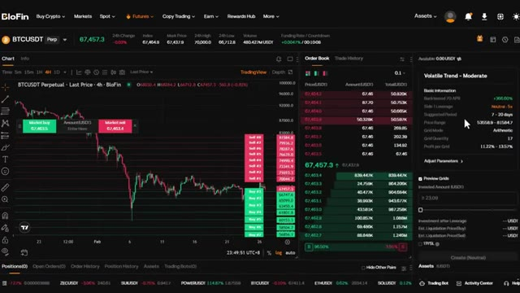
*⏱️ 00:04:32 — Interface de trading Blofin montrant un graphique BTCUSDT et le panneau de configuration d'un bot de grille avec le montant d'investissement et la plage de prix.*

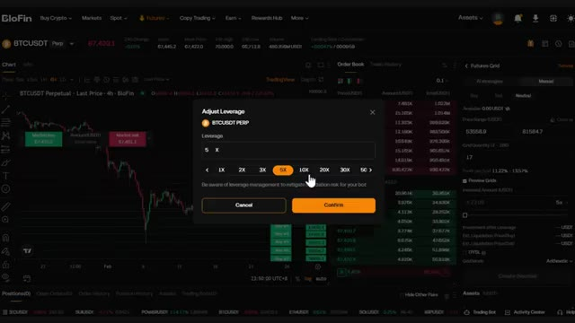
*⏱️ 00:04:40 — Fenêtre pop-up de réglage du levier (Adjust Leverage) sur Blofin affichant les différentes options de 1X à 50X (avec 5X sélectionné).*

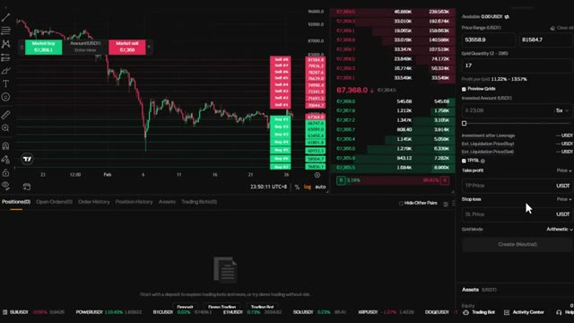
*⏱️ 00:04:48 — Panneau de configuration manuelle des paramètres du bot sur Blofin, incluant les champs Take Profit et Stop Loss.*

---

### ⏱️ `[00:04:57 - 00:05:31]` | Segment #12

**🔊 Audio (Transcription Intégrale Mot pour Mot en Français) :**
> Donc, si vous espacez les grilles de 100 dollars, chaque grille sera exactement espacée de 100 dollars. Géométrique signifie que la différence en pourcentage entre les grilles est égale. C'est mieux pour les marchés volatils parce que cela s'adapte à des variations de prix plus importantes. Une fois que tout semble correct, cliquez sur créer et votre bot de grille de contrats à terme est activé. Le suivant est le bot DCA de contrats à terme, la moyenne d'achat périodique avec effet de levier. C'est idéal si vous voulez accumuler une position au fil du temps tout en utilisant l'effet de levier pour amplifier vos rendements. Voici comment cela fonctionne. D'abord, sélectionnez votre paire de trading. Choisissez la cryptomonnaie dans laquelle vous voulez investir sur le

**👁️ Analyse Visuelle d'Écran (gemini-3.5-flash-lite) :**
**Interface & Outils** : Interface de la plateforme de trading Blofin (section Futures Grid)

**Contenu textuel & Code** : Paramètres de grille de trading (Price Range: 53558.9 - 81584.7, Grid Quantity: 17, Grid Mode: Arithmetic/Geometric)

**Action / Démonstration** : Sélection du mode de grille géométrique dans le panneau de configuration du bot de trading.

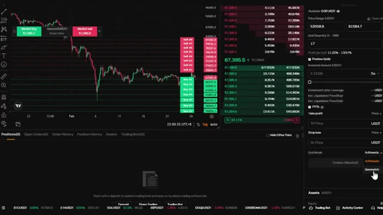
*⏱️ 00:05:05 — Interface de trading Blofin montrant un graphique de prix Bitcoin et le panneau latéral de configuration d'un Grid Bot, avec la sélection du mode 'Geometric' en cours.*

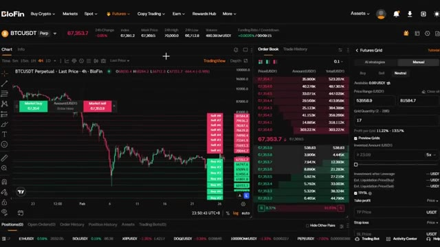
*⏱️ 00:05:14 — Vue générale de l'interface de trading Blofin affichant le graphique BTCUSDT, le carnet d'ordres et les paramètres de configuration du Futures Grid.*

---

### ⏱️ `[00:05:31 - 00:05:49]` | Segment #13

**🔊 Audio (Transcription Intégrale Mot pour Mot en Français) :**
> coin supérieur gauche. Sur le côté droit, vous pouvez toujours voir deux modes comme avant, stratégies IA et manuel. Vous pouvez choisir entre achat et vente et voir les recommandations du bot IA Blowfin. Vous pouvez voir le nom, l'effet de levier utilisé, l'APR testé par le passé, le nombre maximal d'ordres de sécurité, les paliers de prix et le cycle de prise de bénéfices.

**👁️ Analyse Visuelle d'Écran (gemini-3.5-flash-lite) :**
**Interface & Outils** : Plateforme d'échange de cryptomonnaies BloFin (interface Futures DCA avec modes AI strategies et Manual)

**Contenu textuel & Code** : Graphique en chandeliers du BTCUSDT (prix actuel à 67 345), carnet d'ordres en temps réel, et deux cartes de stratégies IA : 'Long-term Moderate Bullish 2X' (APR backtesté de +14.70%, 5 Max Safety Orders) et 'Mid-term Balanced Bullish 6X' (APR de +56.35%, 6 Max Safety Orders).

**Action / Démonstration** : Navigation et présentation des fonctionnalités de trading automatisé par IA (stratégies DCA) sur BloFin.

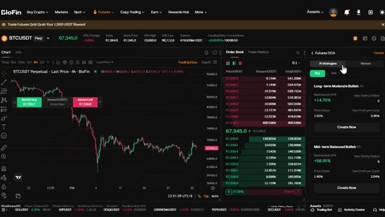
*⏱️ 00:05:35 — Interface de trading de la plateforme BloFin montrant un graphique BTCUSDT en unités 4h, le carnet d'ordres central et le panneau latéral droit dédié aux stratégies IA de DCA.*

---

### ⏱️ `[00:05:49 - 00:06:10]` | Segment #14

**🔊 Audio (Transcription Intégrale Mot pour Mot en Français) :**
> Si vous avez sélectionné celui que vous aimez, cliquez sur créer maintenant. Ici, vous pouvez saisir le montant investi. Une fois que vous avez tout configuré, cliquez sur créer et le bot s'occupe du reste. Maintenant, si vous voulez un contrôle total, vous pouvez l'ajuster en passant en mode manuel en cliquant sur ajuster les paramètres. Ici, vous pouvez définir manuellement les paliers de prix, le take profit par cycle et les ordres de sécurité max.

**👁️ Analyse Visuelle d'Écran (gemini-3.5-flash-lite) :**
**Interface & Outils** : Plateforme de trading crypto BloFin (interface Futures DCA avec graphique TradingView et carnet d'ordres).

**Contenu textuel & Code** : Paire BTCUSDT, stratégie "Bullish Trend - Moderate", paramétrage du montant investi (77,83 USDT minimum) et options du bot de trading.

**Action / Démonstration** : Saisie du montant d'investissement et clic sur le bouton de création du bot DCA.

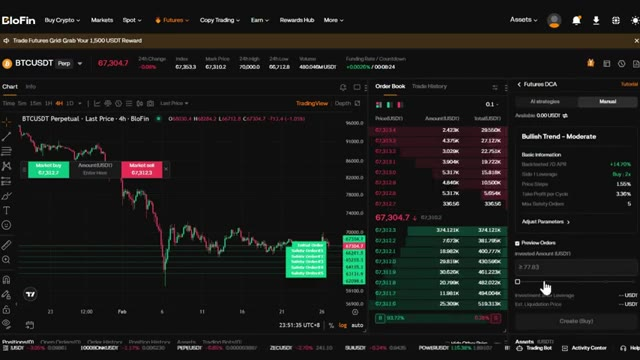
*⏱️ 00:05:54 — Interface de trading BloFin affichant le graphique BTCUSDT (4H), le carnet d'ordres et le panneau de configuration de bot DCA Futures.*

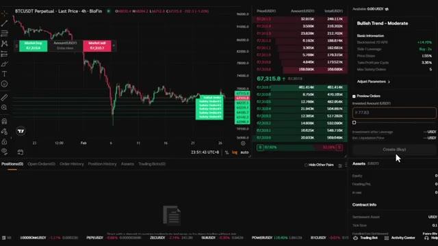
*⏱️ 00:06:00 — Interface BloFin montrant le panneau de création de bot DCA avec le curseur du montant investi et le bouton de validation "Create (Buy)".*

---

### ⏱️ `[00:06:11 - 00:06:30]` | Segment #15

**🔊 Audio (Transcription Intégrale Mot pour Mot en Français) :**
> Les paliers de prix déterminent de quelle distance le prix doit baisser avant que le bot n'achète à nouveau. Le nombre maximal d'ordres de sécurité est le nombre maximal de fois que le bot ajoutera à votre position. Le take profit par cycle définit le pourcentage de profit que le bot vise avant de fermer toute la position. Une fois que tout vous convient, cliquez sur créer et le bot sera actif.

**👁️ Analyse Visuelle d'Écran (gemini-3.5-flash-lite) :**
**Interface & Outils** : Interface de trading d'une plateforme d'échange (type BioFin / courtier crypto) avec un graphique TradingView intégré.

**Contenu textuel & Code** : Paire BTCUSDT Perpétuel, graphique en chandeliers 4h, carnet d'ordres en temps réel, et paramètres du bot DCA : Price Steps (1,55%), Take Profit per Cycle (3,36%), Max Safety Orders (5).

**Action / Démonstration** : Configuration des paramètres du bot DCA sur l'interface latérale droite (modification du nombre maximal d'ordres de sécurité).

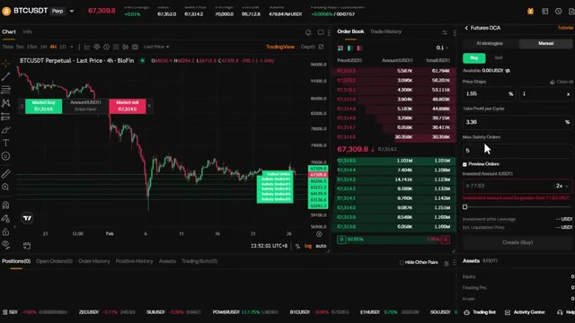
*⏱️ 00:06:16 — Capture d'écran de l'interface d'échange montrant un graphique des prix BTCUSDT à gauche, un carnet d'ordres au centre et un panneau de configuration de bot Futures DCA à droite.*

---

### ⏱️ `[00:06:30 - 00:06:50]` | Segment #16

**🔊 Audio (Transcription Intégrale Mot pour Mot en Français) :**
> Le robot de grille spot fonctionne exactement comme la grille futures, mais sans effet de levier. C'est parfait si vous voulez acheter bas et vendre haut automatiquement dans un marché stagnant, sans le risque de liquidation. En haut à gauche, vous pouvez sélectionner votre paire de trading. Prenons Ethereum USDT. Vous pouvez rechercher n'importe quelle paire que vous voulez ici. Sur le côté droit, vous verrez les sélections de Blowfin AI.

**👁️ Analyse Visuelle d'Écran (gemini-3.5-flash-lite) :**
**Interface & Outils** : Blofin (plateforme d'échange de cryptomonnaies) et graphique de trading.

**Contenu textuel & Code** : Paires de trading BTC/USDT, options de bots (Spot Grid, Futures Grid), carnets d'ordres et stratégies AI Grid avec retours sur investissement (APR).

**Action / Démonstration** : Sélection et configuration d'un robot de trading de type Spot Grid sur la plateforme Blofin.

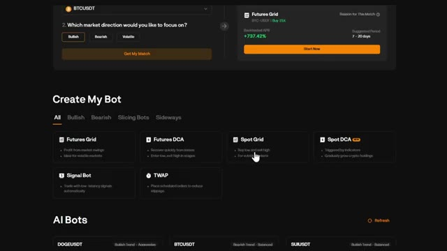
*⏱️ 00:06:35 — Interface de création de bots sur Blofin montrant différentes options comme Futures Grid, Futures DCA et Spot Grid.*

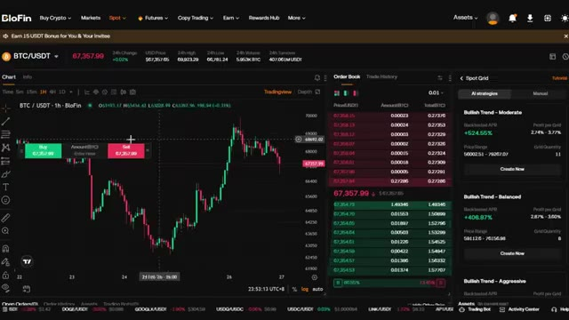
*⏱️ 00:06:40 — Interface de trading Spot Grid sur Blofin avec le graphique du BTC/USDT, le carnet d'ordres et les stratégies de grille automatisées.*

---

### ⏱️ `[00:06:51 - 00:07:12]` | Segment #17

**🔊 Audio (Transcription Intégrale Mot pour Mot en Français) :**
> Ce sont des robots préconstruits avec leurs statistiques si vous voulez les utiliser comme référence. Vous avez deux modes, les stratégies IA et le mode manuel. Commençons par la stratégie IA. Ici, l'IA de Blowfin vous montrera les robots pré-fabriqués. Ici, vous pouvez également voir le nom du robot, l'APR testé par rétro-ingénierie, la fourchette de prix, les profits par grille, et la quantité de grilles en fonction des conditions actuelles du marché.

**👁️ Analyse Visuelle d'Écran (gemini-3.5-flash-lite) :**
**Interface & Outils** : Plateforme d'échange BloFin (interface Web)

**Contenu textuel & Code** : Graphique des prix ETH/USDT en chandeliers (unité 1h), carnet d'ordres (Order Book), et panneau des stratégies IA (AI Strategies) affichant des robots de trading préconfigurés avec leurs performances estimées (Backtested APR : +476.95%, +358.30%, +230.80%), plages de prix et quantités de grilles.

**Action / Démonstration** : Navigation et présentation des options de stratégies automatisées par IA (AI Strategies) sur BloFin.

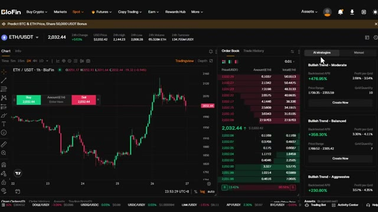
*⏱️ 00:06:56 — Interface de trading de la plateforme BloFin montrant le graphique de ETH/USDT avec les options de stratégies IA de trading de bots sur le panneau latéral droit.*

---

### ⏱️ `[00:07:12 - 00:07:37]` | Segment #18

**🔊 Audio (Transcription Intégrale Mot pour Mot en Français) :**
> Remarquez qu'il n'y a pas de effet de levier ici. Vous ne tradez qu'avec votre propre capital, ce qui rend cela beaucoup plus sûr. Une fois que vous cliquez sur Créer maintenant, tout ce que vous avez à faire est de saisir votre montant d'investissement total. Vous pouvez voir sur un graphique du côté gauche les grilles de prévisualisation où il achètera ou vendra en fonction de vos paramètres. Le bot placera des ordres d'achat à l'extrémité inférieure de la fourchette et des ordres de vente à l'extrémité supérieure, capturant ainsi des profits à chaque fluctuation de prix.

**👁️ Analyse Visuelle d'Écran (gemini-3.5-flash-lite) :**
**Interface & Outils** : Plateforme d'échange de cryptomonnaies BloFin (interface Web Spot Grid).

**Contenu textuel & Code** : Graphique de prix ETH/USDT (2 032,77 USD), carnet d'ordres en temps réel, et options de stratégies de grille (AI strategies) affichant des performances backtestées (ex: Bullish Trend - Moderate avec un APR de +476,95%).

**Action / Démonstration** : Le curseur de la souris clique sur le bouton « Create Now » pour lancer une stratégie de grille automatisée sur le marché spot.

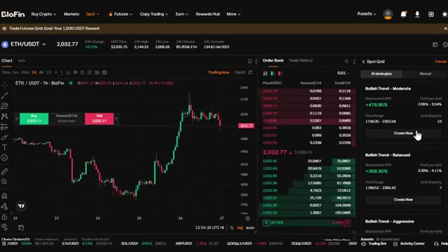
*⏱️ 00:07:19 — Capture d'écran de l'interface de trading Spot Grid sur BloFin montrant le graphique de la paire ETH/USDT en chandeliers japonais sur une unité de temps d'une heure, le carnet d'ordres au centre et les stratégies de grille automatisées à droite.*

---

### ⏱️ `[00:07:37 - 00:07:56]` | Segment #19

**🔊 Audio (Transcription Intégrale Mot pour Mot en Français) :**
> C'est idéal pour accumuler une position au fil du temps sans effet de levier. Maintenant, si vous voulez un contrôle total, vous pouvez passer en mode manuel en cliquant sur ajuster les paramètres. Ici, vous pouvez définir manuellement la fourchette de prix et le nombre de grilles vous-même. Vous pouvez également définir le mode de grille, tel que arithmétique et géométrique, tout comme avec Futures Grid.

**👁️ Analyse Visuelle d'Écran (gemini-3.5-flash-lite) :**
**Interface & Outils** : Blofin (Plateforme d'échange de cryptomonnaies)

**Contenu textuel & Code** : Paire ETH/USDT, graphique en chandeliers (unité 1h), carnet d'ordres (Order Book), et panneau de configuration "Spot Grid" en mode manuel avec les options de paramètres (fourchette de prix, nombre de grilles).

**Action / Démonstration** : Configuration et explication des paramètres du Spot Grid pour le trading automatisé sans effet de levier.

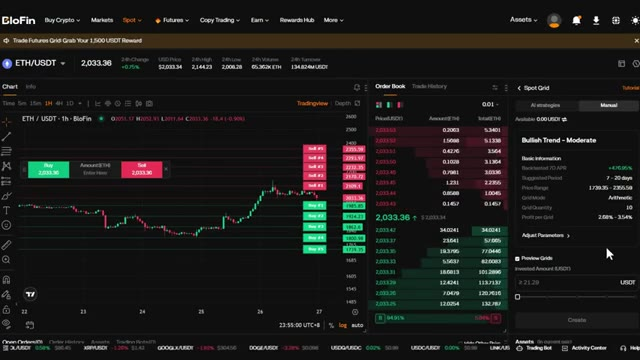
*⏱️ 00:07:42 — Interface de trading Spot Grid sur l'échange Blofin pour la paire ETH/USDT, montrant le graphique, le carnet d'ordres et les paramètres de la grille.*

---

### ⏱️ `[00:07:57 - 00:08:16]` | Segment #20

**🔊 Audio (Transcription Intégrale Mot pour Mot en Français) :**
> Une fois que tout a l'air bon, cliquez sur Créer et votre robot Spot Grid est lancé. Le robot Spot DCA est l'option la plus sûre. Il est parfait pour les investisseurs à long terme qui veulent accumuler sans effet de levier et sans se soucier du timing du marché. Cliquez sur Spot DCA. Voici comment cela fonctionne. D'abord, sélectionnez votre paire de trading.

**👁️ Analyse Visuelle d'Écran (gemini-3.5-flash-lite) :**
**Interface & Outils** : Interface web de trading/exchange de cryptomonnaies (section 'Create My Bot').

**Contenu textuel & Code** : Liste des types de bots de trading disponibles : Futures Grid, Futures DCA, Spot Grid, Spot DCA, Signal Bot, TWAP, ainsi que des suggestions de bots propulsés par l'IA (AI Bots).

**Action / Démonstration** : Le curseur de la souris survole et sélectionne l'option 'Spot DCA'.

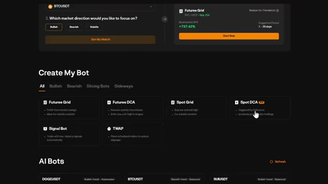
*⏱️ 00:08:01 — Interface de création de bot de trading montrant les différentes options disponibles, avec le curseur pointant sur l'option 'Spot DCA'.*

---

### ⏱️ `[00:08:16 - 00:08:37]` | Segment #21

**🔊 Audio (Transcription Intégrale Mot pour Mot en Français) :**
> Choisissez la crypto dans laquelle vous voulez investir dans le coin supérieur gauche. Sur le côté droit, vous pouvez toujours voir deux modes comme avant, Stratégies IA et Manuel. Vous pouvez voir le nom, le rendement testé sur données historiques, le taux annuel en pourcentage, les ordres de sécurité maximums, les paliers de prix et le cycle de prise de profit. Remarquez qu'il n'y a pas de effet de levier ici. Il s'agit de trading au comptant pur, ce qui signifie que vous n'utilisez que votre propre capital avec un risque de liquidation nul.

**👁️ Analyse Visuelle d'Écran (gemini-3.5-flash-lite) :**
**Interface & Outils** : Plateforme d'échange crypto BloFin (interface Spot DCA avec graphiques TradingView).

**Contenu textuel & Code** : Paire BTC/USDT à 67,303.92 $, graphique en chandeliers (1h), carnet d'ordres, et options de stratégies IA ("Long-term Moderate Bullish" avec Backtested APR à +121.52%, "Mid-term Balanced Bullish" à +88.80%).

**Action / Démonstration** : Présentation des options de configuration des stratégies de trading automatisées (IA vs Manuel) et des performances historiques sur BloFin.

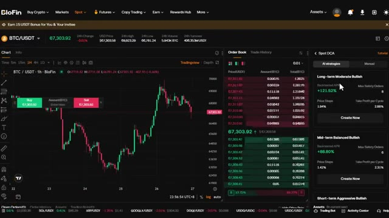
*⏱️ 00:08:21 — Capture d'écran de l'interface de la plateforme BloFin montrant un graphique de prix BTC/USDT, un carnet d'ordres et le panneau de stratégie de trading DCA Spot avec les modes IA et Manuel.*

---

### ⏱️ `[00:08:37 - 00:08:57]` | Segment #22

**🔊 Audio (Transcription Intégrale Mot pour Mot en Français) :**
> Si vous avez sélectionné celui que vous aimez, cliquez sur Créer maintenant. Ici, vous pouvez saisir le montant investi. Le bot achètera automatiquement à intervalles réguliers, peu importe le prix. Cela supprime toute émotion de l'investissement et vous aide à vous positionner au fil du temps. Une fois que vous avez tout configuré, cliquez sur créer et le bot s'occupe du reste.

**👁️ Analyse Visuelle d'Écran (gemini-3.5-flash-lite) :**
**Interface & Outils** : Blofin (plateforme d'échange de cryptomonnaies)

**Contenu textuel & Code** : Graphique TradingView BTC/USDT, carnet d'ordres (Order Book), et panneau de configuration "Spot DCA" affichant des informations de stratégie ("Bullish Trend - Moderate", Backtested 7D APR à +121,52%, Price Steps, Take Profit per Cycle) ainsi qu'un champ pour saisir le montant investi (Invested Amount (USDT)).

**Action / Démonstration** : Configuration et saisie du montant pour la création d'un bot de DCA (Dollar Cost Averaging) sur Blofin.

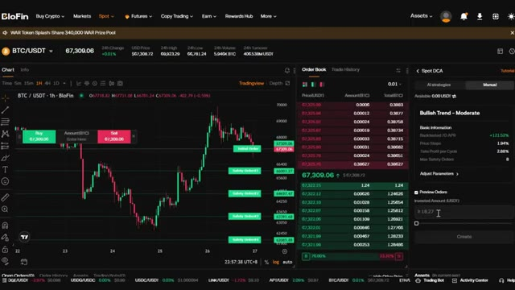
*⏱️ 00:08:42 — Capture d'écran de l'interface de la plateforme de trading Blofin montrant le graphique de la paire BTC/USDT en unités 1h, le carnet d'ordres et le panneau de configuration d'un bot Spot DCA avec le champ de saisie du montant investi.*

---

### ⏱️ `[00:08:58 - 00:09:26]` | Segment #23

**🔊 Audio (Transcription Intégrale Mot pour Mot en Français) :**
> Maintenant, si vous voulez un contrôle total, vous pouvez l'ajuster en passant en mode manuel en cliquant sur ajuster les paramètres. Ici, vous pouvez définir manuellement les pas de prix, le take profit par cycle et les ordres de sécurité maximum. C'est la stratégie ultime du « configurer et oublier ». Vous n'avez pas besoin de surveiller les graphiques. Vous n'avez pas besoin de chronométrer le marché. Vous laissez simplement le bot accumuler pour vous pendant des semaines, des mois, ou même des années. Une fois que tout est à votre convenance, cliquez sur créer et le bot sera actif. Maintenant, parlons du bot de signal.

**👁️ Analyse Visuelle d'Écran (gemini-3.5-flash-lite) :**
**Interface & Outils** : Plateforme d'échange de cryptomonnaies Blofin (interface Spot DCA et TradingView).

**Contenu textuel & Code** : Paires BTC/USDT à 67,405.17 $, paramètres manuels de Spot DCA : Price Steps (1.94%), Take Profit per Cycle (2.88%), Max Safety Orders (8), et montant investi.

**Action / Démonstration** : Configuration manuelle des paramètres de la stratégie DCA sur Blofin avec affichage des niveaux d'ordres de sécurité sur le graphique.

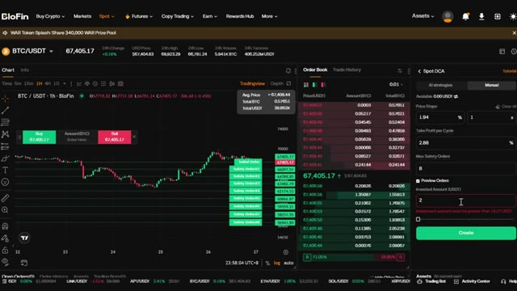
*⏱️ 00:09:05 — Interface de la plateforme Blofin affichant le graphique de la paire BTC/USDT en unités 1h, le carnet d'ordres et le panneau de configuration manuelle du Spot DCA.*

---

### ⏱️ `[00:09:26 - 00:09:59]` | Segment #24

**🔊 Audio (Transcription Intégrale Mot pour Mot en Français) :**
> Celui-ci est vraiment intéressant parce qu'il vous permet d'automatiser des transactions basées sur des signaux TradingView. Lorsque vous cliquez sur le robot de signal, il vous mènera au tableau de bord de trading. En haut à droite, vous verrez un bouton ajouter un signal. Cliquez dessus. Voici comment cela fonctionne. Les robots de signal Blowfin peuvent analyser des signaux générés par les scripts de stratégie TradingView. Cela signifie que si vous avez une stratégie de trading sur TradingView, vous pouvez la connecter directement à Blowfin et automatiser vos transactions. Maintenant, voici ce que vous devez savoir. Ne partagez votre webhook, URL ou jeton de signal avec personne. Blowfin prend uniquement en charge

**👁️ Analyse Visuelle d'Écran (gemini-3.5-flash-lite) :**
**Interface & Outils** : Interface de l'échange de cryptomonnaies Blofin (plateforme Web avec graphique TradingView intégré et module de bot de signal).

**Contenu textuel & Code** : Paire BTCUSDT Perpétuelle, prix actuel autour de 67 374,8 USD, graphique en chandeliers japonais, carnet d'ordres (Order Book) et menu 'Signal Bot' vide avec l'option orange 'Add a signal'.

**Action / Démonstration** : Le curseur de la souris survole le bouton orange 'Add a signal' dans le panneau latéral droit du bot de signal sur Blofin.

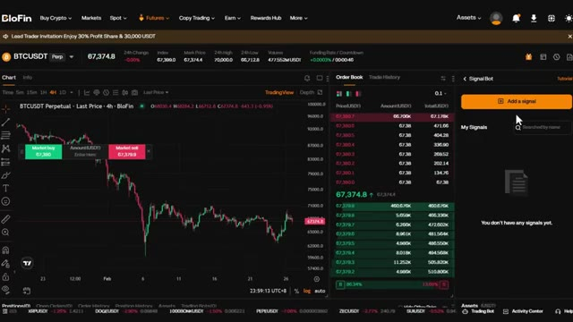
*⏱️ 00:09:34 — Capture d'écran de l'interface de trading Blofin montrant un graphique BTCUSDT en unités 4H, un carnet d'ordres au centre et le panneau du 'Signal Bot' sur la droite avec le bouton 'Add a signal'.*

---

### ⏱️ `[00:09:59 - 00:10:34]` | Segment #25

**🔊 Audio (Transcription Intégrale Mot pour Mot en Français) :**
> mode de position à sens unique. Assurez-vous que votre stratégie TradingView ne repose pas sur le mode de couverture. Il peut y dans ce cas y avoir des risques de perte de signal ou de délai, puisque cela dépend d'une plateforme tierce. Très bien, voici donc comment le configurer. Tout d'abord, créez un nom de signal et une description de signal. C'est uniquement pour votre propre référence. Une fois que vous avez fait cela, cliquez sur suivant. Blowfin vous fournira une URL de webhook et un message d'alerte. Copiez cette URL de webhook. Vous en aurez besoin pour TradingView. Allez maintenant sur TradingView, ouvrez votre stratégie, cliquez sur les alertes, et collez l'URL du webhook ainsi que le message d'alerte dans vos paramètres d'alerte.

**👁️ Analyse Visuelle d'Écran (gemini-3.5-flash-lite) :**
**Interface & Outils** : Interface web de l'échange Blofin, specifically la section Signal Bot.

**Contenu textuel & Code** : Texte d'instructions du tutoriel de configuration : avertissement concernant le support exclusif du mode "One-way" (sens unique), l'interdiction d'utiliser le mode "Hedge" (couverture), et les risques de perte ou de délai de signal liés à la plateforme tierce. Champs vides pour le nom du signal et sa description.

**Action / Démonstration** : Affichage des consignes préalables à la création d'un webhook sur Blofin pour connecter une stratégie TradingView.

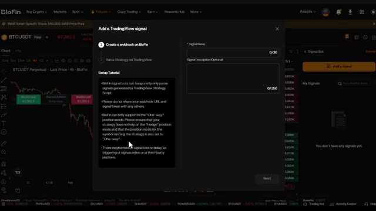
*⏱️ 00:10:08 — Fenêtre modale sur la plateforme Blofin affichant l'assistant de configuration d'un signal TradingView ("Add a TradingView signal") avec les instructions sur le mode de position à sens unique ("One-way").*

---

### ⏱️ `[00:10:34 - 00:11:07]` | Segment #26

**🔊 Audio (Transcription Intégrale Mot pour Mot en Français) :**
> Une fois que vous avez terminé, cliquez sur terminer sur Blowfin. Votre signal apparaîtra désormais dans Mes signaux. À partir de là, vous pouvez créer un bot basé sur ces signaux. Cliquez sur Créer un bot. Ici, vous pouvez modifier le symbole, définir votre effet de levier et entrer votre marge investie. Dans les paramètres avancés, vous pouvez choisir vos paramètres d'entrée. Vous pouvez vous baser sur le signal TradingView, utiliser une marge fixe, un pourcentage de votre marge, ou un pourcentage de votre investissement libre. Vous pouvez également activer l'entrée multiple. Cela permet au bot d'ajouter à votre position si le signal se déclenche à nouveau. C'est parfait pour

**👁️ Analyse Visuelle d'Écran (gemini-3.5-flash-lite) :**
**Interface & Outils** : Plateforme d'échange BloFin (interface de trading Futures et Signal Bot)

**Contenu textuel & Code** : Graphique en chandeliers 4H du BTCUSDT, carnet d'ordres en temps réel, panneau latéral "Signal Bot" listant "TradingBot" avec le bouton "Create a bot".

**Action / Démonstration** : Navigation et présentation de la section "My Signals" pour configurer et créer un bot de trading basé sur les signaux sur BloFin.

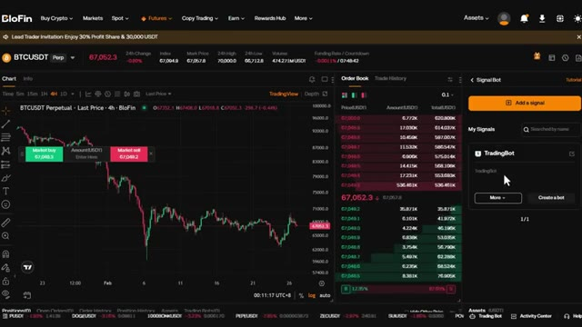
*⏱️ 00:10:42 — Interface de la plateforme BloFin affichant le graphique du BTCUSDT, le carnet d'ordres et le panneau de gestion "Signal Bot" avec un signal nommé "TradingBot".*

---

### ⏱️ `[00:11:07 - 00:11:29]` | Segment #27

**🔊 Audio (Transcription Intégrale Mot pour Mot en Français) :**
> augmente progressivement vos positions. Définissez vos niveaux de take profit et de stop loss. Une fois que vous avez terminé, cliquez sur créer le bot. Si vous souhaitez un jour supprimer ou modifier un signal, cliquez simplement sur plus à côté du nom du signal. Le dernier bot est le TWAP, le prix moyen pondéré dans le temps. Ce bot est conçu pour répartir votre ordre sur une période définie afin d'éviter le slippage et d'obtenir un meilleur prix d'entrée moyen. Voici comment cela fonctionne.

**👁️ Analyse Visuelle d'Écran (gemini-3.5-flash-lite) :**
**Interface & Outils** : Interface de la plateforme d'échange de cryptomonnaies Blofin (section Futures et Trading Bots).

**Contenu textuel & Code** : Graphique en chandeliers BTCUSDT, carnet d'ordres en temps réel, paramètres de levier, TP/SL et sélection des bots de trading (Futures Grid, DCA, Signal Bot, TWAP).

**Action / Démonstration** : Navigation et démonstration de la configuration d'un bot de trading, avec mise en avant du bouton de création et présentation des différents types de bots (notamment le TWAP).

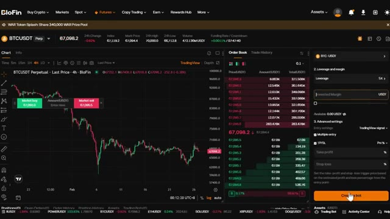
*⏱️ 00:11:13 — Interface de trading Blofin montrant un graphique BTCUSDT en 4h, le carnet d'ordres et le panneau de configuration du bot avec le bouton "Create bot" cliqué.*

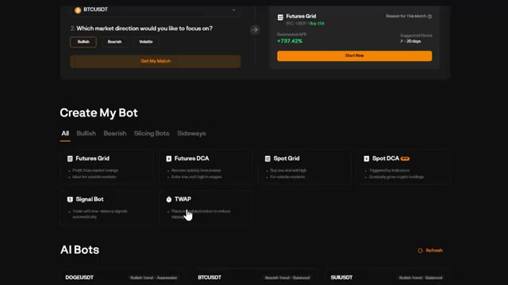
*⏱️ 00:11:18 — Page "Create My Bot" sur Blofin affichant les différents types de robots de trading disponibles (Futures Grid, Futures DCA, Spot Grid, Signal Bot, TWAP).*

---

### ⏱️ `[00:11:29 - 00:12:03]` | Segment #28

**🔊 Audio (Transcription Intégrale Mot pour Mot en Français) :**
> Vous pouvez voir le mode de marge et les paramètres de levier tout en haut. Ensuite, entrez le montant que vous souhaitez investir et définissez le temps total. Vous pouvez le définir en heures et en minutes. Vous pouvez également modifier la fréquence, de 5 secondes jusqu'à 60 secondes. Cela contrôle la fréquence à laquelle le bot place des ordres dans la période que vous avez définie. Voici pourquoi c'est utile. Si vous entrez sur une position importante, placer un seul ordre au marché important peut faire évoluer le prix contre vous. Le TWAP divise votre ordre en plus petits morceaux et les exécute au fil du temps, vous offrant un meilleur prix moyen et réduisant l'impact sur le marché.

**👁️ Analyse Visuelle d'Écran (gemini-3.5-flash-lite) :**
**Interface & Outils** : BloFin (Échange de cryptomonnaies / Interface Futures et TWAP)

**Contenu textuel & Code** : Paire BTCUSDT Perpetual, prix à 67,130.4, options TWAP avec mode Isolated, levier 5X, champs pour le montant (Amount in USDT), le temps total (Total Time en heures/minutes) et la fréquence (30s).

**Action / Démonstration** : Configuration des paramètres de trading algorithmique TWAP (marge, levier, montant, durée, fréquence) sur BloFin.

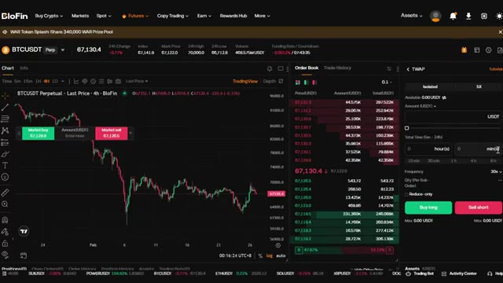
*⏱️ 00:11:38 — Interface de trading de la plateforme BloFin montrant le graphique du BTCUSDT sur 4 heures, le carnet d'ordres et le panneau de configuration TWAP à droite avec les réglages de marge isolée (Isolated), de levier (5X), du temps total et de la fréquence.*

---

### ⏱️ `[00:12:03 - 00:12:22]` | Segment #29

**🔊 Audio (Transcription Intégrale Mot pour Mot en Français) :**
> Une fois que vous avez terminé, cliquez sur Acheter à long terme si vous prenez une position acheteuse ou Vendre à découvert si vous prenez une position vendeuse. Le bot répartira automatiquement votre ordre sur la période que vous avez définie. Maintenant, avant de terminer, laissez-moi vous montrer comment réclamer vos bonus. Si vous vous êtes inscrit avec mon lien dans la description, vous avez accès à des récompenses exclusives. Allez dans le centre des récompenses de votre compte.

**👁️ Analyse Visuelle d'Écran (gemini-3.5-flash-lite) :**
**Interface & Outils** : Plateforme d'échange de cryptomonnaies BloFin (interface de trading, section bots, page d'inscription).

**Contenu textuel & Code** : Graphique BTCUSDT Perpetuel, carnets d'ordres, panneau de configuration TWAP, options pour bots de trading automatisés, formulaire d'inscription.
[DESC_IMAGE_1] Navigation sur l'interface de trading BloFin et visualisation du panneau de placement d'ordres TWAP.
[DESC_IMAGE_2] Présentation des outils de trading automatisé (Trading Bots) sur BloFin.
[DESC_IMAGE_3] Affichage de la page d'inscription partenaire sur BloFin.

**Action / Démonstration** : Explications face caméra et analyse conceptuelle des marchés.

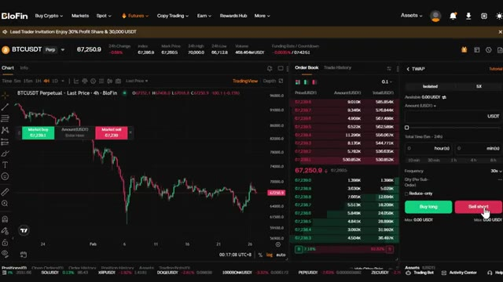
*⏱️ 00:12:08 — Interface de trading BloFin affichant le graphique du BTCUSDT en chandelier, un carnet d'ordres et un panneau TWAP.*

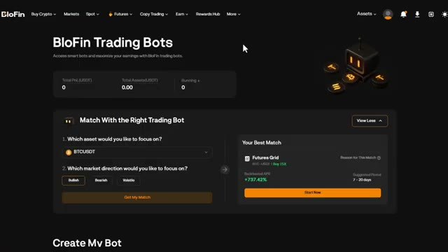
*⏱️ 00:12:12 — Page de présentation des 'BloFin Trading Bots' avec des options de configuration et de matching de bots.*

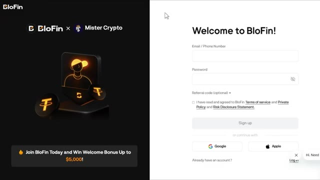
*⏱️ 00:12:17 — Page de connexion/inscription BloFin en partenariat avec 'Mister Crypto' avec un bonus de bienvenue affiché.*

---

### ⏱️ `[00:12:22 - 00:12:43]` | Segment #30

**🔊 Audio (Transcription Intégrale Mot pour Mot en Français) :**
> Ici, vous pouvez voir tous les bonus disponibles, les bonus de dépôt, les récompenses sur le volume de trading, et bien plus encore. Assurez-vous de les réclamer. C'est littéralement de l'argent gratuit juste pour utiliser la plateforme. Les bonus exacts dépendent de votre région et du statut de votre compte. Vérifiez donc votre centre de récompenses pour voir ce qui est disponible pour vous. Très bien, vous savez maintenant comment utiliser absolument tous les bots de trading sur Blowfin.

**👁️ Analyse Visuelle d'Écran (gemini-3.5-flash-lite) :**
**Interface & Outils** : Interface web de l'échange de cryptomonnaies BloFin (Rewards Hub).

**Contenu textuel & Code** : Panneaux détaillant divers bonus : "Trading Gifts (Futures) Week 10" avec des paliers (10 USDT, 15 USDT, 30 USDT, 60 USDT) basés sur le volume de trading, et "Copy Trading Gifts Week 10" avec des récompenses proportionnelles.

**Action / Démonstration** : Navigation et présentation des différentes tâches avancées et récompenses disponibles pour les utilisateurs sur la plateforme.

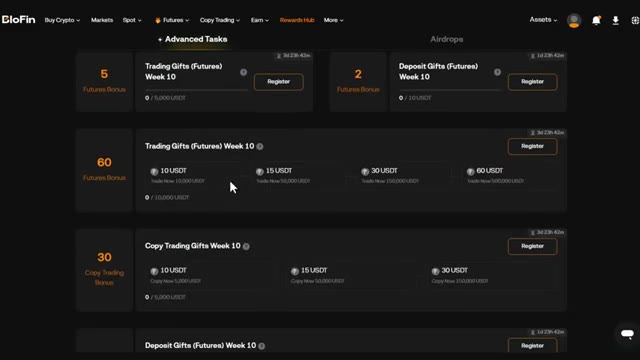
*⏱️ 00:12:28 — Capture d'écran montrant le "Rewards Hub" de la plateforme BloFin avec différentes sections de bonus et cadeaux de trading.*

---

### ⏱️ `[00:12:44 - 00:13:11]` | Segment #31

**🔊 Audio (Transcription Intégrale Mot pour Mot en Français) :**
> Que vous souhaitiez profiter de la volatilité avec des robots de grille, accumuler avec le DCA, automatiser vos stratégies de trading et de visualisation avec des robots de signaux, ou exécuter des ordres importants avec le TWAP, vous avez les outils nécessaires. Et n'oubliez pas, si vous vous êtes inscrit avec mon lien dans la description, assurez-vous de consulter le centre des récompenses et de réclamer vos bonus. Si vous souhaitez une présentation plus détaillée de la plateforme Blowfin, de la manière d'effectuer un dépôt, de trader des contrats à terme et d'utiliser toutes les fonctionnalités, cliquez sur la vidéo qui apparaît à l'écran dès maintenant.

**👁️ Analyse Visuelle d'Écran (gemini-3.5-flash-lite) :**
**Interface & Outils** : BloFin, interface de trading crypto, graphique TradingView.

**Contenu textuel & Code** : Types de bots disponibles (Futures Grid, Futures DCA, Spot Grid, Spot DCA, Signal Bot, TWAP), graphique des prix du BTC/USDT (chandeliers japonais en unités 4h), carnet d'ordres, paramètres de création de robot (effet de levier 5x, signaux TradingView).

**Action / Démonstration** : Présentation des différents types de robots de trading automatisés et de leurs options de configuration sur la plateforme BloFin.

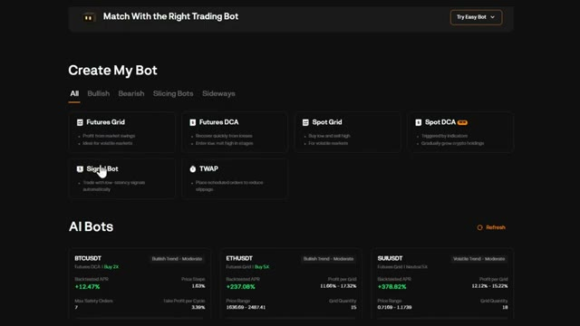
*⏱️ 00:12:51 — Interface de création de robots de trading sur BloFin présentant différents types de bots (Futures Grid, Futures DCA, Spot Grid, Signal Bot, TWAP).*

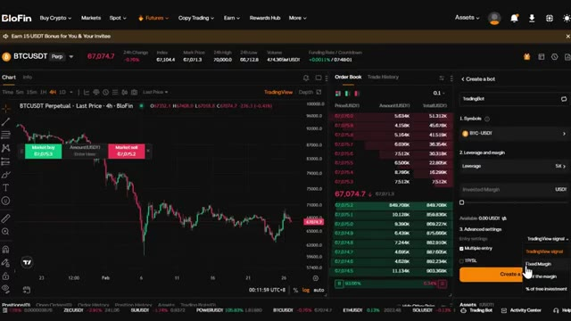
*⏱️ 00:13:04 — Interface de trading de BloFin affichant un graphique TradingView du BTC/USDT en unités 4h, le carnet d'ordres et le panneau de configuration d'un bot.*

---

### ⏱️ `[00:13:12 - 00:13:14]` | Segment #32

**🔊 Audio (Transcription Intégrale Mot pour Mot en Français) :**
> Merci d'avoir regardé, et je vous dis à la prochaine.

**👁️ Analyse Visuelle d'Écran (gemini-3.5-flash-lite) :**
**Interface & Outils** : Aucune interface visible.

**Contenu textuel & Code** : Aucun contenu technique, graphique, code ou donnée chiffrée.

**Action / Démonstration** : Aucune action ou manipulation en cours.

---

