# 🎬 Top 4 Polymarket Strategies To Make You Profitable

> **Chaîne** : [Alex Carter](https://www.youtube.com/@AlexCarterTrading)  
> **Lien YouTube** : [https://www.youtube.com/watch?v=7wT600RhQfI](https://www.youtube.com/watch?v=7wT600RhQfI)  
> **Date de publication** : 20260312  
> **Durée** : 00:09:05  
> **Identifiant vidéo** : `7wT600RhQfI`  
> **Transcription & Analyse** : `whisper-v3-large-turbo+gemini-3.5-flash-lite`  

---

## 📌 Synthèse Exécutive & Outils

### 💡 Résumé

Cette vidéo présentée par Alex Carter lève le voile sur quatre stratégies quantitatives de niche utilisées par les traders d'élite sur Polymarket, se démarquant radicalement des approches de détail traditionnelles. Loin de spéculer aveuglément sur la géopolitique ou la politique, ces méthodologies exploitent les inefficiences structurelles des marchés de prédiction : la valeur temporelle du capital immobilisé, la viralité des fausses informations, les cycles psychologiques d'attention médiatique et le calendrier PR des grandes entreprises technologiques. À travers des cas concrets — qu'il s'agisse du marché de l'AGI d'OpenAI, des rumeurs de démission d'Elon Musk, des primaires républicaines avec J.D. Vance ou du timing de lancement des modèles d'IA face à la WWDC et Google I/O —, l'analyse démontre comment mathématiques financières et théorie des jeux priment toujours sur l'intuition de la foule.

L'objectif central est de transformer le trader de Polymarket en un opérateur systématique capable de capitaliser sur l'impulsivité des parieurs particuliers. En adoptant une posture contrariante, méthodique et rigoureuse, les opérateurs professionnels identifient les anomalies de prix causées par des liquidités pressées ou des biais émotionnels. Les exemples chiffrés illustrent parfaitement la mécanique : parier contre des probabilités artificiellement gonflées par l'actualité immédiate, escompter la valeur temporelle des paris pluriannuels, ou encore anticiper les rotations narratives avant qu'elles ne s'emparent du grand public.

Enfin, la vidéo aborde l'infrastructure moderne nécessaire pour industrialiser ces avantages compétitifs. En s'appuyant sur des outils d'automatisation, des bots de suivi de baleines et des bases de données de vérification de sources, les traders peuvent non seulement éliminer le bruit médiatique mais aussi maximiser leur rentabilité globale grâce aux programmes de incitations de volume de la plateforme. Cette approche globale fusionne l'analyse comportementale, la gestion rigoureuse des probabilités et l'ingénierie des flux de capitaux.

### 🛠️ Outils, Modèles & Logiciels Présentés

* **Polymarket** : La plateforme centrale de marchés de prédiction décentralisés où s'exécutent l'ensemble des stratégies d'arbitrage et de paris binaires présentées.
* **Tradefox** : L'outil exclusif recommandé par le créateur pour automatiser le copy trading et suivre les positions des baleines directement sur les marchés de prédiction.
* **Base de données mentale de canulars** : Un registre analytique personnel permettant de cataloguer et de contraster instantanément les faux dossiers de campagne, captures d'écran et scandales récurrents.
* **Système de liste de contrôle de vérification de source** : Une méthodologie rigoureuse pour croiser la crédibilité des comptes (statut de certification, réputation des médias) avant toute exécution d'ordre.
* **Calendrier culturel et technologique (WWDC, Google I/O, CES, Meta Connect, Microsoft Build)** : Le référentiel événementiel utilisé pour anticiper les fenêtres de communication PR et exploiter l'alpha calendaire.

### 🔑 Points Clés & Enseignements Stratégiques

* **Arbitrage du taux sans risque temporel** : Exploiter la distorsion de la valeur temporelle sur les marchés binaires à long terme où le capital du camp du « oui » se retrouve bloqué durant des années, créant des pics de surévaluation artificiels.
* **Décote mathématique du capital immobilisé** : Appliquer un taux de référence (environ 4 % par an) pour dégonfler la probabilité perçue d'un événement lointain (ex: passage de 10,3 % à une probabilité réelle proche de 6 %) afin d'ajuster les ordres limités sur le « non ».
* **Trading de liquidité forcée** : Identifier les moments où les détenteurs de positions à long terme ont besoin de liquidités et vendent prématurément, générant des rebonds de courte durée exploitables via des ordres échelonnés.
* **Contre-investissement sur fausses nouvelles** : Bâtir une stratégie contrariante systématique face aux investisseurs particuliers qui réagissent impulsivement à des captures d'écran falsifiées ou des comptes non vérifiés de moins de 500 abonnés.
* **Règle absolue de validation préalable** : Systématiser le réflexe « vérifier d'abord, trader ensuite » en croisant la source, l'absence de reprise par des médias crédibles et le silence des canaux officiels avant d'acheter le côté opposé d'un pic de panique.
* **Rotation du personnage principal** : Anticiper les cycles d'attention médiatique en politique en achetant tôt (à 10 ou 20 cents) des personnalités sous-médiatisées avant qu'elles ne deviennent le mémétique ou le favori du moment.
* **Trading de narratifs vs logique** : Reconnaître que la politique et les marchés d'opinion sont dictés par les flux d'attention et les mentions d'initiés (ex: l'ascension programmée de J.D. Vance), permettant de capturer de amples marges de profit (jusqu'à 35 cents par action).
* **Alpha du calendrier culturel et PR** : Utiliser la théorie des jeux pour parier contre les lancements de produits majeurs pendant les grandes fêtes nationales ou les grands raouts concurrentiels (WWDC, Google I/O) où les entreprises évitent de se faire éclipser.
* **Évitement de la noyade médiatique** : Comprendre que les géants de la tech (comme OpenAI) planifient leurs annonces pour dominer seuls le cycle de l'actualité, rendant improbable un lancement de produit exactement aligné sur les dates d'événements rivaux.
* **Optimisation des incitations de volume** : Maximiser la rentabilité brute en exploitant les programmes de bonus de Polymarket, permettant de débloquer des primes substantielles (jusqu'à 1 000 dollars) indexées sur le volume d'affaires généré.
* **Automatisation et copy trading des baleines** : Déléguer l'exécution tactique à des solutions technologiques dédiées comme Tradefox pour répliquer en temps réel les mouvements des opérateurs institutionnels et des grands comptes.

---

## ⏱️ Chronologie & Transcription Complète Audio & Visuelle (Mot pour Mot)

### ⏱️ `[00:00:00 - 00:00:34]` | Segment #01

**🔊 Audio (Transcription Intégrale Mot pour Mot en Français) :**
> Dans cette vidéo, je vous révèle les quatre dernières stratégies avancées qu'utilisent les meilleurs traders de Polymarket. Des stratégies tellement de niche que la plupart des traders ignorent même l'existence. Nous avons déjà couvert les 10 premières dans les parties 1 et 2, mais ces quatre dernières sont d'un autre niveau. Ce sont le genre de stratégies qui séparent les traders d'élite du reste. Maîtrisez-en ne serait-ce qu'une ou deux et vous aurez un avantage que la plupart des traders de Polymarket ne verront jamais. Restez avec moi alors que je décortique chaque stratégie avec des exemples et vous montre comment elles peuvent être appliquées sur Polymarket. Commençons. Et d'ailleurs, si vous

**👁️ Analyse Visuelle d'Écran (gemini-3.5-flash-lite) :**
**Interface & Outils** : Polymarket (site web de prédiction et de paris)

**Contenu textuel & Code** : Question de marché "Will OpenAI launch a consumer hardware product by...?", options de prix en pourcentage (3% pour Mars 2026, 34% pour Décembre 2026), panneau d'achat/vente avec boutons 'Buy Yes' et 'Buy No', volume total des transactions ($164,251 Vol.), et module de passage d'ordres à droite.

**Action / Démonstration** : Navigation et présentation d'un marché spécifique sur la plateforme Polymarket pour illustrer les stratégies de trading de niche.

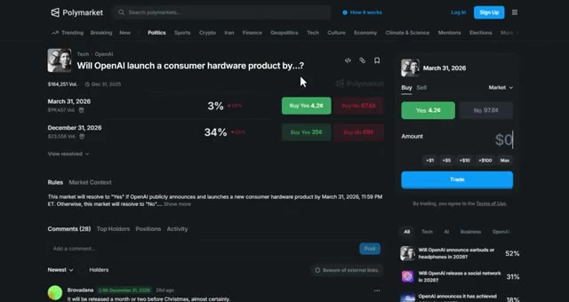
*⏱️ 00:00:08 — Capture d'écran de l'interface de la plateforme Polymarket montrant un marché de prédiction lié au lancement d'un produit matériel par OpenAI.*

---

### ⏱️ `[00:00:34 - 00:01:11]` | Segment #02

**🔊 Audio (Transcription Intégrale Mot pour Mot en Français) :**
> générant un volume important sur Polymarket, vous pouvez débloquer des primes massives, jusqu’à 1 000 dollars après avoir généré seulement 1 million de dollars de chiffre d’affaires. C’est en plus du bonus de parrainage de 10 dollars lorsque votre filleul effectue son premier dépôt. Le lien est en bas. Très bien, passons directement à la stratégie numéro une. Celle-ci s'appelle l'actualisation du taux sans risque. Certains des marchés Polymarket les plus étranges, comme est-ce que les États-Unis confirmeront que les extraterrestres existent avant 2027 ? Ou est-ce que Jésus reviendra d'ici 2027 ? se négocient toujours autour de 4 % sur le oui. Non pas que quiconque pense que cela va réellement se produire, mais parce que la longue durée

**👁️ Analyse Visuelle d'Écran (gemini-3.5-flash-lite) :**
**Interface & Outils** : Polymarket (site web de prédiction)

**Contenu textuel & Code** : Marchés de prédiction avec volumes de transactions (ex: 7M Vol., 2M Vol., 1M Vol., 19M Vol., 24M Vol.) et probabilités en pourcentage pour des événements politiques et géopolitiques.

**Action / Démonstration** : Navigation et affichage des différents marchés de paris et de prédiction disponibles sur la plateforme.

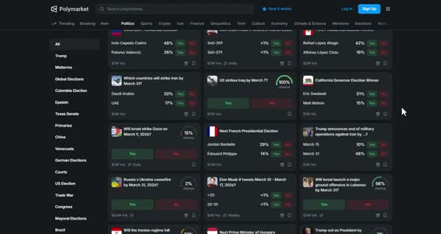
*⏱️ 00:00:43 — Capture d'écran de la plateforme Polymarket affichant une grille de marchés de prédiction politique avec divers événements mondiaux et leurs pourcentages de probabilité.*

---

### ⏱️ `[00:01:11 - 00:01:36]` | Segment #03

**🔊 Audio (Transcription Intégrale Mot pour Mot en Français) :**
> Les marchés comportent une distorsion de la valeur temporelle inhérente. Cela s'appelle la théorie de la valeur temporelle de l'argent. Voici comment cela fonctionne. Le capital du camp du oui se retrouve bloqué pendant des années. Finalement, certains détenteurs ont besoin de liquidités, vendent prématurément et créent des pics de courte durée où le prix du oui est artificiellement élevé. Vous utilisez le marché du oui, qui se négocie autour de 18 cents, comme un taux sans risque pour des paris binaires à long terme. Voici la stratégie.

**👁️ Analyse Visuelle d'Écran (gemini-3.5-flash-lite) :**
**Interface & Outils** : Site web Polymarket (plateforme de marchés de prédiction)

**Contenu textuel & Code** : Question de prédiction affichée ("Will Jesus Christ return before 2027?"), probabilité actuelle à 4%, graphique d'évolution historique des prix et panneau d'achat/vente avec les parts "Yes" (3,9¢) et "No" (96,2¢).

**Action / Démonstration** : Présentation visuelle d'un marché de prédiction à long terme pour illustrer la valeur temporelle de l'argent et le blocage du capital.

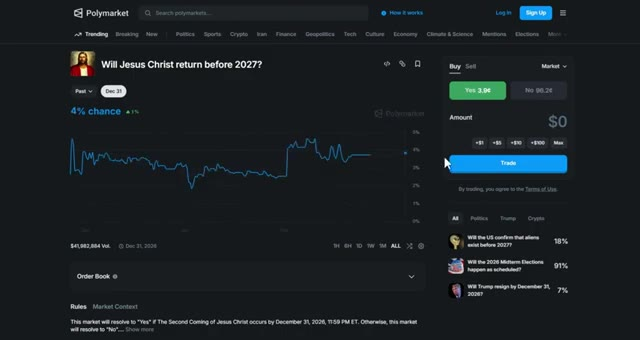
*⏱️ 00:01:17 — Capture d'écran de la plateforme Polymarket montrant le marché de prédiction "Will Jesus Christ return before 2027?" avec un graphique de probabilité et le panneau de trading à droite.*

---

### ⏱️ `[00:01:36 - 00:01:56]` | Segment #04

**🔊 Audio (Transcription Intégrale Mot pour Mot en Français) :**
> Si un autre événement pluriannuel, comme est-ce que Taïwan sera envahi d'ici 2026, s'échange à 10,3 % de oui, vous le décotez d'environ 4 % par rapport au taux de référence. La vraie probabilité est plus proche de 6 %, et non de 10 %. Vous placez donc des ordres limités échelonnés pour acheter du non, à peu près 4 % en dessous du prix indiqué.

**👁️ Analyse Visuelle d'Écran (gemini-3.5-flash-lite) :**
**Interface & Outils** : Interface web de Polymarket (marché de prédiction décentralisé).

**Contenu textuel & Code** : Question du marché : "Will China invade Taiwan by end of 2026?", prix du "Oui" à 10,3 ¢, prix du "Non" à 89,8 ¢, graphique historique de probabilité, volume total de 10 571 073 $, et panneau de passage d'ordres à droite.

**Action / Démonstration** : Consultation du graphique historique et des prix d'achat/vente pour placer des ordres sur le marché "No".

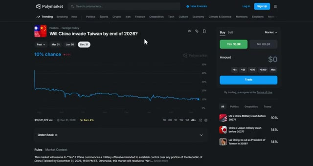
*⏱️ 00:01:41 — Capture d'écran de la plateforme Polymarket montrant le marché prédictif sur l'invasion de Taïwan par la Chine d'ici fin 2026, avec une probabilité affichée à 10,3 % pour le "Oui".*

---

### ⏱️ `[00:01:56 - 00:02:14]` | Segment #05

**🔊 Audio (Transcription Intégrale Mot pour Mot en Français) :**
> Vous attendez des pics stimulés par la liquidité et vous saisissez l'avantage lorsque le marché rebondit. Vous ne faites pas de trading sur la géopolitique. Vous faites du trading sur les mathématiques des capitaux bloqués et de la valeur temporelle mal évaluée. Laissez-moi vous montrer un exemple. Il y a un marché qui nous pose la question : est-ce qu'OpenAI annoncera avoir atteint l'AGI avant 2027 ? Oui, il s'échange à 0,18 dollar.

**👁️ Analyse Visuelle d'Écran (gemini-3.5-flash-lite) :**
**Interface & Outils** : Plateforme de prédiction Polymarket (site web).

**Contenu textuel & Code** : Graphique de probabilité montrant une estimation actuelle à environ 10,3 % pour le "Oui" et 89,8 % pour le "Non", avec un volume total de transactions de 10 571 073 $.

**Action / Démonstration** : Visualisation du marché pour illustrer la valeur temporelle et les capitaux bloqués sur un pari géopolitique.

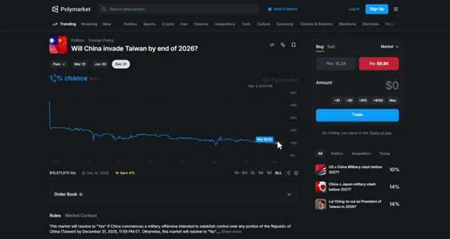
*⏱️ 00:02:01 — Capture d'écran de la plateforme Polymarket affichant un marché de prédiction géopolitique concernant l'invasion de Taïwan.*

---

### ⏱️ `[00:02:14 - 00:02:34]` | Segment #06

**🔊 Audio (Transcription Intégrale Mot pour Mot en Français) :**
> Mais si vous soustrayez le taux sans risque de 4 %, la probabilité réelle est plus proche de 14 %. Vous achetez « non » à 0,83 $ et vous attendez que le marché réajuste ses prix ou se résolve. C'est de l'arbitrage pur sur la valeur temps. La plupart des traders ne savent même pas que cela existe. La deuxième stratégie repose entièrement sur la reconnaissance de schémas de fausses nouvelles.

**👁️ Analyse Visuelle d'Écran (gemini-3.5-flash-lite) :**
**Interface & Outils** : Site web de Polymarket (marché de prédiction décentralisé)

**Contenu textuel & Code** : Question du marché « OpenAI announces it has achieved AGI before 2027? », probabilité actuelle affichée à 15% (puis 17%), boutons d'achat « Yes 18¢ » et « No 83¢ », volume de transactions de 28 660 $, et graphique historique des cours.

**Action / Démonstration** : Visualisation du marché de prédiction et illustration des prix des parts « Yes » et « No » correspondant aux probabilités évoquées dans l'audio.

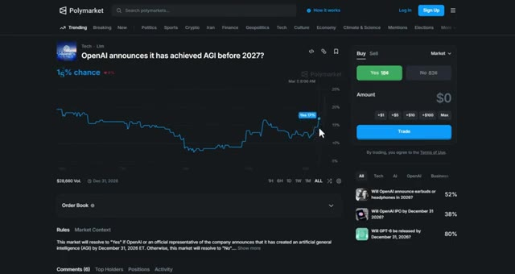
*⏱️ 00:02:19 — Capture d'écran de la plateforme Polymarket montrant un marché de prédiction sur l'AGI d'OpenAI avant 2027, avec un graphique de probabilité et le panneau d'achat/vente.*

---

### ⏱️ `[00:02:35 - 00:03:10]` | Segment #07

**🔊 Audio (Transcription Intégrale Mot pour Mot en Français) :**
> Faux dossiers de campagne, faux captures d'écran, faux scandales. Les investisseurs particuliers y tombent dedans instantanément. Les professionnels, non. Voici comment cela fonctionne. Vous construisez une base de données mentale des canulars passés. Lorsqu'un nouveau sort, vous vérifiez le modèle. S'il correspond à de précédents faux et provient d'un compte suspect, vous contre-investissez sur le pic. Vous profitez des gens qui ne vérifient rien ou croient tout ce qu'ils voient sur les réseaux sociaux. Voici la stratégie. Lorsqu'un marché s'envole sur une nouvelle de dernière minute, vérifiez immédiatement la source. Provient-il d'un compte vérifié ? Provient-il d'un média crédible ? Ou s'agit-il d'un compte Twitter aléatoire ?

**👁️ Analyse Visuelle d'Écran (gemini-3.5-flash-lite) :**
**Interface & Outils** : Polymarket (plateforme de marchés de prédiction)

**Contenu textuel & Code** : Graphique de probabilité de marché (« % chance »), prix d'achat « Yes » (12¢) et « No » (92¢), carnet d'ordres et liste d'autres marchés de prédiction associés.

**Action / Démonstration** : Analyse d'un marché de prédiction lié à Tesla et Elon Musk sur Polymarket.

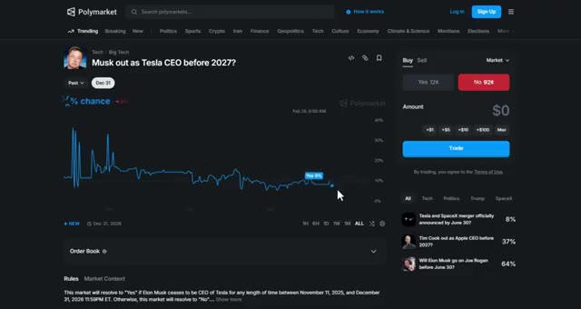
*⏱️ 00:02:53 — Interface de la plateforme Polymarket affichant un marché de prédiction intitulé « Musk out as Tesla CEO before 2027 ? » avec un graphique de probabilité en pourcentage.*

---

### ⏱️ `[00:03:10 - 00:03:47]` | Segment #08

**🔊 Audio (Transcription Intégrale Mot pour Mot en Français) :**
> avec moins de 500 abonnés. Si c'est le second cas, vous achetez le côté opposé et vous attendez que la vérité éclate. Laissez-moi vous donner un exemple. Il y a un marché qui demande : est-ce qu'Elon Musk quittera son poste de PDG de Tesla avant 2027 ? Soudain, le "oui" monte en flèche, passant de 12 centimes à 37 centimes parce que quelqu'un a publié une fausse capture d'écran d'un communiqué de presse de Tesla affirmant qu'Elon démissionne. Mais si vous vérifiez la source, c'est un compte Twitter aléatoire sans vérification, aucun média crédible n'a repris l'information, et les canaux officiels de Tesla restent silencieux. Vous achetez le "non" à 37 centimes et vous attendez que la fausse nouvelle soit démentie. En l'espace de quelques heures,

**👁️ Analyse Visuelle d'Écran (gemini-3.5-flash-lite) :**
**Interface & Outils** : Polymarket, réseau social X (Twitter)

**Contenu textuel & Code** : Graphique de probabilités de marché, prix d'achat "Yes" (12¢) et "No" (92¢), publications et actualités sur Elon Musk et Tesla.

**Action / Démonstration** : Navigation et présentation d'un marché prédictif Polymarket illustrant l'analyse du sentiment et des réactions face à une rumeur médiatique.

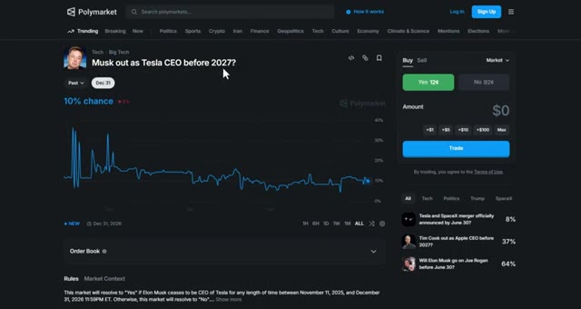
*⏱️ 00:03:19 — Capture d'écran de la plateforme Polymarket montrant le marché prédictif "Musk out as Tesla CEO before 2027?" avec un graphique des probabilités et le carnet d'ordres à droite.*

---

### ⏱️ `[00:03:47 - 00:04:22]` | Segment #09

**🔊 Audio (Transcription Intégrale Mot pour Mot en Français) :**
> le marché corrige à nouveau à 12 cents, et vous avez réalisé un bénéfice de 25 cents par action. Cela fonctionne parce que les investisseurs particuliers réagissent d'abord et vérifient ensuite. Vous faites le contraire. Vérifiez d'abord, puis tradez. Établissez une liste de contrôle mentale. La source est-elle crédible ? A-t-elle été confirmée par plusieurs médias ? Cela a-t-il un sens logique ? Si la réponse est non, pariez contre la hausse. La troisième stratégie s'appelle la rotation du personnage principal. La politique n'est pas rationnelle, c'est du narratif. L'attention change du jour au lendemain. Le favori d'aujourd'hui devient le mème de demain. Vous anticipez le changement d'ambiance avant la foule. Voici le

**👁️ Analyse Visuelle d'Écran (gemini-3.5-flash-lite) :**
**Interface & Outils** : Polymarket et plateforme X (Twitter)

**Contenu textuel & Code** : Cartes de prédiction Polymarket affichant des pourcentages de probabilité et des volumes de transaction sur divers événements politiques et géopolitiques.

**Action / Démonstration** : Navigation et consultation des marchés de prédiction pour vérifier les informations avant d'exécuter des trades.

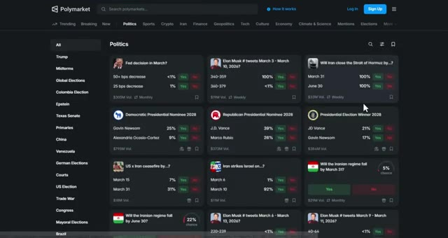
*⏱️ 00:04:13 — Capture d'écran de la plateforme de marchés prédictifs Polymarket affichant différentes cartes de paris politiques et géopolitiques.*

---

### ⏱️ `[00:04:22 - 00:04:43]` | Segment #10

**🔊 Audio (Transcription Intégrale Mot pour Mot en Français) :**
> stratégie. Identifiez le candidat ou la personnalité surmédiatisée. Trouvez le prochain gagnant potentiel de l'attention. Achetez-les tôt à 10 ou 20 cents. Vendez-les lorsque l'ambiance change et qu'ils deviennent le personnage principal. Vous négociez des cycles d'attention, pas une politique. Laissez-moi vous montrer comment cela fonctionne. Au début de 2024, il y a un marché qui demande, qui sera le colistier républicain ?

**👁️ Analyse Visuelle d'Écran (gemini-3.5-flash-lite) :**
**Interface & Outils** : Polymarket (plateforme de marchés prédictifs)

**Contenu textuel & Code** : Liste des candidats (Tom Begich à 25 %, Bernadette Wilson à 32 %, Nancy Dahlstrom à 16 %, Click Bishop à 10 %, etc.) avec les prix d'achat respectifs (« Buy Yes ») exprimés en cents.

**Action / Démonstration** : Navigation et visualisation des prix d'achat des parts de candidats positionnés entre 10 et 20 cents conformément à la stratégie d'attention.

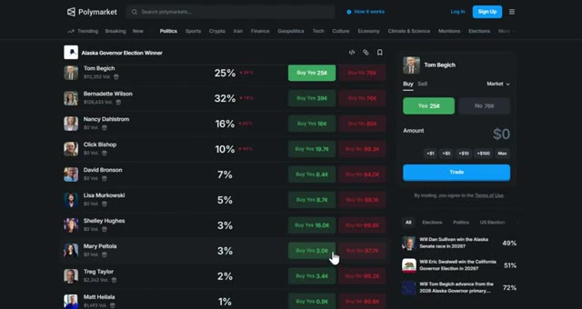
*⏱️ 00:04:27 — Capture d'écran de la plateforme Polymarket montrant les cotes et les pourcentages de probabilité pour les candidats à l'élection du gouverneur de l'Alaska.*

---

### ⏱️ `[00:04:43 - 00:05:03]` | Segment #11

**🔊 Audio (Transcription Intégrale Mot pour Mot en Français) :**
> Au début, tout le monde encensait Nikki Haley. Ses chances étaient à 60 cents. Mais si vous faisiez attention au changement de narrative, vous pouviez voir que Trump commençait à en favoriser quelqu'un d'autre. Disons J.D. Vance. J.D. Vance se négociait à 15 cents parce que personne ne parlait encore de lui. Vous achetez J.D. Vance à 15 cents et vous attendez que la narrative change.

**👁️ Analyse Visuelle d'Écran (gemini-3.5-flash-lite) :**
**Interface & Outils** : Polymarket et le réseau social X (Twitter).

**Contenu textuel & Code** : Graphique de probabilité Polymarket pour J.D. Vance (affichant un volume de $6,452,293 et une tendance montante autour de 21-32%).

**Action / Démonstration** : Navigation sur la plateforme Polymarket et visualisation de graphiques de prédiction électorale.

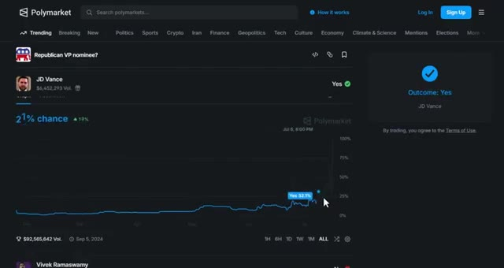
*⏱️ 00:04:58 — Capture d'écran de la plateforme de prédiction Polymarket montrant le graphique d'évolution des chances de J.D. Vance pour la nomination à la vice-présidence républicaine.*

---

### ⏱️ `[00:05:03 - 00:05:23]` | Segment #12

**🔊 Audio (Transcription Intégrale Mot pour Mot en Français) :**
> Quelques semaines plus tard, Trump commence à mentionner davantage J.D. Vance. Les médias s'en emparent, et soudainement, J.D. Vance devient le personnage principal. Ses chances bondissent à 50 centimes, et vous avez réalisé un bénéfice de 35 centimes par action. Cela fonctionne parce que la politique est dictée par les cycles médiatiques et l'attention, et non par la logique. La foule a toujours une longueur d'retard sur le changement de narrative.

**👁️ Analyse Visuelle d'Écran (gemini-3.5-flash-lite) :**
**Interface & Outils** : Polymarket et réseau social X (Twitter).

**Contenu textuel & Code** : Graphique de probabilités de marché prédictif montrant l'envolée des chances de J.D. Vance (jusqu'à 100 %) et volume de transactions associé (92 millions de dollars).

**Action / Démonstration** : Analyse des mouvements de marché sur Polymarket illustrant l'augmentation de la cote de J.D. Vance suite à l'attention médiatique.

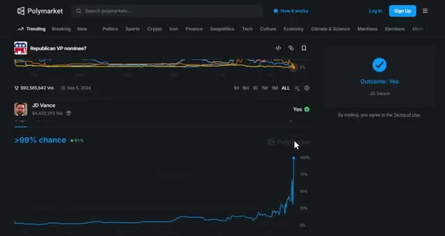
*⏱️ 00:05:13 — Graphique de la plateforme Polymarket illustrant l'évolution des chances de J.D. Vance pour le poste de colistier républicain, affichant une forte hausse jusqu'à plus de 99 %.*

---

### ⏱️ `[00:05:23 - 00:05:43]` | Segment #13

**🔊 Audio (Transcription Intégrale Mot pour Mot en Français) :**
> Tu anticipes le changement avant qu'il ne se produise et tu te positionnes en avance. Comment repérer le changement ? Suis les initiés politiques sur Twitter. Regarde qui Trump ou d'autres personnalités clés mentionnent davantage. Cherche des changements subtils dans la couverture médiatique. Quand tu vois le changement commencer, achète tôt et surfe sur la vague. La stratégie numéro quatre s'appelle l'alpha du calendrier culturel.

**👁️ Analyse Visuelle d'Écran (gemini-3.5-flash-lite) :**
**Interface & Outils** : Polymarket et interface du réseau social X.

**Contenu textuel & Code** : Graphique de probabilités de marché de prédiction Polymarket affichant une évolution vers 6% de chance pour J.D. Vance, et interface X montrant des publications politiques.
[DESC_IMAGE_3] Visualisation d'un marché de prédiction politique sur Polymarket illustrant la hausse des probabilités pour J.D. Vance en tant que colistier républicain.

**Action / Démonstration** : Explications face caméra et analyse conceptuelle des marchés.

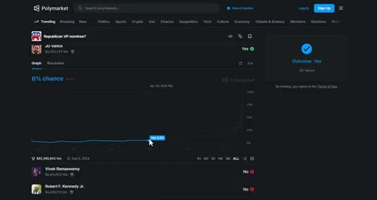
*⏱️ 00:05:38 — Capture d'écran du site de prédiction Polymarket affichant un graphique de probabilité pour le choix du candidat républicain à la vice-présidence, montrant J.D. Vance.*

---

### ⏱️ `[00:05:44 - 00:06:07]` | Segment #14

**🔊 Audio (Transcription Intégrale Mot pour Mot en Français) :**
> Les gouvernements et les grandes entreprises n'aiment pas s'humilier lors des fêtes nationales importantes. Ils évitent les mauvaises nouvelles, les actions controversées ou les mouvements embarrassants à l'approche de dates culturellement significatives. Vous utilisez cela à votre avantage. Voici comment cela fonctionne. Lorsque le marché s'attend à un mouvement important juste avant une fête axée sur la fierté ou un événement technologiquement significatif, vous allez à l'encontre de cette attente, car culturellement, il est peu probable que cela se produise.

**👁️ Analyse Visuelle d'Écran (gemini-3.5-flash-lite) :**
**Interface & Outils** : Polymarket (site web de marchés de prédiction)

**Contenu textuel & Code** : Marché "Grok 5 released by...?", affichant les dates du 31 mars 2026 (4%) et du 30 juin 2026 (65%), ainsi qu'un panneau de trading à droite.

**Action / Démonstration** : Consultation des cotes et des probabilités sur un marché de prédiction lié à la technologie et aux dates de sortie d'intelligence artificielle.

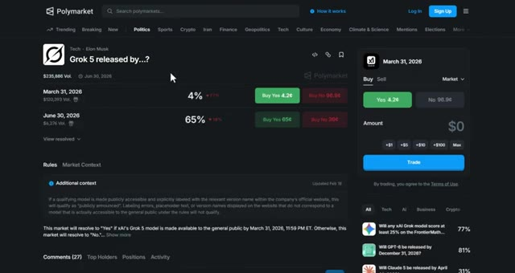
*⏱️ 00:05:49 — Capture d'écran de la plateforme Polymarket montrant un marché de prédiction lié à la sortie de Grok 5 avec différentes échéances et probabilités.*

---

### ⏱️ `[00:06:07 - 00:06:27]` | Segment #15

**🔊 Audio (Transcription Intégrale Mot pour Mot en Français) :**
> Cet avantage existe parce que la plupart des traders ignorent complètement les calendriers culturels. Ce n'est pas de la science politique. C'est de la théorie des jeux. Laissez-moi vous donner un exemple. Il y a un marché qui demande : est-ce qu'OpenAI va lancer GPT-6 d'ici une certaine date ? Maintenant, le mois de mai approche avec la conférence Google I/O et le mois de juin est celui de la conférence WWDC d'Apple.

**👁️ Analyse Visuelle d'Écran (gemini-3.5-flash-lite) :**
**Interface & Outils** : Navigateur Web, Polymarket, Moteur de recherche Google.

**Contenu textuel & Code** : Marché de prédiction Polymarket sur la sortie de Grok 5 avec cotes en pourcentage (ex: 4% et 65%), et panneau de trading latéral. Résultat de recherche Google indiquant les dates de la conférence Google I/O (19-20 mai 2026).

**Action / Démonstration** : Navigation sur une plateforme de prédiction et recherche web d'informations sur un calendrier technologique.

*⏱️ 00:06:12 — Interface du site Polymarket affichant un marché de prédiction lié à la date de sortie du modèle d'IA Grok 5.*

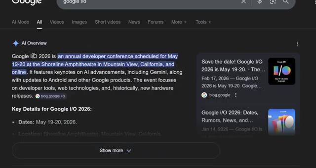
*⏱️ 00:06:22 — Page de résultats de recherche Google affichant les détails et les dates de la conférence Google I/O 2026.*

---

### ⏱️ `[00:06:27 - 00:07:04]` | Segment #16

**🔊 Audio (Transcription Intégrale Mot pour Mot en Français) :**
> et deux des plus grands événements technologiques de l'année où Apple et Google annoncent leurs stratégies en matière d'IA. Le marché pourrait bien coter le 30 juin, oui, à 20 cents, parce que les traders pensent qu'OpenAI veut rester compétitif et sortir son produit pendant cette période de forte attention. Mais si vous comprenez la stratégie technologique, vous savez qu'OpenAI éviterait probablement de lancer GPT-6 pendant les événements d'Apple ou de Google. Pourquoi ? Parce que leur annonce serait éclipsée par la couverture médiatique massive d'Apple et de Google. OpenAI veut que GPT-6 domine le cycle de l'actualité pendant des jours, et non qu'il se batte pour les grands titres avec iOS.

**👁️ Analyse Visuelle d'Écran (gemini-3.5-flash-lite) :**
**Interface & Outils** : Polymarket (navigateur web) et X (anciennement Twitter).

**Contenu textuel & Code** : Cotes de prédiction pour la sortie de GPT-6 (ex: 30 juin 2026 à 20 cents) et publications officielles d'OpenAI et Apple.
[DESC_IMAGE_3] Visualisation des pages de réseaux sociaux et du marché de prédiction lié au sujet abordé.

**Action / Démonstration** : Navigation sur la plateforme de prédiction Polymarket pour illustrer les cotes du marché au 30 juin.

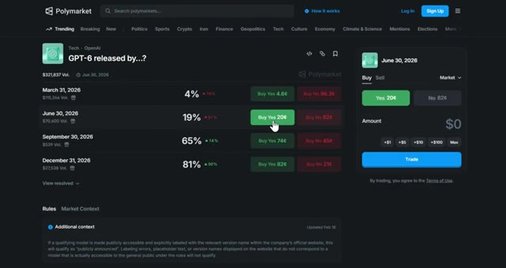
*⏱️ 00:06:36 — Capture d'écran de la plateforme Polymarket montrant le marché de prédiction "GPT-6 released by...?" avec les différentes dates et cotes associées.*

---

### ⏱️ `[00:07:04 - 00:07:38]` | Segment #17

**🔊 Audio (Transcription Intégrale Mot pour Mot en Français) :**
> mises à jour et les téléphones Pixel. Soit ils sortent bien avant ces événements pour maîtriser le récit, soit ils attendent après, lorsque le cycle de l'actualité est calme et qu'ils peuvent obtenir un maximum d'attention. Vous achetez le « non » à 82 centimes si la date limite tombe exactement pendant ces grands événements concurrents. Lorsque l'affaire se conclut sans sortie pendant cette fenêtre spécifique, vous avez fait un profit. Cela fonctionne parce que la plupart des traders ne comprennent pas le timing des relations publiques dans la tech et la stratégie concurrentielle. Ils pensent que la concurrence signifie se précipiter pour annoncer, mais les entreprises intelligentes évitent d'être noyées par des événements plus importants. Les entreprises veulent que leurs annonces

**👁️ Analyse Visuelle d'Écran (gemini-3.5-flash-lite) :**
**Interface & Outils** : Polymarket (marché de prédiction décentralisé)

**Contenu textuel & Code** : Marché "GPT-6 released by...?" avec des probabilités pour les dates du 31 mars 2026 (4%) et du 30 juin 2026 (19%), affichant l'option d'achat du « non » à 82 centimes et un graphique d'évolution temporelle.

**Action / Démonstration** : Navigation et analyse des cotes et probabilités sur un marché de prédiction Polymarket.

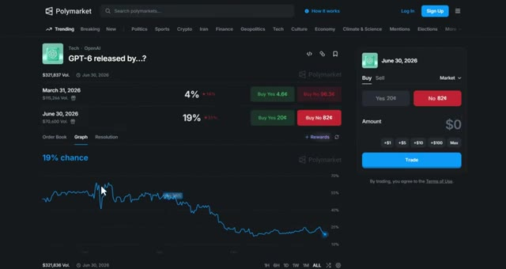
*⏱️ 00:07:21 — Interface de la plateforme de prédiction Polymarket affichant le marché de prédiction "GPT-6 released by...?" avec des graphiques de probabilités et des options d'achat (Buy Yes / Buy No).*

---

### ⏱️ `[00:07:38 - 00:08:00]` | Segment #18

**🔊 Audio (Transcription Intégrale Mot pour Mot en Français) :**
> pour être l'histoire principale, et non une note de bas de page lors de l'événement de quelqu'un d'autre. Comment utiliser cette stratégie ? Recherchez les grands événements technologiques comme la WWDC d'Apple, Google I/O, Meta Connect, Microsoft Build et le CES. Vérifiez si l'annonce attendue risque d'être éclipsée par l'événement d'un concurrent. Si c'est le cas, dites-vous que l'entreprise pourrait retarder son annonce pour obtenir une meilleure couverture médiatique.

**👁️ Analyse Visuelle d'Écran (gemini-3.5-flash-lite) :**
**Interface & Outils** : Polymarket (site web de marchés de prédiction)

**Contenu textuel & Code** : Marché de prédiction Polymarket concernant 'GPT-6 released by...?' avec des probabilités par dates (March 31, 2026 : 4%, June 30, 2026 : 19%, September 30, 2026 : 65%, December 31, 2026 : 81%) et des options d'achat/vente (Buy Yes / Buy No).

**Action / Démonstration** : Navigation et consultation des cotes de prédiction sur le marché Polymarket pour estimer les dates de sortie de nouvelles technologies.

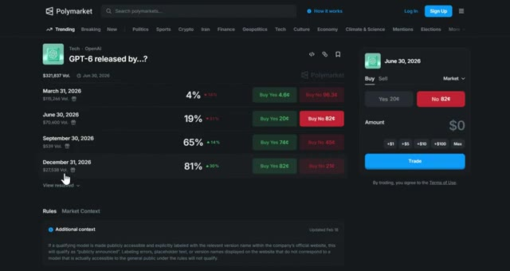
*⏱️ 00:07:55 — Capture d'écran de la plateforme de prédiction Polymarket affichant un marché de prédiction sur la date de sortie de GPT-6.*

---

### ⏱️ `[00:08:01 - 00:08:19]` | Segment #19

**🔊 Audio (Transcription Intégrale Mot pour Mot en Français) :**
> Cette stratégie fonctionne particulièrement bien avec les sorties de modèles d'IA, les lancements de produits et les annonces de fonctionnalités majeures où les entreprises recherchent un maximum d'attention et de couverture médiatique. Et rappelez-vous, si vous générez un volume important sur Polymarket, vous pouvez débloquer des primes allant jusqu'à 1 000 dollars après seulement 1 million de dollars de chiffre d'affaires.

**👁️ Analyse Visuelle d'Écran (gemini-3.5-flash-lite) :**
**Interface & Outils** : Plateforme de prédiction en ligne Polymarket (interface web sombre).

**Contenu textuel & Code** : Marchés de prédiction liés à l'IA, aux lancements de produits technologiques, aux volumes d'échanges et aux dates d'événements futurs.
[DESC_IMAGE_2] Navigation et visualisation des différents paris technologiques disponibles sur la plateforme.

**Action / Démonstration** : Explications face caméra et analyse conceptuelle des marchés.

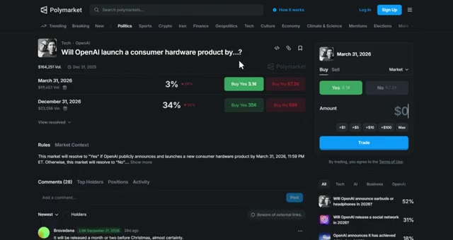
*⏱️ 00:08:05 — Capture d'écran du site Polymarket montrant un marché de prédiction spécifique lié à OpenAI et au lancement de matériel informatique.*

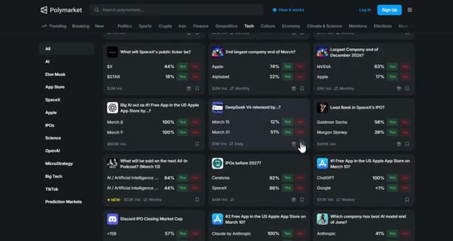
*⏱️ 00:08:14 — Vue d'ensemble de la catégorie "Tech" sur Polymarket affichant de multiples marchés de prédiction sous forme de cartes.*

---

### ⏱️ `[00:08:19 - 00:08:39]` | Segment #20

**🔊 Audio (Transcription Intégrale Mot pour Mot en Français) :**
> Utilisez mon lien dans la description pour commencer. Si vous avez regardé les trois parties de cette série, vous disposez maintenant d'un arsenal complet de stratégies qui séparent les traders professionnels des parieurs particuliers. Je vais également publier d'autres vidéos sur le trading et les marchés de prédiction concernant des stratégies avancées, alors assurez-vous de vous abonner et de cliquer sur l'icône de la cloche pour ne pas les rater.

**👁️ Analyse Visuelle d'Écran (gemini-3.5-flash-lite) :**
**Interface & Outils** : Polymarket, The Moscow Times

**Contenu textuel & Code** : Cotes de prédiction, pourcentages de probabilité, volumes d'échange et titres d'actualité géopolitique.

**Action / Démonstration** : Navigation et présentation de marchés de prédiction et de sources d'information.

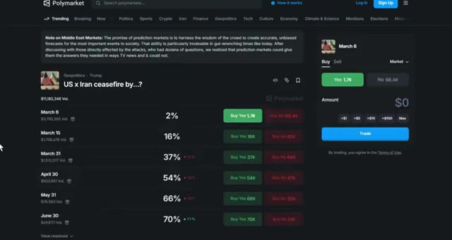
*⏱️ 00:08:24 — Interface du site Polymarket affichant un marché de prédiction géopolitique concernant un cessez-le-feu entre les États-Unis et l'Iran.*

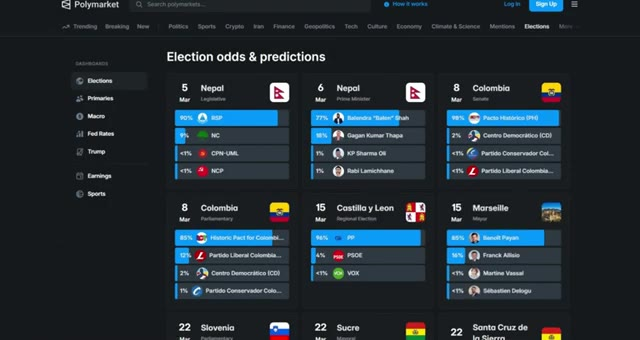
*⏱️ 00:08:29 — Tableau de bord de Polymarket montrant diverses cotes et prédictions sur les élections internationales.*

---

### ⏱️ `[00:08:39 - 00:09:02]` | Segment #21

**🔊 Audio (Transcription Intégrale Mot pour Mot en Français) :**
> Et si vous voulez automatiser votre copy trading et suivre les baleines, allez voir Tradefox. C'est le seul outil que j'utilise pour le copy trading sur Polymarket. Le lien est dans la description. Si vous avez trouvé cette vidéo utile, laissez un pouce bleu en dessous. Si vous avez des questions, posez-les dans les commentaires et je répondrai à chacune d'entre elles. Et si vous avez raté les parties 1 ou 2 de cette série, regardez les vidéos qui apparaissent à l'écran en ce moment même.

**👁️ Analyse Visuelle d'Écran (gemini-3.5-flash-lite) :**
**Interface & Outils** : Tradefox et Polymarket (plateformes web).

**Contenu textuel & Code** : Classement de traders avec adresses de portefeuilles, volumes et variations sur 24h sur Tradefox ; grilles de marchés de prédiction avec cotes (Yes/No) et volumes sur Polymarket.

**Action / Démonstration** : Navigation et présentation des outils de copy trading et de prédiction.

*⏱️ 00:08:45 — Interface de la plateforme Tradefox affichant le classement d'un tournoi de copy trading avec les volumes des participants et des options de suivi (Copy Trades).*

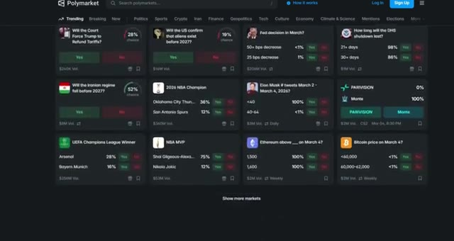
*⏱️ 00:08:56 — Interface de la plateforme de prédictions Polymarket montrant différents marchés de paris tendances (politique, crypto, sport) sous forme de cartes avec pourcentages et volumes.*

---

### ⏱️ `[00:09:02 - 00:09:04]` | Segment #22

**🔊 Audio (Transcription Intégrale Mot pour Mot en Français) :**
> Merci d'avoir regardé et je vous vois dans le prochain.

**👁️ Analyse Visuelle d'Écran (gemini-3.5-flash-lite) :**
**Interface & Outils** : Aucune interface visible.

**Contenu textuel & Code** : Aucun contenu, code ou graphique affiché.

**Action / Démonstration** : Fin de la vidéo, transition ou écran noir de clôture.

---

