# 🎬 This Is How I Copy the Best Traders on Polymarket Using This Tool

> **Chaîne** : [Alex Carter](https://www.youtube.com/@AlexCarterTrading)  
> **Lien YouTube** : [https://www.youtube.com/watch?v=Ee1jwQ7M7b0](https://www.youtube.com/watch?v=Ee1jwQ7M7b0)  
> **Date de publication** : 20260314  
> **Durée** : 00:10:16  
> **Identifiant vidéo** : `Ee1jwQ7M7b0`  
> **Transcription & Analyse** : `whisper-v3-large-turbo+gemini-3.5-flash-lite`  

---

## 📌 Synthèse Exécutive & Outils

### 💡 Résumé

Cette vidéo présentée par la chaîne Alex Carter explore en profondeur l'automatisation des investissements sur les marchés de prédiction grâce au copy trading, en se concentrant sur la plateforme TradeFox. L'analyste y détaille comment s'affranchir de la recherche fondamentale exténuante et de la surveillance constante des actualités (politique, sports, météo) en répliquant automatiquement les transactions de traders à fort rendement. La démonstration guide le spectateur de l'inscription sans KYC et du dépôt multichrypto de fonds jusqu'au paramétrage chirurgical des ordres de copie.

L'analyse technique de la plateforme met en avant des fonctionnalités avancées de filtrage du "smart money" et des baleines, ainsi qu'une panoplie de réglages de gestion des risques. Sont notamment passés au crible les modes de réplication (fixe versus pourcentage), les options de sortie (miroir ou manuelle), ainsi que les paramètres avancés de plafonnement du slippage, de volume minimal de liquidité et d'automatisation des take-profit et stop-loss. En outre, la vidéo met en lumière des aspects uniques comme l'intégration de TradeFox AI pour simuler les performances et l'accès stratégique aux participants des tournois de trading.

Enfin, l'intervenant conclut sur l'opportunité de monétisation de la plateforme via un programme de parrainage multiniveau agressif (sur trois degrés). Cette approche systémique offre aux traders un cadre opérationnel clés en main, transformant un processus d'analyse complexe et chronophage en une stratégie d'investissement passive, hautement structurée et quantitative.

### 🛠️ Outils, Modèles & Logiciels Présentés

* **TradeFox** : Agrégateur de marchés de prédiction centralisant Polymarket et d'autres plateformes, doté de fonctionnalités natives de copy trading et sans exigence de KYC.
* **TradeFox AI** : Outil d'intelligence artificielle intégré permettant de simuler et d'obtenir un aperçu analytique des résultats potentiels basés sur les configurations de copy trading choisies.
* **Polymarket** : Principal marché de prédiction décentralisé source des données de flux et des portefeuilles cibles analysés et copiés.
* **Metamask** : Portefeuille Web3 externe compatible pour l'authentification et les transferts de fonds sur l'agrégateur.
* **Coinbase Wallet** : Solution de portefeuille alternatif utilisée pour approvisionner le compte de trading en crypto-monnaies.
* **Rainbow** : Portefeuille crypto mobile pris en charge pour la connexion rapide et sécurisée sans KYC à la plateforme.
* **Réseau BSC (Binance Smart Chain)** : Infrastructure blockchain privilégiée dans le tutoriel pour exécuter des transferts de fonds rapides et à faible coût.

### 🔑 Points Clés & Enseignements Stratégiques

* **Suppression de la charge cognitive** : Élimination totale de la recherche fondamentale et du suivi des actualités en déléguant la prise de décision à des traders et des robots déjà rentables.
* **Onboarding frictionnel réduit** : Inscription simplifiée via e-mail, compte X ou portefeuilles externes, exempte de procédures KYC lourdes pour un accès immédiat aux marchés.
* **Flexibilité des dépôts multi-actifs** : Capacité à alimenter le compte TradeFox en USDC, ETH, ARB, BNB ou Solana depuis n'importe quel réseau, avec un focus sur la BSC pour son compromis vitesse/frais.
* **Segmentation granulaire du "Smart Money"** : Classement et filtrage des portefeuilles cibles par catégories spécialisées (baleines, robots, acteurs manuels, sports, météo) pour cibler des alpha spécifiques.
* **Mode Fixe vs Mode Pourcentage** : Choix entre une taille de position constante pour un risque prévisible et une allocation proportionnelle reflétant la conviction changeante du trader copié.
* **Modes Miroir vs Manuel** : Distinction entre la réplication totale des mouvements d'achat et de vente (miroir) et le contrôle exclusif des entrées couplé à une gestion autonome des prises de profits (manuel).
* **Contrôle strict du slippage et de la liquidité** : Paramétrage des volumes minimaux par marché et de la liquidité requise pour éviter l'impact des ordres importants sur des carnets d'ordres peu profonds.
* **Filtres de juste valeur et d'horizon temporel** : Utilisation de fourchelles de prix minimales et maximales pour rejeter les achats à l'extrême, combinée à un filtre de temps maximum avant résolution.
* **Automatisation des sorties (Take-Profit & Stop-Loss)** : Définition de seuils de sortie personnalisés pour verrouiller les gains ou couper les pertes indépendamment de la stratégie de conservation du trader d'origine.
* **Exploitation des tournois de trading** : Stratégie consistant à copier les participants des tournois TradeFox, ces derniers tradant à leur plus haut niveau de compétitivité pour maximiser la qualité des signaux.
* **Monétisation par parrainage multiniveau** : Intégration d'un système d'affiliation sur trois degrés (35 %, 10 % et 5 %) générant des revenus passifs récurrents sur les frais de réseau.

---

## ⏱️ Chronologie & Transcription Complète Audio & Visuelle (Mot pour Mot)

### ⏱️ `[00:00:00 - 00:00:37]` | Segment #01

**🔊 Audio (Transcription Intégrale Mot pour Mot en Français) :**
> Dans cette vidéo, je vais vous montrer comment je copie les transactions de certains des traders de marchés de prédiction les plus rentables sur Polymarket en utilisant TradeFox. Si vous avez déjà négocié sur des marchés de prédiction, vous savez à quel point cela peut être épuisant, à rechercher constamment, à analyser des données et à surveiller les actualités juste pour comprendre où le marché pourrait évoluer. Mais au lieu de faire tout ce travail vous-même, vous pouvez simplement copier les transactions de traders qui réalisent déjà des milliers de dollars de profit automatiquement. Plongeons dans le vif du sujet. Alors tout d'abord, qu'est-ce que Tradefox ? Tradefox est essentiellement un agrégateur de marchés de prédiction. Cela signifie qu'il rassemble tous les marchés de Polymarket et d'autres plateformes dans

**👁️ Analyse Visuelle d'Écran (gemini-3.5-flash-lite) :**
**Interface & Outils** : TradeFox (plateforme de trading et d'agrégation pour les marchés de prédiction)

**Contenu textuel & Code** : Statistiques de trading (valeur du portefeuille à 165 111,13 $, PnL global de +10 618 054 $, volume total de 242 797 444,53 $, taux de réussite de 52,6%) et texte descriptif de la plateforme TradeFox.

**Action / Démonstration** : Navigation sur la plateforme TradeFox pour analyser les performances d'un trader rentable et consulter la présentation de l'outil.

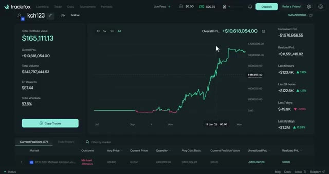
*⏱️ 00:00:09 — Interface TradeFox montrant le profil d'un trader (kch123) avec ses statistiques de performance (Overall PnL de +10 618 054 $), un graphique d'évolution du PnL et un bouton de copie de transactions.*

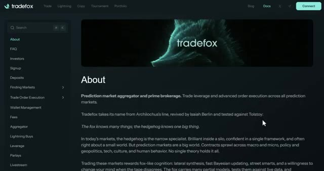
*⏱️ 00:00:28 — Page "About" du site web TradeFox détaillant la vision de la plateforme en tant qu'agrégateur de marchés de prédiction et courtier principal.*

---

### ⏱️ `[00:00:37 - 00:01:10]` | Segment #02

**🔊 Audio (Transcription Intégrale Mot pour Mot en Français) :**
> un seul endroit. Donc vous n'avez pas besoin de passer d'un site à un autre. Tout est ici. Et voici le point important. Tradefox propose un programme de parrainage généreux. Je vous montrerai exactement comment cela fonctionne plus tard dans la vidéo. Mais sachez simplement que le lien que j'ai mis dans la description vous donnera des récompenses bien meilleures que si vous vous inscrivez normalement. Très bien, donc d'abord vous allez avoir besoin d'un compte sur Tradefox. Cliquez sur le lien dans la description et l'inscription est super simple. Vous pouvez utiliser votre email, votre compte X, ou un portefeuille externe comme Metamask, Coinbase Wallet, Rainbow, et plus encore. Avec Tradefox,

**👁️ Analyse Visuelle d'Écran (gemini-3.5-flash-lite) :**
**Interface & Outils** : Site web de la plateforme Tradefox (documentation et interface de trading).

**Contenu textuel & Code** : Explications textuelles du programme de parrainage (35% pour les filleuls directs, 10% de 2e degré, 5% de 3e degré) et options de connexion (Email, X, Wallet).

**Action / Démonstration** : Navigation dans la documentation de Tradefox et affichage de la fenêtre contextuelle de connexion.

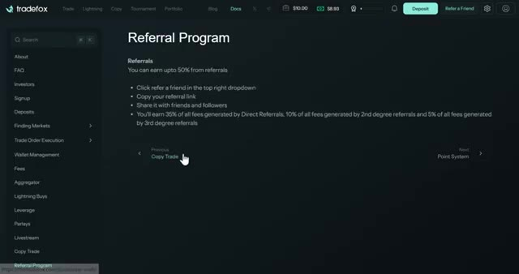
*⏱️ 00:00:45 — Page de documentation de Tradefox détaillant le programme de parrainage avec des explications sur les gains par niveau.*

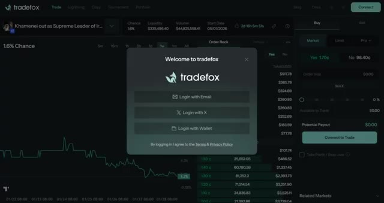
*⏱️ 00:01:02 — Interface principale de la plateforme Tradefox affichant un graphique de marché avec une fenêtre modale de connexion.*

---

### ⏱️ `[00:01:10 - 00:01:40]` | Segment #03

**🔊 Audio (Transcription Intégrale Mot pour Mot en Français) :**
> tu n'as même pas besoin de KYC, ce qui est génial parce que ça signifie que tu peux commencer à trader tout de suite. Pour ce tutoriel, je vais utiliser mon compte Google pour m'inscrire. Une fois que tu y es, tu vas devoir déposer des fonds. Et le truc cool avec TradeFox, c'est qu'une fois que tu as un compte Polymarket ou Calci, tu peux déposer et transférer à peu près n'importe quelle crypto. ARB, BNB, ETH, USDC, Solana, et plus encore. Quoi que tu aies, tu peux le transférer directement sur le portefeuille qu'ils te donnent.

**👁️ Analyse Visuelle d'Écran (gemini-3.5-flash-lite) :**
**Interface & Outils** : Plateforme de trading TradeFox (interface web).

**Contenu textuel & Code** : Formulaire de connexion (champ email) et menu déroulant de sélection des jetons/réseaux (USDC, Polygon, ARB, BNB, etc.).

**Action / Démonstration** : Navigation et démonstration de la procédure d'inscription et de dépôt sur la plateforme.

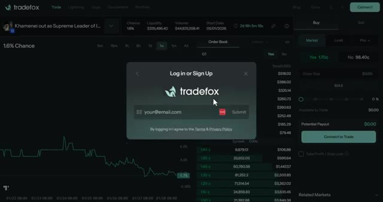
*⏱️ 00:01:17 — Interface de TradeFox affichant une fenêtre modale de connexion ou d'inscription par email.*

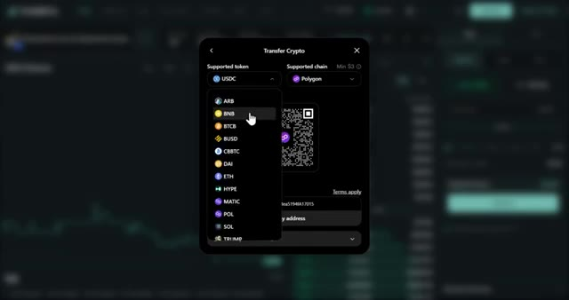
*⏱️ 00:01:32 — Fenêtre de transfert de crypto sur TradeFox montrant la liste des jetons et chaînes supportés.*

---

### ⏱️ `[00:01:40 - 00:02:01]` | Segment #04

**🔊 Audio (Transcription Intégrale Mot pour Mot en Français) :**
> Laissez-moi vous montrer. Une fois que vous êtes sur ce menu et que je veux déposer, disons de l'USDC, après cela je sélectionne un réseau. Je choisis généralement le réseau BSC parce qu'il est rapide et bon marché. Ensuite, je copie simplement cette adresse de portefeuille, je vais sur mon autre portefeuille, et j'envoie les fonds. En quelques minutes, boum, ça apparaît sur mon compte TradeFox et je suis prêt à trader. Pour cette démo, j'ai 20 dollars chargés.

**👁️ Analyse Visuelle d'Écran (gemini-3.5-flash-lite) :**
**Interface & Outils** : Interface web d'échange ou de portefeuille crypto.

**Contenu textuel & Code** : Menu déroulant des réseaux supportés avec les montants de dépôt minimum (ex: Polygon Min $3, Ethereum Min $10, BSC Min $3), QR code et adresse de dépôt du portefeuille.

**Action / Démonstration** : Sélection du réseau blockchain pour effectuer un dépôt d'USDC.

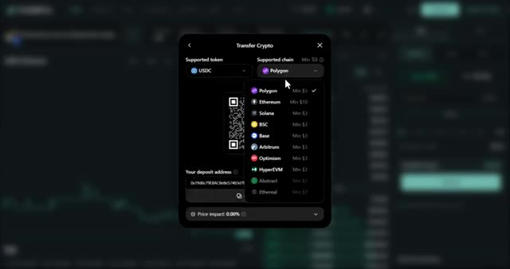
*⏱️ 00:01:45 — Fenêtre modale "Transfer Crypto" affichant la sélection du jeton USDC et du réseau de transfert (Polygon, Ethereum, Solana, BSC, Base, Arbitrum, Optimism, etc.).*

---

### ⏱️ `[00:02:02 - 00:02:24]` | Segment #05

**🔊 Audio (Transcription Intégrale Mot pour Mot en Français) :**
> Donc maintenant nous sommes prêts à commencer. Très bien, voici maintenant la partie qui m'enthousiasme le plus, le copy trading. C'est honnêtement la raison pour laquelle j'ai transféré la plupart de mes trades sur les marchés de prédiction vers TradeFox. Cliquez sur copy dans la barre supérieure. Vous pouvez voir trois sections ici, following, smart money et leaderboard. Dans following, vous pouvez rechercher l'adresse de portefeuille d'un utilisateur spécifique que vous souhaitez copier depuis Polymarket et la coller ici.

**👁️ Analyse Visuelle d'Écran (gemini-3.5-flash-lite) :**
**Interface & Outils** : Plateforme de trading TradeFox (interface web).

**Contenu textuel & Code** : Tableaux de classement "High-PnL Investors" et "Most Copied By Category" affichant des données financières chiffrées (Total PnL, Win Rate, Volume, 30D Return).

**Action / Démonstration** : Navigation sur la page de copy trading de la plateforme TradeFox pour présenter les meilleurs traders à copier.

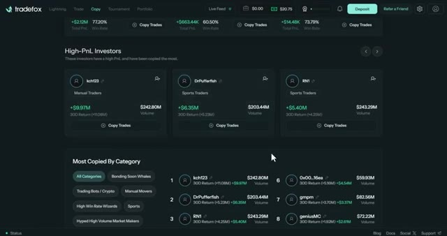
*⏱️ 00:02:07 — Capture d'écran de l'interface de TradeFox montrant la section dédiée au copy trading avec le classement des investisseurs et leurs performances (PnL, volume, taux de réussite).*

---

### ⏱️ `[00:02:25 - 00:02:45]` | Segment #06

**🔊 Audio (Transcription Intégrale Mot pour Mot en Français) :**
> Vous pouvez voir ici les traders que vous copiez et tous les traders que vous suivez. Vous pouvez voir leur profil ou leur adresse, leur P&L, la valeur de leur position, leur volume, leur dernière activité et leurs actions. Dans la section "smart money", vous pouvez voir les investisseurs à fort P&L. Ce sont les investisseurs qui ont un P&L élevé et qui ont été le plus copiés.

**👁️ Analyse Visuelle d'Écran (gemini-3.5-flash-lite) :**
**Interface & Outils** : Plateforme de copy trading Tradefox

**Contenu textuel & Code** : Tableaux avec colonnes "Profile or Address", "PnL", "Position Value", "Volume", "Last Active" et "Actions"

**Action / Démonstration** : Navigation dans l'onglet de suivi des traders et présentation des sections de copy trading

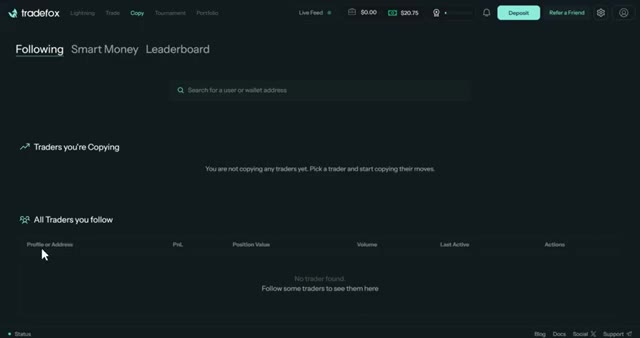
*⏱️ 00:02:30 — Interface de la plateforme Tradefox affichant les sections "Following", "Smart Money" et "Leaderboard", avec les listes des traders suivis et copiés.*

---

### ⏱️ `[00:02:45 - 00:03:05]` | Segment #07

**🔊 Audio (Transcription Intégrale Mot pour Mot en Français) :**
> Vous pouvez voir leur nom, quel genre de trader ils sont, leur rendement sur 30 jours et leur volume. Vous pouvez aussi suivre leurs transactions sans les copier. Lorsque vous faites défiler vers le bas, vous pouvez voir des catégories. Vous pouvez également vérifier chaque trader par catégorie comme "Sur le point de lier", "Baleines", "Robots de trading", "Acteurs manuels", "Sports", "Météo" et plus encore.

**👁️ Analyse Visuelle d'Écran (gemini-3.5-flash-lite) :**
**Interface & Outils** : Plateforme de trading Tradefox (interface web de copy trading)

**Contenu textuel & Code** : Noms des traders (kch123, DrPufferfish, RN1), catégories (Manual Traders, Sports Traders), rendement sur 30 jours (30D Return), volumes totaux et classements par catégorie.

**Action / Démonstration** : Présentation des profils d'investisseurs et des métriques de performance pour le copy trading sur la plateforme Tradefox.

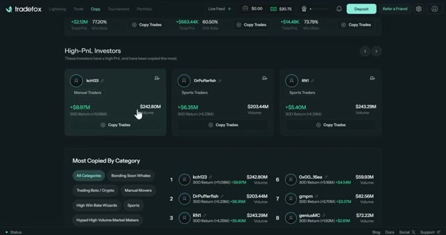
*⏱️ 00:02:50 — Capture d'écran de la plateforme Tradefox montrant la section de copy trading avec les investisseurs à haut PnL et les catégories de traders.*

---

### ⏱️ `[00:03:05 - 00:03:29]` | Segment #08

**🔊 Audio (Transcription Intégrale Mot pour Mot en Français) :**
> Vous pouvez voir les classements sur le côté droit, leur nom, le rendement sur 30 jours et le volume. Lorsque vous faites un peu plus défiler vers le bas, vous pouvez voir les investisseurs à fort volume. Ce sont des investisseurs qui ont le volume le plus élevé sur 12 mois. Vous pouvez consulter les statistiques de chaque trader en cliquant sur son profil. Vous pouvez voir le volume total de leur portefeuille, leur P&L global, leur volume et leurs récompenses de LP ou de pool de liquidité.

**👁️ Analyse Visuelle d'Écran (gemini-3.5-flash-lite) :**
**Interface & Outils** : Plateforme de copy trading Tradefox.

**Contenu textuel & Code** : Classement des 10 meilleurs traders par catégorie avec leurs volumes respectifs (ex: kch123, DrPufferfish, gmanas) et rendements sur 30 jours, ainsi que la section « High-Volume Investors » en bas de page.

**Action / Démonstration** : Navigation et présentation des classements de copy trading et des volumes des investisseurs sur la plateforme Tradefox.

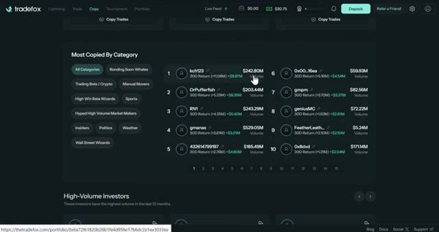
*⏱️ 00:03:11 — Capture d'écran de la plateforme Tradefox montrant le classement des traders (« Most Copied By Category ») avec les noms d'utilisateurs, le rendement sur 30 jours et le volume.*

---

### ⏱️ `[00:03:30 - 00:03:50]` | Segment #09

**🔊 Audio (Transcription Intégrale Mot pour Mot en Français) :**
> Vous pouvez voir la visualisation également au milieu avec leur courbe de P&L. Vous pouvez voir d'autres statistiques sur la droite, telles que le P&L non réalisé, le P&L réalisé, et leurs statistiques sur les 6 dernières heures, 24 heures, 7 jours et 30 jours. Lorsque vous faites défiler un peu vers le bas, vous pouvez voir leurs positions actuelles et l'historique de leurs trades.

**👁️ Analyse Visuelle d'Écran (gemini-3.5-flash-lite) :**
**Interface & Outils** : Plateforme de trading Tradefox (interface web).

**Contenu textuel & Code** : Valeur totale du portefeuille (96 077,37 $), P&L global (+5 013 726,00 $), volume total, récompenses LP, taux de réussite (53,1 %), graphique de P&L au centre, P&L non réalisé (-2 641 115,75 $), P&L réalisé (+7 654 841,93 $), et statistiques sur différentes périodes (6 heures, 24 heures, 7 jours, 30 jours).

**Action / Démonstration** : Présentation de la vue d'ensemble du profil de trading et des performances d'un utilisateur sur Tradefox.

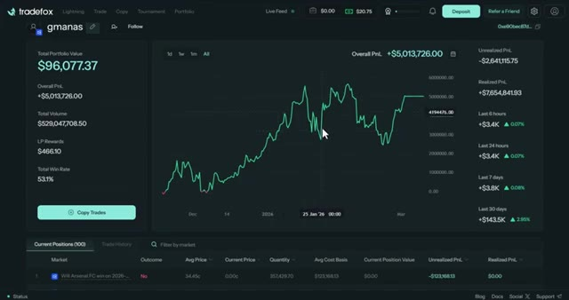
*⏱️ 00:03:35 — Interface de la plateforme Tradefox affichant les statistiques de trading, le graphique de P&L global et les positions en cours d'un utilisateur.*

---

### ⏱️ `[00:03:50 - 00:04:08]` | Segment #10

**🔊 Audio (Transcription Intégrale Mot pour Mot en Français) :**
> Vous pouvez voir le résultat, le prix moyen auquel ils ont acheté, le prix actuel, la quantité, le prix de revient et la valeur actuelle de la position. Une fois que vous cliquez sur copier les trades, cela vous donnera le formulaire d'ordre pour ce trader. Vous pouvez voir les options sur la façon dont vous voulez copier le trade. Vous pouvez voir deux modes, le mode fixe et le mode pourcentage.

**👁️ Analyse Visuelle d'Écran (gemini-3.5-flash-lite) :**
**Interface & Outils** : Interface web Tradefox (plateforme de copy trading et de prédictions).

**Contenu textuel & Code** : Tableaux de positions (Market, Outcome, Avg Price, Current Price, Quantity, Avg Cost Basis, Current Position Value, Unrealized PnL, Realized PnL) et formulaire de configuration de copy trading (Fixed Mode, Percentage Mode, Total Allocated Funds, Mirror/Manual).

**Action / Démonstration** : Navigation dans le tableau des positions puis ouverture du formulaire de configuration après un clic sur le bouton "Copy Trades".

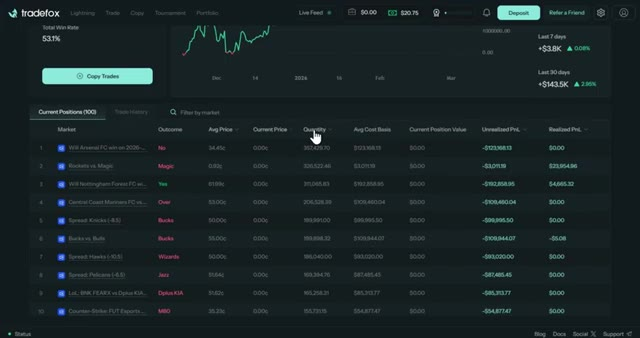
*⏱️ 00:03:55 — Image montrant le tableau des positions actuelles sur l'interface Tradefox avec les détails des marchés, prix et quantités.*

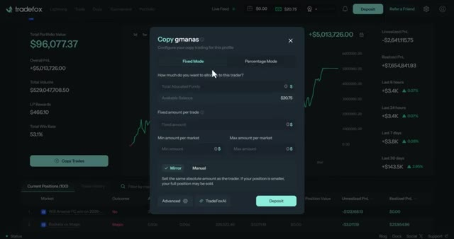
*⏱️ 00:04:04 — Image montrant la fenêtre contextuelle de configuration du copy trading (Copy Trades) sur Tradefox avec les modes Fixed Mode et Percentage Mode.*

---

### ⏱️ `[00:04:09 - 00:04:28]` | Segment #11

**🔊 Audio (Transcription Intégrale Mot pour Mot en Français) :**
> Le mode fixe signifie que vous copiez chaque trade à une taille constante. Pas de dimensionnement dynamique et un risque prévisible par trade. C'est idéal si vous voulez de la cohérence et que vous ne voulez pas que la taille de vos positions change en fonction de l'allocation du trader. Le mode pourcentage signifie que la taille de votre position évolue proportionnellement à l'allocation du trader.

**👁️ Analyse Visuelle d'Écran (gemini-3.5-flash-lite) :**
**Interface & Outils** : Interface de la plateforme de copy trading Tradefox avec une pop-up de configuration des paramètres de trading.

**Contenu textuel & Code** : Paramètres de configuration du copy trading : 'Fixed Mode', 'Percentage Mode', allocation de fonds, montant fixe par trade, limites min/max par marché, options 'Mirror' et 'Manual'.

**Action / Démonstration** : Sélection du mode fixe ('Fixed Mode') pour configurer la copie des trades à taille constante.

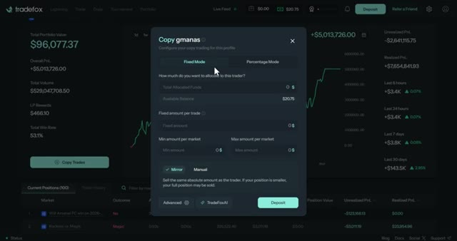
*⏱️ 00:04:14 — Fenêtre modale de configuration du copy trading sur la plateforme Tradefox, affichant l'onglet 'Fixed Mode' sélectionné.*

---

### ⏱️ `[00:04:29 - 00:04:47]` | Segment #12

**🔊 Audio (Transcription Intégrale Mot pour Mot en Français) :**
> Donc s'ils voient plus grand sur un trade, vous voyez plus grand aussi. Cela reflète leur niveau de conviction sur chaque trade. Ensuite, c'est le montant des fonds que vous souhaitez allouer à ce trader. Vous pouvez voir votre solde disponible juste ici. Si vous choisissez le mode fixe, vous verrez l'option du montant fixe par trade. Ce sera le montant exact que vous copierez sur chaque trade.

**👁️ Analyse Visuelle d'Écran (gemini-3.5-flash-lite) :**
**Interface & Outils** : Plateforme de trading TradeFox (interface web de copy trading).

**Contenu textuel & Code** : Solde disponible de 20,75 $, options de configuration ("Total Allocated Funds", "Percentage Mode", modes "Proportional", "Mirror", "Manual"), et statistiques de performance du trader en arrière-plan.

**Action / Démonstration** : Sélection et configuration des paramètres de copy trading (allocation des fonds et mode de réplication des trades).

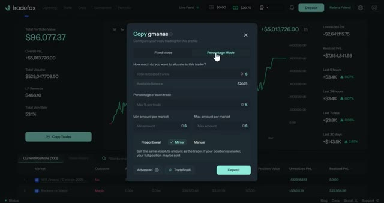
*⏱️ 00:04:33 — Interface de configuration du copy trading sur la plateforme TradeFox, affichant la fenêtre modale de paramétrage avec les modes "Fixed Mode" et "Percentage Mode".*

---

### ⏱️ `[00:04:47 - 00:05:08]` | Segment #13

**🔊 Audio (Transcription Intégrale Mot pour Mot en Français) :**
> Simple et prévisible. Si vous choisissez le mode pourcentage, vous verrez l'option du pourcentage par trade. Cela signifie que vous copiez un pourcentage de votre allocation totale sur chaque trade. Donc, si vous allouez 100 $ et définissez 10 % par trade, chaque trade sera de 10 $. Mais si la taille du trader augmente, votre pourcentage reste le même, vous reflétez donc sa stratégie de manière proportionnelle.

**👁️ Analyse Visuelle d'Écran (gemini-3.5-flash-lite) :**
**Interface & Outils** : Plateforme de copy trading Tradefox.

**Contenu textuel & Code** : Paramètres de configuration : Total Allocated Funds, Available Balance ($20.75), Percentage of each trade (0%), Min/Max amount per market, modes Proportional, Mirror, et Manual.

**Action / Démonstration** : Sélection et explication des paramètres du mode pourcentage pour le copy trading.

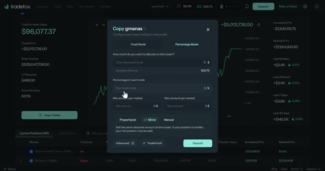
*⏱️ 00:04:52 — Fenêtre de configuration du copy trading sur la plateforme Tradefox en mode pourcentage.*

---

### ⏱️ `[00:05:09 - 00:05:30]` | Segment #14

**🔊 Audio (Transcription Intégrale Mot pour Mot en Français) :**
> Ensuite, il s'agit de configurer les montants minimum et maximum par marché. Cela vous permet de contrôler votre risque. Le minimum garantit que vous ne copiez pas des transactions trop petites pour avoir de l'importance, et le maximum plafonne votre exposition, afin de ne pas tout miser sur un seul marché. Vous pouvez également choisir entre le mode miroir et le mode manuel. Lorsque vous choisissez le mode miroir, vous vendez le même montant absolu que le trader.

**👁️ Analyse Visuelle d'Écran (gemini-3.5-flash-lite) :**
**Interface & Outils** : Plateforme de copy trading Tradefox (interface web sombre).

**Contenu textuel & Code** : Paramètres de configuration du copy trading : mode pourcentage, allocation des fonds, pourcentage maximum par trade, montants minimum et maximum par marché (fixés à 0 $).

**Action / Démonstration** : Le curseur survole les champs de configuration des montants minimum et maximum par marché pour le copy trading.

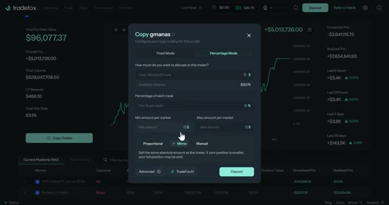
*⏱️ 00:05:14 — Fenêtre modale de configuration du copy trading sur la plateforme Tradefox, affichant les champs pour les montants minimum et maximum par marché.*

---

### ⏱️ `[00:05:31 - 00:05:53]` | Segment #15

**🔊 Audio (Transcription Intégrale Mot pour Mot en Français) :**
> Si votre position est plus petite, votre position entière peut être vendue. Vous reproduisez donc essentiellement leurs mouvements exacts, achats et ventes. Si vous choisissez le mode manuel, cela copie uniquement les achats, et vous avez un contrôle total sur toutes les sorties et la prise de profits. Vous pouvez donc laisser le trade durer plus longtemps ou le couper tôt selon votre propre stratégie. Lorsque vous cliquez sur le mode pourcentage, vous pouvez également voir la vente proportionnelle.

**👁️ Analyse Visuelle d'Écran (gemini-3.5-flash-lite) :**
**Interface & Outils** : Plateforme de trading Tradefox, interface web de copy trading.

**Contenu textuel & Code** : Paramètres de configuration du copy trading : modes (Fixed Mode, Percentage Mode), allocation de fonds, pourcentage par trade, et modes d'exécution (Proportional, Mirror, Manual).

**Action / Démonstration** : Le curseur survole et sélectionne le mode "Mirror" pour configurer le suivi des trades.

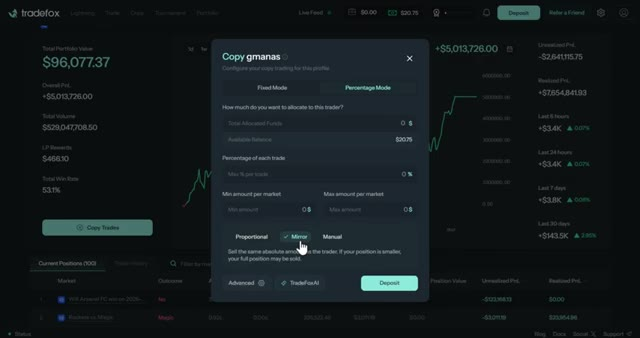
*⏱️ 00:05:36 — Interface de la plateforme Tradefox affichant une fenêtre de configuration de copy trading avec la sélection du mode "Mirror".*

---

### ⏱️ `[00:05:54 - 00:06:12]` | Segment #16

**🔊 Audio (Transcription Intégrale Mot pour Mot en Français) :**
> Cela signifie que cela se vend proportionnellement à votre allocation. Par exemple, si vous avez alloué 50 % et que le trader vend 1 000 actions, vous vendez automatiquement 500 actions. Vous évoluez donc avec eux, et vous ne copiez pas le nombre exact d'actions. Une fois que vous cliquez sur les paramètres avancés dans l'un ou l'autre mode, vous pouvez voir le montant maximal de copie par transaction.

**👁️ Analyse Visuelle d'Écran (gemini-3.5-flash-lite) :**
**Interface & Outils** : Interface de la plateforme de trading Tradefox, avec une fenêtre pop-up de configuration "Copy gmanas".

**Contenu textuel & Code** : Paramètres de copy trading avec les modes "Fixed Mode" et "Percentage Mode", allocation de fonds, pourcentage par trade, et la sélection active du mode "Proportional" avec description textuelle détaillée.

**Action / Démonstration** : Configuration des paramètres de répartition proportionnelle pour copier automatiquement les trades d'un utilisateur selon l'allocation définie.

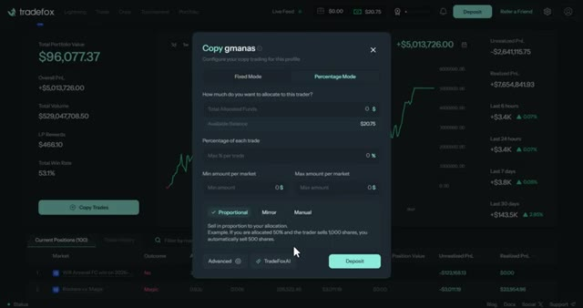
*⏱️ 00:05:58 — Fenêtre modale de configuration du copy trading sur la plateforme Tradefox, affichant les options de mode proportionnel.*

---

### ⏱️ `[00:06:13 - 00:06:32]` | Segment #17

**🔊 Audio (Transcription Intégrale Mot pour Mot en Français) :**
> Cela limite le montant que vous êtes prêt à risquer sur un seul trade, même si le trader voit plus grand. Volume minimum de chaque marché. Cela élimine les marchés à faible liquidité où le slippage pourrait vous nuire. Liquidité minimum par marché. Semblable au volume, cela garantit que le marché a suffisamment de profondeur pour que vos ordres ne fassent pas trop bouger le prix.

**👁️ Analyse Visuelle d'Écran (gemini-3.5-flash-lite) :**
**Interface & Outils** : Interface de la plateforme de trading TradeFox avec une fenêtre pop-up de paramètres.

**Contenu textuel & Code** : Paramètres visibles : "Max copy amount per trade", "Min volume of each market", "Min liquidity per market", "Market price range", "Max time-until resolution", options de "Take Profit" et "Stop Loss". Valeurs du portefeuille en arrière-plan ($96,077.37).

**Action / Démonstration** : Configuration et survol des options de gestion des risques pour le copy trading dans les paramètres avancés.

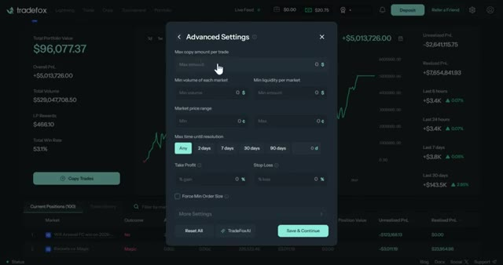
*⏱️ 00:06:18 — Capture d'écran de l'interface TradeFox affichant une fenêtre modale de configuration des paramètres avancés ("Advanced Settings") pour le copy trading.*

---

### ⏱️ `[00:06:32 - 00:06:50]` | Segment #18

**🔊 Audio (Transcription Intégrale Mot pour Mot en Français) :**
> Fourchette de prix du marché avec minimum et maximum. Cela vous évite de copier des transactions qui sont trop éloignées de la juste valeur. Donc si un trader achète à un prix extrême, vous ne suivrez pas. Temps maximum. Jusqu'à la résolution, cela filtre les marchés à long terme si vous préférez des transactions plus rapides qui se résolvent rapidement.

**👁️ Analyse Visuelle d'Écran (gemini-3.5-flash-lite) :**
**Interface & Outils** : Plateforme de copy trading Tradefox avec interface de paramètres avancés (Advanced Settings)

**Contenu textuel & Code** : Paramètres affichés : "Max copy amount per trade", "Min volume of each market", "Min liquidity per market", "Market price range", "Max time until resolution" (avec options Any, 2 days, 7 days, 30 days, 90 days), "Take Profit", "Stop Loss", et "Force Min Order Size".

**Action / Démonstration** : Configuration des filtres de risque et des limites de temps pour le copy trading de marchés prédictifs.

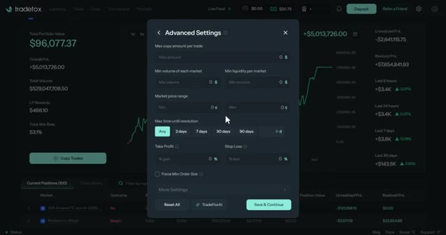
*⏱️ 00:06:36 — Capture d'écran montrant la fenêtre des paramètres avancés (Advanced Settings) sur la plateforme Tradefox, illustrant les options de configuration pour le copy trading.*

---

### ⏱️ `[00:06:51 - 00:07:12]` | Segment #19

**🔊 Audio (Transcription Intégrale Mot pour Mot en Français) :**
> Pourcentage de prise de bénéfice et de stop-loss. Cela automatise vos sorties. Ainsi, même si le trader conserve sa position, vous pouvez verrouiller vos gains ou couper vos pertes à vos propres niveaux. Vous pouvez également activer la taille de commande minimale forcée, ce qui garantit l'exécution en arrondissant les petits ordres au minimum de la plateforme. Mais cela peut entraîner une taille de position relative plus importante pour les petits trades.

**👁️ Analyse Visuelle d'Écran (gemini-3.5-flash-lite) :**
**Interface & Outils** : Plateforme de trading Tradefox, interface web de copy trading.

**Contenu textuel & Code** : Paramètres de gestion des risques incluant 'Take Profit (% gain)', 'Stop Loss (% loss)', 'Force Min Order Size', ainsi que des filtres de volume et de liquidité.

**Action / Démonstration** : Configuration des niveaux automatisés de prise de bénéfice et de stop-loss pour le copy trading.

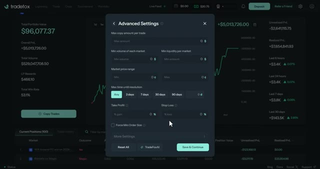
*⏱️ 00:06:56 — Fenêtre modale des paramètres avancés (Advanced Settings) sur la plateforme Tradefox, affichant les options pour configurer le Take Profit (% gain), le Stop Loss (% loss) et la taille de commande minimale forcée.*

---

### ⏱️ `[00:07:12 - 00:07:33]` | Segment #20

**🔊 Audio (Transcription Intégrale Mot pour Mot en Français) :**
> Gardez donc cela à l'esprit. Vous pouvez également découvrir leur fonctionnalité sympa, TradeFox AI. Cela vous donnera un aperçu des résultats possibles en fonction de vos données. C'est donc comme un aperçu de la façon dont votre configuration de copy trading pourrait fonctionner. Une fois que vous êtes satisfait, cliquez sur commencer à copier et votre copy trade sera désormais en ligne. En retournant sur le tableau de bord, vous pouvez voir la section du classement.

**👁️ Analyse Visuelle d'Écran (gemini-3.5-flash-lite) :**
**Interface & Outils** : Interface web de la plateforme TradeFox.

**Contenu textuel & Code** : Paramètres de copy trading avec le mode pourcentage sélectionné, allocation de fonds, pourcentage maximum par trade (2%), et un panneau TradeFox AI affichant un aperçu d'analyse.

**Action / Démonstration** : Configuration d'une stratégie de copy trading et consultation de l'outil TradeFox AI pour estimer les résultats potentiels.

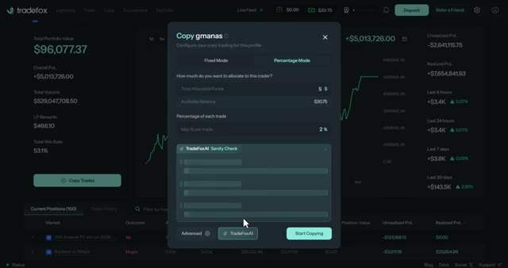
*⏱️ 00:07:18 — Fenêtre modale de configuration du copy trading sur TradeFox avec l'outil d'analyse TradeFox AI Sanity Check ouvert.*

---

### ⏱️ `[00:07:33 - 00:07:52]` | Segment #21

**🔊 Audio (Transcription Intégrale Mot pour Mot en Français) :**
> Ici, vous pouvez voir les 50 meilleurs traders selon leur P&L total. Vous pouvez voir leurs statistiques telles que le retour sur investissement, le taux de réussite, les transactions qu'ils ont effectuées, le volume et le style de leurs transactions. Vous pouvez également effectuer un tri en haut de la page en fonction de ces métriques. Vous pouvez ajuster la période pour afficher tous les temps, 30 jours, 7 jours et 24 heures.

**👁️ Analyse Visuelle d'Écran (gemini-3.5-flash-lite) :**
**Interface & Outils** : Plateforme de trading Tradefox, section Leaderboard.

**Contenu textuel & Code** : Tableau affichant le classement (Rank), les adresses de portefeuille (Wallet), le PnL réalisé, le PnL total, le retour sur investissement (ROI), le taux de réussite (Win rate), le nombre de transactions (Trades), le volume et le style de trading avec des filtres de recherche.

**Action / Démonstration** : Navigation et présentation du classement des traders et de leurs performances sur la plateforme de copy trading.

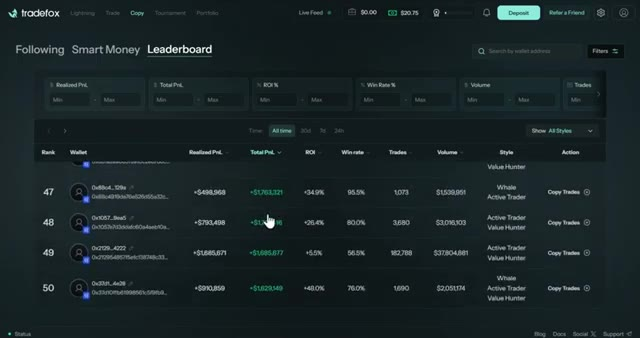
*⏱️ 00:07:38 — Capture d'écran montrant le classement (Leaderboard) de la plateforme Tradefox avec les statistiques des meilleurs traders.*

---

### ⏱️ `[00:07:53 - 00:08:15]` | Segment #22

**🔊 Audio (Transcription Intégrale Mot pour Mot en Français) :**
> Une fois que vous cliquez sur l'action de copy trading sur le côté droit, le même écran d'ordre apparaîtra. Et voilà le truc. Je n'ai pas besoin de faire de recherches. Je n'ai pas besoin de surveiller les marchés. Je n'ai pas besoin de savoir ce qui se passe dans la politique américaine ou le sport ou peu importe. Je trouve juste quelqu'un qui fait déjà le travail difficile et je le copie. Ne serait-ce pas plus facile ? Alors pourquoi ferais-je toutes ces recherches alors que je peux simplement copier quelqu'un qui cartonne déjà ?

**👁️ Analyse Visuelle d'Écran (gemini-3.5-flash-lite) :**
**Interface & Outils** : Plateforme de trading Tradefox (onglet Copy > Leaderboard)

**Contenu textuel & Code** : Classement de traders avec adresses de portefeuille masquées, PnL réalisé, PnL total, ROI en pourcentage, taux de réussite (Win rate), nombre de trades, volume et style de trading (Whale, Active Trader, Value Hunter).

**Action / Démonstration** : Navigation et visualisation de la liste des meilleurs traders disponibles pour le copy trading avec un bouton "Copy Trades" sur la droite.

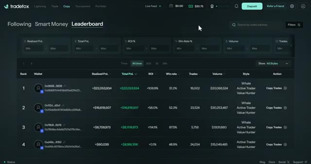
*⏱️ 00:07:58 — Capture d'écran de l'interface de copy trading de la plateforme Tradefox montrant le classement des traders (Leaderboard) avec leurs performances.*

---

### ⏱️ `[00:08:15 - 00:08:48]` | Segment #23

**🔊 Audio (Transcription Intégrale Mot pour Mot en Français) :**
> Vous pouvez également voir ici en haut l'option du tournoi. Ici, vous pouvez rejoindre le tournoi TradeFox où vous pouvez gagner des prix allant jusqu'à 3 000 dollars. Vous pouvez voir ici le volume du tournoi, votre classement actuel et le boost de récompense dont vous disposez. Vous pouvez également voir ici le temps restant avant la fin du tournoi. Vous pouvez voir tous les participants et leur classement du 1er au 25e. Donc, si vous êtes compétitif et que vous voulez tester vos compétences contre d'autres traders, c'est une fonctionnalité plutôt sympa. Et le meilleur dans tout ça, c'est que vous pouvez aussi copier les trades de ces traders du tournoi.

**👁️ Analyse Visuelle d'Écran (gemini-3.5-flash-lite) :**
**Interface & Outils** : Plateforme de trading en ligne TradeFox (page du tournoi)

**Contenu textuel & Code** : Détails du tournoi TradeFox: Season 2, volume total, compte à rebours de fin, prix (Alpha Fox : 3 000 $, Silver Fox : 2 000 $, Bronze Fox : 1 300 $) et tableau du classement des utilisateurs avec volumes et variations sur 24h.

**Action / Démonstration** : Navigation et présentation de l'interface du tournoi TradeFox, visualisation des prix et du classement des traders.

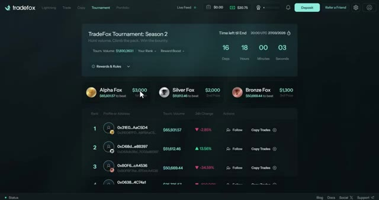
*⏱️ 00:08:23 — Interface du tableau de bord du tournoi TradeFox montrant les détails de la saison 2, les prix à gagner et le classement des participants.*

---

### ⏱️ `[00:08:48 - 00:09:08]` | Segment #24

**🔊 Audio (Transcription Intégrale Mot pour Mot en Français) :**
> Je pense que c'est absolument insensé parce que les traders que vous copiez ici concourent à leur tout meilleur niveau. Vous pouvez donc vous attendre à des trades de haute qualité et ciblés. Ils essaient littéralement de gagner. Leur stratégie va donc être pointue. Très bien. Alors avant de conclure, laissez-moi vous montrer rapidement le programme de parrainage parce que c'est vraiment insensé.

**👁️ Analyse Visuelle d'Écran (gemini-3.5-flash-lite) :**
**Interface & Outils** : Plateforme de trading TradeFox (interface web de courtage/copie de trading).

**Contenu textuel & Code** : Paramètres de copy trading (fonds alloués, solde disponible, modes fixe et pourcentage), graphique de prix XRP, carnet d'ordres avec prix et volumes, et options d'achat/vente.

**Action / Démonstration** : Configuration d'un profil de copy trading sur TradeFox puis visualisation du marché XRP avec le carnet d'ordres.

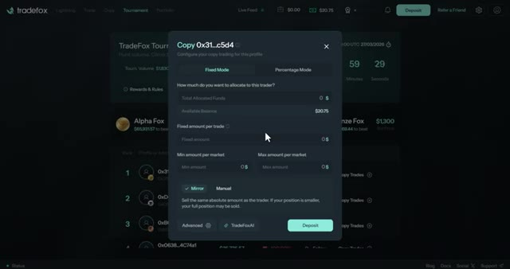
*⏱️ 00:08:53 — Interface TradeFox affichant la fenêtre de configuration du copy trading avec les options de fonds alloués et les modes de réplication.*

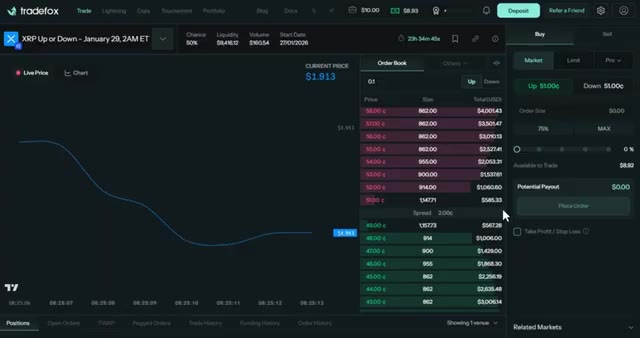
*⏱️ 00:09:03 — Interface de trading TradeFox montrant un graphique de prix pour XRP, le carnet d'ordres (Order Book) et le panneau d'exécution d'ordres.*

---

### ⏱️ `[00:09:08 - 00:09:26]` | Segment #25

**🔊 Audio (Transcription Intégrale Mot pour Mot en Français) :**
> Donc, si vous allez en haut à droite et que vous cliquez sur « Parrainer un ami », vous verrez votre lien de parrainage. Vous n'avez qu'à le copier et à le partager avec vos amis ou vos abonnés. Et voici ce que vous gagnez : vous obtenez 35 % de tous les frais de vos parrainages directs, 10 % des parrainages de deuxième degré, et 5 % des parrainages de troisième degré.

**👁️ Analyse Visuelle d'Écran (gemini-3.5-flash-lite) :**
**Interface & Outils** : Plateforme de trading en ligne Tradefox avec panneau de parrainage (« Refer a Friend »)

**Contenu textuel & Code** : Panneau latéral affichant les détails du programme de parrainage, les bonus totaux (0,00 $), les paliers de parrainage (Direct, 2e et 3e degré) et le bouton « Copy Referral Link ».

**Action / Démonstration** : Clic sur le bouton de parrainage dans le coin supérieur droit pour afficher le lien de partage et les commissions.

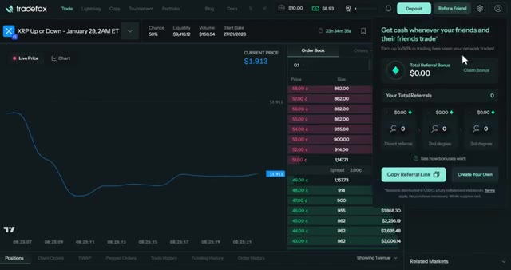
*⏱️ 00:09:13 — Interface de la plateforme de trading Tradefox montrant le panneau contextuel du programme de parrainage ouvert sur le côté droit.*

---

### ⏱️ `[00:09:26 - 00:10:02]` | Segment #26

**🔊 Audio (Transcription Intégrale Mot pour Mot en Français) :**
> C'est donc un système à trois niveaux, ce qui est plutôt cool. Donc si vous êtes sérieux à ce sujet, vous pouvez vous faire pas mal d'argent rien qu'avec les parrainages. Très bien, c'est donc pratiquement tout. TradeVox est honnêtement l'une des meilleures plateformes de marchés de prédiction que j'ai utilisées. Vous avez tous les marchés au même endroit, vous bénéficiez d'outils de trading avancés, et surtout, vous pouvez copier les meilleurs traders sans faire aucun de leurs travaux vous-même. Et je sais, pour avoir tradé la crypto, que les personnes qui avaient les meilleurs outils avant tout le monde avaient un énorme avantage. Donc si vous voulez cet avantage sur les marchés de prédiction, allez jeter un œil à TradeVox. Très bien, c'est tout pour cette vidéo.

**👁️ Analyse Visuelle d'Écran (gemini-3.5-flash-lite) :**
**Interface & Outils** : Interface web de la plateforme TradeVox (Markets / Sports Mode).

**Contenu textuel & Code** : Tableau listant divers marchés (Solana, Bitcoin, XRP, Ethereum Up or Down) avec prix (50c), probabilité (50%), volume ($0.00), liquidité et boutons de transaction rapide ("Buy YES" / "Buy NO").

**Action / Démonstration** : Navigation et présentation des marchés de prédiction et des options de trading sur TradeVox.

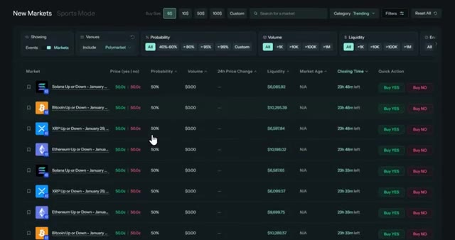
*⏱️ 00:09:35 — Capture d'écran montrant l'interface des marchés de prédiction de TradeVox avec la liste des nouveaux marchés et les options de paris.*

---

### ⏱️ `[00:10:02 - 00:10:16]` | Segment #27

**🔊 Audio (Transcription Intégrale Mot pour Mot en Français) :**
> Si vous avez trouvé cela utile, explosez ce bouton J'aime, abonnez-vous pour plus de contenu sur la crypto et les marchés de prédiction. Et si vous voulez un guide complet sur le fonctionnement de Polymarket, regardez la vidéo qui apparaît à l'écran en ce moment même. Je vous vois dans la prochaine.

**👁️ Analyse Visuelle d'Écran (gemini-3.5-flash-lite) :**
**Interface & Outils** : Plateforme de trading Tradefox (marchés de prédiction).

**Contenu textuel & Code** : Graphique de probabilité d'un événement (« Khamenei out as Supreme Leader of Iran by January... ») avec une chance évaluée à 1,6 %, carnet d'ordres (Order Book), volume de 44 825 558,41 $ et panneau d'achat (Buy).

**Action / Démonstration** : Consultation de l'interface de marché de prédiction et des carnets d'ordres.

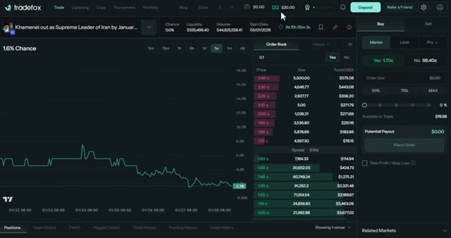
*⏱️ 00:10:05 — Interface de trading de marchés de prédiction montrant un graphique de probabilité, un carnet d'ordres et les options d'achat.*

---

