# 🎬 How To Trade 24/7 Automatically with BingX Trading Bots

> **Chaîne** : [Alex Carter](https://www.youtube.com/@AlexCarterTrading)  
> **Lien YouTube** : [https://www.youtube.com/watch?v=RDXJyw5HYtM](https://www.youtube.com/watch?v=RDXJyw5HYtM)  
> **Date de publication** : 20260316  
> **Durée** : 00:11:19  
> **Identifiant vidéo** : `RDXJyw5HYtM`  
> **Transcription & Analyse** : `whisper-v3-large-turbo+gemini-3.5-flash-lite`  

---

## 📌 Synthèse Exécutive & Outils

### 💡 Résumé

Cette vidéo immersive de la chaîne Alex Carter propose un guide exhaustif et technique sur l'automatisation intégrale du trading crypto 24h/24 et 7j/7 grâce à l'écosystème de bots de la plateforme BingX. En tant qu'analyste quantitatif, l'intervenant décortique méthodiquement chaque type de robot d'investissement — du Futures Grid au Martingale en passant par le Spot Grid Infinity et les stratégies de signaux connectées — afin de fournir aux traders une boîte à outils complète adaptée à toutes les configurations de marché (haussier, baissier, stagnant ou fortement volatil).

L'analyse technique mise en avant couvre non seulement les aspects purs du grid trading (capture de micro-fluctuations, effet de levier, neutralité directionnelle), mais aborde également des notions avancées de gestion des risques (Take Profit, Stop Loss par prix ou par ratio, subventions de trading sur grille et lissage des coûts d'achat). Les démonstrations pratiques guident l'utilisateur pas à pas, de la configuration automatisée par l'algorithme jusqu'au contrôle manuel millimétré, en passant par l'interfaçage d'outils externes pour exécuter des ordres basés sur des conditions graphiques complexes.

---

### 🛠️ Outils, Modèles & Logiciels Présentés

* **BingX** : Plateforme d'échange de cryptomonnaies centralisée hébergeant l'ensemble des bots de trading automatisé, des options de dépôt sécurisées et des programmes de bonus de bienvenue.
* **Grok Bots** : Outil d'intelligence artificielle et d'automatisation mentionné dans le contexte global de la stratégie pour assister le trader dans sa prise de décision et l'optimisation de ses flux d'exécution.
* **Pine Script** : Langage de programmation propriétaire de TradingView utilisé pour coder des indicateurs et des stratégies de trading sur mesure.
* **Claude Code** : Assistant de développement par IA employé pour concevoir, structurer et déboguer les scripts d'automatisation et les codes sources des stratégies.
* **TradingView** : Plateforme de graphisme et d'analyse technique externe connectée via des webhooks pour piloter les bots de signaux de BingX en temps réel.

---

### 🔑 Points Clés & Enseignements Stratégiques

* **Diversification des bots selon le régime de marché** : Il est impératif d'aligner la stratégie du robot sur la structure du marché (Grid Spot pour le range/stagnation, Martingale Futures pour la volatilité avec attente de rebond, et Grille Futures avec effet de levier pour maximiser les profits bidirectionnels).
* **Grid Trading sur Futures** : Permet de générer des profits réguliers sur les fluctuations de prix à l'intérieur d'une fourchette définie, avec trois orientations possibles : Neutre, Long ou Short, associées à un effet de levier paramétrable.
* **Gestion automatisée des risques (TP/SL)** : Le paramétrage des niveaux de Take Profit (TP) et de Stop Loss (SL) peut s'effectuer soit par seuil de prix absolu, soit par ratio en pourcentage par rapport au prix d'entrée, garantissant un contrôle strict du capital.
* **Filet de sécurité "Bon de subvention"** : L'utilisation de bons de subvention de trading sur grille permet de compenser automatiquement les pertes nettes (P&L négatif) en cas de scénario de marché défavorable.
* **Mode Automatique vs Manuel** : Le mode automatique délègue le choix de la fourchette de prix et du profit par grille à l'algorithme de BingX, tandis que le mode manuel offre un contrôle granulaire total sur les bornes de prix et le nombre de grilles.
* **Grid Trading Spot sans liquidation** : La version Spot Grid supprime l'effet de levier et le risque de liquidation, constituant une approche conservatrice idéale pour accumuler des actifs de long terme.
* **Fonctionnalité "Reinvest" (Mode Poignée)** : Sur les bots spot, cette option réinvestit automatiquement les profits de la grille pour racheter l'actif au prix du marché, combinant la génération de rendement de grille à l'accumulation passive de tokens.
* **Spot Infinity Grid** : Conçu pour l'arbitrage non-stop sans limite de prix supérieure, ce bot s'affranchit de tout plafond haussier pour continuer à engranger des gains indéfiniment lors des tendances haussières prolongées.
* **Futures Martingale et lissage des coûts** : Le bot ajuste dynamiquement les coûts de position en renforçant les achats à chaque palier de baisse prédéfini, en s'appuyant sur un multiplicateur de montant et un nombre d'ajouts maximaux par round.
* **Stratégies de signaux par Webhook** : La passerelle entre TradingView et BingX permet de recevoir des signaux externes en temps réel pour exécuter instantanément des ordres d'ouverture ou de fermeture sur les marchés futures perpétuels.
* **Options de clôture intelligentes** : À l'arrêt d'un bot, le système offre la flexibilité de tout revendre immédiatement en USDT de manière automatisée ou de conserver l'actif sous-jacent (ex: BTC) pour une gestion manuelle ultérieure.
* **Dollar Cost Averaging (DCA / Achat récurrent)** : Intégré sous la section spot, ce mécanisme lisse l'impact de la volatilité en programmant des achats périodiques et automatiques de cryptomonnaies.

---

## ⏱️ Chronologie & Transcription Complète Audio & Visuelle (Mot pour Mot)

### ⏱️ `[00:00:00 - 00:00:38]` | Segment #01

**🔊 Audio (Transcription Intégrale Mot pour Mot en Français) :**
> Dans cette vidéo, je vais vous montrer comment configurer et utiliser absolument tous les bots de trading sur BingX, étape par étape. Nous aborderons le Futures Grid, le Spot Grid, le Martingale, les stratégies de signaux, l'achat récurrent, et bien plus encore. Ainsi, à la fin de cette vidéo, vous saurez exactement quel bot utiliser et comment le faire fonctionner. Entrons dans le vif du sujet. Première chose, vous avez besoin d'un compte BingX. Si vous n'en avez pas encore un, cliquez sur le lien dans la description. Avec mon lien, vous pouvez obtenir jusqu'à 9 800 USDT de cadeaux de bienvenue, 30 USDT de récompenses d'inscription, 500 USDT de récompenses de dépôt, et encore 500 USDT de récompenses de trading.

**👁️ Analyse Visuelle d'Écran (gemini-3.5-flash-lite) :**
**Interface & Outils** : Interface web de l'échange de cryptomonnaies BingX (paramétrage de bot et page d'inscription).

**Contenu textuel & Code** : Formulaire de configuration de bot (Simple Instruction, Webhook URL, Trading Pair, Trade Direction Long/Short, Order Type) et formulaire d'inscription avec code de parrainage et bonus en USDT.

**Action / Démonstration** : Présentation de l'interface de création d'un bot de signaux et de la page d'inscription à la plateforme.

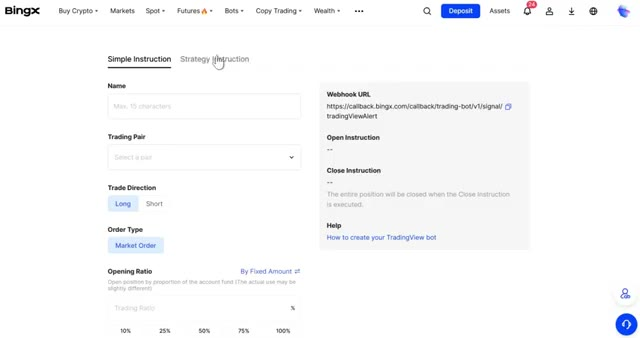
*⏱️ 00:00:09 — Interface de configuration d'un bot de trading sur BingX avec les paramètres de stratégie de signaux.*

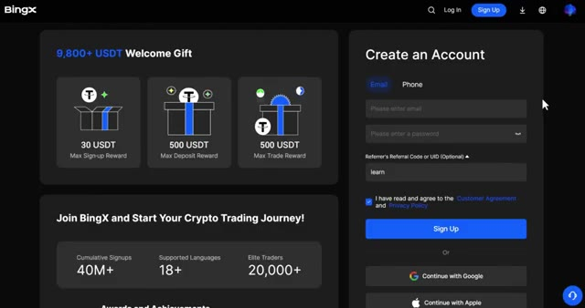
*⏱️ 00:00:19 — Page d'inscription et de création de compte sur la plateforme BingX avec offre de bonus de bienvenue.*

---

### ⏱️ `[00:00:38 - 00:01:14]` | Segment #02

**🔊 Audio (Transcription Intégrale Mot pour Mot en Français) :**
> Je vais vous montrer exactement comment réclamer cela dans un instant. Une fois que vous êtes connecté, assurez-vous d'avoir des fonds sur votre compte. Si vous devez faire un dépôt, cliquez sur dépôt dans le coin supérieur droit, sélectionnez USDT, choisissez votre réseau, et envoyez vos fonds depuis votre autre échange ou portefeuille externe. Ils arriveront en quelques minutes. Maintenant, passons aux bots. Tout en haut de la page, cliquez sur bots. Immédiatement, vous pouvez voir cinq types de bots principaux : la grille futures, le martingale futures, la grille spot, la grille spot infinity et les stratégies de signal. Et juste en dessous de la section spot, sur les bots spot, vous trouverez également un bot d'achat récurrent.

**👁️ Analyse Visuelle d'Écran (gemini-3.5-flash-lite) :**
**Interface & Outils** : Échange de cryptomonnaies BingX (interface web).

**Contenu textuel & Code** : Menus de dépôt, sélection de cryptos (USDT, USDC, BTC, ETH, TRX) et bannières promotionnelles.

**Action / Démonstration** : Navigation sur l'interface de dépôt de l'exchange et présentation des fonctionnalités de la plateforme.

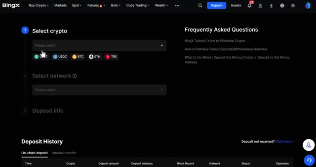
*⏱️ 00:00:47 — Interface de dépôt de la plateforme d'échange BingX montrant les étapes pour sélectionner la cryptomonnaie et le réseau.*

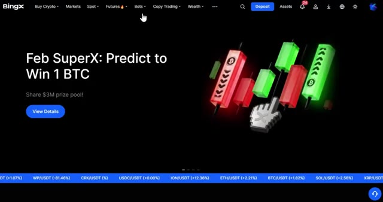
*⏱️ 00:00:56 — Page d'accueil de la plateforme BingX mettant en avant une promotion pour gagner 1 BTC ("Feb SuperX: Predict to Win 1 BTC").*

---

### ⏱️ `[00:01:14 - 00:01:51]` | Segment #03

**🔊 Audio (Transcription Intégrale Mot pour Mot en Français) :**
> nous allons aborder les différentes stratégies, chacune d'entre elles est conçue pour un style de trading différent, alors laissez-moi vous présenter chacune d'elles en détail avant de commencer à créer des bots. Voici un bref aperçu de ce que fait chacune d'elles. Grille Futures : cela permet de générer des profits grâce aux fluctuations des prix en plaçant des ordres d'achat et de vente dans une fourchette de prix définie avec effet de levier. Martingale Futures : cela ajuste automatiquement les coûts de votre position à mesure que le prix baisse. C'est idéal pour les marchés volatils. Grille Spot : c'est le même concept que la grille Futures mais sans effet de levier. Le risque est plus faible et c'est idéal pour les marchés stagnants. Grille Infinie Spot : c'est une version avancée de la grille Spot sans limite supérieure

**👁️ Analyse Visuelle d'Écran (gemini-3.5-flash-lite) :**
**Interface & Outils** : Plateforme d'échange de cryptomonnaies BingX (interface web).

**Contenu textuel & Code** : Menu des stratégies de trading automatisées : Futures Grid, Martingale, Spot Grid, Spot Infinity Grid, et Signal Strategies avec descriptions textuelles.

**Action / Démonstration** : Navigation et survol des différentes options de bots de trading disponibles sur la plateforme BingX.

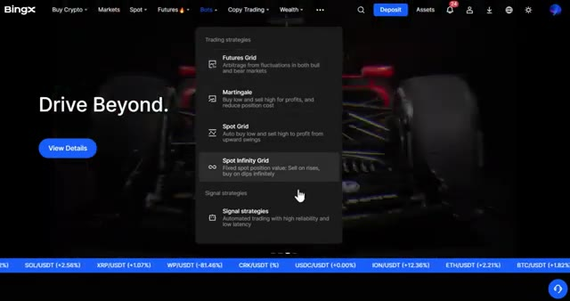
*⏱️ 00:01:23 — Interface BingX affichant un menu déroulant des stratégies de trading avec le curseur sur Spot Infinity Grid.*

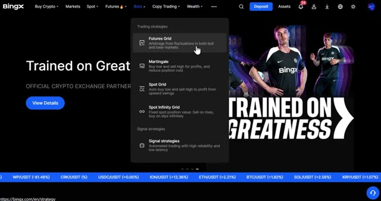
*⏱️ 00:01:32 — Interface BingX montrant le menu des stratégies de trading avec le curseur pointant sur Futures Grid.*

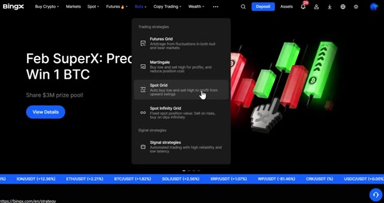
*⏱️ 00:01:41 — Interface BingX montrant le menu des stratégies de trading avec le curseur pointant sur Spot Grid.*

---

### ⏱️ `[00:01:51 - 00:02:23]` | Segment #04

**🔊 Audio (Transcription Intégrale Mot pour Mot en Français) :**
> La limite de prix conçue pour l'arbitrage non-stop et les stratégies de signaux se connecte à des plateformes externes comme TradingView pour exécuter automatiquement des transactions basées sur vos signaux. Lorsque vous cliquez sur n'importe quel bot, vous pouvez voir l'investissement total actuellement en cours dans ce bot et combien d'utilisateurs l'utilisent activement. Vous pouvez également consulter vos bots en cours d'exécution et votre historique juste ici. Commençons par le bot de grille futures, l'un des plus populaires. Cliquez sur grille futures et un nouveau formulaire de commande apparaîtra. Ici, vous avez deux modes, automatique et manuel. En mode automatique, sélectionnez votre paire de cryptos.

**👁️ Analyse Visuelle d'Écran (gemini-3.5-flash-lite) :**
**Interface & Outils** : Plateforme d'échange de cryptomonnaies BingX (interface web).

**Contenu textuel & Code** : Options de bots de trading automatisés (Futures Grid, Martingale, Spot Grid, Spot Infinity Grid, Signal Strategies) et métriques d'investissement total et d'utilisateurs.

**Action / Démonstration** : Navigation dans le menu des bots de trading et présentation des différentes stratégies automatisées disponibles sur la plateforme.

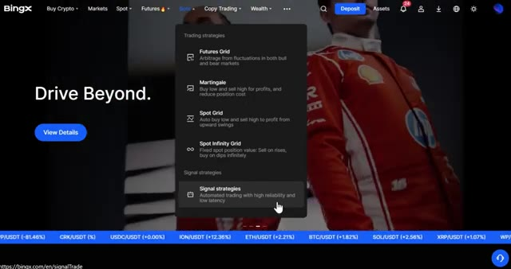
*⏱️ 00:01:59 — Interface de la plateforme BingX montrant le menu déroulant des stratégies de trading avec des options telles que Futures Grid, Martingale, Spot Grid, Spot Infinity Grid et Signal Strategies.*

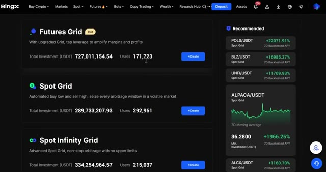
*⏱️ 00:02:07 — Interface de la plateforme BingX affichant les différents types de bots de trading (Futures Grid, Spot Grid, Spot Infinity Grid) avec les investissements totaux et le nombre d'utilisateurs.*

---

### ⏱️ `[00:02:24 - 00:02:46]` | Segment #05

**🔊 Audio (Transcription Intégrale Mot pour Mot en Français) :**
> Pour cet exemple, prenons Bitcoin USDT. Vous pouvez sélectionner trois directions, neutre, qui profite d'un mouvement de prix dans les deux sens, long, qui profite lorsque le prix monte, et court, qui profite lorsque le prix baisse. Si vous choisissez automatique, BingX sélectionnera automatiquement la fourchette de prix et le profit par grille pour vous. Tout ce que vous avez à faire est de définir votre effet de levier et votre montant d'investissement.

**👁️ Analyse Visuelle d'Écran (gemini-3.5-flash-lite) :**
**Interface & Outils** : BingX (Interface Web d'échange de cryptomonnaies)

**Contenu textuel & Code** : Paire BTCUSDT à 70290.7 (+1.78%), options de stratégie (Auto/Manual, Neutral/Long/Short), fourchette de prix 64619.1 - 75670.7 USDT, effet de levier 5X.

**Action / Démonstration** : Sélection des modes de direction de grille (Neutral, Long, Short) et visualisation des paramètres automatiques sur le bot Futures Grid de BingX.

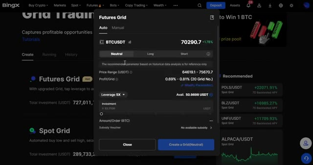
*⏱️ 00:02:29 — Interface de configuration du bot 'Futures Grid' sur l'échange BingX pour la paire BTCUSDT, montrant les options de direction (Neutral, Long, Short) et les paramètres de fourchette de prix.*

---

### ⏱️ `[00:02:46 - 00:03:06]` | Segment #06

**🔊 Audio (Transcription Intégrale Mot pour Mot en Français) :**
> Vous pouvez également activer le take profit et le stop loss ici. Ceux-ci peuvent être définis par prix, où le bot se ferme lorsqu'il atteint un niveau de prix spécifique, ou par ratio où il se ferme en fonction d'un pourcentage de gain ou de perte par rapport à votre entrée. Les deux vous donnent le contrôle sur votre gestion des risques. Vous verrez également une option pour appliquer un bon de subvention de trading sur grille.

**👁️ Analyse Visuelle d'Écran (gemini-3.5-flash-lite) :**
**Interface & Outils** : Échange de cryptomonnaies BingX (Interface Web - Menu de configuration des options de trading automatisé).

**Contenu textuel & Code** : Fenêtre modale "Futures Grid" affichant les options TP/SL avec les bascules "By Price", les champs de saisie pour le ratio de déclenchement ("Trigger Ratio") et des pourcentages prédéfinis (5%, 10%, 25%, 50%, 100%, 150%).

**Action / Démonstration** : Le curseur de la souris survole l'option "By Price" pour configurer les seuils de Take Profit et de Stop Loss du bot.

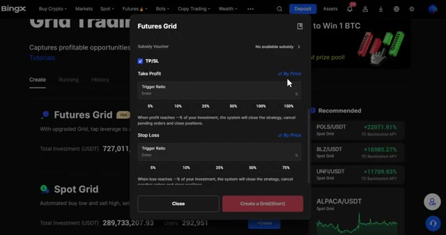
*⏱️ 00:02:51 — Interface de configuration des paramètres de Take Profit et Stop Loss (TP/SL) pour un bot de Grid Trading sur la plateforme BingX.*

---

### ⏱️ `[00:03:07 - 00:03:25]` | Segment #07

**🔊 Audio (Transcription Intégrale Mot pour Mot en Français) :**
> En résumé, si votre stratégie se solde par une perte, le système vous émettra automatiquement une subvention en USDT pour compenser ce P&L négatif. C'est un beau filet de sécurité si vous en avez un de disponible. Si vous voulez plus de contrôle, vous pouvez soit sélectionner directement le mode manuel, soit modifier les paramètres à partir du mode automatique.

**👁️ Analyse Visuelle d'Écran (gemini-3.5-flash-lite) :**
**Interface & Outils** : Interface web de l'échange de cryptomonnaies BingX (module Grid Trading).

**Contenu textuel & Code** : Paramètres du Futures Grid : Price Range (64619.1 - 75670.7 USDT), Leverage 5X, Available Balance (50.9898 USDT), Subsidiary Voucher (No available subsidy), et options TP/SL avec Take Profit.

**Action / Démonstration** : Configuration des paramètres d'un robot de trading en grille (Grid Trading) sur les contrats futures avec sélection de l'effet de levier et des niveaux de Take Profit/Stop Loss.

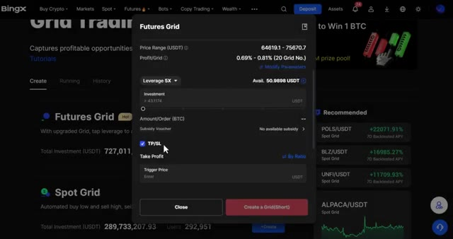
*⏱️ 00:03:11 — Fenêtre de configuration d'un Bot de type Futures Grid sur la plateforme BingX montrant les paramètres de levier, d'investissement et l'option TP/SL.*

---

### ⏱️ `[00:03:26 - 00:04:00]` | Segment #08

**🔊 Audio (Transcription Intégrale Mot pour Mot en Français) :**
> Ça basculera automatiquement. Ici, vous pouvez définir votre propre fourchette de prix inférieure et supérieure et choisir votre nombre de grilles. n'importe où de 2 $ à 200 $. Plus vous définissez de grilles, plus les ordres d'achat et de vente sont passés dans votre fourchette, capturant des profits plus petits mais plus fréquents. Faites défiler vers le bas et vous trouverez des paramètres avancés où vous pouvez définir à nouveau votre take profit et votre stop loss, ainsi qu'une option de déclenchement. Le déclencheur vous permet de définir un prix spécifique auquel le bot commencera seulement à fonctionner. Utile si vous voulez attendre que le marché atteigne un certain niveau avant d'activer la stratégie. Une fois que tout a l'air bien, cliquez

**👁️ Analyse Visuelle d'Écran (gemini-3.5-flash-lite) :**
**Interface & Outils** : Échange de cryptomonnaies BingX (interface web de bot de trading)

**Contenu textuel & Code** : Paire BTCUSDT, prix actuel 70346.6 (+1.95%), mode manuel, position Short, fourchette de prix (Lower Price: 64619.1, Upper Price: 75670.7), champ "Grid No." (2 - 200), effet de levier 5X, solde disponible 50.9898 USDT.

**Action / Démonstration** : Configuration manuelle des paramètres d'un bot Futures Grid (fourchette de prix et nombre de grilles) sur BingX.

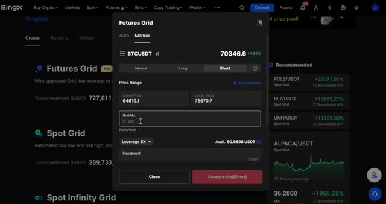
*⏱️ 00:03:34 — Interface de configuration manuelle d'un bot de trading "Futures Grid" sur la plateforme BingX pour la paire BTCUSDT, montrant les champs pour la fourchette de prix, le nombre de grilles (2 à 200) et l'effet de levier.*

---

### ⏱️ `[00:04:00 - 00:04:24]` | Segment #09

**🔊 Audio (Transcription Intégrale Mot pour Mot en Français) :**
> créez une grille et votre bot est lancé. Une fois qu'il est en marche, rendez-vous dans la section en cours. Ici, vous pouvez voir tous vos bots actifs, surveiller les performances et modifier vos take profit et stop loss à tout moment. Si vous voulez arrêter le bot, cliquez simplement sur fermer. Une fenêtre de confirmation apparaîtra pour vous demander. Procédez à la fermeture de la stratégie de grille BTCUSDT et laissez le système vous aider à vendre le BTC contre de l'USDT.

**👁️ Analyse Visuelle d'Écran (gemini-3.5-flash-lite) :**
**Interface & Outils** : Site web / Plateforme de trading BingX (section Grid Trading, onglet Running).

**Contenu textuel & Code** : Détails du bot actif : paire BTCUSDT, effet de levier 6X, statut "Running", profit total (+0.0000 / +0.00%), APY (+0.00%), investissement de 20.00 USDT, et bouton "Close".

**Action / Démonstration** : Visualisation du bot de grille actif et de ses performances en temps réel sur la plateforme BingX.

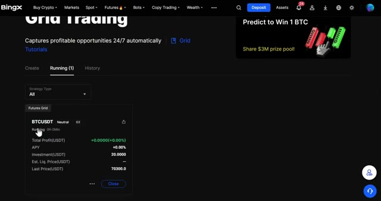
*⏱️ 00:04:06 — Interface de la plateforme BingX montrant l'onglet des bots actifs (Running) avec un bot de Grid Trading en cours sur la paire BTCUSDT.*

---

### ⏱️ `[00:04:24 - 00:04:58]` | Segment #10

**🔊 Audio (Transcription Intégrale Mot pour Mot en Français) :**
> Ensuite, il y a le Spot Grid Bot. Celui-ci fonctionne exactement comme le Futures Grid, mais sans effet de levier. Il n'y a donc aucun risque de liquidation. C'est parfait si vous voulez une approche plus sûre et plus conservatrice du grid trading. Cliquez sur créer sur le spot grid. Vous verrez le même formulaire de commande qu'avant, mais remarquez qu'il n'y a pas d'option de direction. Puisque vous achetez uniquement au comptant, vous êtes toujours acheteur par défaut. Sélectionnez votre crypto et vous pourrez voir l'APY testé rétrospectivement, la fourchette de prix et le profit par grille juste ici. C'est idéal pour avoir une idée des performances historiques du bot. Définissez votre take profit et votre stop loss comme

**👁️ Analyse Visuelle d'Écran (gemini-3.5-flash-lite) :**
**Interface & Outils** : Plateforme d'échange de cryptomonnaies BingX (interface web).

**Contenu textuel & Code** : Options de bots de trading (Spot Grid, Spot Infinity Grid), statistiques d'investissement total et de performance (APY sur 7 jours), et fenêtre de configuration pour BTC/USDT (fourchette de prix, nombre de grilles, montant d'investissement).

**Action / Démonstration** : Navigation sur la plateforme et sélection du bouton de création du bot "Spot Grid".

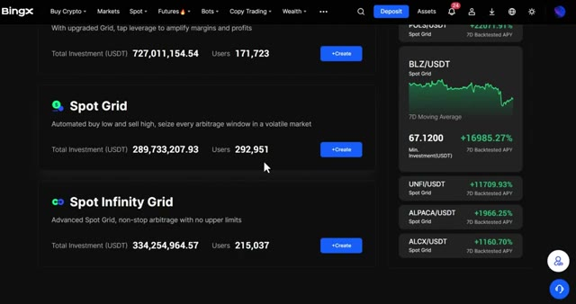
*⏱️ 00:04:33 — Interface de la plateforme BingX montrant les différentes options de bots de trading, avec une mise en avant du "Spot Grid".*

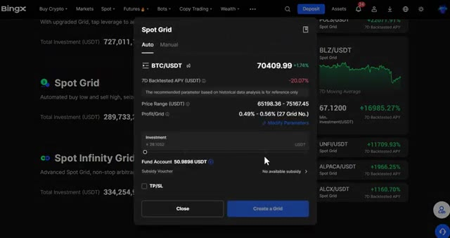
*⏱️ 00:04:41 — Fenêtre de configuration du bot "Spot Grid" sur BingX pour la paire BTC/USDT, affichant les paramètres automatiques et le solde disponible.*

---

### ⏱️ `[00:04:58 - 00:05:16]` | Segment #11

**🔊 Audio (Transcription Intégrale Mot pour Mot en Français) :**
> avant et d'entrer votre montant d'investissement. Si vous voulez ajuster les paramètres manuellement, modifiez-les simplement et cela passera en mode manuel où vous pourrez définir votre propre fourchette de prix et votre nombre de grilles. Faites défiler vers le bas et vous trouverez à nouveau le déclencheur dans le paramètre TPSL ainsi que deux nouveaux basculeurs. Vendre toutes les terminaisons.

**👁️ Analyse Visuelle d'Écran (gemini-3.5-flash-lite) :**
**Interface & Outils** : Échange de cryptomonnaies BingX (Bots de trading - Spot Grid)

**Contenu textuel & Code** : Fenêtre modale "Spot Grid" affichant la fourchette de prix (Price Range : 65198.36 - 75167.45 USDT), le profit par grille (0.49% - 0.56%, 27 grilles), le champ de saisie "Investment", le solde du compte (Fund Account : 50.9898 USDT) et les options de Take Profit / Stop Loss (TP/SL).

**Action / Démonstration** : Saisie du montant d'investissement dans le champ dédié de la configuration du bot de grille.

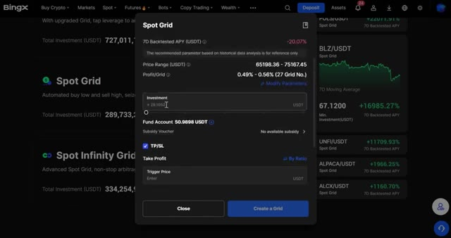
*⏱️ 00:05:03 — Interface de configuration d'un robot Spot Grid sur la plateforme BingX avec le paramétrage du montant d'investissement.*

---

### ⏱️ `[00:05:17 - 00:05:50]` | Segment #12

**🔊 Audio (Transcription Intégrale Mot pour Mot en Français) :**
> Quand le bot s'arrête, il revend automatiquement tous vos actifs en USDT pour que vous n'ayez pas à le gérer manuellement. En mode poignée, si vous êtes haussier sur une cryptomonnaie à long terme, ce mode réinvestit vos profits de trading sur grille pour acheter davantage de cette cryptomonnaie au prix du marché. Vous gagnez donc grâce à la grille et accumulez plus de pièces en même temps. Une fois que tout est prêt, cliquez sur créer une grille, comme précédemment. Une fois qu'il est en marche, vous pouvez le retrouver dans la section en cours. Ajustez votre take profit et stop loss et fermez-le quand vous voulez avec les mêmes options de vente. Vous aurez deux options. Oui, tout vendre

**👁️ Analyse Visuelle d'Écran (gemini-3.5-flash-lite) :**
**Interface & Outils** : Interface de la plateforme d'échange de cryptomonnaies BingX.

**Contenu textuel & Code** : Menus de configuration de bots de trading sur grille, options de Take Profit / Stop Loss, et statistiques de performance de bots recommandés (ex: POLS/USDT).

**Action / Démonstration** : Navigation dans l'interface de configuration des bots de grille et survol des options avancées de gestion des positions.

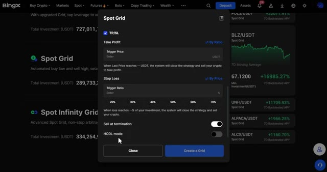
*⏱️ 00:05:25 — Interface de configuration d'un bot Spot Grid sur BingX, montrant les options TP/SL, Sell at termination et HODL mode.*

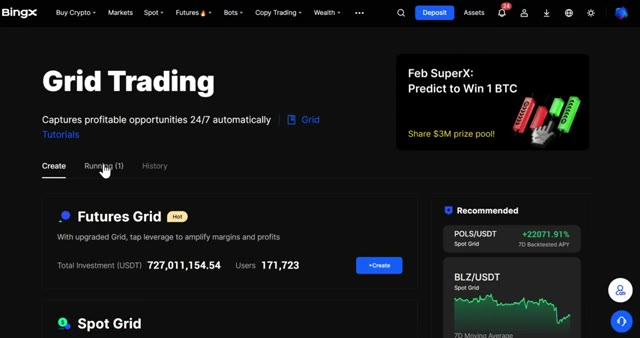
*⏱️ 00:05:41 — Page d'accueil de la section Grid Trading sur la plateforme BingX, affichant les options Futures Grid, Spot Grid et Spot Infinity Grid.*

---

### ⏱️ `[00:05:50 - 00:06:23]` | Segment #13

**🔊 Audio (Transcription Intégrale Mot pour Mot en Français) :**
> ordres, où le système convertit automatiquement tout en USDT pour vous, ou non, je vends moi-même, où vous conservez le BTC et gérez la vente manuellement. Choisissez ce qui vous convient le mieux. Vient ensuite le Spot Infinity Grid. Considérez cela comme la version avancée du Spot Grid. Il est conçu pour de l'arbitrage non-stop sans limite de prix supérieure, de sorte qu'il continue de fonctionner peu importe à quel faut le prix monte. Cliquez sur créer sur Spot Infinity Grid. Vous verrez des paramètres similaires à ceux d'avant, mais ici vous remarquerez un rendement annuel sur 30 jours affiché, donnant une performance réelle

**👁️ Analyse Visuelle d'Écran (gemini-3.5-flash-lite) :**
**Interface & Outils** : Échange de cryptomonnaies BingX (Bots de trading, Spot Grid et Spot Infinity Grid).

**Contenu textuel & Code** : Paires de trading BTC/USDT, options de vente automatique/manuelle des ordres, statistiques d'investissement et paramètres de grille (Min. Price, Profit/Grid, Investment).

**Action / Démonstration** : Navigation et explication des bots de trading automatisés, confirmation de fermeture de stratégie et configuration du Spot Infinity Grid.

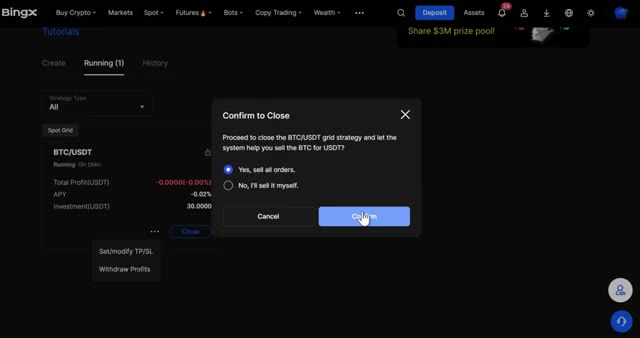
*⏱️ 00:05:58 — Pop-up de confirmation de clôture d'une stratégie de grille BTC/USDT sur BingX, avec les options de vente automatique en USDT ou manuelle.*

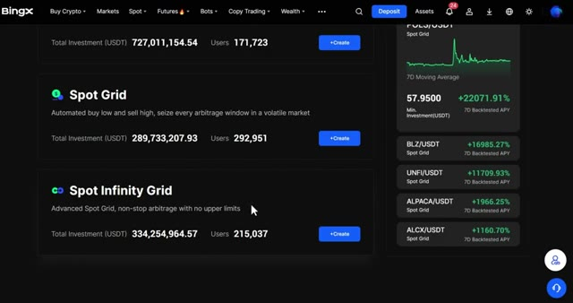
*⏱️ 00:06:06 — Interface de la plateforme BingX montrant les différentes options de bots de trading, dont le Spot Grid et le Spot Infinity Grid.*

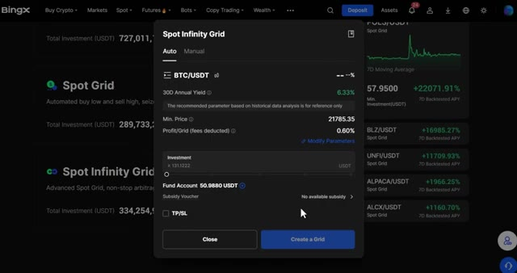
*⏱️ 00:06:14 — Fenêtre de configuration du bot 'Spot Infinity Grid' pour la paire BTC/USDT sur BingX avec les paramètres d'investissement.*

---

### ⏱️ `[00:06:23 - 00:06:57]` | Segment #14

**🔊 Audio (Transcription Intégrale Mot pour Mot en Français) :**
> repère et un champ de prix minimum au lieu d'une fourchette supérieure puisqu'il n'y a pas de plafond sur celui-ci. Cliquez sur ajuster les paramètres pour passer en mode manuel où vous pouvez définir votre propre prix minimum et profit par grille avec les frais déjà déduits. Ce que vous voyez est donc ce que vous obtenez réellement. Faites défiler vers le bas et vous trouverez toujours les options de déclenchement et de TP/SL comme avant. Une fois que vous êtes satisfait des paramètres, cliquez sur créer une grille et elle est mise en ligne. Passons maintenant au bot Futures Martingale. Celui-ci ajuste automatiquement vos coûts de position lorsque le prix évolue contre vous, ce qui le rend idéal pour les marchés volatils où vous vous attendez à une reprise.

**👁️ Analyse Visuelle d'Écran (gemini-3.5-flash-lite) :**
**Interface & Outils** : Plateforme d'échange de cryptomonnaies BingX (section Bots).

**Contenu textuel & Code** : Paramètres de grille manuelle (Min. Price : 21785.35, Profit/Grid : 0.6%, Investment) et sélection de stratégies de trading.

**Action / Démonstration** : Configuration des paramètres manuels du bot Spot Infinity Grid sur la plateforme BingX.

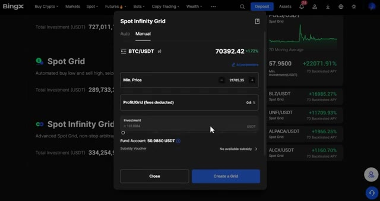
*⏱️ 00:06:31 — Interface de configuration manuelle du Spot Infinity Grid sur BingX pour BTC/USDT.*

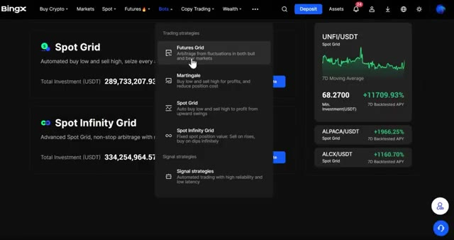
*⏱️ 00:06:49 — Menu déroulant des stratégies de trading montrant Futures Grid, Martingale, Spot Grid et Spot Infinity Grid.*

---

### ⏱️ `[00:06:57 - 00:07:16]` | Segment #15

**🔊 Audio (Transcription Intégrale Mot pour Mot en Français) :**
> Cliquez sur Créer sur Futures Martingale. Sélectionnez votre paire de trading, définissez votre effet de levier, et choisissez votre direction, long ou short. Définissez votre objectif de profit. C'est le pourcentage de gain que le bot vise avant de clôturer le trade, et votre investissement total. Faites défiler vers le bas et vous verrez quelques paramètres clés.

**👁️ Analyse Visuelle d'Écran (gemini-3.5-flash-lite) :**
**Interface & Outils** : Échange de cryptomonnaies BingX (interface de bot de trading)

**Contenu textuel & Code** : Paire BTCUSDT, effet de levier configuré à 5X, boutons de validation (Confirm / Cancel), curseur d'ajustement de l'effet de levier.

**Action / Démonstration** : Configuration et ajustement de l'effet de levier pour le bot de trading Futures Martingale.

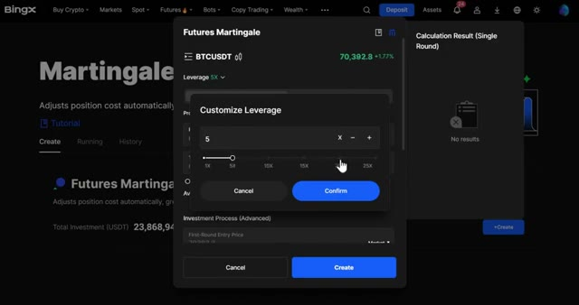
*⏱️ 00:07:02 — Fenêtre modale de configuration d'un effet de levier sur l'interface de bot Futures Martingale de BingX, avec un curseur positionné sur 5x.*

---

### ⏱️ `[00:07:16 - 00:07:50]` | Segment #16

**🔊 Audio (Transcription Intégrale Mot pour Mot en Français) :**
> processus vous montre comment le bot va répartir votre capital sur plusieurs entrées à mesure que le prix évolue. Les paliers de prix définissent la baisse que le prix doit enregistrer avant que le bot n'ajoute à la position, et le multiplicateur de montant contrôle à quel point chaque achat supplémentaire devient plus important. Par exemple, un multiplicateur de deux signifie que chaque nouvel ordre est le double du précédent. L'ajout maximal par round limite le nombre de fois que le bot peut ajouter à la position en un seul cycle, vous protégeant ainsi d'une exposition excessive en cas de forte tendance baissière. Une boucle automatique et lorsqu'elle est activée, le bot démarre automatiquement un

**👁️ Analyse Visuelle d'Écran (gemini-3.5-flash-lite) :**
**Interface & Outils** : Échange de cryptomonnaies BingX (interface web de création de bot Futures Martingale)

**Contenu textuel & Code** : Paramètres de configuration : Price Step réglé à 1%, Amount Multiplier réglé à 1.1, First-Round Entry Price à 70427.6, ainsi que les options Auto Loop et Stop Loss (SL).

**Action / Démonstration** : Configuration des paramètres avancés du bot de trading Martingale pour définir la répartition du capital et la gestion des ajouts de positions.

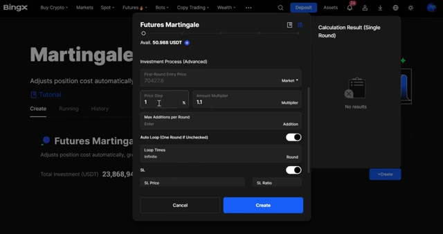
*⏱️ 00:07:25 — Interface de configuration du bot de trading Futures Martingale sur l'échange BingX, montrant les paramètres avancés tels que le pas de prix (Price Step) et le multiplicateur de montant (Amount Multiplier).*

---

### ⏱️ `[00:07:50 - 00:08:12]` | Segment #17

**🔊 Audio (Transcription Intégrale Mot pour Mot en Français) :**
> nouveau cycle après avoir atteint l'objectif de profit. Si vous décochez cette option, il s'exécute un seul tour et s'arrête. C'est utile si vous souhaitez examiner les performances avant de le relancer. Vous pouvez également définir un stop loss ici pour une protection supplémentaire. Une fois que vous avez terminé, cliquez sur créer. Rendez-vous dans la section en cours d'exécution pour le surveiller, ajuster votre stop loss ou le fermer à tout moment en utilisant la même option de confirmation qu'auparavant.

**👁️ Analyse Visuelle d'Écran (gemini-3.5-flash-lite) :**
**Interface & Outils** : Interface de l'échange de cryptomonnaies BingX (section Futures Martingale Bots).

**Contenu textuel & Code** : Paramètres de configuration du bot (Auto Loop, SL Price, SL Ratio) et suivi de position active sur BTCUSDT (Long 5X, Total Profit: -0,0024 USDT, APY: -2,83%).

**Action / Démonstration** : Configuration des options avancées du bot Martingale puis visualisation du bot en cours d'exécution.

*⏱️ 00:07:56 — Configuration du bot Futures Martingale sur l'échange BingX, mettant en avant l'option Auto Loop et les paramètres de Stop Loss.*

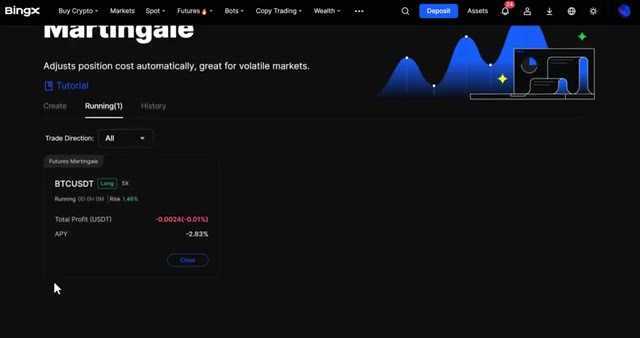
*⏱️ 00:08:07 — Vue de l'onglet 'Running' du bot Futures Martingale sur BingX montrant une position ouverte sur BTCUSDT avec un profit négatif.*

---

### ⏱️ `[00:08:12 - 00:08:32]` | Segment #18

**🔊 Audio (Transcription Intégrale Mot pour Mot en Français) :**
> Ensuite, il y a Signal Strategies. C'est une fonctionnalité puissante qui permet à BingX de recevoir des signaux de plateformes externes comme TradingView pour exécuter automatiquement des transactions sur futures perpétuels. Vous créez et configurez des instructions de trading pour qu'elles correspondent exactement à votre stratégie. Au bas de la page, vous pouvez voir toutes les instructions que vous avez déjà créées.

**👁️ Analyse Visuelle d'Écran (gemini-3.5-flash-lite) :**
**Interface & Outils** : Interface web BingX (section Signal Trading / Futures)

**Contenu textuel & Code** : Texte explicatif sur la réception de signaux externes (TradingView) pour automatiser les transactions sur futures perpétuels, avec deux types d'instructions (Simple Instruction et Strategy Instruction) et un bouton "Create".

**Action / Démonstration** : Présentation de la fonctionnalité de trading par signaux de la plateforme BingX.

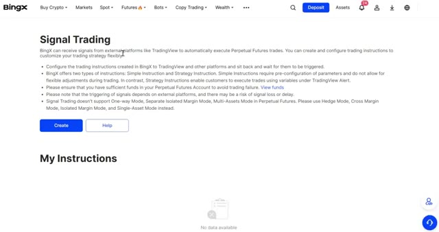
*⏱️ 00:08:17 — Capture d'écran de l'interface de la plateforme BingX montrant la page dédiée au "Signal Trading" et ses instructions de configuration.*

---

### ⏱️ `[00:08:33 - 00:08:55]` | Segment #19

**🔊 Audio (Transcription Intégrale Mot pour Mot en Français) :**
> Cliquez sur Créer. Vous aurez deux modes : Instruction simple et Instruction stratégique. En instruction simple, définissez un nom pour votre stratégie, choisissez votre paire de trading, définissez la direction du trade et le type d'ordre, et définissez la marge de votre position, soit par ratio, qui est un pourcentage de votre solde disponible, soit par montant fixe, qui est une valeur USDT déterminée.

**👁️ Analyse Visuelle d'Écran (gemini-3.5-flash-lite) :**
**Interface & Outils** : Interface Web de l'échange de cryptomonnaies BingX (Bots / TradingView bot).

**Contenu textuel & Code** : Formulaire de configuration avec les champs : Name, Trading Pair, Open/Close Type (By Amount / By Ratio), options TP/SL, bouton Create et encadré Webhook URL.

**Action / Démonstration** : Le curseur de la souris survole l'onglet 'Simple Instruction' lors de la configuration du bot de trading.

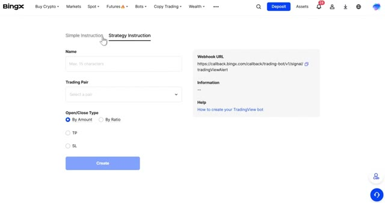
*⏱️ 00:08:38 — Capture d'écran de l'interface BingX montrant le formulaire de création de bot de trading avec les onglets 'Simple Instruction' et 'Strategy Instruction', ainsi que les champs pour le nom, la paire de trading et le type de marge.*

---

### ⏱️ `[00:08:55 - 00:09:17]` | Segment #20

**🔊 Audio (Transcription Intégrale Mot pour Mot en Français) :**
> Configurez vos TP et SL, et voici la partie clé. Vous verrez votre URL de webhook. C'est l'URL que vous collerez dans TradingView afin qu'il puisse envoyer des signaux directement à BingX et déclencher vos trades automatiquement. Dans les instructions de la stratégie, définissez un nom, choisissez votre paire de trading et définissez votre type d'ouverture et de fermeture, soit par montant, soit par ratio.

**👁️ Analyse Visuelle d'Écran (gemini-3.5-flash-lite) :**
**Interface & Outils** : BingX, TradingView

**Contenu textuel & Code** : URL de webhook BingX, paramètres de stratégie, options TP/SL, configuration des alertes TradingView.

**Action / Démonstration** : Copie de l'URL du webhook depuis BingX et collage dans la configuration d'alerte TradingView.

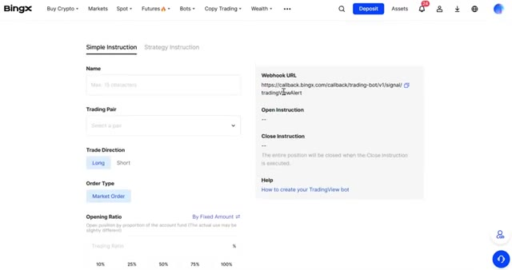
*⏱️ 00:09:01 — Interface de configuration BingX montrant l'URL du webhook et les paramètres simples de stratégie.*

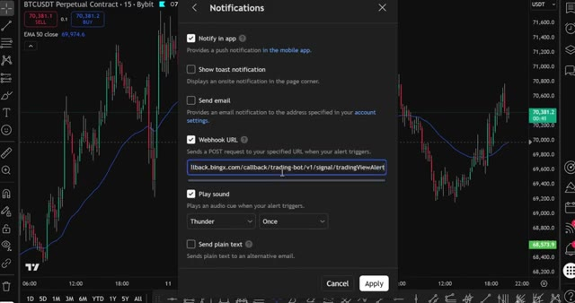
*⏱️ 00:09:06 — Fenêtre de notification TradingView affichant le champ pour coller l'URL du webhook BingX.*

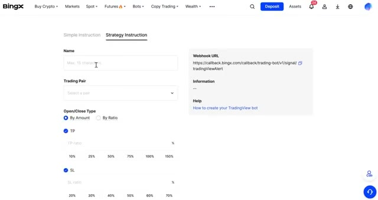
*⏱️ 00:09:11 — Onglet "Strategy Instruction" sur BingX avec les réglages TP (Take Profit) et SL (Stop Loss).*

---

### ⏱️ `[00:09:17 - 00:09:35]` | Segment #21

**🔊 Audio (Transcription Intégrale Mot pour Mot en Français) :**
> Vous verrez également l'URL du webhook sur le côté droit ici. Une fois que tout est configuré, cliquez sur Créer, et votre stratégie de signal est prête à recevoir des instructions. Le dernier emplacement est l'achat républic, et vous le trouverez juste en dessous de la section des emplacements. C'est la version de BingX du lissage des coûts d'achat.

**👁️ Analyse Visuelle d'Écran (gemini-3.5-flash-lite) :**
**Interface & Outils** : Échange de cryptomonnaies BingX (interface web).

**Contenu textuel & Code** : Configuration de stratégie de signal, gestion de la marge, Take Profit (TP), Stop Loss (SL), et menu des options de bots et d'achat récurrent (Recurring Buy).

**Action / Démonstration** : Configuration et validation de la stratégie de signal sur la plateforme BingX en cliquant sur le bouton de création, puis navigation dans les menus pour localiser l'achat récurrent.

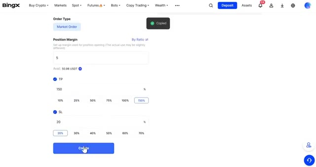
*⏱️ 00:09:21 — Interface BingX montrant les paramètres de configuration d'un ordre (Type d'ordre Market, marge de position, TP à 150%, SL à 20%) avec le bouton Create.*

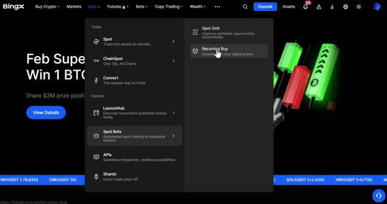
*⏱️ 00:09:31 — Menu déroulant de la plateforme BingX affichant les options de trading, les bots spot et l'option "Recurring Buy" mise en surbrillance.*

---

### ⏱️ `[00:09:35 - 00:09:55]` | Segment #22

**🔊 Audio (Transcription Intégrale Mot pour Mot en Français) :**
> Il achète automatiquement de la crypto à des intervalles définis, ce qui vous permet d'accumuler sans jamais avoir à anticiper le marché. Sélectionnez la crypto avec laquelle vous voulez payer et la crypto que vous voulez recevoir. Pour cet exemple, prenons le BTC. Vous pouvez également ajouter plusieurs cryptos si vous souhaitez faire du DCA sur plus d'une pièce en même temps.

**👁️ Analyse Visuelle d'Écran (gemini-3.5-flash-lite) :**
**Interface & Outils** : Interface web de l'échangeur crypto BingX (section "Recurring Buy").

**Contenu textuel & Code** : Formulaire de configuration d'achat récurrent avec sélection de la devise de paiement (USDT), de la crypto à recevoir (BTC), et options pour définir la fréquence d'investissement.

**Action / Démonstration** : Sélection des cryptomonnaies pour mettre en place un plan d'investissement automatisé (DCA).

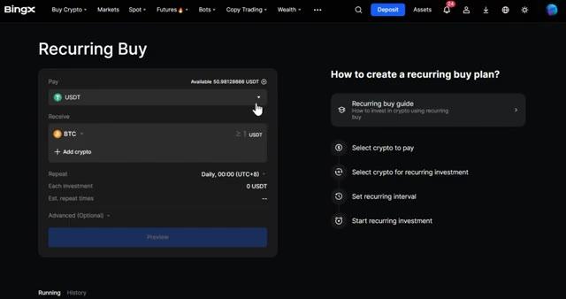
*⏱️ 00:09:40 — Interface de la plateforme d'échange BingX montrant l'outil de configuration d'un achat récurrent (Recurring Buy) de cryptomonnaies.*

---

### ⏱️ `[00:09:55 - 00:10:16]` | Segment #23

**🔊 Audio (Transcription Intégrale Mot pour Mot en Français) :**
> Entrez combien d'USDT vous voulez dépenser par achat. Sous répéter, sélectionnez votre intervalle d'achat. Vous pouvez choisir toutes les heures, 6 heures, 12 heures, chaque jour, chaque semaine ou toutes les deux semaines. Sur le côté droit, vous pouvez également définir l'heure exacte à laquelle vous voulez que l'achat ait lieu. Utile si vous voulez acheter à un moment précis de la journée.

**👁️ Analyse Visuelle d'Écran (gemini-3.5-flash-lite) :**
**Interface & Outils** : Échange de cryptomonnaies BingX

**Contenu textuel & Code** : Formulaire de configuration d'achat récurrent avec sélection du montant en USDT, choix des cryptos (BTC, ETH), intervalle de répétition (Daily, 00:00 UTC+8) et résumé de l'investissement (20 USDT).

**Action / Démonstration** : Configuration et paramétrage d'un plan d'investissement automatisé (DCA).

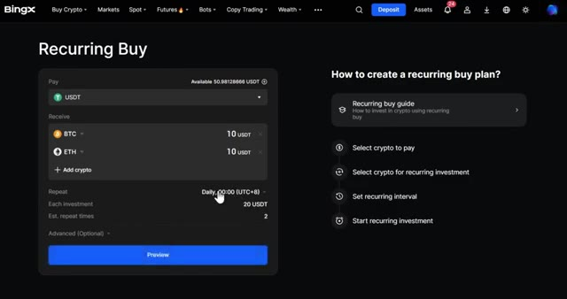
*⏱️ 00:10:00 — Interface de la plateforme BingX montrant l'outil 'Recurring Buy' pour configurer des achats récurrents de cryptomonnaies en USDT.*

---

### ⏱️ `[00:10:16 - 00:10:34]` | Segment #24

**🔊 Audio (Transcription Intégrale Mot pour Mot en Français) :**
> Une fois que vous êtes satisfait, cliquez sur confirmer. Si vous cliquez sur avancer, vous pouvez définir un nombre maximal de répétitions, de sorte que le bot s'arrête après un certain nombre d'achats, et vous pouvez également modifier le nom du plan pour garder les choses organisées. Lorsque vous êtes prêt, cliquez sur Aperçu pour tout vérifier, puis sur confirmer, et le bot commence à s'exécuter automatiquement.

**👁️ Analyse Visuelle d'Écran (gemini-3.5-flash-lite) :**
**Interface & Outils** : Échange de cryptomonnaies BingX (interface web de configuration d'achat récurrent).

**Contenu textuel & Code** : Formulaire d'achat récurrent avec sélection des actifs (USDT vers BTC et ETH), montant par investissement (20 USDT), fréquence quotidienne et paramètres avancés pour limiter le nombre de répétitions.

**Action / Démonstration** : Configuration des paramètres avancés du plan d'achat récurrent sur la plateforme BingX, notamment la définition du nombre maximal de répétitions.

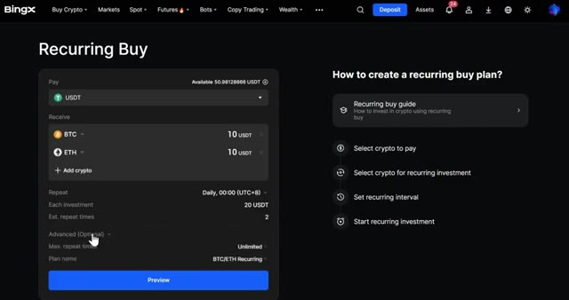
*⏱️ 00:10:20 — Interface BingX pour la configuration d'un achat récurrent (Recurring Buy) montrant les paramètres avancés (Advanced) avec les options de nombre maximal de répétitions et le nom du plan.*

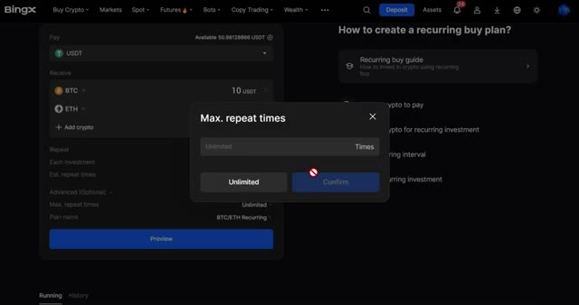
*⏱️ 00:10:25 — Pop-up BingX permettant de configurer le nombre maximal de répétitions (Max. repeat times) pour l'achat récurrent.*

---

### ⏱️ `[00:10:35 - 00:11:00]` | Segment #25

**🔊 Audio (Transcription Intégrale Mot pour Mot en Français) :**
> Très bien, donc maintenant vous savez comment utiliser absolument tous les bots de trading sur BingX, de la grille et du martingale jusqu'aux stratégies de signaux et à l'achat récurrent. Que vous vouliez profiter de la volatilité, automatiser votre DCA, ou connecter des signaux TradingView, vous avez tout l'arsenal juste ici. Et n'oubliez pas, si vous vous êtes inscrit avec mon lien dans la description, vous pouvez réclamer jusqu'à 9 800 USDT de bonus rien qu'en déposant et en tradant.

**👁️ Analyse Visuelle d'Écran (gemini-3.5-flash-lite) :**
**Interface & Outils** : Plateforme d'échange BingX et interface graphique TradingView.

**Contenu textuel & Code** : Documentation sur le Signal Trading, URL de Webhook (`https://api.blofin.com/...`), formulaires de configuration d'alertes, et options de bonus de bienvenue de la plateforme.

**Action / Démonstration** : Navigation sur la section de trading par signaux de BingX et configuration des notifications de webhook sur TradingView.

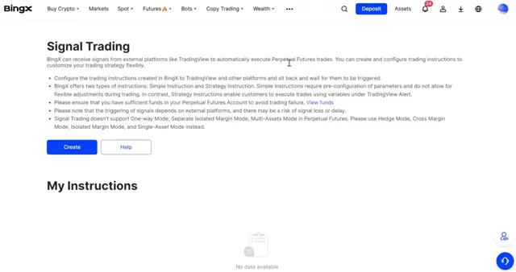
*⏱️ 00:10:41 — Interface BingX présentant la section "Signal Trading" et la gestion des instructions de trading automatisé.*

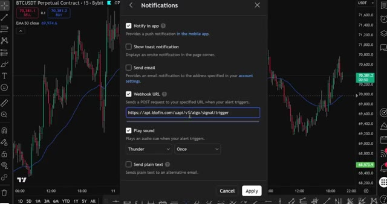
*⏱️ 00:10:48 — Fenêtre des paramètres d'alerte sur TradingView avec l'URL de webhook configurée vers l'API de trading.*

---

### ⏱️ `[00:11:01 - 00:11:18]` | Segment #26

**🔊 Audio (Transcription Intégrale Mot pour Mot en Français) :**
> Allez voir la section des récompenses dans votre compte. Il y a de l'argent gratuit qui vous y attend juste pour avoir utilisé la plateforme. Si vous voulez voir comment configurer des bots de trading sur d'autres plateformes comme Blowfin et Bybit, regardez les vidéos à l'écran en ce moment même. J'ai aussi préparé des guides étape par étape pour celles-là. Merci d'avoir regardé, et je vous dis à la prochaine dans une nouvelle vidéo.

**👁️ Analyse Visuelle d'Écran (gemini-3.5-flash-lite) :**
**Interface & Outils** : BingX (plateforme d'échange de cryptomonnaies)

**Contenu textuel & Code** : Tâches à durée limitée, bons de récompense en USDT, et robots de trading IA (DOGEUSDT, BTCUSDT, SUIUSDT, SOLUSDT, ETHUSDT, XRPUSDT) avec backtests APR et fourchettes de prix.

**Action / Démonstration** : Navigation dans l'interface de la plateforme pour montrer les récompenses et les bots de trading automatisés.

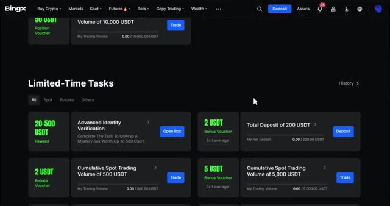
*⏱️ 00:11:05 — Interface de la plateforme BingX montrant la section "Limited-Time Tasks" avec diverses récompenses en USDT.*

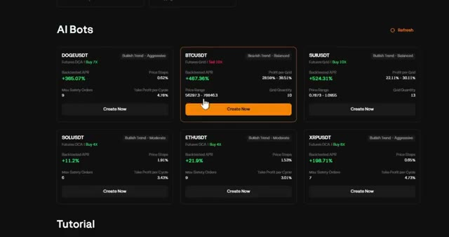
*⏱️ 00:11:10 — Interface de la plateforme BingX affichant des "AI Bots" de trading pour différentes cryptomonnaies avec leurs performances (APR).*

---

