# 🎬 Most Traders Don’t Know You Can Trade Oil Like This

> **Chaîne** : [Alex Carter](https://www.youtube.com/@AlexCarterTrading)  
> **Lien YouTube** : [https://www.youtube.com/watch?v=NJM7eysTm-c](https://www.youtube.com/watch?v=NJM7eysTm-c)  
> **Date de publication** : 20260318  
> **Durée** : 00:09:35  
> **Identifiant vidéo** : `NJM7eysTm-c`  
> **Transcription & Analyse** : `whisper-v3-large-turbo+gemini-3.5-flash-lite`  

---

## 📌 Synthèse Exécutive & Outils

### 💡 Résumé

Cette vidéo propose une incursion stratégique au cœur du trading de matières premières, en démontrant comment exploiter la forte volatilité du pétrole brut directement depuis un terminal crypto de contrats à terme (sur la plateforme Blofin, désignée sous les noms de Blofen/Blowfin). L'analyse met en lumière l'accessibilité inédite de marchés traditionnels majeurs grâce à la tokenisation et aux produits dérivés adossés à des marges en stablecoins (USDT/USDC). L'intervenant détaille l'intégralité du parcours opérationnel, depuis l'optimisation des incitations financières (dépôts, bonus de volume, et *mystery boxes*) jusqu'à l'exécution technique des ordres.

Sur le plan méthodologique, la démonstration se concentre sur une approche rigoureuse du passage d'ordres sur le ticker `CLUSDT`. L'analyse des graphiques en chandeliers — combinée aux outils de charting de TradingView — permet de structurer des prises de position directionnelles (long ou short). Le cœur de la stratégie repose sur un arbitrage millimétré entre l'effet de levier, le choix entre marge isolée ou croisée, et le dimensionnement du capital, illustré par la mise en place d'un ratio risque-rendement asymétrique de 1:3. 

Enfin, la vidéo aborde l'automatisation potentielle et l'interfaçage avec des solutions d'intelligence artificielle (telles que Grok Bots, Claude Code ou OpenClaw AI mentionnées en filigrane). L'objectif est d'outiller les traders pour qu'ils automatisent non seulement l'exécution de leurs stratégies via Pine Script et des bots décisionnels, mais aussi la gestion globale de leur risque, transformant une simple interface de dérivés en un véritable écosystème de trading quantitatif.

### 🛠️ Outils, Modèles & Logiciels Présentés

* **Blofin (Blowfin / Blofen)** : Plateforme centrale de contrats à terme permettant de trader des actifs traditionnels comme le pétrole brut (*CLUSDT*) via des marges en cryptomonnaies et des stablecoins.
* **TradingView** : Outil d'analyse graphique intégré permettant l'étude des prix, le tracé d'indicateurs techniques et l'ajustement dynamique des niveaux de *Take Profit* et *Stop Loss*.
* **Pine Script** : Langage de programmation dédié à TradingView pour concevoir, backtester et automatiser des stratégies de trading algorithmique.
* **Grok Bots** : Assistants conversationnels et agents décisionnels basés sur l'IA pour assister le trader dans l'analyse de marché et la formulation de scénarios.
* **Claude Code** : Environnement de développement et assistant de codage avancé utile pour générer et structurer des scripts de trading ou connecter des API d'échange.
* **OpenClaw AI** : Solution logicielle d'automatisation avancée permettant de connecter des plateformes d'échange à des agents intelligents pour exécuter des stratégies de scalping et de gestion de portefeuille.

### 🔑 Points Clés & Enseignements Stratégiques

* **Diversification des actifs sur terminaux unifiés** : Possibilité de trader le pétrole brut (*CLUSDT*) sans nécessiter de compte de courtage en matières premières traditionnel, en utilisant la même interface que pour le Bitcoin ou l'Ethereum.
* **Sélection du mode de marge (Isolée vs Croisée)** : Recommandation stricte d'utiliser la marge isolée pour les débutants afin de compartimenter le risque et d'empêcher la liquidation totale du solde du compte en cas de trade défavorable.
* **Maîtrise de l'effet de levier** : Limitation volontaire de l'effet de levier entre 5x et 10x maximum sur le pétrole brut (en dépit d'une limite technique à 20x) pour préserver le capital contre la volatilité intrajournalière.
* **Dimensionnement des positions par le montant** : Utilisation de la saisie par montant nominal de marge plutôt que par quantité pure, facilitant le calcul du capital engagé par rapport à la taille globale de la position.
* **Optimisation du ratio risque-rendement (RR)** : Application systématique d'un ratio asymétrique (ex: risquer 2 $ pour en gagner 6 $, soit un ratio de 1 pour 3) pour garantir la rentabilité à long terme même avec un taux de réussite modéré.
* **Non-négociabilité du Stop Loss et Take Profit** : Placement obligatoire des ordres de protection (*SL/TP*) dès l'ouverture de l'ordre au marché pour automatiser la sortie et éliminer tout biais émotionnel.
* **Gestion active de la position** : Stratégie de sécurisation consistant à déplacer le *Stop Loss* au point d'entrée (seuil de rentabilité) dès que le trade génère des profits confortables, tout en autorisant des clôtures partielles.
* **Stratégie d'optimisation des bonus de volume** : Structuration des dépôts (via le réseau TRC20 pour minimiser les frais de transfert) et du volume de trading cumulé pour débloquer des paliers de récompenses et des *mystery boxes* allant jusqu'à plusieurs milliers d'USDT.
* **Conversion et liquidité inter-actifs** : Utilisation des fonctions de conversion instantanée ou du marché au comptant (*Spot*) sans frais majeurs pour réallouer rapidement des actifs dormants (BTC, ETH) en USDT de marge.
* **Discipline et journalisation** : Nécessité absolue de tenir un journal de trading rigoureux, de limiter le risque par trade entre 2 % et 5 % du capital total, et de s'interdire toute tentative de "chasser les pertes" (*revenge trading*).

---

## ⏱️ Chronologie & Transcription Complète Audio & Visuelle (Mot pour Mot)

### ⏱️ `[00:00:00 - 00:00:22]` | Segment #01

**🔊 Audio (Transcription Intégrale Mot pour Mot en Français) :**
> Le pétrole est l'un des marchés les plus volatils au entorno en ce moment. Et beaucoup d'entre vous m'ont demandé comment le trader. Eh bien, si vous avez un compte Blofen, vous pouvez en fait trader le pétrole brut directement depuis votre terminal de contrats à terme. Et cela fonctionne exactement de la même manière que le trading de Bitcoin ou d'Ethereum. Dans cette vidéo, je vais vous montrer étape par étape comment le trouver, ouvrir votre premier trade de contrats à terme sur Blofen, et le gérer en toute sécurité.

**👁️ Analyse Visuelle d'Écran (gemini-3.5-flash-lite) :**
**Interface & Outils** : Interface de trading (probablement TradingView ou un terminal de courtier intégré).

**Contenu textuel & Code** : Graphique du cours du pétrole brut (Light Crude Oil Futures, NYMEX) avec affichage des prix (OHLC) et échelle temporelle.

**Action / Démonstration** : Visualisation et analyse technique de la forte baisse des cours du pétrole brut sur une période intraday.

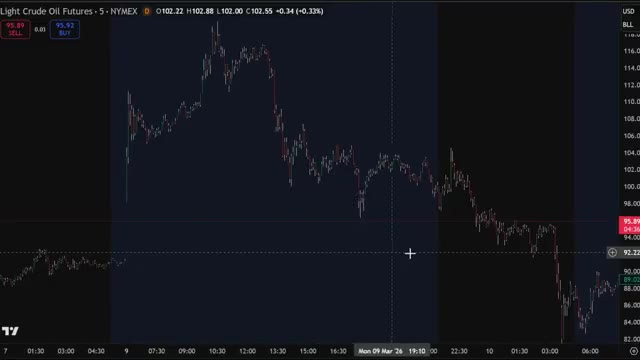
*⏱️ 00:00:06 — Graphique en chandeliers japonais des contrats à terme sur le pétrole brut léger (Light Crude Oil Futures) affichant une tendance baissière marquée.*

---

### ⏱️ `[00:00:23 - 00:00:44]` | Segment #02

**🔊 Audio (Transcription Intégrale Mot pour Mot en Français) :**
> Très bien, c'est parti. D'abord, cliquez sur le lien dans la description. Utiliser ce lien est crucial pour débloquer tous les bonus exclusifs. Vous pouvez vous inscrire avec votre e-mail ou votre téléphone ou vous connecter via Google ou Apple. Pour ce tutoriel, j'utiliserai Gmail. Une fois inscrit, vous êtes dans votre compte Bluffin et prêt à commencer. Les bonus seront débloqués au fur et à mesure que vous accomplirez certaines actions, que je vais vous présenter.

**👁️ Analyse Visuelle d'Écran (gemini-3.5-flash-lite) :**
**Interface & Outils** : Site web de l'échange de cryptomonnaies BloFin

**Contenu textuel & Code** : Formulaire d'inscription (e-mail, téléphone, options de connexion Google/Apple) et offre de bonus de bienvenue.

**Action / Démonstration** : Présentation du processus d'inscription et des différentes options pour créer un compte sur la plateforme.

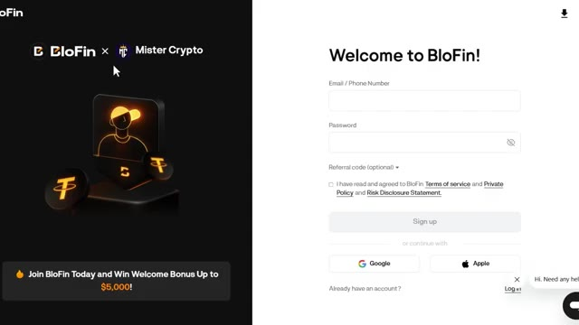
*⏱️ 00:00:28 — Page d'inscription de la plateforme BloFin avec un bonus de bienvenue de 5 000 $.*

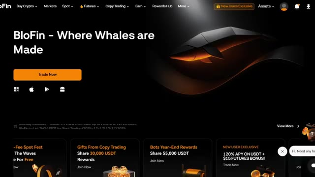
*⏱️ 00:00:39 — Page d'accueil principale du site web de l'échange de cryptomonnaies BloFin.*

---

### ⏱️ `[00:00:45 - 00:01:13]` | Segment #03

**🔊 Audio (Transcription Intégrale Mot pour Mot en Français) :**
> Mettons de l'argent sur votre compte et commençons à réclamer des bonus. Cliquez sur Actifs en haut à droite, puis choisissez Aperçu. Une fois sur la page Aperçu, cliquez sur Dépôt. Sur Sélectionner la crypto, choisissez USDT. L'USDT est idéal pour le trading, mais le Bitcoin ou l'Ethereum conviennent aussi. Lors de la sélection de votre réseau, choisissez le réseau TRC20 pour des frais bas. Vous verrez votre adresse de dépôt personnelle, copiez-la soigneusement, puis allez sur votre échange ou portefeuille actuel, collez l'adresse et envoyez votre crypto.

**👁️ Analyse Visuelle d'Écran (gemini-3.5-flash-lite) :**
**Interface & Outils** : Interface web de l'échange de cryptomonnaies BloFin.

**Contenu textuel & Code** : Menus de gestion de compte, options de dépôt, sélection de cryptomonnaies (USDT) et bonus de bienvenue (30 USDT).

**Action / Démonstration** : Navigation dans les menus pour accéder à la section de dépôt de fonds et sélection de l'USDT.

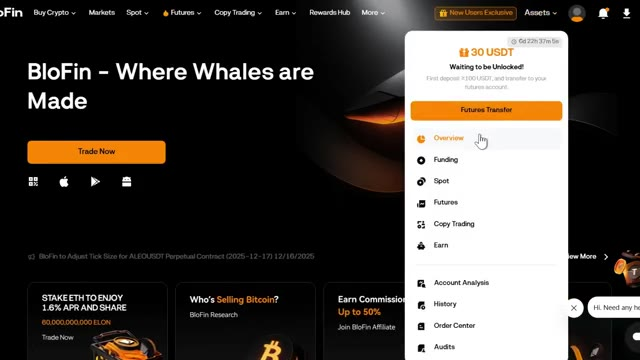
*⏱️ 00:00:52 — Interface de la plateforme BloFin montrant le menu déroulant des actifs avec le curseur sur "Overview".*

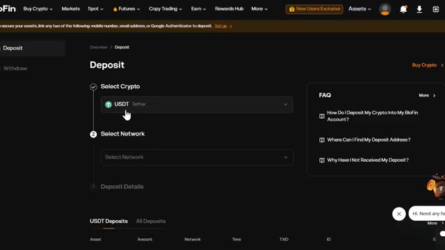
*⏱️ 00:00:59 — Page de dépôt de la plateforme BloFin avec le menu de sélection de la cryptomonnaie centré sur l'USDT.*

---

### ⏱️ `[00:01:14 - 00:01:44]` | Segment #04

**🔊 Audio (Transcription Intégrale Mot pour Mot en Français) :**
> Il faut généralement 5 à 15 minutes. Astuce de pro, envoyez toujours d'abord un petit montant test, peut-être 10 à 20 dollars, et vérifiez bien que le réseau correspond des deux côtés. Maintenant, c'est là que les bonus commencent à entrer en jeu. Récompense de premier dépôt. Déposez au moins 100 USDT sur votre compte futures et réclamez une mystery box pouvant aller jusqu'à 30 USDT. Récompense de premier staking. Stakez au moins 80 USDT, gagnez 120 % de taux annuel en pourcentage, et réclamez une mystery box pouvant aller jusqu'à 50 USDT.

**👁️ Analyse Visuelle d'Écran (gemini-3.5-flash-lite) :**
**Interface & Outils** : Interface web de l'échange de cryptomonnaies Blofin (section des actifs / portefeuille).

**Contenu textuel & Code** : Solde total affiché à 15.68 USDT, détails par section (Funding: 15.68 USDT, Spot: 0.00 USDT, Futures: 0.00 USDT), options de dépôt, achat, retrait et transfert, ainsi qu'une section dédiée aux récompenses de jalonnement pour nouveaux utilisateurs.

**Action / Démonstration** : Navigation et présentation de la vue d'ensemble des actifs sur le compte de l'échange Blofin.

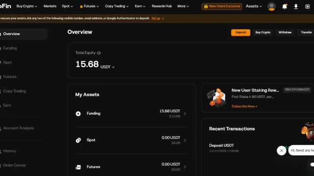
*⏱️ 00:01:21 — Capture d'écran de l'interface de la plateforme Blofin montrant la vue d'ensemble du compte (Overview) avec le solde total de 15.68 USDT et les différentes sections (Funding, Spot, Futures).*

---

### ⏱️ `[00:01:44 - 00:02:03]` | Segment #05

**🔊 Audio (Transcription Intégrale Mot pour Mot en Français) :**
> Des bonus sur le volume de trading. C'est là que ça devient énorme. Si vous transférez 100 USDT et atteignez 1 000 USDT de volume de trading, vous obtenez 15 USDT. Cela monte en puissance jusqu'à 5 000 USDT si vous déposez 100 000 et atteignez 25 millions de volume de trading.

**👁️ Analyse Visuelle d'Écran (gemini-3.5-flash-lite) :**
**Interface & Outils** : Interface web de l'échange de cryptomonnaies Blofin (section Rewards Hub).

**Contenu textuel & Code** : Détails des bonus de dépôt et de volume de trading : paliers de récompense allant de 15 USDT à 5 000 USDT, avec conditions de transfert (>= 100 USDT) et de volume de trading (>= 1 000 USDT).

**Action / Démonstration** : Navigation et présentation des différents paliers de bonus et conditions d'attribution des récompenses sur la plateforme.

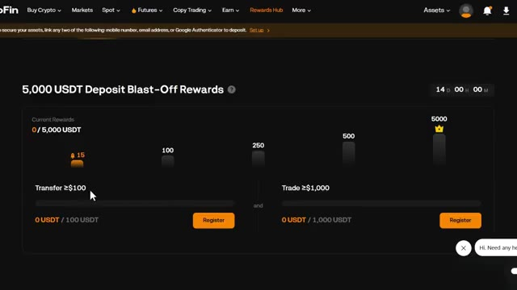
*⏱️ 00:01:49 — Capture d'écran de l'interface de la plateforme Blofin montrant le programme de récompenses "5,000 USDT Deposit Blast-Off Rewards".*

---

### ⏱️ `[00:02:03 - 00:02:25]` | Segment #06

**🔊 Audio (Transcription Intégrale Mot pour Mot en Français) :**
> Certaines récompenses peuvent exiger une vérification d'identité. La plateforme vérifie que vous êtes un trader légitime, et si vous y êtes éligible, le bonus sera crédité automatiquement. Si vous n'avez pas encore de crypto, vous pouvez en acheter directement sur Blofen. Allez dans « Acheter des cryptos » dans le menu en haut à gauche. Vous avez deux options, mais c'est techniquement le même processus. Ici, vous pouvez faire un achat rapide par carte de crédit, carte de débit ou virement bancaire.

**👁️ Analyse Visuelle d'Écran (gemini-3.5-flash-lite) :**
**Interface & Outils** : Site web Blofin (Rewards Hub et menu d'achat de cryptomonnaies)

**Contenu textuel & Code** : Offres de bonus de bienvenue (« New User Exclusive: Earn up to 5,000 USDT ») et options de dépôt/achat (« Quick Buy », « Bank Transfer », « Crypto Deposit »)

**Action / Démonstration** : Navigation sur le site Blofin pour présenter le programme de récompenses et les méthodes d'achat de crypto-monnaies.

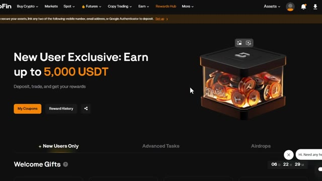
*⏱️ 00:02:09 — Page Rewards Hub de la plateforme Blofin montrant une offre exclusive pour nouveaux utilisateurs jusqu'à 5000 USDT.*

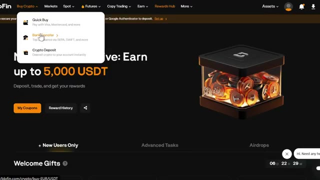
*⏱️ 00:02:20 — Menu déroulant « Buy Crypto » ouvert sur la plateforme Blofin affichant les options Quick Buy, Bank Transfer et Crypto Deposit.*

---

### ⏱️ `[00:02:26 - 00:02:45]` | Segment #07

**🔊 Audio (Transcription Intégrale Mot pour Mot en Français) :**
> Sélectionnez votre devise, choisissez USDT, et choisissez votre mode de paiement. Visa, MasterCard, Google Pay, Apple Pay, et plus encore. Blofen s'associe à des fournisseurs de confiance pour des conversions rapides de monnaie fiat en crypto. Les frais sont plus élevés lors de l'achat avec de la monnaie fiat, mais vous obtenez le bonus en plus. Et lorsque vous utilisez mon lien, cela vous donne toujours la même structure de bonus.

**👁️ Analyse Visuelle d'Écran (gemini-3.5-flash-lite) :**
**Interface & Outils** : Interface web de l'échange Blofin (section "Buy Crypto").

**Contenu textuel & Code** : Options de paiement acceptées (Visa, Mastercard, Apple Pay, Google Pay, SEPA) et taux de conversion indicatifs pour l'USDT en EUR.

**Action / Démonstration** : Sélection et démonstration des différents modes de paiement fiat disponibles pour l'achat de crypto-monnaies.

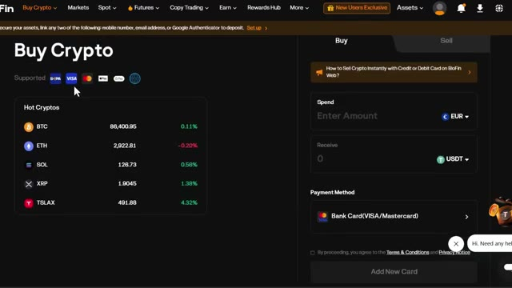
*⏱️ 00:02:30 — Interface d'achat de crypto-monnaies sur Blofin affichant les options de paiement par carte et les cryptos populaires.*

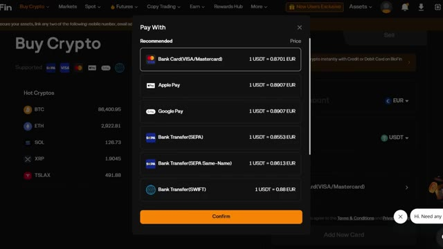
*⏱️ 00:02:40 — Fenêtre modale de sélection du mode de paiement ("Pay With") affichant les différentes options (Carte bancaire, Apple Pay, Google Pay, SEPA, SWIFT).*

---

### ⏱️ `[00:02:46 - 00:03:09]` | Segment #08

**🔊 Audio (Transcription Intégrale Mot pour Mot en Français) :**
> Si vous avez déposé du Bitcoin ou une autre cryptomonnaie mais que vous avez besoin d'USDT pour trader, voici comment le convertir. Allez sur le trading au comptant en cliquant sur trader puis cliquez sur comptant. Recherchez votre paire, par exemple, BTC slash USDT. Sélectionnez un ordre au marché, choisissez vendre, entrez le montant, et cliquez sur vendre du BTC. Cela convertit instantanément votre Bitcoin en USDT, qui apparaît alors dans votre portefeuille au comptant.

**👁️ Analyse Visuelle d'Écran (gemini-3.5-flash-lite) :**
**Interface & Outils** : Interface web de l'échange de cryptomonnaies BloFin.

**Contenu textuel & Code** : Paires de trading au comptant (BTC/USDT, ETH/USDT, BNB/USDT), carnet d'ordres, prix du Bitcoin à 86,498.36 USDT et options de types d'ordres (Limit, Market, Trigger).

**Action / Démonstration** : Navigation sur la plateforme BloFin pour accéder au trading au comptant et sélection de la paire BTC/USDT.

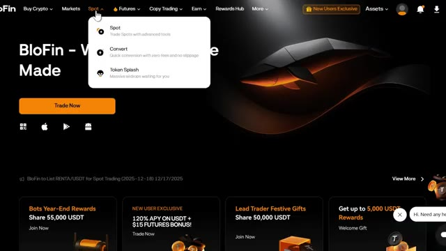
*⏱️ 00:02:52 — La page d'accueil de la plateforme BloFin montrant le menu déroulant sur l'onglet 'Spot' avec les options Spot, Convert et Token Splash.*

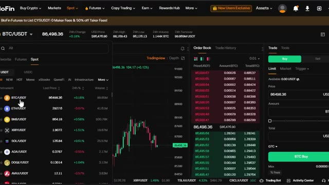
*⏱️ 00:02:57 — L'interface de trading au comptant (Spot) de BloFin affichant la paire BTC/USDT, le carnet d'ordres, le graphique TradingView et le panneau de passage d'ordres.*

---

### ⏱️ `[00:03:10 - 00:03:33]` | Segment #09

**🔊 Audio (Transcription Intégrale Mot pour Mot en Français) :**
> Vous pouvez également choisir de convertir instantanément. Pour ce faire, allez de nouveau sur le spot et cliquez sur convertir. Il n'y a pas de frais pour l'utilisation de Blofin Convert. Les actifs à recevoir indiqués seront le montant réel des actifs que vous recevrez sur votre compte une fois la conversion exécutée. Après cela, vos fonds apparaîtront dans votre portefeuille spot. Au fait, avant de continuer, n'oubliez pas de consulter la page du centre des récompenses après vous être inscrit avec mon lien.

**👁️ Analyse Visuelle d'Écran (gemini-3.5-flash-lite) :**
**Interface & Outils** : Site web / Plateforme d'échange Blofin (outil Blofin Convert)

**Contenu textuel & Code** : Interface de swap affichant les champs "From" (USDT, limite 0.01-50000) et "To" (BTC, limite 0.0000001-0.5), avec la mention "Zero fees | Real-time swap | Multi-asset support".

**Action / Démonstration** : Démonstration de l'outil de conversion instantanée sans frais sur Blofin.

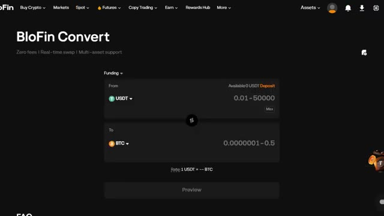
*⏱️ 00:03:16 — Interface de conversion de la plateforme Blofin (Blofin Convert) montrant l'outil de swap de crypto-monnaies d'USDT vers BTC.*

---

### ⏱️ `[00:03:33 - 00:04:10]` | Segment #10

**🔊 Audio (Transcription Intégrale Mot pour Mot en Français) :**
> Vous pouvez suivre toutes vos boîtes mystères, réclamer vos bonus et voir exactement à quel point vous êtes près de débloquer le niveau de récompenses suivant. C'est entièrement automatisé. Il suffit de accomplir les tâches et les récompenses sont créditées. Passons maintenant à l'événement principal, le trading de contrats à terme. Allez dans le menu supérieur et passez la souris sur contrats à terme. Ici, vous pouvez trader avec de l'USDT ou de l'USDC comme marge, et même CoinM, ce qui vous permet de régler vos trades de contrats à terme dans votre crypto, aussi connus sous le nom de contrats à terme inversés. Puisque nous tradons de l'USDT, cliquez sur USDTM. Cela vous mènera au terminal de trading de contrats à terme. Cela peut paraître un peu intimidant

**👁️ Analyse Visuelle d'Écran (gemini-3.5-flash-lite) :**
**Interface & Outils** : Interface web de la plateforme de cryptomonnaies BloFin (Rewards Hub).

**Contenu textuel & Code** : Offres de bienvenue, tâches pour nouveaux utilisateurs, boîtes mystères en USDT et options de menu déroulant pour le trading.

**Action / Démonstration** : Navigation et présentation des fonctionnalités du centre de récompenses et des options de trading de la plateforme.

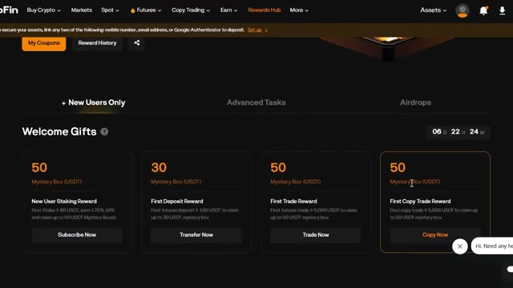
*⏱️ 00:03:43 — Vue d'ensemble du Rewards Hub de la plateforme montrant les boîtes mystères et les récompenses pour les nouveaux utilisateurs.*

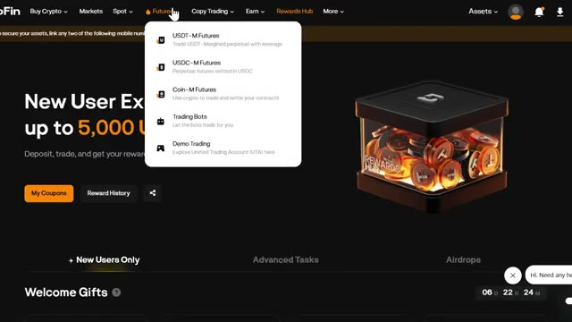
*⏱️ 00:03:52 — Navigation dans le menu déroulant du site de trading, affichant les options pour les contrats Futures et les bots de trading.*

---

### ⏱️ `[00:04:10 - 00:04:44]` | Segment #11

**🔊 Audio (Transcription Intégrale Mot pour Mot en Français) :**
> au début, mais je vais décortiquer chaque section pour que ce soit parfaitement clair. Voici ce que vous verrez sur l'écran de trading. En haut à gauche, vous avez la sélection de votre paire de trading. C'est ici que vous choisissez quelle crypto trader comme BTCUSDT ou ETHUSDT. Au centre, vous avez le graphique des prix. Il montre l'évolution historique des prix et vous pouvez basculer entre différentes unités de temps et même utiliser TradingView pour une analyse plus poussée. Sur le côté droit, vous trouverez le carnet d'ordres. Les chiffres rouges sont les ordres de vente et les chiffres verts sont les ordres d'achat. Le panneau de passage d'ordres se trouve tout à droite.

**👁️ Analyse Visuelle d'Écran (gemini-3.5-flash-lite) :**
**Interface & Outils** : Blofin (plateforme d'échange de cryptomonnaies)

**Contenu textuel & Code** : Paire BTCUSDT Perpétuel, prix actuel autour de 86 450 USDT, volume sur 24h, carnet d'ordres (Order Book) en temps réel avec les prix d'achat et de vente, panneau de passage d'ordres (Limit / Market, levier 3x).

**Action / Démonstration** : Navigation dans l'interface de l'exchange, sélection de la paire de trading et présentation des différents blocs fonctionnels (graphique, carnet d'ordres, carnet de positions).

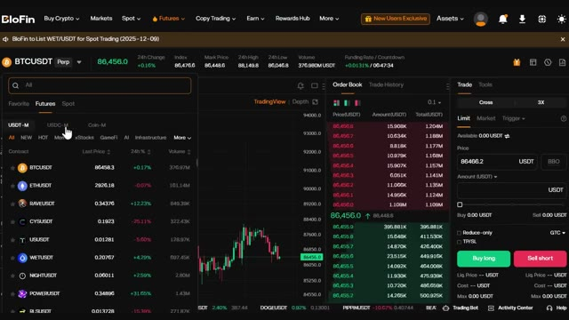
*⏱️ 00:04:18 — Interface de trading Blofin montrant le menu déroulant de sélection des paires de cryptomonnaies en futures (BTCUSDT, ETHUSDT, etc.) ouvert sur la gauche.*

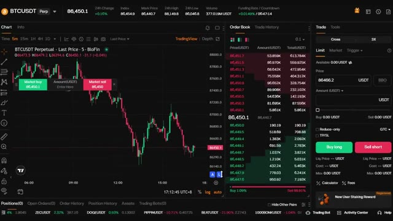
*⏱️ 00:04:35 — Interface de trading Blofin avec le graphique en chandelier du BTCUSDT (en unité de temps 5 minutes), le carnet d'ordres au centre et le panneau d'exécution des ordres à droite.*

---

### ⏱️ `[00:04:44 - 00:05:17]` | Segment #12

**🔊 Audio (Transcription Intégrale Mot pour Mot en Français) :**
> C'est ici que vous placerez vos transactions, définirez votre effet de levier et entrerez la taille de votre position. Enfin, tout en bas, il y a le panneau des positions. Il affiche vos transactions actives, vos profits et pertes, et votre prix de liquidation. Tout ce dont vous avez besoin est ici même sur un seul écran, prêt à trader. Maintenant, c'est la partie qui rend cette vidéo différente d'un tutoriel crypto ordinaire. Nous ne tradons pas le Bitcoin ou l'Ethereum aujourd'hui. Nous tradons le pétrole brut. En haut à gauche, là où vous voyez la sélection de votre paire de trading, cliquez dessus et cherchez CLUSDT. C'est le symbole boursier du pétrole brut.

**👁️ Analyse Visuelle d'Écran (gemini-3.5-flash-lite) :**
**Interface & Outils** : Interface de trading d'une exchange de cryptomonnaies (avec graphique de prix intégré et panneau de gestion des positions).

**Contenu textuel & Code** : Graphique en chandeliers, carnet d'ordres (order book), boutons d'achat/vente (Buy long, Sell short), informations sur les actifs et le contrat (Equity, Floating PnL, Mark Price).

**Action / Démonstration** : Présentation des différents panneaux de l'interface de trading, avec un curseur survolant le bouton 'Deposit'.

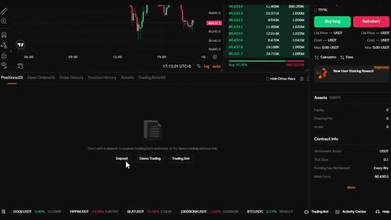
*⏱️ 00:04:52 — Interface d'une plateforme d'échange de cryptomonnaies montrant un graphique des prix en haut à gauche, un carnet d'ordres à droite, le panneau de passage d'ordres (Buy long / Sell short) et le panneau inférieur des positions et soldes du compte.*

---

### ⏱️ `[00:05:17 - 00:05:51]` | Segment #13

**🔊 Audio (Transcription Intégrale Mot pour Mot en Français) :**
> sur Bluefin. CL signifie pétrole brut et USDT est votre devise de marge. Sélectionnez-la et, comme ça, vous regardez maintenant le graphique des prix du pétrole brut directement dans votre compte crypto. Vous verrez le même graphique en chandeliers, le même carnet d'ordres, le même panneau d'ordres. Tout fonctionne exactement de la même manière que pour le trading de n'importe quelle autre paire sur Bluefin. C'est ce qui rend cela si puissant. Vous n'avez pas besoin d'un compte de matières premières séparé. Vous n'avez pas besoin de courtier. Vous n'avez pas besoin de passer par une configuration compliquée. Vous avez déjà tout ce dont vous avez besoin ici même. Avant de placer le moindre trade, configurez trois

**👁️ Analyse Visuelle d'Écran (gemini-3.5-flash-lite) :**
**Interface & Outils** : Interface de trading Blofin (Futures)

**Contenu textuel & Code** : Paire CLUSDT Perpetual, graphique en chandeliers (unité de temps 4h), carnet d'ordres (Order Book) avec les prix et volumes, panneau d'ordres pour position Isolated avec effet de levier 5x (Limit / Market / Trigger), prix actuel à 96.570 USDT.

**Action / Démonstration** : Navigation et présentation de l'interface de trading de pétrole brut (CL) margé en USDT sur la plateforme Blofin.

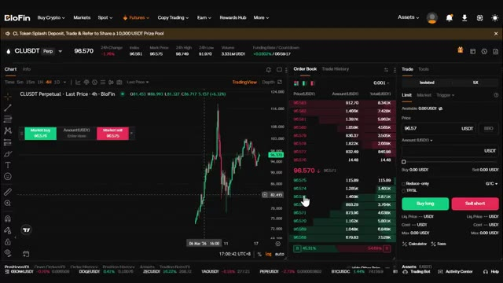
*⏱️ 00:05:25 — Capture d'écran de l'interface de trading de la plateforme Blofin montrant le graphique du contrat perpétuel CLUSDT en chandeliers, le carnet d'ordres en temps réel et le panneau d'ordres à droite.*

---

### ⏱️ `[00:05:51 - 00:06:24]` | Segment #14

**🔊 Audio (Transcription Intégrale Mot pour Mot en Français) :**
> importants. Tout d'abord, choisissez votre mode de marge. Blowfin propose deux options. La marge isolée. Cela protège le reste de votre compte. Si le trade tourne mal, vous ne perdez que ce que vous avez mis dans cette position spécifique. Le mode de marge croisée. Toutes les positions sous le même actif de marge partagent le même solde de marge. En cas de liquidation, les traders risquent de perdre la totalité du solde de marge ainsi que toutes les positions sous cet actif de marge. Pour les débutants, utilisez toujours la marge isolée pour protéger votre compte. Deuxièmement, définissez votre effet de levier. Blowfin autorise jusqu'à 20 fois sur le pétrole brut,

**👁️ Analyse Visuelle d'Écran (gemini-3.5-flash-lite) :**
**Interface & Outils** : Plateforme de trading Blofin, graphique en chandeliers (paire CLUSDT), carnet d'ordres et panneau de passage d'ordres.

**Contenu textuel & Code** : Fenêtre modale "Change Margin Mode" avec les options "Cross" et "Isolated", descriptions des modes de marge et boutons de validation "Cancel" et "Confirm".

**Action / Démonstration** : Sélection du mode de marge "Isolated" sur la plateforme Blofin pour configurer la gestion du risque d'une position.

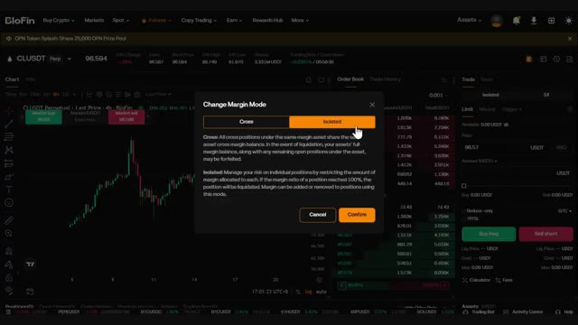
*⏱️ 00:05:59 — Interface de la plateforme Blofin affichant une fenêtre contextuelle pour modifier le mode de marge (Cross ou Isolated) sur une paire de trading de cryptomonnaies.*

---

### ⏱️ `[00:06:25 - 00:06:59]` | Segment #15

**🔊 Audio (Transcription Intégrale Mot pour Mot en Français) :**
> mais n'utilisez pas un effet de levier élevé en tant que débutant. Limitez-vous à 5 fois à 10 fois maximum. Voici comment cela fonctionne. Par exemple, si vous avez un solde de 10 dollars avec un effet de levier de 5 fois, vous obtenez 50 dollars de pouvoir d'achat de position. Cela signifie que vous contrôlez l'équivalent de 50 dollars de Bitcoin avec seulement 10 dollars de votre propre argent. Pour cet exemple, j'utilise un effet de levier de cinq fois sur une marge isolée. Maintenant que vous savez où trouver le ticker du pétrole brut sur Blowfin, plaçons notre premier trade de position sur futures. Plaçons un trade long en pariant que le Bitcoin va monter. Choisissez un ordre au marché pour qu'il s'exécute instantanément. Vous verrez les options de saisie des ordres,

**👁️ Analyse Visuelle d'Écran (gemini-3.5-flash-lite) :**
**Interface & Outils** : Interface de la plateforme de trading BloFin (Futures)

**Contenu textuel & Code** : Paire CLUSDT Perp, réglage du levier en mode Isolé (Isolated) avec sélection de 1x, 2x, 3x, 5x, 10x, 20x.

**Action / Démonstration** : Le curseur sélectionne le levier 5x pour l'ouverture d'une position sur le contrat perpétuel.

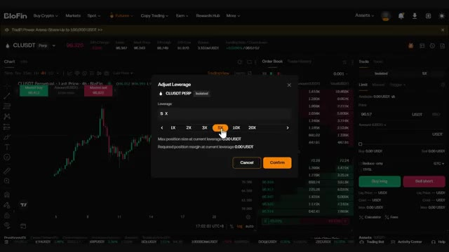
*⏱️ 00:06:33 — Fenêtre de réglage du levier (Adjust Leverage) sur l'interface de trading, avec un curseur positionné sur le levier 5x.*

---

### ⏱️ `[00:06:59 - 00:07:33]` | Segment #16

**🔊 Audio (Transcription Intégrale Mot pour Mot en Français) :**
> trier par montant, le montant réel de la marge pour le trade libellé en BTC, trier par quantité, la quantité de la position de contrats à terme avec effet de levier libellée en USDT. Pour ce tutoriel, j'utiliserai trier par montant parce que cela rend le dimensionnement de la position plus facile. Définissez la taille de votre position. Par exemple, une position de 50 dollars. Avec un effet de levier de cinq fois, cela représente 10 dollars de votre propre capital. Définissez toujours un stop loss et un take profit. Cliquez sur TP barre oblique SL pour ouvrir les paramètres. Je vais risquer 2 dollars pour gagner 6 dollars, un ratio risque-rendement de 1 pour 3.

**👁️ Analyse Visuelle d'Écran (gemini-3.5-flash-lite) :**
**Interface & Outils** : BloFin (Interface d'échange de cryptomonnaies)

**Contenu textuel & Code** : Graphique en chandelier BTCUSDT, carnet d'ordres (Order Book), menu de passage d'ordres au marché (Market) avec sélection de l'unité (Amount (BTC) ou Amount (USDT)) et effet de levier 5X en mode isolé (Isolated).

**Action / Démonstration** : Sélection de l'option « Amount (USDT) » dans le menu déroulant du module de passage d'ordres.

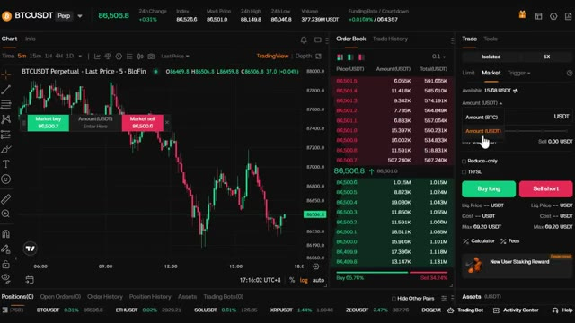
*⏱️ 00:07:08 — Interface de trading de contrats à terme affichant le graphique du BTCUSDT avec un menu déroulant ouvert pour choisir entre le montant en BTC et le montant en USDT.*

---

### ⏱️ `[00:07:33 - 00:08:07]` | Segment #17

**🔊 Audio (Transcription Intégrale Mot pour Mot en Français) :**
> ratio. Une fois que tout est configuré, cliquez sur acheter long. Votre trade est maintenant actif. Vous le verrez dans le panneau des positions, avec votre prix d'entrée, vos profits et pertes, et votre prix de liquidation. Pour shorter le marché, choisissez simplement vendre slash short au lieu de long. Et rappelez-vous, ces volumes de trading sur les contrats à terme vous aident débloquer des bonus, comme si vous transférez 100 USDT et obtenez 1 000 USDT de volume, vous obtenez 15 USDT de bonus. Cela va jusqu'à 5 000 USDT de bonus si vous déposez 100 000 et avez 25 millions de volume de trading,

**👁️ Analyse Visuelle d'Écran (gemini-3.5-flash-lite) :**
**Interface & Outils** : Plateforme de trading Blofin (interface Futures / Perpétuel).

**Contenu textuel & Code** : Graphique BTCUSDT Perpetuel, carnet d'ordres (Order Book), panneau des positions avec prix d'entrée, PnL, et boutons "Buy long" / "Sell short".

**Action / Démonstration** : Démonstration du placement d'un ordre long et visualisation de la position active dans le panneau des positions.

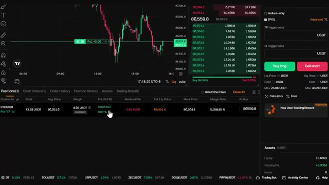
*⏱️ 00:07:42 — Interface de trading Blofin montrant un graphique BTCUSDT et le panneau des positions ouvertes en bas.*

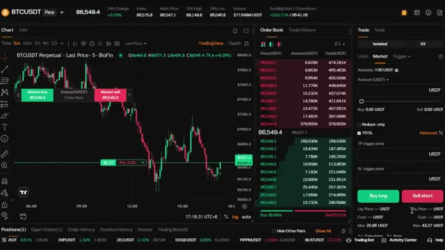
*⏱️ 00:07:50 — Interface de trading Blofin affichant un graphique de prix en chandelier, le carnet d'ordres et les boutons d'achat/vente.*

---

### ⏱️ `[00:08:07 - 00:08:32]` | Segment #18

**🔊 Audio (Transcription Intégrale Mot pour Mot en Français) :**
> donc ne le manquez surtout pas. Au fur et à mesure que votre trade évolue en votre faveur, ajustez votre stop loss pour sécuriser vos profits. Une fois que vous êtes en bénéfice de quelques dollars, déplacez votre stop loss au seuil de rentabilité. Vous pouvez également augmenter ou réduire votre position pendant qu'elle est active. Pour clôturer, laissez le TP ou le SL la fermer automatiquement. Fermez manuellement avec le bouton de fermeture. Fermez un pourcentage de la position. Ajustez le TP slash SL directement sur le graphique.

**👁️ Analyse Visuelle d'Écran (gemini-3.5-flash-lite) :**
**Interface & Outils** : Interface de trading (plateforme d'échange de dérivés cryptos)

**Contenu textuel & Code** : Fenêtre modale "Modify TP/SL" affichant les détails de la position (prix d'entrée, prix de liquidation, prix de déclenchement TP/SL en USDT et montant en BTC de 0.0005).

**Action / Démonstration** : Ajustement ou configuration des niveaux de Take Profit et Stop Loss pour sécuriser les profits ou limiter les pertes d'une position ouverte.

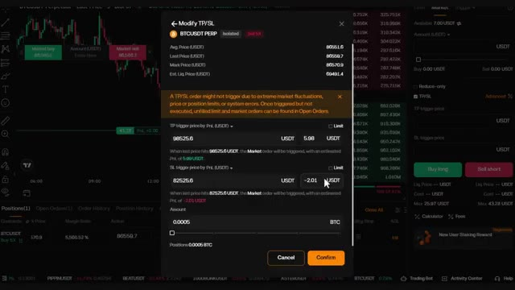
*⏱️ 00:08:13 — Interface de modification des ordres Stop Loss et Take Profit (TP/SL) sur une plateforme d'échange de cryptomonnaies pour une position BTCUSDT Perpétuel.*

---

### ⏱️ `[00:08:32 - 00:09:07]` | Segment #19

**🔊 Audio (Transcription Intégrale Mot pour Mot en Français) :**
> Donc, avant de conclure, voici les règles essentielles pour trader. Commencez par de petites tailles de position. Ne risquez pas plus de 2 % à 5 % par trade pour préserver votre capital. Utilisez toujours des stop-loss. C'est non négociable quand on fait du trading. Tenez un journal de trading. Notez chaque trade que vous effectuez. Et enfin, ne risquez jamais plus que ce que vous pouvez vous permettre de perdre. Le trading est une compétence qui peut vous donner de la liberté, mais il peut aussi devenir risqué. Cela demande de la répétition et de la discipline. Très bien, voilà donc un récapitulatif complet de la manière de trader les contrats à terme sur le pétrole sur Blowfin, de l'inscription au dépôt jusqu'à l'ouverture.

**👁️ Analyse Visuelle d'Écran (gemini-3.5-flash-lite) :**
**Interface & Outils** : Blofin, TradingView

**Contenu textuel & Code** : Graphique de prix BTCUSDT Perpetual (unités de temps 5m), carnet d'ordres en temps réel, niveaux de Take Profit (TP) et Stop Loss (SL), onglet de positions ouvertes.

**Action / Démonstration** : Navigation et affichage de l'interface de trading de la plateforme Blofin pour illustrer la gestion des positions et des ordres.

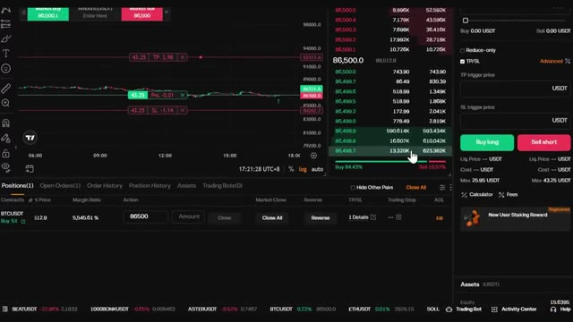
*⏱️ 00:08:41 — Gros plan sur l'interface de trading de la plateforme Blofin montrant un graphique BTCUSDT et le carnet d'ordres.*

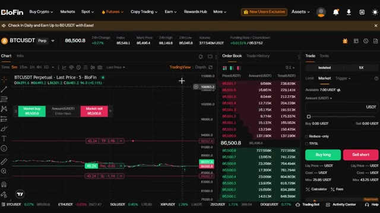
*⏱️ 00:08:58 — Vue complète de l'interface de l'échange Blofin avec les graphiques et le panneau de passage d'ordres pour la paire BTCUSDT.*

---

### ⏱️ `[00:09:07 - 00:09:35]` | Segment #20

**🔊 Audio (Transcription Intégrale Mot pour Mot en Français) :**
> et à gérer votre premier trade. Avant de partir, n'oubliez pas d'utiliser mon lien dans la description pour réclamer vos bonus sur le dépôt et le volume de trading, pouvant aller jusqu'à 5 000 USDT. Rappelez-vous de commencer petit, de vous concentrer sur l'apprentissage et de ne pas courir après les profits en premier. Si vous voulez apprendre à connecter n'importe quel échange à OpenClaw AI, regardez la vidéo qui apparaît à l'écran dès maintenant. Si vous avez des questions, déposez-les dans les commentaires ci-dessous. Je les lis absolument toutes et je vous vois dans la prochaine vidéo.

**👁️ Analyse Visuelle d'Écran (gemini-3.5-flash-lite) :**
**Interface & Outils** : Interface de la plateforme d'échange de cryptomonnaies Blofin (Rewards Hub et interface de trading Futures).

**Contenu textuel & Code** : Offre de bonus « New User Exclusive: Earn up to 5,000 USDT » et paramètres de Take Profit / Stop Loss pour une position BTCUSDT Perp (Isolated, Buy 5X) avec un montant de 0,0005 BTC.

**Action / Démonstration** : Navigation sur le centre de récompenses (Rewards Hub) et configuration des niveaux de Take Profit et Stop Loss (TP/SL) sur une position de trading en cours.

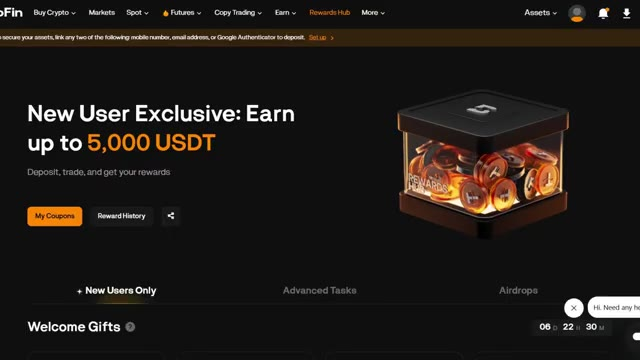
*⏱️ 00:09:14 — Page Rewards Hub de la plateforme Blofin montrant une offre exclusive pour les nouveaux utilisateurs jusqu'à 5 000 USDT.*

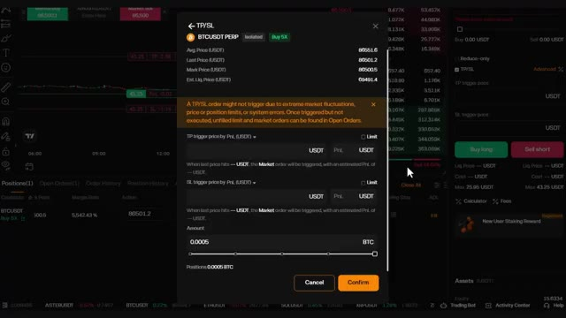
*⏱️ 00:09:21 — Fenêtre modale de configuration TP/SL pour une position BTCUSDT perpétuelle sur l'interface de trading Blofin.*

---

