# 🎬 My Best 1 Minute Crude Oil Trading Strategy I Use Daily

> **Chaîne** : [Alex Carter](https://www.youtube.com/@AlexCarterTrading)  
> **Lien YouTube** : [https://www.youtube.com/watch?v=HdUFQAJQNdM](https://www.youtube.com/watch?v=HdUFQAJQNdM)  
> **Date de publication** : 20260320  
> **Durée** : 00:07:26  
> **Identifiant vidéo** : `HdUFQAJQNdM`  
> **Transcription & Analyse** : `whisper-v3-large-turbo+gemini-3.5-flash-lite`  

---

## 📌 Synthèse Exécutive & Outils

### 💡 Résumé
Cette vidéo d'Alex Carter décortique une stratégie de scalping ultra-rapide en unité de temps 1 minute, spécialement optimisée pour le trading des contrats à terme sur le pétrole brut (`CLUSDT`) ainsi que sur les marchés crypto. L'approche repose sur un filtrage rigoureux de la tendance macro-intermédiaire combiné à une détection fine du momentum, en s'affranchissant des bruits de marché grâce à des outils visuels adaptés. En utilisant des techniques de lissage des prix et des indicateurs de dynamique croisés, la méthode cherche à capturer les vagues directionnelles à forte probabilité tout en éliminant les faux signaux inhérents aux unités de temps inférieures.

La mise en œuvre pratique s'appuie sur des plateformes de produits dérivés performantes permettant une exécution instantanée, sans friction bureaucratique excessive. L'analyse technique intègre un changement de paradigme visuel en abandonnant les chandeliers traditionnels au profit d'une représentation lissée du prix. L'interaction entre la structure de tendance à long terme et les oscillations de momentum à court terme constitue le cœur battant de la méthode, garantissant que chaque position ouverte épouse fidèlement la dynamique dominante du marché.

Enfin, la viabilité à long terme de cette stratégie de scalping intensif repose sur une discipline de fer en matière de gestion du risque. En imposant un ratio risque/rendement asymétrique et mathématique, la méthode protège le capital du trader contre la variance statistique inévitable du trading à haute fréquence. L'ensemble forme un système clé en main, rigoureux et directement actionnable pour tout opérateur cherchant à systématiser son approche du scalping sur les marchés dérivés.

### 🛠️ Outils, Modèles & Logiciels Présentés
* **Blofin** : Plateforme d'échange de cryptomonnaies et de contrats à terme sur dérivés (`USDT-M`), privilégiée pour son accès rapide sans KYC obligatoire et ses bonus de dépôt attractifs.
* **MEXI** : Échange alternatif centralisé et décentralisé offrant une liquidité élevée, des paires variées et des bonus incitatifs pour les nouveaux utilisateurs moyennant une vérification d'identité.
* **TradingView** : Logiciel de cartographie et d'analyse technique de référence utilisé pour configurer les graphiques en temps réel, appliquer les indicateurs et exploiter les versions premium.
* **Bougies Heiken Ashi** : Modèle de représentation graphique alternatif qui lisse l'action des prix en faisant la moyenne des périodes précédentes pour identifier clairement les flux de momentum.
* **MACD (Moving Average Convergence Divergence)** : Indicateur technique de suivi de tendance et de momentum servant de déclencheur d'entrée précis lors des croisements de lignes ou des changements de couleur d'histogramme.
* **Moyenne Mobile Simple à 200 Périodes (SMA 200)** : Indicateur de tendance macroéconomique lourd agissant comme un filtre absolu pour interdire les prises de position à contresens de la dynamique de fond.

### 🔑 Points Clés & Enseignements Stratégiques
* **Sélection rigoureuse de l'unité de temps** : L'utilisation exclusive du graphique en 1 minute permet de maximiser la fréquence des opportunités tout en exigeant une exécution chirurgicale propre au scalping.
* **Lissage visuel via Heiken Ashi** : Le remplacement des bougies japonaises classiques par les bougies Heiken Ashi filtre le bruit de marché erratique et met en évidence la véritable continuité des vagues de prix.
* **Filtre directionnel absolu (SMA 200)** : Aucune position ne doit être ouverte à l'encontre de la moyenne mobile à 200 périodes ; elle sert de barrière infranchissable dictant si le trader cherche exclusivement des achats ou des ventes.
* **Trading pro-tendance obligatoire** : Si le cours évolue au-dessus de la SMA 200, le marché est haussier et seuls les signaux longs sont autorisés ; s'il évolue en dessous, seuls les shorts sont permis.
* **Le MACD comme déclencheur chronométrique** : Alors que la SMA 200 donne la direction, le MACD valide le timing exact en signalant l'essoufflement d'une correction et le réengagement de l'impulsion.
* **Confluence des signaux d'entrée** : Pour un achat (long), le prix doit être au-dessus de la SMA 200, l'histogramme MACD doit croiser du rouge au vert, et les bougies Heiken Ashi doivent basculer au vert de manière simultanée.
* **Gestion du risque asymétrique (Risk/Reward 1:3)** : Application systématique d'un stop-loss strict fixé à 1 % et d'un take-profit ambitieux fixé à 3 % pour garantir l'espérance mathématique positive du système.
* **Résilience statistique** : Conscient qu'une stratégie de scalping affiche nécessairement un taux de réussite inférieur à 100 %, le ratio 1:3 garantit la rentabilité globale du compte même avec un taux de réussite de seulement 50 %.
* **Isolation du risque de capital** : Utilisation systématique du mode de marge isolée (`Isolated Margin`) plutôt que croisée pour compartimenter les pertes et ne risquer que le montant alloué à la position spécifique.
* **Maîtrise de l'effet de levier** : Recommandation d'ajuster l'effet de levier entre 5x et 10x pour les débutants (pouvant aller jusqu'à 20x pour les profils aguerris sur le pétrole brut) afin d'éviter la liquidation prématurée due à la volatilité minute.

---

## ⏱️ Chronologie & Transcription Complète Audio & Visuelle (Mot pour Mot)

### ⏱️ `[00:00:00 - 00:00:28]` | Segment #01

**🔊 Audio (Transcription Intégrale Mot pour Mot en Français) :**
> Dans cette vidéo, je décortique la configuration de scalping exacte d'une minute que j'utilise en ce moment pour trader les contrats à terme sur le pétrole sur Blofin. Rapide, précis et conçu pour des entrées à forte probabilité. Je vais vous montrer les indicateurs exacts, les paramètres et la façon dont je l'exécute étape par étape. Ne sautez donc aucune étape. Tout se construit du début à la fin. Entrons dans le vif du sujet. Très bien les gars, étape numéro une, choisir le bon échange de cryptomonnaies. Pour cette stratégie, nous allons utiliser Blofin comme notre plateforme principale.

**👁️ Analyse Visuelle d'Écran (gemini-3.5-flash-lite) :**
**Interface & Outils** : Blofin, TradingView.

**Contenu textuel & Code** : Moyenne mobile simple (SMA) avec une longueur de 200, MACD, graphique de contrats à terme sur le pétrole (Crude Oil Futures), carnet d'ordres (Order Book).

**Action / Démonstration** : Configuration des paramètres d'un indicateur technique (SMA 200) sur le graphique et présentation de l'interface de trading de la plateforme.

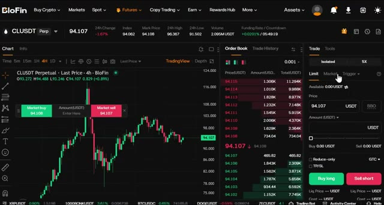
*⏱️ 00:00:07 — Interface de trading de la plateforme Blofin affichant un graphique de prix CLUSDT, un carnet d'ordres et le panneau d'exécution des ordres.*

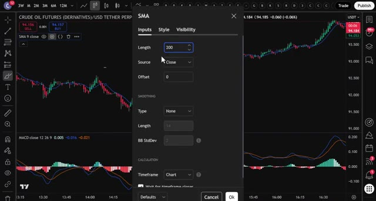
*⏱️ 00:00:14 — Fenêtre de configuration des paramètres d'une moyenne mobile simple (SMA) avec une longueur réglée à 200 sur TradingView.*

---

### ⏱️ `[00:00:29 - 00:00:53]` | Segment #02

**🔊 Audio (Transcription Intégrale Mot pour Mot en Français) :**
> Blofen ne requiert pas de vérification KYC obligatoire pour le trading de base, ce qui signifie que vous pouvez commencer à trader immédiatement. De plus, les nouveaux utilisateurs peuvent gagner jusqu'à 5 000 USDT grâce à des bonus sur les dépôts et le volume de trading. Maintenant, si vous voulez une alternative avec encore plus de paires de trading et la possibilité de basculer entre les fonctionnalités d'un échange centralisé et le trading de perpetuals décentralisés, vous pouvez utiliser Mexi.

**👁️ Analyse Visuelle d'Écran (gemini-3.5-flash-lite) :**
**Interface & Outils** : Navigateur web, site d'avis Crypto Vanguards et plateforme d'échange de cryptomonnaies Blofin (interface de trading Futures).

**Contenu textuel & Code** : Articles sur les limites de retrait Blofin sans KYC, programme de récompenses "5,000 USDT Deposit Blast-Off Rewards", paires de trading USDT-M (BTCUSDT à 86,802.9), carnet d'ordres en temps réel.

**Action / Démonstration** : Navigation à travers les pages d'information et les programmes de bonus de Blofin, présentation de l'interface de trading crypto.

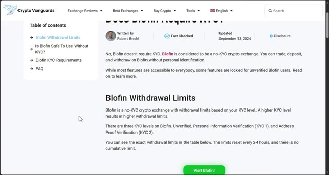
*⏱️ 00:00:35 — Article web sur Crypto Vanguards détaillant la politique de Blofin concernant l'absence de vérification KYC et ses limites de retrait.*

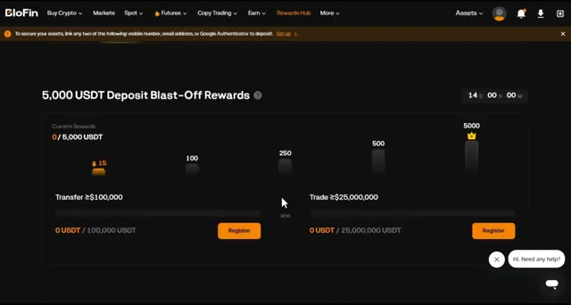
*⏱️ 00:00:41 — Page "Rewards Hub" de l'échange Blofin affichant les bonus promotionnels jusqu'à 5 000 USDT liés aux transferts et au volume de trading.*

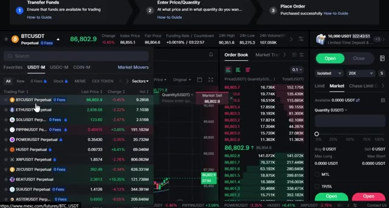
*⏱️ 00:00:47 — Interface de trading de contrats à terme de la plateforme Blofin montrant la paire BTCUSDT, le carnet d'ordres et le panneau de passage d'ordres.*

---

### ⏱️ `[00:00:53 - 00:01:14]` | Segment #03

**🔊 Audio (Transcription Intégrale Mot pour Mot en Français) :**
> Ils proposent jusqu'à 10 000 USDT de bonus pour les nouveaux utilisateurs en ce moment. Les deux platefromes fonctionnent parfaitement pour cette stratégie, alors choisissez celle qui correspond le mieux à vos besoins. Pour vous inscrire sur Blofen, cliquez sur le premier lien dans la description. Vous serez redirigé vers la page d'inscription où il vous suffit d'entrer vos informations et de créer un compte. Aucune vérification KYC nécessaire. Vous pouvez commencer à trader immédiatement.

**👁️ Analyse Visuelle d'Écran (gemini-3.5-flash-lite) :**
**Interface & Outils** : Interface web de l'échange de cryptomonnaies BloFin, graphiques de trading, page d'inscription et tableaux de bonus.

**Contenu textuel & Code** : Graphique BTCUSDT Perpetuel (unité de temps 5 minutes), carnets d'ordres (order book), panneau d'achat/vente (Buy long / Sell short), et tableau des paliers de bonus de dépôt ($30 à $1,000).

**Action / Démonstration** : Présentation de la plateforme de trading BloFin et de son interface, puis affichage de la page d'inscription et des bonus pour les nouveaux utilisateurs.

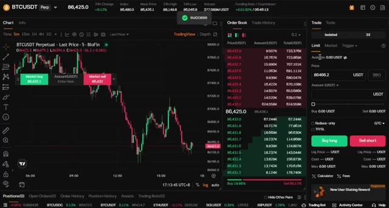
*⏱️ 00:00:58 — Interface de trading de la plateforme BloFin montrant un graphique des prix BTCUSDT en chandelier japonais avec un carnet d'ordres et un panneau de passage d'ordres.*

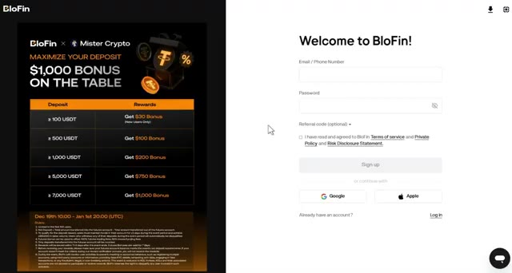
*⏱️ 00:01:04 — Page d'inscription de la plateforme BloFin affichant un tableau récapitulatif des bonus de dépôt pour les nouveaux utilisateurs.*

---

### ⏱️ `[00:01:14 - 00:01:33]` | Segment #04

**🔊 Audio (Transcription Intégrale Mot pour Mot en Français) :**
> Si vous préférez Mexi, utilisez le deuxième lien ci-dessous. Vous devrez effectuer une vérification KYC rapide sur Mexi, mais c'est rapide et sécurisé. Personnellement, j'ai des comptes sur les deux plateformes selon ce que je trade. L'étape numéro deux consiste à déposer des fonds. Laissez-moi vous montrer comment faire cela rapidement avant que nous ne plongeons dans la stratégie.

**👁️ Analyse Visuelle d'Écran (gemini-3.5-flash-lite) :**
**Interface & Outils** : Interfaces web des plateformes d'échange de cryptomonnaies MEXC et BloFin.

**Contenu textuel & Code** : Formulaires d'inscription, tableaux de bonus de dépôt (ex: 30 $ à 1 000 $ de bonus selon le montant déposé de 100 à 7 000 USDT) et liens de parrainage.

**Action / Démonstration** : Navigation et présentation des interfaces d'inscription et des bonus sur les plateformes BloFin et MEXC.

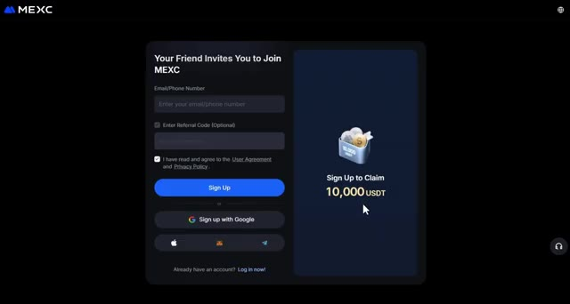
*⏱️ 00:01:19 — Page d'inscription de la plateforme d'échange de cryptomonnaies MEXC avec une offre de bonus de 10 000 USDT.*

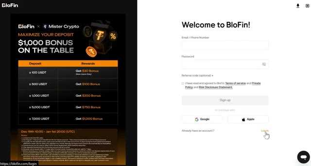
*⏱️ 00:01:24 — Page de connexion et tableau des bonus de dépôt de la plateforme BloFin (BloFin x Mister Crypto).*

*⏱️ 00:01:28 — Page d'accueil principale du site web de BloFin avec le slogan "BloFin - Where Whales are Made".*

---

### ⏱️ `[00:01:33 - 00:01:59]` | Segment #05

**🔊 Audio (Transcription Intégrale Mot pour Mot en Français) :**
> Une fois que vous êtes connecté à votre plateforme, cliquez sur Actifs en haut à droite, puis choisissez Vue d'ensemble. Une fois sur la page Vue d'ensemble, cliquez sur Dépôt. Choisissez la crypto-monnaie que vous souhaitez déposer. Je recommande l'USDT et sélectionnez le réseau de blockchain correct. Assurez-vous de choisir le bon réseau pour éviter de perdre vos fonds. Confirmez les détails, puis scannez le code QR ou copiez l'adresse de dépôt pour transférer vos fonds depuis votre portefeuille ou un autre échange.

**👁️ Analyse Visuelle d'Écran (gemini-3.5-flash-lite) :**
**Interface & Outils** : Blofin (plateforme d'échange crypto)

**Contenu textuel & Code** : Solde total (Total Equity) à 0.00 USDT, sections Funding, Spot, Futures à 0.00 USDT, et boutons d'action (Deposit, Buy Crypto, Withdraw, Transfer).

**Action / Démonstration** : Navigation vers la page d'aperçu des actifs du compte et clic sur le bouton de dépôt.

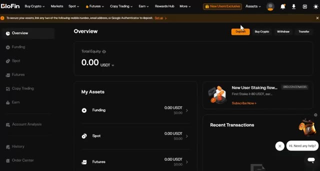
*⏱️ 00:01:40 — Capture d'écran de l'interface de la plateforme d'échange Blofin montrant la page de vue d'ensemble (Overview) du compte avec un solde total de 0.00 USDT et le curseur pointant sur le bouton de dépôt (Deposit).*

---

### ⏱️ `[00:02:00 - 00:02:19]` | Segment #06

**🔊 Audio (Transcription Intégrale Mot pour Mot en Français) :**
> Si vous souhaitez déposer en utilisant de la monnaie fiat, cherchez l'option Acheter des cryptos en haut du menu, puis sélectionnez Achat rapide. Choisissez votre devise, entrez le montant, sélectionnez votre mode de paiement, et cliquez sur Continuer. Une fois vos fonds déposés, il est temps d'ouvrir une position. La troisième étape consiste à ouvrir votre première position.

**👁️ Analyse Visuelle d'Écran (gemini-3.5-flash-lite) :**
**Interface & Outils** : Interface web de l'échange de cryptomonnaies Blofin.

**Contenu textuel & Code** : Menus de dépôt de monnaie fiat, options de paiement par carte bancaire, SEPA, Apple Pay et Google Pay, et taux de change pour l'achat d'USDT.

**Action / Démonstration** : Navigation dans les menus de la plateforme pour sélectionner le mode de dépôt de fonds fiat.

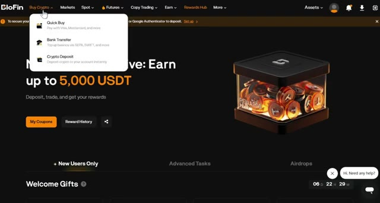
*⏱️ 00:02:05 — Le menu déroulant 'Buy Crypto' est ouvert sur la plateforme Blofin, affichant les options Quick Buy, Bank Transfer et Crypto Deposit.*

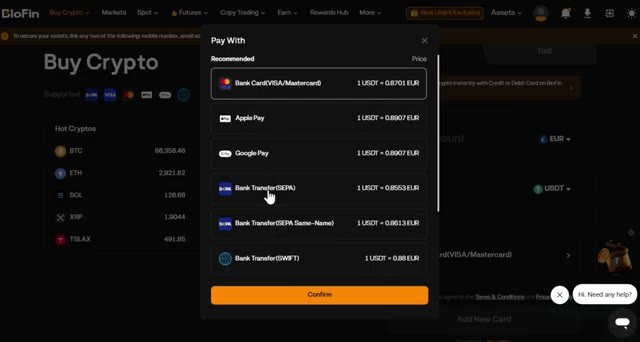
*⏱️ 00:02:09 — Une fenêtre pop-up 'Pay With' est ouverte sur Blofin, listant les différents modes de paiement acceptés (Carte bancaire, Apple Pay, Google Pay, SEPA, SWIFT).*

---

### ⏱️ `[00:02:19 - 00:02:39]` | Segment #07

**🔊 Audio (Transcription Intégrale Mot pour Mot en Français) :**
> Survolez "Futures" dans le menu supérieur, puis sélectionnez "Futures USDT-M". Cela vous amènera à l'interface de trading où toute la magie opère. Choisissez l'actif que vous souhaitez trader dans le coin supérieur gauche. Puisque nous tradons du pétrole brut, choisissez CLUSDT, mais cette stratégie fonctionne aussi sur n'importe quelle paire crypto.

**👁️ Analyse Visuelle d'Écran (gemini-3.5-flash-lite) :**
**Interface & Outils** : Plateforme d'échange BloFin (interface de trading Futures).

**Contenu textuel & Code** : Graphique en chandeliers 4H de BTCUSDT, carnet d'ordres (Order Book), prix du marché (74,158.0), indicateurs de volume (353,937M USDT) et panneau d'exécution (Isolated, 5X).

**Action / Démonstration** : Navigation et présentation de l'interface de trading des contrats futures sur la plateforme.

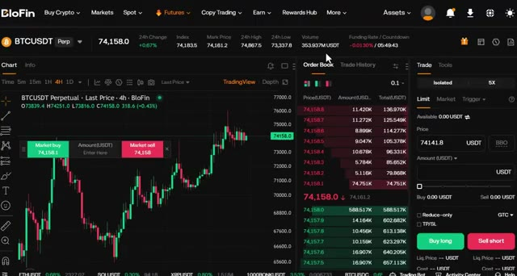
*⏱️ 00:02:24 — Interface de trading de la plateforme BloFin montrant le graphique en chandeliers de la paire BTCUSDT, le carnet d'ordres et le panneau de passage d'ordres.*

---

### ⏱️ `[00:02:39 - 00:03:12]` | Segment #08

**🔊 Audio (Transcription Intégrale Mot pour Mot en Français) :**
> Après cela, sélectionnez votre type d'ordre, limite ou au marché. Pour les débutants, je recommande de commencer par des ordres au marché pour une exécution instantanée. Ensuite, choisissez votre type de levier. Vous pouvez utiliser la marge croisée ou la marge isolée. Personnellement, j'utilise toujours la marge isolée parce qu'elle limite votre risque à cette position spécifique uniquement. Si le trade tourne mal, vous perdez seulement ce que vous avez mis dans le trade. Vous pouvez utiliser un effet de levier de 20 fois pour le pétrole brut et le "blowfin", mais pour les débutants, je recommande de commencer par un effet de levier de 5 à 10 fois jusqu'à ce que vous soyez à l'aise avec la façon dont le marché évolue. Entrez les détails de votre trade,

**👁️ Analyse Visuelle d'Écran (gemini-3.5-flash-lite) :**
**Interface & Outils** : Interface de l'échange de cryptomonnaies Blofin (section Futures).

**Contenu textuel & Code** : Paire CLUSDT Perpetual, types d'ordres (Limit, Market), options de levier et de marge (Cross vs Isolated).

**Action / Démonstration** : Sélection du type d'ordre au marché et bascule entre les modes de marge croisée et isolée.

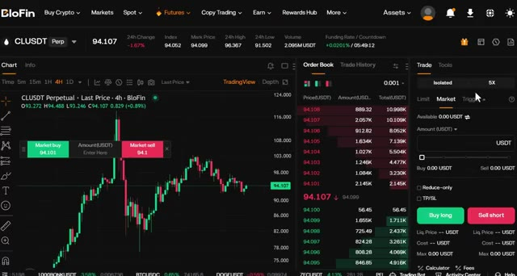
*⏱️ 00:02:48 — Interface de trading Blofin affichant le graphique de CLUSDT en 4H avec le panneau de passage d'ordres à droite et le carnet d'ordres au centre.*

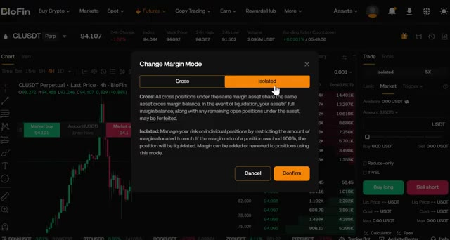
*⏱️ 00:02:56 — Fenêtre pop-up de sélection du mode de marge (« Change Margin Mode ») sur Blofin montrant les options « Cross » et « Isolated ».*

---

### ⏱️ `[00:03:12 - 00:03:46]` | Segment #09

**🔊 Audio (Transcription Intégrale Mot pour Mot en Français) :**
> confirmez que tout a l'air bien puis cliquez sur acheter long ou vendre court pour ouvrir votre position. Maintenant que vous savez comment naviguer sur la plateforme et trouver le symbole du pétrole, passons à la meilleure stratégie d'une minute que vous pouvez utiliser aujourd'hui. D'abord, rendez-vous sur TradingView. J'ai un lien dans la description qui vous donne une réduction si vous voulez la version premium. Commencez par sélectionner la paire que vous voulez trader. Pour cet exemple, nous allons utiliser le pétrole brut contre USDT ou CLUSDT sur l'échange Blofen. Mais cette stratégie fonctionne sur n'importe quelle paire crypto, alors n'hésitez pas à utiliser ce que vous voulez

**👁️ Analyse Visuelle d'Écran (gemini-3.5-flash-lite) :**
**Interface & Outils** : Blofin, TradingView (interface de trading et recherche de symboles)

**Contenu textuel & Code** : Graphique de prix CLUSDT Perpetual en unité 4 heures, carnet d'ordres (Order Book), panneau d'exécution des ordres (Market, Isolated, 5x, boutons Buy long / Sell short), et menu contextuel de recherche de symboles avec les actifs correspondants (Crude Oil Futures, etc.).

**Action / Démonstration** : Navigation sur la plateforme, visualisation du graphique de prix, utilisation du carnet d'ordres et recherche d'un symbole financier (pétrole / CLUSDT).

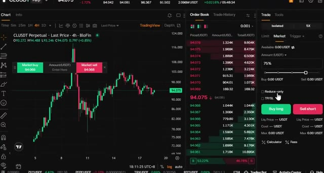
*⏱️ 00:03:21 — Interface de trading sur Blofin montrant un graphique en chandeliers en unité 4h pour CLUSDT Perpetual, un carnet d'ordres au centre et un panneau de passage d'ordre sur la droite avec les boutons d'achat long et vente court.*

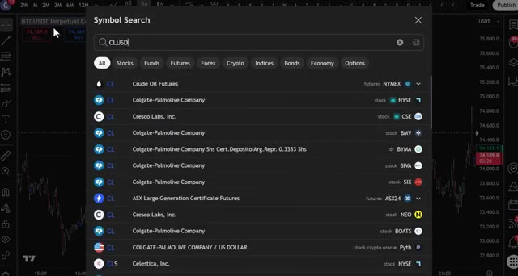
*⏱️ 00:03:37 — Fenêtre de recherche de symboles superposée sur la plateforme, avec la barre de recherche affichant 'CLUSD' et une liste de résultats incluant 'Crude Oil Futures'.*

---

### ⏱️ `[00:03:46 - 00:04:17]` | Segment #10

**🔊 Audio (Transcription Intégrale Mot pour Mot en Français) :**
> avec lequel vous êtes le plus à l'aise. Ensuite, cliquez sur le sélecteur d'unité de temps et choisissez l'unité d'une minute. C'est une stratégie de scalping, donc nous travaillons rapidement et avec précision. Maintenant, voici la première erreur que la plupart des gens commettent. Ils utilisent des bougies normales. À la place, cliquez sur le type de bougie et passez aux bougies Heiken Ashi. Celles-ci sont différentes des bougies normales car au lieu de vous montrer une seule bougie par période, elles prennent également la moyenne des bougies précédentes, ce qui vous donne une représentation beaucoup plus fluide et nette des mouvements de prix.

**👁️ Analyse Visuelle d'Écran (gemini-3.5-flash-lite) :**
**Interface & Outils** : Graphique TradingView sur l'exchange BloFin.

**Contenu textuel & Code** : Paire CLUSDT.P (Crude Oil Futures), unité de temps 1m sélectionnée, affichage des prix du contrat perpétuel avec des signaux de trading sous forme de points bleus.

**Action / Démonstration** : Sélection de l'unité de temps 1 minute pour une stratégie de scalping rapide.

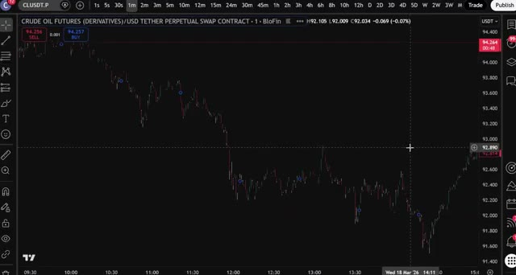
*⏱️ 00:03:53 — Un graphique en chandeliers montrant l'évolution des prix sur une période de 1 minute.*

---

### ⏱️ `[00:04:18 - 00:04:41]` | Segment #11

**🔊 Audio (Transcription Intégrale Mot pour Mot en Français) :**
> Ce que vous observez essentiellement, c'est la direction du momentum, et non pas seulement le prix brut. Et cela rend bien plus facile de repérer quand une vague commence ou se termine. Vous pouvez le voir clairement sur le graphique. Le prix évolue par vagues : haut, bas, haut, bas. Notre travail est simplement de capturer ces vagues au bon moment. Maintenant, cliquez sur les indicateurs et recherchez MACD, pour moving average convergence divergence (moyenne mobile de convergence divergence).

**👁️ Analyse Visuelle d'Écran (gemini-3.5-flash-lite) :**
**Interface & Outils** : Graphique de trading (interface type TradingView intégrée sur BloFin).

**Contenu textuel & Code** : Paire CRUDE OIL FUTURES (DERIVATIVES)/USD TETHER PERPETUAL SWAP CONTRACT, échelle de temps en minutes, chandeliers verts (haussiers) et rouges (baissiers).

**Action / Démonstration** : Observation des mouvements de prix en vagues (hauts et bas) pour analyser la structure du marché.

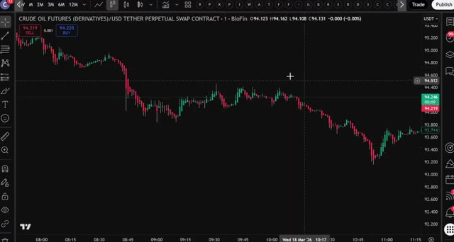
*⏱️ 00:04:23 — Un graphique en chandeliers japonais montrant l'évolution des prix du Crude Oil Futures sur la plateforme BloFin.*

---

### ⏱️ `[00:04:41 - 00:05:06]` | Segment #12

**🔊 Audio (Transcription Intégrale Mot pour Mot en Français) :**
> Sélectionnez-le et ajoutez-le à votre graphique. Ensuite, cliquez à nouveau sur les indicateurs, recherchez la moyenne mobile, et ajoutez celle-ci également. Cliquez sur les paramètres de la moyenne mobile, définissez la longueur sur 200, puis allez dans le style et changez la couleur en bleu et rendez-la plus épaisse afin qu'il soit facile de la voir sur votre graphique. C'est votre moyenne mobile sur 200 périodes et c'est la ligne la plus importante sur votre graphique pour cette stratégie.

**👁️ Analyse Visuelle d'Écran (gemini-3.5-flash-lite) :**
**Interface & Outils** : Graphique TradingView

**Contenu textuel & Code** : Menu "Indicators, metrics, and strategies" avec la barre de recherche contenant "MOVING AVERAGE" et les résultats associés (Moving Average Exponential, Simple Moving Average, etc.).

**Action / Démonstration** : Recherche et sélection d'une moyenne mobile (Moving Average) dans le menu des indicateurs.

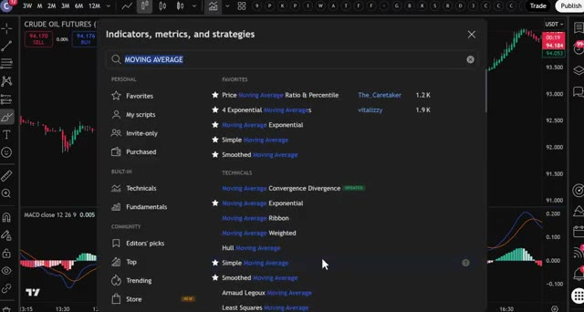
*⏱️ 00:04:47 — Fenêtre de recherche des indicateurs techniques sur TradingView avec la recherche "MOVING AVERAGE".*

---

### ⏱️ `[00:05:06 - 00:05:28]` | Segment #13

**🔊 Audio (Transcription Intégrale Mot pour Mot en Français) :**
> Voici la règle et elle est simple. Si le prix est au-dessus de la moyenne mobile à 200 périodes, vous ne cherchez que des positions acheteuses. Si le prix est en dessous de la moyenne mobile à 200 périodes, vous ne cherchez que des positions vendeuses. C'est tout. Ne tradez jamais à l'encontre de cette ligne. J'ai vu tellement de traders se faire détruire parce qu'ils ont essayé de shorter une crypto qui se trouvait au-dessus de la moyenne mobile à 200 périodes ou d'acheter quelque chose qui s'échangeait en dessous.

**👁️ Analyse Visuelle d'Écran (gemini-3.5-flash-lite) :**
**Interface & Outils** : Graphique de trading (TradingView / BloFin)

**Contenu textuel & Code** : SMA 200 (ligne bleue), MACD (12, 26, 9), paires Crude Oil Futures / USD Tether Perp.

**Action / Démonstration** : Analyse graphique de la tendance par rapport à la moyenne mobile à 200 périodes et mise en évidence de zones clés avec des cercles tracés à main levée.

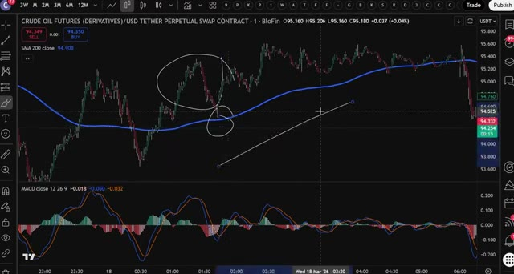
*⏱️ 00:05:12 — Un graphique en chandeliers japonais montrant le contrat CRUDE OIL FUTURES sur BloFin avec une moyenne mobile simple (SMA) à 200 périodes en bleu et l'indicateur MACD en bas, avec des annotations cerclées à la main.*

---

### ⏱️ `[00:05:28 - 00:06:03]` | Segment #14

**🔊 Audio (Transcription Intégrale Mot pour Mot en Français) :**
> ne le faites pas. La moyenne mobile à 200 périodes vous indique la tendance générale. Tradez toujours avec elle, jamais contre elle. C'est là qu'intervient le MACD, et c'est votre véritable déclencheur d'entrée. Le MACD est un indicateur de momentum. Il vous indique quand le momentum change, et c'est exactement à ce moment-là que vous voulez entrer en position. Voici ce que vous devez rechercher. Pour une position short, le prix doit être en dessous de la moyenne mobile à 200 périodes. Ensuite, surveillez le MACD. Lorsque vous voyez le momentum passer du vert au rouge, ce signal rouge est votre déclencheur. Les bougies Heiken Ashi vont également commencer à devenir rouges et à montrer

**👁️ Analyse Visuelle d'Écran (gemini-3.5-flash-lite) :**
**Interface & Outils** : Interface de type TradingView / BloFin affichant un graphique de contrats perpétuels de pétrole brut (CRUDE OIL FUTURES).

**Contenu textuel & Code** : SMA 200 (ligne bleue sur le prix), MACD (12, 26, 9) avec histogramme, lignes de signal et de MACD, et une zone encerclée sur le MACD illustrant un changement de momentum.

**Action / Démonstration** : Analyse technique du graphique illustrant l'utilisation conjointe de la moyenne mobile à 200 périodes pour la tendance et du MACD comme déclencheur d'entrée basé sur le momentum.

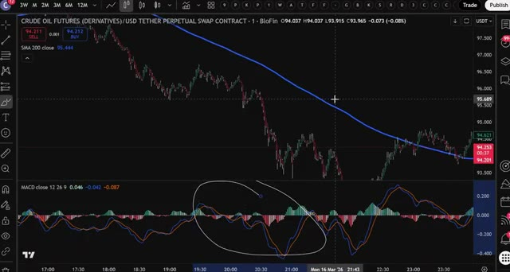
*⏱️ 00:05:37 — Capture d'écran montrant un graphique de trading avec la moyenne mobile SMA 200 sur le graphique des prix du pétrole brut et l'indicateur MACD en sous-fenêtre, avec une zone cerclée au stylo blanc.*

---

### ⏱️ `[00:06:03 - 00:06:39]` | Segment #15

**🔊 Audio (Transcription Intégrale Mot pour Mot en Français) :**
> l'élan est en train de changer de direction. C'est votre point d'entrée. Ouvrez votre position short. Pour une position long, le prix doit donc être au dessus de la moyenne mobile à 200 périodes. Surveillez le MACD pour un croisement du rouge au vert. Lorsque vous voyez ce signal vert et que les bougies Heiken Ashi commencent à devenir vertes, c'est votre point d'entrée. Ouvrez votre position long. C'est une confirmation en deux étapes à chaque fois. La moyenne mobile à 200 périodes vous indique la direction. Le MACD vous indique le timing. Les deux doivent s'aligner avant que vous n'entriez en position. Maintenant écoutez, le scalping signifie que vous allez prendre beaucoup de trades et que vous n'allez pas tous les gagner. Personne ne le fait. Donc la façon dont vous vous protégez

**👁️ Analyse Visuelle d'Écran (gemini-3.5-flash-lite) :**
**Interface & Outils** : Graphique TradingView intégré sur la plateforme Blofin

**Contenu textuel & Code** : Paire CRUDE OIL FUTURES (DERIVATIVES)/USD TETHER PERPETUAL SWAP CONTRACT, moyenne mobile simple (SMA 200 close à 99.828), et indicateur MACD (12, 26, 9) affichant des histogrammes de momentum verts et rouges ainsi que des lignes de signal.

**Action / Démonstration** : Analyse technique du graphique des prix par rapport à la moyenne mobile à 200 périodes et observation du croisement du MACD pour identifier un point d'entrée de position.

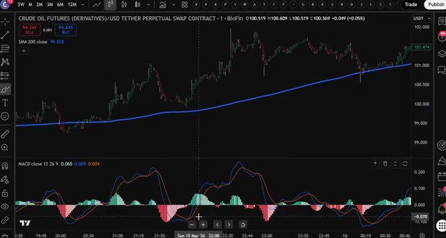
*⏱️ 00:06:12 — Graphique en chandeliers japonais des contrats à terme sur le pétrole brut (Crude Oil Futures) avec l'indicateur SMA 200 en superposition et l'oscillateur MACD en panneau inférieur.*

---

### ⏱️ `[00:06:39 - 00:07:15]` | Segment #16

**🔊 Audio (Transcription Intégrale Mot pour Mot en Français) :**
> c'est avec une bonne gestion des risques. Pour cette stratégie, définissez votre stop loss à 1 % et votre take profit à 3 %. Cela vous donne un ratio risque/rendement de 1 pour 3, ce qui signifie que même si vous ne gagnez que la moitié de vos trades, vous restez globalement rentable. Et voilà la stratégie complète sur une minute pour le pétrole brut. Simple, claire et extrêmement efficace lorsque vous suivez les règles. Pour commencer, cliquez sur le premier lien dans la description pour vous inscrire sur Bluffin et réclamer vos bonus. Si Bluffin n'est pas disponible dans votre pays, utilisez le deuxième lien pour Mexi. Les deux plateformes fonctionnent parfaitement pour cette stratégie,

**👁️ Analyse Visuelle d'Écran (gemini-3.5-flash-lite) :**
**Interface & Outils** : Interface TradingView intégrée sur BloFin montrant un graphique en chandeliers et l'indicateur MACD.

**Contenu textuel & Code** : Outil de position Long avec un Stop Loss de 1% et un Target de 3%, affichant clairement "Risk/reward ratio: 3".

**Action / Démonstration** : Visualisation d'un trade configuré avec gestion des risques et rapport risque/rendement de 1:3 sur le graphique.

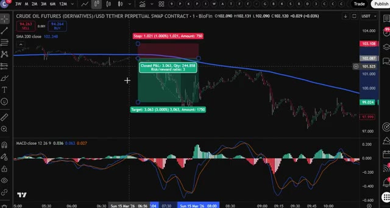
*⏱️ 00:06:48 — Graphique TradingView affichant le cours du pétrole (Crude Oil Futures) avec un outil de mesure du ratio risque/rendement (Stop Loss à 1% et Take Profit à 3%, ratio de 3).*

---

### ⏱️ `[00:07:15 - 00:07:26]` | Segment #17

**🔊 Audio (Transcription Intégrale Mot pour Mot en Français) :**
> et aucun des deux n'exige de KYC obligatoire pour commencer. Et si vous voulez plus de détails sur le fonctionnement des plateformes Bluffin et Mexi, regardez la vidéo qui s'affiche à l'écran en ce moment même. Je vous retrouve dans la prochaine.

**👁️ Analyse Visuelle d'Écran (gemini-3.5-flash-lite) :**
**Interface & Outils** : Navigateur web (Crypto Vanguards) et interface de l'échange de cryptomonnaies Blofin.

**Contenu textuel & Code** : Articles sur les exigences KYC, graphiques de prix en direct, carnet d'ordres et panneau de passage d'ordres (Futures).

**Action / Démonstration** : Navigation sur un site de revue de crypto-monnaies et consultation de l'interface de trading de Blofin.

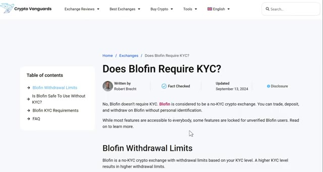
*⏱️ 00:07:18 — Page web de Crypto Vanguards affichant l'article "Does Blofin Require KYC?" confirmant l'absence de KYC obligatoire.*

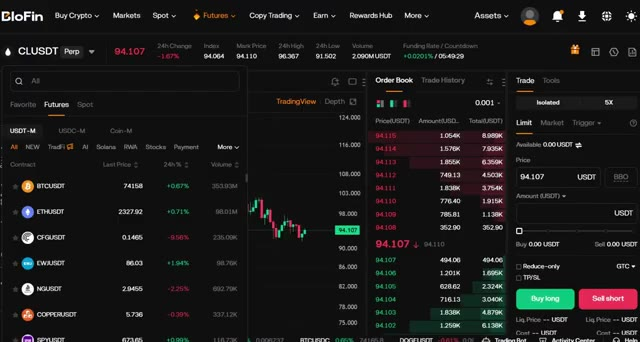
*⏱️ 00:07:21 — Interface de trading de la plateforme Blofin montrant un graphique de prix, un carnet d'ordres et le panneau d'exécution.*

---

