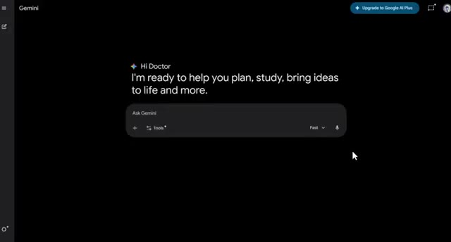
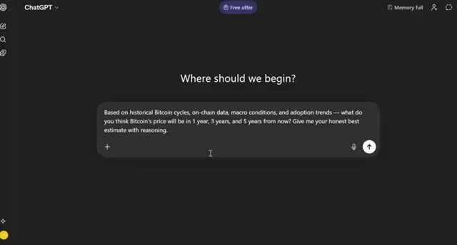

# 🎬 AI Predicts Bitcoin's Price

> **Chaîne** : [Alex Carter](https://www.youtube.com/@AlexCarterTrading)  
> **Lien YouTube** : [https://www.youtube.com/watch?v=EtZDUxKvjxY](https://www.youtube.com/watch?v=EtZDUxKvjxY)  
> **Date de publication** : 20260402  
> **Durée** : 00:11:19  
> **Identifiant vidéo** : `EtZDUxKvjxY`  
> **Transcription & Analyse** : `whisper-v3-large-turbo+gemini-3.5-flash-lite`  

---

## 📌 Synthèse Exécutive & Outils

### 💡 Résumé
Dans cette vidéo intitulée **L'IA prédit le prix du Bitcoin**, Alex Carter détaille une approche stratégique et pratique du trading et de l'automatisation par agents IA.

### 🛠️ Outils, Modèles & Logiciels Présentés
- **TradingView & Claude Code** : Analyse technique avancée et automatisation algorithmique.

### 🔑 Points Clés & Enseignements Stratégiques
- Respect rigoureux du ratio risque/rendement et du money management.
- Automatisation méthodique des déclencheurs d'ordres via des agents intelligents.

---

## ⏱️ Chronologie & Transcription Complète Audio & Visuelle (Mot pour Mot)

### ⏱️ `[00:00:00 - 00:00:21]` | Segment #01

**🔊 Audio (Transcription Intégrale Mot pour Mot en Français) :**
> I asked three of the most powerful AI models in the world on what Bitcoin is going to be worth over the next five years. And the answers were actually pretty interesting. But more importantly, I used those answers to build an AI agent that DCAs into Bitcoin for me automatically at exactly the right time. In today's video, I'm going to show you exactly how I did it step by step.

**👁️ Analyse Visuelle d'Écran (gemini-3.5-flash-lite) :**
**Interface & Outils** : Présentation ou face-caméra explicatif du trader sans interface logicielle partagée.

**Contenu textuel & Code** : Explications orales des stratégies et mise en contexte méthodologique du marché.

**Action / Démonstration** : Explications face caméra et analyse conceptuelle des marchés.

---

### ⏱️ `[00:00:22 - 00:00:47]` | Segment #02

**🔊 Audio (Transcription Intégrale Mot pour Mot en Français) :**
> Et j'ai quelques bonus pour vous tout au long de la vidéo, juste pour vous être inscrit via mes liens dans la description. Assurez-vous donc de rester pour en profiter. Entrons dans le vif du sujet. La première chose que j'ai faite a été d'aller sur les trois, Claude, ChatGPT et Gemini. Et je leur ai donné exactement le même prompt. J'ai dit : en me basant sur les cycles historiques du Bitcoin, les données on-chain, les conditions macroéconomiques et les tendances d'adoption, quel sera, selon vous, le prix du Bitcoin dans un an, trois ans et cinq ans à partir de maintenant ?

**👁️ Analyse Visuelle d'Écran (gemini-3.5-flash-lite) :**
**Interface & Outils** : Interfaces web de plateformes d'IA (Gemini, ChatGPT) et écran promotionnel de broker crypto (Toobit).

**Contenu textuel & Code** : Prompts textuels sur les cycles historiques du Bitcoin, données prévisionnelles et interface utilisateur de LLM.

**Action / Démonstration** : Saisie d'un prompt d'analyse de prix et de prédictions sur le Bitcoin dans l'interface de ChatGPT.

*⏱️ 00:00:34 — Interface de l'assistant IA Google Gemini affichant une invite de texte vide ("Ask Gemini").*

*⏱️ 00:00:41 — Interface de ChatGPT affichant un prompt posant une question sur les cycles du Bitcoin et ses prix futurs à 1, 3 et 5 ans.*

---

### ⏱️ `[00:00:47 - 00:01:24]` | Segment #03

**🔊 Audio (Transcription Intégrale Mot pour Mot en Français) :**
> Give me your honest best estimate with reasoning. So here's what Claude said. It estimates from $95,000 at year one all the way to $280,000 by year five. And here's ChatGPT. It said Bitcoin can be $120,000 on the low end at year one and $600,000 at peak by year five. And here's Gemini, where it said $45,000 by end of year one and $500,000 by end of year five. Now look at those answers. All three gave very different numbers with very different reasoning. And that actually told me something

**👁️ Analyse Visuelle d'Écran (gemini-3.5-flash-lite) :**
**Interface & Outils** : Présentation ou face-caméra explicatif du trader sans interface logicielle partagée.

**Contenu textuel & Code** : Explications orales des stratégies et mise en contexte méthodologique du marché.

**Action / Démonstration** : Explications face caméra et analyse conceptuelle des marchés.

---

### ⏱️ `[00:01:24 - 00:01:52]` | Segment #04

**🔊 Audio (Transcription Intégrale Mot pour Mot en Français) :**
> ...vraiment utile sur la façon de structurer une stratégie de DCA. Parce que voilà le truc : si même les modèles d'IA les plus puissants au monde peuvent tomber d'accord sur un objectif de prix, cela vous montre bien que viser le moment parfait sur le marché est fondamentalement impossible. Mais ce sur quoi ils sont tous tombés d'accord, c'est la direction. Et c'est là que le DCA entre en jeu. DCA signifie *Dollar Cost Averaging*. Cela signifie que vous achetez un montant fixe à intervalles réguliers, quel que soit le prix. Vous n'essayez pas d'anticiper le point le plus bas, vous continuez simplement d'acheter.

**👁️ Analyse Visuelle d'Écran (gemini-3.5-flash-lite) :**
**Interface & Outils** : Présentation ou face-caméra explicatif du trader sans interface logicielle partagée.

**Contenu textuel & Code** : Explications orales des stratégies et mise en contexte méthodologique du marché.

**Action / Démonstration** : Explications face caméra et analyse conceptuelle des marchés.

---

### ⏱️ `[00:01:52 - 00:02:24]` | Segment #05

**🔊 Audio (Transcription Intégrale Mot pour Mot en Français) :**
> And when you combine that with an AI agent that monitors the market and executes those buys for you automatically, that's where it gets really interesting. So let me show you how I set this up. All right, so before we get into the setup, let me quickly explain what Claude actually is, because I think a lot of people are still sleeping on this. Claude is an AI model built by Anthropic. And in my opinion, it is right now the most powerful and most useful AI tool available for traders. I've personally switched to Claude for the majority of my AI usage. And over the past

**👁️ Analyse Visuelle d'Écran (gemini-3.5-flash-lite) :**
**Interface & Outils** : Présentation ou face-caméra explicatif du trader sans interface logicielle partagée.

**Contenu textuel & Code** : Explications orales des stratégies et mise en contexte méthodologique du marché.

**Action / Démonstration** : Explications face caméra et analyse conceptuelle des marchés.

---

### ⏱️ `[00:02:24 - 00:02:58]` | Segment #06

**🔊 Audio (Transcription Intégrale Mot pour Mot en Français) :**
> few months, especially the gap between Claude and everything else has just been getting bigger and bigger. Now, the version of Claude that most people know is the basic chat version. You type a message, it responds. That's it. And look, even that version is already incredibly useful for market analysis, strategy research, writing trade journals, all of that. But what makes Claude genuinely game changing for us as traders is what they built on top of that. There are two things I want to walk you through today. The first is Claude Cowork. This is Claude's agentic mode. It doesn't

**👁️ Analyse Visuelle d'Écran (gemini-3.5-flash-lite) :**
**Interface & Outils** : Présentation ou face-caméra explicatif du trader sans interface logicielle partagée.

**Contenu textuel & Code** : Explications orales des stratégies et mise en contexte méthodologique du marché.

**Action / Démonstration** : Explications face caméra et analyse conceptuelle des marchés.

---

### ⏱️ `[00:02:58 - 00:03:19]` | Segment #07

**🔊 Audio (Transcription Intégrale Mot pour Mot en Français) :**
> just talk, it actually acts. It can open your apps, read and edit files on your computer, run scheduled tasks, and remember context across sessions. So it knows what you told it yesterday. It knows your trading setup. It works for you in the background while you're doing something else. The second is the 2Bit AI agent trade kit. And this is where it gets really exciting.

**👁️ Analyse Visuelle d'Écran (gemini-3.5-flash-lite) :**
**Interface & Outils** : Présentation ou face-caméra explicatif du trader sans interface logicielle partagée.

**Contenu textuel & Code** : Explications orales des stratégies et mise en contexte méthodologique du marché.

**Action / Démonstration** : Explications face caméra et analyse conceptuelle des marchés.

---

### ⏱️ `[00:03:20 - 00:03:57]` | Segment #08

**🔊 Audio (Transcription Intégrale Mot pour Mot en Français) :**
> 2Bit has built a direct integration that connects Claude straight to your exchange account. So your AI agent can check prices, monitor your portfolio, and place real-life trades, all from a simple text prompt. Together, these two things create something that I genuinely think most traders are not ready for. So let me show you how to set it all up. This part is actually very simple and let me walk you through it. All right, so to get started, you need to download the Claude desktop app. Head over to claude.com slash download. You'll see the download page right here. You'll see download options for Mac and Windows. Just click on your operating system

**👁️ Analyse Visuelle d'Écran (gemini-3.5-flash-lite) :**
**Interface & Outils** : Présentation ou face-caméra explicatif du trader sans interface logicielle partagée.

**Contenu textuel & Code** : Explications orales des stratégies et mise en contexte méthodologique du marché.

**Action / Démonstration** : Explications face caméra et analyse conceptuelle des marchés.

---

### ⏱️ `[00:03:57 - 00:04:18]` | Segment #09

**🔊 Audio (Transcription Intégrale Mot pour Mot en Français) :**
> and the download will start automatically. Once it's installed and you open it up, you'll land on the main interface. It looks similar to a chat window, but this is where all the power lives. Now, to access Cowork specifically, you'll need a Claude Pro or Claude Max. Cowork is a premium feature. Once you're on the right plan, you'll see the Cowork option available in your interface.

**👁️ Analyse Visuelle d'Écran (gemini-3.5-flash-lite) :**
**Interface & Outils** : Présentation ou face-caméra explicatif du trader sans interface logicielle partagée.

**Contenu textuel & Code** : Explications orales des stratégies et mise en contexte méthodologique du marché.

**Action / Démonstration** : Explications face caméra et analyse conceptuelle des marchés.

---

### ⏱️ `[00:04:18 - 00:04:53]` | Segment #10

**🔊 Audio (Transcription Intégrale Mot pour Mot en Français) :**
> When you first open Cowork, it will ask you to set up your connected folders. These are the folders on your computer that Claude is allowed to access. I recommend creating a dedicated folder for your crypto work. Something like Claude Trading, and in pointing it there. That way, Claude has access to everything it needs without touching the rest of your computer. And that's it. You're installed and ready to go. Now, to connect Claude directly to your exchange, we're going to use 2Bit. 2Bit just released what they're calling the AI agent trade kit. And this is by far the most exciting thing I've seen released on any exchange

**👁️ Analyse Visuelle d'Écran (gemini-3.5-flash-lite) :**
**Interface & Outils** : Présentation ou face-caméra explicatif du trader sans interface logicielle partagée.

**Contenu textuel & Code** : Explications orales des stratégies et mise en contexte méthodologique du marché.

**Action / Démonstration** : Explications face caméra et analyse conceptuelle des marchés.

---

### ⏱️ `[00:04:53 - 00:05:15]` | Segment #11

**🔊 Audio (Transcription Intégrale Mot pour Mot en Français) :**
> this year. If you don't have a 2Bit account yet, now is actually a great time to sign up. Click the link in the description below. You'll land on the 2-bit page and you can sign up with your email in less than a minute. Set a strong password, verify your email, and you're in. And just by signing up through my link, you'll get a $30 futures bonus plus one month of VIP status.

**👁️ Analyse Visuelle d'Écran (gemini-3.5-flash-lite) :**
**Interface & Outils** : Présentation ou face-caméra explicatif du trader sans interface logicielle partagée.

**Contenu textuel & Code** : Explications orales des stratégies et mise en contexte méthodologique du marché.

**Action / Démonstration** : Explications face caméra et analyse conceptuelle des marchés.

---

### ⏱️ `[00:05:15 - 00:05:48]` | Segment #12

**🔊 Audio (Transcription Intégrale Mot pour Mot en Français) :**
> Completely free, just for registering. I'll mention more bonuses later in the video as well. Once you're logged in, you'll land on the main dashboard. Before we set up the API, I want to show you a smart way to do this, using a subaccount. This is how I recommend doing it because it keeps your main account protected. Once you're logged in, click on your profile icon at the top right, then click on subaccount. Click create subaccount. You can choose between a regular email or a virtual email. Get the verification code, set a strong password, and confirm. Your subaccount is now

**👁️ Analyse Visuelle d'Écran (gemini-3.5-flash-lite) :**
**Interface & Outils** : Présentation ou face-caméra explicatif du trader sans interface logicielle partagée.

**Contenu textuel & Code** : Explications orales des stratégies et mise en contexte méthodologique du marché.

**Action / Démonstration** : Explications face caméra et analyse conceptuelle des marchés.

---

### ⏱️ `[00:05:48 - 00:06:23]` | Segment #13

**🔊 Audio (Transcription Intégrale Mot pour Mot en Français) :**
> ready. Step two, set up the API key. Click on your profile icon again and this time click on API management. At the top right, click new API. Under the note field, give it a name, something like AI agent trading, so you know exactly what this key is for. For permissions, choose read and write. This is what allows the AI agent to actually place orders on your behalf. If you just want to use this for analysis only, you can choose read only. You can enable spot, contracts, or both, depending on what markets you want the agent to trade. For IP settings, if you have a dedicated

**👁️ Analyse Visuelle d'Écran (gemini-3.5-flash-lite) :**
**Interface & Outils** : Présentation ou face-caméra explicatif du trader sans interface logicielle partagée.

**Contenu textuel & Code** : Explications orales des stratégies et mise en contexte méthodologique du marché.

**Action / Démonstration** : Explications face caméra et analyse conceptuelle des marchés.

---

### ⏱️ `[00:06:23 - 00:06:42]` | Segment #14

**🔊 Audio (Transcription Intégrale Mot pour Mot en Français) :**
> workspace, I'd recommend selecting allow trusted IPs only and entering your IP address. This is the most secure option. If you move around a lot, you can select unrestricted, but keep in mind your API key will only be valid for three months in that case. Once everything looks good, click confirm.

**👁️ Analyse Visuelle d'Écran (gemini-3.5-flash-lite) :**
**Interface & Outils** : Présentation ou face-caméra explicatif du trader sans interface logicielle partagée.

**Contenu textuel & Code** : Explications orales des stratégies et mise en contexte méthodologique du marché.

**Action / Démonstration** : Explications face caméra et analyse conceptuelle des marchés.

---

### ⏱️ `[00:06:42 - 00:07:15]` | Segment #15

**🔊 Audio (Transcription Intégrale Mot pour Mot en Français) :**
> Step three, save your keys. You'll now see your access key and secret key. Copy both of them carefully and store them somewhere offline, like a notes app that's not connected to the internet or write them down. This is important because the secret key is only shown once. If you lose it, you'll need to create a new API key. All right, now the fun part. Open up Claude, give it this exact prompt. I want you to connect to my 2-bit exchange account using these API credentials. Once connected, check my account balance so I can confirm you have access. If everything is set up correctly,

**👁️ Analyse Visuelle d'Écran (gemini-3.5-flash-lite) :**
**Interface & Outils** : Présentation ou face-caméra explicatif du trader sans interface logicielle partagée.

**Contenu textuel & Code** : Explications orales des stratégies et mise en contexte méthodologique du marché.

**Action / Démonstration** : Explications face caméra et analyse conceptuelle des marchés.

---

### ⏱️ `[00:07:15 - 00:07:49]` | Segment #16

**🔊 Audio (Transcription Intégrale Mot pour Mot en Français) :**
> Claude will confirm it has access and show you your account balance. Now, here's where the AI predictions from the beginning of the video actually come in. Because once Claude is connected to your account, you can give it a DCA instruction based on exactly what those AI models told us. Something like this. Based on a five-year Bitcoin bull case target of these AI model, I want you to DCA $50 into Bitcoin every Monday at 9 a.m. If Bitcoin drops more than 10% in a single week, double the buy that week. Track all purchases and give me a weekly summary. And Claude will

**👁️ Analyse Visuelle d'Écran (gemini-3.5-flash-lite) :**
**Interface & Outils** : Présentation ou face-caméra explicatif du trader sans interface logicielle partagée.

**Contenu textuel & Code** : Explications orales des stratégies et mise en contexte méthodologique du marché.

**Action / Démonstration** : Explications face caméra et analyse conceptuelle des marchés.

---

### ⏱️ `[00:07:49 - 00:08:10]` | Segment #17

**🔊 Audio (Transcription Intégrale Mot pour Mot en Français) :**
> handle it. It checks the price. It places the order. It logs everything. You just wake up and check your summary. From that point on, you can also give it commands like, what's the price of Bitcoin right now? And it pulls live market data instantly. Show me my open futures positions. And it shows you exactly what you have running. Set a stop loss on my BTC position at $60,000.

**👁️ Analyse Visuelle d'Écran (gemini-3.5-flash-lite) :**
**Interface & Outils** : Présentation ou face-caméra explicatif du trader sans interface logicielle partagée.

**Contenu textuel & Code** : Explications orales des stratégies et mise en contexte méthodologique du marché.

**Action / Démonstration** : Explications face caméra et analyse conceptuelle des marchés.

---

### ⏱️ `[00:08:11 - 00:08:31]` | Segment #18

**🔊 Audio (Transcription Intégrale Mot pour Mot en Français) :**
> And it will be done. It's genuinely that simple. Just a reminder that once you start trading on 2-bit, if you hit 50,000 USDT in futures volume, you'll get another 30 USDT in trial funds on top of your signup bonus. And if you deposit 5,000 USDT, you can get up to 750 USDT in trial funds.

**👁️ Analyse Visuelle d'Écran (gemini-3.5-flash-lite) :**
**Interface & Outils** : Présentation ou face-caméra explicatif du trader sans interface logicielle partagée.

**Contenu textuel & Code** : Explications orales des stratégies et mise en contexte méthodologique du marché.

**Action / Démonstration** : Explications face caméra et analyse conceptuelle des marchés.

---

### ⏱️ `[00:08:32 - 00:08:52]` | Segment #19

**🔊 Audio (Transcription Intégrale Mot pour Mot en Français) :**
> The link in the description has all of this unlocked automatically. I know what some of you are thinking. How do I know this is actually safe? I'm giving an AI access to my exchange account. That's a fair question. So let me walk you through exactly why this is built differently. At first, everything runs locally on your machine. Your API key never gets sent to a server somewhere.

**👁️ Analyse Visuelle d'Écran (gemini-3.5-flash-lite) :**
**Interface & Outils** : Présentation ou face-caméra explicatif du trader sans interface logicielle partagée.

**Contenu textuel & Code** : Explications orales des stratégies et mise en contexte méthodologique du marché.

**Action / Démonstration** : Explications face caméra et analyse conceptuelle des marchés.

---

### ⏱️ `[00:08:53 - 00:09:29]` | Segment #20

**🔊 Audio (Transcription Intégrale Mot pour Mot en Français) :**
> All the request signing happens on your device, so there's no third party sitting in the middle holding your credentials. Second, you can set it to read-only mode. That means the agent can only pull market data and check your portfolio. It literally cannot place a trade. If you just want to test it out or use it for analysis only, that's an option. Third, every single action the agent takes gets logged. There's a local activity log of every tool call it makes, so you always have a clear record of what happened and when. Fourth, custom access. You choose exactly which features

**👁️ Analyse Visuelle d'Écran (gemini-3.5-flash-lite) :**
**Interface & Outils** : Présentation ou face-caméra explicatif du trader sans interface logicielle partagée.

**Contenu textuel & Code** : Explications orales des stratégies et mise en contexte méthodologique du marché.

**Action / Démonstration** : Explications face caméra et analyse conceptuelle des marchés.

---

### ⏱️ `[00:09:29 - 00:09:52]` | Segment #21

**🔊 Audio (Transcription Intégrale Mot pour Mot en Français) :**
> the agent can use. You're not just flipping one switch and giving it full control. You can toggle specific tools on or off depending on what you actually need. Fifth, permission matching. The tools the agent can access are automatically matched to whatever permissions your API key has. So if your key doesn't have futures permissions, the agent simply won't have access to futures tools.

**👁️ Analyse Visuelle d'Écran (gemini-3.5-flash-lite) :**
**Interface & Outils** : Présentation ou face-caméra explicatif du trader sans interface logicielle partagée.

**Contenu textuel & Code** : Explications orales des stratégies et mise en contexte méthodologique du marché.

**Action / Démonstration** : Explications face caméra et analyse conceptuelle des marchés.

---

### ⏱️ `[00:09:52 - 00:10:13]` | Segment #22

**🔊 Audio (Transcription Intégrale Mot pour Mot en Français) :**
> Unauthorized tools are never even exposed to it. And finally, the whole thing is open source under the MIT license. The code is fully auditable. Anyone can read it. There are no hidden dependencies. No black boxes, no third-party services running in the background. So yeah, for a tool this powerful, the security setup is actually really solid.

**👁️ Analyse Visuelle d'Écran (gemini-3.5-flash-lite) :**
**Interface & Outils** : Présentation ou face-caméra explicatif du trader sans interface logicielle partagée.

**Contenu textuel & Code** : Explications orales des stratégies et mise en contexte méthodologique du marché.

**Action / Démonstration** : Explications face caméra et analyse conceptuelle des marchés.

---

### ⏱️ `[00:10:14 - 00:10:34]` | Segment #23

**🔊 Audio (Transcription Intégrale Mot pour Mot en Français) :**
> And that's it, guys. You saw what Claude, ChatGPT, and Gemini all predicted for Bitcoin. Different numbers, different reasoning, but all pointing in the same direction. So instead of just watching those predictions and doing nothing, I built a system around them. Claude is connected to my 2-bit account. It's DCA-ing for me automatically.

**👁️ Analyse Visuelle d'Écran (gemini-3.5-flash-lite) :**
**Interface & Outils** : Présentation ou face-caméra explicatif du trader sans interface logicielle partagée.

**Contenu textuel & Code** : Explications orales des stratégies et mise en contexte méthodologique du marché.

**Action / Démonstration** : Explications face caméra et analyse conceptuelle des marchés.

---

### ⏱️ `[00:10:34 - 00:11:07]` | Segment #24

**🔊 Audio (Transcription Intégrale Mot pour Mot en Français) :**
> and I don't have to think about it. Now look, I'm not telling you to blindly trust an AI with your money. Start small, test the setup, and always keep an eye on what it's doing. But if you've been waiting for the right time to start building a Bitcoin position, this is honestly one of the most hands-off ways to do it. If you want to get started, the 2-bit link is at the top of the description. You get a $30 futures bonus and one month of VIP just for signing up. And there's up to 8,000 USDT in additional bonuses once you start trading. And if you want to watch the full walkthrough

**👁️ Analyse Visuelle d'Écran (gemini-3.5-flash-lite) :**
**Interface & Outils** : Présentation ou face-caméra explicatif du trader sans interface logicielle partagée.

**Contenu textuel & Code** : Explications orales des stratégies et mise en contexte méthodologique du marché.

**Action / Démonstration** : Explications face caméra et analyse conceptuelle des marchés.

---

### ⏱️ `[00:11:07 - 00:11:18]` | Segment #25

**🔊 Audio (Transcription Intégrale Mot pour Mot en Français) :**
> of how I set Claude from scratch, click on the video popping on screen right now. Leave a thumbs up if this was useful. Subscribe if you haven't already, and I'll see you in the next one.

**👁️ Analyse Visuelle d'Écran (gemini-3.5-flash-lite) :**
**Interface & Outils** : Présentation ou face-caméra explicatif du trader sans interface logicielle partagée.

**Contenu textuel & Code** : Explications orales des stratégies et mise en contexte méthodologique du marché.

**Action / Démonstration** : Explications face caméra et analyse conceptuelle des marchés.

---

