# 🎬 How I Integrated TradingView with Claude Code (Insane Results)

> **Chaîne** : [Alex Carter](https://www.youtube.com/@AlexCarterTrading)  
> **Lien YouTube** : [https://www.youtube.com/watch?v=VPPKW3CYXTs](https://www.youtube.com/watch?v=VPPKW3CYXTs)  
> **Date de publication** : 20260407  
> **Durée** : 00:06:42  
> **Identifiant vidéo** : `VPPKW3CYXTs`  
> **Transcription & Analyse** : `whisper-v3-large-turbo+gemini-3.5-flash-lite`  

---

## 📌 Synthèse Exécutive & Outils

### 💡 Résumé
Dans cette vidéo intitulée **Comment j'ai intégré TradingView à Claude Code (Résultats hallucinants)**, Alex Carter détaille une approche stratégique et pratique du trading et de l'automatisation par agents IA.

### 🛠️ Outils, Modèles & Logiciels Présentés
- **TradingView & Claude Code** : Analyse technique avancée et automatisation algorithmique.

### 🔑 Points Clés & Enseignements Stratégiques
- Respect rigoureux du ratio risque/rendement et du money management.
- Automatisation méthodique des déclencheurs d'ordres via des agents intelligents.

---

## ⏱️ Chronologie & Transcription Complète Audio & Visuelle (Mot pour Mot)

### ⏱️ `[00:00:00 - 00:00:34]` | Segment #01

**🔊 Audio (Transcription Intégrale Mot pour Mot en Français) :**
> Et si Claude pouvait lire votre graphique TradingView en direct, rédiger une stratégie PineScript complète à partir d'un simple texte en anglais, la tester, l'optimiser, puis exécuter des trades automatiquement dès qu'il émet un signal. Pas de code, pas de saisie manuelle, pas besoin de surveiller les graphiques. Dans cette vidéo, je vais vous montrer exactement à quoi cela ressemble en direct à l'écran. Chaque fonctionnalité, chaque cas d'utilisation. Et à la fin, je vous dirai exactement comment vous pouvez configurer tout cela vous-même. Donc, sans plus attendre, entrons dans le vif du sujet. Très bien, vous avez besoin de deux outils pour cette configuration. Cela va être très rapide.

**👁️ Analyse Visuelle d'Écran (gemini-3.5-flash-lite) :**
**Interface & Outils** : Interface de trading (exchange) et plateforme graphique TradingView.

**Contenu textuel & Code** : Graphique de prix, carnet d'ordres, détails de position ETH/USDT, indicateurs de volume, et rapport de stratégie TradingView (Strategy Report) avec courbes de performance.
[DESC_IMAGE_2] Analyse de graphiques de trading et affichage des métriques de backtest d'une stratégie.

**Action / Démonstration** : Explications face caméra et analyse conceptuelle des marchés.

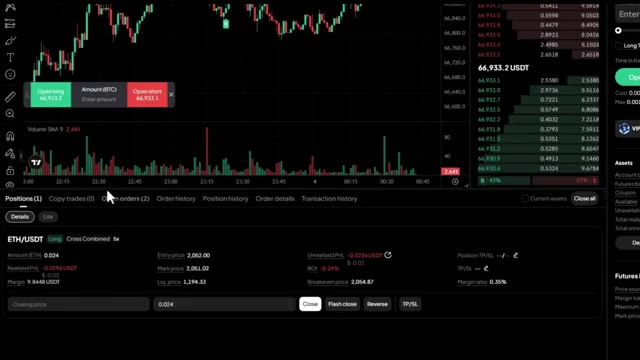
*⏱️ 00:00:09 — Interface d'échange affichant un graphique de prix avec un carnet d'ordres et les détails d'une position ouverte sur ETH/USD.*

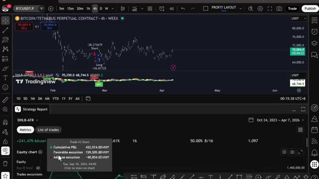
*⏱️ 00:00:17 — Graphique TradingView d'un contrat perpétuel Bitcoin avec un rapport de stratégie (Strategy Report) et des métriques de performance en bas d'écran.*

---

### ⏱️ `[00:00:34 - 00:01:10]` | Segment #02

**🔊 Audio (Transcription Intégrale Mot pour Mot en Français) :**
> Premièrement, vous avez besoin de l'application de bureau TradingView. Rendez-vous simplement sur tradingview.com barre oblique desktop et téléchargez-la. Je l'ai déjà installée ici. Un compte Plus ou Premium va vous donner plus d'indicateurs et plus de données, mais vous pouvez commencer avec la version gratuite. Deuxièmement, c'est Claude Code. C'est la version agentique de Claude AI. Il ne fait pas que parler, mais il agit réellement en fonction de votre saisie. Il se connecte à TradingView, lit vos graphiques, écrit et injecte du PineScript, analyse votre liste de surveillance, le tout en anglais simple. Le plan pro à 20 dollars par mois est tout ce dont vous avez besoin. Ces deux choses ensemble, c'est la configuration.

**👁️ Analyse Visuelle d'Écran (gemini-3.5-flash-lite) :**
**Interface & Outils** : TradingView, éditeur Pine Script

**Contenu textuel & Code** : Graphique de prix Bitcoin/TetherUS (1h, WEEX) et code source d'un indicateur technique en Pine Script.

**Action / Démonstration** : Présentation de l'interface TradingView et de son éditeur de code pour indicateurs.

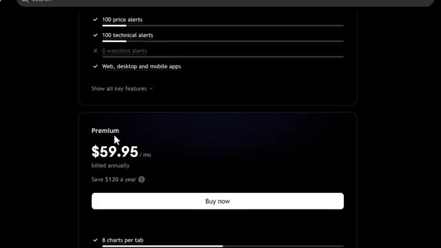
*⏱️ 00:00:43 — Page de tarification de TradingView montrant l'abonnement Premium à 59.95 dollars par mois.*

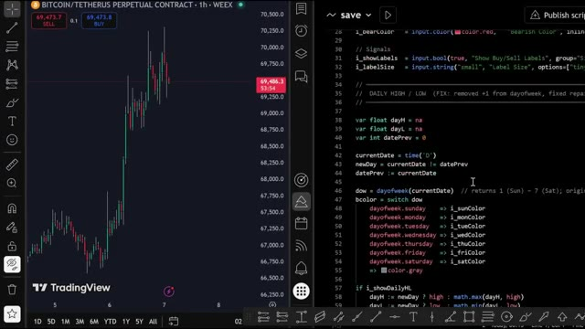
*⏱️ 00:01:01 — Interface de TradingView avec un graphique Bitcoin à gauche et l'éditeur de code Pine Script à droite.*

---

### ⏱️ `[00:01:11 - 00:01:45]` | Segment #03

**🔊 Audio (Transcription Intégrale Mot pour Mot en Français) :**
> Maintenant, laissez-moi vous montrer ce que ça fait réellement. Très bien, laissez-moi ouvrir Claude Code et vous montrer ça en direct. La première chose que je veux vous montrer, et c'est celle qui m'a vraiment époustouflé la première fois que je l'ai vue, Claude lit l'historique des prix, identifie les niveaux les plus significatifs, les trace directement sur votre graphique et vous indique lesquels comptent le plus en ce moment même. Regardez le graphique. Lignes vertes pour le support, lignes rouges pour la résistance, étiquettes de prix. Le nombre de fois que chaque niveau a été testé, tout est tracé automatiquement, et ensuite il vous dit exactement où se situe le prix en ce moment par rapport à ces

**👁️ Analyse Visuelle d'Écran (gemini-3.5-flash-lite) :**
**Interface & Outils** : Terminal de commande (Claude Code v2.1.92).

**Contenu textuel & Code** : Informations sur la version de Claude Code (v2.1.92), modèle Opus 4.6 (in context), profil Claude Max, et un message d'information concernant le passage de npm à l'installateur natif.

**Action / Démonstration** : Ouverture de l'interface CLI de Claude Code en direct pour lancer la démonstration.

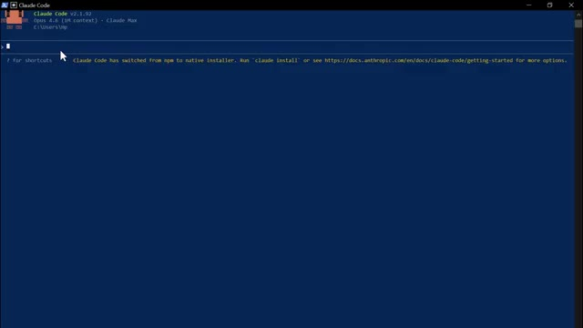
*⏱️ 00:01:19 — Vue du terminal de commande affichant l'interface de Claude Code.*

---

### ⏱️ `[00:01:45 - 00:02:10]` | Segment #04

**🔊 Audio (Transcription Intégrale Mot pour Mot en Français) :**
> niveaux et vous donne un biais directionnel basé sur l'historique de la façon dont le prix a réagi à chacun d'eux. Cela me prenait 20 minutes à tracer manuellement sur chaque graphique. Claude le fait en quelques secondes. Celui-ci, je l'exécute chaque matin avant de faire quoi que ce soit d'autre. Claude analyse votre liste de surveillance, vérifie les niveaux clés, lit les indicateurs et vous donne un compte rendu d'une page de tout ce que vous devez surveiller aujourd'hui. En moins de 60 secondes, regardez-le agir.

**👁️ Analyse Visuelle d'Écran (gemini-3.5-flash-lite) :**
**Interface & Outils** : Terminal de commandes ou interface de sortie texte (type invite de commandes / CLI)

**Contenu textuel & Code** : Tableaux avec colonnes "Level", "Tests" et "Notes" pour les niveaux de résistance (70 250, 69 900) et de support (69 660, 69 530, 69 290, 69 040, 68 770), ainsi qu'une section "Current Position & Bias" détaillant le prix actuel (69 891), le biais directionnel (Cautiously Bearish) et des scénarios de marché.

**Action / Démonstration** : Analyse textuelle automatisée des niveaux de support et de résistance avec évaluation du biais directionnel et des scénarios de trading.

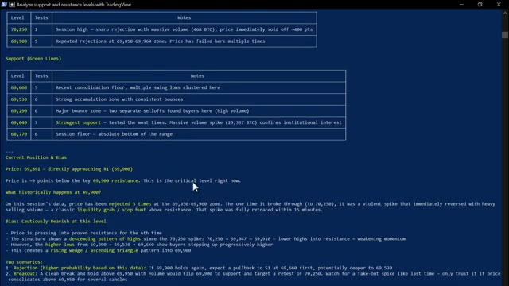
*⏱️ 00:01:51 — Un tableau de données textuel affichant des niveaux de support et de résistance, des analyses statistiques et des notes de trading générées par un assistant IA.*

---

### ⏱️ `[00:02:10 - 00:02:46]` | Segment #05

**🔊 Audio (Transcription Intégrale Mot pour Mot en Français) :**
> Point quotidien sur le Bitcoin. Ethan Saul. Ensuite, toute la liste de surveillance, en signalant tout ce qui bouge de manière significative ou se trouve à un niveau clé. Et voici le résultat. Un briefing matinal clair et formaté. Tout ce que je dois savoir sur le marché aujourd'hui, avant même d'avoir pris mon café. Maintenant, celui-ci s'adresse à tous ceux qui ont déjà des indicateurs ou des stratégies en cours d'exécution sur leur graphique. Claude lit le PineScript actuellement chargé sur votre graphique, trouve tous les bugs, les corrige, puis améliore le tout. Problèmes de repainting, erreurs de logique, calculs redondants. Il attrape tout cela. Il lit le code source complet,

**👁️ Analyse Visuelle d'Écran (gemini-3.5-flash-lite) :**
**Interface & Outils** : Terminal de commandes CLI, Éditeur Pine Script de TradingView, Graphique de prix TradingView.

**Contenu textuel & Code** : Code source Pine Script, tableaux de prix pour BTC, ETH et SOL, métriques de performance de backtest (Total P&L, Drawdown).
[DESC_IMAGE_3] Analyse des performances de la stratégie de trading et visualisation du code Pine Script associé sur TradingView.

**Action / Démonstration** : Explications face caméra et analyse conceptuelle des marchés.

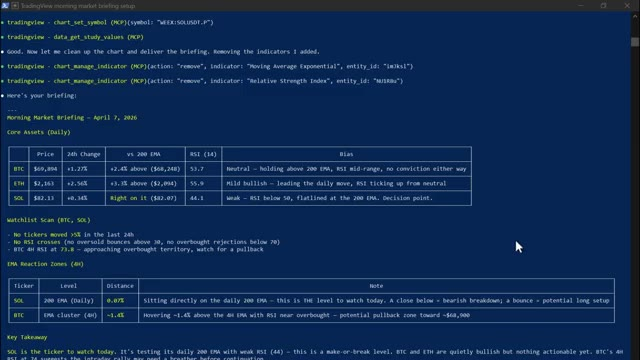
*⏱️ 00:02:19 — Un terminal de commandes affichant un briefing matinal formaté sur les cryptomonnaies (BTC, ETH, SOL) avec des tableaux de prix, des variations sur 24h et des analyses techniques.*

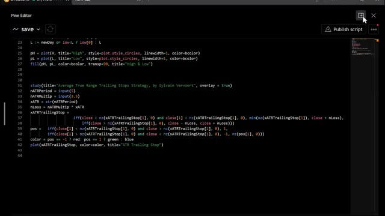
*⏱️ 00:02:28 — L'éditeur Pine Script de TradingView montrant le code source d'une stratégie de trading basée sur l'indicateur Average True Range Trailing Stops.*

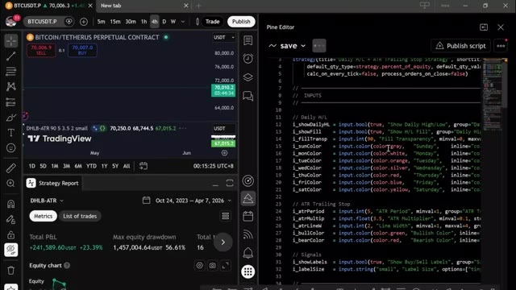
*⏱️ 00:02:37 — Une interface TradingView divisée en deux : à gauche, un graphique du Bitcoin avec un rapport de stratégie (Total P&L, Drawdown) ; à droite, l'éditeur de code Pine Script.*

---

### ⏱️ `[00:02:47 - 00:03:25]` | Segment #06

**🔊 Audio (Transcription Intégrale Mot pour Mot en Français) :**
> signale le problème de repeinte, trouve le bogue logique, puis il corrige tout et réinjecte la version améliorée directement dans TradingView. Avant et après, même stratégie, corrigée et améliorée. Et vous pouvez voir la différence dans les résultats du test rétrospectif immédiatement. Et ce dernier, c'est celui que j'utilise avant d'ouvrir toute position sérieuse. Claude analyse le même actif sur les unités de temps hebdomadaire, journalière, de quatre heures et d'une heure simultanément et vous donne un rapport de confluence structuré avec une recommandation de trade spécifique. Regardez-le parcourir chaque unité de temps, lire les EMA, vérifier le RSI, lire le MACD, construire l'image, et voici le résultat.

**👁️ Analyse Visuelle d'Écran (gemini-3.5-flash-lite) :**
**Interface & Outils** : TradingView et terminal de ligne de commande (Claude Code).

**Contenu textuel & Code** : Graphique de prix, signaux Buy/Sell, indicateurs de tendance, et tableau d'analyse multi-timeframe avec EMA, RSI, MACD et niveaux clés.

**Action / Démonstration** : Présentation des résultats du test rétrospectif d'une stratégie de trading et exécution d'une analyse multi-timeframe via l'assistant de code.

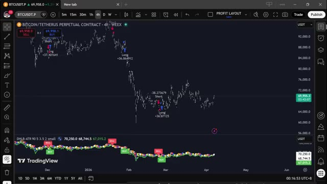
*⏱️ 00:02:56 — Graphique TradingView affichant la paire BTCUSDT en unités 4h avec des indicateurs techniques et des signaux de trading (Buy/Sell).*

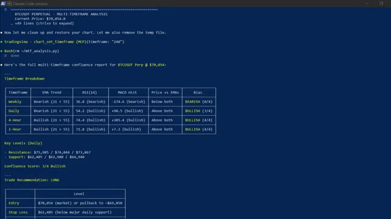
*⏱️ 00:03:06 — Terminal de commande Claude Code affichant un rapport d'analyse multi-timeframe (MTF) pour le contrat perpétuel BTCUSDT.*

---

### ⏱️ `[00:03:26 - 00:04:01]` | Segment #07

**🔊 Audio (Transcription Intégrale Mot pour Mot en Français) :**
> Analyse image par image, score de confluence global et recommandation de trade spécifique, prix d'entrée, stop loss, take profit basés sur tout ce qu'il vient de lire. C'est le genre d'analyse qui prenait autrefois 30 à 45 minutes à un trader sérieux pour être faite correctement. Claude le fait en seulement quelques minutes. Maintenant, toutes ces fonctionnalités sont déjà incroyables et puissantes par elles-mêmes, mais voici où cela devient entièrement automatisé. Vous pouvez connecter n'importe laquelle de ces stratégies directement à votre exchange via un webhook TradingView. Lorsque votre stratégie déclenche un signal sur TradingView,

**👁️ Analyse Visuelle d'Écran (gemini-3.5-flash-lite) :**
**Interface & Outils** : Terminal de commandes (Claude Code session)

**Contenu textuel & Code** : Tableau de décomposition par timeframe (Weekly, Daily, 4-Hour, 1-Hour avec EMA, RSI, MACD), Niveaux clés (Résistances à $75,985 / $74,044 / $73,867 et Supports à $62,405 / $62,900 / $64,940), Score de confluence (3/4 Bullish), Recommandation de trade LONG (Entrée à $70,054, Stop Loss à $62,405, Take Profit à $75,985, ratio R:R de ~1:0.8) et notes d'avertissement.

**Action / Démonstration** : Affichage des résultats générés par l'IA détaillant l'analyse technique multi-timeframe et la stratégie de trading proposée pour Bitcoin.

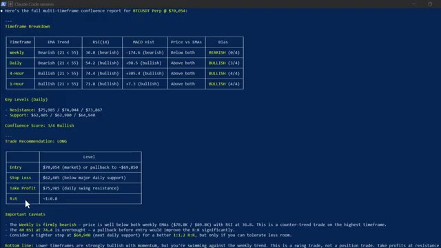
*⏱️ 00:03:35 — Rapport complet de confluence multi-timeframe pour BTCUSDT affiché dans un terminal de commande, incluant l'analyse des unités de temps, les niveaux clés, un score de confluence, une recommandation de trade long et des avertissements importants.*

---

### ⏱️ `[00:04:02 - 00:04:34]` | Segment #08

**🔊 Audio (Transcription Intégrale Mot pour Mot en Français) :**
> Claude le reçoit instantanément via le webhook et exécute le trade automatiquement sur votre exchange. Entrée, stop loss, take profit. Tout est fait. Sans que vous ne touchiez à rien, le signal est arrivé. Claude l'a traité. Trade ouvert. Confirmation avec tous les détails. Vous construisez la stratégie une seule fois, et à partir de ce moment-là, elle tourne toute seule. Et avant de vous montrer comment vous pouvez obtenir tout ça, je veux vous montrer une dernière chose. Celle-ci est un bonus. Claude peut mettre TradingView en mode replay, vous alimenter bougie par bougie, et vous coacher sur vos décisions de trade avec des retours en temps réel sur vos

**👁️ Analyse Visuelle d'Écran (gemini-3.5-flash-lite) :**
**Interface & Outils** : Présentation ou face-caméra explicatif du trader sans interface logicielle partagée.

**Contenu textuel & Code** : Explications orales des stratégies et mise en contexte méthodologique du marché.

**Action / Démonstration** : Explications face caméra et analyse conceptuelle des marchés.

---

### ⏱️ `[00:04:34 - 00:05:08]` | Segment #09

**🔊 Audio (Transcription Intégrale Mot pour Mot en Français) :**
> entrées et sorties. Claude choisit une date aléatoire, vous y dépose posé à l'aveugle, fait avancer 10 bougies pour le contexte, puis vous demande : achat, vente ou neutre. Vous répondez. Il fait avancer le graphique, vous montre ce qui s'est passé, suit vos profits et pertes, et après 10 rounds, il vous donne une analyse brutalement honnête de votre prise de décision. Où vous aviez raison, où vous aviez tort, quels schémas vous avez manqués. C'est comme avoir un coach en trading assis à côté de vous, disponible à tout moment, gratuitement. Et pour les quelques années à venir, il existera deux types de traders. Celui qui utilise l'intelligence artificielle et celui qui ne l'utilise pas. Et dans le même marché,

**👁️ Analyse Visuelle d'Écran (gemini-3.5-flash-lite) :**
**Interface & Outils** : Terminal de commandes (Claude Code session)

**Contenu textuel & Code** : Données OHLCV pour 10 barres (Bar 1 à Bar 10), prix actuel à 91,292, analyse textuelle de l'action des prix (chute de 93K à 80,6K puis rebond vers 91,292), et invite de décision (LONG, SHORT ou FLAT).

**Action / Démonstration** : Saisie de la commande "short" dans le terminal par l'utilisateur pour répondre au jeu de trading du round 1.

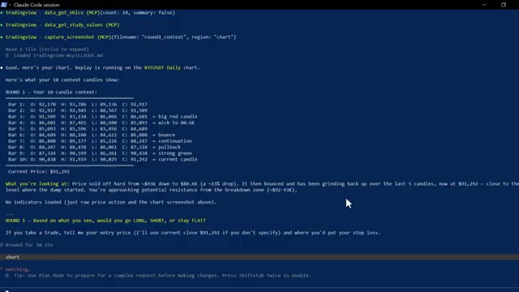
*⏱️ 00:04:43 — Capture d'écran montrant une session Claude Code dans un terminal, affichant les données OHLCV pour 1和小 candles sur le graphique journalier BTCUSDT ainsi qu'une question de trading.*

---

### ⏱️ `[00:05:08 - 00:05:29]` | Segment #10

**🔊 Audio (Transcription Intégrale Mot pour Mot en Français) :**
> cela va certainement façonner un résultat très différent. Voici comment vous obtenez tout cela. Je lance la communauté AI Trade Edge. Chaque prompt, bot, agent, modèle et guide étape par étape que j'utilise personnellement, le tout au même endroit. Tout ce que je vous ai montré aujourd'hui est à l'intérieur et tout ce que je construirai à l'avenir sera ajouté directement dans le groupe.

**👁️ Analyse Visuelle d'Écran (gemini-3.5-flash-lite) :**
**Interface & Outils** : Plateforme web Whop et interface de cours en ligne de la communauté AI Trade Edge.

**Contenu textuel & Code** : Tarifs d'abonnement (79.99 $/mois), étapes du cours (Prérequis, Installation de Claude Code, Serveur MCP, TradingView) et liste des fonctionnalités de lecture et de contrôle des graphiques.

**Action / Démonstration** : Présentation de la communauté payante et de la liste des fonctionnalités offertes par l'intégration de Claude avec TradingView.

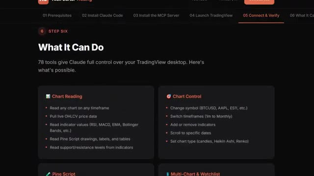
*⏱️ 00:05:18 — Interface de la communauté présentant les fonctionnalités de l'outil, notamment le contrôle de TradingView par Claude et ses 78 outils intégrés.*

---

### ⏱️ `[00:05:29 - 00:05:49]` | Segment #11

**🔊 Audio (Transcription Intégrale Mot pour Mot en Français) :**
> Chaque nouvelle intégration, chaque nouvelle stratégie, chaque nouveau prompt, et chaque mise à jour. Je travaille déjà sur une intégration complète d'Hyperliquid et sur un agent de trading autonome qui prend ses propres décisions, les deux sortant très bientôt au sein de la communauté. Si vous arrivez tôt, vous obtenez tout cela dès sa sortie.

**👁️ Analyse Visuelle d'Écran (gemini-3.5-flash-lite) :**
**Interface & Outils** : TradingView et interface de communauté / application web.

**Contenu textuel & Code** : Graphique de prix BTCUSDT.P en 4h, indicateur de type oscillateur/lignes en bas (DHLB-ATR), et menu de navigation avec des rubriques dédiées à l'IA et au trading.

**Action / Démonstration** : Navigation dans l'interface de la communauté pour présenter les différentes intégrations et l'agent de trading autonome.

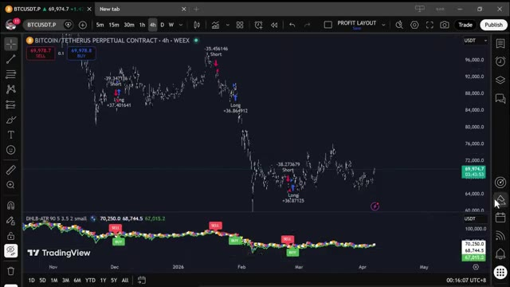
*⏱️ 00:05:34 — Capture d'écran montrant un graphique TradingView en timeframe 4h pour Bitcoin / TetherUS avec des indicateurs techniques et des signaux d'achat/vente (Long/Short).*

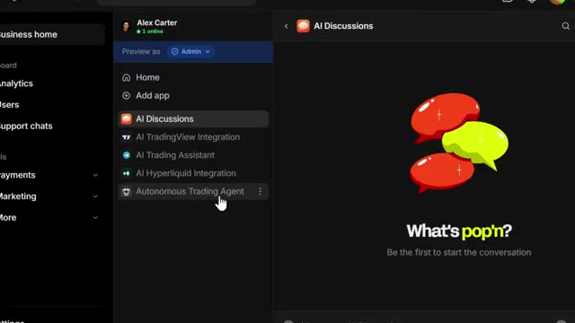
*⏱️ 00:05:39 — Capture d'écran montrant l'interface d'une communauté ou plateforme (avec le panneau de navigation à gauche affichant des options comme 'AI Discussions', 'AI TradingView Integration', 'AI Hyperliquid Integration' et 'Autonomous Trading Agent').*

---

### ⏱️ `[00:05:49 - 00:06:07]` | Segment #12

**🔊 Audio (Transcription Intégrale Mot pour Mot en Français) :**
> Le prix est de 79,99 $ par mois. Et honnêtement, quand on y pense, ce que c'est vraiment, la configuration de trading par IA la plus avancée disponible pour les traders particuliers en ce moment, constamment mise à jour avec tout inclus. Ce n'est pas beaucoup d'argent. Un seul bon trade suffit à couvrir les frais.

**👁️ Analyse Visuelle d'Écran (gemini-3.5-flash-lite) :**
**Interface & Outils** : Interface web de configuration (étape 05/06) et documentation des fonctionnalités.

**Contenu textuel & Code** : Texte listant 78 outils permettant à Claude de contrôler TradingView (lecture de graphiques, données OHLCV, indicateurs techniques RSI/MACD/EMA, modification de symboles, et gestion des timeframes).

**Action / Démonstration** : Présentation des capacités du système d'IA intégré pour le trading et navigation dans les étapes de configuration.

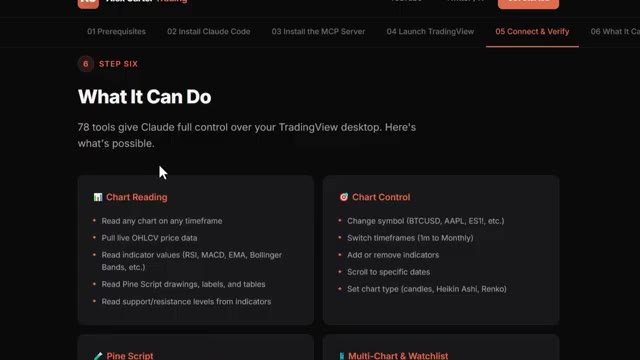
*⏱️ 00:05:54 — Capture d'écran montrant l'interface d'une application ou d'un site web de formation au trading avec des étapes numérotées et la section 'What It Can Do' détaillant les fonctionnalités de contrôle de TradingView par l'IA.*

---

### ⏱️ `[00:06:07 - 00:06:35]` | Segment #13

**🔊 Audio (Transcription Intégrale Mot pour Mot en Français) :**
> but the first 100 members lock in that rate permanently. After that, the price goes up. So the earlier you get in, the better the deal. The link is in the description. Get in now before the price goes up. You genuinely cannot afford to miss this. And that is it. Claude Code and TradingView, your own AI trading assistant, fully connected and running live. If you want the full demo on how to take trades using only your Telegram app, check the video popping on screen right now.

**👁️ Analyse Visuelle d'Écran (gemini-3.5-flash-lite) :**
**Interface & Outils** : Présentation ou face-caméra explicatif du trader sans interface logicielle partagée.

**Contenu textuel & Code** : Explications orales des stratégies et mise en contexte méthodologique du marché.

**Action / Démonstration** : Explications face caméra et analyse conceptuelle des marchés.

---

### ⏱️ `[00:06:35 - 00:06:42]` | Segment #14

**🔊 Audio (Transcription Intégrale Mot pour Mot en Français) :**
> Si vous avez trouvé cela utile, laissez un pouce bleu. Cela aide vraiment beaucoup la chaîne. Abonnez-vous si ce n'est pas déjà fait, et je vous vois dans la prochaine.

**👁️ Analyse Visuelle d'Écran (gemini-3.5-flash-lite) :**
**Interface & Outils** : Présentation ou face-caméra explicatif du trader sans interface logicielle partagée.

**Contenu textuel & Code** : Explications orales des stratégies et mise en contexte méthodologique du marché.

**Action / Démonstration** : Explications face caméra et analyse conceptuelle des marchés.

---

