# 🎬 How I Track All Whale Traders With Claude Code

> **Chaîne** : [Alex Carter](https://www.youtube.com/@AlexCarterTrading)  
> **Lien YouTube** : [https://www.youtube.com/watch?v=wSoBeIcZAHg](https://www.youtube.com/watch?v=wSoBeIcZAHg)  
> **Date de publication** : 20260408  
> **Durée** : 00:09:43  
> **Identifiant vidéo** : `wSoBeIcZAHg`  
> **Transcription & Analyse** : `whisper-v3-large-turbo+gemini-3.5-flash-lite`  

---

## 📌 Synthèse Exécutive & Outils

### 💡 Résumé

Cette vidéo dévoile une méthodologie de pointe en trading quantitatif, exploitant l'intelligence artificielle agentique pour analyser en temps réel l'écosystème on-chain de Hyperliquid. En s'affranchissant des méthodes de recherche manuelles et des clés API complexes, l'approche repose sur un agent IA connecté directement aux endpoints publics d'une blockchain de type exchange décentralisé (DEX). L'objectif est d'extraire la substantifique moelle du comportement des portefeuilles les plus rentables (les « baleines » ou « smart money ») pour identifier des divergences de positionnement massives face aux investisseurs particuliers (le « retail »).

Les stratégies décortiquées s'articulent autour de l'analyse comparative et du croisement de données comportementales à grande échelle. En scannant instantanément des dizaines de milliers de portefeuilles, l'outil hiérarchise les traders selon leur P&L global, met en lumière les accumulations ou les désinvestissements sectoriels (comme le biais haussier sur le Bitcoin et baissier sur Ethereum), et détecte les anomalies de marché. Cette approche permet de repérer des configurations à haute conviction où la smart money prend le contre-pied exact du grand public, transformant ces frictions de marché en opportunités directionnelles nettes.

Enfin, les démonstrations pratiques illustrent la génération automatisée de plans de trading complets et instantanés. Qu'il s'agisse d'auditer l'historique de performance d'un portefeuille spécifique, d'établir un briefing matinal automatisé ou de calculer des points d'entrée, des stop-loss et des take-profits précis basés sur des métriques de levier et d'exposition réelle, la démarche démontre l'avantage compétitif immense conféré par l'automatisation par l'IA. Elle rappelle toutefois que ces signaux on-chain doivent impérativement s'intégrer dans un cadre rigoureux de gestion des risques et d'analyse technique traditionnelle.

### 🛠️ Outils, Modèles & Logiciels Présentés

* **Claude Code** : Version agentique et autonome de Claude AI capable d'interagir directement avec des API publiques pour exécuter des requêtes complexes en langage naturel.
* **Hyperliquid** : Exchange décentralisé (DEX) de type perpetual fonctionnant sur sa propre blockchain, offrant une transparence totale et publique de l'ensemble des positions, portefeuilles et historiques de trade sans nécessiter de KYC.
* **TradingView** : Plateforme de graphisme et d'analyse technique utilisée en conjonction avec les signaux on-chain pour valider les configurations graphiques.
* **Grok Bots** : Outils d'automatisation et de traitement de données souvent couplés aux boucles de rétroaction pour le scalping et le suivi des flux.
* **Telegram** : Canal de messagerie utilisé pour la réception des briefings matinales et des notifications de plans de trading automatisés.
* **AI Trade Edge Community** : Communauté et hub centralisant l'accès aux codes de compétences (skill codes), prompts, modèles et guides étape par étape de la stratégie.

### 🔑 Points Clés & Enseignements Stratégiques

* **Exploitation de la transparence on-chain** : L'architecture décentralisée d'Hyperliquid rend l'intégralité des positions, des prix d'entrée, des leviers et des P&L non réalisés de 33 000 portefeuilles publiquement accessibles via son API gratuite.
* **Analyse de divergence Smart Money vs Retail** : La stratégie centrale consiste à comparer le positionnement des 20 portefeuilles les plus rentables face aux 20 plus perdants afin de repérer les actifs où les deux groupes s'opposent frontalement.
* **Détection des trades encombrés** : L'outil isole instantanément les consensus unanimes (par exemple, un achat massif partagé sur Sui) pour éviter les pièges de liquidité ou, au contraire, identifier les désalignements forts.
* **Génération automatisée de plans de trading** : En cas de divergence maximale (comme sur le Monero ou l'Ethereum), l'IA synthétise un plan complet incluant le sens de la transaction, le prix d'entrée, le stop-loss et plusieurs niveaux de take-profit.
* **Audit granulaire des portefeuilles d'élite** : Il est possible d'analyser l'historique complet d'une baleine spécifique (plus gros gains, pertes, profils de risque et effet de levier moyen, souvent situés entre 3x et 10x) pour décider s'il est pertinent de répliquer ses mouvements.
* **Briefing matinal macro-comportemental** : Un scan automatisé quotidien de 50 portefeuilles majeurs permet de cartographier dès l'ouverture des marchés les accumulations en cours et les positions ouvertes au cours des dernières 24 heures.
* **Calcul précis du levier et de l'exposition** : L'analyse en direct permet de connaître l'effet de levier moyen employé par l'argent intelligent sur un token donné (par exemple, ~19x sur l'ETH), offrant une vision claire du degré de conviction des opérateurs.
* **Gestion rigoureuse du sizing de position** : Les plans de trade fournis intègrent des recommandations de gestion du capital, telles que l'allocation d'un pourcentage fixe (ex: 15 %) du capital total par trade.
* **Complémentarité impérative avec l'analyse technique** : Les données de suivi des baleines ne constituent qu'une pièce du puzzle et doivent obligatoirement être croisées avec des graphiques de prix et des règles strictes de risk management.
* **Avantage asymétrique de l'automatisation** : L'utilisation d'agents IA permet de réaliser en moins d'une minute des analyses de flux de données qui nécessiteraient des heures de recherche manuelle, redéfinissant les standards du trading pour les investisseurs particuliers.

---

## ⏱️ Chronologie & Transcription Complète Audio & Visuelle (Mot pour Mot)

### ⏱️ `[00:00:00 - 00:00:20]` | Segment #01

**🔊 Audio (Transcription Intégrale Mot pour Mot en Français) :**
> What if you could scan 33,000 wallets on Hyperliquid? Find the top 20 most profitable traders. See exactly what they're buying right now. Their entry prices, their leverage, their unrealized P&L, and get a complete trade plan based on all of it. No API keys needed, no coding, no manual research.

**👁️ Analyse Visuelle d'Écran (gemini-3.5-flash-lite) :**
**Interface & Outils** : Terminal de commandes (CLI) / Script de suivi de portefeuilles crypto.

**Contenu textuel & Code** : Rapport « Hyperliquid Whale Report » montrant le portefeuille #1 (0xecb6...2b00) avec un PnL global de +204,4M$, un PnL mensuel de +5,2M$, une valeur de compte de 71,8M$, ainsi qu'un tableau des positions clés (Coin, Direction, Size, Entry, Leverage, uPnL) pour BTC, ETH, SOL, ENA, LINK, FARTCOIN, WLD, AAVE, HYPE, MON, DOGE.

**Action / Démonstration** : Génération et affichage du rapport d'analyse automatisé des portefeuilles les plus rentables.

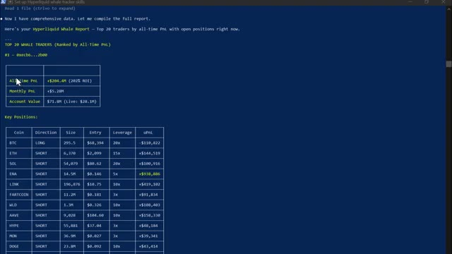
*⏱️ 00:00:05 — Capture d'écran d'un terminal en ligne de commande affichant un rapport détaillé sur les baleines du protocole Hyperliquid avec les performances et positions ouvertes du top 1 trader.*

---

### ⏱️ `[00:00:20 - 00:00:55]` | Segment #02

**🔊 Audio (Transcription Intégrale Mot pour Mot en Français) :**
> In this video, I'm going to show you exactly what this looks like live on screen. Every feature, every use case. and at the end i'll tell you exactly how you can get all of this for yourself so without any further ado let's get straight into it all right you need one tool for this setup this will be very quick claude code this is the agentic version of claude ai it doesn't just talk it actually acts it connects to hyperliquid's public api scans thousands of wallets ranks traders by profitability and gives you a complete breakdown of what smart money is doing right now all from plain english

**👁️ Analyse Visuelle d'Écran (gemini-3.5-flash-lite) :**
**Interface & Outils** : Page web du guide de configuration de Whale Tracker et site officiel de Claude (Anthropic).

**Contenu textuel & Code** : Texte descriptif sur le scan de plus de 33 000 portefeuilles Hyperliquid, options de téléchargement de compétences et commande d'installation `irm https://claude.ai/install.ps1 | iex`.

**Action / Démonstration** : Navigation sur la page de présentation du script de suivi de baleines et passage à la page de téléchargement/installation de l'outil Claude Code.

*⏱️ 00:00:29 — Guide d'installation du Whale Tracker d'Alex Carter Trading, montrant un outil Claude Code pour scanner les portefeuilles Hyperliquid.*

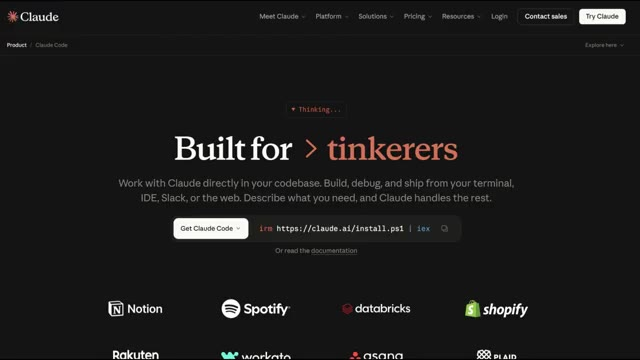
*⏱️ 00:00:37 — Page web de présentation de Claude Code ("Built for tinkerers"), affichant les liens et la commande d'installation PowerShell.*

---

### ⏱️ `[00:00:55 - 00:01:14]` | Segment #03

**🔊 Audio (Transcription Intégrale Mot pour Mot en Français) :**
> The pro plan at $20 a month is all you need. Now, Hyperliquid. Very quickly. It's a decentralized perpetual exchange running on its own blockchain. No KYC. No middleman. And because it's fully on-chain, every single trade, every position, every wallet, it's all public. That's what makes this possible.

**👁️ Analyse Visuelle d'Écran (gemini-3.5-flash-lite) :**
**Interface & Outils** : Documentation en ligne Hyperliquid (GitBook) et interface de trading décentralisée Hyperliquid.

**Contenu textuel & Code** : Texte explicatif sur la blockchain L1 Hyperliquid, le consensus HyperBFT, ainsi que les options de connexion de portefeuilles (Log in with Email, MetaMask, OKX Wallet, WalletConnect, Coinbase Wallet).

**Action / Démonstration** : Navigation et présentation de la documentation officielle puis affichage du module de connexion utilisateur sans KYC de la plateforme.

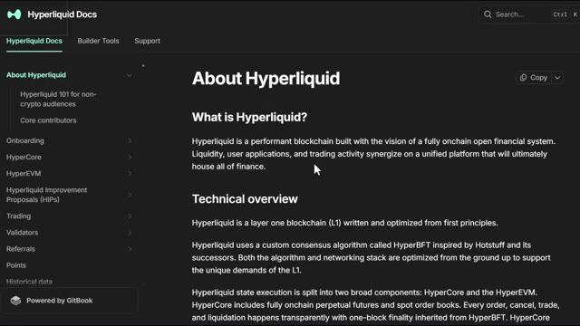
*⏱️ 00:01:00 — Documentation officielle de Hyperliquid (Hyperliquid Docs) présentant la description et la vue d'ensemble technique de la plateforme.*

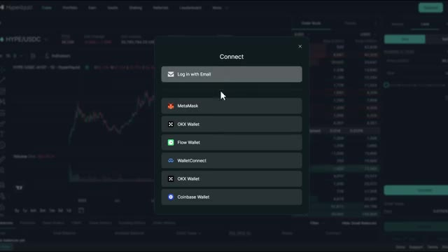
*⏱️ 00:01:04 — Interface de la plateforme de trading Hyperliquid affichant une fenêtre modale de connexion aux portefeuilles crypto (MetaMask, OKX Wallet, WalletConnect, etc.).*

---

### ⏱️ `[00:01:15 - 00:01:33]` | Segment #04

**🔊 Audio (Transcription Intégrale Mot pour Mot en Français) :**
> Hyperliquid's API is completely free and public, and Claude connects to it automatically with a skill code I created. And if you want the full step-by-step setup instructions, every prompt and the skill code itself, all of that is inside the AI Trade Edge community. Link is in the description. That's the setup.

**👁️ Analyse Visuelle d'Écran (gemini-3.5-flash-lite) :**
**Interface & Outils** : Documentation technique Hyperliquid, page web personnalisée Alex Carter Trading.

**Contenu textuel & Code** : Liens SDK GitHub, spécifications de l'API publique, métriques de portefeuilles suivis (33,000+), liste des fonctionnalités de trading par API (ordres, positions, historique).

**Action / Démonstration** : Navigation à travers la documentation et les guides de configuration pour l'intégration de l'API et du skill Claude.

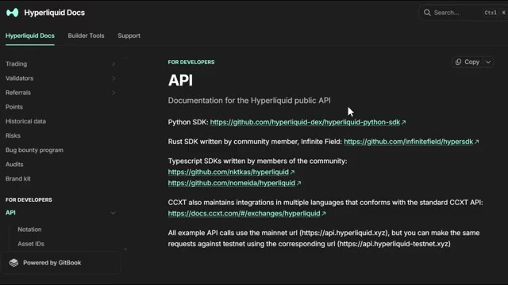
*⏱️ 00:01:20 — Documentation officielle de l'API publique Hyperliquid sur le site web, affichant les liens vers les SDKs Python, Rust et Typescript.*

*⏱️ 00:01:24 — Page de guide de configuration du "Whale Tracker" sur la plateforme Alex Carter Trading, permettant de scanner plus de 33 000 portefeuilles Hyperliquid en temps réel.*

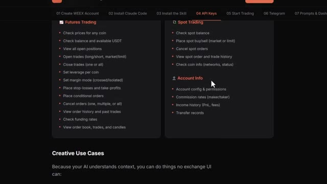
*⏱️ 00:01:29 — Interface de documentation détaillant les fonctionnalités de trading (Futures, Spot et informations de compte) ainsi que les cas d'utilisation créatifs de l'IA.*

---

### ⏱️ `[00:01:33 - 00:02:00]` | Segment #05

**🔊 Audio (Transcription Intégrale Mot pour Mot en Français) :**
> Now let me show you what it actually does. All right, let me open Claude Code and show you this live. Here's the first thing I want to show you. Claude scans the top 20 most profitable wallets on Hyperliquid right now, pulls every open position, and ranks them by total profitability. All in one shot. Watch what happens. Claude hits Hyperliquid's public endpoints, starts pulling wallet data across 33,000 addresses, ranks them by profitability, and starts building the report.

**👁️ Analyse Visuelle d'Écran (gemini-3.5-flash-lite) :**
**Interface & Outils** : Terminal de commandes Claude Code (CLI)

**Contenu textuel & Code** : Informations de version (Claude Code v2.1.92, Opus 4.6), chemin du répertoire utilisateur et invite de commande vide avec le curseur.

**Action / Démonstration** : Ouverture du terminal pour démarrer la démonstration en direct et lancer des scripts d'analyse des portefeuilles Hyperliquid.

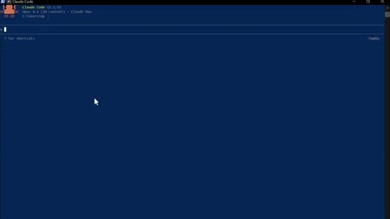
*⏱️ 00:01:40 — Interface de la console Claude Code v2.1.92 ouverte sur un terminal en ligne de commande.*

---

### ⏱️ `[00:02:01 - 00:02:23]` | Segment #06

**🔊 Audio (Transcription Intégrale Mot pour Mot en Français) :**
> Tu peux le voir fonctionner à travers les portefeuilles en temps réel. Les prix d'entrée, l'effet de levier, les profits et pertes non réalisés, tout arrive en direct. Et voici le résultat. Les 20 principales baleines classées, chaque position ouverte répertoriée. Et en bas, le résumé du sentiment global. En ce moment, l'argent intelligent est acheteur net sur le Bitcoin et vendeur net sur presque tout le reste, en particulier Ethereum.

**👁️ Analyse Visuelle d'Écran (gemini-3.5-flash-lite) :**
**Interface & Outils** : Terminal de commandes / Interpréteur de scripts

**Contenu textuel & Code** : Données JSON formatées listant des paires de cryptomonnaies (MOODENG, HYPE, VIRTUAL, MORPHO, IP), la direction des positions (SHORT), la taille, le prix d'entrée, les profits et pertes non réalisés (unrealized_pnl), l'effet de levier et le prix de liquidation.

**Action / Démonstration** : Suivi et affichage en temps réel des portefeuilles et positions ouvertes des baleines via un script.

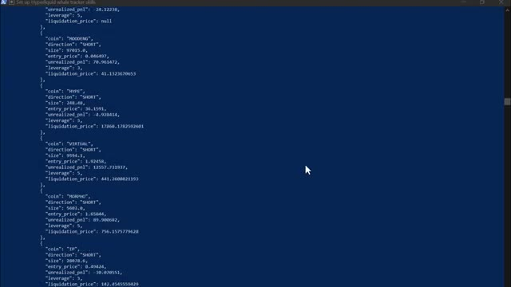
*⏱️ 00:02:06 — Capture d'écran montrant un terminal affichant des données JSON en temps réel sur les positions des baleines.*

---

### ⏱️ `[00:02:24 - 00:02:43]` | Segment #07

**🔊 Audio (Transcription Intégrale Mot pour Mot en Français) :**
> C'est le genre de signal qu'il fallait des heures pour reconstituer manuellement. Claude le fait en moins d'une minute. Maintenant, c'est là que ça devient vraiment intéressant. Ce prompt compare les 20 portefeuilles les plus rentables aux 20 portefeuilles les plus perdants et trouve chaque jeton où ils sont sur des côtés opposés de la transaction.

**👁️ Analyse Visuelle d'Écran (gemini-3.5-flash-lite) :**
**Interface & Outils** : Terminal de commandes en ligne de commande (CLI) sur fond bleu.

**Contenu textuel & Code** : Métriques de performance globale (« All-Time PnL +$204.4M », « Monthly PnL +$5.28M », « Account Value $71.8M ») et tableau des positions ouvertes (« Key Positions ») détaillant les cryptos (BTC, ETH, SOL, ENA, LINK, FARTCOIN, WLD, AAVE, HYPE, MON, DOGE, PUMP), la direction (LONG/SHORT), la taille, le prix d'entrée, le levier et l'uPnL.

**Action / Démonstration** : Analyse et affichage des données des portefeuilles des baleines de la plateforme Hyperliquid générées par l'outil.

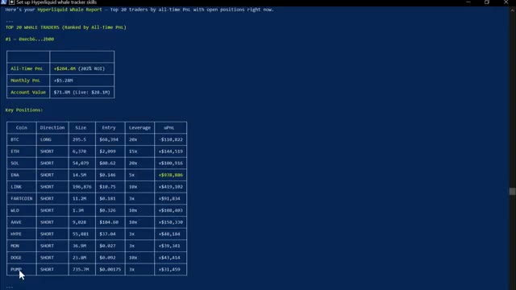
*⏱️ 00:02:29 — Rapport détaillé dans un terminal affichant les performances (PnL et positions ouvertes) du top trader d'un tracker de baleines Hyperliquid.*

---

### ⏱️ `[00:02:43 - 00:03:20]` | Segment #08

**🔊 Audio (Transcription Intégrale Mot pour Mot en Français) :**
> Regardez-le tirer sur les deux groupes simultanément : les portefeuilles rentables d'un côté, les portefeuilles perdants de l'autre, et ensuite il commence à croiser les positions. Voici le résultat. Vous pouvez voir là où les deux groupes sont d'accord. Ils sont tous les deux acheteurs sur suey, donc c'est un trade encombré. Mais regardez ça. L'argent intelligent est massivement acheteur sur XMR, TRX, Pendle et Farcoin, tandis que les traders de détail sont vendeurs sur ces cryptos. Cette divergence juste là, c'est le signal. C'est le genre d'analyse pour laquelle les hedge funds payent. Vous l'obtenez grâce à un outil d'IA à 20 dollars et une API publique gratuite. Au fait, si vous trouvez cela utile jusqu'à présent, restez jusqu'à

**👁️ Analyse Visuelle d'Écran (gemini-3.5-flash-lite) :**
**Interface & Outils** : Terminal de commande en ligne de type CLI / script Python.

**Contenu textuel & Code** : Statistiques globales (All-Time PnL +$204.4M, Monthly PnL +$5.28M, Account Value $71.8M) et tableau des positions ouvertes par crypto (BTC, ETH, SOL, ENA, LINK, etc.) avec direction, taille, prix d'entrée, levier et PnL non réalisé.

**Action / Démonstration** : Présentation des données d'analyse des positions des traders performants (Whale Tracker).

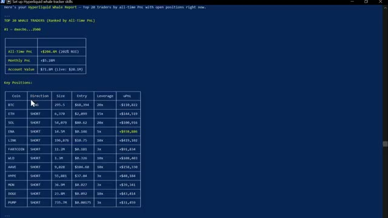
*⏱️ 00:02:52 — Rapport de suivi des baleines sur Hyperliquid affichant les performances et les positions clés du top 20 des traders.*

---

### ⏱️ `[00:03:20 - 00:03:43]` | Segment #09

**🔊 Audio (Transcription Intégrale Mot pour Mot en Français) :**
> fin. Je vais vous montrer comment obtenir un plan de trading complet généré par IA avec un point d'entrée spécifique, un stop-loss et un take-profit, le tout basé sur le positionnement des baleines. Ça arrive dans une minute. Celui-ci, je le lance chaque fois que je cherche un setup à haute conviction. Claude trouve un token où les traders particuliers sont massivement positionnés d'un côté et où l'argent intelligent est soit neutre, soit de l'autre côté.

**👁️ Analyse Visuelle d'Écran (gemini-3.5-flash-lite) :**
**Interface & Outils** : Terminal de commandes ou interface CLI.

**Contenu textuel & Code** : Analyse du positionnement des baleines (100% top traders LONG, 0% rekt SHORT), tableau de plan de trading pour XMR (Monero) avec prix d'entrée ($325-330), stop-loss ($305), take-profit 1 ($355) et take-profit 2 ($385), effet de levier (5x), taille de position, et niveau de confiance (7/10) avec explications détaillées.

**Action / Démonstration** : Présentation et explication d'un plan de trading complet généré par IA basé sur les baleines.

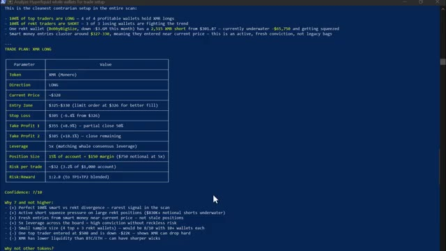
*⏱️ 00:03:26 — Capture d'écran montrant un terminal affichant un plan de trading généré par IA basé sur le positionnement des baleines (XMR LONG).*

---

### ⏱️ `[00:03:43 - 00:04:17]` | Segment #10

**🔊 Audio (Transcription Intégrale Mot pour Mot en Français) :**
> Ensuite, il vous donne un trade spécifique. Regardez-le parcourir les données de divergence qu'il a déjà récupérées. Il cherche le plus grand écart entre la position des portefeuilles perdants et celle des portefeuilles rentables. Et voici le résultat. Il a signalé l'ETH où l'argent des investisseurs lambda est à 93 % net vendeur et l'argent intelligent a une exposition presque nulle du côté vendeur. Claude explique la divergence, pourquoi c'est important, puis vous donne un point d'entrée, un stop-loss et un take-profit spécifiques. C'est une idée de trade complète générée en quelques secondes sur la base de données de positionnement réelles provenant de milliers de traders en direct.

**👁️ Analyse Visuelle d'Écran (gemini-3.5-flash-lite) :**
**Interface & Outils** : Terminal de commandes / Interpréteur de scripts Bash et Python

**Contenu textuel & Code** : Scripts de traitement de données JSON, affichage de résultats agrégés pour le Smart Money (Top 25 PnL) avec des lignes pour BTC et ETH (ex: ETH: 11L / 7S (18) 61% long), et tentatives de récupération de prix via l'outil TradingView / script Weex.

**Action / Démonstration** : Exécution de scripts en ligne de commande pour récupérer et analyser les positions des portefeuilles et inspecter les données sur l'ETH.

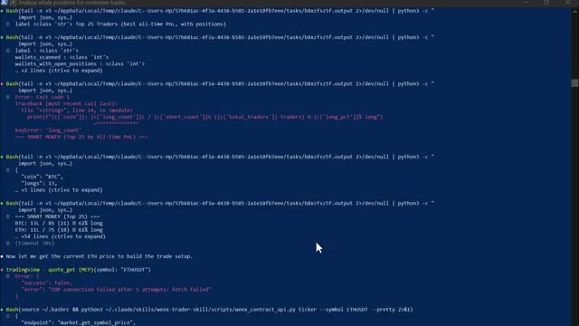
*⏱️ 00:03:51 — Capture d'écran montrant un terminal de commandes avec des scripts Python et des blocs Bash exécutant l'analyse des positions des traders.*

---

### ⏱️ `[00:04:17 - 00:04:50]` | Segment #11

**🔊 Audio (Transcription Intégrale Mot pour Mot en Français) :**
> portefeuilles. Maintenant, celui-ci est conçu pour lorsque vous surveillez déjà un jeton spécifique et que vous voulez savoir ce que les meilleurs traders du marché font avec. Regardez-le filtrer pour ne garder que les positions en ETH du groupe de portefeuilles rentables. Prix d'entrée moyen, effet de levier moyen, exposition totale, le tout calculé en direct. Et voici le résultat. L'entrée moyenne de l'argent intelligent sur l'ETH se situe à 2 081 $ pour les longs et 2 096 $ pour les shorts. L'effet de levier moyen est de 19,3 fois sur les longs et de 17,8 fois sur les shorts.

**👁️ Analyse Visuelle d'Écran (gemini-3.5-flash-lite) :**
**Interface & Outils** : Terminal de commandes (script Python / interface CLI).

**Contenu textuel & Code** : Tableaux de métriques pour le 'SMART MONEY (Top 20 by All-Time PnL)' : Traders (10 longs, 5 shorts), Avg Entry ($2,081.23 / $2,096.29), Avg Leverage (19.3x / 17.8x), Total Exposure ($8.65M / $20.17M), et PnL combiné.

**Action / Démonstration** : Affichage des données de positionnement sur ETH filtrées par portefeuille rentable et analyse textuelle du sentiment du marché.

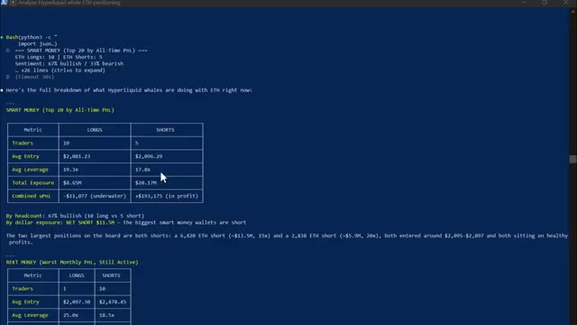
*⏱️ 00:04:25 — Un terminal de commandes affichant l'analyse des positions sur ETH des baleines Hyperliquid (Smart Money et Rekt Money).*

---

### ⏱️ `[00:04:50 - 00:05:25]` | Segment #12

**🔊 Audio (Transcription Intégrale Mot pour Mot en Français) :**
> L'exposition longue totale sur l'ensemble des principaux portefeuilles est de 8,65 millions de dollars. Et ensuite, Claude vous donne les deux côtés, le scénario haussier et le scénario baissier, basés uniquement sur la façon dont ces portefeuilles sont positionnés. C'est votre avantage. Vous savez ce que font les traders les plus rentables du marché avec le token exact que vous examinez avant d'ouvrir une seule position. Maintenant, celui-ci est mon préféré personnel. Si vous tombez un jour sur un portefeuille qui génère absolument un max de profits, vous pouvez coller l'adresse directement dans Claude et obtenir une analyse complète de tout ce que ce portefeuille a jamais fait. Regardez-le extraire l'historique complet du portefeuille.

**👁️ Analyse Visuelle d'Écran (gemini-3.5-flash-lite) :**
**Interface & Outils** : Présentation ou face-caméra explicatif du trader sans interface logicielle partagée.

**Contenu textuel & Code** : Explications orales des stratégies et mise en contexte méthodologique du marché.

**Action / Démonstration** : Explications face caméra et analyse conceptuelle des marchés.

---

### ⏱️ `[00:05:25 - 00:05:55]` | Segment #13

**🔊 Audio (Transcription Intégrale Mot pour Mot en Français) :**
> historique, positions ouvertes, P&L total, plus grands gains, plus grosses pertes, profil de risque. Et voici le résultat. Ce portefeuille affiche un gain total de 400 000 dollars. Son plus gros gain individuel a été de 276 000 dollars sur un short DYDX. Il utilise un faible effet de levier, principalement de 3x à 10x. Et en ce moment, il détient une position long importante sur le XRP et des positions plus petites sur le BNB et le Bitcoin. Le verdict de Claude ? Oui, c'est un trader qui vaut la peine d'être suivi.

**👁️ Analyse Visuelle d'Écran (gemini-3.5-flash-lite) :**
**Interface & Outils** : Interface de terminal de commande en ligne (CLI)

**Contenu textuel & Code** : Tableaux 'Wallet Overview' (Account Value: $13,910,150, Total Open Positions: 106, Long: 47, Short: 59, Net Unrealized PnL: +~$400K) et 'Top 10 Biggest Winners (Unrealized)' détaillant les cryptos shortées (DYDX: +$276,096, PUMP: +$198,293, etc.) avec effet de levier.

**Action / Démonstration** : Présentation et analyse des performances et des positions ouvertes d'un portefeuille de type 'whale' sur Hyperliquid.

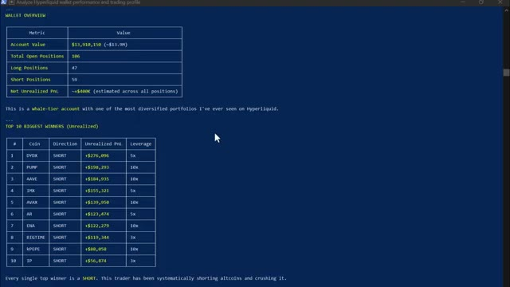
*⏱️ 00:05:32 — Capture d'écran montrant une interface de terminal avec des tableaux de données sur la performance d'un portefeuille sur Hyperliquid, incluant la valeur du compte, les positions ouvertes et le classement des plus gros gains.*

---

### ⏱️ `[00:05:55 - 00:06:17]` | Segment #14

**🔊 Audio (Transcription Intégrale Mot pour Mot en Français) :**
> Maintenant, vous pouvez suivre exactement ce que fait ce portefeuille ensuite. Celui-ci, je le lance tous les matins avant de faire quoi que ce soit d'autre. Claude extrait les 50 meilleurs portefeuilles de baleines, trouve ce qui est accumulé, ce qui est délesté, toutes les nouvelles positions ouvertes au cours des dernières 24 heures, et vous donne la transaction avec la plus forte conviction parmi les 10 portefeuilles les plus rentables, le tout formaté sous forme de briefing matinal rapide.

**👁️ Analyse Visuelle d'Écran (gemini-3.5-flash-lite) :**
**Interface & Outils** : Terminal de commandes (CLI) / Script d'analyse Python.

**Contenu textuel & Code** : Tableaux de données textuels classés par tokens avec le nombre de positions Long, Short et le biais (ex: GRIFFAIN, SCR, MAV, XLM, ONDO, LIT, LINK, ZEC, ETH, MON), ainsi qu'une analyse textuelle soulignant les positions des baleines ("Dumping / Exiting").

**Action / Démonstration** : Affichage des positions des portefeuilles de baleines pour identifier les tokens délestés ou accumulés par les smart money.

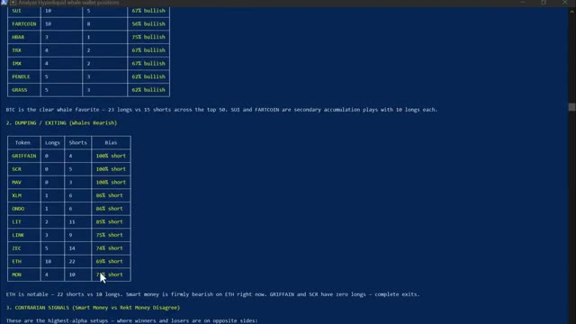
*⏱️ 00:06:01 — Capture d'écran montrant un terminal de commande affichant les résultats d'une analyse automatisée des portefeuilles de baleines sur Hyperliquid.*

---

### ⏱️ `[00:06:17 - 00:06:49]` | Segment #15

**🔊 Audio (Transcription Intégrale Mot pour Mot en Français) :**
> Regardez-le s'exécuter. Analyse de 50 portefeuilles, signalement des accumulations, signalement des sorties, extraction des nouvelles positions des dernières 24 heures. Et voici le résultat. Propre, formaté, lisible. Bitcoin et altcoins sont en cours d'accumulation. L'argent intelligent est fermement baissier sur Ethereum en ce moment. Un trader a ouvert une position vendeuse sur E&A à cinq fois avec près de 950 000 dollars de profit, et un autre trader est acheteur à vingt fois sur le Bitcoin avec près de 50 000 dollars de profit. Et vous pouvez également voir le trade de plus forte conviction en ce moment

**👁️ Analyse Visuelle d'Écran (gemini-3.5-flash-lite) :**
**Interface & Outils** : Terminal de commande en ligne de texte (CLI) sur fond bleu.

**Contenu textuel & Code** : Rapport « WHALE ALPHA SCAN » du 8 avril 2026. Tableau 1 (Accumulation) listant les tokens (BTC, SUI, FARTCOIN, HBAR, TRX, IMX, PENDLE, GRASS) avec le nombre de positions Long, Short et le biais haussier. Tableau 2 (Dumping / Exiting) listant les tokens à tendance baissière.

**Action / Démonstration** : Affichage des résultats d'un script d'analyse automatisée de 50 portefeuilles de baleines, mettant en avant les accumulations et les sorties.

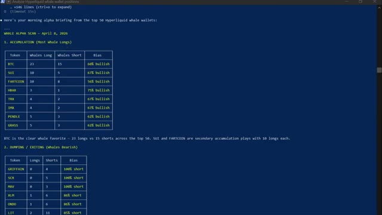
*⏱️ 00:06:25 — Capture d'écran d'un terminal affichant les résultats d'analyse des positions des portefeuilles de baleines sur Hyperliquid, incluant des tableaux de données sur l'accumulation et les sorties.*

---

### ⏱️ `[00:06:49 - 00:07:13]` | Segment #16

**🔊 Audio (Transcription Intégrale Mot pour Mot en Français) :**
> parmi les 10 meilleurs portefeuilles avant même d'avoir bu mon café. C'est l'avantage matinal. Et celui-ci, le dernier, c'est celui que j'utilise quand je veux que Claude me dise simplement quelle est la toute meilleure caractéristique sur le marché en ce moment. Regardez-le exécuter l'analyse complète, en croisant les portefeuilles rentables avec les portefeuilles perdants, pour trouver le consensus directionnel le plus fort. Et voici le résultat. Jeton XMR. Direction long.

**👁️ Analyse Visuelle d'Écran (gemini-3.5-flash-lite) :**
**Interface & Outils** : Terminal de commandes / console en ligne de commande affichant du texte formaté en bleu foncé avec du texte jaune et blanc.

**Contenu textuel & Code** : Un tableau de données comparant 'Smart Money' et 'Rekt Money' pour différentes cryptomonnaies (XMR, BTC, ETH, HYPE, LIT, SUI) ainsi qu'un plan de trade détaillé pour XMR (Monero) indiquant une position LONG, un prix actuel d'environ 328 $, et une zone d'entrée.

**Action / Démonstration** : Exécution d'un script d'analyse de données de portefeuilles de baleines affichant les signaux et les recommandations de trading (Smart Money vs Rekt Money).

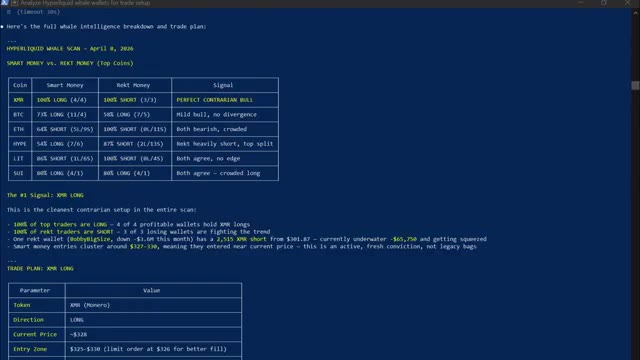
*⏱️ 00:06:55 — Capture d'écran montrant un terminal de commandes affichant l'analyse détaillée des portefeuilles de baleines (Hyperliquid Whale Scan) générée par Claude avec un plan de trade sur XMR.*

---

### ⏱️ `[00:07:13 - 00:07:50]` | Segment #17

**🔊 Audio (Transcription Intégrale Mot pour Mot en Français) :**
> Entrée 328 dollars. Stop loss 305 dollars. Premier take profit 355 dollars. Deuxième take profit 385 dollars. Taille de la position. 15 % d'un compte de 1 000 dollars. Confiance, 7 sur 10. Raisonnement, divergence parfaite à 100 % entre smart money et REC, le signal le plus rare du scan. C'est un plan de trading complet, élaboré à partir de données de positionnement réelles provenant de milliers de portefeuilles en direct en moins de quelques minutes. Une chose avant d'entrer dans le vif du sujet, faites toujours vos propres recherches. Les données de suivi des baleines ne sont qu'une pièce du puzzle,

**👁️ Analyse Visuelle d'Écran (gemini-3.5-flash-lite) :**
**Interface & Outils** : Terminal de script / Interface CLI personnalisée

**Contenu textuel & Code** : Tableau récapitulatif du trade plan XMR Long : Token XMR (Monero), Direction LONG, Current Price ~$328, Entry Zone $325-$330, Stop Loss $305, Take Profit 1 $355, Take Profit 2 $385, Leverage 5x, Position Size 15% of account, Confidence 7/10.

**Action / Démonstration** : Présentation détaillée du plan de trading et des niveaux de prix pour la crypto-monnaie Monero (XMR).

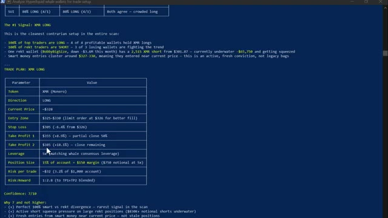
*⏱️ 00:07:22 — Capture d'écran montrant un terminal affichant le plan de trading détaillé pour XMR Long avec les paramètres d'entrée, stop loss et take profit.*

---

### ⏱️ `[00:07:50 - 00:08:23]` | Segment #18

**🔊 Audio (Transcription Intégrale Mot pour Mot en Français) :**
> pas toute la vue d'ensemble. Combinez toujours les données sur les baleines avec votre propre analyse de graphiques et votre gestion des risques avant de prendre toute décision de trading. Les performances passées des portefeuilles de baleines ne garantissent pas les résultats futurs. Et pour les prochaines années, deux types de traders existeront. Celui qui utilise l'IA et se simplifie la vie et celui qui ne le fait pas et fait encore tout manuellement. Et dans le même marché, cela façonnera un résultat très différent. Voici comment vous obtenez tout cela. Je lance la communauté AI Trade Edge. Chaque invite, bot, agent, modèle et guide étape par étape que j'utilise personnellement

**👁️ Analyse Visuelle d'Écran (gemini-3.5-flash-lite) :**
**Interface & Outils** : TradingView, interface web du courtier WEEX, réseau social X (Twitter).

**Contenu textuel & Code** : Graphique de prix du Bitcoin (BTC/USDT Perpetual Contract) en timeframe de 5 minutes avec bougies vertes et rouges, barre d'outils technique TradingView.

**Action / Démonstration** : Affichage et analyse visuelle de l'évolution du cours du Bitcoin sur un graphique de trading en temps réel.

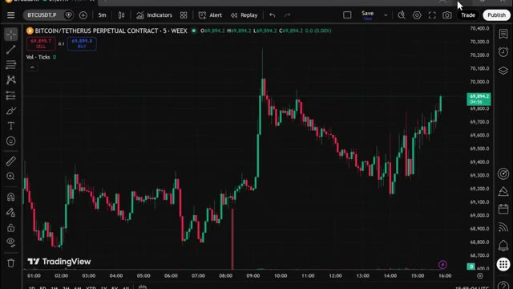
*⏱️ 00:08:15 — Graphique en chandeliers japonais sur l'interface TradingView montrant le contrat perpétuel BTC/USDT en unité de temps 5 minutes.*

---

### ⏱️ `[00:08:23 - 00:08:59]` | Segment #19

**🔊 Audio (Transcription Intégrale Mot pour Mot en Français) :**
> to use all in one place. Everything I showed you today is inside and everything I build going forward gets added straight into the group. Every new integration, every new strategy, every new prompt, every update. This hyper liquid whale tracking setup, it's already inside along with trading view and telegram integration. The moment you join, you get it all. The price is $79.99 a month. And honestly, when you think about what this actually is, the most cutting edge AI trading setup available to retail traders right now, constantly updated with everything included.

**👁️ Analyse Visuelle d'Écran (gemini-3.5-flash-lite) :**
**Interface & Outils** : TradingView, interface Web Whop.

**Contenu textuel & Code** : Graphique Bitcoin perpétuel avec indicateurs de signaux de trading (Buy/Sell), indicateur technique en bas de graphique.

**Action / Démonstration** : Présentation d'un graphique technique avec signaux intégrés.

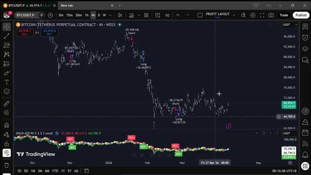
*⏱️ 00:08:41 — Graphique TradingView en unité 4h pour la paire BTCUSDT sur l'exchange WEEX, affichant des signaux d'achat et de vente ainsi qu'un indicateur technique inférieur.*

---

### ⏱️ `[00:08:59 - 00:09:33]` | Segment #20

**🔊 Audio (Transcription Intégrale Mot pour Mot en Français) :**
> That is not a lot of money. One good trade covers it. But the first 100 members lock in that rate permanently. After that, the price goes up. So the earlier you get in, the better the deal. The link is in the description. Get in now before the price goes up. You genuinely cannot afford to miss this. And that is it. Cloud Code and Hyperliquid's public API, your own AI whale tracker, scanning 33,000 wallets and telling you exactly what smart money is doing right now. If you want to see the full demo on how to set up automated trade execution using Telegram and TradingView,

**👁️ Analyse Visuelle d'Écran (gemini-3.5-flash-lite) :**
**Interface & Outils** : Page web Whop, interface CLI Claude Code, et site web personnel Alex Carter Trading.

**Contenu textuel & Code** : Tarifs d'abonnement (79.99$/mois), interface de terminal Claude Code, et fonctionnalités du Whale Tracker (33 000+ portefeuilles scannés, sans clé API requise).

**Action / Démonstration** : Présentation de l'offre payante de bots de trading et téléchargement d'une extension/skill Claude Code.

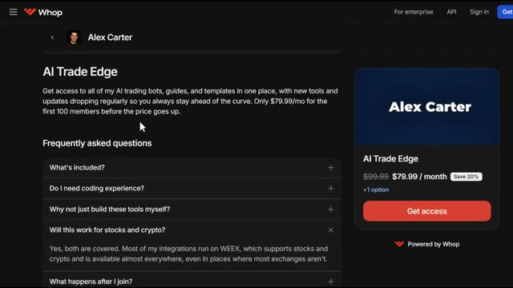
*⏱️ 00:09:08 — Page de paiement Whop affichant le produit "AI Trade Edge" d'Alex Carter au prix de 79.99$/mois.*

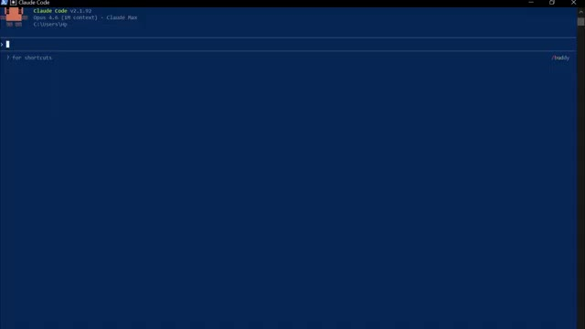
*⏱️ 00:09:16 — Interface de terminal de commande "Claude Code V2.1.92" en cours d'exécution.*

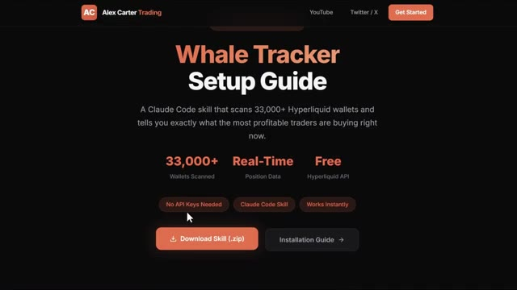
*⏱️ 00:09:24 — Guide de configuration du "Whale Tracker" pour Claude Code permettant de scanner plus de 33 000 portefeuilles Hyperliquid.*

---

### ⏱️ `[00:09:33 - 00:09:43]` | Segment #21

**🔊 Audio (Transcription Intégrale Mot pour Mot en Français) :**
> check the video popping on screen right now. If you found this useful, leave a like. It really does help the channel. Subscribe if you haven't already, and I will see you in the next one.

**👁️ Analyse Visuelle d'Écran (gemini-3.5-flash-lite) :**
**Interface & Outils** : Aucun

**Contenu textuel & Code** : Aucun

**Action / Démonstration** : Aucune action ou démonstration visible.

---

