# 🎬 Claude Managed Agents Made Trading Easy!

> **Chaîne** : [Alex Carter](https://www.youtube.com/@AlexCarterTrading)  
> **Lien YouTube** : [https://www.youtube.com/watch?v=nyKdFpOXe9s](https://www.youtube.com/watch?v=nyKdFpOXe9s)  
> **Date de publication** : 20260410  
> **Durée** : 00:08:41  
> **Identifiant vidéo** : `nyKdFpOXe9s`  
> **Transcription & Analyse** : `whisper-v3-large-turbo+gemini-3.5-flash-lite`  

---

## 📌 Synthèse Exécutive & Outils

### 💡 Résumé
La vidéo de la chaîne Alex Carter met en lumière une véritable rupture technologique pour le trading algorithmique de détail : l'intégration des agents autonomes gérés par Claude (Anthropic). Contrairement aux chatbots traditionnels ou aux API de messages basiques nécessitant une gestion technique complexe, ces agents autonomes s'exécutent entièrement sur l'infrastructure cloud d'Anthropic. Ils fonctionnent en arrière-plan 24h/24 et 7j/7, indépendamment de l'état de l'ordinateur du trader, agissant comme des assistants de recherche et d'analyse infatigables capables de naviguer sur le web, d'exécuter du code et de gérer des sessions persistantes pour moins d'un dollar par jour.

La stratégie présentée ne se limite pas à la simple automatisation de tâches répétitives, mais s'attaque au cœur de la recherche de alpha et du suivi des narratifs de marché (cryptomonnaies, altcoins, IA, RWA, Layer 2). L'orateur démontre comment déléguer l'agrégation d'actualités macroéconomiques, l'analyse fondamentale de nouveaux jetons (livres blancs, fils Twitter, forums) et la surveillance en temps réel de niveaux techniques clés. Couplé à des écosystèmes d'exécution avancés comme Telegram, TradingView et le suivi des baleines sur Hyperliquid, ce dispositif permet aux traders de combler le fossé entre analyse quantitative et passage d'ordres automatisé sans avoir à maintenir des serveurs dédiés (DevOps).

Enfin, l'approche pose les bases d'une division inévitable du marché entre les acteurs traditionnels manuels et les traders augmentés par l'intelligence artificielle. En s'appuyant sur une architecture simple reposant sur quatre piliers (l'agent, l'environnement cloud, les sessions persistantes et les événements en temps réel), les particuliers disposent désormais d'une puissance de frappe opérationnelle autrefois réservée aux fonds quantitatifs institutionnels. La démonstration illustre l'accessibilité financière et technique de ces outils, redéfinissant les standards de productivité et de réactivité face à la volatilité des marchés cryptographiques.

### 🛠️ Outils, Modèles & Logiciels Présentés
* **Claude Managed Agents (Anthropic)** : Harnais d'agent pré-construit fonctionnant sur l'infrastructure cloud d'Anthropic, gérant de manière autonome le bac à sable, l'exécution d'outils et la persistance des états.
* **API Messages (Claude)** : Accès direct aux modèles d'Anthropic offrant un contrôle total mais exigeant de coder et de gérer soi-même la boucle d'exécution et l'environnement.
* **Claude Sonnet 4.6 / Opus 4.6** : Modèles de langage de pointe utilisés pour propulser l'intelligence des agents de recherche, optimisés pour la rapidité et la précision analytique.
* **TradingView** : Plateforme de graphisme et d'analyse technique incontournable intégrée dans les configurations de trading automatisé pour détecter les cassures de range et les niveaux clés.
* **Telegram** : Application de messagerie instantanée exploitée comme interface de contrôle à distance et canal de réception des alertes de trading automatisées.
* **Hyperliquid** : DEX et protocole de pointe utilisé pour suivre les mouvements des portefeuilles de baleines et exécuter des opérations on-chain.
* **Grok Bots** : Assistants conversationnels et outils d'analyse de sentiment intégrés dans les écosystèmes de veille algorithmique.
* **Pine Script** : Langage de programmation propriétaire de TradingView dédié au développement d'indicateurs et de stratégies de scalping automatisables.
* **AI Trade Edge** : Communauté privée centralisant les guides de configuration, prompts, bots, modèles d'agents et stratégies de trading de l'auteur.

### 🔑 Points Clés & Enseignements Stratégiques
* **Délégation totale de la recherche fondamentale** : L'agent autonome peut scruter en quelques minutes les livres blancs, publications Reddit et fils Twitter d'un nouvel altcoin pour fournir un rapport de synthèse complet sans intervention humaine.
* **Veille macroéconomique en pilotage automatique** : Automatisation de la collecte des trois principales actualités impactant Bitcoin et Ethereum sur 24 heures, avec qualification immédiate du biais haussier ou baissier.
* **Surveillance proactive des niveaux clés** : Configuration d'agents capables de vérifier en continu si les actifs cryptographiques majeurs se maintiennent au-dessus de seuils critiques ou sortent de leurs zones de consolidation (ranges).
* **Détection précoce des narratifs de marché** : Analyse croisée de sources multiples par l'agent pour identifier les secteurs en forte dynamique (jetons IA, RWA, Layer 2) avant qu'ils ne fassent l'objet d'une adoption de masse.
* **Architecture simplifiée en quatre dimensions** : Le système repose exclusivement sur l'Agent (le cerveau), l'Environnement (le conteneur cloud géré par Anthropic), la Session (la tâche persistante) et les Événements (les flux de communication en temps réel).
* **Résilience et persistance opérationnelle** : Les sessions d'agents tournent en arrière-plan dans le cloud, garantissant un fonctionnement ininterrompu même en cas de coupure de connexion Internet ou d'extinction de l'ordinateur personnel.
* **Optimisation drastique des coûts d'infrastructure** : Absence totale de frais de serveurs ou de maintenance DevOps, avec un coût réel d'exécution facturé uniquement au temps d'activité (environ 0,08 $ par heure de session active et zéro en période d'inactivité).
* **Modèle économique hybride et abordable** : Un coût opérationnel réel estimé à environ 6 dollars par mois pour 50 sessions quotidiennes de trois minutes, combinant consommation de tokens, frais d'exécution et requêtes web.
* **Intégration multi-plateforme transparente** : Possibilité de relier les agents à des outils de messagerie (Telegram, Slack, Teams) et à des espaces de travail centralisés (Notion) pour recevoir des alertes et piloter les workflows.
* **Paradigme du "Trading Augmenté"** : Émergence d'une scission structurelle entre les traders exploitant l'IA autonome pour multiplier leur efficacité et ceux maintenant des processus manuels voués à l'obsolescence face à la vitesse des marchés.
* **Scalabilité des déploiements en production** : Validation industrielle de l'approche par de grandes structures (Sentry, Asana, Rakuten, Notion) démontrant la fiabilité de l'exécution d'agents autonomes à grande échelle.

---

## ⏱️ Chronologie & Transcription Complète Audio & Visuelle (Mot pour Mot)

### ⏱️ `[00:00:00 - 00:00:26]` | Segment #01

**🔊 Audio (Transcription Intégrale Mot pour Mot en Français) :**
> Et si vous aviez un assistant IA qui pouvait surveiller le marché des cryptomonnaies pour vous 24h/24 et 7j/7, faire des recherches sur les pièces, analyser les configurations, et faire tout cela automatiquement ? Pendant que vous dormez, pendant que vous travaillez, pendant que vous faites n'importe quoi d'autre ? C'est exactement ce que permettent les agents gérés de Claude. Et dans cette vidéo, je vais vous montrer ce que c'est réellement, ce qu'ils font, et comment vous pouvez les utiliser en tant que trader, même si vous n'avez jamais écrit une seule ligne de code de votre vie.

**👁️ Analyse Visuelle d'Écran (gemini-3.5-flash-lite) :**
**Interface & Outils** : Interface de terminal CLI / Interface de script d'analyse.

**Contenu textuel & Code** : Analyse textuelle des cours du Bitcoin (~$66,850) et d'Ethereum (~$2,254), avec des liens de sources web et métriques de résistance/support.

**Action / Démonstration** : Exécution d'un script ou d'un prompt d'analyse automatisée des niveaux de prix des cryptomonnaies.

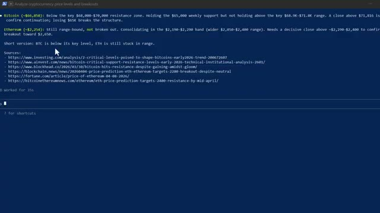
*⏱️ 00:00:13 — Terminal de commande affichant une analyse de prix des cryptomonnaies Bitcoin et Ethereum générée par une IA.*

---

### ⏱️ `[00:00:27 - 00:00:55]` | Segment #02

**🔊 Audio (Transcription Intégrale Mot pour Mot en Français) :**
> Entrons dans le vif du sujet. Donc Claude est l'IA d'Anthropic. La plupart des gens le connaissent comme un chatbot. Vous tapez quelque chose, il répond. C'est la version de base. Claude Managed Agents est un niveau complètement différent. Anthropic vous donne en fait deux façons de construire avec Claude. La première est l'API Messages. C'est un accès direct au modèle où vous contrôlez tout. Vous construisez votre propre boucle d'agent, gérez l'exécution des outils, gérez vous-même l'environnement d'exécution. Contrôle total, responsabilité totale.

**👁️ Analyse Visuelle d'Écran (gemini-3.5-flash-lite) :**
**Interface & Outils** : Documentation officielle de la plateforme Anthropic (platform.claude.com).

**Contenu textuel & Code** : Comparaison détaillée entre "Messages API" (contrôle personnalisé, gestion manuelle) et "Managed Agents" (infrastructure gérée, $0.08 / session-hour).

**Action / Démonstration** : Présentation des deux approches de construction proposées par Anthropic pour les développeurs.

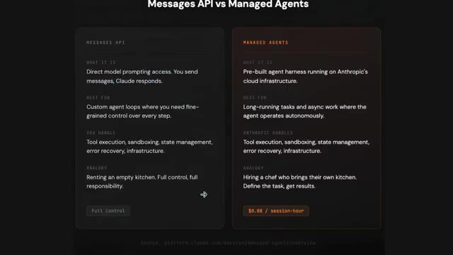
*⏱️ 00:00:48 — Tableau comparatif officiel intitulé "Messages API vs Managed Agents" présentant les différences de fonctionnalités, de responsabilités et de tarification.*

---

### ⏱️ `[00:00:55 - 00:01:15]` | Segment #03

**🔊 Audio (Transcription Intégrale Mot pour Mot en Français) :**
> Claude Managed Agents est différent. C'est un harnais d'agent pré-construit qui s'exécute entièrement sur l'infrastructure d'Anthropix. Vous définissez ce que l'agent doit faire. Anthropix s'occupe de tout le reste. Le bac à sable, l'exécution des outils, la gestion des états, la récupération d'erreurs. Voyez les choses ainsi. L'API Messages, c'est louer une cuisine vide.

**👁️ Analyse Visuelle d'Écran (gemini-3.5-flash-lite) :**
**Interface & Outils** : Navigateur web affichant la documentation technique d'Anthropic / Claude API Docs.

**Contenu textuel & Code** : Tableau listant les champs de configuration d'un agent (name, model, system, tools, mcp_servers, skills, callable_agents, description, metadata).

**Action / Démonstration** : Navigation dans la documentation technique pour présenter la structure et les paramètres de configuration des Claude Managed Agents.

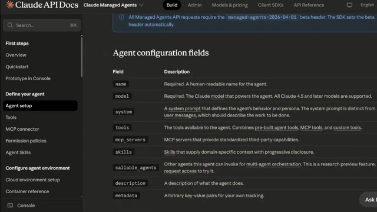
*⏱️ 00:01:05 — Documentation officielle de l'API Claude affichant le tableau des champs de configuration pour les agents gérés (Agent configuration fields).*

---

### ⏱️ `[00:01:15 - 00:01:53]` | Segment #04

**🔊 Audio (Transcription Intégrale Mot pour Mot en Français) :**
> Managed Agents embauche un chef qui apporte sa propre cuisine. Au lieu de poser une question à Claude et d'attendre une réponse, vous donnez une tâche à Claude et il va la faire de lui-même, de manière autonome. Il peut naviguer sur le web, lire des fichiers, exécuter du code, chercher des informations et vous revenir avec les résultats, tout cela sans que vous restiez assis là à le relancer à chaque étape. Et voici le point clé. Il tourne dans le cloud, sur l'infrastructure d'Anthropix. Donc il continue de travailler même si vous fermez votre ordinateur portable, même si votre connexion Internet se coupe. L'agent tourne simplement en arrière-plan en faisant son travail. Pensez-y comme à l'embauche d'un chercheur

**👁️ Analyse Visuelle d'Écran (gemini-3.5-flash-lite) :**
**Interface & Outils** : Terminal de commandes (CLI Claude Code) et navigateur web (site d'Anthropic).

**Contenu textuel & Code** : Commandes bash exécutant des scripts Python d'API de trading (weex-contract_api.py), gestion des leviers et des ordres d'achat (long) sur ETHUSDT.

**Action / Démonstration** : Exécution autonome de scripts de trading et appels d'API pour configurer un effet de levier et passer un ordre d'achat.

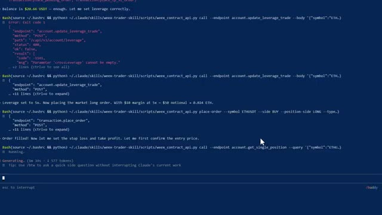
*⏱️ 00:01:25 — Un terminal de commandes montrant Claude Code en train d'exécuter des scripts Python pour interagir avec l'API WEEX de manière autonome.*

---

### ⏱️ `[00:01:53 - 00:02:27]` | Segment #05

**🔊 Audio (Transcription Intégrale Mot pour Mot en Français) :**
> analyste qui ne dort jamais, ne se fatigue jamais et vous coûte moins d'un dollar par jour à faire fonctionner. Pour les traders, c'est une très grande affaire. Vous ne construisez rien. Vous ne maintenez rien. Vous définissez simplement la tâche, et elle s'exécute. Au fait, si vous voulez les instructions de configuration complètes sur la façon de trader en utilisant votre application Telegram, comment intégrer Claude pour trader et afficher ou analyser les baleines sur Hyperliquid, le tout automatiquement, chaque instruction, chaque guide étape par étape, et tous les modèles d'agents que j'utilise personnellement. Tout cela se trouve à l'intérieur de la communauté AI Trade Edge. Le lien est dans la description.

**👁️ Analyse Visuelle d'Écran (gemini-3.5-flash-lite) :**
**Interface & Outils** : Documentation technique web et interface de présentation des agents gérés / MCP.

**Contenu textuel & Code** : Texte comparatif sur les agents gérés, coût par heure de session, et liste des 78 outils de contrôle TradingView (lecture de graphiques, indicateurs, changement d'unités de temps).

**Action / Démonstration** : Présentation des avantages des agents autonomes et des fonctionnalités de pilotage de TradingView par l'IA.

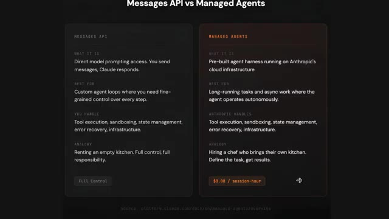
*⏱️ 00:02:01 — Comparatif entre l'API de messages et les agents gérés (Managed Agents), illustrant la délégation complète des tâches d'infrastructure et d'exécution à l'IA.*

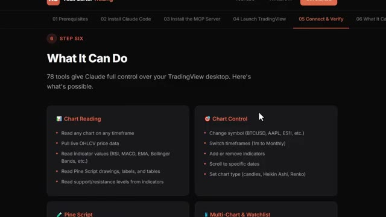
*⏱️ 00:02:18 — Interface de documentation détaillant les capacités des 78 outils permettant à Claude de contrôler entièrement TradingView (lecture de graphiques et contrôle direct).*

---

### ⏱️ `[00:02:28 - 00:03:00]` | Segment #06

**🔊 Audio (Transcription Intégrale Mot pour Mot en Français) :**
> Maintenant, laissez-moi vous montrer ce que l'agent géré de Claude fait réellement pour nous, les traders. Premièrement, la recherche de marché en pilotage automatique. Vous dites à l'agent : « Va trouver les trois principales actualités qui affectent Bitcoin et Ethereum au cours des dernières 24 heures. Résume-les et dis-moi si elles sont haussières ou baissières. » Il y va et le fait. Il navigue sur le web, lit les articles, et revient avec un résumé clair chaque matin sans que vous ayez à le petit doigt. Deuxièmement, l'analyse de pièces. Vous examinez un nouvel altcoin. Au lieu de passer une heure à lire des livres blancs, des fils Twitter,

**👁️ Analyse Visuelle d'Écran (gemini-3.5-flash-lite) :**
**Interface & Outils** : Terminal de commandes (Claude Code dans Windows PowerShell)

**Contenu textuel & Code** : Texte du prompt saisi : « go find the top 3 news stories affecting Bitcoin and Ethereum in the last 24 hours, summarize them, and tell me if they're bullish or bearish » et statut « Incubating... ».

**Action / Démonstration** : Saisie et exécution d'un prompt dans l'agent de recherche de marché automatisé via Claude Code.

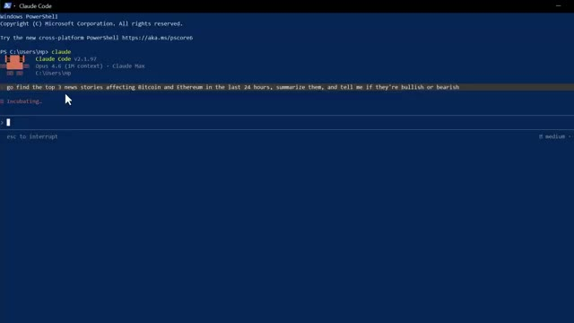
*⏱️ 00:02:36 — Capture d'écran montrant une fenêtre de terminal Windows PowerShell exécutant Claude Code, avec un prompt demandant de trouver les 3 principales actualités sur Bitcoin et Ethereum.*

---

### ⏱️ `[00:03:00 - 00:03:34]` | Segment #07

**🔊 Audio (Transcription Intégrale Mot pour Mot en Français) :**
> et des publications Reddit, vous l'envoyez à l'agent. Il fait des recherches sur le projet, analyse le sentiment, examine les actualités récentes et vous fournit un compte rendu en quelques minutes. Troisièmement, configurez la surveillance. Vous pouvez donner des instructions à l'agent pour qu'il surveille des conditions spécifiques. Est-ce que Bitcoin se maintient au-dessus d'un niveau clé ? Est-ce qu'Ethereum est sorti d'un range ? L'agent peut vérifier, faire un rapport et vous le signaler. Quatrièmement, le suivi des narratifs. Quel est le secteur en vogue en ce moment ? Les jetons IA, les RWA, les layer 2. L'agent peut analyser différentes sources et vous dire où la dynamique se construit avant que cela ne devienne évident pour tout le monde.

**👁️ Analyse Visuelle d'Écran (gemini-3.5-flash-lite) :**
**Interface & Outils** : Terminal de commandes Claude Code (v2.1.97)

**Contenu textuel & Code** : Invite de commande et interface CLI avec des requêtes textuelles sur les niveaux de prix des cryptomonnaies (« Is Bitcoin holding above a key level? Has Ethereum broken out of a range? »).

**Action / Démonstration** : Exécution et affichage d'un outil en ligne de commande pour l'analyse technique des cryptomonnaies.

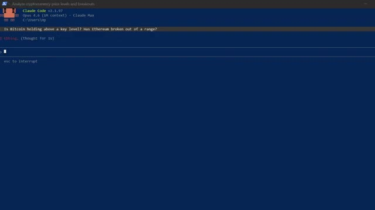
*⏱️ 00:03:17 — Une interface de terminal de commandes Claude Code affichant des requêtes sur les niveaux de prix et les breakouts de Bitcoin et Ethereum.*

---

### ⏱️ `[00:03:34 - 00:04:00]` | Segment #08

**🔊 Audio (Transcription Intégrale Mot pour Mot en Français) :**
> ailleurs. Et comme les sessions sont persistantes, ce qui signifie que l'agent se souvient de tout de vos conversations précédentes, vous pouvez progresser au fil du temps. Il devient de plus en plus utile à mesure que vous l'utilisez. Maintenant, je laisserai le lien vers la documentation officielle dans la description ci-dessous afin que vous puissiez suivre toutes les instructions étape par étape. Mais je veux vraiment que vous compreniez comment cela fonctionne de manière globale parce que c'est en réalité très simple. Il y a quatre éléments. D'abord, l'agent. C'est le cerveau.

**👁️ Analyse Visuelle d'Écran (gemini-3.5-flash-lite) :**
**Interface & Outils** : Terminal de commandes (CLI)

**Contenu textuel & Code** : Analyse des prix et niveaux clés pour Bitcoin (~66 850 $) et Ethereum (~2 254 $) avec des liens de sources (Investing.com, Ainvest, etc.) et un curseur de saisie.

**Action / Démonstration** : Affichage des résultats d'une analyse automatisée des niveaux de prix et des ruptures par un agent ou un script.

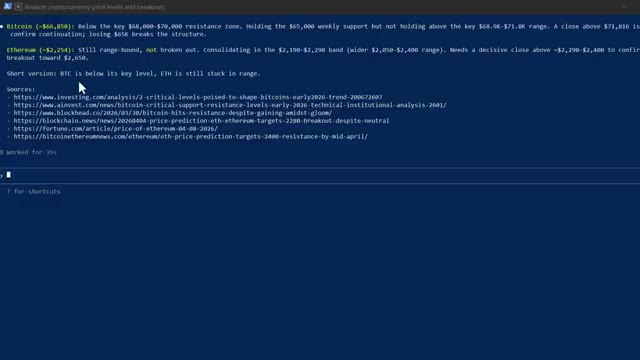
*⏱️ 00:03:40 — Un terminal de commandes affichant une analyse textuelle de cryptomonnaies (Bitcoin et Ethereum) avec des sources web associées.*

---

### ⏱️ `[00:04:00 - 00:04:22]` | Segment #09

**🔊 Audio (Transcription Intégrale Mot pour Mot en Français) :**
> Tu lui dis ce que c'est. Un assistant de recherche en cryptographie, un analyste de marché, tout ce que tu veux, et quels outils il a à sa disposition. Deuxièmement, l'environnement. C'est l'espace de travail, un conteneur cloud qu'Anthropic gère pour toi. C'est là que l'agent s'exécute réellement et fait son travail. Tu ne construis pas ça. Tu ne le gères pas. Anthropic s'occupe de tout cela. Troisièmement, la session.

**👁️ Analyse Visuelle d'Écran (gemini-3.5-flash-lite) :**
**Interface & Outils** : Documentation web officielle (Claude API Docs - Claude Managed Agents).

**Contenu textuel & Code** : Tableau des outils disponibles avec leurs descriptions : Bash (commandes shell), Read/Write/Edit (gestion de fichiers), Glob/Grep (recherche), Web fetch/Web search (accès web).

**Action / Démonstration** : Présentation des outils à la disposition de l'agent et de sa configuration.

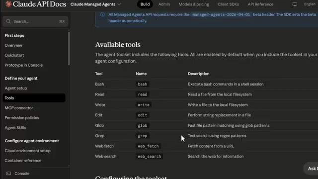
*⏱️ 00:04:06 — Capture d'écran de la documentation de l'API Claude montrant la section des outils disponibles pour les agents gérés.*

---

### ⏱️ `[00:04:22 - 00:04:40]` | Segment #10

**🔊 Audio (Transcription Intégrale Mot pour Mot en Français) :**
> C'est à ce moment-là que vous le démarrez. Vous combinez l'agent et l'environnement, vous lui donnez une tâche, et il se met au travail. Une session peut durer des heures. Elle persiste malgré les déconnexions. Vous pouvez lui envoyer de nouvelles instructions en cours de route si le marché change. Et enfin, les événements. C'est ainsi qu'il communique avec vous en retour.

**👁️ Analyse Visuelle d'Écran (gemini-3.5-flash-lite) :**
**Interface & Outils** : Documentation officielle Claude API Docs et interface de terminal de commande.

**Contenu textuel & Code** : Extrait de code cURL pour initialiser une session d'agent avec les identifiants d'agent et d'environnement, et sortie textuelle d'analyse de crypto-monnaies avec sources web.

**Action / Démonstration** : Présentation de la méthode d'initialisation d'une session d'agent suivie de l'affichage des résultats d'exécution de la tâche.

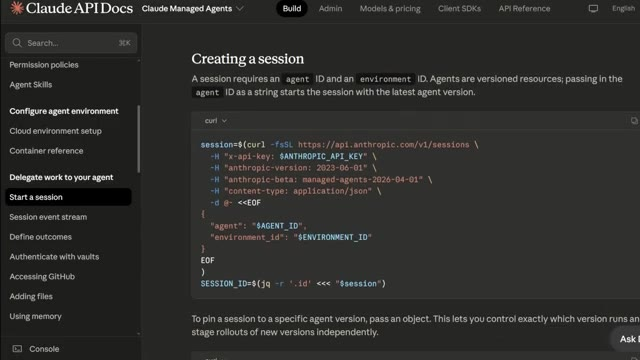
*⏱️ 00:04:27 — Documentation de l'API Claude montrant comment créer une session avec un agent managé via une requête cURL.*

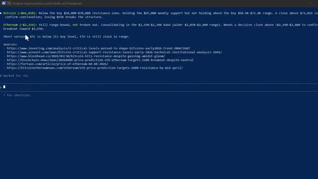
*⏱️ 00:04:36 — Interface de terminal affichant l'analyse en cours de niveaux de prix et de ruptures pour le Bitcoin et l'Ethereum générée par un agent.*

---

### ⏱️ `[00:04:41 - 00:05:01]` | Segment #11

**🔊 Audio (Transcription Intégrale Mot pour Mot en Français) :**
> Alors que l'agent travaille, navigue, analyse, écrit, il vous transmet des mises à jour en temps réel. Vous pouvez le regarder travailler ou simplement attendre le résultat final. C'est tout. Agent, environnement, session, événements, quatre éléments. L'ensemble peut être configuré en moins de 10 minutes en suivant la documentation. Beaucoup d'entre vous se demandent peut-être : combien cela coûte-t-il ?

**👁️ Analyse Visuelle d'Écran (gemini-3.5-flash-lite) :**
**Interface & Outils** : Documentation Claude API Docs / Interface web de présentation.

**Contenu textuel & Code** : Blocs de code cURL pour l'API Anthropic et diagramme explicatif des quatre concepts clés (Agent, Environment, Session, Events).

**Action / Démonstration** : Présentation de la structure technique et de l'architecture des agents gérés par l'API.

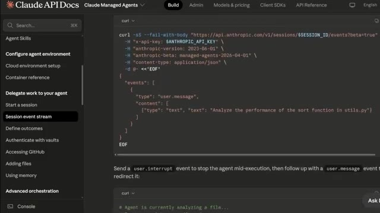
*⏱️ 00:04:46 — Documentation d'API montrant un exemple de requête cURL pour gérer les sessions et les événements de l'agent.*

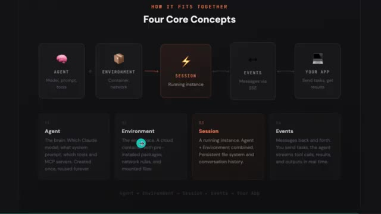
*⏱️ 00:04:51 — Schéma conceptuel représentant les quatre éléments fondamentaux : agent, environnement, session et événements.*

---

### ⏱️ `[00:05:01 - 00:05:20]` | Segment #12

**🔊 Audio (Transcription Intégrale Mot pour Mot en Français) :**
> C'est la partie qui m'a le plus surpris. Il y a trois choses pour lesquelles vous payez. La première est l'utilisation des jetons. C'est la même chose que pour l'API Claude classique. Sonnet 4.6 coûte 3 dollars par million de jetons d'entrée et 15 dollars par million de jetons de sortie. Opus 4.6 coûte 5 dollars en entrée, 25 dollars en sortie.

**👁️ Analyse Visuelle d'Écran (gemini-3.5-flash-lite) :**
**Interface & Outils** : Page web de tarification (Pricing) avec un design sombre et des sections de coûts détaillées.

**Contenu textuel & Code** : Tarifs affichés : Sonnet 4.6 Tokens à 3 $ / 15 $ par million de jetons, Opus 4.6 Tokens à 5 $ / 25 $ par million, Session Runtime à 0,08 $ par heure, Web Searches à 10 $ par 1 000 recherches, ainsi qu'un exemple concret de coût mensuel évalué à environ 6 $ par mois hors jetons.

**Action / Démonstration** : Présentation des différents composants tarifaires des agents gérés par le présentateur.

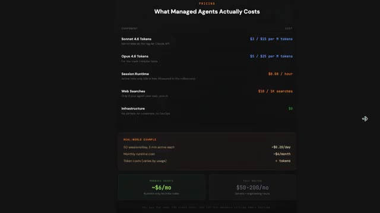
*⏱️ 00:05:06 — Un tableau des prix détaillé montrant le coût des agents gérés, incluant les tarifs des jetons pour Sonnet 4.6 et Opus 4.6, le temps d'exécution des sessions et les recherches sur le web.*

---

### ⏱️ `[00:05:20 - 00:05:53]` | Segment #13

**🔊 Audio (Transcription Intégrale Mot pour Mot en Français) :**
> La plupart des tâches de recherche en trading que vous exécutez utiliseront Sonnet. C'est plus rapide et largement capable. Deuxièmement, les coûts d'exécution sont de 0,08 $ par heure de session. C'est 0,08 $ par heure d'activité de votre agent. Et le temps d'inactivité est totalement gratuit. Donc si votre agent termine une tâche et reste simplement là à attendre la suivante, vous ne payez rien. Et troisièmement, les recherches sur le web coûtent 10 $ par 1 000 recherches. Donc si votre agent parcourt le web à la recherche de nouvelles et de sentiment de marché chaque jour, cela représente toujours une fraction de centime par recherche. Qu'en est-il du coût de l'infrastructure ?

**👁️ Analyse Visuelle d'Écran (gemini-3.5-flash-lite) :**
**Interface & Outils** : Page web de tarification (Pricing) avec interface sombre.

**Contenu textuel & Code** : Coûts affichés : Sonnet 4.6 Tokens à 3 $ / 15 $ par million de tokens, Opus 4.6 Tokens à 5 $ / 25 $ par million de tokens, Session Runtime à 0,08 $ par heure (temps actif uniquement, temps d'inactivité gratuit), Web Searches à 10 $ par 1 000 recherches, Infrastructure à 0 $. Exemple concret : 50 sessions/jour, 3 min actives chacune pour un coût de ~0,20 $/jour ou ~4 $/mois.

**Action / Démonstration** : Présentation et explication des coûts d'exécution et de l'utilisation des différents modèles pour les agents de trading.

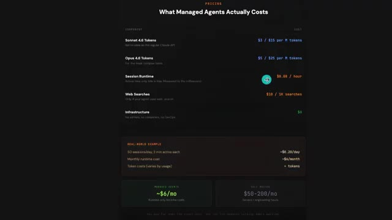
*⏱️ 00:05:29 — Tableau des prix et coûts des agents managés présentant les tarifs pour Sonnet, Opus, le temps d'exécution (Session Runtime) et un exemple concret d'utilisation.*

---

### ⏱️ `[00:05:53 - 00:06:30]` | Segment #14

**🔊 Audio (Transcription Intégrale Mot pour Mot en Français) :**
> Zéro. Pas de serveurs, pas de conteneurs, pas de DevOps. Anthropic s'occupe de tout. Le calcul du monde réel, 50 sessions par jour, chacune active pendant environ trois minutes, coûte environ 6 dollars par mois en temps d'exécution. Comparez cela à 50 à 200 dollars par mois minimum pour des serveurs auto-hébergés. Et ce, avant même de prendre en compte les heures d'ingénierie pour le construire et le maintenir. Pour un assistant de recherche en trading par IA entièrement autonome fonctionnant dans le cloud 24 heures sur 24. Ce n'est rien. Et regardez, ce n'est pas théorique. De grandes entreprises déploient déjà des agents gérés en ce moment même. Sentry l'a associé

**👁️ Analyse Visuelle d'Écran (gemini-3.5-flash-lite) :**
**Interface & Outils** : Interface web de présentation des prix (Pricing page)

**Contenu textuel & Code** : Tarifs affichés : Sonnet 4.6 ($3 / $15 par M tokens), Opus 4.6 ($5 / $25 par M tokens), Session Runtime ($0.08 / heure), Web Searches ($10 / 1K searches), Infrastructure ($0). Exemple concret : 50 sessions/jour, 3 min actives (~$0.20/jour, ~$4/mois de temps d'exécution). Comparaison finale : ~6$/mois pour les agents gérés contre 50-200$/mois pour des serveurs traditionnels.

**Action / Démonstration** : Présentation des coûts comparatifs entre l'utilisation d'agents gérés et des serveurs traditionnels.

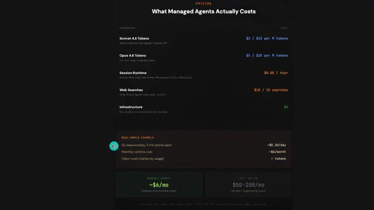
*⏱️ 00:06:02 — Un tableau de tarification détaillé montrant les coûts des agents gérés, incluant les tarifs des tokens, le temps d'exécution, les recherches web et un exemple concret comparant les coûts mensuels.*

---

### ⏱️ `[00:06:30 - 00:07:04]` | Segment #15

**🔊 Audio (Transcription Intégrale Mot pour Mot en Français) :**
> avec leur agent de débogage pour écrire automatiquement des correctifs de code et ouvrir des demandes de tirage. Expédié en semaines au lieu de mois. Asana a construit des coéquipiers IA qui travaillent aux côtés des humains à l'intérieur des projets. Reprenant des tâches, rédigeant des livrables, passant le relais du travail. Rakuten a déployé des agents dans l'ingénierie, le produit, les ventes et la finance, connectés à Slack et Teams. Notion l'utilise pour vous permettre de déléguer du travail directement dans votre espace de travail, exécutant des dizaines de tâches en parallèle. Ce ne sont pas de petites entreprises qui font des expérimentations. Ce sont des déploiements en production à grande échelle. Et si c'est ce que

**👁️ Analyse Visuelle d'Écran (gemini-3.5-flash-lite) :**
**Interface & Outils** : Présentation ou face-caméra explicatif du trader sans interface logicielle partagée.

**Contenu textuel & Code** : Explications orales des stratégies et mise en contexte méthodologique du marché.

**Action / Démonstration** : Explications face caméra et analyse conceptuelle des marchés.

---

### ⏱️ `[00:07:04 - 00:07:23]` | Segment #16

**🔊 Audio (Transcription Intégrale Mot pour Mot en Français) :**
> peut faire pour eux, imaginez ce que cela peut faire pour votre trading. Et pour les prochaines années, deux sortes de traders existeront. Celui qui utilise l'IA et se simplifie la vie, et celui qui ne le fait pas et fait encore tout manuellement. Et sur le même marché, cela façonnera un résultat très différent. Voici comment vous obtenez tout cela. Je lance la communauté AI Trade Edge.

**👁️ Analyse Visuelle d'Écran (gemini-3.5-flash-lite) :**
**Interface & Outils** : Présentation ou face-caméra explicatif du trader sans interface logicielle partagée.

**Contenu textuel & Code** : Explications orales des stratégies et mise en contexte méthodologique du marché.

**Action / Démonstration** : Explications face caméra et analyse conceptuelle des marchés.

---

### ⏱️ `[00:07:24 - 00:07:44]` | Segment #17

**🔊 Audio (Transcription Intégrale Mot pour Mot en Français) :**
> Chaque prompt, bot, agent, modèle et guide étape par étape que j'utilise personnellement, le tout regroupé au même endroit. Et tout ce que je construirai à l'avenir sera ajouté directement dans le groupe. Chaque nouvelle intégration, chaque nouvelle stratégie, chaque nouveau prompt, chaque mise à jour. De l'intégration de TradingView au trading sur Telegram et au suivi des baleines sur Hyperliquid.

**👁️ Analyse Visuelle d'Écran (gemini-3.5-flash-lite) :**
**Interface & Outils** : Navigateur web affichant une interface utilisateur sombre (dark mode) avec un menu de navigation par étapes en haut (01 à 05).

**Contenu textuel & Code** : Présentation des fonctionnalités de suivi des baleines ('Whale Scanning', 'Sentiment Analysis', 'Trade Ideas', 'Wallet Lookup') connectant Claude aux portefeuilles les plus rentables d'Hyperliquid.

**Action / Démonstration** : Présentation visuelle des capacités du système de suivi des portefeuilles de baleines sur une interface web.

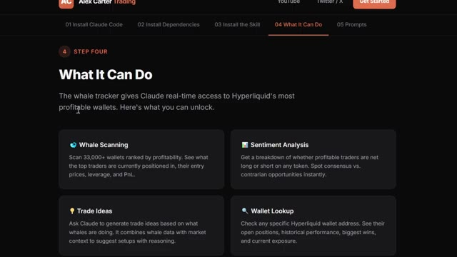
*⏱️ 00:07:29 — Capture d'écran montrant l'interface d'un guide ou d'une plateforme en ligne (Alex Carter Trading), avec l'étape 4 intitulée 'What It Can Do' détaillée en quatre fonctionnalités principales.*

---

### ⏱️ `[00:07:44 - 00:08:06]` | Segment #18

**🔊 Audio (Transcription Intégrale Mot pour Mot en Français) :**
> The moment you join, you get it all. The price is $79.99 a month. And honestly, when you think about what this actually is, the most cutting edge AI trading setup available to retail traders right now, constantly updated with everything included. That is not a lot of money. One good trade covers it. But the first 100 members lock in that rate permanently.

**👁️ Analyse Visuelle d'Écran (gemini-3.5-flash-lite) :**
**Interface & Outils** : Navigateur web affichant la plateforme Whop et une interface de documentation utilisateur.

**Contenu textuel & Code** : Tarification d'abonnement (79,99 $ / mois) et liste de fonctionnalités techniques (lecture de graphiques, données OHLCV en direct, RSI, MACD, Pine Script).

**Action / Démonstration** : Navigation et présentation des tarifs et des fonctionnalités de l'outil d'IA pour le trading.

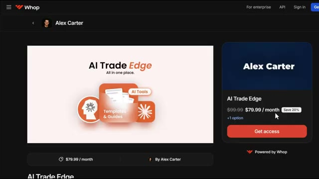
*⏱️ 00:07:50 — Capture d'écran de la plateforme Whop montrant la page de vente du produit 'AI Trade Edge' d'Alex Carter au prix de 79,99 $ par mois.*

*⏱️ 00:07:55 — Capture d'écran d'une interface de cours ou de documentation en ligne listant les fonctionnalités ('What It Can Do', 'Chart Reading', 'Chart Control') d'un outil de trading piloté par IA.*

---

### ⏱️ `[00:08:06 - 00:08:41]` | Segment #19

**🔊 Audio (Transcription Intégrale Mot pour Mot en Français) :**
> Après ça, le prix augmente, donc le plus tôt vous vous inscrivez, meilleure est l'offre. Le lien est dans la description, inscrivez-vous maintenant avant que le prix n'augmente. Vous ne pouvez vraiment pas vous permettre de rater ça, et voilà, une introduction aux agents gérés par Clog. Si vous voulez en savoir plus et faire une incursion en profondeur, je mettrai le guide de démarrage rapide en lien dans la description sur la façon de le configurer. Si vous voulez voir la démonstration complète sur la façon de configurer l'exécution de transactions automatisées en utilisant Telegram et TradingView, regardez la vidéo qui apparaît à l'écran en ce moment même. Si vous avez trouvé cela utile, laissez un pouce bleu, cela aide vraiment la chaîne. Abonnez-vous si ce n'est pas déjà fait, et je vous vois dans la prochaine.

**👁️ Analyse Visuelle d'Écran (gemini-3.5-flash-lite) :**
**Interface & Outils** : Whop, Documentation Claude API, TradingView.

**Contenu textuel & Code** : Commandes d'installation Homebrew (`brew install anthropic/tap/ant`), indicateurs techniques et signaux de trading sur Bitcoin.

**Action / Démonstration** : Présentation de la plateforme payante, configuration d'agents gérés et analyse graphique de la paire BTCUSDT.P.

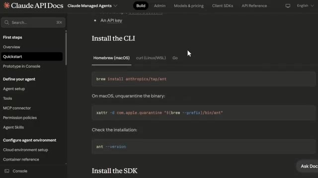
*⏱️ 00:08:24 — Documentation Claude API montrant les instructions d'installation de la CLI et du SDK.*

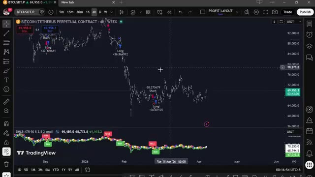
*⏱️ 00:08:32 — Graphique TradingView sur une période 4h montrant le contrat perpétuel Bitcoin/Tether (BTCUSDT.P) avec des signaux d'achat et de vente.*

---

