# 🎬 How I Made a Polymarket AI Agent Using Claude Code

> **Chaîne** : [Alex Carter](https://www.youtube.com/@AlexCarterTrading)  
> **Lien YouTube** : [https://www.youtube.com/watch?v=_lA1M_t4lnE](https://www.youtube.com/watch?v=_lA1M_t4lnE)  
> **Date de publication** : 20260411  
> **Durée** : 00:13:14  
> **Identifiant vidéo** : `_lA1M_t4lnE`  
> **Transcription & Analyse** : `whisper-v3-large-turbo+gemini-3.5-flash-lite`  

---

## 📌 Synthèse Exécutive & Outils

### 💡 Résumé

Cette vidéo d'Alex Carter dévoile une méthode de pointe en trading quantitatif et automatisation : la conception et le déploiement d'un agent de trading intelligent propulsé par l'intelligence artificielle de Claude (via l'application de bureau Claude Code sur les forfaits Pro ou Max). L'objectif est d'interfacer directement le grand modèle de langage avec une plateforme de prédiction décentralisée, Polymarket, afin d'exploiter les inefficiences informationnelles des marchés. En combinant la lecture en temps réel de flux d'actualités vérifiés et l'exécution programmée d'ordres via des clés API sécurisées, l'agent surpasse le simple rôle de chatbot pour devenir un véritable opérateur de marché autonome.

L'approche repose sur trois stratégies distinctes et complémentaires : l'arbitrage d'actualités basé sur un consensus strict de sources institutionnelles, le scan de résolution de dernière minute ciblant les opportunités à forte probabilité à 24-48 heures de l'échéance, et le suivi dynamique du sentiment multi-sources pour anticiper les retournements de tendance. Ces méthodes permettent d'identifier des décalages massifs entre la réalité factuelle rapportée par les médias de référence et les cotes affichées par les parieurs, offrant ainsi aux traders quantitatifs des avantages asymétriques exploitables de manière systématique.

Sur le plan technique et opérationnel, la configuration exige une rigueur absolue, notamment dans la gestion des réseaux (utilisation du réseau Polygon et de l'USDC pour éviter la perte irrémédiable de fonds) et la sécurisation hors-ligne des clés API. Couplé à des consignes (prompts) structurées et à un filtrage drastique du bruit médiatique des réseaux sociaux, ce dispositif illustre l'efficacité redoutable de l'automatisation par agent IA pour capitaliser sur les marchés prédictifs avec un niveau de risque et de certitude finement maîtrisé.

---

### 🛠️ Outils, Modèles & Logiciels Présentés

* **Claude / Claude Code** : Modèle d'intelligence artificielle avancé (nécessitant les forfaits Pro ou Max) utilisé pour orchestrer l'agent de trading, analyser les données textuelles et exécuter les requêtes API.
* **Polymarket** : Plateforme décentralisée de marchés de prédiction fonctionnant sur le réseau Polygon et utilisant l'USDC comme devise principale.
* **API Développeur Polymarket** : Interface de programmation permettant de connecter des applications externes au compte utilisateur pour automatiser le passage d'ordres et la lecture des soldes.
* **Portefeuilles Web3 (Metamask, Phantom, OKEx, Coinbase, Wallet Connect)** : Solutions de stockage et de connexion indispensables pour financer et interagir avec les plateformes décentralisées.
* **Reuters, AP News, BBC, Bloomberg, Wall Street Journal** : Sources d'information institutionnelles et officielles servant de socle décisionnel et de filtrage pour les agents IA.
* **AI Trade Edge Community** : Communauté privée proposant des configurations de trading avancées (Telegram, TradingView, Hyperliquid) et des modèles d'agents prêts à l'emploi.

---

### 🔑 Points Clés & Enseignements Stratégiques

* **Connexion API hautement sécurisée** : La génération des clés API sur Polymarket (clé, clé secrète, phrase secrète) exige une sauvegarde immédiate et hors-ligne, car ces identifiants ne sont affichés qu'une seule fois pour prévenir tout piratage.
* **Prérequis d'abonnement pour l'automatisation** : L'utilisation d'agents capables d'exécuter des requêtes externes et de passer des ordres nécessite impérativement un forfait Claude Pro ou Max (20 $/mois minimum), la version gratuite étant strictement limitée.
* **Architecture des fonds et réseau Polygon** : Les transactions sur Polymarket s'effectuent en USDC via le réseau Polygon ; une vérification rigoureuse de la compatibilité des réseaux lors des transferts est vitale pour éviter la perte définitive des capitaux.
* **Stratégie 1 - Arbitrage d'actualités fondé sur le consensus** : L'agent filtre le bruit des réseaux sociaux et exige un accord concordant d'au moins trois sources médiatiques de référence avant de recommander une position sur un marché sous-évalué.
* **Stratégie 2 - Scanner de résolution de dernière minute** : Approche tactique consistant à surveiller les marchés à 24-48 heures de leur échéance pour identifier des résultats quasi-certains où les actions "oui" ou "non" se négocient encore sous le seuil de rentabilité optimale (ex. en dessous de 0,99 $).
* **Stratégie 3 - Traqueur de sentiment multi-sources** : Suivi longitudinal de l'évolution des actualités sur des marchés ouverts à moyen terme pour détecter en amont les basculements de sentiment non encore intégrés par les cotes du marché.
* **Filtrage drastique des sources d'information** : Pour éliminer les biais émotionnels et les fake news, les prompts imposent à Claude d'ignorer les articles d'opinion et les réseaux sociaux au profit exclusif de communiqués officiels et d'agences de presse accréditées.
* **Vérification initiale de l'intégrité du système** : Avant toute exécution de stratégie, l'agent doit impérativement se connecter au compte, interroger le solde et afficher les positions ouvertes pour valider la bonne liaison des identifiants API.
* **Hiérarchisation des opportunités par score de confiance** : Les rapports générés par l'IA classent systématiquement les trades selon un niveau de confiance explicite, couplé à une analyse comparative entre les cotes actuelles et la réalité du terrain.
* **Synergie des trois approches quantitatives** : La combinaison de l'arbitrage temps réel, du scan de fin de cycle et du suivi de sentiment offre une couverture tactique complète, s'adaptant à toutes les phases de vie d'un marché prédictif.

---

## ⏱️ Chronologie & Transcription Complète Audio & Visuelle (Mot pour Mot)

### ⏱️ `[00:00:00 - 00:00:24]` | Segment #01

**🔊 Audio (Transcription Intégrale Mot pour Mot en Français) :**
> What if I told you that you can build an AI agent using Claude that reads the news, analyzes prediction markets, and places trades on Polymarket automatically? In this video, I'm going to show you exactly how to set this up step by step, from creating your Polymarket account, to generating your API keys, to giving Claude the exact prompts that turn it into your personal prediction market trading agent.

**👁️ Analyse Visuelle d'Écran (gemini-3.5-flash-lite) :**
**Interface & Outils** : Interface web de Polymarket (plateforme de marchés de prédiction)

**Contenu textuel & Code** : Liste de marchés prédictifs avec pourcentages de probabilité, filtres de recherche et affichage des clés API (apiKey, secret, passphrase).

**Action / Démonstration** : Navigation sur la plateforme Polymarket et génération/visualisation des clés API pour le bot de trading.

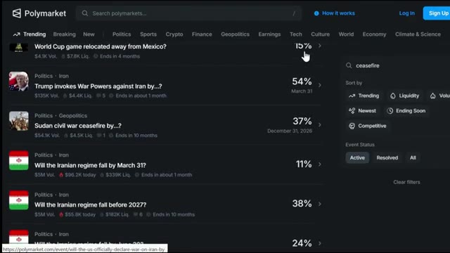
*⏱️ 00:00:06 — Capture d'écran montrant l'interface web de Polymarket avec une liste de marchés de prédiction tendance et des filtres de recherche.*

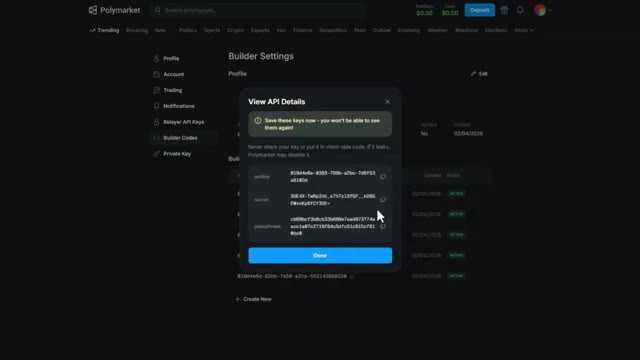
*⏱️ 00:00:18 — Capture d'écran montrant la section des paramètres "Builder Settings" de Polymarket avec une fenêtre pop-up affichant les clés API masquées.*

---

### ⏱️ `[00:00:24 - 00:00:45]` | Segment #02

**🔊 Audio (Transcription Intégrale Mot pour Mot en Français) :**
> Let's get into it. By the way, if you want the full setup instructions on how to trade using your Telegram app, how to integrate Claude to TradingView or analyze whales on Hyperliquid, all automatically, every prompt, every step-by-step guide, and all the agent templates I personally use, all of that is inside the AI Trade Edge community.

**👁️ Analyse Visuelle d'Écran (gemini-3.5-flash-lite) :**
**Interface & Outils** : Application Telegram et page web de documentation / configuration.

**Contenu textuel & Code** : Instructions d'appairage avec le bot Telegram Claude, commandes (/start, /status), et liste des fonctionnalités de trading (Futures Trading, Spot Trading, Account Info).

**Action / Démonstration** : Démonstration de l'intégration du bot Telegram avec une session Claude et présentation des étapes de configuration du tutoriel de trading.

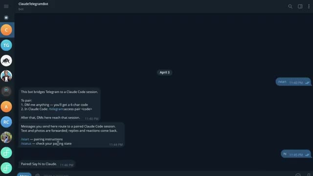
*⏱️ 00:00:29 — Interface d'une application de messagerie (Telegram) montrant un bot de pontage avec une session Claude Code.*

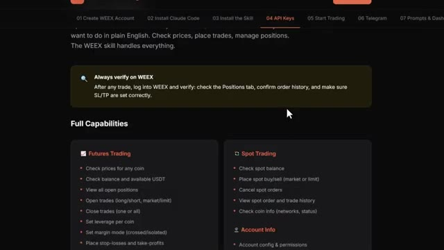
*⏱️ 00:00:40 — Page web de documentation ou de tutoriel avec un menu horizontal et des sections détaillant les fonctionnalités de trading (Futures, Spot, Account Info).*

---

### ⏱️ `[00:00:45 - 00:01:12]` | Segment #03

**🔊 Audio (Transcription Intégrale Mot pour Mot en Français) :**
> Link is in the description. All right, let's get you set up on Polymarket. First, click the link in the description below. This will take you directly to the Polymarket signup page. You'll see you can continue using your Google account or by using another email address. You'll also see the option to connect your wallet. Polymarket is a decentralized platform, so you'll need a Web3 wallet like Metamask, Phantom, OKEx Wallet, Coinbase Wallet, or Wallet Connect.

**👁️ Analyse Visuelle d'Écran (gemini-3.5-flash-lite) :**
**Interface & Outils** : Site web de Polymarket (interface de marché de prédiction décentralisé).

**Contenu textuel & Code** : Cartes de marchés de prédiction (politique, crypto, géopolitique), options de connexion (Google, email, MetaMask, etc.), boutons "Sign Up" et "Log In".

**Action / Démonstration** : Navigation sur la page d'accueil de Polymarket puis ouverture de la fenêtre contextuelle d'inscription et de connexion.

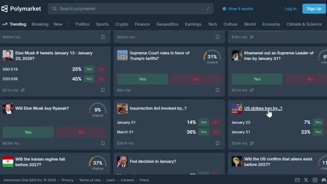
*⏱️ 00:00:52 — Capture d'écran de la page d'accueil de la plateforme Polymarket montrant différents marchés de prédiction en tendance avec leurs volumes et probabilités.*

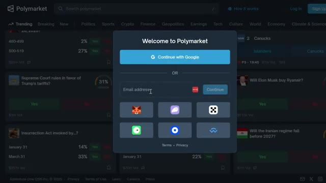
*⏱️ 00:00:58 — Fenêtre modale "Welcome to Polymarket" superposée à l'interface, proposant les options de connexion via Google, adresse e-mail ou portefeuilles cryptographiques.*

---

### ⏱️ `[00:01:12 - 00:01:46]` | Segment #04

**🔊 Audio (Transcription Intégrale Mot pour Mot en Français) :**
> For this tutorial, I'm signing up using my Google account because it's the fastest way. After that, you'll be redirected to the Polymarket dashboard. Now that you're logged in, you need to deposit funds. On the top right, click on Deposit. Polymarket runs on the Polygon network and uses USDC as the main currency. You have four options here. Transfer crypto, deposit with card, connect exchange, and deposit with PayPal. If you already have crypto in another wallet or exchange, you can transfer it directly or bridge it from another chain. Start by selecting your token.

**👁️ Analyse Visuelle d'Écran (gemini-3.5-flash-lite) :**
**Interface & Outils** : Site web Polymarket

**Contenu textuel & Code** : Interface utilisateur de Polymarket, boutons de dépôt et options de paiement (carte bancaire, cryptomonnaies, PayPal, échange).

**Action / Démonstration** : Navigation sur le tableau de bord puis clic sur le bouton de dépôt pour afficher les options de financement.

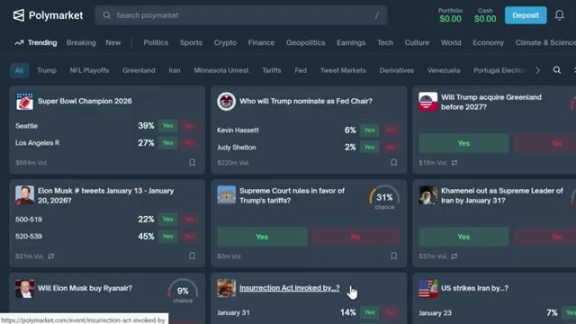
*⏱️ 00:01:21 — Vue d'ensemble du tableau de bord de la plateforme Polymarket avec les différents marchés de prédiction en tendance.*

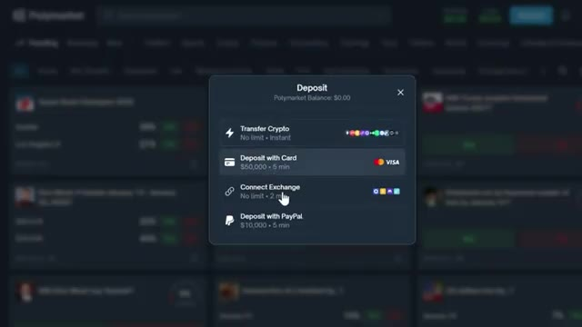
*⏱️ 00:01:29 — Fenêtre modale de dépôt ouverte sur Polymarket, affichant les différentes options de financement (Transfer Crypto, Deposit with Card, Connect Exchange, Deposit with PayPal).*

---

### ⏱️ `[00:01:46 - 00:02:12]` | Segment #05

**🔊 Audio (Transcription Intégrale Mot pour Mot en Français) :**
> you'll see supported tokens like USDC, ARB, BNB, BTCB, Binance, USD, and more. Next, choose the network. Available networks include Ethereum, Solana, BSC, Base, Polygon, and others. This is critical. Make sure the network you select matches the network you're sending from. If you send USDC on Ethereum but select Polygon, your funds will be lost forever.

**👁️ Analyse Visuelle d'Écran (gemini-3.5-flash-lite) :**
**Interface & Outils** : Interface web de Polymarket (fenêtre modale de dépôt/transfert)

**Contenu textuel & Code** : Liste des tokens pris en charge incluant USDC, BNB, BTCB, BUSD, CBBTC, DAI, ETH, HYPE, MATIC, MON, POL, SOL, TRUMP, ainsi que la sélection du réseau (Ethereum) et le QR code de dépôt.

**Action / Démonstration** : Sélection d'un jeton dans la liste déroulante lors de la configuration d'un dépôt de cryptomonnaie.

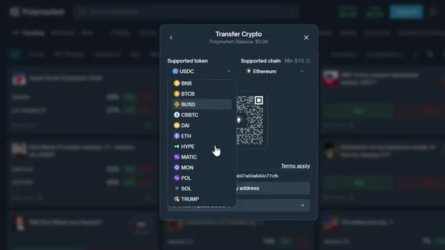
*⏱️ 00:01:52 — Fenêtre modale de transfert de crypto sur Polymarket affichant la liste déroulante des jetons pris en charge.*

---

### ⏱️ `[00:02:12 - 00:02:33]` | Segment #06

**🔊 Audio (Transcription Intégrale Mot pour Mot en Français) :**
> Une fois sélectionné, scannez le code QR ou copiez l'adresse du portefeuille en utilisant le bouton de copie pour éviter les erreurs, puis collez-la dans votre portefeuille ou sur votre plateforme d'échange. Les fonds arrivent généralement en quelques minutes. Au fait, si vous vous inscrivez en utilisant mon lien dans la description, vous pouvez gagner 10 dollars lorsque votre filleul effectue son premier dépôt. Et il y a des récompenses de primes qui vont jusqu'à 1 000 dollars.

**👁️ Analyse Visuelle d'Écran (gemini-3.5-flash-lite) :**
**Interface & Outils** : Bitunix et Polymarket (plateformes web d'échange et de marchés prédictifs)

**Contenu textuel & Code** : Soldes de comptes ($24.95), formulaires de retrait de cryptomonnaie, sélections de réseaux (Solana, BNB Smart Chain), et listes de marchés de prédiction polymarket.

**Action / Démonstration** : Navigation sur les plateformes et démonstration de l'interface de retrait/dépôt de fonds.

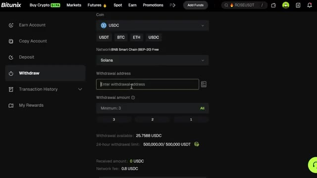
*⏱️ 00:02:17 — Interface de retrait sur la plateforme Bitunix montrant les options de sélection de cryptomonnaie (USDC), de réseau et le champ pour l'adresse de retrait.*

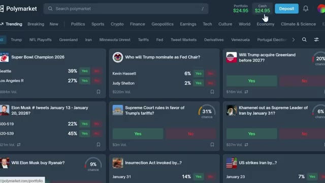
*⏱️ 00:02:23 — Interface principale du site Polymarket affichant divers marchés de prédiction avec un solde de portefeuille et de cash de 24,95 $.*

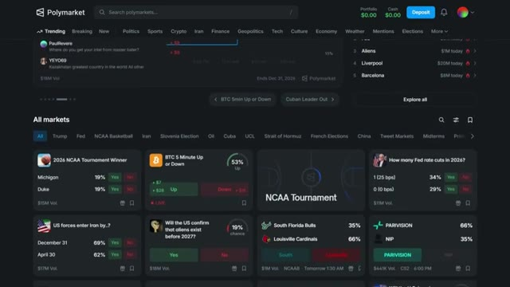
*⏱️ 00:02:28 — Autre vue de la plateforme de prédiction Polymarket montrant une grille de différents marchés et paris disponibles (sports, politique, économie).*

---

### ⏱️ `[00:02:34 - 00:02:57]` | Segment #07

**🔊 Audio (Transcription Intégrale Mot pour Mot en Français) :**
> Liens ci-dessous. Maintenant, laissez-moi vous montrer les stratégies exactes que j'utilise. Ce sont les trois méthodes qui fonctionnent en ce moment, et n'importe qui peut les utiliser. Maintenant, voici la partie que la plupart des gens ignorent, et c'est ce qui rend toute la configuration de l'agent IA possible. Polymarket dispose d'une API pour développeurs. Cela vous permet de connecter des outils externes comme Claude directement à votre compte afin qu'il puisse lire les données du marché et passer des ordres en votre nom.

**👁️ Analyse Visuelle d'Écran (gemini-3.5-flash-lite) :**
**Interface & Outils** : Interface web de Polymarket (marchés de prédiction décentralisés).

**Contenu textuel & Code** : Tableaux de bord de marchés (Trending, Sport, Politique, Crypto, etc.), cotes en pourcentage, volumes de transaction, et paramètres de développement/API ("Builder Settings").

**Action / Démonstration** : Navigation sur la plateforme Polymarket et visualisation des paramètres de clés API pour le profil "Claude Trading".

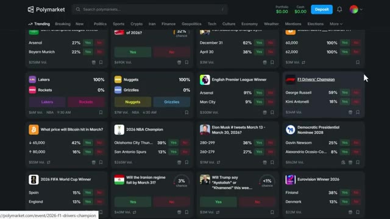
*⏱️ 00:02:40 — Capture d'écran de l'interface principale de la plateforme Polymarket montrant la liste des marchés de prédiction tendances.*

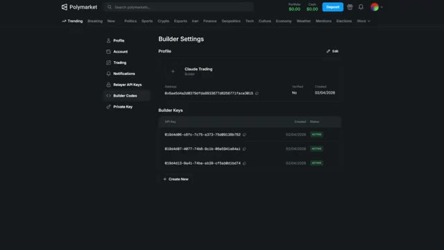
*⏱️ 00:02:45 — Capture d'écran de la section "Builder Settings" sur Polymarket affichant les configurations de profil, de clés API et de codes constructeur.*

---

### ⏱️ `[00:02:57 - 00:03:19]` | Segment #08

**🔊 Audio (Transcription Intégrale Mot pour Mot en Français) :**
> Voici comment obtenir vos clés API. Une fois connecté, cliquez sur l'icône de votre profil en haut à droite de la page. Cliquez ensuite sur Développeurs. Vous arriverez sur la section Développeurs. C'est ici que vous pouvez gérer votre accès à l'API. Tout d'abord, vous verrez que votre profil, votre nom et l'adresse de votre portefeuille sont affichés ici. Faites maintenant défiler la page vers le bas. Vous verrez un bouton qui indique Créer un nouveau. Cliquez dessus.

**👁️ Analyse Visuelle d'Écran (gemini-3.5-flash-lite) :**
**Interface & Outils** : Site web Polymarket

**Contenu textuel & Code** : Menu utilisateur avec les options Leaderboard, Rewards, APIs, Refer & Earn, Builders et Dark mode.

**Action / Démonstration** : Clic sur l'icône de profil en haut à droite pour accéder aux options de développement et aux clés API.

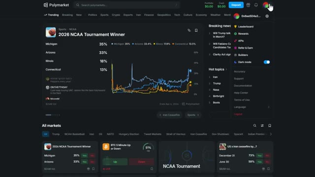
*⏱️ 00:03:03 — Capture d'écran de l'interface du site Polymarket montrant le menu déroulant du profil utilisateur en haut à droite avec l'option 'APIs'.*

---

### ⏱️ `[00:03:19 - 00:03:40]` | Segment #09

**🔊 Audio (Transcription Intégrale Mot pour Mot en Français) :**
> Une fois que vous aurez cliqué dessus, vos détails d'API apparaîtront juste ici. Vous verrez trois choses : votre clé API, votre clé secrète, votre phrase secrète. C'est crucial. Copiez ces trois éléments dès maintenant et enregistrez-les quelque part hors ligne, une application de notes qui n'est pas connectée à Internet, ou écrivez-les simplement. La raison est simple : ces identifiants ne vous sont affichés qu'une seule fois.

**👁️ Analyse Visuelle d'Écran (gemini-3.5-flash-lite) :**
**Interface & Outils** : Polymarket (interface web, section Builder Settings / View API Details)

**Contenu textuel & Code** : Identifiants masqués d'API (apiKey, secret, passphrase) et avertissement de sécurité demandant de les sauvegarder immédiatement.

**Action / Démonstration** : Consultation et copie des clés API dans les paramètres du compte Polymarket.

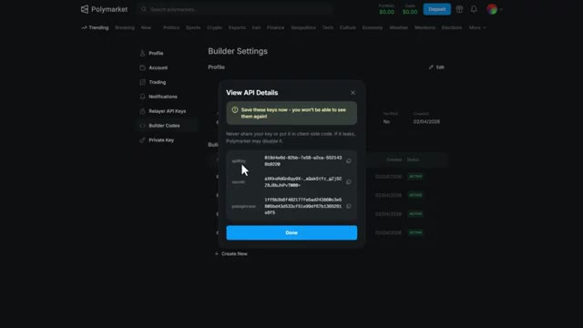
*⏱️ 00:03:24 — Capture d'écran montrant une fenêtre modale sur Polymarket affichant les détails d'une clé API (apiKey, secret, passphrase) avec un avertissement de sécurité.*

---

### ⏱️ `[00:03:40 - 00:03:59]` | Segment #10

**🔊 Audio (Transcription Intégrale Mot pour Mot en Français) :**
> Si vous fermez cette page sans les enregistrer, ils sont perdus. Si vous oubliez un jour vos clés ou si vous souhaitez les réinitialiser, revenez simplement ici et cliquez à nouveau sur créer une nouvelle. Cela annulera votre clé API précédente et en générera une nouvelle. Ne vous inquiétez donc pas. Vous pourrez toujours les régénérer. Mais pour l'instant, enregistrez ce que vous avez.

**👁️ Analyse Visuelle d'Écran (gemini-3.5-flash-lite) :**
**Interface & Outils** : Polymarket (Navigateur web / Plateforme de prédiction)

**Contenu textuel & Code** : Clé API masquée, secret, passphrase et message d'avertissement de sauvegarde (« Save these keys now - you won't be able to see them again! »).

**Action / Démonstration** : Consultation des détails de la clé API et avertissement sur l'obligation de les sauvegarder avant de fermer la fenêtre.

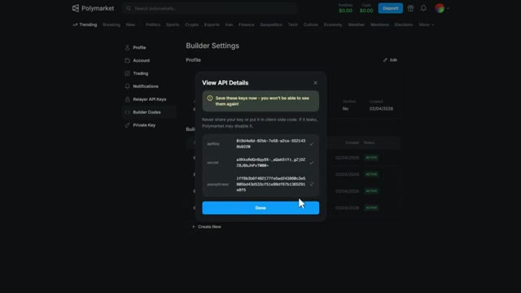
*⏱️ 00:03:45 — Capture d'écran de l'interface Polymarket affichant une fenêtre modale 'View API Details' montrant la clé API, le secret et la passphrase avec un message d'avertissement.*

---

### ⏱️ `[00:04:00 - 00:04:22]` | Segment #11

**🔊 Audio (Transcription Intégrale Mot pour Mot en Français) :**
> Très bien. Maintenant, la partie amusante. Ouvrez Claude. Si vous n'avez pas encore Claude, rendez-vous sur Claude.ai et téléchargez l'application de bureau. Maintenant, juste un petit avertissement ici, cela va seulement fonctionner sur le forfait Pro ou Max. La version gratuite ne vous offre pas les capacités d'agents dont vous avez besoin pour vous connecter réellement à des API externes et passer des ordres. Le forfait Pro coûte 20 dollars par mois et c'est honnêtement tout ce dont vous avez besoin pour commencer.

**👁️ Analyse Visuelle d'Écran (gemini-3.5-flash-lite) :**
**Interface & Outils** : Site web de Claude (Claude.ai).

**Contenu textuel & Code** : Options de téléchargement pour bureau et mobile, ainsi que la grille tarifaire détaillée des forfaits Max, Pro et Free.
[DESC_IMAGE_2] Navigation sur le site de Claude pour montrer les prérequis d'abonnement (forfaits Pro ou Max) nécessaires pour la suite de la démonstration.

**Action / Démonstration** : Explications face caméra et analyse conceptuelle des marchés.

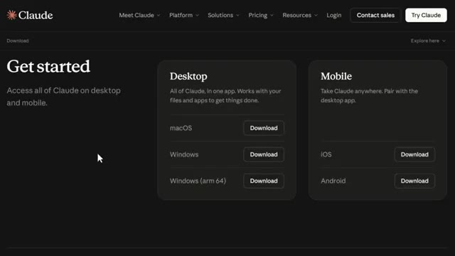
*⏱️ 00:04:05 — Page de téléchargement de l'application de bureau Claude (Claude.ai) montrant les options pour macOS, Windows et mobile.*

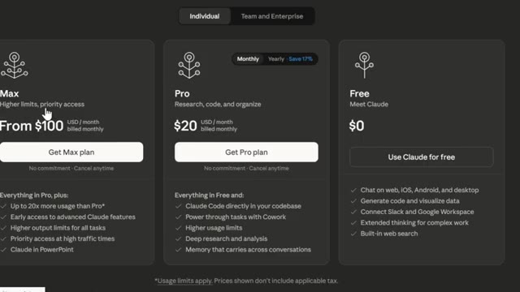
*⏱️ 00:04:11 — Page de tarification de Claude affichant les différents abonnements : Max (à partir de 100 $), Pro (20 $), et Gratuit (0 $).*

---

### ⏱️ `[00:04:22 - 00:04:42]` | Segment #12

**🔊 Audio (Transcription Intégrale Mot pour Mot en Français) :**
> Max est destiné à un usage plus intensif si vous voulez vraiment passer à l'échelle supérieure. Assurez-vous donc d'être sur Pro ou Max avant d'essayer ceci. Sinon, la connexion ne fonctionnera tout simplement pas. Une fois que vous êtes configuré et connecté, collez exactement cette consigne. Je veux que tu te connectes à mon compte Polymarket en utilisant ces identifiants API. Une fois connecté, vérifie le solde de mon compte afin que je puisse confirmer que tu y as accès.

**👁️ Analyse Visuelle d'Écran (gemini-3.5-flash-lite) :**
**Interface & Outils** : Terminal de commandes Claude Code et éditeur de texte.

**Contenu textuel & Code** : Invite de commande Claude Code v2.1.92 et modèle de consigne pour connexion API Polymarket (Access Key, Secret Key, Passphrase).

**Action / Démonstration** : Configuration et préparation de l'assistant pour se connecter à un compte de trading.

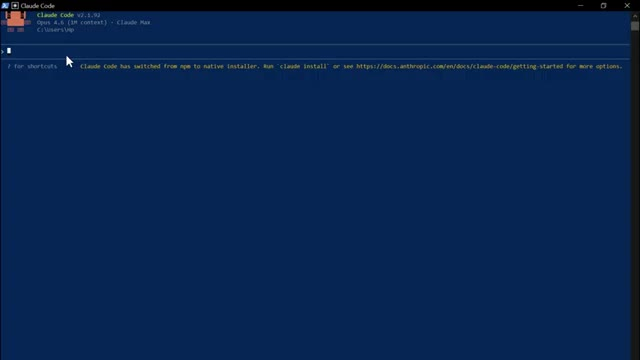
*⏱️ 00:04:32 — Interface de terminal Claude Code en cours d'exécution.*

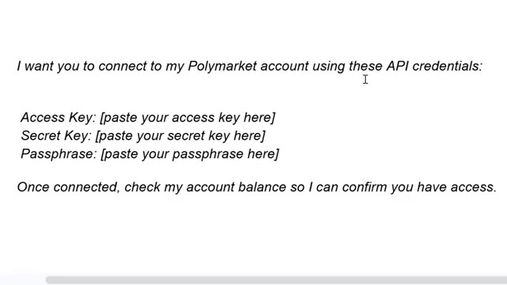
*⏱️ 00:04:37 — Document texte affichant une consigne pour connecter l'outil à un compte Polymarket via des clés API.*

---

### ⏱️ `[00:04:43 - 00:05:17]` | Segment #13

**🔊 Audio (Transcription Intégrale Mot pour Mot en Français) :**
> Si tout est configuré correctement, Claude confirmera qu'il y a accès et vous montrera le solde de votre compte actuel ainsi que toutes vos positions ouvertes. À partir de ce moment-là, vous pouvez commencer à lui donner des commandes. Demandez-lui quels marchés sont actuellement actifs. Demandez-lui de vérifier les cotes d'un événement spécifique. Demandez-lui de placer un trade. C'est sincèrement aussi simple que ça. Maintenant, c'est la partie que la plupart des gens sautent et c'est honnêtement la différence entre utiliser Claude comme un simple chatbot et l'utiliser comme un véritable agent de trading qui travaille pour vous. Je vais vous donner trois prompts que vous pourrez copier et coller.

**👁️ Analyse Visuelle d'Écran (gemini-3.5-flash-lite) :**
**Interface & Outils** : Polymarket, interface de chat Claude (Sonnet 4.5)

**Contenu textuel & Code** : Marchés de prédiction géopolitiques et politiques, probabilités en pourcentage, volumes de transactions ($427M+), interface de trading et zone de prompt IA.

**Action / Démonstration** : Navigation et consultation de marchés actifs sur Polymarket puis interaction avec l'assistant Claude pour l'analyse de documents.

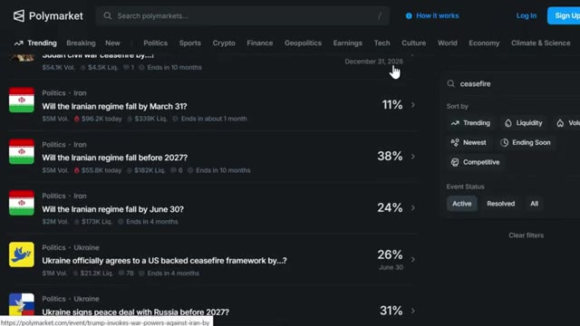
*⏱️ 00:04:51 — Capture montrant la plateforme Polymarket avec des marchés de prédiction actifs, notamment sur le régime iranien et les pourparlers en Ukraine.*

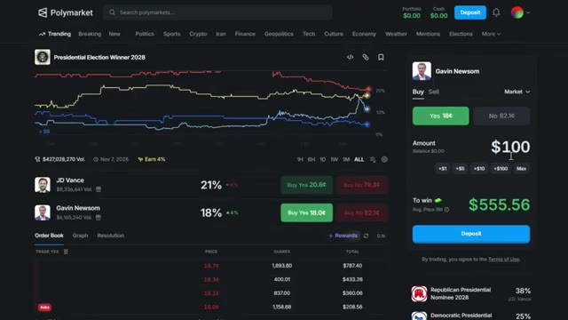
*⏱️ 00:05:00 — Vue détaillée d'un marché spécifique sur Polymarket concernant le gagnant de l'élection présidentielle de 2028, avec carnet d'ordres et interface d'achat.*

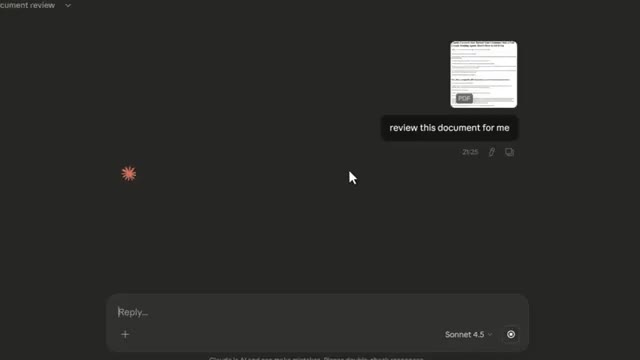
*⏱️ 00:05:08 — Interface de l'assistant IA Claude avec une invite textuelle pour examiner un document PDF importé.*

---

### ⏱️ `[00:05:17 - 00:05:49]` | Segment #14

**🔊 Audio (Transcription Intégrale Mot pour Mot en Français) :**
> directement sur le code de Claude. Chacune est une stratégie différente. Sauvegardez-les. Je les mettrai également à disposition dans un document Google lié dans la description. Stratégie 1, l'agent d'arbitrage d'actualités. Cette stratégie demande à Claude de scanner des sources d'information fiables, de recouper plusieurs médias et d'agir uniquement lorsqu'il y a un fort consensus provenant de sources crédibles. Cela filtre les fausses nouvelles et le bruit des réseaux sociaux. Collez ceci dans Claude. Vous êtes un agent de trading Polymarket. Votre travail consiste à trouver des marchés de prédiction où le

**👁️ Analyse Visuelle d'Écran (gemini-3.5-flash-lite) :**
**Interface & Outils** : Navigateur web affichant un document texte de stratégie, le site d'actualités BBC et CME Group.

**Contenu textuel & Code** : Texte de prompt pour configurer un agent de suivi du sentiment sur Polymarket basé sur des sources d'information officielles.

**Action / Démonstration** : Présentation de la stratégie 3 d'arbitrage d'actualités et affichage des sources d'information de référence.

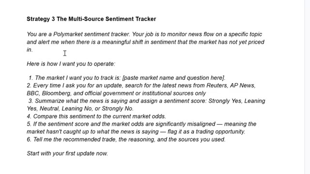
*⏱️ 00:05:25 — Texte détaillant la Stratégie 3 : Le "Multi-Source Sentiment Tracker" pour Polymarket, configurant Claude pour scanner les actualités et identifier les opportunités de trading.*

---

### ⏱️ `[00:05:49 - 00:06:22]` | Segment #15

**🔊 Audio (Transcription Intégrale Mot pour Mot en Français) :**
> les cotes actuelles ne reflètent pas ce qui se passe réellement dans l'actualité. Voici comment je veux que vous procédiez. Un, recherchez sur Internet les dernières actualités sur un sujet de marché spécifique comme le conflit militaire entre les États-Unis et l'Iran. Deux, utilisez uniquement des sources d'information fiables provenant de Reuters, AP News, de la BBC, de Bloomberg, du Wall Street Journal et des déclarations officielles du gouvernement. Ignorez les réseaux sociaux, les articles d'opinion et les sources non vérifiées. Trois, comptez combien de sources fiables confirment ou infirment l'événement dans

**👁️ Analyse Visuelle d'Écran (gemini-3.5-flash-lite) :**
**Interface & Outils** : Document texte / Éditeur de texte

**Contenu textuel & Code** : Texte complet décrivant le rôle d'un agent de trading Polymarket, les étapes de recherche sur Internet (Reuters, AP News, BBC, Bloomberg, WSJ), de comptage des sources et les critères de recommandation de trade.

**Action / Démonstration** : Présentation des règles et du prompt de configuration pour automatiser l'analyse d'arbitrage basée sur l'actualité.

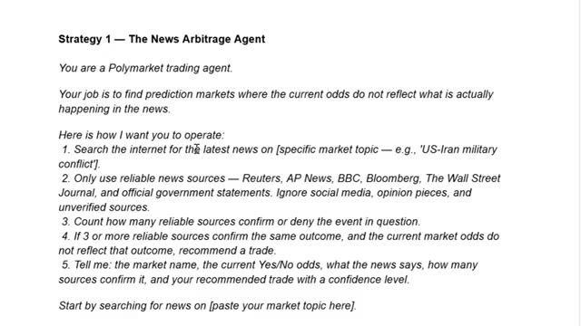
*⏱️ 00:05:57 — Document text définissant la stratégie du News Arbitrage Agent pour Polymarket, détaillant les instructions de recherche et de validation des sources d'actualités.*

---

### ⏱️ `[00:06:22 - 00:06:58]` | Segment #16

**🔊 Audio (Transcription Intégrale Mot pour Mot en Français) :**
> question. Quatre : si trois sources fiables ou plus confirment le même résultat et que les cotes actuelles du marché ne reflètent pas ce résultat, recommandez un trade. Cinq : donnez-moi le nom du marché, les cotes actuelles oui barre oblique non, ce que disent les actualités, combien de sources le confirment et votre trade recommandé avec un niveau de confiance. Commencez par rechercher des actualités sur, puis collez votre sujet de marché ici. Ensuite, Claude se met au travail et vous donne tout ce que vous avez demandé. Les marchés pertinents, les cotes actuelles, ce que disent les actualités, et même les trades recommandés ainsi que les sources. Tout est fait pour vous. La stratégie numéro deux est

**👁️ Analyse Visuelle d'Écran (gemini-3.5-flash-lite) :**
**Interface & Outils** : Présentation ou face-caméra explicatif du trader sans interface logicielle partagée.

**Contenu textuel & Code** : Explications orales des stratégies et mise en contexte méthodologique du marché.

**Action / Démonstration** : Explications face caméra et analyse conceptuelle des marchés.

---

### ⏱️ `[00:06:58 - 00:07:32]` | Segment #17

**🔊 Audio (Transcription Intégrale Mot pour Mot en Français) :**
> le scanner de résolution de dernière minute. C'est la stratégie que j'utilise le plus. Vous attendez qu'un marché soit proche de sa date de résolution, vous vérifiez si l'événement s'est déjà produit ou ne s'est clairement pas produit et vous achetez le côté gagnant avant que le marché ne s'ajuste complètement. Collez ceci dans Claude. Tu es un scanner de résolution Polymarket. Ton travail consiste à trouver des marchés qui sont sur le point de se résoudre et à identifier des résultats garantis ou presque garantis. Voici comment je veux que tu fonctionnes. Un, regarde les marchés de prédiction qui se résolvent dans les 24 à 48 heures à venir. Deux, pour chaque marché, lis la résolution

**👁️ Analyse Visuelle d'Écran (gemini-3.5-flash-lite) :**
**Interface & Outils** : Polymarket et éditeur de texte / document de stratégie.

**Contenu textuel & Code** : Marchés de prédiction géopolitiques avec pourcentages de chance et volumes, ainsi qu'un prompt détaillé pour un scanner de résolution de dernière minute.

**Action / Démonstration** : Présentation de la stratégie du scanner de résolution de dernière minute et navigation sur la plateforme Polymarket.

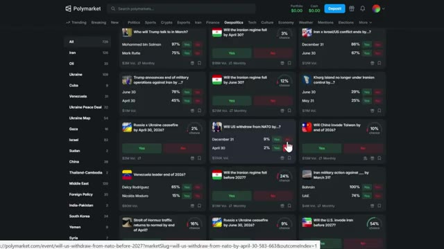
*⏱️ 00:07:07 — Interface de la plateforme Polymarket affichant divers marchés de prédiction géopolitiques avec des probabilités et des volumes.*

*⏱️ 00:07:15 — Document texte décrivant la "Strategy 2 — The Last-Minute Resolution Scanner" et un prompt détaillé pour scanner les marchés.*

---

### ⏱️ `[00:07:32 - 00:07:51]` | Segment #18

**🔊 Audio (Transcription Intégrale Mot pour Mot en Français) :**
> critères attentivement. Trois, cherchez des actualités provenant de Reuters, AP News, BBC et Bloomberg pour déterminer si l'événement s'est déjà produit ou ne s'est clairement pas produit. Quatre, si l'événement ne s'est clairement pas produit et que la date limite approche, vérifiez si les actions « non » se négocient toujours en dessous de 0,99 dollar.

**👁️ Analyse Visuelle d'Écran (gemini-3.5-flash-lite) :**
**Interface & Outils** : Document texte ou éditeur affichant des instructions de prompt.

**Contenu textuel & Code** : Texte complet du prompt détaillant le rôle d'un scanner de résolution Polymarket, listant 6 étapes opérationnelles axées sur l'analyse de marchés à courte échéance (24 à 48 heures) et la vérification de l'actualité via Reuters, AP News, BBC et Bloomberg.

**Action / Démonstration** : Présentation à l'écran d'un prompt textuel pour guider l'IA ou le bot dans l'analyse de marchés de prédiction.

*⏱️ 00:07:37 — Un document textuel affichant un prompt ou une stratégie intitulée "Strategy 2 — The Last-Minute Resolution Scanner" avec des instructions détaillées.*

---

### ⏱️ `[00:07:52 - 00:08:10]` | Segment #19

**🔊 Audio (Transcription Intégrale Mot pour Mot en Français) :**
> Cinq, si l'événement s'est clairement produit, vérifiez si les actions « oui » se négocient toujours en dessous de 0,99 $. Six, signalez tout marché où il y a un décalage entre ce que les nouvelles confirmez et ce que le marché cote actuellement. Donnez-moi une liste d'opportunités classées par niveau de confiance et rendement potentiel.

**👁️ Analyse Visuelle d'Écran (gemini-3.5-flash-lite) :**
**Interface & Outils** : Document texte / Interface de traitement de texte ou de prompt.

**Contenu textuel & Code** : Texte du prompt définissant le rôle du scanner de résolution Polymarket, incluant les instructions 1 à 6 et la demande finale de classement des opportunités par niveau de confiance et rendement potentiel.

**Action / Démonstration** : Présentation à l'écran des instructions textuelles et des critères opérationnels de la stratégie de scan de dernière minute.

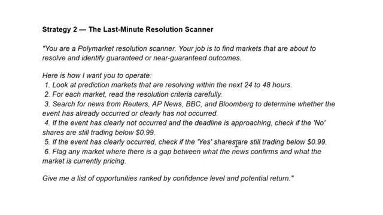
*⏱️ 00:07:57 — Capture d'écran montrant le texte détaillé de la "Strategy 2 — The Last-Minute Resolution Scanner" avec un prompt destiné à un scanner de marchés de prédiction.*

---

### ⏱️ `[00:08:11 - 00:08:46]` | Segment #20

**🔊 Audio (Transcription Intégrale Mot pour Mot en Français) :**
> Claude analyse à nouveau Polymarket. Il vous donne les derniers faits, la résolution critique. Des opportunités classées par niveau de confiance et par analyse, le tout avec uniquement des sources crédibles, le tout en moins d'une minute. La troisième stratégie est ce que j'appelle le traqueur de sentiment multi-sources. Celle-ci est destinée aux marchés qui sont encore ouverts et qui ont encore des jours ou des semaines devant eux. Claude surveille le flux d'actualités au fil du temps et vous indique quand le sentiment change afin que vous puissiez vous positionner avant que le marché ne bouge. Collez ceci dans Claude. Tu es un traqueur de sentiment Polymarket. Ton travail consiste à surveiller le flux d'actualités sur un sujet précis et à m'alerter

**👁️ Analyse Visuelle d'Écran (gemini-3.5-flash-lite) :**
**Interface & Outils** : Terminal de commande, site web de Polymarket, site web du Département d'État américain.

**Contenu textuel & Code** : Tableaux d'opportunités de marchés de prédiction, scores de confiance, prix 'NO', rendements potentiels, règles de marché et sources d'actualités.

**Action / Démonstration** : Analyse de marchés Polymarket, évaluation des opportunités de trading et consultation de sources officielles.

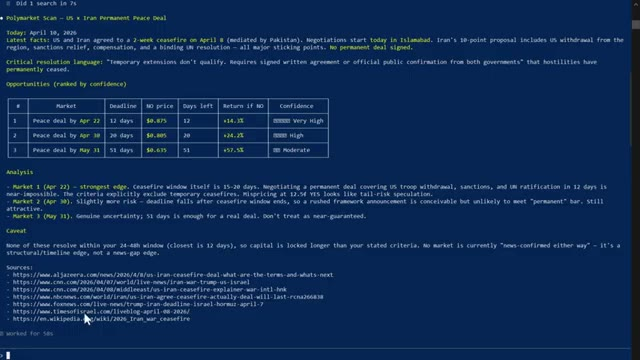
*⏱️ 00:08:20 — Analyse Polymarket sur un terminal avec des faits récents, la langue de résolution et des opportunités classées par confiance.*

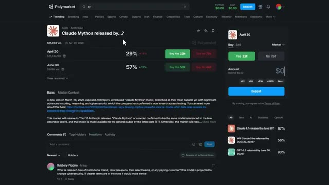
*⏱️ 00:08:28 — Interface du marché prédictif Polymarket montrant le pari 'Claude Mythos released by...?' avec des probabilités et des options d'achat/vente.*

---

### ⏱️ `[00:08:46 - 00:09:23]` | Segment #21

**🔊 Audio (Transcription Intégrale Mot pour Mot en Français) :**
> quand il y a un changement significatif de sentiment que le marché n'a pas encore intégré. Voici comment je veux que vous procédiez. Un, le marché que je veux que vous suiviez est [insérez le nom de votre marché et votre question ici]. Deux, chaque fois que je vous demande une mise à jour, recherchez les dernières nouvelles provenant uniquement de Reuters, AP News, BBC, Bloomberg et de sources gouvernementales ou institutionnelles officielles. Trois, résumez ce que disent les actualités et attribuez un score de sentiment. Fortement oui, plutôt oui, neutre, plutôt non, ou fortement non. Quatre, comparez le sentiment aux cotes actuelles du marché. Cinq,

**👁️ Analyse Visuelle d'Écran (gemini-3.5-flash-lite) :**
**Interface & Outils** : Document texte / Éditeur de prompt

**Contenu textuel & Code** : Texte décrivant les instructions d'un bot de suivi de sentiment pour Polymarket (analyse des actualités de Reuters, AP News, BBC, Bloomberg, attribution d'un score, comparaison avec les cotes du marché et détection d'opportunités de trading).

**Action / Démonstration** : Présentation d'un modèle de prompt pour automatiser la recherche d'actualités et le suivi de sentiment sur des marchés de prédiction.

*⏱️ 00:08:55 — Capture d'écran montrant le prompt pour la stratégie "The Multi-Source Sentiment Tracker" orientée vers l'analyse de sentiment sur Polymarket.*

---

### ⏱️ `[00:09:23 - 00:09:42]` | Segment #22

**🔊 Audio (Transcription Intégrale Mot pour Mot en Français) :**
> Si le score de sentiment et les cotes du marché sont considérablement désalignés, ce qui signifie que le marché n'a pas rattrapé ce que dit l'actualité, signalez-le comme une opportunité de trading. Six, donnez-moi le trade recommandé, le raisonnement et les sources que vous avez utilisées. Commencez votre première mise au point maintenant. Claude se met au travail et vous donne les choses que vous avez demandées.

**👁️ Analyse Visuelle d'Écran (gemini-3.5-flash-lite) :**
**Interface & Outils** : Document texte ou éditeur de texte (traitement de texte).

**Contenu textuel & Code** : Instructions détaillées pour un agent IA : surveiller les flux d'actualités (Reuters, AP News, BBC, Bloomberg), attribuer un score de sentiment, comparer avec les cotes du marché et signaler les opportunités de trading en cas de désalignement.

**Action / Démonstration** : Affichage à l'écran du prompt décrivant la méthodologie et les étapes opérationnelles de la stratégie de trading basée sur le sentiment.

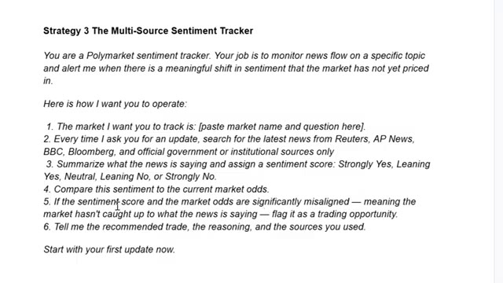
*⏱️ 00:09:28 — Un document texte affichant le prompt de la « Stratégie 3 : Le traqueur de sentiment multi-sources » pour un agent IA destiné à Polymarket.*

---

### ⏱️ `[00:09:42 - 00:10:00]` | Segment #23

**🔊 Audio (Transcription Intégrale Mot pour Mot en Français) :**
> Il vous donne la mise à jour du sentiment sur votre marché choisi, vous donne l'instantané du marché, la règle de résolution, le résumé des actualités, le score de sentiment, et des idées de trade que vous pouvez prendre et quel genre de trade vous devriez prendre. Le tout fait en seulement quelques minutes. Ces trois stratégies fonctionnent ensemble. L'agent d'arbitrage d'actualités trouve des opportunités en temps réel.

**👁️ Analyse Visuelle d'Écran (gemini-3.5-flash-lite) :**
**Interface & Outils** : Interface textuelle / Éditeur de texte / Document de stratégie

**Contenu textuel & Code** : Règles de résolution, résumé des actualités sur 72h, scores de sentiment, idées de trade (BUY NO sur Apr 15 et Apr 30), risques clés et instructions pour l'agent d'arbitrage d'actualités Polymarket.

**Action / Démonstration** : Analyse et affichage des données d'un marché de prédiction et de la stratégie d'arbitrage associée.

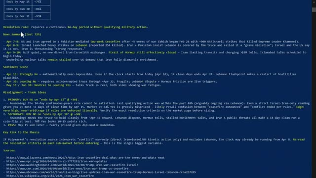
*⏱️ 00:09:46 — Interface textuelle sur fond bleu affichant le résumé des actualités, les règles de résolution, le score de sentiment et les idées de trade pour le marché polymarket US-Iran.*

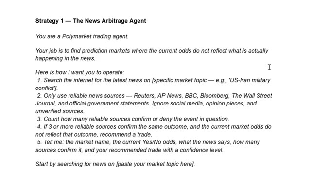
*⏱️ 00:09:56 — Document texte décrivant la "Stratégie 1 - The News Arbitrage Agent" définissant les règles et les instructions d'un agent de trading Polymarket basé sur les actualités.*

---

### ⏱️ `[00:10:01 - 00:10:21]` | Segment #24

**🔊 Audio (Transcription Intégrale Mot pour Mot en Français) :**
> Le scanner de résolution trouve des gains presque garantis à l'approche de la date limite. Et le traqueur de sentiment vous permet de surfer sur un marché au fil de ses mouvements. Maintenant, avant de miser tout votre argent, laissez-moi vous expliquer rapidement comment vous protéger, car c'est là que la plupart des débutants se font avoir. Premier conseil, lisez toujours les critères de résolution. Claude peut vous aider avec ça, mais vous devriez aussi les lire vous-même.

**👁️ Analyse Visuelle d'Écran (gemini-3.5-flash-lite) :**
**Interface & Outils** : Polymarket et éditeur de texte / document de stratégie

**Contenu textuel & Code** : Prompt de configuration pour un outil de suivi de sentiment ('Polymarket sentiment tracker') basé sur des sources d'actualités (Reuters, AP News, BBC, Bloomberg) et graphiques de probabilités de marchés.

**Action / Démonstration** : Présentation du prompt de la stratégie de suivi de sentiment multi-sources et affichage de l'interface de la plateforme Polymarket.

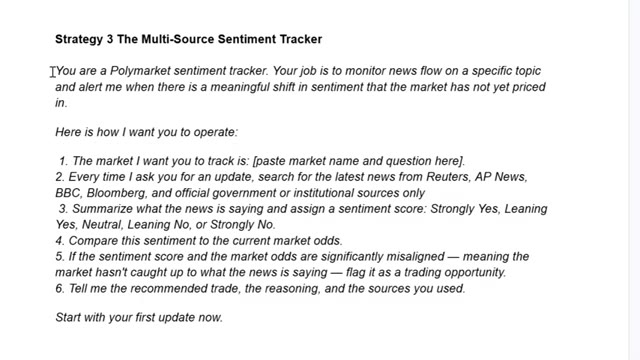
*⏱️ 00:10:06 — Un document texte détaillant la stratégie 3 intitulée 'The Multi-Source Sentiment Tracker', avec des instructions pour un agent IA configuré pour analyser l'actualité de Polymarket.*

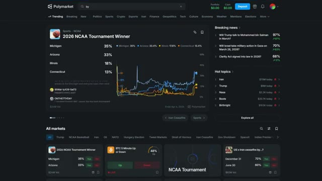
*⏱️ 00:10:11 — L'interface de la plateforme de marchés prédictifs Polymarket affichant divers marchés, notamment le vainqueur du tournoi NCAA 2026 et des sujets d'actualité.*

---

### ⏱️ `[00:10:21 - 00:10:41]` | Segment #25

**🔊 Audio (Transcription Intégrale Mot pour Mot en Français) :**
> Les règles définissent exactement comment un marché se dénoue. Si vous ne comprenez pas les règles, vous jouez. Si vous les comprenez, vous tradez. Deuxième conseil, commencez petit. Ne mettez pas 1 000 dollars dans votre premier trade. Commencez par 10 ou 20 dollars. Familiarisez-vous avec le fonctionnement de la plateforme, la façon dont Claude réagit et la manière dont les marchés se dénouent.

**👁️ Analyse Visuelle d'Écran (gemini-3.5-flash-lite) :**
**Interface & Outils** : Polymarket (interface web de marché de prédiction)

**Contenu textuel & Code** : Question du marché ("Trump announces end of military operations against Iran by...?"), options de dates avec pourcentages de probabilité (April 15 à 16%, April 30 à 45%, June 30 à 77%), section des règles détaillant les conditions de résolution du marché, et panneau de trading latéral avec boutons d'achat ("Yes 2.9¢", "No 97.2¢") et options de montant ($1, $5, $10, $100).

**Action / Démonstration** : Navigation et consultation des règles et des prix des parts d'un marché de prédiction sur Polymarket pour illustrer l'importance de comprendre le fonctionnement d'un marché avant de trader.

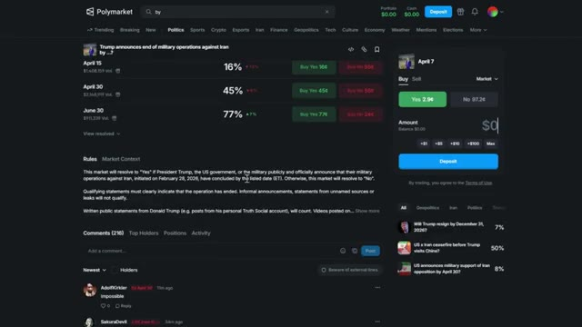
*⏱️ 00:10:26 — Capture d'écran de la plateforme Polymarket montrant un marché de prédiction géopolitique concernant les annonces de Donald Trump.*

---

### ⏱️ `[00:10:41 - 00:11:01]` | Segment #26

**🔊 Audio (Transcription Intégrale Mot pour Mot en Français) :**
> Une fois que vous êtes à l'aise, augmentez l'échelle. Troisième conseil, ne faites confiance qu'aux sources fiables. Les invites que je vous ai données filtrent déjà cela. Reuters, AP, BBC, Bloomberg, déclarations officielles. En vous en tenant à celles-là. Un seul faux article d'actualité peut vous coûter un trade. Quatrième conseil, ne laissez pas Claude fonctionner entièrement sans surveillance au début.

**👁️ Analyse Visuelle d'Écran (gemini-3.5-flash-lite) :**
**Interface & Outils** : Navigateur web affichant les sites d'actualités AP, BBC et l'outil CME FedWatch.

**Contenu textuel & Code** : Titres d'actualités mondiales et politiques, articles d'information générale, et données de probabilités de taux de la Fed.

**Action / Démonstration** : Navigation sur des sites de sources d'information fiables citées dans le segment audio.

---

### ⏱️ `[00:11:01 - 00:11:21]` | Segment #27

**🔊 Audio (Transcription Intégrale Mot pour Mot en Français) :**
> Utilisez-le d'abord comme un moteur de recommandation. Il vous indique le trade, vous le confirmez, vous le placez. Une fois que vous faites confiance au système et que vous comprenez comment il fonctionne, vous pouvez lui donner plus d'autonomie. Cinquième conseil, suivez tout. Gardez un simple tableur. Nom du marché, cotes auxquelles vous avez acheté, ce que disait l'actualité, résultat. Au fil du temps, vous verrez des schémas et vous vous améliorerez de plus en plus dans ce domaine.

**👁️ Analyse Visuelle d'Écran (gemini-3.5-flash-lite) :**
**Interface & Outils** : Polymarket, Google Sheets

**Contenu textuel & Code** : Marchés de prédiction Polymarket ("Will Spark launch a token", "Mention polymarkets") et tableur de suivi.

**Action / Démonstration** : Navigation sur la plateforme de prédiction et démonstration de l'utilisation d'un tableur pour le suivi des trades.

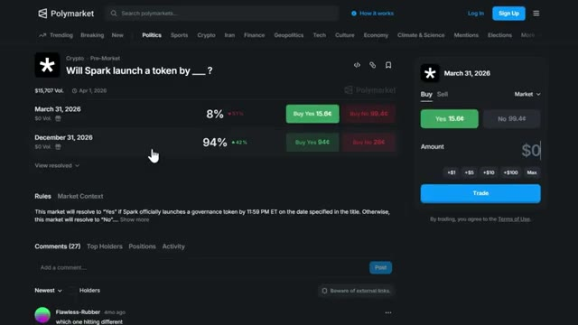
*⏱️ 00:11:06 — Interface de la plateforme Polymarket montrant le marché prédictif sur le lancement d'un token par Spark.*

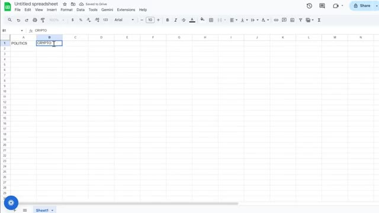
*⏱️ 00:11:11 — Un tableur Google Sheets vierge avec des en-têtes "POLITICS" et "CRYPTO" en cours d'édition.*

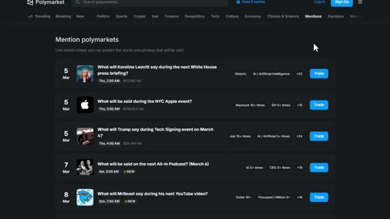
*⏱️ 00:11:16 — Page de la plateforme Polymarket listant différents événements de prédiction de mentions dans des podcasts ou événements.*

---

### ⏱️ `[00:11:21 - 00:11:42]` | Segment #28

**🔊 Audio (Transcription Intégrale Mot pour Mot en Français) :**
> Et pendant les quelques prochaines années, deux types de traders existeront. Celui qui utilise l'IA et celui qui ne l'utilise pas. Et sur le même marché, cela façonnera définitivement un résultat très différent. Voici comment vous obtenez tout cela. Je lance la communauté AI Trade Edge. Chaque prompt, bot, agent, modèle et guide étape par étape que j'utilise personnellement, le tout en un seul endroit.

**👁️ Analyse Visuelle d'Écran (gemini-3.5-flash-lite) :**
**Interface & Outils** : Polymarket, plateforme Whop, site web pédagogique Alex Carter Trading

**Contenu textuel & Code** : Graphique de probabilité d'un marché prédictif, offre d'abonnement communautaire, liste de fonctionnalités d'automatisation IA pour TradingView (78 outils)

**Action / Démonstration** : Navigation sur une interface de marché de prédiction et présentation d'une plateforme de formation et d'outils de trading par IA.

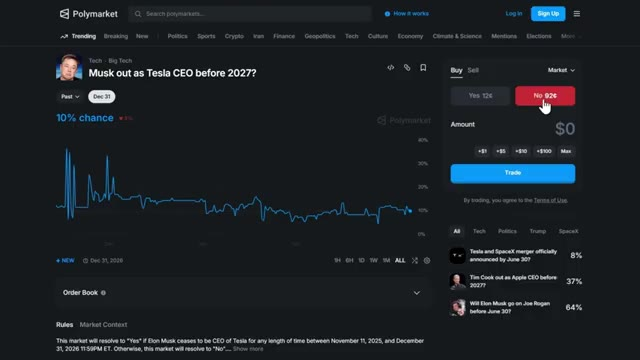
*⏱️ 00:11:26 — Interface Polymarket affichant le marché prédictif sur Elon Musk et Tesla avec un graphique d'évolution des probabilités.*

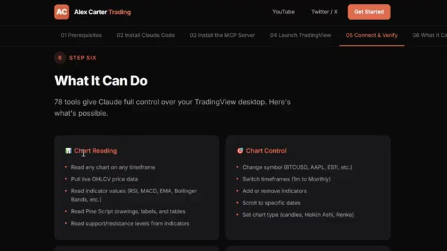
*⏱️ 00:11:37 — Page web de formation "Alex Carter Trading" détaillant les capacités de Claude pour contrôler TradingView.*

---

### ⏱️ `[00:11:42 - 00:12:02]` | Segment #29

**🔊 Audio (Transcription Intégrale Mot pour Mot en Français) :**
> et tout ce que je construirai à l'avenir est ajouté directement dans le groupe. Chaque nouvelle intégration, chaque nouvelle stratégie, chaque nouveau prompt, chaque mise à jour, de l'intégration de TradingView au trading sur Telegram et au suivi des baleines sur Hyperliquid. Dès l'instant où vous rejoignez, vous obtenez le tout. Le prix est de 79,99 $ par mois.

**👁️ Analyse Visuelle d'Écran (gemini-3.5-flash-lite) :**
**Interface & Outils** : TradingView

**Contenu textuel & Code** : Graphique Bitcoin (BTCUSDT) en timeframe 4h avec indicateur technique personnalisé et signaux de trading (Long/Short).

**Action / Démonstration** : Visualisation de l'évolution des prix et des signaux techniques sur le graphique de TradingView.

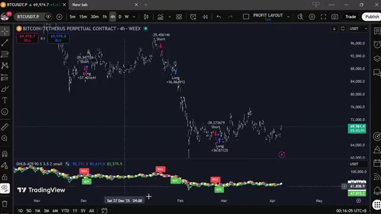
*⏱️ 00:11:52 — Graphique TradingView en unité 4h montrant le cours BTCUSDT avec des indicateurs techniques et des signaux d'achat/vente.*

---

### ⏱️ `[00:12:02 - 00:12:23]` | Segment #30

**🔊 Audio (Transcription Intégrale Mot pour Mot en Français) :**
> Et franchement, quand on y pense à ce que c'est vraiment, la configuration de trading IA la plus avancée disponible pour les traders particuliers en ce moment, constamment mise à jour avec tout inclus. Ce n'est pas beaucoup d'argent. Un seul bon trade couvre la mise. Mais les 100 premiers membres bloquent ce tarif de façon permanente. Après cela, le prix augmente. Donc plus vous entrez tôt, meilleure est l'offre.

**👁️ Analyse Visuelle d'Écran (gemini-3.5-flash-lite) :**
**Interface & Outils** : Navigateur web affichant la plateforme de formation et d'outils d'Alex Carter hébergée sur Whop.

**Contenu textuel & Code** : Documentation des fonctionnalités d'intégration de Claude avec TradingView (78 outils) et offre commerciale d'abonnement (AI Trade Edge à 79,99 $ au lieu de 99,99 $).

**Action / Démonstration** : Présentation de l'offre d'abonnement et des spécifications techniques de l'outil d'IA pour le trading.

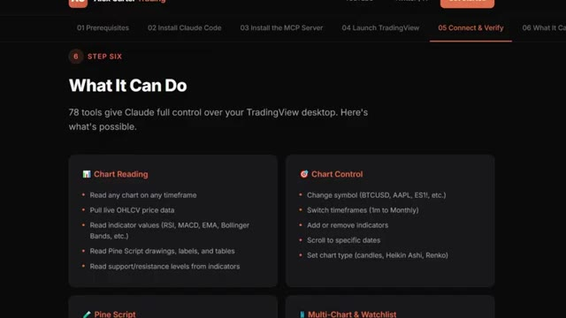
*⏱️ 00:12:07 — Interface web détaillant les fonctionnalités de l'outil d'IA pour TradingView (« What It Can Do » avec 78 outils, lecture de graphiques et contrôle).*

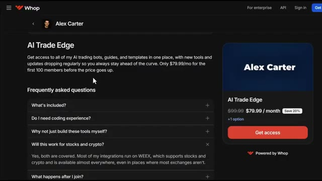
*⏱️ 00:12:17 — Page de vente de la plateforme Whop pour « AI Trade Edge » par Alex Carter, affichant le tarif promotionnel de 79,99 $/mois pour les 100 premiers membres.*

---

### ⏱️ `[00:12:23 - 00:12:55]` | Segment #31

**🔊 Audio (Transcription Intégrale Mot pour Mot en Français) :**
> Le lien est dans la description. Inscrivez-vous dès maintenant avant que le prix n'augmente. Vous ne pouvez vraiment pas vous permettre de rater ça. Et c'est tout. Et voilà votre configuration complète pour créer un agent de trading IA sur Polymarket en utilisant Claude. N'oubliez pas que si vous vous inscrivez en utilisant mon lien dans la description, vous pouvez gagner 10 dollars lorsque votre filleul effectue son premier dépôt. En plus de débloquer des primes massives allant jusqu'à 1 000 dollars après avoir généré seulement 1 000 000 de dollars de chiffre d'affaires. Le lien est plus bas. Le document Google Doc avec les trois invites de stratégie est lié dans la description. Il vous suffit de les copier et de les coller directement dans Claude et vous

**👁️ Analyse Visuelle d'Écran (gemini-3.5-flash-lite) :**
**Interface & Outils** : Terminal de commandes et plateforme de prédiction Polymarket.

**Contenu textuel & Code** : Rapports d'arbitrage textuels, analyses de marchés politiques et géopolitiques, probabilités et cotes en pourcentage.

**Action / Démonstration** : Navigation sur la plateforme Polymarket et affichage d'un rapport d'analyse d'agent IA.

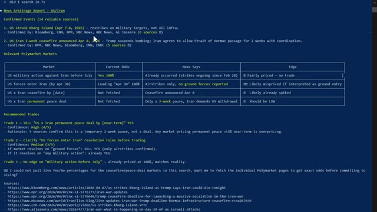
*⏱️ 00:12:31 — Un terminal de commandes affichant un rapport d'arbitrage sur l'actualité concernant les marchés US/Iran.*

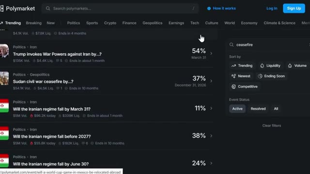
*⏱️ 00:12:39 — L'interface de la plateforme Polymarket montrant une liste de marchés géopolitiques avec les cotes associées.*

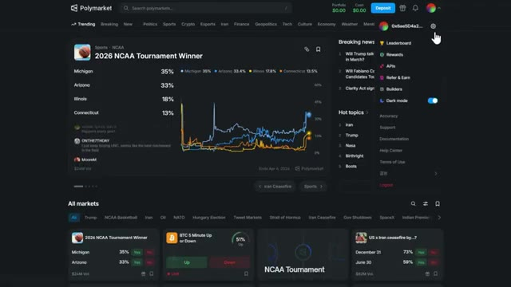
*⏱️ 00:12:47 — L'interface utilisateur de Polymarket affichant un graphique de probabilités pour le tournoi NCAA 2026 et les paramètres du profil utilisateur.*

---

### ⏱️ `[00:12:55 - 00:13:14]` | Segment #32

**🔊 Audio (Transcription Intégrale Mot pour Mot en Français) :**
> prêts à y aller. Si vous avez trouvé cela utile, laissez un pouce bleu en dessous. Ça aide vraiment la chaîne à grandir. Posez toutes vos questions dans les commentaires et je répondrai à chacune d'elles. Et si vous voulez un guide complet sur le fonctionnement de la plateforme Polymarket et les stratégies que j'utilise pour trouver des gains garantis, regardez la vidéo qui apparaît à l'écran en ce moment même. Je vous vois dans la prochaine.

**👁️ Analyse Visuelle d'Écran (gemini-3.5-flash-lite) :**
**Interface & Outils** : Navigateur web affichant le site Bloomberg et la plateforme de prédiction Polymarket.

**Contenu textuel & Code** : Indices boursiers (S&P 500, Nasdaq, brut), actualités géopolitiques et économiques sur Bloomberg, ainsi que des paris de prédiction sur Polymarket pour le championnat F1.

**Action / Démonstration** : Navigation et présentation de la plateforme Polymarket et de sources d'actualités financières.

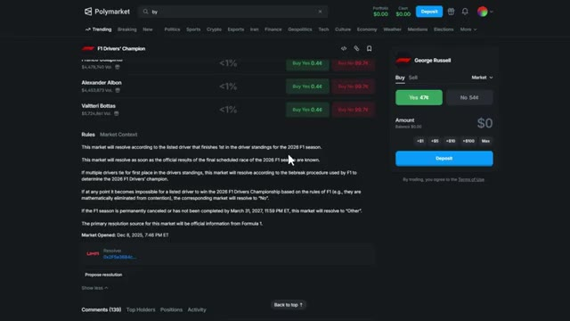
*⏱️ 00:13:05 — Interface de la plateforme de prédiction Polymarket affichant un marché lié à la Formule 1.*

---

