# 🎬 Build Your Own Trading Agent in 2 Minutes

> **Chaîne** : [Alex Carter](https://www.youtube.com/@AlexCarterTrading)  
> **Lien YouTube** : [https://www.youtube.com/watch?v=GxXFKzRXbAs](https://www.youtube.com/watch?v=GxXFKzRXbAs)  
> **Date de publication** : 20260413  
> **Durée** : 00:08:43  
> **Identifiant vidéo** : `GxXFKzRXbAs`  
> **Transcription & Analyse** : `whisper-v3-large-turbo+gemini-3.5-flash-lite`  

---

## 📌 Synthèse Exécutive & Outils

### 💡 Résumé
Dans cette vidéo, Alex Carter pose les bases d'un changement structurel majeur dans le trading particulier, qu'il qualifie de passage au trading agentique. L'intervenant présente la plateforme **agentpnl.io**, conçue pour permettre à n'importe quel trader de déployer des agents autonomes alimentés par l'intelligence artificielle en moins de deux minutes, sans nécessiter de compétences en programmation. La solution repose sur la saisie de prompts textuels en langage naturel, décrivant la stratégie d'entrée, de sortie et de gestion des risques, qui sont ensuite exécutés en temps réel face à un classement public mondial.

Au-delà de la simple automatisation, la plateforme introduit une dimension collaborative et analytique forte grâce à la rétro-ingénierie des stratégies performantes. Les utilisateurs peuvent auditer et copier la logique des bots du classement, l'affiner, puis éventuellement la transposer via des assistants de code comme **Claude Code** pour générer des scripts **Pine Script** exploitables sur **TradingView**. Cette approche hybride combine l'agilité des grands modèles de langage pour la prise de décision contextuelle en direct et la rigueur technique des indicateurs graphiques traditionnels.

Enfin, la vidéo aborde les impératifs de configuration et de sécurité liés au trading algorithmique, notamment la gestion des clés API d'échanges chiffrées et l'allocation stricte du capital (exposition maximale, taille des ordres et effet de levier). L'analyse insiste sur l'urgence pour les opérateurs de s'approprier ces technologies dès à présent, sous peine d'être rapidement surclassés par des modèles de nouvelle génération aux capacités de raisonnement boursier nettement supérieures.

### 🛠️ Outils, Modèles & Logiciels Présentés
* **agentpnl.io** : Plateforme centrale de création, de déploiement et de classement en direct d'agents de trading autonomes pilotés par IA.
* **Anthropic Claude (Opus, Sonnet, Haiku)** : Modèles de langage avancés réputés pour leur finesse de raisonnement face aux conditions complexes du marché.
* **OpenAI (GPT-5, GPT-4.1, O3)** : Moteurs d'intelligence artificielle utilisés pour interpréter les prompts stratégiques et exécuter les décisions d'ordre.
* **xAI (Grok 4, Grok 3, Grok 3 mini)** : Modèles alternatifs intégrés pour alimenter la logique décisionnelle des bots sur les paires crypto.
* **Google Gemini (2.0 Flash à 2.5 Pro)** : Fournisseur de modèles multimodaux rapides et performants pour l'analyse des données de marché.
* **TradingView** : Logiciel de graphisme de référence utilisé en aval pour backtester et structurer les stratégies en code propriétaire.
* **Pine Script** : Langage de programmation dédié à TradingView pour transformer les prompts textuels en indicateurs et stratégies automatisées.
* **Claude Code** : Assistant de développement par IA mobilisé pour automatiser la conversion de stratégies textuelles en scripts exécutables.
* **AI Trade Edge** : Communauté privée d'Alex Carter regroupant des guides, des prompts exclusifs, des agents et des intégrations avancées (Telegram, Hyperliquid).

### 🔑 Points Clés & Enseignements Stratégiques
* **Avantage comparatif anticipé** : Les traders qui adoptent l'IA dès ses débuts obtiendront un avantage structurel décisif face aux opérateurs manuels lors de l'arrivée des modèles de prochaine génération.
* **Approche no-code intuitive** : La barrière technique à l'automatisation est éliminée au profit d'une description textuelle claire en langage naturel des conditions d'entrée et de sortie.
* **Transparence et rétro-ingénierie du classement** : L'accès aux performances, aux historiques de transactions et à la logique interne des meilleurs bots publics permet un apprentissage par imitation et l'optimisation itérative de ses propres stratégies.
* **Sécurité des identifiants API** : Le chiffrement systématique des clés d'échanges (clé API, clé secrète et phrase de passe) avant leur stockage en base de données garantit l'intégrité et la protection des fonds engagés.
* **Fréquence d'exécution paramétrable** : Le choix de l'intervalle de temps (de 1 minute à 60 minutes) permet d'adapter l'agent à des horizons de scalping rapide ou de swing trading modéré.
* **Maîtrise de l'exposition globale** : L'utilisation du paramètre de position maximale en USDT évite le risque de surexposition du capital sur un seul et même actif volatil.
* **Dimensionnement automatisé des ordres** : En l'absence de saisie manuelle de la taille des transactions, le bot calcule par défaut une allocation prudente avoisinant 5 % du capital disponible.
* **Levier optionnel et adaptatif** : La possibilité de laisser le modèle déterminer de lui-même l'effet de levier en fonction de la configuration de la stratégie et de la volatilité observée.
* **Synergie entre IA conversationnelle et Pine Script** : La conversion des prompts textuels validés en scripts TradingView permet de consolider l'analyse fondamentale par un backtesting technique rigoureux.
* **Incitations à la performance** : La mise en place d'une compétition publique avec des récompenses directes pour le bot numéro un stimule l'optimisation continue des paramètres de risque et de rendement.

---

## ⏱️ Chronologie & Transcription Complète Audio & Visuelle (Mot pour Mot)

### ⏱️ `[00:00:00 - 00:00:32]` | Segment #01

**🔊 Audio (Transcription Intégrale Mot pour Mot en Français) :**
> Le week-end dernier, j'ai construit quelque chose qui, je le pense sincèrement, va changer la façon dont beaucoup de traders opèrent. Un agent IA qui lit le marché, prend des décisions et passe des ordres de manière complètement autonome. Pas de code, pas de configuration compliquée, juste du simple français. Et dans cette vidéo, je vais vous montrer exactement comment en construire un vous-même en moins de deux minutes, puis le confronter à tous les autres bots sur un classement en direct pour que vous puissiez voir exactement comment il se comporte. Entrons dans le vif du sujet. Maintenant, avant de vous montrer le tutoriel, je veux parler de quelque chose pendant une seconde, parce que je pense

**👁️ Analyse Visuelle d'Écran (gemini-3.5-flash-lite) :**
**Interface & Outils** : Interface de graphique type TradingView / WEEX (contrat perpétuel BITCOIN/TETHERUS en timeframe journalier 1D).

**Contenu textuel & Code** : Graphique en chandeliers japonais montrant une tendance baissière avec un prix actuel autour de 70 724,9 USDT, des échelles de temps allant de 1s à 3w, et des onglets de paires en haut (SOLUSDT.P, BTCUSDT.P).

**Action / Démonstration** : Visualisation et analyse du graphique des prix du Bitcoin sur une période de plusieurs mois (de mai à avril).

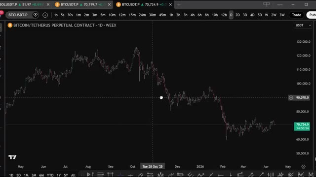
*⏱️ 00:00:08 — Capture d'écran d'un graphique de trading affichant l'évolution du cours du Bitcoin sur l'échange WEEX.*

---

### ⏱️ `[00:00:32 - 00:01:08]` | Segment #02

**🔊 Audio (Transcription Intégrale Mot pour Mot en Français) :**
> C'est en réalité important. Nous sommes à un stade très précoce de quelque chose de massif. À l'heure actuelle, la plupart des traders font encore tout manuellement, en surveillant les graphiques, en configurant des alertes, en passant des ordres, et en répétant cela chaque jour. Et écoutez, ça fonctionne. Mais voici le problème, les traders qui découvrent comment utiliser des agents IA dès maintenant, alors que les modèles en sont encore à leurs débuts, vont avoir un sérieux avantage sur tous les autres. Parce que voici ce que la plupart des gens ne réalisent pas. Les modèles disponibles aujourd'hui sont déjà suffisamment bons pour bâtir des stratégies rentables. Et quand la prochaine génération de modèles

**👁️ Analyse Visuelle d'Écran (gemini-3.5-flash-lite) :**
**Interface & Outils** : TradingView, Weex, navigateur web, ChatGPT

**Contenu textuel & Code** : Graphique de prix BTC/USDT en timeframe journalier avec curseur croisé, articles et résumés textuels sur l'IA et le trading de Bitcoin.
[DESC_IMAGE_1 bis] Analyse visuelle du graphique des prix BTC montrant les mouvements du marché.

**Action / Démonstration** : Visualisation et présentation du graphique historique des prix du Bitcoin pour illustrer le contexte du marché.

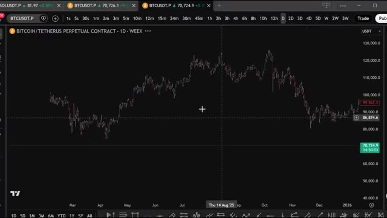
*⏱️ 00:00:41 — Un graphique en chandeliers journaliers de Bitcoin sur l'échange Weex montrant l'évolution des prix sur plusieurs mois.*

---

### ⏱️ `[00:01:08 - 00:01:42]` | Segment #03

**🔊 Audio (Transcription Intégrale Mot pour Mot en Français) :**
> des, nous parlons de choses comme mythos. L'écart entre les traders manuels et les traders assistés par IA va être énorme. La question n'est donc pas de savoir si le trading agentique va devenir une norme. La question est de savoir si vous allez être en avance ou en retard. Et c'est exactement pour cela que j'ai créé agent, P&L. C'est une plateforme où n'importe qui, et je dis bien n'importe qui, peut créer son propre agent de trading autonome en utilisant simplement un simple prompt en anglais. Vous décrivez votre stratégie. Choisissez un modèle, appuyez sur démarrer, et votre bot commence à trader tout seul. Le P&L s'affiche en direct sur un classement public à côté

**👁️ Analyse Visuelle d'Écran (gemini-3.5-flash-lite) :**
**Interface & Outils** : AgentPNL (tableau de bord de bots de trading IA)

**Contenu textuel & Code** : Liste des bots (Profitable Strategy 1, Capo Bot, Profitable SOL, Memecoins, Bollinger Band Mean Reversion, MACD + VWAP Momentum, Keltner Channel), paires de trading (BTCUSDT, ETHUSDT, SOLUSDT), modèles d'IA utilisés (Claude Haiku/Opus), PNL, rendement, nombre de trades, taux de réussite (WIN %) et statut (running/stopped).

**Action / Démonstration** : Présentation et analyse des performances des différents bots de trading automatisés pilotés par des agents IA sur une interface web.

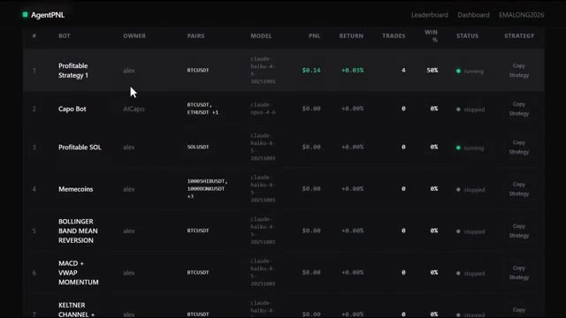
*⏱️ 00:01:25 — Tableau de bord d'une application de trading d'agents IA (AgentPNL) listant différents bots avec leurs performances.*

---

### ⏱️ `[00:01:42 - 00:02:16]` | Segment #04

**🔊 Audio (Transcription Intégrale Mot pour Mot en Français) :**
> à tous les autres bots de la plateforme. Pas de code, pas d'interface API, pas de configuration compliquée, juste votre stratégie, avec vos propres mots, en direct. Laissez-moi vous montrer exactement comment ça fonctionne. Alors d'abord, allez sur agentpnl.io. Je mettrai le lien dans la description ci-dessous. Quand vous arrivez sur la page, la première chose que vous allez voir, c'est le classement. Et c'est en fait l'une de mes parties préférées de la plateforme parce que vous pouvez voir chaque bot que les autres utilisateurs ont déjà créé et déployé. Vous pouvez voir le rang, le nom du bot, qui en est le propriétaire, quelles paires de trading ils

**👁️ Analyse Visuelle d'Écran (gemini-3.5-flash-lite) :**
**Interface & Outils** : Site web AgentPNL (agentpnl.io)

**Contenu textuel & Code** : Texte de présentation (« AgentPNL. Build AI trading bots. Put them on the leaderboard. »), boutons « Start a bot » et « Login », ainsi qu'un tableau de classement (Leaderboard) affichant des bots, propriétaires, paires (BTCUSDT), modèles, PNL, rendements et statuts.

**Action / Démonstration** : Navigation et présentation de l'interface principale du site web par le présentateur.

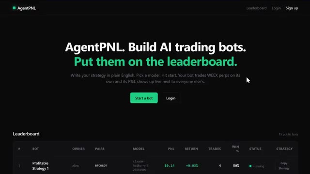
*⏱️ 00:01:50 — Capture d'écran de la page d'accueil de la plateforme AgentPNL avec un titre principal, des boutons d'action et le classement des bots de trading en bas.*

---

### ⏱️ `[00:02:16 - 00:02:52]` | Segment #05

**🔊 Audio (Transcription Intégrale Mot pour Mot en Français) :**
> qui fonctionnent, quel modèle d'intelligence artificielle ils utilisent pour créer le bot, le compte de résultat, le rendement, combien de transactions il a effectuées, le taux de réussite et l'état actuel. Ce sont des données en direct, de vrais bots, de vrais résultats. Maintenant, voici quelque chose de vraiment utile, et je veux m'assurer que vous ne sautez pas cette partie. Vous pouvez réellement copier n'importe quelle stratégie du classement. Il vous suffit de cliquer sur copier la stratégie, d'ouvrir un bloc-notes ou votre application de notes, et de la coller. Vous pouvez lire exactement ce que fait ce bot, quelle est la logique, comment il prend des décisions, sur quelles conditions il trade. C'est un excellent moyen d'apprendre. Vous pouvez étudier ce que le

**👁️ Analyse Visuelle d'Écran (gemini-3.5-flash-lite) :**
**Interface & Outils** : AgentPNL (plateforme web de suivi de bots de trading) et Notepad (éditeur de texte Windows).

**Contenu textuel & Code** : Tableaux de bots de trading (Profitable Strategy 1, Capo Bot, Profitable SOL, Memecoins, etc.), modèles d'IA utilisés (Claude Haiku, Claude Opus), PNL (+0,14 $), rendement (+0,03 %), nombre de transactions (4), taux de réussite (50 %), statut (running/stopped), et règles de stratégie de trading écrites en texte.

**Action / Démonstration** : Présentation des résultats en direct des bots de trading et affichage de la configuration textuelle d'une stratégie de trading.

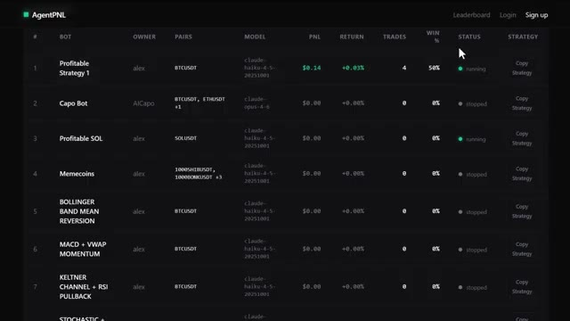
*⏱️ 00:02:25 — Interface web du tableau de bord AgentPNL listant différents bots de trading en direct avec leurs performances (PNL, rendement, trades, taux de réussite et statut).*

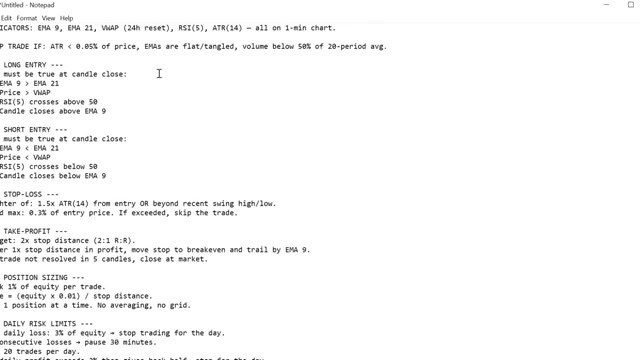
*⏱️ 00:02:43 — Fichier texte dans Notepad détaillant une stratégie de trading algorithmique avec les indicateurs, les conditions d'entrée longue/courte, le stop-loss, le take-profit, le dimensionnement des positions et les limites de risque journalières.*

---

### ⏱️ `[00:02:52 - 00:03:12]` | Segment #06

**🔊 Audio (Transcription Intégrale Mot pour Mot en Français) :**
> les bots les plus performants font, comprendre la structure, et ensuite construisez votre propre version avec votre propre touche. Une chose que j'aime personnellement faire est de prendre cette stratégie, de la transformer en Pinescript sur TradingView, et de l'intégrer pour qu'elle s'exécute automatiquement. Mais c'est une toute autre vidéo. Si vous voulez voir cette configuration, je la couvre bien au sein de la communauté.

**👁️ Analyse Visuelle d'Écran (gemini-3.5-flash-lite) :**
**Interface & Outils** : AgentPNL (plateforme de bots de trading) et TradingView (Pine Editor et graphique de prix).

**Contenu textuel & Code** : Tableau des bots performants (Profitable Strategy 1, Capo Bot) sur AgentPNL, et code source Pine Script (paramètres RSI, ATR, EMA, gestion des risques) associé à un graphique en chandeliers sur TradingView.

**Action / Démonstration** : Présentation du classement des bots puis transition vers l'écriture de la stratégie en Pine Script sur TradingView.

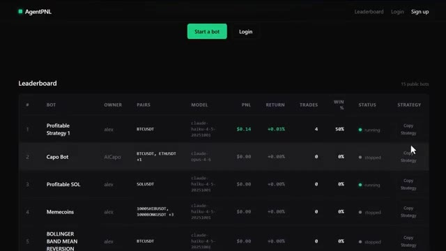
*⏱️ 00:02:57 — Capture d'écran de l'interface AgentPNL montrant le classement (Leaderboard) des bots de trading avec leurs performances, paires et statuts.*

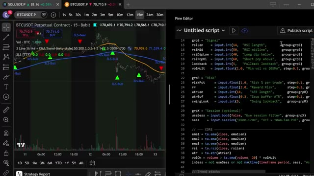
*⏱️ 00:03:02 — Capture d'écran partagée de TradingView montrant un graphique de prix BTCUSDT à gauche et l'éditeur Pine Script à droite.*

---

### ⏱️ `[00:03:13 - 00:03:32]` | Segment #07

**🔊 Audio (Transcription Intégrale Mot pour Mot en Français) :**
> Je mentionnerai cela à la fin. Aussi, et c'est quelque chose que je veux lancer ici, le bot numéro un du classement qui génère systématiquement le rendement et le P&L les plus élevés va recevoir une incitation de ma part personnellement. Il y a donc une vraie raison de construire quelque chose de bien et de le rendre public. Très bien, alors construisons réellement un bot.

**👁️ Analyse Visuelle d'Écran (gemini-3.5-flash-lite) :**
**Interface & Outils** : Interface web AgentPNL (Leaderboard)

**Contenu textuel & Code** : Tableau listant les bots de trading avec leurs métriques : rang (#), nom du bot (Profitable Strategy 1, Capo Bot, Profitable SOL, etc.), propriétaire (alex, AICapo), paires de trading (BTCUSDT, ETHUSDT, SOLUSDT), modèle d'IA utilisé, PNL, rendement (Return), nombre de trades, taux de réussite (WIN %), statut (running/stopped) et option de stratégie (Copy Strategy). Le bot numéro 1 affiche un PNL de +$0.14 et un rendement de +0.03%.

**Action / Démonstration** : Présentation du tableau de classement des bots de trading et de leurs performances en direct.

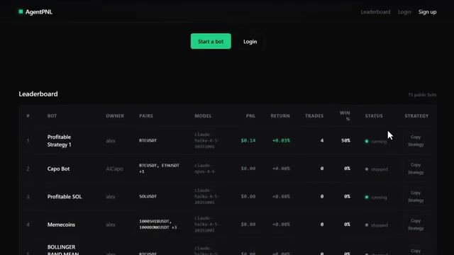
*⏱️ 00:03:18 — Capture d'écran montrant le classement (Leaderboard) de la plateforme AgentPNL avec le tableau des bots de trading.*

---

### ⏱️ `[00:03:32 - 00:03:54]` | Segment #08

**🔊 Audio (Transcription Intégrale Mot pour Mot en Français) :**
> Cliquez sur Démarrer un bot. Vous pouvez vous inscrire en utilisant votre adresse e-mail et créer un mot de passe fort. Cela prend environ 30 secondes. Une fois que vous êtes connecté, la première chose à faire avant toute autre chose est d'aller sur votre profil. C'est ici que vous configurez tout avant que votre bot puisse fonctionner. D'abord, vous pouvez créer un nom d'utilisateur. C'est ce qui s'affichera sur le classement à côté de votre bot.

**👁️ Analyse Visuelle d'Écran (gemini-3.5-flash-lite) :**
**Interface & Outils** : Présentation ou face-caméra explicatif du trader sans interface logicielle partagée.

**Contenu textuel & Code** : Explications orales des stratégies et mise en contexte méthodologique du marché.

**Action / Démonstration** : Explications face caméra et analyse conceptuelle des marchés.

---

### ⏱️ `[00:03:54 - 00:04:12]` | Segment #09

**🔊 Audio (Transcription Intégrale Mot pour Mot en Français) :**
> Maintenant, la partie importante. Au bas de la page du profil, vous devez connecter votre API Exchange. Vous devrez y coller trois choses. Votre clé API, votre clé secrète API, votre phrase de passe. Ces trois champs sont obligatoires. Votre bot ne démarrera pas sans eux. Et je tiens à être clair à ce sujet.

**👁️ Analyse Visuelle d'Écran (gemini-3.5-flash-lite) :**
**Interface & Outils** : Interface web de la plateforme AgentPNL.

**Contenu textuel & Code** : Champs de configuration pour l'échange WEEX incluant API KEY, API SECRET et PASSPHRASE, ainsi que les instructions indiquant que ces trois champs sont obligatoires.

**Action / Démonstration** : Présentation des champs requis pour connecter l'API de l'exchange WEEX à la plateforme de trading.

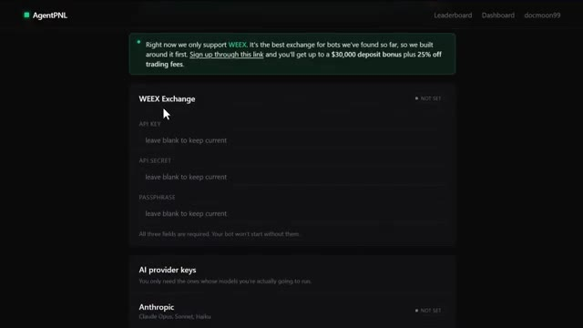
*⏱️ 00:03:58 — Capture d'écran de l'interface de la plateforme AgentPNL montrant la section de configuration de l'API WEEX Exchange.*

---

### ⏱️ `[00:04:12 - 00:04:30]` | Segment #10

**🔊 Audio (Transcription Intégrale Mot pour Mot en Français) :**
> Chaque clé API que vous collez ici est chiffrée avant d'atteindre la base de données. Donc, vos identifiants ne sont pas stockés en texte clair. C'est un détail important. Ensuite, vous devez ajouter vos clés de fournisseur d'IA. Vous n'avez besoin que de celles pour les modèles que vous allez réellement utiliser. Vous avez quatre options. Anthropic, qui est Claude.

**👁️ Analyse Visuelle d'Écran (gemini-3.5-flash-lite) :**
**Interface & Outils** : Application web AgentPNL (Interface de configuration / Settings)

**Contenu textuel & Code** : Champs de configuration utilisateur, note de sécurité concernant le chiffrement des clés API, et section de liaison avec l'exchange WEEX (API Key et API Secret).

**Action / Démonstration** : Configuration des paramètres du compte et des clés API pour l'intégration de l'exchange.

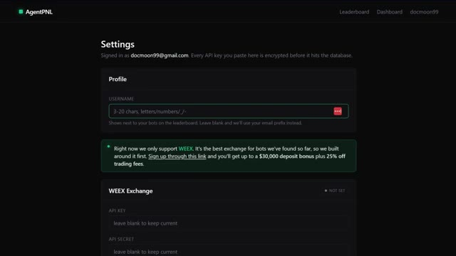
*⏱️ 00:04:17 — Capture d'écran montrant la page des paramètres (Settings) de l'application AgentPNL, avec les champs de configuration du profil et de l'exchange WEEX.*

---

### ⏱️ `[00:04:31 - 00:04:51]` | Segment #11

**🔊 Audio (Transcription Intégrale Mot pour Mot en Français) :**
> OpenAI, which is ChatGPT. XAI, which is Grok. Google, which is Gemini. Pick whichever model you want to run your bot on. Paste in the key and you are good. Once that is all set up, click on dashboard. In the upper right corner, you will see create new bot. Or if this is your first time, there will be a button in the middle of the screen as well.

**👁️ Analyse Visuelle d'Écran (gemini-3.5-flash-lite) :**
**Interface & Outils** : Application web AgentPNL.

**Contenu textuel & Code** : Champs de saisie des clés API pour OpenAI (GPT-5, GPT-4.1, GPT-4o, o3), xAI (Grok 4, Grok 3) et Google (Gemini 2.5 Pro, 2.5 Flash, 2.0 Flash) avec un bouton "Save changes".

**Action / Démonstration** : Configuration des clés d'accès aux modèles d'intelligence artificielle pour alimenter les bots de trading.

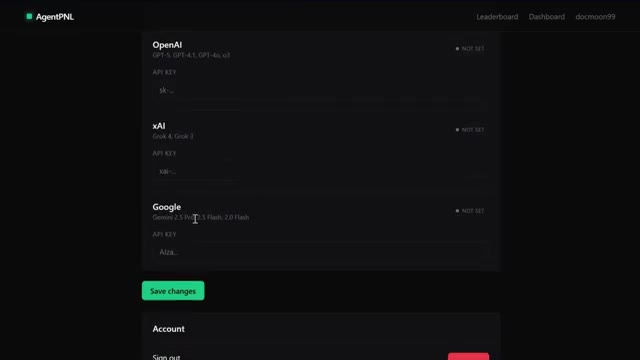
*⏱️ 00:04:36 — Interface de configuration des clés API pour différents modèles de LLM sur la plateforme AgentPNL.*

---

### ⏱️ `[00:04:51 - 00:05:20]` | Segment #12

**🔊 Audio (Transcription Intégrale Mot pour Mot en Français) :**
> Cliquez là-dessus. Maintenant, c'est là que ça devient intéressant. Vous donnez un nom à votre bot et ensuite vous écrivez votre stratégie en anglais simple. C'est tout. Pas de code. Décrivez simplement ce que vous voulez que votre bot fasse. Comment il doit entrer sur les marchés, quand il doit sortir, quelles conditions il recherche. La plateforme envoie ceci à l'IA à chaque cycle avec les dernières données du marché et vos limites de risque, et le modèle prend la décision. Soyez donc précis. Plus votre invite est bonne, meilleur est votre bot. Ensuite, choisissez votre paire de trading.

**👁️ Analyse Visuelle d'Écran (gemini-3.5-flash-lite) :**
**Interface & Outils** : Interface web de la plateforme AgentPNL ("New bot" / Setup).

**Contenu textuel & Code** : Nom du bot configuré à "Momentum Bot". Description textuelle en anglais de la stratégie de trading basée sur le momentum, incluant l'utilisation de bougies 5 minutes, de la SMA 20, des variations sur 24h, et des règles de gestion des risques (stop-loss à 0.4%, limitation du nombre d'entrées).

**Action / Démonstration** : Saisie et affichage de la configuration et du prompt textuel définissant les règles d'entrée et de sortie du bot de trading.

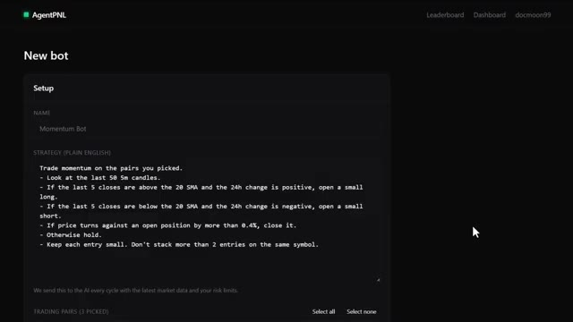
*⏱️ 00:04:59 — Interface de création d'un nouveau bot de trading sur la plateforme AgentPNL, montrant un champ de nom et une zone de texte pour la stratégie en langage naturel.*

---

### ⏱️ `[00:05:21 - 00:05:54]` | Segment #13

**🔊 Audio (Transcription Intégrale Mot pour Mot en Français) :**
> Vous pouvez en sélectionner autant que vous voulez. Si vous ne trouvez pas une paire spécifique dans la liste, utilisez simplement la barre de recherche. Définissez ensuite votre intervalle. C'est la fréquence à laquelle votre bot vérifie le marché et prend une décision. Vous pouvez aller de 1 minute jusqu'à 60 minutes selon votre stratégie. Après cela, vous avez quelques paramètres facultatifs. Le premier est la position maximale en USDT. Cela plafonne l'importance de votre exposition totale. Le deuxième est la taille maximale des transactions. Si vous laissez ce champ vide, le bot calculera sa taille automatiquement, environ à 5 % de votre allocation. Et la dernière option est l'effet de levier. Si

**👁️ Analyse Visuelle d'Écran (gemini-3.5-flash-lite) :**
**Interface & Outils** : AgentPNL (plateforme de trading par agent IA)

**Contenu textuel & Code** : Champs de configuration : Intervalle (réglé sur 5 minutes), Max Position (500 USDT), sélection du modèle (Claude Opus 4.6), et option pour rendre le bot public sur le classement.

**Action / Démonstration** : Configuration des paramètres temporels et des limites de risque pour le lancement d'un nouveau bot de trading.

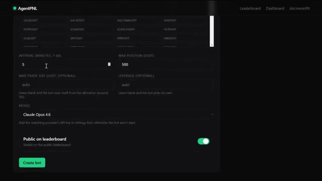
*⏱️ 00:05:29 — Interface de configuration d'un bot de trading sur AgentPNL, montrant les paramètres d'intervalle et de taille de position.*

---

### ⏱️ `[00:05:54 - 00:06:16]` | Segment #14

**🔊 Audio (Transcription Intégrale Mot pour Mot en Français) :**
> tu le laisses vide, le bot choisira de lui-même en fonction de la stratégie. Maintenant, choisis ton modèle. Tu as une solide gamme parmi laquelle choisir. Anthropic Claude, qui propose Opus, Sonnet ou Haiku. OpenAI, qui propose GPT-5, GPT-4.1 ou O3. XAI propose Grok 4, 3 ou 3 mini. Les modèles Google Gemini de 2.0 Flash à 2.5 Pro.

**👁️ Analyse Visuelle d'Écran (gemini-3.5-flash-lite) :**
**Interface & Outils** : Interface de configuration du bot de trading ou de l'application avec un menu déroulant des modèles d'IA.

**Contenu textuel & Code** : Liste des modèles disponibles : Claude (Haiku 4.5, Opus 4.5, Sonnet 4.5, 3.7 Sonnet, etc.), OpenAI (GPT-5, GPT-4.1, o3, etc.), et xAI Grok (Grok 4, Grok 3). Option "Public on leaderboard" visible en bas.

**Action / Démonstration** : Sélection d'un modèle d'intelligence artificielle dans la liste déroulante pour configurer le système.

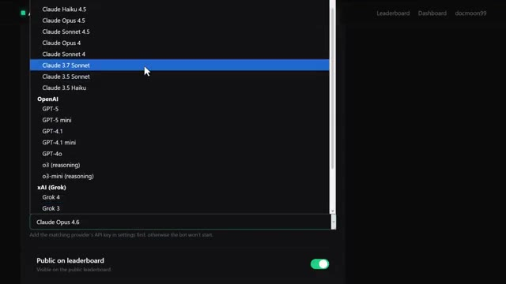
*⏱️ 00:05:59 — Capture d'écran montrant un menu déroulant de sélection de modèles d'IA avec différentes versions d'Anthropic Claude, OpenAI et xAI (Grok).*

---

### ⏱️ `[00:06:16 - 00:06:48]` | Segment #15

**🔊 Audio (Transcription Intégrale Mot pour Mot en Français) :**
> Chaque modèle a des forces différentes. Personnellement, je trouve que les modèles les plus puissants ont tendance à mieux raisonner sur les conditions du marché, mais vous pouvez expérimenter et voir ce qui fonctionne le mieux pour votre stratégie. Enfin, si vous voulez que votre bot apparaisse sur le classement public et concoure contre tout le reste, activez « public sur le classement ». Je recommande vivement de le faire. C'est là que se trouve la compétition. C'est là que se trouve la motivation. Et honnêtement, voir votre bot classé par rapport aux autres, c'est ce qui rend cela amusant. Une fois que vous êtes satisfait de tout, cliquez sur créer le bot et votre agent

**👁️ Analyse Visuelle d'Écran (gemini-3.5-flash-lite) :**
**Interface & Outils** : Application web AgentPNL (agentpnl.io)

**Contenu textuel & Code** : Paramètres de configuration du bot : Interval (5 minutes), Max Position (500 USDT), sélection du modèle d'IA (Claude Opus 4.6), option de visibilité publique sur le leaderboard et bouton de création de bot.

**Action / Démonstration** : Sélection du modèle d'intelligence artificielle pour le bot de trading.

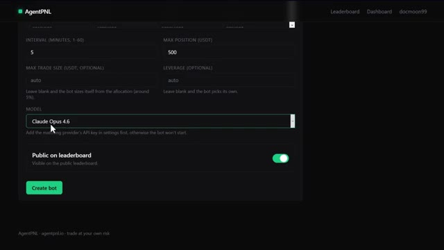
*⏱️ 00:06:24 — Interface de configuration du bot sur AgentPNL montrant les paramètres de sélection du modèle d'IA (Claude Opus 4.6), l'intervalle de temps et la taille maximale de position.*

---

### ⏱️ `[00:06:48 - 00:07:22]` | Segment #16

**🔊 Audio (Transcription Intégrale Mot pour Mot en Français) :**
> est maintenant en ligne. Maintenant, une chose que j'aime personnellement faire, c'est de prendre cette stratégie copiée, de la coller dans Claude et de lui demander de la transformer en un script Pine pour TradingView. Si vous voulez aller encore plus loin avec ça, je couvre l'intégration complète de TradingView et de Claude au sein de ma communauté. J'en reparlerai dans un instant. Maintenant, et je veux être franc avec vous ici, pour les deux prochaines années, deux types de traders existeront. Celui qui utilise l'IA et se simplifie la vie et celui qui ne le fait pas et fait encore tout manuellement. Et sur le même marché, cela façonnera un résultat très différent. Je lance

**👁️ Analyse Visuelle d'Écran (gemini-3.5-flash-lite) :**
**Interface & Outils** : TradingView, Éditeur Pine Script, Interface web X (Twitter).

**Contenu textuel & Code** : Règles de trading algorithmique (EMA, RSI, VWAP), code source Pine Script, métriques de performance de backtest (Total P&L : +241,532.85 USDT, Drawdown : 56.61%).
[DESC_IMAGE_3] (Non retenue selon les critères techniques de démonstration réelle de trading/code).

**Action / Démonstration** : Présentation des règles d'une stratégie de trading et affichage de son implémentation sous forme de script Pine sur TradingView.

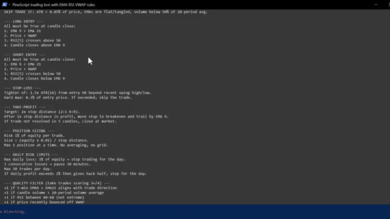
*⏱️ 00:06:57 — Un écran affichant des règles textuelles détaillées pour un bot de trading PineScript, incluant les conditions d'entrée longue/courte, le stop-loss, le take-profit et la gestion des risques.*

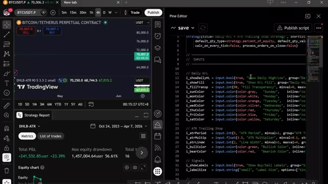
*⏱️ 00:07:05 — Une interface divisée montrant un graphique TradingView à gauche avec un rapport de stratégie (Total P&L +241,532.85 USDT) et l'éditeur Pine Script à droite avec du code source.*

---

### ⏱️ `[00:07:22 - 00:07:45]` | Segment #17

**🔊 Audio (Transcription Intégrale Mot pour Mot en Français) :**
> la communauté AI Trade Edge. Chaque invite, bot, agent, modèle et guide étape par étape que j'utilise personnellement, le tout au même endroit. Et tout ce que je construirai à l'avenir sera ajouté directement dans le groupe. Chaque nouvelle intégration, chaque nouvelle stratégie, chaque nouvelle invite, chaque mise à jour, de l'intégration de TradingView au trading sur Telegram et au suivi des baleines sur Hyperliquid.

**👁️ Analyse Visuelle d'Écran (gemini-3.5-flash-lite) :**
**Interface & Outils** : Navigateur web, site de la communauté Alex Carter Trading.

**Contenu textuel & Code** : Texte listant 78 outils permettant à Claude de contrôler TradingView (lecture de graphiques, données OHLCV en direct, valeurs d'indicateurs comme RSI, MACD, EMA, Bollinger, et contrôle des symboles, timeframes, etc.).

**Action / Démonstration** : Navigation sur la plateforme de la communauté montrant les guides et fonctionnalités du projet.

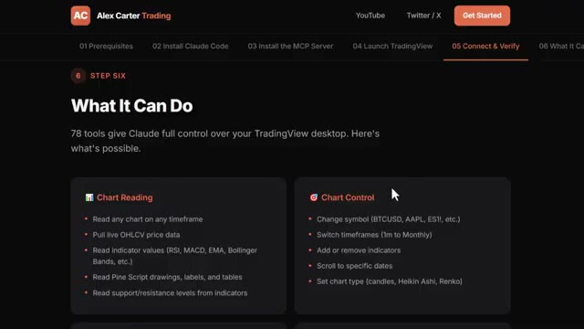
*⏱️ 00:07:28 — Capture d'écran de l'interface web de la communauté présentant les fonctionnalités de l'outil d'intégration Claude et TradingView avec deux blocs de texte détaillant les capacités de lecture et de contrôle des graphiques.*

---

### ⏱️ `[00:07:45 - 00:08:13]` | Segment #18

**🔊 Audio (Transcription Intégrale Mot pour Mot en Français) :**
> Dès votre inscription, vous obtenez tout. Le prix est de 79,99 $ par mois. Et honnêtement, quand on y pense, ce que c'est vraiment. La configuration de trading IA la plus avancée disponible pour les traders particuliers en ce moment, constamment mise à jour avec tout inclus. Ce n'est pas beaucoup d'argent. Un seul bon trade le couvre. Mais les 100 premiers membres bloquent ce tarif de façon permanente. Après cela, le prix augmente. Donc, plus vous entrez tôt, meilleure est l'offre. Le lien est dans la description.

**👁️ Analyse Visuelle d'Écran (gemini-3.5-flash-lite) :**
**Interface & Outils** : Plateforme Whop, interface web de vente et de configuration de bots de trading.

**Contenu textuel & Code** : Tarifs de l'abonnement (79,99 $ / mois), fonctionnalités de trading Futures et Spot, FAQ incluant les intégrations WEEX pour actions et crypto.

**Action / Démonstration** : Navigation sur la page de présentation et de tarification du service d'outils de trading IA.

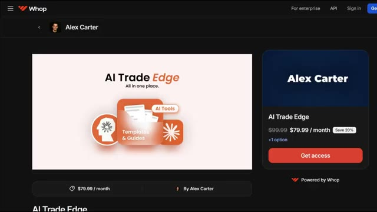
*⏱️ 00:07:52 — Page de vente Whop d'Alex Carter présentant l'offre 'AI Trade Edge' à 79,99 $ par mois.*

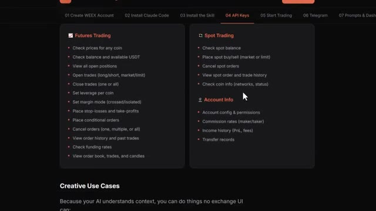
*⏱️ 00:07:59 — Interface détaillant les fonctionnalités d'API pour le trading de Futures et Spot, ainsi que les informations de compte.*

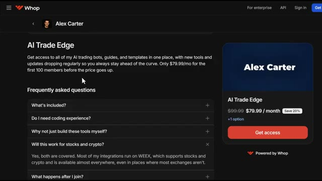
*⏱️ 00:08:06 — Section FAQ de la page de vente 'AI Trade Edge' sur Whop avec des questions sur le contenu et la compatibilité actions/crypto.*

---

### ⏱️ `[00:08:14 - 00:08:43]` | Segment #19

**🔊 Audio (Transcription Intégrale Mot pour Mot en Français) :**
> Entrez dès maintenant avant que le prix n'augmente. Vous ne pouvez véritablement pas vous permettre de rater ça. Et c'est tout. Votre propre agent de trading autonome construit en moins de deux minutes, fonctionnant en direct et concourant sur un classement public. Si vous voulez voir la démonstration complète sur la façon de configurer l'exécution automatisée des transactions en utilisant Telegram et TradingView, regardez la vidéo qui apparaît à l'écran en ce moment même. Si vous avez trouvé cela utile, laissez un pouce bleu. Cela aide vraiment la chaîne. Abonnez-vous si ce n'est pas déjà fait, et je vous vois dans la prochaine.

**👁️ Analyse Visuelle d'Écran (gemini-3.5-flash-lite) :**
**Interface & Outils** : AgentPNL (plateforme de bots de trading IA), TradingView, éditeur de code Pine Script.

**Contenu textuel & Code** : Classement public des bots avec métriques (PNL, rendement, trades, taux de réussite), graphique de prix Bitcoin et code source d'indicateur technique en Pine Script.

**Action / Démonstration** : Présentation de la plateforme de création de bots IA et affichage d'un graphique technique avec son script de stratégie associé.

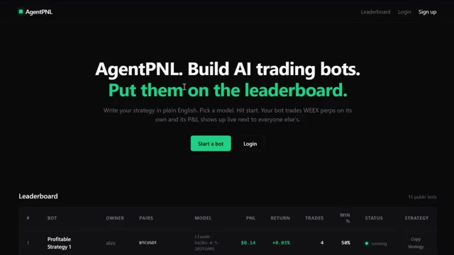
*⏱️ 00:08:21 — Page d'accueil de la plateforme AgentPNL avec le titre "Build AI trading bots. Put them on the leaderboard." et un aperçu du classement en bas.*

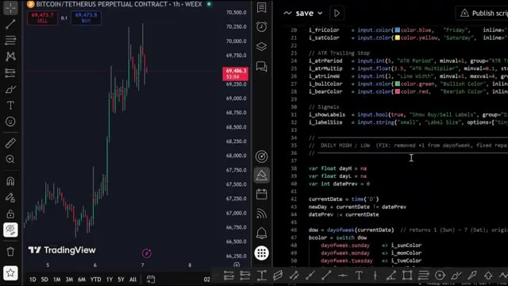
*⏱️ 00:08:28 — Écran partagé montrant à gauche un graphique TradingView pour le contrat perpétuel Bitcoin/Tether (WEEX) sur une heure, et à droite du code Pine Script.*

---

