# 🎬 How I Used Claude to Build a Profitable MACD Strategy

> **Chaîne** : [Alex Carter](https://www.youtube.com/@AlexCarterTrading)  
> **Lien YouTube** : [https://www.youtube.com/watch?v=xbeN3f-DV8E](https://www.youtube.com/watch?v=xbeN3f-DV8E)  
> **Date de publication** : 20260414  
> **Durée** : 00:06:49  
> **Identifiant vidéo** : `xbeN3f-DV8E`  
> **Transcription & Analyse** : `whisper-v3-large-turbo+gemini-3.5-flash-lite`  

---

## 📌 Synthèse Exécutive & Outils

### 💡 Résumé

Cette vidéo signée Alex Carter propose une démonstration concrète et accessible de l'automatisation du trading algorithmique grâce à l'intelligence artificielle, s'adressant aux traders cherchant à s'affranchir du codage et de la surveillance obsessionnelle des écrans. En prenant l'exemple classique du MACD (*Moving Average Convergence Divergence*) sur le Bitcoin, le créateur illustre comment transformer une méthodologie visuelle trouvée en ligne en un script informatique totalement fonctionnel. L'approche repose sur l'utilisation de grands modèles de langage, en l'occurrence **Claude Code**, pour traduire instantanément une stratégie textuelle en code source propre, prêt à être compilé.

Au-delà de la simple génération de code, la démonstration détaille le pont technologique entre l'analyse technique et l'exécution opérationnelle. Le script généré intègre des conditions d'alerte sur **TradingView** capables de notifier le trader ou d'alimenter des architectures d'exécution automatisées. L'écosystème présenté va de l'analyse pure à la gamification et au trading social via des agents conversationnels et des classements de P&L (*Profit and Loss*), tout en proposant une passerelle vers des solutions d'exécution par-delà les simples alertes graphiques.

Enfin, l'intervention met en lumière l'évolution des pratiques du trading particulier, où la frontière entre le développeur quantitatif et le trader discrétionnaire s'efface. En combinant des outils de pointe comme Claude, des interfaces graphiques robustes comme TradingView et des exchanges adaptés aux produits dérivés (tels que Weeks), le flux de travail présenté démocratise des stratégies d'automatisation autrefois réservées aux desks de trading professionnels, tout en structurant une communauté autour du partage de prompts et de configurations avancées.

### 🛠️ Outils, Modèles & Logiciels Présentés

* **Claude / Claude Code** : Assistant conversationnel et agent de développement propulsé par l'IA, utilisé ici pour générer l'intégralité du code Pine Script à partir d'un simple prompt textuel.
* **TradingView** : Plateforme de graphisme et d'analyse technique de référence, servant à visualiser les paires de crypto-monnaies, backtester les indicateurs et compiler le code Pine Script.
* **Pine Script** : Langage de programmation propriétaire de TradingView dédié à la création d'indicateurs personnalisés et de stratégies de trading automatisées.
* **Weeks** : Exchange de crypto-monnaies spécialisé dans le trading de contrats à terme (*futures*), mis en avant pour ses incitations financières et bonus d'inscription.
* **Grok Bots / Agent P&L** : Agents conversationnels et outils de trading social intégrés dans un classement en direct, permettant de concevoir des bots de trading en langage naturel et de copier les meilleures stratégies.
* **Telegram** : Outil de messagerie instantanée utilisé dans l'écosystème privé du créateur pour centraliser les notifications de signaux, l'interaction avec les bots et le suivi des positions.
* **Hyperliquid** : Protocole de finance décentralisée (DeFi) mentionné pour le suivi automatisé de portefeuilles et la détection d'activité des grands comptes (*whale tracking*).

### 🔑 Points Clés & Enseignements Stratégiques

* **Démocratisation du code par l'IA** : L'utilisation de modèles de langage comme Claude permet de s'affranchir totalement de l'apprentissage des langages de programmation complexes pour concevoir des scripts de trading sur mesure.
* **Mécanique de la stratégie MACD** : La stratégie de base exploite la convergence et la divergence des moyennes mobiles (lignes bleue et orange) couplées à un histogramme pour identifier les changements de dynamique de marché.
* **Signaux de position courte (Short)** : Un signal baissier est validé lorsque la ligne orange croise et passe au-dessus de la ligne bleue, accompagné d'un basculement de l'histogramme en territoire négatif et de bougies rouges.
* **Signaux de position acheteuse (Long)** : Un signal haussier est caractérisé par la ligne bleue positionnée au-dessus de la ligne orange, confirmée par un histogramme vert et des configurations de prix orientées à la hausse.
* **Flux de travail prompt-to-script** : Le processus de développement consiste à rédiger un prompt clair décrivant les règles d'entrée et de sortie, à le soumettre à Claude, puis à copier-coller directement le code généré dans l'éditeur Pine Script.
* **Compilation et intégration visuelle** : Le copier-coller du code dans l'éditeur de TradingView, suivi d'un clic sur le bouton de compilation, permet d'afficher instantanément des repères graphiques (flèches vertes et rouges) pour chaque signal détecté.
* **Automatisation de la veille par alertes** : La configuration des alertes TradingView basées sur les conditions du script personnalisé libère le trader de la surveillance visuelle continue des graphiques au profit d'une notification directe sur mobile.
* **Gestion du risque (*Risk Management*) et sorties** : Les points de sortie de position reposent soit sur la mise en place de ordres stop-loss stricts, soit sur l'attente d'un croisement inversé du MACD matérialisant l'épuisement de la tendance.
* **Gamification et émulation par les bots P&L** : L'utilisation d'agents de trading en compétition sur un classement en direct permet d'analyser, de rétro-analyser et de dupliquer les stratégies affichant les meilleurs rendements.
* **Industrialisation des cas d'usage avancés** : Le passage à l'étape supérieure implique l'interconnexion des scripts graphiques avec des webhooks et des canaux de messagerie (comme Telegram) pour exécuter des ordres réels de manière instantanée sur les exchanges.

---

## ⏱️ Chronologie & Transcription Complète Audio & Visuelle (Mot pour Mot)

### ⏱️ `[00:00:00 - 00:00:37]` | Segment #01

**🔊 Audio (Transcription Intégrale Mot pour Mot en Français) :**
> Et si vous pouviez prendre n'importe quelle stratégie de trading trouvée en ligne, la donner à Claude, et lui faire coder automatiquement un PineScript fonctionnel ? Pas besoin de savoir coder. Dans cette vidéo, je vais vous montrer exactement comment j'ai fait cela avec une stratégie MACD simple. Je vais vous montrer comment fonctionne la stratégie, comment j'ai rédigé le prompt pour Claude, et comment importer le PineScript terminé directement dans TradingView. Assurez-vous de regarder jusqu'à la fin car je vais également vous montrer comment accéder à tous mes prompts, stratégies et configurations. De plus, je vais vous montrer un agent IA que j'ai créé avec lequel vous pouvez créer votre propre bot de trading en utilisant un anglais simple, et rivaliser avec tout le monde sur un flux en direct.

**👁️ Analyse Visuelle d'Écran (gemini-3.5-flash-lite) :**
**Interface & Outils** : TradingView, Éditeur Pine Editor, interface web de formation de trading Alex Carter.

**Contenu textuel & Code** : Code source Pine Script, indicateur MACD, graphiques de prix Bitcoin (BTCUSDT), métriques de risque/rendement (Reward Ratio: 2.46).

**Action / Démonstration** : Affichage simultané d'un graphique de trading, de code Pine Script et d'une interface de présentation des capacités d'IA pour le trading.

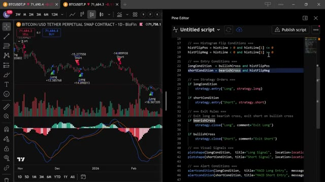
*⏱️ 00:00:09 — Un graphique TradingView à gauche affichant le Bitcoin et l'éditeur Pine Script à droite avec du code source de stratégie MACD.*

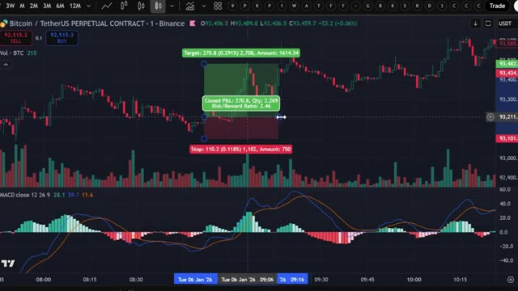
*⏱️ 00:00:18 — Un graphique en chandelier montrant une position de trading ouverte sur Bitcoin avec un indicateur MACD en bas et les métriques de P&L.*

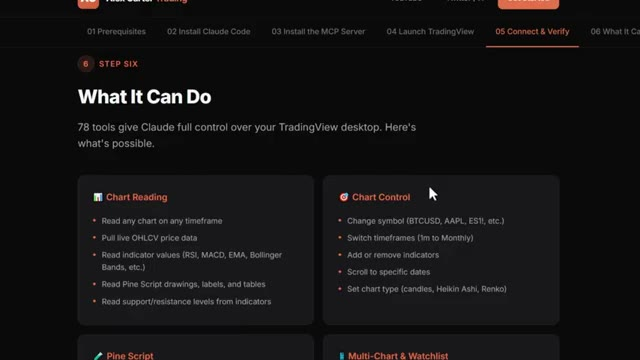
*⏱️ 00:00:27 — Une interface web de formation (Alex Carter Trading) intitulée 'What It Can Do' détaillant les fonctionnalités de contrôle de graphiques par l'IA.*

---

### ⏱️ `[00:00:37 - 00:01:10]` | Segment #02

**🔊 Audio (Transcription Intégrale Mot pour Mot en Français) :**
> classement, et gagner un prix de ma part. Plus de détails là-dessus plus tard. Entrons dans le vif du sujet. Très bien, les gars, étape numéro une, inscrivez-vous sur un échange. Pour cette stratégie, nous allons utiliser Weeks. C'est l'un de mes échanges préférés pour le trading de contrats à terme en ce moment, et ils ont de sérieux bonus pour les nouveaux utilisateurs, jusqu'à 30 000 dollars de bonus rien que pour l'inscription et le trading. Je mettrai le lien en bas. Très bien, maintenant pour la stratégie elle-même. Avec cette stratégie, nous allons utiliser l'indicateur MACD sur TradingView et jetons-y un rapide coup d'œil. Rendez-vous sur TradingView. Je vais avoir

**👁️ Analyse Visuelle d'Écran (gemini-3.5-flash-lite) :**
**Interface & Outils** : WEEX et TradingView.

**Contenu textuel & Code** : Formulaire d'inscription WEEX avec code de parrainage et indicateur technique MACD (12, 26, 9) sur TradingView.

**Action / Démonstration** : Présentation de la plateforme d'échange WEEX pour l'inscription et analyse technique d'un indicateur de momentum.

*⏱️ 00:00:45 — Page d'inscription de l'échange WEEX montrant le bonus de bienvenue et le formulaire de création de compte.*

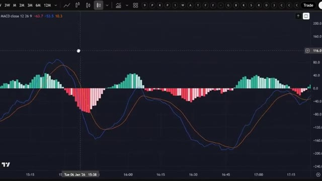
*⏱️ 00:01:02 — Graphique TradingView affichant l'indicateur MACD avec des histogrammes et des lignes de signal.*

---

### ⏱️ `[00:01:10 - 00:01:48]` | Segment #03

**🔊 Audio (Transcription Intégrale Mot pour Mot en Français) :**
> le lien dans la description si vous en avez besoin. Une fois que vous êtes sur TradingView, recherchez la paire de crypto que vous tradez. Pour cet exemple, j'utiliserai Bitcoin. Maintenant, la chose clé à garder à l'esprit est que le MACD vous permet d'identifier les tendances sur le marché. Cela signifie que vous pouvez voir si les prix montent ou descendent et prendre des décisions éclairées sur le moment d'entrer ou de sortir d'un trade. Avec un peu de pratique, vous pouvez utiliser le MACD pour faire de sérieux profits en trader de la crypto. Laissez-moi vous montrer maintenant comment utiliser le MACD. Tout ce que vous avez faîtes, c'est d'aller dans les indicateurs en haut de TradingView et de taper MACD. Simple comme bonjour. Vous verrez deux lignes, orange et bleue, et en bas un histogramme.

**👁️ Analyse Visuelle d'Écran (gemini-3.5-flash-lite) :**
**Interface & Outils** : TradingView (ou interface de graphique intégrée d'un échange type Binance).

**Contenu textuel & Code** : Paire Bitcoin / TetherUS Perpetual Contract, indicateur de volume (Vol) et indicateur MACD (paramètres 12, 26, 9) avec histogramme et lignes de signal.

**Action / Démonstration** : Visualisation du graphique de prix du Bitcoin et de l'indicateur MACD pour l'analyse des tendances.

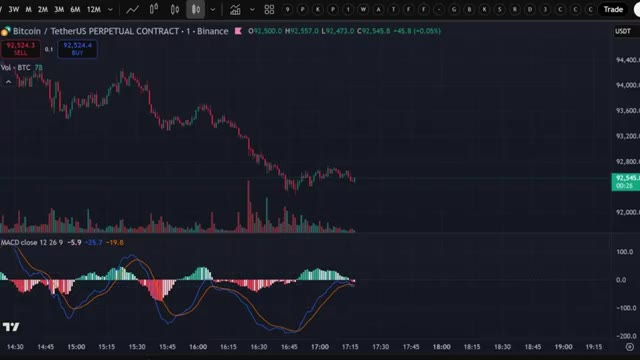
*⏱️ 00:01:19 — Graphique en chandeliers japonais du Bitcoin (BTC/USDT) affichant les volumes et l'indicateur MACD en bas.*

---

### ⏱️ `[00:01:48 - 00:02:16]` | Segment #04

**🔊 Audio (Transcription Intégrale Mot pour Mot en Français) :**
> L'histogramme peut basculer en négatif ou en positif, et c'est la manière la plus simple de le comprendre. Chaque fois que la ligne orange passe au-dessus de la ligne bleue, c'est un signal pour entrer dans une position courte. Quand la ligne bleue croise la ligne orange, c'est un signal pour se positionner à l'achat. Laissez-moi vous montrer une façon simple d'identifier une position courte sur un graphique Bitcoin. Il suffit de chercher un croisement baissier du MACD, indiqué par la ligne orange qui passe au-dessus de la ligne bleue, et ils basculent en mode baissier sur l'histogramme, ainsi que des bougies japonaises rouges.

**👁️ Analyse Visuelle d'Écran (gemini-3.5-flash-lite) :**
**Interface & Outils** : TradingView

**Contenu textuel & Code** : Graphique en chandeliers japonais du Bitcoin, volumes de transactions et indicateur MACD (lignes bleue et orange, histogramme).

**Action / Démonstration** : Explication du fonctionnement des signaux de croisement de l'indicateur MACD pour identifier les opportunités de trading court.

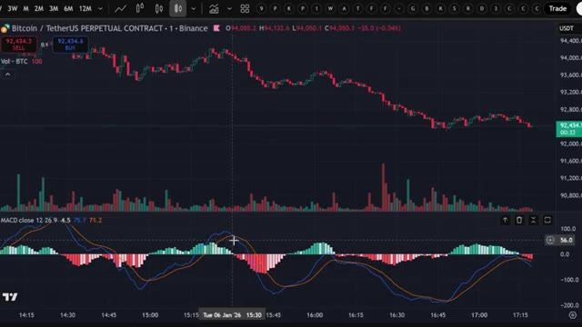
*⏱️ 00:01:55 — Un graphique TradingView affichant le cours du Bitcoin (BTC/USDT) avec l'indicateur MACD en bas.*

---

### ⏱️ `[00:02:16 - 00:02:34]` | Segment #05

**🔊 Audio (Transcription Intégrale Mot pour Mot en Français) :**
> Une fois que vous repérez ces indicateurs, il est temps d'entrer sur le marché. Regardez cet exemple de trade où vous auriez pu faire un bon profit avec cette stratégie MACD. Maintenant, je vais vous parler d'une position acheteuse potentielle. Regardez ce graphique MACD. La ligne bleue est directement au-dessus de la ligne orange, et l'histogramme est devenu vert.

**👁️ Analyse Visuelle d'Écran (gemini-3.5-flash-lite) :**
**Interface & Outils** : TradingView / Binance

**Contenu textuel & Code** : Graphique de prix du Bitcoin, indicateur de volume et indicateur MACD (paramètres 12, 26, 9) avec histogramme et lignes de signal.

**Action / Démonstration** : Analyse technique du graphique de prix et de l'indicateur MACD pour illustrer une stratégie de trading et repérer des configurations de profit potentiel.

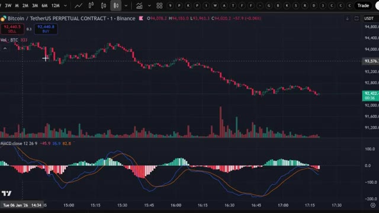
*⏱️ 00:02:20 — Un graphique TradingView en chandeliers japonais du contrat perpétuel Bitcoin/TetherUS (BTC/USDT) sur Binance, affichant l'indicateur MACD en bas.*

---

### ⏱️ `[00:02:34 - 00:03:10]` | Segment #06

**🔊 Audio (Transcription Intégrale Mot pour Mot en Français) :**
> C'est un signal haussier positif, c'est donc le moment idéal pour passer votre ordre. Vous devez définir un stop-loss ou attendre de voir un croisement baissier sur le MACD pour en sortir. Vous pouvez repérer le croisement baissier sur le graphique et simplement le laisser tourner jusqu'à ce que vous fassiez vos profits. Vous comprenez donc maintenant exactement comment la stratégie fonctionne manuellement. Mais c'est là que ça devient vraiment intéressant. Au lieu de regarder des graphiques toute la journée et de faire cela manuellement, j'ai donné cette stratégie exacte à Claude et je lui ai demandé de m'écrire un script PineScript complet. Pour que TradingView puisse détecter automatiquement ces signaux pour moi. Et voici le prompt que j'utilise. Je vais l'afficher à l'écran dès maintenant pour que vous puissiez

**👁️ Analyse Visuelle d'Écran (gemini-3.5-flash-lite) :**
**Interface & Outils** : TradingView, Terminal CLI Claude Code (v2.1.100)

**Contenu textuel & Code** : Paire BTC/USDT Binance (1m), indicateur MACD (12, 26, 9), configuration de trade Long (Risk/Reward 2.46, Closed P&L 270.8), prompt de programmation de stratégie Pine Script (règles de crossover MACD, signaux visuels, alertes, commission 0.1%).

**Action / Démonstration** : Démonstration visuelle d'une configuration de sortie/entrée sur croisement MACD, puis soumission des règles de trading à Claude Code pour générer automatiquement le script de backtesting Pine Script.

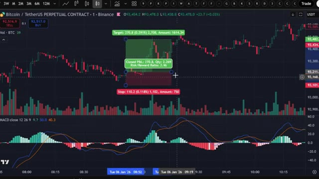
*⏱️ 00:02:43 — Graphique TradingView 1m (BTC/USDT) avec outil de position Long affichant un Risk/Reward de 2.46 et l'oscillateur MACD en sous-fenêtre.*

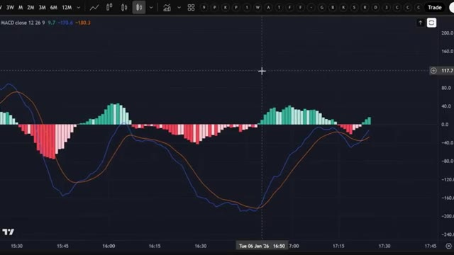
*⏱️ 00:02:52 — Gros plan sur la sous-fenêtre de l'indicateur MACD (12, 26, 9) sur TradingView illustrant l'histogramme et les lignes de signal.*

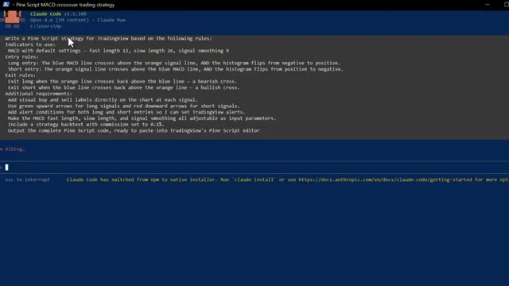
*⏱️ 00:03:01 — Terminal de commande exécutant Claude Code avec un prompt pour coder une stratégie de trading Pine Script basée sur le MACD.*

---

### ⏱️ `[00:03:10 - 00:03:29]` | Segment #07

**🔊 Audio (Transcription Intégrale Mot pour Mot en Français) :**
> copiez-le exactement. C'est tout. C'est le prompt complet. Vous collez ça dans Claude. J'utilise Claude code ici. Et en quelques secondes, il crache un script Pine complet et fonctionnel dans un bloc-notes. Ouvrez ce fichier, appuyez sur Ctrl plus A pour tout sélectionner le code, puis sur Ctrl plus C pour le copier. C'est tout ce dont vous avez besoin.

**👁️ Analyse Visuelle d'Écran (gemini-3.5-flash-lite) :**
**Interface & Outils** : Terminal de commande (Claude Code) et Bloc-notes (Notepad Windows).

**Contenu textuel & Code** : Prompt détaillé pour une stratégie de trading MACD sur TradingView (règles d'entrée, de sortie, alertes, backtest) et code source Pine Script complet affiché et sélectionné dans le Bloc-notes.

**Action / Démonstration** : Saisie d'un prompt dans Claude Code puis ouverture et sélection intégrale du script Pine généré dans le Bloc-notes.

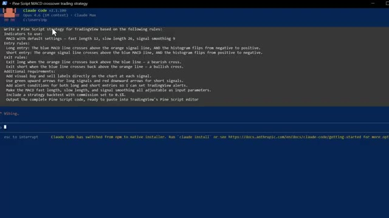
*⏱️ 00:03:15 — Interface du terminal Claude Code affichant un prompt détaillé pour la génération d'une stratégie de trading Pine Script basée sur le MACD.*

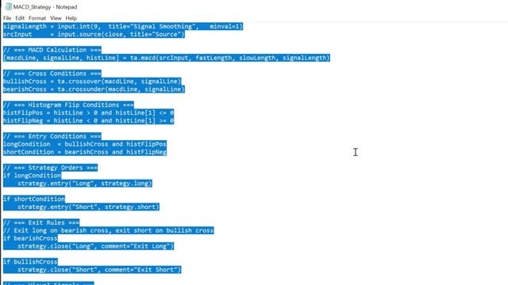
*⏱️ 00:03:24 — Éditeur Notepad ouvert affichant du code source Pine Script (calculs MACD, conditions d'entrée et de sortie) entièrement sélectionné par l'utilisateur.*

---

### ⏱️ `[00:03:29 - 00:03:49]` | Segment #08

**🔊 Audio (Transcription Intégrale Mot pour Mot en Français) :**
> Maintenant, passons à TradingView. Ouvrez TradingView et allez sur n'importe quel graphique. Je vais utiliser à nouveau le Bitcoin. Tout en bas de l'écran, cliquez sur l'onglet Éditeur Pine Script. Si vous ne le voyez pas, allez dans la barre d'outils en bas à droite et cliquez sur le bouton qui ressemble à un pin. Une fois l'éditeur ouvert, vous y verrez du code par défaut. Sélectionnez-le entièrement et supprimez-le.

**👁️ Analyse Visuelle d'Écran (gemini-3.5-flash-lite) :**
**Interface & Outils** : Graphique TradingView sur l'échange BloFin.

**Contenu textuel & Code** : Graphique en chandeliers japonais du Bitcoin affichant une tendance baissière, avec les volumes en bas et les boutons d'achat/vente (BUY/SELL) en haut à gauche.

**Action / Démonstration** : Navigation et présentation du graphique du Bitcoin sur TradingView avant l'ouverture de l'éditeur Pine Script.

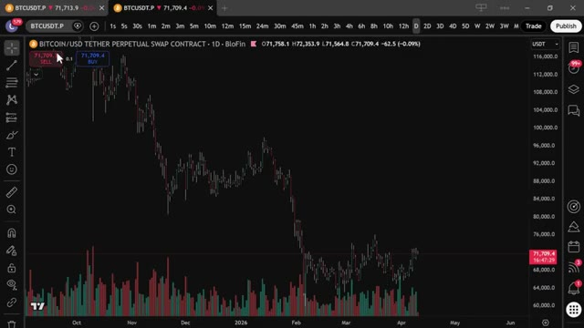
*⏱️ 00:03:34 — Capture d'écran montrant l'interface du graphique TradingView avec la paire Bitcoin/USD (BloFin) en unité journalière (1D).*

---

### ⏱️ `[00:03:50 - 00:04:09]` | Segment #09

**🔊 Audio (Transcription Intégrale Mot pour Mot en Français) :**
> Ensuite, collez le code que Claude vient de vous donner. Cliquez maintenant sur Ajouter au graphique ou sur le bouton de lecture. C'est le bouton situé en haut à droite de l'éditeur Pine Script. TradingView va compiler le script et l'appliquer directement sur votre graphique. Et voilà. Vous pouvez voir le panneau MACD en dessous du graphique et les signaux d'achat et de vente tracés automatiquement.

**👁️ Analyse Visuelle d'Écran (gemini-3.5-flash-lite) :**
**Interface & Outils** : TradingView (Pine Editor et graphique de prix)

**Contenu textuel & Code** : Code source Pine Script pour une stratégie de trading incluant des conditions d'entrée (long/short), des règles de sortie et des signaux visuels, appliqué sur un graphique journalier Bitcoin/USD.

**Action / Démonstration** : Visualisation du code de la stratégie Pine Script et du graphique avant son application sur le graphique via le bouton d'ajout de l'éditeur.

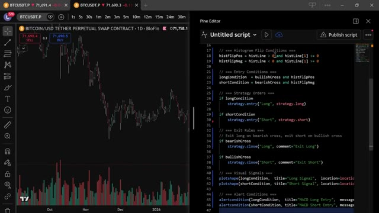
*⏱️ 00:03:55 — Capture d'écran montrant l'interface de TradingView avec un graphique de prix Bitcoin à gauche et l'éditeur Pine Script à droite affichant le code d'une stratégie de trading.*

---

### ⏱️ `[00:04:09 - 00:04:30]` | Segment #10

**🔊 Audio (Transcription Intégrale Mot pour Mot en Français) :**
> Des flèches vertes pour les longs, des flèches rouges pour les shorts. Chaque fois que les lignes se croisent et que l'histogramme confirme, le script vous le marque directement sur le graphique. Pour configurer des alertes, cliquez sur l'icône en forme de réveil en haut de TradingView. Sélectionnez Créer une alerte. Et dans le menu déroulant Condition, vous verrez les conditions d'alerte que Claude a ajoutées : signal long et signal short.

**👁️ Analyse Visuelle d'Écran (gemini-3.5-flash-lite) :**
**Interface & Outils** : TradingView / BloFin

**Contenu textuel & Code** : Graphique en chandeliers japonais de Bitcoin (BTC/USD), indicateurs de signaux de trading (marquages Long/Short avec flèches et valeurs numériques), histogramme de volume, et oscillateur technique sous le graphique principal.

**Action / Démonstration** : Présentation visuelle des signaux d'achat et de vente générés automatiquement par le script sur le graphique des prix.

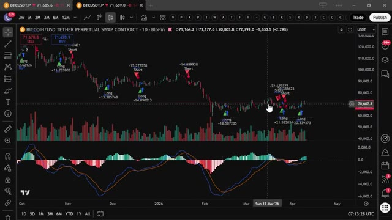
*⏱️ 00:04:14 — Graphique TradingView en unité journalière (1D) affichant le contrat perpétuel Bitcoin/USD sur BloFin avec des signaux d'achat (flèches vertes) et de vente (flèches rouges) ainsi qu'un indicateur de type MACD/oscillateur en bas.*

---

### ⏱️ `[00:04:30 - 00:04:49]` | Segment #11

**🔊 Audio (Transcription Intégrale Mot pour Mot en Français) :**
> Configurez-les et TradingView vous notifiera dès qu'un signal se déclenche. Donc maintenant, au lieu de surveiller le graphique manuellement, TradingView fait tout le travail pour vous. Dès que les lignes du MACD se croisent et que l'histogramme confirme, vous recevez une alerte directement sur votre téléphone. Et vous vous souvenez de cet agent PnL dont j'ai parlé plus tôt ? C'est là qu'il entre en jeu.

**👁️ Analyse Visuelle d'Écran (gemini-3.5-flash-lite) :**
**Interface & Outils** : TradingView, graphique en chandeliers japonais, interface de courtier/échange (BloFin).

**Contenu textuel & Code** : Signaux de trading (marquages Long/Short avec flèches bleues et rouges sur les chandeliers), histogramme des volumes, indicateur MACD avec ses lignes de signal et son histogramme coloré.

**Action / Démonstration** : Analyse graphique et visualisation de la stratégie de trading automatisée avec les signaux de croisement et les alertes configurées.

*⏱️ 00:04:35 — Graphique TradingView en unité journalière (1D) d'un contrat perpétuel Bitcoin (BITCOIN/USD TETHER PERPETUAL SWAP CONTRACT - 1D - BloFin) affichant des signaux d'achat (Long) et de vente (Short) ainsi qu'un indicateur MACD en sous-fenêtre avec ses histogrammes et lignes.*

---

### ⏱️ `[00:04:49 - 00:05:11]` | Segment #12

**🔊 Audio (Transcription Intégrale Mot pour Mot en Français) :**
> C'est un classement en direct où votre bot affronte tous les autres bots de la plateforme. Vous pouvez même copier des stratégies directement depuis le classement. Voyez exactement ce que font les meilleurs bots et créez votre propre version. Et le trader qui occupe la première place avec le P&L le plus élevé et le rendement le plus haut reçoit un prix personnel de ma part. Alors, si vous construisez quelque chose de sérieux, rendez-le public et entrez dans la compétition.

**👁️ Analyse Visuelle d'Écran (gemini-3.5-flash-lite) :**
**Interface & Outils** : Interface Web (AgentPNL) et Bloc-notes Windows (Notepad)

**Contenu textuel & Code** : Tableau de classement des bots (Bot, Owner, Pairs, Model, PNL, Return, Trades, Win %, Status, Strategy) et script de stratégie textuel (EMA, VWAP, RSI, ATR, Stop-Loss, Position Sizing).

**Action / Démonstration** : Présentation du tableau de classement en direct de la plateforme et affichage du code source textuel d'une stratégie de trading algorithmique.

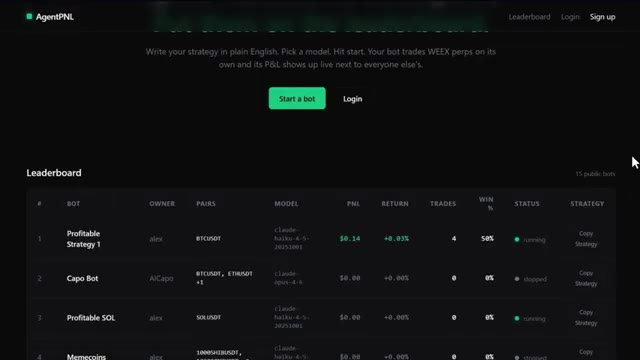
*⏱️ 00:04:54 — Capture d'écran de l'interface AgentPNL montrant le classement en direct (Leaderboard) avec les performances des différents bots.*

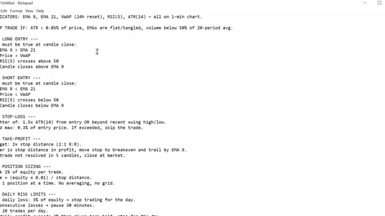
*⏱️ 00:05:00 — Bloc-notes affichant une stratégie de trading détaillée en anglais (indicateurs, entrées long/short, stop-loss, take-profit).*

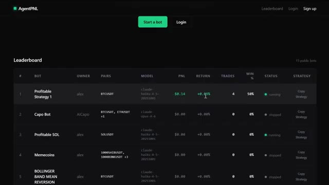
*⏱️ 00:05:05 — Vue similaire de l'interface AgentPNL montrant le classement des bots de trading avec un curseur sur les retours en pourcentage.*

---

### ⏱️ `[00:05:11 - 00:05:31]` | Segment #13

**🔊 Audio (Transcription Intégrale Mot pour Mot en Français) :**
> Le lien est dans la description. Maintenant, si vous voulez aller encore plus loin et qu'un trade s'ouvre automatiquement sur votre exchange dès qu'un signal se déclenche, j'ai ce qu'il vous faut. J'ai mis en place un groupe privé où je partage tous mes cas d'usage pour Claude Code, de son intégration avec Telegram, TradingView, à la recherche de baleines sur Hyperliquid. Tout automatiquement.

**👁️ Analyse Visuelle d'Écran (gemini-3.5-flash-lite) :**
**Interface & Outils** : Terminal de commandes (Claude Code), Interface web Whop, Site de documentation.

**Contenu textuel & Code** : Tableau de décomposition multi-timeframe (Weekly, Daily, 4-Hour, 1-Hour) avec indicateurs EMA Trend, RSI, MACD et niveaux clés (Support/Résistance).

**Action / Démonstration** : Affichage des résultats d'analyse multi-timeframe et des recommandations de trade (LONG).

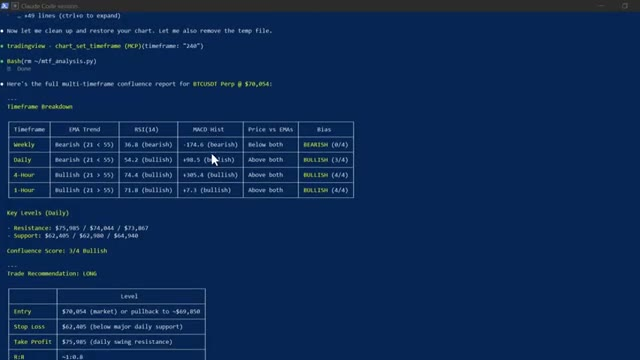
*⏱️ 00:05:16 — Image #1 @ 00:05:16 : Terminal de commande affichant un rapport d'analyse multi-timeframe généré par Claude Code pour BTCUSDT Perp.*

---

### ⏱️ `[00:05:31 - 00:05:59]` | Segment #14

**🔊 Audio (Transcription Intégrale Mot pour Mot en Français) :**
> Tout ce que je vous ai montré aujourd'hui, c'est entièrement dans le groupe. Et j'ajoute constamment de nouvelles choses, de nouvelles stratégies, de nouveaux prompts, de nouvelles intégrations. Chaque fois que je construis quelque chose de nouveau, ça va directement dedans. Le prix est de 79,99 $ par mois. Et honnêtement, quand on y pense, ce que c'est réellement, la configuration de trading IA la plus révolutionnaire disponible pour les traders particuliers en ce moment, constamment mise à jour avec tout inclus. Ce n'est pas beaucoup d'argent. Un seul bon trade le couvre.

**👁️ Analyse Visuelle d'Écran (gemini-3.5-flash-lite) :**
**Interface & Outils** : Plateforme web Whop (page produit d'abonnement "AI Trade Edge").

**Contenu textuel & Code** : Tarification du service d'abonnement à 79,99 $ par mois (réduit de 99,99 $) et présentation des outils inclus ("AI Tools", "Templates & Guides").

**Action / Démonstration** : Navigation et présentation de la page d'abonnement payant à la communauté par le présentateur.

*⏱️ 00:05:45 — Page d'abonnement Whop pour le service "AI Trade Edge" d'Alex Carter affichant le prix promotionnel de 79,99 $ par mois.*

---

### ⏱️ `[00:05:59 - 00:06:19]` | Segment #15

**🔊 Audio (Transcription Intégrale Mot pour Mot en Français) :**
> Mais les 100 premiers membres bloquent ce tarif de façon permanente. Après cela, le prix augmente. Donc plus vous vous inscrivez tôt, meilleure est l'offre. Le lien est dans la description. Inscrivez-vous dès maintenant avant que le prix n'augmente. Vous ne pouvez vraiment pas vous permettre de rater ça. Et c'est tout, les gars. C'est comme ça qu'on prend une stratégie sur Internet, qu'on la confie à Claude, et qu'on obtient un script Pine fonctionnel sur TradingView.

**👁️ Analyse Visuelle d'Écran (gemini-3.5-flash-lite) :**
**Interface & Outils** : TradingView, Whop

**Contenu textuel & Code** : Bitcoin/USD Tether Perpetual Swap Contract, signaux de trading Long/Short, indicateurs techniques (volume, MACD/oscillateur), prix de l'abonnement AI Trade Edge (79.99$/mois au lieu de 99.99$)

**Action / Démonstration** : Présentation de la plateforme de vente de la formation et affichage du graphique technique BTC/USD sur TradingView.

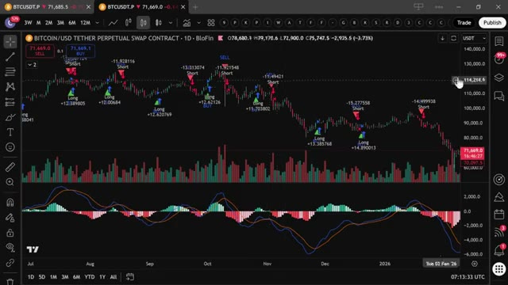
*⏱️ 00:06:14 — Graphique TradingView (blofin) en journalier (1D) de la paire Bitcoin/USD Tether Perpetual Swap Contract, affichant des signaux d'achat (Long) et de vente (Short) avec des indicateurs en bas de page.*

---

### ⏱️ `[00:06:19 - 00:06:48]` | Segment #16

**🔊 Audio (Transcription Intégrale Mot pour Mot en Français) :**
> Pas de code, pas de surveillance manuelle de graphiques. Si vous voulez voir une démonstration complète de la façon dont je trade en utilisant uniquement mon Telegram et la démonstration complète de tous les cas d'utilisation sur TradingView, cliquez sur la vidéo qui apparaît à l'écran dès maintenant. Et si vous voulez voir un guide complet sur le fonctionnement d'Agent P&L, comment créer votre bot, le lancer en direct et le faire figurer dans le classement, cliquez également sur la vidéo à l'écran. Si vous avez trouvé cela utile, laissez un pouce bleu. Ça aide vraiment la chaîne. Abonnez-vous si ce n'est pas déjà fait, et je vous vois dans la prochaine.

**👁️ Analyse Visuelle d'Écran (gemini-3.5-flash-lite) :**
**Interface & Outils** : Application Telegram.

**Contenu textuel & Code** : Messages Telegram avec des détails d'ordres de trading (BTC, SOL, DOGE) et une légende explicative pour l'analyse.

**Action / Démonstration** : Configuration et envoi de captures d'écran et de prompts de trading via Telegram.

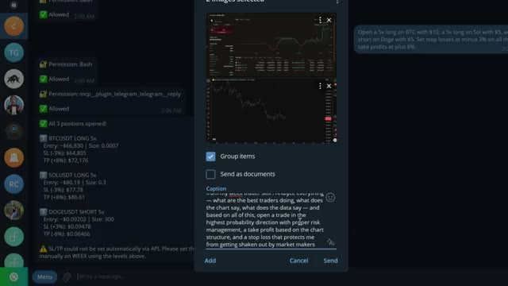
*⏱️ 00:06:27 — Interface Telegram montrant l'envoi de graphiques avec une légende détaillée pour le trading automatisé.*

---

