# 🎬 I Found The Next RAVE Using Claude (Here's How)

> **Chaîne** : [Alex Carter](https://www.youtube.com/@AlexCarterTrading)  
> **Lien YouTube** : [https://www.youtube.com/watch?v=ytBfMnH8kFE](https://www.youtube.com/watch?v=ytBfMnH8kFE)  
> **Date de publication** : 20260415  
> **Durée** : 00:09:11  
> **Identifiant vidéo** : `ytBfMnH8kFE`  
> **Transcription & Analyse** : `whisper-v3-large-turbo+gemini-3.5-flash-lite`  

---

## 📌 Synthèse Exécutive & Outils

### 💡 Résumé
Dans cette vidéo intitulée **J'ai trouvé la prochaine pépite RAVE grâce à Claude (Voici comment)**, Alex Carter détaille une approche stratégique et pratique du trading et de l'automatisation par agents IA.

### 🛠️ Outils, Modèles & Logiciels Présentés
- **TradingView & Claude Code** : Analyse technique avancée et automatisation algorithmique.

### 🔑 Points Clés & Enseignements Stratégiques
- Respect rigoureux du ratio risque/rendement et du money management.
- Automatisation méthodique des déclencheurs d'ordres via des agents intelligents.

---

## ⏱️ Chronologie & Transcription Complète Audio & Visuelle (Mot pour Mot)

### ⏱️ `[00:00:00 - 00:00:19]` | Segment #01

**🔊 Audio (Transcription Intégrale Mot pour Mot en Français) :**
> Si vous venez tout juste d'entendre parler de Rave, vous êtes déjà trop tard. Pendant que vous dormiez, l'argent intelligent a déjà multiplié sa position par 10. Et en ce moment, ils prennent tranquillement leurs bénéfices sur vos ordres d'achat. Mais voici ce que personne ne vous dit. Rave n'était pas le fruit du hasard. Il a suivi un schéma exact. Et j'ai construit un système en utilisant Claude qui l'a repéré avant que tout le monde n'en parle.

**👁️ Analyse Visuelle d'Écran (gemini-3.5-flash-lite) :**
**Interface & Outils** : Réseau social X (Twitter), CoinMarketCap, TradingView

**Contenu textuel & Code** : Publication de Kierian concernant RaveDAO, graphique du token RAVE avec une performance de +4609.57%, graphique de trading crypto montrant une zone de distribution et une tendance baissière.

**Action / Démonstration** : Navigation et consultation d'un post Twitter sur RaveDAO, puis analyse graphique d'une phase de distribution sur TradingView.

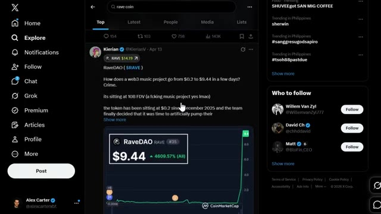
*⏱️ 00:00:05 — Capture d'écran du réseau social X (Twitter) affichant un tweet sur le projet RaveDAO ($RAVE) avec un graphique de prix CoinMarketCap montrant une forte hausse verticale.*

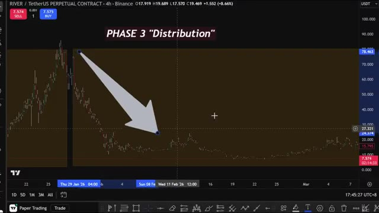
*⏱️ 00:00:10 — Graphique TradingView en unité de temps 4h (RIVER/TetherUS Perpetual Contract) avec une flèche explicative indiquant la « PHASE 3 Distribution » et une forte baisse.*

---

### ⏱️ `[00:00:20 - 00:00:57]` | Segment #02

**🔊 Audio (Transcription Intégrale Mot pour Mot en Français) :**
> Le suivant est déjà en train de se former. Et cette fois, vous allez être en avance. Laissez-moi vous expliquer comment ça fonctionne. Assurez-vous aussi de regarder jusqu'à la fin parce que je vais également vous montrer comment accéder à tous mes prompts, stratégies et configurations sur la façon d'intégrer et d'automatiser votre trading en utilisant TradingView et Telegram. De plus, je vais aussi vous montrer un agent IA que j'ai créé où vous pouvez créer votre propre bot de trading en utilisant un anglais simple, concourir contre tout le monde sur un classement en direct, et gagner un prix de ma part. Plus de détails à ce sujet plus tard. Entrons dans le vif du sujet. Maintenant, Rave, River, Siren, ces cryptos suivent toutes exactement le même schéma. Graphique plat. Financement négatif et l'intérêt ouvert est

**👁️ Analyse Visuelle d'Écran (gemini-3.5-flash-lite) :**
**Interface & Outils** : Interface web / documentation de cours de trading (style Notion ou plateforme LMS personnalisée).

**Contenu textuel & Code** : Texte descriptif des fonctionnalités (« What It Can Do », « 78 tools give Claude full control over your TradingView desktop »), sections « Chart Reading » et « Chart Control » avec des listes à puces détaillant les actions possibles (lecture des données OHLCV, RSI, MACD, modification des symboles et timeframes).

**Action / Démonstration** : Présentation des capacités d'intégration et d'automatisation entre les outils d'IA et la plateforme de graphiques.

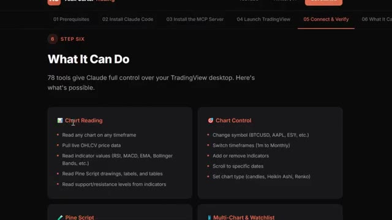
*⏱️ 00:00:29 — Capture d'écran montrant l'interface d'un guide ou d'un site web de tutoriel détaillant les fonctionnalités de contrôle de TradingView via Claude, avec des sections sur la lecture et le contrôle des graphiques.*

---

### ⏱️ `[00:00:57 - 00:01:33]` | Segment #03

**🔊 Audio (Transcription Intégrale Mot pour Mot en Français) :**
> tranquillement en train de se construire. Puis, de nulle part, le prix explose par 100 et soudain, tout le monde en parle. La plupart des gens voient ces cryptos après qu'elles soient déjà sur le fil d'actualité de tout le monde. Mais à ce moment-là, il est trop tard. Maintenant, j'ai créé un système qui les attrape en phase un avant même que la hausse ne commence. Avant d'entrer dans le vif du sujet avec l'outil, vous devez comprendre le schéma. Chacune de ces cryptos est passée par les mêmes trois étapes. Une fois que vous l'avez vu, vous ne pouvez plus ne pas le voir. Phase un, l'accumulation. Le prix est totalement plat. Personne ne parle de la crypto. Les taux de financement sont négatifs parce que les particuliers

**👁️ Analyse Visuelle d'Écran (gemini-3.5-flash-lite) :**
**Interface & Outils** : Terminal Claude Code, plateforme TradingView

**Contenu textuel & Code** : Commandes CLI Claude Code v2.1.109, graphique de prix crypto annoté avec les phases de marché (Phase 1 Accumulation, Phase 2 Squeeze, Phase 3 Distribution)

**Action / Démonstration** : Saisie d'une commande d'installation de skill et analyse technique d'un graphique de prix sur TradingView découpé en phases de marché

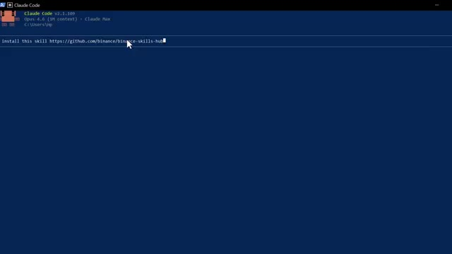
*⏱️ 00:01:15 — Interface du terminal Claude Code affichant une ligne de commande pour installer une compétence GitHub Binance.*

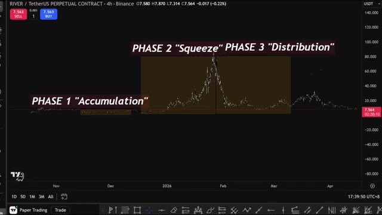
*⏱️ 00:01:24 — Graphique TradingView en unité 4h de la paire RIVER/USDT annoté avec les différentes phases de marché (Accumulation, Squeeze, Distribution).*

---

### ⏱️ `[00:01:33 - 00:02:07]` | Segment #04

**🔊 Audio (Transcription Intégrale Mot pour Mot en Français) :**
> est convaincu que le graphique est mort et ils le shortent. Mais voici l'indice. L'intérêt ouvert grimpe tranquillement. Quelqu'un construit des positions. Les teneurs de marché font le plein et appâtent les shorts, préparant le piège pour un short squeeze massif. C'est là que se trouve l'opportunité de multiplier par 10 ou 50. C'est la phase dans laquelle vous voulez être et là où nous allons acheter. Et quand vous trouvez l'une de ces cryptos, vous voulez déjà être prêt et configuré. Je trade celles-ci sur Binance ou Bybit. Elles ont tendance à avoir les premières cotations sur ces paires perpétuelles plus petites, ce qui est exactement ce dont vous avez besoin lorsque vous essayez d'obtenir

**👁️ Analyse Visuelle d'Écran (gemini-3.5-flash-lite) :**
**Interface & Outils** : Coinglass, TradingView, Binance Futures

**Contenu textuel & Code** : Intérêt ouvert, volume des contrats à terme, prix en direct, taux de financement, carnets d'ordres, bougies japonaises

**Action / Démonstration** : Analyse de l'intérêt ouvert et visualisation d'une zone d'accumulation sur graphique de prix pour identifier une configuration de marché.

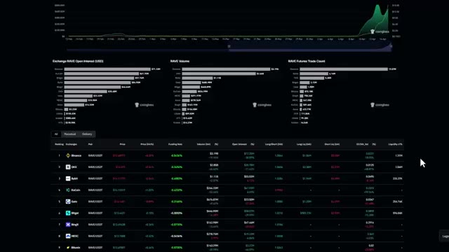
*⏱️ 00:01:41 — Tableau de bord Coinglass montrant l'intérêt ouvert, les volumes et les statistiques des contrats à terme pour RAVE/USDT.*

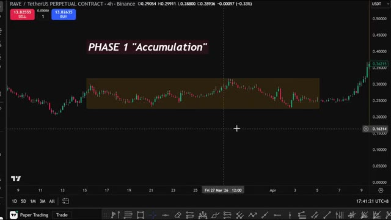
*⏱️ 00:01:50 — Graphique TradingView en bougies japonaises sur 4 heures de la paire RAVE/USDT, mettant en évidence la phase 1 d'accumulation.*

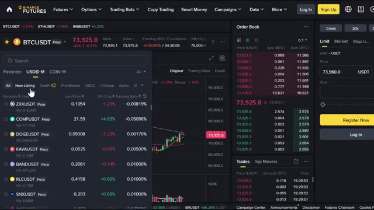
*⏱️ 00:01:58 — Interface de l'échange Binance Futures avec le carnet d'ordres, la liste des paires et le graphique du Bitcoin (BTCUSDT).*

---

### ⏱️ `[00:02:07 - 00:02:39]` | Segment #05

**🔊 Audio (Transcription Intégrale Mot pour Mot en Français) :**
> avant tout le monde. Les deux liens sont dans la description. Phase deux, le « squeeze ». Un short squeeze massif fait monter le prix à la verticale. Le financement devient extrêmement positif. La pièce apparaît soudainement sur la timeline de tout le monde. Crypto Twitter publie des captures d'écran. Si vous êtes entrés dans la phase un, vous profitez déjà de gains qui changent une vie. Si vous venez juste d'en entendre parler, vous êtes déjà en retard. La plupart des gens se font démolir ici en essayant de shorter une hausse qui continue de monter. Chaque short liquidé pousse le prix de plus en plus haut, et tout cet argent va directement à ceux qui ont acheté

**👁️ Analyse Visuelle d'Écran (gemini-3.5-flash-lite) :**
**Interface & Outils** : Plateforme Coinglass et graphique TradingView (Binance, RAVE/TetherUS).

**Contenu textuel & Code** : Métriques de volume, d'intérêt ouvert, de liquidations et graphique du taux de financement pondéré (Weighted Funding Rate) ; graphique en chandeliers japonais montrant une zone de prix latérale.

**Action / Démonstration** : Analyse des données de dérivés sur Coinglass et identification visuelle de la phase d'accumulation sur le graphique de prix.

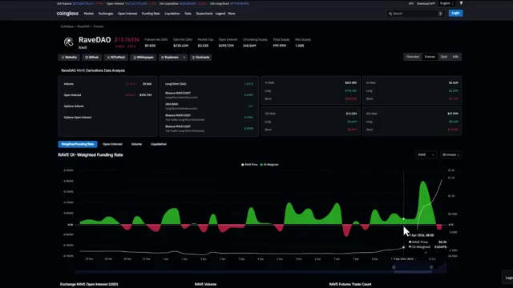
*⏱️ 00:02:15 — Capture d'écran de la plateforme Coinglass montrant l'analyse des dérivés de RaveDAO, avec les métriques d'intérêt ouvert et un graphique du taux de financement pondéré.*

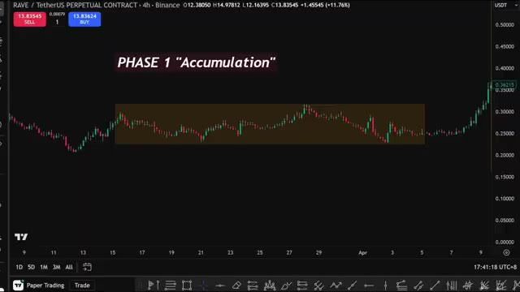
*⏱️ 00:02:23 — Graphique TradingView en unité de temps 4h pour le contrat perpétuel RAVE/USDT sur Binance, annoté avec la mention "PHASE 1 'Accumulation'".*

---

### ⏱️ `[00:02:39 - 00:03:02]` | Segment #06

**🔊 Audio (Transcription Intégrale Mot pour Mot en Français) :**
> tôt dans la phase un. Phase trois, la distribution ou le "dump". Les baleines distribuent dans la hype. Le financement reste extrêmement haut. Les particuliers achètent la baisse, mais la baisse continue de baisser. C'est là que la plupart des gens perdent de l'argent. Chacune de ces cryptos finit par chuter lourdement à partir de cette phase. La clé est de vendre ici, pas d'acheter. Une fois que la hausse est terminée, les prix ne retournent jamais aux niveaux qu'ils ont atteints.

**👁️ Analyse Visuelle d'Écran (gemini-3.5-flash-lite) :**
**Interface & Outils** : Coinglass et graphique TradingView

**Contenu textuel & Code** : Données de dérivés, taux de financement pondéré, et graphique de prix avec mise en évidence de la phase de distribution.
[DESC_ACTION] Présentation des métriques on-chain et illustration graphique de la phase de distribution descendante pour expliquer le comportement des baleines et des particuliers.

**Action / Démonstration** : Explications face caméra et analyse conceptuelle des marchés.

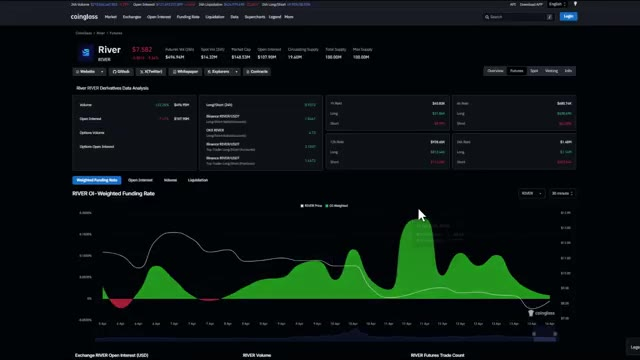
*⏱️ 00:02:45 — Analyse des données de dérivés pour le token River sur Coinglass, montrant les taux de financement et l'Open Interest.*

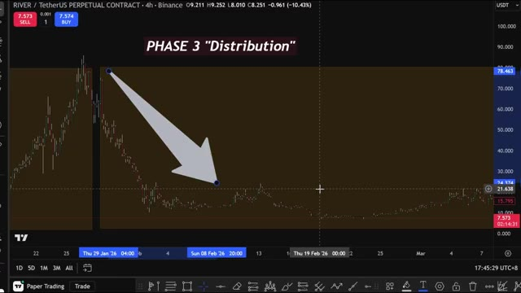
*⏱️ 00:02:51 — Graphique TradingView en unité 4h du contrat perpétuel RIVER/TetherUS sur Binance, illustrant la Phase 3 "Distribution" avec une flèche de baisse.*

---

### ⏱️ `[00:03:02 - 00:03:21]` | Segment #07

**🔊 Audio (Transcription Intégrale Mot pour Mot en Français) :**
> La manipulation est faite et la seule issue est la baisse avec quelques rebonds du chat mort en chemin. Maintenant, la stratégie est simple. Trouver des pièces en phase un, surfer pendant la phase deux, et vendre avant la phase trois. C'est tout. La partie difficile est de trouver les pièces de la phase un avant tout le monde. C'est ce que la compétence Claude Code automatise.

**👁️ Analyse Visuelle d'Écran (gemini-3.5-flash-lite) :**
**Interface & Outils** : TradingView et interface de marchés d'une plateforme d'échange de cryptomonnaies.

**Contenu textuel & Code** : Graphique de prix avec zones surlignées et cerclées, paires de trading, prix en temps réel, variations en pourcentage et volumes.

**Action / Démonstration** : Analyse technique d'un graphique illustrant les phases de marché et visualisation d'une liste de cryptomonnaies sur un exchange.

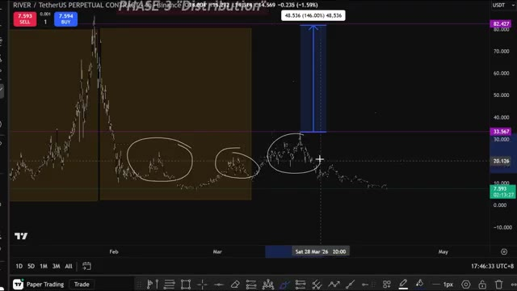
*⏱️ 00:03:07 — Graphique en chandeliers TradingView montrant l'évolution du prix d'un token perpétuel (RIVER/TetherUS) avec des annotations manuscrites et la mention 'PHASE 3: Distribution'.*

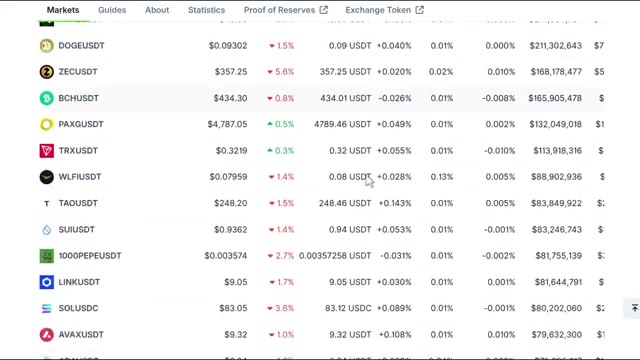
*⏱️ 00:03:16 — Capture d'écran d'une liste de marchés de cryptomonnaies sur une plateforme d'échange affichant divers tokens (DOGEUSDT, ZECUSDT, BCHUSDT, etc.) avec leurs prix et variations en pourcentage.*

---

### ⏱️ `[00:03:21 - 00:03:53]` | Segment #08

**🔊 Audio (Transcription Intégrale Mot pour Mot en Français) :**
> Claude Code analyse les marchés chaque jour et voit les données avant n'importe quel trader humain. Lorsque les teneurs de marché s'apprêtent à manipuler une cryptomonnaie, ils laissent des traces, et Claude les détecte. Voici exactement ce qu'il fait sous le capot. Chaque pièce des contrats perpetuals de Binance est scannée. Toutes. D'abord, il se connecte directement à l'API publique de Binance. Aucune clé d'API nécessaire, aucune inscription, rien. C'est totalement gratuit et déjà intégré à la compétence. Ensuite, il récupère chaque cryptomonnaie cotée en perpetual et commence à filtrer. Il vérifie

**👁️ Analyse Visuelle d'Écran (gemini-3.5-flash-lite) :**
**Interface & Outils** : TradingView et tableau de cotations/données de marché boursier crypto.

**Contenu textuel & Code** : Graphique de prix, zones surlignées, indicateurs de phase de marché, paires de trading (BTCUSDT, ETHUSDT, etc.) avec taux de financement et open interest.

**Action / Démonstration** : Analyse graphique de la phase de distribution des prix et consultation des données de marché en direct.

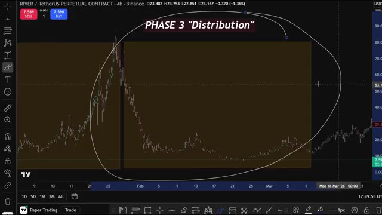
*⏱️ 00:03:29 — Graphique TradingView en unité 4h d'un contrat perpétuel de cryptomonnaie montrant une phase de distribution.*

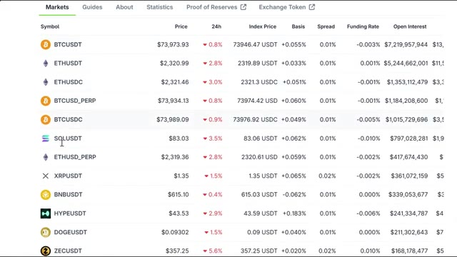
*⏱️ 00:03:37 — Tableau de cotations et de marchés des cryptomonnaies listant les prix, variations sur 24h et taux de financement (Funding Rate).*

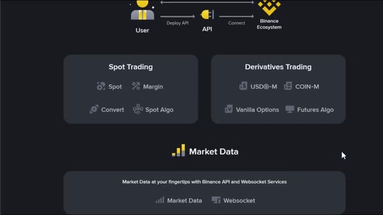
*⏱️ 00:03:45 — Schéma explicatif d'une architecture d'échange avec connexion API, séparant le Spot Trading et le Derivatives Trading.*

---

### ⏱️ `[00:03:53 - 00:04:14]` | Segment #09

**🔊 Audio (Transcription Intégrale Mot pour Mot en Français) :**
> que le prix soit stable, que le financement soit négatif, que l'intérêt ouvert grimpe discrètement, et que la cotation soit relativement récente. C'est votre empreinte digitale de phase un, voilà. Et si une crypto a déjà fait son mouvement, elle est éliminée automatiquement. Pas de pièges de liquidité de sortie. Ensuite, pour chaque crypto qui passe, il attribue un score de squeeze de 0 à 10.

**👁️ Analyse Visuelle d'Écran (gemini-3.5-flash-lite) :**
**Interface & Outils** : Coinglass (tableaux de bord de données sur les dérivés crypto) et TradingView (graphique des prix).

**Contenu textuel & Code** : Métriques de dérivés, taux de financement pondérés, intérêt ouvert, volumes et données de liquidation (Long/Short).

**Action / Démonstration** : Analyse technique et fondamentale illustrant la phase d'accumulation du prix et le comportement des liquidations sur le marché des contrats perpétuels.

*⏱️ 00:03:58 — Interface Coinglass affichant l'analyse des données de dérivés pour RIVER, incluant les taux de financement et les graphiques d'intérêt ouvert.*

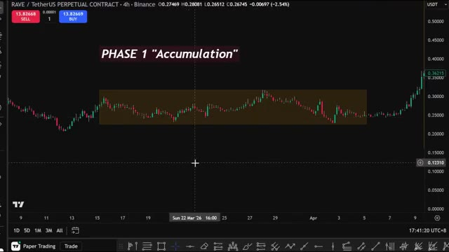
*⏱️ 00:04:03 — Graphique TradingView en bougies japonaises (unité 4h) pour RAVE/USDT, montrant une zone de prix en surbrillance étiquetée 'PHASE 1 Accumulation'.*

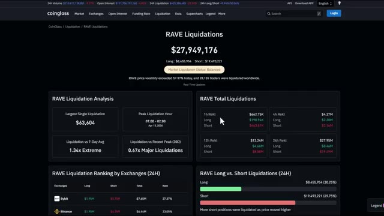
*⏱️ 00:04:08 — Tableau de bord Coinglass présentant l'analyse des liquidations de RAVE avec des statistiques détaillées sur les positions Long et Short.*

---

### ⏱️ `[00:04:14 - 00:04:32]` | Segment #10

**🔊 Audio (Transcription Intégrale Mot pour Mot en Français) :**
> Plus le score est élevé, plus cette cryptomonnaie correspond exactement à la configuration que nous avons vue avec Rave, Siren et River. Juste avant qu'elles n'explosent. Un 10 signifie un prix stable, un financement profondément négatif, un intérêt ouvert qui grimpe fortement et zéro hausse préalable. C'est la cryptomonnaie que vous voulez surveiller. Maintenant, laissez-moi vous montrer comment faire tout cela.

**👁️ Analyse Visuelle d'Écran (gemini-3.5-flash-lite) :**
**Interface & Outils** : TradingView, terminal de script/bot de scan personnalisé.

**Contenu textuel & Code** : Graphique de prix, niveaux de chandeliers, tableau de métriques de futures (taux de financement négatifs, scores de squeeze, variations d'intérêt ouvert).

**Action / Démonstration** : Analyse technique des phases de marché (accumulation, squeeze, distribution) et présentation des résultats du scanner de cryptomonnaies.

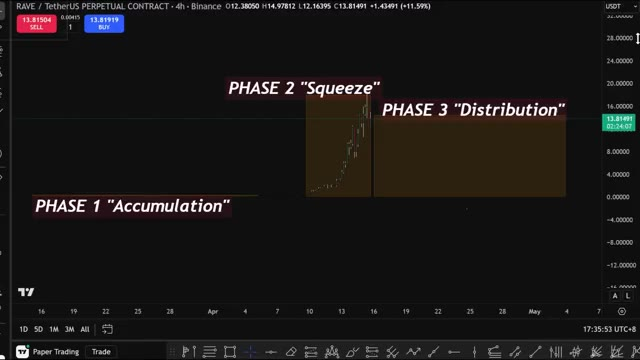
*⏱️ 00:04:19 — Graphique TradingView en chandelier montrant le contrat perpétuel RAVE/USDT avec les annotations 'PHASE 1 Accumulation', 'PHASE 2 Squeeze' et 'PHASE 3 Distribution'.*

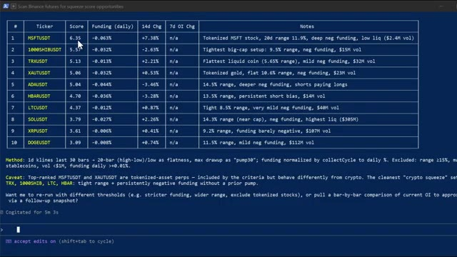
*⏱️ 00:04:23 — Interface de terminal affichant un tableau de classement des opportunités de squeeze sur Binance Futures avec des colonnes Ticker, Score, Funding (daily), 14d Chg, 7d OI Chg et Notes.*

---

### ⏱️ `[00:04:32 - 00:05:07]` | Segment #11

**🔊 Audio (Transcription Intégrale Mot pour Mot en Français) :**
> L'installation complète prend environ cinq minutes. Vous avez besoin de CloudCode et d'un dépôt GitHub gratuit. Pas de clés API, pas d'outils payants, rien de compliqué. Voici les trois étapes. Étape un, ouvrez CloudCode. Si vous ne l'avez pas encore, installez-le depuis Anthropic. Cela fonctionne sur Mac et Windows. Ouvrez-le simplement et vous êtes prêt. Pour accéder à CloudCode, vous devez avoir la version Pro ou Max. Le plan Pro à 20 dollars par mois est tout ce dont vous avez vraiment besoin pour commencer. Étape deux, installez le Binance Skills Hub. Allez sur github.com, recherchez le Binance Skills Hub et clonez-le.

**👁️ Analyse Visuelle d'Écran (gemini-3.5-flash-lite) :**
**Interface & Outils** : Terminal de commande (Claude Code) et navigateur web (site officiel de Claude/Anthropic).

**Contenu textuel & Code** : Versions logicielles, lignes de commandes et plans tarifaires (Free, Pro à 17$/mois, Max à partir de 100$/mois).

**Action / Démonstration** : Présentation de l'interface de Claude Code et consultation des abonnements disponibles sur le site d'Anthropic.

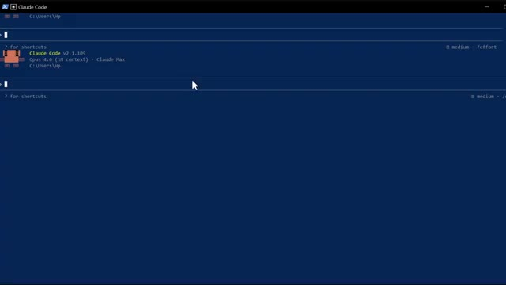
*⏱️ 00:04:41 — Interface du terminal Claude Code montrant la version v2.1.109 avec l'indication Opus 4.6.*

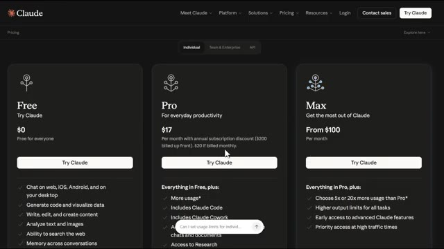
*⏱️ 00:04:58 — Page web de tarification de Claude affichant les offres Free, Pro et Max avec leurs tarifs respectifs.*

---

### ⏱️ `[00:05:07 - 00:05:26]` | Segment #12

**🔊 Audio (Transcription Intégrale Mot pour Mot en Français) :**
> sur votre machine. Ouvrez ensuite Claude Code depuis l'intérieur de ce dossier. Je mettrai tous les liens dans la description ci-dessous. Assurez-vous que la sortie réseau est activée dans vos paramètres et définie sur tous les domaines. Sinon, Claude ne peut pas atteindre l'API Binance. Étape 3. Ouvrez Claude Code et collez ceci. C'est tout.

**👁️ Analyse Visuelle d'Écran (gemini-3.5-flash-lite) :**
**Interface & Outils** : Terminal de commande (Claude Code)

**Contenu textuel & Code** : Commande d'installation : "install this skill https://github.com/binance/binance-skills-hub" et version de Claude Code v2.1.109.

**Action / Démonstration** : Exécution d'une commande dans le terminal pour installer les compétences Binance via Claude Code.

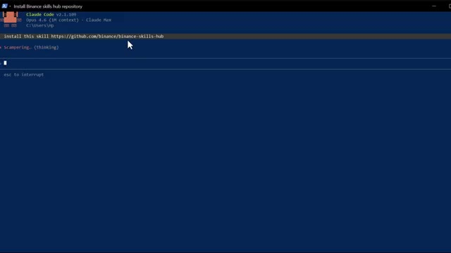
*⏱️ 00:05:12 — Capture d'écran montrant l'interface en ligne de commande de Claude Code exécutant l'installation d'un dépôt GitHub.*

---

### ⏱️ `[00:05:27 - 00:05:47]` | Segment #13

**🔊 Audio (Transcription Intégrale Mot pour Mot en Français) :**
> Cloud se connecte à Binance, analyse chaque paire de contrats à terme et renvoie vos candidats au *squeeze* classés. Quatrième étape, l'automatiser. Exécuter cela une seule fois est utile, mais le véritable avantage vient du fait d'en faire une habitude quotidienne. Vous pouvez planifier l'exécution de cette invite chaque matin automatiquement. Il existe de nombreuses façons de le faire avec Cloud Code, des simples tâches cron aux scripts personnalisés.

**👁️ Analyse Visuelle d'Écran (gemini-3.5-flash-lite) :**
**Interface & Outils** : Interface de terminal CLI / Script d'automatisation

**Contenu textuel & Code** : Tableau avec les colonnes Ticker, Score, Funding (daily), 14d Chg, 7d OI Chg et Notes. Les paires incluent MSFTUSDT, 1000SHIBUSDT, TRXUSDT, XAUTUSDT, ADAUSDT, HBARUSDT, LTCUSDT, SOLUSDT, XRPUSDT, DOGEUSDT avec des notes explicatives.

**Action / Démonstration** : Analyse et affichage des candidats au squeeze sur les contrats à terme Binance par un assistant cloud.

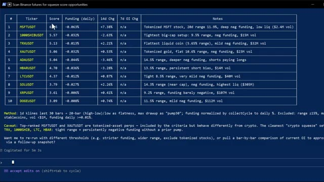
*⏱️ 00:05:32 — Un tableau affiché dans une interface de terminal listant les paires de contrats à terme Binance classées par score de squeeze.*

---

### ⏱️ `[00:05:48 - 00:06:07]` | Segment #14

**🔊 Audio (Transcription Intégrale Mot pour Mot en Français) :**
> L'idée est simple. Laissez-le scanner toutes les 24 heures. Gardez un journal de l'évolution des scores au fil du temps et signalez toute pièce qui bondit soudainement à 8 ou plus. Lorsque vous voyez une pièce qui était à 5 la semaine dernière et qui pousse maintenant à 9, c'est votre signal. Quelque chose a changé. L'intérêt ouvert augmente. Le financement devient de plus en plus négatif.

**👁️ Analyse Visuelle d'Écran (gemini-3.5-flash-lite) :**
**Interface & Outils** : Interface de terminal ou application de type console (fond bleu sombre avec texte blanc) exécutant un script de scan de marchés.

**Contenu textuel & Code** : Un tableau de 10 cryptomonnaies/actifs (MSFTUSDT, 1000SHIBUSDT, TRXUSDT, XAUTUSDT, ADAUSDT, HBARUSDT, LTCUSDT, SOLUSDT, XRPUSDT, DOGEUSDT) avec des colonnes de score, taux de financement (funding), variation sur 14 jours, et notes détaillées (ex: range de prix, volume, biais short).

**Action / Démonstration** : Affichage des résultats du scanner automatisé pour identifier les opportunités de squeeze sur les contrats à terme Binance.

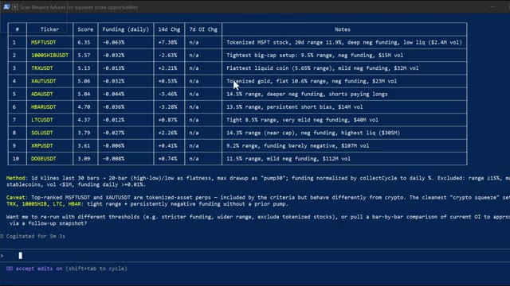
*⏱️ 00:05:53 — Un tableau de résultats de scan affiché dans un terminal ou une interface de type console, listant divers tickers de contrats à terme Binance avec leurs scores de squeeze et notes analytiques.*

---

### ⏱️ `[00:06:07 - 00:06:43]` | Segment #15

**🔊 Audio (Transcription Intégrale Mot pour Mot en Français) :**
> La configuration est en train de se former. C'est à ce moment-là que vous devez commencer à faire attention. Et pendant les prochaines années, deux types de traders existeront. Celui qui utilise l'IA et se simplifie la vie et celui qui ne le fait pas et fait encore tout manuellement. Et dans le même marché, cela donnera des résultats très différents. Voici comment vous obtenez tout cela. Je lance la communauté AI Trade Edge. Chaque prompt, chaque bot, chaque agent, chaque modèle et chaque guide étape par étape que j'utilise personnellement, tout au même endroit, et tout ce que je construirai à l'avenir sera ajouté directement dans le groupe. Chaque nouvelle intégration, chaque nouvelle stratégie, chaque nouveau prompt,

**👁️ Analyse Visuelle d'Écran (gemini-3.5-flash-lite) :**
**Interface & Outils** : Navigateur web (Whop, site de documentation sur les outils d'IA pour le trading).

**Contenu textuel & Code** : Fonctionnalités logicielles présentées : Whale Scanning (analyse de plus de 33 000 portefeuilles), Sentiment Analysis, Trade Ideas et Wallet Lookup.

**Action / Démonstration** : Présentation des capacités et fonctionnalités de l'outil d'IA de trading pour analyser les portefeuilles de baleines et générer des idées de trade.

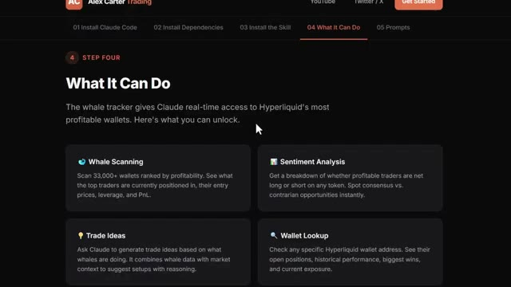
*⏱️ 00:06:34 — Page de documentation web 'Step Four: What It Can Do' détaillant les fonctionnalités de suivi des baleines (Whale Scanning), d'analyse de sentiment, d'idées de trade et de recherche de portefeuilles connectés à Hyperliquid.*

---

### ⏱️ `[00:06:43 - 00:07:05]` | Segment #16

**🔊 Audio (Transcription Intégrale Mot pour Mot en Français) :**
> chaque mise à jour, de l'intégration de TradingView au trading sur Telegram et au suivi des baleines sur Hyperliquid. Dès l'instant où vous rejoignez, vous obtenez le tout. Le prix est de 79,99 $ par mois. Et honnêtement, quand on y pense, quand on réalise ce que c'est vraiment, la configuration de trading par IA la plus avancée disponible pour les traders particuliers en ce moment, constamment mise à jour avec tout inclus.

**👁️ Analyse Visuelle d'Écran (gemini-3.5-flash-lite) :**
**Interface & Outils** : Whop, site web de formation et d'outils de trading d'Alex Carter, plateforme de documentation et interface de cours.

**Contenu textuel & Code** : Tarification d'abonnement (79,99 $ / mois), liste des fonctionnalités d'intégration de TradingView (lecture de graphiques, OHLCV, indicateurs RSI, MACD, EMA, contrôle des symboles et timeframes).

**Action / Démonstration** : Présentation des avantages et des fonctionnalités incluses dans l'offre payante de la formation.

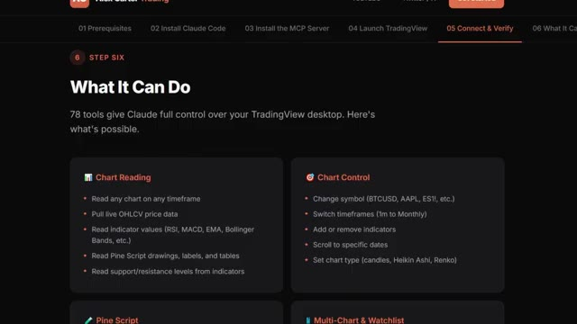
*⏱️ 00:07:00 — Page de documentation en ligne intitulée "What It Can Do" détaillant les 78 outils permettant à Claude de contrôler TradingView (Lecture de graphiques, Contrôle, Pine Script, etc.).*

---

### ⏱️ `[00:07:06 - 00:07:31]` | Segment #17

**🔊 Audio (Transcription Intégrale Mot pour Mot en Français) :**
> Ce n'est pas beaucoup d'argent. Un seul bon trade suffit à couvrir ça. Mais les 100 premiers membres bloquent ce tarif définitivement. Après ça, le prix augmente. Donc plus vous entrez tôt, meilleure est l'offre. Le lien est dans la description. Inscrivez-vous dès maintenant avant que le prix n'augmente. Vous ne pouvez vraiment pas vous permettre de rater ça. La plupart des traders essaient de faire une de ces deux choses. Ils essaient de rattraper la hausse après qu'elle a déjà commencé, ce qui est trop tard, ou ils essaient de vendre à découvert au sommet, ce qui est extrêmement dangereux.

**👁️ Analyse Visuelle d'Écran (gemini-3.5-flash-lite) :**
**Interface & Outils** : TradingView, Plateforme Whop

**Contenu textuel & Code** : Graphique en chandeliers 4h de RAVE/USDT, indicateur de prix, zone surbrillante 'PHASE 2 Squeeze', interface de commande Whop avec tarif réduit à 79.99$.

**Action / Démonstration** : Analyse technique d'un graphique de cryptomonnaie montrant une forte hausse de prix et présentation d'une offre commerciale d'abonnement.

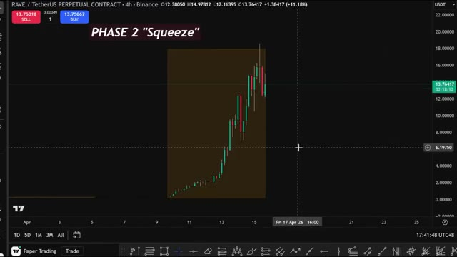
*⏱️ 00:07:25 — Graphique TradingView en chandeliers montrant une phase haussière annotée 'PHASE 2 Squeeze' sur la paire RAVE/USDT.*

---

### ⏱️ `[00:07:32 - 00:07:53]` | Segment #18

**🔊 Audio (Transcription Intégrale Mot pour Mot en Français) :**
> Les deux sont des stratégies perdantes. Cette approche est différente. Vous ne réagissez pas à l'évolution des prix. Vous lisez les signaux structurels comme le financement, l'intérêt ouvert et la compression des prix qui précèdent le mouvement. Les pièces qui explosent cent fois ne le font pas au hasard. Elles se mettent d'abord en tension. Les données sont là. Il vous suffit de savoir où chercher. Vous avez maintenant un outil qui cherche pour vous.

**👁️ Analyse Visuelle d'Écran (gemini-3.5-flash-lite) :**
**Interface & Outils** : Interface de terminal de scan de données, graphique TradingView et tableau de bord Coinglass.

**Contenu textuel & Code** : Scores de compression, taux de financement journaliers, variations de prix, graphiques de contrats perpétuels et données historiques de taux de financement.

**Action / Démonstration** : Analyse quantitative des signaux structurels, balayage des opportunités de compression (squeeze) et étude de la phase d'accumulation du prix.

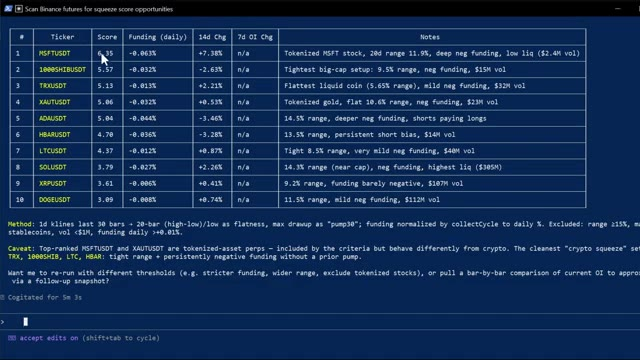
*⏱️ 00:07:37 — Un tableau de balayage de contrats à terme Binance montrant un classement des opportunités de score de compression (squeeze score) avec des tickers, scores et taux de financement.*

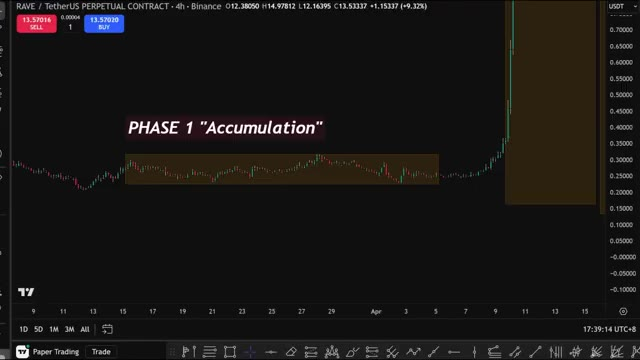
*⏱️ 00:07:42 — Un graphique en chandeliers affichant l'actif RAVE avec une zone surlignée annotée 'PHASE 1 Accumulation' avant une forte hausse verticale des prix.*

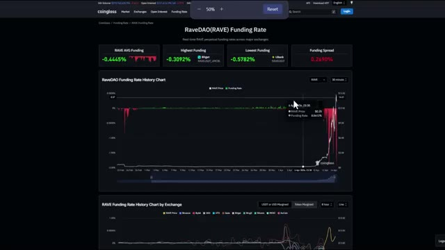
*⏱️ 00:07:48 — Un tableau de bord Coinglass montrant l'historique des taux de financement (Funding Rate) de RaveDAO (RAVE) avec des graphiques analytiques détaillés.*

---

### ⏱️ `[00:07:54 - 00:08:16]` | Segment #19

**🔊 Audio (Transcription Intégrale Mot pour Mot en Français) :**
> Et rappelez-vous de l'agent PNLI mentionné tout à l'heure ? C'est là que ça entre en jeu. C'est un classement en direct où votre bot concourt contre tous les autres bots de la plateforme. Vous pouvez même copier des stratégies directement depuis le classement. Voir exactement ce que font les meilleurs bots et construire votre propre version. et le trader qui est à la première place avec le P&L le plus élevé et le rendement le plus élevé obtient un prix personnel de ma part.

**👁️ Analyse Visuelle d'Écran (gemini-3.5-flash-lite) :**
**Interface & Outils** : Site web AgentPNL (Interface de classement des bots de trading).

**Contenu textuel & Code** : Tableau du classement affichant les colonnes : BOT, OWNER, PAIRS, MODEL, PNL, RETURN, TRADES, WIN %, STATUS et STRATEGY avec un bouton 'Copy Strategy'.

**Action / Démonstration** : Présentation de l'interface de classement (Leaderboard) et du tableau comparatif des performances des différents bots de la plateforme.

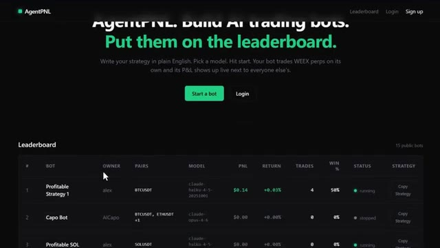
*⏱️ 00:07:59 — Capture d'écran de la plateforme AgentPNL montrant la page d'accueil avec le classement (Leaderboard) des bots de trading IA.*

---

### ⏱️ `[00:08:16 - 00:08:54]` | Segment #20

**🔊 Audio (Transcription Intégrale Mot pour Mot en Français) :**
> Donc si vous construisez quelque chose de sérieux, rendez-le public et entrez dans la compétition. Le lien est dans la description. Et c'est tout, les gars. Maintenant, vous savez comment trouver la prochaine pièce 100x avant tout le monde. Assurez-vous d'être configuré sur Binance dans les semaines à venir pour être prêt à agir lorsque le scanner signalera quelque chose. Les nouveaux utilisateurs de Binance obtiennent jusqu'à 100 $ de récompenses d'inscription, et avec WEIX, vous pouvez obtenir jusqu'à 30 000 USDT de récompenses sur le volume de trading. Les deux liens sont dans la description. Si vous voulez voir une démonstration complète de la façon dont je trade en utilisant seulement mon Telegram et la démonstration complète de tous les cas d'utilisation sur TradingView, cliquez sur la vidéo qui apparaît à l'écran dès maintenant.

**👁️ Analyse Visuelle d'Écran (gemini-3.5-flash-lite) :**
**Interface & Outils** : Terminal de script / Interface d'analyse de données, Plateforme d'échange Binance, Plateforme d'échange WEEX.

**Contenu textuel & Code** : Tableau de score de squeeze crypto (MSFTUSDT, 1000SHIBUSDT, TRXUSDT, etc.), taux de financement journalier, variations sur 14 jours, et formulaires d'inscription avec bonus de parrainage.

**Action / Démonstration** : Analyse et affichage des résultats du scan de marché pour le repérage de tokens à fort potentiel de hausse, suivis de la présentation des plateformes d'échange recommandées.

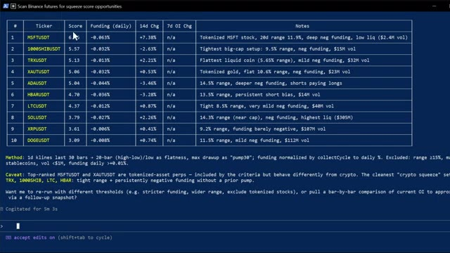
*⏱️ 00:08:25 — Un tableau de données affichant un scan des contrats futures sur Binance pour identifier des opportunités de 'squeeze score', listant différents tickers cryptos et tokenisés avec leurs scores et taux de financement.*

*⏱️ 00:08:35 — La page d'accueil de la plateforme d'échange Binance affichant le formulaire d'inscription et une offre de récompense de bienvenue allant jusqu'à 100 USD.*

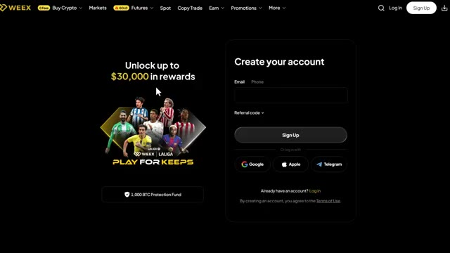
*⏱️ 00:08:44 — La page d'inscription de l'échange WEEX affichant une offre de récompense promotionnelle allant jusqu'à 30 000 $ en partenariat avec LaLiga.*

---

### ⏱️ `[00:08:54 - 00:09:13]` | Segment #21

**🔊 Audio (Transcription Intégrale Mot pour Mot en Français) :**
> Et si vous voulez voir une présentation complète de la façon dont Agent PNL fonctionne, de la manière de construire votre bot, de le mettre en ligne et de l'inscrire au classement, cliquez également sur la vidéo à l'écran. Si vous avez trouvé cela utile, laissez un pouce bleu, cela aide vraiment la chaîne, abonnez-vous si ce n'est pas déjà fait et je vous vois dans la prochaine !

**👁️ Analyse Visuelle d'Écran (gemini-3.5-flash-lite) :**
**Interface & Outils** : Aucune

**Contenu textuel & Code** : Aucun

**Action / Démonstration** : Aucune

---

